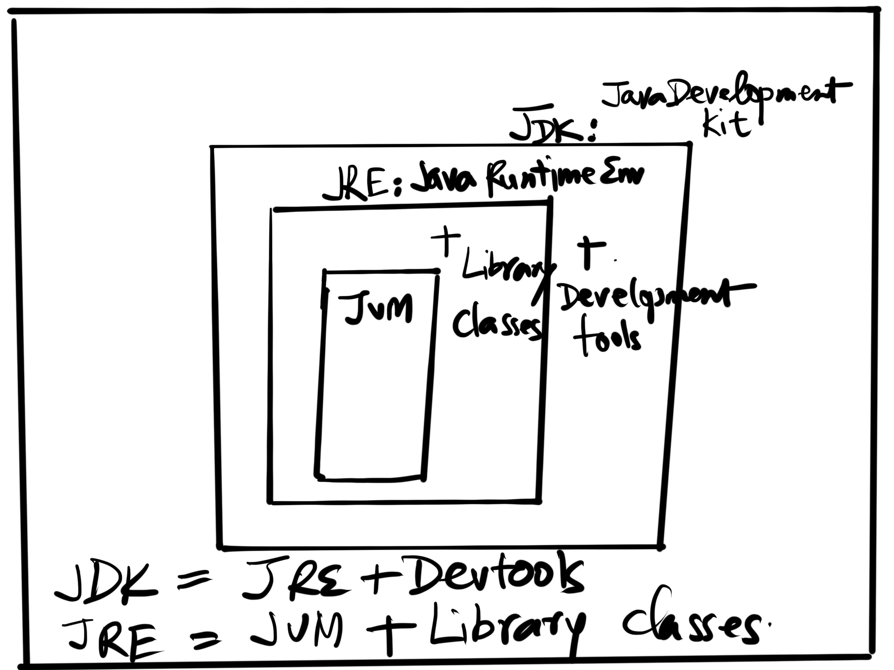
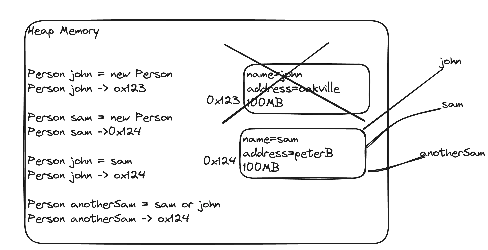

**Basic Java References** **(recommended reading)** 

 The students are strongly encouraged to read through and hand code the material here. Try all examples by hand to get better at Java programming.** 

 https://docs.oracle.com/javase/tutorial/getStarted/application/index.html

[**https://docs.oracle.com/javase/tutorial/java/index.html**](https://docs.oracle.com/javase/tutorial/java/index.html) 

### **JDK, JRE and JVM** 

 **JDK:** Java Development Kit (JDK) is a software development environment used for developing Java applications and applets. It includes the Java Runtime Environment (JRE), an interpreter/loader (Java), a compiler (javac), an archiver (jar), a documentation generator (Javadoc) and other tools needed in Java development. 

 **JRE:** The Java Runtime Environment provides the minimum requirements for executing a Java application; it consists of the Java Virtual Machine (JVM), core classes, and supporting files. 

It is: 

- A specification where working of Java Virtual Machine is specified. But implementation provider is independent to choose the algorithm. Its implementation has been provided by Sun and other companies. 

- An implementation is a computer program that meets the requirements of the JVM specification 

- Runtime Instance Whenever you write java command on the command prompt to run the java class, an instance of JVM is created 

 **JVM:** Java Virtual machine (JVM) is a very important part of both JDK and JRE because it is contained or inbuilt in both. Whatever Java program you run using JRE or JDK goes into JVM and JVM is responsible for executing the java program line by line hence it is also known as interpreter. 

Reference: https://www.baeldung.com/jvm-vs-jre-vs-jdk 



There is a difference between the Java Runtime Environment (JRE) and the Java Virtual Machine (JVM), and this distinction remains relevant in Java 17, as it does in other versions. Let's break down the differences:

### JVM (Java Virtual Machine)

- **Purpose**: The JVM is a specification that provides a runtime environment in which Java bytecode can be executed. It is responsible for interpreting the compiled Java bytecode and executing it as machine code on the host machine. The JVM acts as an intermediary between the compiled Java code and the hardware/operating system.
- **Components**:
  - **Class Loader**: Loads class files.
  - **Bytecode Verifier**: Ensures the loaded bytecode adheres to Java's security constraints.
  - **Interpreter**: Executes bytecode instructions.
  - **Just-In-Time Compiler (JIT)**: Compiles bytecode into native machine code at runtime for better performance.
  - **Garbage Collector**: Manages memory by reclaiming memory used by objects that are no longer reachable.
- **Portability**: The JVM provides platform independence, meaning that Java programs can run on any device or operating system that has a compatible JVM implementation.

### JRE (Java Runtime Environment)

- **Purpose**: The JRE is a package that provides all the necessary components to run Java applications. It includes the JVM, core libraries, and other components required to execute Java programs. The JRE does not contain development tools like compilers or debuggers; its primary role is to provide the runtime environment.
- **Components**:
  - **JVM**: The core component of the JRE that executes Java bytecode.
  - **Core Libraries**: Java Class Library (JCL) includes essential libraries and APIs required for running Java applications.
  - **Supporting Files**: Configuration files, property settings, etc.
- **Usage**: The JRE is used by end-users who need to run Java applications without developing them.

### Key Differences

1. **Function**:
   - The JVM is a specification and an implementation that provides an environment for executing Java bytecode.
   - The JRE is a distribution that includes the JVM and other necessary components to run Java applications.
2. **Scope**:
   - The JVM is focused solely on executing Java programs.
   - The JRE encompasses the JVM along with the core libraries and supporting files needed for running Java applications.
3. **Contents**:
   - The JVM includes components like the class loader, bytecode verifier, interpreter, JIT compiler, and garbage collector.
   - The JRE includes the JVM, core libraries, and additional components required for execution.

### Java 17 and Beyond

With Java 17, the concept of JRE and JVM remains consistent with previous versions. However, starting with Java 11, Oracle removed the separate JRE distribution, meaning that only the JDK (Java Development Kit) is officially provided. The JDK includes the JRE as part of its distribution, along with development tools like the Java compiler (`javac`).

In summary, the JVM and JRE are distinct but closely related components in the Java ecosystem. The JVM is the core engine that runs Java applications, while the JRE provides the complete runtime environment, including the JVM and necessary libraries.

**Languages** 

(statically typed vs dynamically typed languages) 

 Java – 

- OOPS
- Statically Typed ( you cannot assign Float to an Integer.. )
- Compiled language ( compiled at first, then at runtime, it will interpreted but could get compiled to machine code by the JIT compiler based on _ complexity or runtime usage (incoming load , more frequent branches of execution, underlying hardware architecture (OS, number of cores)) ) 
- Write Once Run Anywhere (platform independent) via Platform dependent JVMs shipped for each OS/Hardware combination, 
- Automatic Garbage collection, 
- Web Programming (Applets), [ Outdated now, not used, JavaFX provides the alternative].  
- Graal VM (produces binary images for better start-up times). [ADVANCED-TOPIC] 

https://hackernoon.com/i-finally-understand-static-vs-dynamic-typing-and-you-will-too-ad0c2bd0acc7 

Majorly two types of languages. First one is **Statically typed language** where each variable and expression type is already known at compile time. Once a variable is declared to be of a certain data type, it cannot hold values of other data types.Example: C,C++, Java. Other, **Dynamically typed languages:** These languages can receive different data types over time. Ruby, Python, Javascript 

**TODO**: discuss about the current state of affairs about the JAVA distributions 

EASY https://dzone.com/articles/java-and-the-jdks-which-one-to-use 

EASY [https://en.wikipedia.org/wiki/Java_version_history.  ](https://en.wikipedia.org/wiki/Java_version_history.)  
[ Java 5 – 2004, Java 8- 2014, ].   
https://semver.org/ 

MEDIUM https://dzone.com/articles/no-more-jre-packaging-no-big-deal-1 

**ORACLE JAVA TUTORIAL** 

**https://docs.oracle.com/javase/tutorial/java/javaOO/index.html** 

**First Example Classes** 

To define a class in Java use the **keywords** public class followed by a *ClassName*. Then the body of the class is enclosed in a starting { and ending } as shown below. 

```java
public class ClassName {

}
```


The following is an example class in Java. A class in Java can have fields (**data** or **properties**), **constructors** (ways to initialize the fields), **methods** (behaviors), and a main method for testing the class. It does not have to have any of these items. The following would compile, but what do you think would happen if you tried to have a computer execute it? 

```java
public class FirstClass {

}
```

The class FirstClass doesn’t have anything inside of it, so the computer wouldn’t know what to do if we asked it to execute the class. 

When you ask the Java run-time to *run* a class (java ClassName) it will start execution in the main method. Click on the *Run* button to have the computer execute the main method in the following class. 

```java
public class SecondClass { 
	public static void main(String[] args) { 
    System.out.println("Hi there!"); 
  } 
}
```


The class SecondClass isn’t very object-oriented. The only thing in it is the main method which is a **class method** (special method to let us run Java program), not an **object method** (one that works on the current object). 

**Fields - Instance Variables** 

Fields  hold the data for an object. Fields record what an object needs to know to do work in the program. Fields are also called **instance variables** or **object variables** or **properties**. 

**Constructors** 

 Constructors** don’t actually construct the object. The class makes the object and then executes a constructor to initialize the values of the fields (instance variables). You will only work with public constructors on the exam. 

**How to create object in Java** 

The **'new' operator** in java is responsible for the creation of new object or we can say instance of a class. Actually, it dynamically allocates memory in the heap with the reference we define pointed from the stack. The dynamically allocation is just means that the memory is allocated at the run time of the program 

https://docs.oracle.com/javase/tutorial/java/javaOO/constructors.html 

https://docs.oracle.com/javase/tutorial/java/javaOO/objectcreation.html 

 **Methods** 

 A Java method is a set of statements they are grouped together to perform an operator. Methods defined in a class defines what an object can do or the behavior of the object. One can say ‘method’ is the object-oriented word for ‘function’ 

 In Object Oriented Programing (for example: Java Language) we use Methods (Build-in and User Defined) 

https://docs.oracle.com/javase/tutorial/java/javaOO/methods.html 

https://www.geeksforgeeks.org/understanding-public-static-void-mainstring-args-in-java/ 

**Functions**  

In structured progrming languages (ex C Language) we use Functions (Build-in and User Defined). A function is independent of an object. 

 In Java we used to have methods only but with Java 8 lambda functions are supported that do not belongs to a particular class. 

 Java lambda** expressions are new in **Java** 8. **Java lambda** expressions are **Java's** first step into **functional programming.** A **Java lambda** expression is thus a **function** which can be created without belonging to any class. A **Java lambda** expression can be passed around as if it was an object and executed on demand. (Advance topic will discuss in few weeks) 

```java
public class Person { 

  // Fields
  private String name; 
  private String cell; 

  // Constructor
  public Person(String theName, String theCell) { 
    this.name = theName; 
    this.cell = theCell; 
  } 

  // Getter for name
  public String getName() { 
    return this.name; 
  } 

  // Setter for name
  public void setName(String theName) { 
    this.name = theName; 
  } 

  // Getter for cell
  public String getCell() { 
    return this.cell; 
  } 

  // Setter for cell
  public void setCell(String theCell) { 
    this.cell = theCell; 
  } 

  // toString method for displaying object information
  public String toString() { 
    return "name: " + this.name + ", cell: " + this.cell; 
  } 

  // Main method for testing
  public static void main(String[] args) { 
    Person p1 = new Person("Deja", "555 132-3253"); 
    System.out.println(p1); 
    Person p2 = new Person("Avery", "555 132-6632"); 
		System.out.println(p2); 
   } 
}
```
  **Java Data Types** 

There are two **types** of **data types** in **Java**: 

Primitive **data types**: The primitive **data types** include boolean, char, byte, short, int, long, float and double. 

Non-primitive **data types**: The non-primitive **data types** include Classes, Interfaces, Arrays and String. 


```java

public class DataTypesTest { 
  public static void main(String args[]) { 
    // Declaring a character
    char a = 'G'; 

    // Integer data type is generally used for numeric values
    int i = 89; 

    // Use byte and short if memory is a constraint
    byte b = 4; 

    // This will give an error as the number is larger than the byte range
    // byte b1 = 7888888955; 

    short s = 56; 

    // This will give an error as the number is larger than the short range
    // short s1 = 87878787878; 

    // By default, fraction value is double in Java
    double d = 4.355453532; 

    // For float, use 'f' as suffix
    float f = 4.7333434f; 

    // Outputting the values
    System.out.println("char: " + a);  
    System.out.println("integer: " + i);  
    System.out.println("byte: " + b);  
    System.out.println("short: " + s);  
    System.out.println("float: " + f);  
    System.out.println("double: " + d);  
   } 	 
}
```
**Java: What happens at compile time?** 

 At compile time, java file is compiled by Java Compiler (It does not interact with OS) and converts the java code into bytecode. 

 

**How is the Java platform independent ?** 

Java is **Platform Neutral** because the same Java code will run on multiple platforms (Operating Systems) without modification, provided that the code does not intentionally put any specific demands on the system, holding true to the slogan,**"Write Once, Run Anywhere"** . Java's platform independence consists mostly of its Java Virtual Machine (JVM), which is a well-specified and mature virtual machine. 

How does this work ? First, you write Java source file and compile it. When you compile Java source code, the results is a **.class file** that contains bytecode. The bytecode is the same no matter what platform you are on, provided that you are using **Java Virtual Machine (JVM)** which is platform dependent in nature. This JVM converts the byte code to machine code according to your original computer's machine architecture like x86,ARM etc. Java Virtual Machine (JVM) is of different type, according to computer system architecture, that means for x86 JVM will be different for ARM JVM. 


The **Platform Independence** is a very important feature in Java. It means that you can develop on one Operating System and run on another Operating system (Windows, Linux, OS X, BSD, various embedded systems) without doing very much porting of the code. It means that you can diverse client systems, with only one version of the client code. 

**Java: What happens at runtime?** 

At runtime, following steps are performed: 


Code written in Java is: 

- **First compiled** to bytecode by a program called *javac* as shown in the left section of the image above; 

- Then, as shown in the right section of the above image, another program called *java* starts the Java runtime environment and it may **compile and/or interpret** the bytecode by using the Java Interpreter/JIT Compiler.

**When does java interpret the bytecode and when does it compile it?** The application code is initially interpreted, but the JVM monitors which sequences of bytecode are frequently executed and translates them to machine code for direct execution on the hardware. For bytecode which is executed only a few times, this saves the compilation time and reduces the initial latency; for frequently executed bytecode, JIT compilation is used to run at high speed, after an initial phase of slow interpretation. Additionally, since a program spends most time executing a minority of its code, the reduced compilation time is significant. Finally, during the initial code interpretation, execution statistics can be collected before compilation, which helps to perform better optimization. 

#### Read this link for complete discussion 

 https://stackoverflow.com/questions/1326071/is-java-a-compiled-or-an-interpreted-programming-language 

 https://howtodoinjava.com/java/basics/java-classpath/ 

 Debugging in IntelliJ https://www.youtube.com/watch?v=1bCgzjatcr4


**Access Modifiers in java** 

 There are two types of modifiers in java: **access modifiers** and **non-access modifiers**. 

The access modifiers in java specifies accessibility (scope) of a data member, method, constructor or class. 

There are 4 types of java access modifiers: 

- private 
- default 
- protected 
- public 

There are many non-access modifiers such as ***static, abstract, synchronized, native, volatile, transient*** etc. Here, we will learn about access modifiers. Non-access modifiers will be discussed in later classes. 

**Private access modifier** 

The private access modifier is accessible only within class. 

Example of private access modifier 

In this example, we have created two classes A and Simple. A class contains private data member and private method. We are accessing these private members from outside the class, so there is compile time error. 


``

```java
package io.reactivestax; 

class A { 
 private int data = 40; 

 private void msg() { 
  System.out.println("Hello java"); 
 } 
} 

public class Simple { 
 public static void main(String args[]) { 
  A obj = new A(); 
  System.out.println(obj.data); // Compile Time Error   
  obj.msg(); // Compile Time Error   
 } 
} 
```

If you make any class constructor private, you cannot create the instance of that class from outside the class. For example: 

```java
package io.reactivestax; 

class A { 

 private A() {} // private constructor   

 void msg() { 
  System.out.println("Hello java"); 
 } 
} 

public class Simple { 

 public static void main(String args[]) { 
  A obj = new A(); // Compile Time Error   
 } 

} 
```

**Default access modifier:** If you don't use any modifier, it is treated as default by default. The default modifier is accessible only within package. 

 Example of default access modifier 

In this example, we have created two packages io.reactivestax and com.reactivestax. We are accessing the A class from outside its package, since A class is not public, so it cannot be accessed from outside the package. 

```java
package io.reactivestax; 

class A { 
  void msg() { 
    System.out.println("Hello"); 
  } 
}
```


```java
package com.reactivestax; 

import io.reactivestax.*; 

class B { 
  public static void main(String args[]) { 
    A obj = new A(); // Compile Time Error  
    obj.msg(); // Compile Time Error  
  } 
}
```


**Protected access modifier:** The protected access modifier is accessible within package and outside the package but through inheritance only. The protected access modifier can be applied on the data member, method and constructor. It can't be applied on the class 


```java
package io.reactivestax;

public class A { 

  protected void msg() { 
    System.out.println("Hello"); 
  } 

}
```

- **package io.reactivestax;**: This declares that the class `A` is part of the `io.reactivestax` package.
- **public class A**: The class `A` is declared public, which means it can be accessed from outside its package.
- **protected void msg()**: The `msg()` method is declared with the `protected` access modifier, meaning it can be accessed within its package and by subclasses.

#### 

```java
package io.reactivestax;
class B extends A { 
  public static void main(String args[]) { 
    B obj = new B(); 
    obj.msg(); 
  } 
}
```

**package io.reactivestax;**: This correctly declares that the class `B` is part of the `io.reactivestax` package. Note: The `package io.reactivestax.*;` statement in the original code is incorrect as `.*` is not valid syntax in a package declaration.

**class B extends A**: The class `B` extends `A`, inheriting its methods. Since `msg()` in `A` is `protected`, `B` can access it.

**public static void main(String args[])**: The `main` method is the entry point of the program. It creates an instance of `B` and calls the inherited `msg()` method, which prints "Hello" to the console.


#### **Public access modifier:** 

###### The public access modifier is accessible everywhere. It has the widest scope among all other modifiers. 

```java
package io.reactivestax;

public class A {
    public void msg() {
        System.out.println("Hello");
    }
}


package com.reactivestax;

import io.reactivestax.A;

class B {
    public static void main(String args[]) {
        A obj = new A();
        obj.msg();
    }
}
```


**Autoboxing and Unboxing** 

 **Autoboxing:** Converting a primitive value into an object of the corresponding wrapper class is called autoboxing. For example, converting int to Integer class. The Java compiler applies autoboxing when a primitive value is: 

- passed as a parameter to a method that expects an object of the corresponding wrapper class. 

- Assigned to a variable of the corresponding wrapper class. 

  

  Autoboxing in Java is the automatic conversion that the Java compiler makes between the primitive types and their corresponding object wrapper classes. For instance, converting an `int` to an `Integer`, a `double` to a `Double`, and so on. This feature was introduced in Java 5 to simplify the process of working with primitive types in contexts that require objects.

  Here's a simple example to illustrate autoboxing:

  ```java
  import java.util.ArrayList;
  import java.util.List;
  
  public class AutoboxingExample {
      public static void main(String[] args) {
          // Autoboxing: primitive int to Integer object
          int primitiveInt = 5;
          //Integer wrappedInt = new Integer(primitiveInt); // Autoboxing
  				Integer wrappedInt = primitiveInt; // Autoboxing
          // Autoboxing: primitive double to Double object
          double primitiveDouble = 10.5;
          Double wrappedDouble = primitiveDouble; // Autoboxing
      
          // Using autoboxing with collections
  				//pre-java7 
        	List<Integer> intList = new ArrayList<Integer>();
        	
          List<Integer> intList = new ArrayList<>(); //Java7 introduced diamond operator
          intList.add(primitiveInt); // Autoboxing from int to Integer
          intList.add(7); // Autoboxing from int to Integer
      
          // Printing values
          System.out.println("Wrapped int: " + wrappedInt);
          System.out.println("Wrapped double: " + wrappedDouble);
          System.out.println("List of Integers: " + intList);
      
          // Unboxing: converting Integer object back to primitive int
          int unboxedInt = wrappedInt; // Unboxing
          System.out.println("Unboxed int: " + unboxedInt);
      
          // Unboxing: converting Double object back to primitive double
          double unboxedDouble = wrappedDouble; // Unboxing
          System.out.println("Unboxed double: " + unboxedDouble);
      }
  
  }
  ```
  
  

 **Unboxing:** Converting an object of a wrapper type to its corresponding primitive value is called unboxing. For example, conversion of Integer to int. The Java compiler applies unboxing when an object of a wrapper class is:  

- Passed as a parameter to a method that expects a value of the corresponding primitive type. 
- Assigned to a variable of the corresponding primitive type. 


##### **Association, Composition and Aggregation** 

###### **Association** 

Association refers to the relationship between multiple objects. It refers to how objects are related to each other and how they are using each other's functionality. Composition and aggregation are two types of association. 

###### **Composition** 

The composition is the strong type of association. An association is said to composition if an Object owns another object and another object cannot exist without the owner object. The object only exists, or only makes sense inside the other, as a part of the other. Ex: People – heart. You don’t create a heart and then passes it to a person. 

Consider the case of Human having a heart. Here Human object contains the heart and heart cannot exist without Human. 

###### **Aggregation** 

Aggregation is a weak association. An association is said to be aggregation if both Objects can exist independently. The object exists outside the other, is created outside, so it is passed as an argument (for example) to the constructor. Ex: People – car. The car is create in a different context and then becomes a person property. 

For example, a Team object and a Player object. The team contains multiple players but a player can exist without a team. 

#### **Composition Example**  

```java
// Car must have Engine
public class Car { 
   // Engine is a mandatory part of the car
   private final Engine engine; 

   public Car() { 
      this.engine = new Engine(); 
   } 
} 
// Engine Object
class Engine {} 

// Person class
class Person { 
    private final Heart heart; 
    private final List<Hand> hands; 

    public Person() { 
        this.heart = new Heart(); 
        Hand leftHand = new Hand(); 
        Hand rightHand = new Hand(); 
        this.hands = new ArrayList<>(); 
        this.hands.add(leftHand); 
        this.hands.add(rightHand); 
    } 
    
    // Getter methods if needed
    public Heart getHeart() {
        return heart;
    }
    
    public List<Hand> getHands() {
        return hands;
    }
} 

// Hand class
class Hand {} 

// Heart class
class Heart {}
```

```java
public class WebServer { 

    private HttpListener listener; 
    private RequestProcessor processor; 
    
    public WebServer() { 
        this.listener = new HttpListener(80); 
        this.processor = new RequestProcessor("/www/root"); 
    }
    
    // Additional methods for starting, stopping, and managing the server can be added here

}
```

##### **Aggregation Example** 

```java
import java.util.List;

public class Team {       

   // players can be 0 or more
   private List<Player> players;

   public Team(List<Player> newPlayers) { 
      this.players = newPlayers;
   }

   // Getter for players if needed
   public List<Player> getPlayers() {
      return players;
   }
} 

// Player Object
class Player {}
```

```java

```

```java
public class WebServer { 

    private HttpListener listener; 
    private RequestProcessor processor; 
    
    public WebServer(HttpListener listener, RequestProcessor processor) { 
        this.listener = listener; 
        this.processor = processor; 
    }
    
    // Example method to start the server
    public void start() {
        // Code to start the server
    }
    
    // Example method to stop the server
    public void stop() {
        // Code to stop the server
    }

} 

// Example classes
class HttpListener {
    private int port;

    public HttpListener(int port) {
        this.port = port;
    }
    
    public int getPort() {
        return port;
    }

}

class RequestProcessor {
    private String rootPath;

    public RequestProcessor(String rootPath) {
        this.rootPath = rootPath;
    }
    
    public String getRootPath() {
        return rootPath;
    }

}
```

**Summary** 

- In composition (Person, Heart, Hand), "sub objects" (Heart, Hand) will be destroyed as soon as Person is destroyed.  
- In composition (Car, Engine), "sub objects" (Engine) will be destroyed as soon as Car is destroyed.  
- In aggregation (City, Tree, Car) "sub objects" (Tree, Car) will NOT be destroyed when City is destroyed. 
- In aggregation (Team, Player) "sub objects" (Player, will NOT be destroyed when Team is destroyed. 

The bottom line is, composition stresses on mutual existence, and in aggregation, this property is NOT required. 

**Classloaders and Hierarchy** 

 **Bootstrap Classloader:** Whenever a new JVM is started the bootstrap classloader is responsible to load key Java classes (from java.lang package) and other runtime classes to the memory first. The bootstrap classloader is a parent of all other classloaders. Consequently, it is the only one without a parent. 

 **Extension Classloader:** It has the bootstrap classloader as parent and is responsible for loading classes from all .jar files kept in the java.ext.dirs path–these are available regardless of the JVM’s classpath. 

 **System classpath Classloader:** The third and most important classloader from a developer’s perspective is the system classpath classloader, which is an immediate child of the extension classloader. It loads classes from directories and jar files specified by the CLASSPATH environment variable, java.class.pathsystem property or -classpath command line option. 

Note that the classloader hierarchy is not an inheritance hierarchy, but a delegation hierarchy. Most classloaders delegate finding classes and resources to their parent before searching their own classpath. If the parent classloader cannot find a class or resource, only then does the classloader attempt to find them locally. In effect, a classloader is responsible for loading only the classes not available to the parent; classes loaded by a classloader higher in the hierarchy cannot refer to classes available lower in the hierarchy. 


- http://www2.informatik.tu-muenchen.de/lehre/vorlesungen/WS07/security/L07.pdf 
- https://www.ibm.com/support/knowledgecenter/en/SSYKE2_7.0.0/com.ibm.java.lnx.70.doc/diag/understanding/class_loader.html

## What is Object Oriented Programming (OOP)?

Object Oriented Programming (OOP) is a programming paradigm that focuses on the use of objects to represent and manipulate data. In OOP, data is encapsulated within objects, and objects are defined by their properties (attributes) and behaviors (methods). OOP provides several key concepts that enable developers to write modular, reusable, and maintainable code.


## Definition of OOP Concepts in Java

The main ideas behind Java’s Object-Oriented Programming, OOP concepts include [**abstraction**](https://stackify.com/oop-concept-abstraction/)**,** [**encapsulation**](https://stackify.com/oop-concept-for-beginners-what-is-encapsulation/), [**inheritance**](https://stackify.com/oop-concept-inheritance/) and[ **polymorphism**](https://stackify.com/oop-concept-polymorphism/). Basically, Java OOP concepts let us create working methods and variables, then re-use all or part of them without compromising security. Grasping OOP concepts is key to understanding how Java works.

Java defines OOP concepts as follows:

- **Abstraction.** Using simple things to represent complexity. We all know how to turn the TV on, but we don’t need to know how it works in order to enjoy it. In Java, abstraction means simple things like **objects**, **classes** and **variables** represent more complex underlying code and data. This is important because it lets you avoid repeating the same work multiple times.
- **Encapsulation.** The practice of keeping fields within a class private, then providing access to those fields via public methods. Encapsulation is a protective barrier that keeps the data and code safe within the class itself. We can then reuse objects like code components or variables without allowing open access to the data system-wide.
- **Inheritance.** A special feature of Object-Oriented Programming in Java, Inheritance lets programmers create new classes that share some of the attributes of existing classes. Using Inheritance lets us build on previous work without reinventing the wheel.
- **Polymorphism.** Allows programmers to use the same word in Java to mean different things in different contexts. One form of polymorphism is **method overloading**. That’s when the code itself implies different meanings. The other form is **method overriding**. That’s when the values of the supplied variables imply different meanings. Let’s delve a little further.

## How OOP Concepts in Java Work

OOP concepts in Java work by letting programmers create components that are reusable in different ways while maintaining security.

### How Abstraction Works

Abstraction lets programmers create useful and reusable tools. It enables programmers to create complex systems by breaking them down into smaller, more manageable components. For example, a programmer can create several different types of **objects**, which can be variables, functions or data structures. Programmers can also create different **classes** of objects as ways to define the objects.

For instance, a class of variable might be an address. The class might specify that each address object shall have a name, street, city and zip code. The objects, in this case, might be employee addresses, customer addresses or supplier addresses. In addition, abstraction provides a mechanism for hiding the implementation details of a class or method from the outside world and providing a simplified interface for clients to interact with. In Java, you can achieve abstraction through two main mechanisms: abstract classes and interfaces.

1. **Abstract Classes:** An abstract class is a class that you can’t instantiate and can only extend by subclasses. Abstract classes can have both abstract and non-abstract methods. Abstract methods do not have a body and you must implement them by any subclass that extends the abstract class. Non-abstract methods have a body and you can directly call them by the subclass.
2. **Interfaces:** An interface is a collection of methods. You can use it to define a set of behaviors that a class should implement. A class can implement multiple interfaces, and all the methods defined in an interface must be implemented by any class that implements it.


### How Encapsulation Works

Encapsulation lets us reuse functionality without jeopardizing security. It’s a powerful, time-saving OOP concept in Java. For example, we may create a piece of code that calls specific data from a database. It may be useful to reuse that code with other databases or processes. Encapsulation lets us do that while keeping our original data private. It also lets us alter our original code without breaking it for others who have adopted it in the meantime.

Encapsulation provides several benefits, including:

1. **Data hiding:** By hiding the implementation details of a class, encapsulation protects the data from unauthorized access and manipulation.
2. **Modularity:** Encapsulation helps to break down complex systems into smaller, more manageable components, making the codebase more modular and easier to maintain.
3. **Flexibility:** By providing a controlled interface for interacting with a class, encapsulation allows for changes to the internal implementation without affecting the external interface.

### Access Modifiers

In Java, encapsulation is implemented using access modifiers, which control the visibility of variables and methods within a class.

The three access modifiers in Java are:

1. **Public:** Public variables and methods can be accessed from anywhere, including outside the class.
2. **Private:** Private variables and methods can only be accessed within the class they are defined in.
3. **Protected:** Protected variables and methods can be accessed within the same class and its subclasses.

Encapsulation enables developers to write cleaner, more organized, and more secure code. By controlling access to variables and methods, encapsulation promotes good software design practices and helps to manage the complexity of large-scale projects.

### How Inheritance Works

Inheritance is another labor-saving Java OOP concept that works by letting a new class adopt the properties of another. We call the inheriting class a **subclass** or a **child class**. The original class is often called the **parent** or the **superclass**. We use the keyword **extends** to define a new class that inherits properties from an old class.

The subclass inherits all the public and protected variables and methods of the superclass, and it can also define its own variables and methods. This makes it possible to create a hierarchy of classes, where each subclass inherits from its superclass and adds its own unique features.

### Benefits of Inheritance

Inheritance provides several benefits, including:

1. **Reusability:** By inheriting from a superclass, a subclass can reuse the code and functionality already defined in the superclass, making it easier to write and maintain code.
2. **Polymorphism:** Inheritance allows for polymorphism, where objects of different subclasses can be treated as objects of the same superclass, making it easier to write generic code.
3. **Flexibility:** Inheritance provides a way to add new features to an existing class hierarchy without modifying the existing code.

Inheritance allows developers to create complex class hierarchies with shared functionality and unique features. By promoting code reuse, polymorphism, and flexibility, inheritance enables developers to write more efficient and maintainable code.

Inheritance is a fundamental concept in object-oriented programming that allows one class (the subclass or derived class) to inherit the properties and behaviors (methods and fields) of another class (the superclass or base class). This promotes code reuse and establishes a hierarchical relationship between classes.

### Example of Inheritance in Java

Let's consider a simple example involving a base class `Vehicle` and a derived class `Car`.

```java
// Base class (Superclass)
class Vehicle {
    // Fields
    protected String brand;
    protected int speed;

    // Constructor
    public Vehicle(String brand, int speed) {
        this.brand = brand;
        this.speed = speed;
    }

    // Method to display vehicle details
    public void displayInfo() {
        System.out.println("Brand: " + brand);
        System.out.println("Speed: " + speed + " km/h");
    }

    // Method to accelerate
    public void accelerate() {
        speed += 10;
        System.out.println("The vehicle accelerates. Speed: " + speed + " km/h");
    }
}

// Derived class (Subclass)
class Car extends Vehicle {
    // Additional field
    private int doors;

    // Constructor
    public Car(String brand, int speed, int doors) {
        super(brand, speed); // Call the constructor of the superclass
        this.doors = doors;
    }

    // Overriding the displayInfo method
    @Override
    public void displayInfo() {
        super.displayInfo(); // Call the displayInfo method of the superclass
        System.out.println("Number of doors: " + doors);
    }

    // New method specific to Car
    public void honk() {
        System.out.println("The car honks: Beep! Beep!");
    }
}

// Main class to test the inheritance
public class Main {
    public static void main(String[] args) {
        // Creating an object of the Car class
        Car myCar = new Car("Toyota", 120, 4);

        // Calling methods
        myCar.displayInfo(); // Calls the overridden method in Car
        myCar.accelerate(); // Inherited from Vehicle
        myCar.honk(); // Specific to Car
    }
}
```

### Explanation

1. **Base Class (`Vehicle`)**:
   - This class has two fields, `brand` and `speed`, representing common attributes of vehicles.
   - It includes a constructor, a method `displayInfo()` to display the vehicle's details, and a method `accelerate()` to increase the vehicle's speed.

2. **Derived Class (`Car`)**:
   - This class extends `Vehicle`, inheriting its fields and methods.
   - It adds an additional field, `doors`, to represent the number of doors in the car.
   - It overrides the `displayInfo()` method to include details specific to the car, such as the number of doors.
   - It includes a new method, `honk()`, that is specific to the `Car` class.

3. **Main Class (`Main`)**:
   - An object of the `Car` class is created, and its methods are called. The `Car` class inherits methods and fields from `Vehicle` and can override or extend its functionality.

This example demonstrates the basic concept of inheritance in Java, where the `Car` class inherits properties and behaviors from the `Vehicle` class and can also introduce new features specific to cars.

### How Polymorphism Works

Yes, method overriding is a type of polymorphism in Java, specifically a form of **runtime polymorphism**.

### Polymorphism in Java

Polymorphism is a core concept in object-oriented programming that allows objects to be treated as instances of their parent class. There are two types of polymorphism in Java:

1. **Compile-time Polymorphism (Static Polymorphism)**: Achieved through method overloading.
2. **Runtime Polymorphism (Dynamic Polymorphism)**: Achieved through method overriding.

### Method Overriding

Method overriding occurs when a subclass provides a specific implementation for a method that is already defined in its superclass. The overridden method in the subclass must have the same name, return type, and parameters as the method in the superclass.

When an overridden method is called on an object, the subclass's version of the method is executed. This is determined at runtime based on the actual object's type, hence the term runtime polymorphism.

#### Example

```java
class Animal {
    void makeSound() {
        System.out.println("Some generic animal sound");
    }
}

class Dog extends Animal {
    @Override
    void makeSound() {
        System.out.println("Bark");
    }
}

class Cat extends Animal {
    @Override
    void makeSound() {
        System.out.println("Meow");
    }
}

public class TestPolymorphism {
    public static void main(String[] args) {
        Animal myDog = new Dog();
        Animal myCat = new Cat();

        myDog.makeSound(); // Outputs: Bark
        myCat.makeSound(); // Outputs: Meow
    }
}
```

In the example above:
- The `Animal` class defines a method `makeSound()`.
- The `Dog` and `Cat` subclasses override the `makeSound()` method to provide specific behavior.
- At runtime, the JVM determines which `makeSound()` method to call based on the actual object type (`Dog` or `Cat`), demonstrating runtime polymorphism.

Method overriding allows Java to support runtime polymorphism, enabling more flexible and reusable code. It allows objects of different types to be handled using a common interface, while the specific implementation is determined at runtime.

### Benefits of Polymorphism

Polymorphism provides several benefits, including:

1. **Flexibility:** Polymorphism allows for more flexible and adaptable code by enabling objects of different classes to be treated as if they are of the same class.
2. **Code reuse:** Polymorphism promotes code reuse by allowing classes to inherit functionality from other classes and to share common methods and properties.
3. **Simplification:** Polymorphism simplifies code by enabling the use of generic code that can handle different types of objects.

Polymorphism allows for more flexible and adaptable code. By enabling objects of different classes to be treated as if they are of the same class, polymorphism promotes code reuse, simplification, and flexibility, making it an essential component of Object-Oriented Programming.


Now that we explained the foundational OOP concepts in Java, let’s look at a few common examples.

### Short Encapsulation Example in Java

In the example below, [encapsulation](https://www.javatpoint.com/encapsulation) is demonstrated as an OOP concept in Java. Here, the variable “name” is kept private or “encapsulated.”

```java
//save as Student.java
package com.javatpoint;
public class Student {
 private String name;
 public String getName() {
  return name;
 }
 public void setName(String name) {
  this.name = name
 }
}
//save as Test.java
package com.javatpoint;
class Test {
 public static void main(String[] args) {
  Student s = new Student();
  s.setName(“vijay”);
  System.out.println(s.getName());
 }
}
Compile By: javac -d . Test.java
Run By: java com.javatpoint.Test

Output: vijay
```


### Example of Inheritance in Java

It’s quite simple to achieve inheritance as an OOP concept in Java. Inheritance can be as easy as using the **extends** keyword:

```java
class Mammal {

}
class Aardvark extends Mammal {

}
```

### Short Example of Polymorphism in Java

In the example below of polymorphism as an OOP concept in Java, we have two classes: Person and Employee. The Employee class inherits from the Person class by using the keyword **extends**. Here, the child class overrides the parent class. For the full example, [see this blog post](http://www.sitesbay.com/java/java-polymorphism).

```java
class Person {
 void walk() {
  System.out.println(“Can Run….”);
 }
}
class Employee extends Person {
 void walk() {
  System.out.println(“Running Fast…”);
 }
 public static void main(String arg[]) {
  Person p = new Employee(); //upcasting
  p.walk();
 }
}
```

## Differences between OOP and other programming styles

Object-Oriented Programming (OOP) has become widely popular due to its many advantages over other programming styles such as Procedural Programming and Functional Programming.

### Procedural Programming

**Procedural Programming** is a programming style that is based on a set of procedures or functions, where each function is a sequence of instructions that performs a specific task. It focuses on the sequence of must-follow steps that to accomplish a specific task. In contrast, OOP focuses on the objects and their interactions to solve problems.

### Functional Programming

**Functional Programming** is a programming style that focuses on the use of functions that produce output based on their input, without modifying any external state. It is based on mathematical functions and is characterized by immutability and statelessness. In contrast, OOP is based on objects and their states, and it is designed to manage complex, stateful systems.

### Benefits of OOP over other programming

Here are some key differences between OOP and other programming styles:

1. **Data and behavior:** OOP is based on the idea of encapsulating data and behavior within objects, whereas procedural programming separates data and behavior into different functions or procedures. Functional programming, on the other hand, treats data and behavior as separate entities altogether.
2. **Inheritance and code reuse:** OOP uses inheritance to reuse code and build complex systems. Procedural programming and functional programming do not have inheritance concepts built into them.
3. **Flexibility:** OOP is more flexible than procedural programming because it allows for changes to be made to the underlying data structures and objects without changing the entire system. In contrast, procedural programming requires a complete restructuring of the program if any changes are made.

OOP enables encapsulation, inheritance, code reusability, and flexibility, making it a powerful tool for building complex, stateful systems.

## Best Practices for OOP Concepts in Java

The goal of OOP concepts in Java is to save time without sacrificing security and ease of use. The following best practices are all oriented toward advancing that main goal.

- **DRY (Don’t Repeat Yourself).** A core concept in Java, DRY simply means you should never have two blocks of identical code in two different places. Instead, have one method you use for different applications.
- If you expect your Java code to change in the future, encapsulate it by making all variables and methods private at the outset. As the code changes, increase access to **“protected”** as needed, but not too **public.**
- **Single Responsibility.** This best practice principle for OOP concepts in Java states that a class should always have only one functionality. That way, the class can be called and/or extended on its own when new uses arise for it, without causing **coupling** between different functionalities.
- **Open Closed Design.** Make all methods and classes Closed for modification but Open for an extension. That way, tried and tested code can remain static but can be modified to perform new tasks as needed.

For a good, full list of best practices for OOP concepts in Java, [see this blog post](https://javarevisited.blogspot.com/2012/03/10-object-oriented-design-principles.html). 


#### **<u>Control flow statements</u>**

Control flow statements in Java dictate the order in which statements, instructions, or function calls are executed or evaluated. Here are some examples of different control flow statements:

### 1. **If-Else Statement**

The `if-else` statement executes a block of code if a specified condition is true. Otherwise, it executes another block of code.

```java

int num = 10;

if (num > 0) {
    System.out.println("The number is positive.");
} else {
    System.out.println("The number is not positive.");
}
```

### 2. **Switch Statement**

The `switch` statement allows a variable to be tested for equality against a list of values.

```java

int day = 3;
String dayName;

switch (day) {
    case 1:
        dayName = "Monday";
        break;
    case 2:
        dayName = "Tuesday";
        break;
    case 3:
        dayName = "Wednesday";
        break;
    default:
        dayName = "Invalid day";
        break;
}

System.out.println(dayName);
```

### 3. **For Loop**

The `for` loop is used to execute a block of code a specific number of times.

```java

for (int i = 0; i < 5; i++) {
    System.out.println("Iteration: " + i);
}
```

### 4. **While Loop**

The `while` loop continues to execute a block of code as long as a specified condition is true.

```java

int i = 0;

while (i < 5) {
    System.out.println("Iteration: " + i);
    i++;
}
```

### 5. **Do-While Loop**

The `do-while` loop is similar to the `while` loop, but it guarantees that the block of code will be executed at least once.

```java

int i = 0;

do {
    System.out.println("Iteration: " + i);
    i++;
} while (i < 5);
```

### 6. **Break Statement**

The `break` statement is used to exit a loop or switch statement prematurely.

```java

for (int i = 0; i < 5; i++) {
    if (i == 3) {
        break;
    }
    System.out.println("Iteration: " + i);
}
```

### 7. **Continue Statement**

The `continue` statement skips the current iteration of a loop and proceeds with the next iteration.

```java

for (int i = 0; i < 5; i++) {
    if (i == 2) {
        continue;
    }
    System.out.println("Iteration: " + i);
}
```

These are some of the common control flow statements in Java. They are fundamental for controlling the flow of execution in your programs.


### Java Interfaces

##### Interfaces in Java are a powerful feature that allows you to define/enforce a contract that other classes can implement. Any concrete class that implements the interface has to implement all its methods or declare itself abstract. 

##### This helps in achieving abstraction and multiple inheritance in Java.

#### 1. **What is an Interface?**

An interface in Java is a reference type, similar to a class, that can contain only constants, method signatures, default methods, static methods, and nested types. Interfaces cannot contain instance fields or constructors. 

#### 2. **Why Use Interfaces?**

- **Abstraction**: Interfaces allow you to define methods that should be implemented by any class that claims to implement the interface. This helps in hiding the implementation details from the user.
  
- **Multiple Inheritance**: Java does not support multiple inheritance with classes, but you can achieve it with interfaces, as a class can implement multiple interfaces.

- **Loose Coupling**: Interfaces allow you to decouple your code. For example, you can change the implementation of a class without affecting the code that uses the interface.

#### 3. **Declaring an Interface**

Here's how you declare an interface in Java:

```java
interface Animal {
    void makeSound(); // abstract method
    void eat();       // abstract method
}
```

#### 4. **Implementing an Interface**

A class that implements an interface must provide implementations for all the methods declared in the interface:

```java
class Dog implements Animal {
    public void makeSound() {
        System.out.println("Bark");
    }

    public void eat() {
        System.out.println("Dog is eating");
    }
}
```

#### 5. **Using an Interface**

You can create an object of the implementing class and call the methods defined by the interface:

```java
public class Main {
    public static void main(String[] args) {
        Animal myDog = new Dog();
        myDog.makeSound(); // Outputs: Bark
        myDog.eat();       // Outputs: Dog is eating
    }
}
```

#### 6. **Default Methods in Interfaces**  (review during Java8 discussion again)

Java 8 introduced default methods, which allow you to add new methods to interfaces without breaking the existing code. Default methods have a body and can be overridden by implementing classes.

```java
interface Animal {
    void makeSound();
    void eat();

    default void sleep() {
        System.out.println("Sleeping");
    }
}

class Dog implements Animal {
    public void makeSound() {
        System.out.println("Bark");
    }

    public void eat() {
        System.out.println("Dog is eating");
    }
}
```

In this example, the `Dog` class can use the `sleep()` method without needing to implement it:

```java
public class Main {
    public static void main(String[] args) {
        Animal myDog = new Dog();
        myDog.makeSound(); // Outputs: Bark
        myDog.eat();       // Outputs: Dog is eating
        myDog.sleep();     // Outputs: Sleeping
    }
}
```

#### 7. **Static Methods in Interfaces **(review during Java8 discussion again)

Java 8 also introduced static methods in interfaces, which belong to the interface itself rather than to instances of the interface.

```java
interface Animal {
    void makeSound();
    void eat();

    static void describe() {
        System.out.println("Animals are living beings.");
    }
}
```

You can call the static method using the interface name:

```java
public class Main {
    public static void main(String[] args) {
        Animal.describe(); // Outputs: Animals are living beings.
    }
}
```

#### 8. **Multiple Interfaces**

A class can implement multiple interfaces, allowing you to build flexible and reusable code:

```java
interface Animal {
    void makeSound();
}

interface Pet {
    void play();
}

class Dog implements Animal, Pet {
    public void makeSound() {
        System.out.println("Bark");
    }

    public void play() {
        System.out.println("Playing fetch");
    }
}
```

Here, `Dog` implements both `Animal` and `Pet`, and must provide implementations for all methods in both interfaces.

#### 9. **Interface vs Abstract Class**

- **Abstract Class**: Can have instance variables, constructors, and can define some methods with implementation.
- **Interface**: Cannot have instance variables or constructors, and traditionally cannot have method implementations (except for default and static methods introduced in Java 8).

Use an abstract class when you need to share code among several related classes, and use an interface when you expect that unrelated classes would implement your interface.

### Summary

- Interfaces define methods that classes can implement.
- Classes can implement multiple interfaces, which is a way to achieve multiple inheritance in Java.
- Interfaces promote loose coupling and provide a way to build scalable and maintainable systems.


Abstract class vs Interface

- **Interface allows the developer to enforce a contract (behaviour) on implementing classes.**
  VS
- **Abstract class allows you to pass on partial implementations to the extending classes.** 

### Java Abstract Classes

Abstract classes in Java are a way to define classes that cannot be instantiated on their own and are meant to be extended by other classes. They serve as a blueprint for other classes and can provide partial implementation that other classes can build upon.

#### 1. **What is an Abstract Class?**

An abstract class is a class that is declared with the `abstract` keyword. It can have both abstract methods (methods without a body) and concrete methods (methods with a body). Abstract classes cannot be instantiated, meaning you cannot create an object directly from an abstract class.

#### 2. **Why Use Abstract Classes?**

- **Abstraction**: Abstract classes allow you to define a template for other classes. You can declare methods that must be implemented by subclasses while also providing some common functionality that all subclasses will inherit.
  
- **Code Reusability**: Abstract classes allow you to implement methods that are common to all subclasses, reducing code duplication.

- **Partial Implementation**: You can provide some methods with a body in an abstract class and leave the rest for the subclasses to implement.

#### 3. **Declaring an Abstract Class**

To declare an abstract class in Java, use the `abstract` keyword:

```java
abstract class Animal {
    abstract void makeSound(); // abstract method
    
    void eat() { // concrete method
        System.out.println("This animal is eating");
    }
}
```

#### 4. **Extending an Abstract Class**

A class that extends an abstract class must provide implementations for all abstract methods of the abstract class:

```java
class Dog extends Animal {
    void makeSound() {
        System.out.println("Bark");
    }
}
```

#### 5. **Using an Abstract Class**

You cannot create an instance of an abstract class directly, but you can create an instance of a subclass that implements all abstract methods:

```java
public class Main {
    public static void main(String[] args) {
        Animal myDog = new Dog();
        myDog.makeSound(); // Outputs: Bark
        myDog.eat();       // Outputs: This animal is eating
    }
}
```

#### 6. **Abstract Methods**

Abstract methods are methods declared in an abstract class without an implementation (no body). Subclasses must provide the implementation for these methods:

```java
abstract class Animal {
    abstract void makeSound(); // no body
}
```

When a class extends this abstract class, it must implement the `makeSound` method:

```java
class Cat extends Animal {
    void makeSound() {
        System.out.println("Meow");
    }
}
```

#### 7. **Concrete Methods in Abstract Classes**

Abstract classes can also have concrete methods (methods with a body). These methods can be inherited by subclasses:

```java
abstract class Animal {
    abstract void makeSound();
    
    void sleep() {
        System.out.println("This animal is sleeping");
    }
}
```

Subclasses can use the `sleep` method without needing to override it, though they can choose to override it if necessary.

#### 8. **Constructors in Abstract Classes**

Abstract classes can have constructors, which are called when a subclass is instantiated:

```java
abstract class Animal {
    String name;

    Animal(String name) {
        this.name = name;
    }

    abstract void makeSound();

    void sleep() {
        System.out.println(name + " is sleeping");
    }
}
```

When a subclass extends this abstract class, it must call the constructor of the abstract class:

```java
class Dog extends Animal {
    Dog(String name) {
        super(name);
    }

    void makeSound() {
        System.out.println("Bark");
    }
}
```

#### 9. **Abstract Class vs Interface**

- **Abstract Class**: Can have instance variables, constructors, and both abstract and concrete methods. It allows you to provide some common code implementation.
- **Interface**: Traditionally, only method signatures (abstract methods) and constants were allowed, but Java 8 introduced default and static methods. Interfaces don't have instance variables or constructors.

Use an abstract class when you want to share code among several related classes. Use an interface when you expect that unrelated classes will implement your interface.

#### 10. **Example: Abstract Class in Action**

```java
abstract class Vehicle {
    abstract void start();

    void fuelUp() {
        System.out.println("Fueling up the vehicle");
    }
}

class Car extends Vehicle {
    void start() {
        System.out.println("Car is starting with key ignition");
    }
}

class Motorcycle extends Vehicle {
    void start() {
        System.out.println("Motorcycle is starting with kickstart");
    }
}

public class Main {
    public static void main(String[] args) {
        Vehicle myCar = new Car();
        myCar.start();   // Outputs: Car is starting with key ignition
        myCar.fuelUp();  // Outputs: Fueling up the vehicle

        Vehicle myBike = new Motorcycle();
        myBike.start();  // Outputs: Motorcycle is starting with kickstart
        myBike.fuelUp(); // Outputs: Fueling up the vehicle
    }
}
```

In this example, `Vehicle` is an abstract class with one abstract method `start()` and one concrete method `fuelUp()`. The `Car` and `Motorcycle` classes extend `Vehicle` and provide their own implementation of the `start()` method.

### Summary

- Abstract classes are classes that cannot be instantiated and are meant to be extended by other classes.
- They can contain both abstract methods (without implementation) and concrete methods (with implementation).
- Abstract classes provide a way to define a common interface for a group of related classes, while allowing code reuse through concrete methods.


**<u>Calculator with interfaces and Abstract classes -</u>** 

Here's how you can design a simple calculator using interfaces and abstract classes in Java, while ensuring it handles basic arithmetic operations and invalid operations like division by zero.

### Step 1: Define the Interface

We'll define an interface `Operation` that will declare a method for performing the operation.

```java
interface Operation {
    double calculate(double a, double b);
}
```

### Step 2: Create an Abstract Class

We'll create an abstract class `AbstractOperation` that implements the `Operation` interface. This class can be used as a base class for all specific operations.

```java
abstract class AbstractOperation implements Operation {
    @Override
    public abstract double calculate(double a, double b);
    
    protected void validate(double b) {
        // Method to validate the second operand, useful for division by zero.
    }
}
```

### Step 3: Implement Concrete Classes for Each Operation

Now, let's create concrete classes for each arithmetic operation: addition, subtraction, multiplication, and division.

#### Addition

```java
class Addition extends AbstractOperation {
    @Override
    public double calculate(double a, double b) {
        return a + b;
    }
}
```

#### Subtraction

```java
class Subtraction extends AbstractOperation {
    @Override
    public double calculate(double a, double b) {
        return a - b;
    }
}
```

#### Multiplication

```java
class Multiplication extends AbstractOperation {
    @Override
    public double calculate(double a, double b) {
        return a * b;
    }
}
```

#### Division

```java
class Division extends AbstractOperation {
    @Override
    public double calculate(double a, double b) {
        validate(b);
        return a / b;
    }

    @Override
    protected void validate(double b) {
        if (b == 0) {
            throw new ArithmeticException("Cannot divide by zero.");
        }
    }
}
```

### Step 4: Create the Calculator Class

The `Calculator` class will use these operation classes to perform calculations.

```java
class Calculator {
    public double performOperation(Operation operation, double a, double b) {
        return operation.calculate(a, b);
    }
}
```

### Step 5: Using the Calculator

Now, you can use the `Calculator` class to perform different operations.

```java
public class Task {
    public static void main(String[] args) {
        Calculator calculator = new Calculator();

        double num1 = 10;
        double num2 = 5;

        Operation addition = new Addition();
        Operation subtraction = new Subtraction();
        Operation multiplication = new Multiplication();
        Operation division = new Division();

        System.out.println("Addition: " + calculator.performOperation(addition, num1, num2));
        System.out.println("Subtraction: " + calculator.performOperation(subtraction, num1, num2));
        System.out.println("Multiplication: " + calculator.performOperation(multiplication, num1, num2));
        System.out.println("Division: " + calculator.performOperation(division, num1, num2));

        // Uncomment the following line to test division by zero
        // System.out.println("Division by zero: " + calculator.performOperation(division, num1, 0));
    }
}
```

### Explanation

1. **Interface (`Operation`)**: Declares a method `calculate(double a, double b)` to perform an operation on two operands.
   
2. **Abstract Class (`AbstractOperation`)**: Implements the `Operation` interface and provides a `validate` method to handle cases like division by zero.
   
3. **Concrete Classes (`Addition`, `Subtraction`, `Multiplication`, `Division`)**: Implement specific operations by overriding the `calculate` method.
   
4. **Calculator Class**: This class is responsible for performing operations by accepting an `Operation` object and applying it to the given operands.

5. **Main Method (`Task.java`)**: Demonstrates how to use the `Calculator` class to perform basic arithmetic operations and handle division by zero.

This design pattern provides flexibility and encapsulation, allowing you to easily add more operations in the future without modifying the existing code.

Let's consider a real-life example of a **payment processing system** for an e-commerce platform. This system needs to handle different payment methods such as credit cards, PayPal, and bank transfers. Each payment method has specific steps but also shares some common behaviors.

### Step 1: Define the Interface .

We'll start by defining a `PaymentMethod` interface that declares the essential method for processing a payment.

```java
interface PaymentMethod {
    void processPayment(double amount);
}
```

### Step 2: Create an Abstract Class with Default Implementations

Next, we'll create an abstract class `AbstractPaymentMethod` that implements the `PaymentMethod` interface. This class will include some default implementations and behaviors that are common to all payment methods.

```java
abstract class AbstractPaymentMethod implements PaymentMethod {
    @Override   // it gives you overall business flow/algorithm for payment processing.
    public void processPayment(double amount) {
        if (validatePayment(amount)) {  //1
          	
            //checkForHighValuePayments(); //2
            //checkForFraudulentTransfers();//3
            //checkForTransactionsToBlockedCountries();//4

            //contactThePaymentProvider();  //5

            executePayment(amount); //6
            generateReceipt(amount); //7
        } else {
            System.out.println("Payment validation failed.");
        }
    }

    // Default implementation for validating payment
    protected boolean validatePayment(double amount) {
        return amount > 0;
    }

    // Abstract method to be implemented by concrete classes
    protected abstract void executePayment(double amount);

    // Default method for generating a receipt
    protected void generateReceipt(double amount) {
        System.out.println("Receipt: Payment of $" + amount + " processed successfully.");
    }
}
```

### Step 3: Implement Concrete Classes for Different Payment Methods

Now, let's create concrete classes for different payment methods like `CreditCardPayment`, `PayPalPayment`, and `BankTransferPayment`.

#### Credit Card Payment

```java
class CreditCardPayment extends AbstractPaymentMethod {
    @Override
    protected void executePayment(double amount) {
        System.out.println("Processing credit card payment of $" + amount);
        // Logic for executing credit card payment
    }
}
```

#### PayPal Payment

```java
class PayPalPayment extends AbstractPaymentMethod {
    @Override
    protected void executePayment(double amount) {
        System.out.println("Processing PayPal payment of $" + amount);
        // Logic for executing PayPal payment
    }
}
```

#### Bank Transfer Payment

```java
class BankTransferPayment extends AbstractPaymentMethod {
    @Override
    protected void executePayment(double amount) {
        System.out.println("Processing bank transfer payment of $" + amount);
        // Logic for executing bank transfer payment
    }

    // Override the default implementation for receipt generation
    @Override
    protected void generateReceipt(double amount) {
        System.out.println("Bank Transfer Receipt: Payment of $" + amount + " processed successfully.");
    }
}
```

### Step 4: Create a Payment Processor Class

The `PaymentProcessor` class will handle the payment by using the appropriate payment method.

```java
class PaymentProcessor {
    public void process(PaymentMethod paymentMethod, double amount) {
        paymentMethod.processPayment(amount);
    }
}
```

### Step 5: Using the Payment Processor

Now, you can use the `PaymentProcessor` class to process payments using different methods.

```java
public class Task {
    public static void main(String[] args) {
        PaymentProcessor processor = new PaymentProcessor();

        PaymentMethod creditCard = new CreditCardPayment();
        PaymentMethod payPal = new PayPalPayment();
        PaymentMethod bankTransfer = new BankTransferPayment();

        processor.process(creditCard, 100.00);
        processor.process(payPal, 250.50);
        processor.process(bankTransfer, 500.75);
    }
}
```

### Explanation

1. **Interface (`PaymentMethod`)**: This interface declares the `processPayment(double amount)` method that all payment methods must implement.

2. **Abstract Class (`AbstractPaymentMethod`)**: Provides default behavior for payment validation and receipt generation. It also defines the `executePayment` method as abstract, forcing concrete classes to provide their specific implementation.

3. **Concrete Classes (`CreditCardPayment`, `PayPalPayment`, `BankTransferPayment`)**: Each class provides its own implementation of the `executePayment` method. Additionally, `BankTransferPayment` overrides the default receipt generation behavior.

4. **Payment Processor (`PaymentProcessor`)**: This class processes payments by using different payment methods without needing to know the details of each method.

5. **Main Method (`Task.java`)**: Demonstrates how to use the payment processing system with different payment methods.

### Benefits of This Design

- **Flexibility**: New payment methods can be added easily by creating new concrete classes that implement the `PaymentMethod` interface.
- **Code Reuse**: Common behaviors (like validation and receipt generation) are provided in the abstract class, reducing code duplication.
- **Extensibility**: The system is easily extensible; you can override default behaviors in the abstract class or add new ones in the concrete classes as needed.

This design pattern is particularly useful in real-world applications where you have different behaviors that share common traits but also require specific implementations.

**The main differences** **between an interface and an abstract class** in Java can be summarized as follows:

### 1. **Purpose and Use Case:**

- **Abstract Class:**
  - **Purpose**: Abstract classes are used to represent a base class with some common functionality and shared code among related classes.
  - **Use Case**: Use an abstract class when you have classes that are closely related and share some common behavior or state (fields) that you want to implement in one place and inherit in the subclasses.

- **Interface:**
  - **Purpose**: Interfaces are used to define a contract or a set of methods that a class must implement, without any implementation details.
  - **Use Case**: Use an interface when you need to define a role or capability that can be shared across unrelated classes. Interfaces are also useful when you want to ensure that different classes implement the same methods.

### 2. **Inheritance:**

- **Abstract Class:**
  - A class can extend only one abstract class (single inheritance). This is because Java does not support multiple inheritance with classes.

- **Interface:**
  - A class can implement multiple interfaces (multiple inheritance). This allows a class to inherit behavior from multiple sources, which is one of the key advantages of interfaces.

### 3. **Methods and Fields:**

- **Abstract Class:**
  - Can have both abstract methods (without implementation) and concrete methods (with implementation).
  - Can have instance variables (fields) and constructors.
  - Can maintain state through instance variables, which can be shared by subclasses.

- **Interface:**
  - Traditionally, could only have abstract methods (method signatures without a body) and constants (static final fields). However, starting with Java 8, interfaces can also have:
    - **Default methods**: Methods with a body that can be overridden by implementing classes.
    - **Static methods**: Methods that belong to the interface itself, not to any instance.
  - Cannot have instance variables or constructors, meaning interfaces cannot maintain state.

### 4. **Accessibility:**

- **Abstract Class:**
  - Abstract classes can define methods with any access modifier (public, protected, private).
  - Subclasses can be required to use these methods according to their access levels.

- **Interface:**
  - Methods in interfaces are implicitly `public`, and since Java 9, they can also be `private` (for helper methods within the interface). There are no protected or default (package-private) methods in interfaces.

### 5. **Constructor:**

- **Abstract Class:**
  - Can have constructors, which are called when a subclass is instantiated. The constructor is used to initialize the state of the object.

- **Interface:**
  - Cannot have constructors. Interfaces are not meant to create instances directly; they are purely a blueprint for behavior.

### 6. **When to Use:**

- **Abstract Class:**
  - Use an abstract class when you want to share code among several closely related classes.
  - Use when you need to define common fields or state that should be shared by all subclasses.
  - Use when you want to provide some methods with a default implementation that subclasses can use or override.

- **Interface:**
  - Use an interface when you want to define a contract that can be implemented by any class, regardless of where it sits in the class hierarchy.
  - Use when you expect that unrelated classes will implement your interface.
  - Use when you need to implement multiple inheritance.

### **Example Comparison:**

```java
// Abstract Class Example
abstract class Animal {
    String name;

    Animal(String name) {
        this.name = name;
    }

    abstract void makeSound();

    void sleep() {
        System.out.println(name + " is sleeping");
    }
}

class Dog extends Animal {
    Dog(String name) {
        super(name);
    }

    void makeSound() {
        System.out.println("Bark");
    }
}
```

```java
// Interface Example
interface Pet {
    void play();
}

interface Animal {
    void makeSound();
}

class Dog implements Animal, Pet {
    public void makeSound() {
        System.out.println("Bark");
    }

    public void play() {
        System.out.println("Playing fetch");
    }
}
```

In the abstract class example, `Animal` defines common behavior (`sleep()`) that can be shared by subclasses, while `Dog` provides its own implementation of `makeSound()`.

In the interface example, `Dog` implements both `Animal` and `Pet`, which allows it to inherit behavior from multiple sources.

### **Summary:**
- Use **abstract classes** when classes share a common base and behavior.
- Use **interfaces** when you need to define a contract that multiple classes can implement, especially when those classes may be unrelated.


These differences guide the design choices depending on the needs of your application.

### Java `static` Keyword

The `static` keyword in Java is one of the most commonly used keywords, and it serves several purposes in the language. It can be applied to variables, methods, blocks, and nested classes. The `static` keyword means that the member belongs to the class itself, rather than to any instance of the class.

#### 1. **Static Variables**

- **Definition**: A static variable (also called a class variable) is a variable that is shared among all instances of a class. Only one copy of the static variable exists, regardless of how many instances of the class are created.
- **Use Case**: Static variables are often used to keep track of data that is shared by all instances of a class, such as a counter that tracks the number of instances.

**Example:**
```java
class Counter {
    static int count = 0;

    Counter() {
        count++;
    }

    void displayCount() {
        System.out.println("Count is: " + count);
    }
}

public class Main {
    public static void main(String[] args) {
        Counter c1 = new Counter();
        Counter c2 = new Counter();
        Counter c3 = new Counter();

        c1.displayCount(); // Outputs: Count is: 3
    }
}
```

In this example, the `count` variable is static, so it is shared among all instances of the `Counter` class. Each time a new `Counter` object is created, the `count` is incremented.

#### 2. **Static Methods**

- **Definition**: A static method belongs to the class rather than to any instance of the class. It can be called without creating an object of the class.
- **Use Case**: Static methods are often used for utility or helper methods that perform operations that don't require data from an instance of the class.

**Example:**
```java
class MathOperations {
    static int add(int a, int b) {
        return a + b;
    }

    static int multiply(int a, int b) {
        return a * b;
    }
}

public class Main {
    public static void main(String[] args) {
        int sum = MathOperations.add(5, 3);        // Outputs: 8
        int product = MathOperations.multiply(5, 3); // Outputs: 15

        System.out.println("Sum: " + sum);
        System.out.println("Product: " + product);
    }
}
```

In this example, the `add` and `multiply` methods are static, so they can be called directly using the class name without needing to create an instance of `MathOperations`.

#### 3. **Static Blocks**

- **Definition**: A static block is a block of code that is executed when the class is loaded into memory. It is typically used to initialize static variables.
- **Use Case**: Static blocks are useful when you need to initialize static variables or run some setup code before any objects are created or any static methods are called.

**Example:**
```java
class Example {
    static int value;

    static {
        value = 42;
        System.out.println("Static block executed. Value: " + value);
    }

    static void displayValue() {
        System.out.println("Value is: " + value);
    }
}

public class Main {
    public static void main(String[] args) {
        Example.displayValue(); // Outputs: Static block executed. Value: 42, Value is: 42
    }
}
```

In this example, the static block is executed when the `Example` class is first loaded, initializing the static variable `value`. The `displayValue` method then uses this value.

#### 4. **Static Nested Classes**

- **Definition**: A static nested class is a class that is declared inside another class with the `static` keyword. It does not have access to the instance variables and methods of the outer class.
- **Use Case**: Static nested classes are often used to group classes that are only relevant in the context of their enclosing class but do not need access to the instance variables of the enclosing class.

**Example:**

```java
class OuterClass {
    static int outerValue = 10;

    static class NestedClass {
        void display() {
            System.out.println("Outer value: " + outerValue);
        }
    }
}

public class Main {
    public static void main(String[] args) {
        OuterClass.NestedClass nested = new OuterClass.NestedClass();
        nested.display(); // Outputs: Outer value: 10
    }
}
```

In this example, `NestedClass` is a static nested class inside `OuterClass`. It can access the static members of `OuterClass` but does not need an instance of `OuterClass` to be created.

#### 5. **Static Import**

- **Definition**: The `static` keyword can also be used with the `import` statement to import static members of a class so that you can use them without class qualification.
- **Use Case**: Static imports allow you to access static members (methods, fields) of a class directly without qualifying them with the class name, which can make the code cleaner and more readable.

**Example:**
```java
import static java.lang.Math.*;

public class Main {
    public static void main(String[] args) {
        double result = sqrt(16); // No need to use Math.sqrt(16)
        System.out.println("Square root is: " + result); // Outputs: Square root is: 4.0
    }
}
```

In this example, by using `import static java.lang.Math.*`, you can directly call `sqrt` without needing to prefix it with `Math.`.

### Summary

- **Static Variables**: Shared across all instances of a class.
- **Static Methods**: Belong to the class, not to any specific instance, and can be called without creating an instance.
- **Static Blocks**: Executed when the class is loaded; used for static variable initialization.
- **Static Nested Classes**: Inner classes that do not need a reference to an outer class instance.
- **Static Import**: Allows you to access static members of a class without class qualification.

The `static` keyword is a versatile tool in Java, useful for defining shared data, utility methods, and organizing code into logical groups.

If you have more specific scenarios or need further examples, feel free to ask!

----------

The **`public static void main(String[] args)`** method is the entry point of any Java application. It's the method that the Java Virtual Machine (JVM) calls when you start the execution of a Java program. Let's break down each part of this method to understand its significance:

### 1. **`public`**

- **Meaning**: The `public` keyword is an access modifier that makes the `main` method accessible from anywhere, which is necessary because the JVM needs to access this method to start the program.
- **Why It's Important**: The `main` method must be `public` so that it can be invoked by the JVM from outside the class.

### 2. **`static`**

- **Meaning**: The `static` keyword means that the method belongs to the class rather than an instance of the class. This means you can call the `main` method without creating an object of the class.
- **Why It's Important**: The JVM calls the `main` method without creating an instance of the class. If `main` were not `static`, the JVM would need to create an instance of the class to invoke the method, which would be impractical since there's no instance yet when the program starts.

### 3. **`void`**

- **Meaning**: The `void` keyword indicates that the `main` method does not return any value.
- **Why It's Important**: The `main` method is not supposed to return any data to the JVM; it just executes the program. If you need to return something to the operating system (like an exit status), you would typically use `System.exit(int status)`.

### 4. **`main`**

- **Meaning**: `main` is the name of the method. This is the standard name that the JVM looks for as the entry point to start the execution of a Java application.
- **Why It's Important**: The JVM expects this method name to be `main`. If you use a different name, the JVM will not find it and will not be able to start your program.

### 5. **`String[] args`**

- **Meaning**: `String[] args` is an array of `String` objects. This array is used to pass command-line arguments to the application. Each argument is a `String`, and the entire set of arguments is stored in the `args` array.
- **Why It's Important**: Command-line arguments allow you to pass information to your program at runtime. For example, if you run a program with `java MyClass arg1 arg2`, the `args` array in `main` would contain `["arg1", "arg2"]`.

### **Putting It All Together**

Here's a concise explanation of the `public static void main(String[] args)` method:

- **`public`**: The method is accessible from outside the class (necessary for the JVM to invoke it).
- **`static`**: The method can be called without creating an instance of the class (necessary because the JVM does not create an instance of the class to call `main`).
- **`void`**: The method does not return any value.
- **`main`**: This is the name of the method that serves as the entry point for the program.
- **`String[] args`**: This parameter holds command-line arguments passed to the program when it's run.

### **Example of `main` Method in Action**

```java
public class Main {
    public static void main(String[] args) {
        System.out.println("Hello, World!");

        if (args.length > 0) {
            System.out.println("Arguments passed:");
            for (String arg : args) {
                System.out.println(arg);
            }
        } else {
            System.out.println("No arguments passed.");
        }
    }
}
```

**Explanation:**
- When you run this program with `java Main`, it will print "Hello, World!" and "No arguments passed."
- If you run it with `java Main arg1 arg2`, it will print "Hello, World!" followed by "Arguments passed:" and then "arg1" and "arg2" on separate lines.

This method signature is crucial for running Java applications, and understanding it helps you grasp how Java programs are structured and executed.

**final vs finally vs finalize** 
(**final** is for making things final - constant - non changing, non extensible )

(**finally** is a concept in Exception handling )

(**finalize** is a concept in Garbage collection)  

**Access** vs **non-access** modifiers 

### Java `final` Keyword Tutorial

The `final` keyword in Java is a non-access modifier that can be applied to classes, methods, and variables. Its primary function is to impose restrictions on the code to prevent modification, which can be useful for various reasons like ensuring data integrity, improving performance, or enforcing design decisions.

Let's explore how the `final` keyword works in different contexts:

### 1. **`final` with Variables**

When a variable is declared as `final`, its value cannot be changed once it has been initialized. This makes the variable a constant.

#### **Example:**

```java
public class FinalVariableExample {
    public static void main(String[] args) {
        final int MAX_SIZE = 100;
        System.out.println("Max Size: " + MAX_SIZE);

        // Uncommenting the following line will cause a compile-time error
        // MAX_SIZE = 200;
    }
}
```

**Explanation:**
- `MAX_SIZE` is declared as a `final` variable, meaning it cannot be reassigned after its initial assignment. 
- Attempting to reassign `MAX_SIZE` will result in a compile-time error.

#### **Use Case:**
- Use `final` for constants, which are values that should not change throughout the program. By convention, such constants are typically named in all uppercase letters.

### 2. **`final` with Methods**

When a method is declared as `final`, it cannot be overridden by subclasses. This is useful when you want to prevent a method's implementation from being modified.

#### **Example:**

```java
class BaseClass {
    final void show() {
        System.out.println("This is a final method.");
    }
}

class DerivedClass extends BaseClass {
    // Uncommenting the following code will cause a compile-time error
    // void show() {
    //     System.out.println("Attempting to override.");
    // }
}

public class FinalMethodExample {
    public static void main(String[] args) {
        DerivedClass obj = new DerivedClass();
        obj.show(); // Outputs: This is a final method.
    }
}
```

**Explanation:**
- The `show` method in `BaseClass` is declared as `final`, so it cannot be overridden in `DerivedClass`.
- Attempting to override the `show` method in `DerivedClass` will result in a compile-time error.

#### **Use Case:**
- Use `final` with methods when you want to make sure that the method's behavior remains consistent and is not altered by subclasses, which can be crucial for maintaining the integrity of the code.

### 3. **`final` with Classes**

When a class is declared as `final`, it cannot be subclassed. This is often used when a class is intended to be immutable or when its design should not be altered.

#### **Example:**

```java
final class FinalClass {
    void display() {
        System.out.println("This is a final class.");
    }
}

// Uncommenting the following code will cause a compile-time error
// class SubClass extends FinalClass {
// }

public class FinalClassExample {
    public static void main(String[] args) {
        FinalClass obj = new FinalClass();
        obj.display(); // Outputs: This is a final class.
    }
}
```

**Explanation:**
- `FinalClass` is declared as `final`, so no other class can extend it.
- Attempting to create a subclass of `FinalClass` will result in a compile-time error.

#### **Use Case:**
- Use `final` with classes when you want to prevent inheritance. This can be particularly useful for classes that are designed to be immutable or when you want to ensure the class is used exactly as intended.

### 4. **`final` with Reference Variables**



For reference variables, `final` ensures that the reference cannot be changed to point to a different object. However, the object's internal state can still be modified if the object is mutable.

#### **Example:**

```java
class MyClass {
    int value = 10;
}

public class FinalReferenceExample {
    public static void main(String[] args) {
        final MyClass obj = new MyClass();
        System.out.println("Value: " + obj.value); // Outputs: Value: 10

        // Allowed: Modifying the object's state
        obj.value = 20;
        System.out.println("Modified Value: " + obj.value); // Outputs: Modified Value: 20

        // Not allowed: Reassigning the reference
        // Uncommenting the following line will cause a compile-time error
        // obj = new MyClass();
    }
}
```

**Explanation:**
- The reference variable `obj` is declared as `final`, so it cannot point to a different object after it is initialized.
- You can modify the internal state of the object that `obj` refers to, but you cannot reassign `obj` to point to a new object.

#### **Use Case:**
- Use `final` with reference variables when you want to ensure that the reference to the object remains constant, though the object's state can still be altered.

### **Summary**

- **`final` with Variables**: The variable's value cannot be changed after it is initialized.
- **`final` with Methods**: The method cannot be overridden by subclasses.
- **`final` with Classes**: The class cannot be subclassed (extended).
- **`final` with Reference Variables**: The reference cannot point to a different object, but the object's state can still be modified.

The `final` keyword is a powerful tool in Java that helps enforce immutability and stability in your code, making it easier to maintain and less prone to errors.


### Java Arrays

Arrays in Java are a fundamental data structure that allows you to store multiple values of the same type in a single variable. Arrays are useful when you need to group related data items together and work with them collectively.

### 1. **What is an Array?**

An array is a collection of elements, each identified by an index or a key. In Java, arrays are objects that store multiple variables of the same type. The size of an array is fixed once it is created.

### 2. **Declaring and Initializing an Array**

You can declare an array and then initialize it in two steps, or you can do both in one step.

#### **Declaration:**

```java
int[] myArray; // Preferred style
// or
int myArray[]; // Allowed but less common
```

#### **Initialization:**

Once an array is declared, it can be initialized using the `new` keyword:

```java
myArray = new int[5]; // Array of 5 integers
```

Or, you can combine the declaration and initialization in one step:

```java
int[] myArray = new int[5]; // Array of 5 integers
```

You can also initialize an array with values directly:

```java
int[] myArray = {1, 2, 3, 4, 5};
```

#### **Accessing Elements:**

Elements in an array are accessed using their index, with the first element at index 0.

```java
int firstElement = myArray[0]; // Accesses the first element
myArray[1] = 10;               // Sets the second element to 10
```

### 3. **Array Length**

You can find out the number of elements in an array using the `length` attribute.

```java
int length = myArray.length; // Gets the length of the array  , its a field, not a method
/// vs 
List<Person> persons = new ArrayList<>();
persons.size();  //its a method call 
```

### 4. **Looping Through Arrays**

You often need to loop through all the elements in an array. This can be done using a `for` loop or an enhanced `for` loop (also known as a "foreach" loop).

#### **Using a `for` Loop:**

```java
for (int i = 0; i < myArray.length; i++) {
    System.out.println("Element at index " + i + ": " + myArray[i]);
}
```

#### **Using an Enhanced `for` Loop:**

```java
for (int element : myArray) {
    System.out.println("Element: " + element);
}
```

### 5. **Multidimensional Arrays**

[ {1,2,3,4}, 

{4,5,7,9}]


Java supports arrays with more than one dimension. A common example is a two-dimensional array, which you can think of as an array of arrays.

#### **Declaration and Initialization:**

```java
int[][] twoDArray = new int[3][4]; // 3 rows and 4 columns
```

#### **Accessing Elements:**

```java
twoDArray[0][0] = 1; // First row, first column
int value = twoDArray[2][3]; // Third row, fourth column
```

#### **Looping Through a Two-Dimensional Array:**

```java
for (int i = 0; i < twoDArray.length; i++) {
    for (int j = 0; j < twoDArray[i].length; j++) {
        System.out.println("Element at (" + i + ", " + j + "): " + twoDArray[i][j]);
    }
}
```

### 6. **Common Array Operations**

#### **Copying an Array:**

You can copy an array using the `System.arraycopy()` method or the `Arrays.copyOf()` method.

[System (Java SE 17 & JDK 17) (oracle.com)](https://docs.oracle.com/en/java/javase/17/docs/api/java.base/java/lang/System.html#arraycopy(java.lang.Object,int,java.lang.Object,int,int))

```java
int[] copy = new int[myArray.length];
System.arraycopy(myArray, 0, copy, 0, myArray.length);

// or

int[] copy = Arrays.copyOf(myArray, myArray.length);
```

#### **Sorting an Array:**

You can sort an array using the `Arrays.sort()` method.

```java
Arrays.sort(myArray);
```

#### **Searching in an Array:**

You can search for a value in a sorted array using `Arrays.binarySearch()`.

```java
int index = Arrays.binarySearch(myArray, 3);
```

### 7. **Array of Objects**

Arrays can hold objects as well as primitive data types. When you create an array of objects, each element of the array is a reference to an object.

#### **Example:**

```java
class Student {
    String name;

    Student(String name) {
        this.name = name;
    }
}

public class Main {
    public static void main(String[] args) {
        //int[] salaries = new int[10];
        Student[] students = new Student[3];
        students[0] = new Student("Alice");
        students[1] = new Student("Bob");
        students[2] = new Student("Charlie");

        for (Student student : students) {
            System.out.println(student.name);
        }
    }
}
```

### 8. **Limitations of Arrays**

- **Fixed Size**: Once an array is created, its size cannot be changed. If you need a dynamic array, consider using `ArrayList` or other collections from the `java.util` package.
- **Homogeneous Elements**: All elements in an array must be of the same type.

### **Example: Working with Arrays**

```java
public class Main {
    public static void main(String[] args) {
        // Declare and initialize an array
        int[] numbers = {3, 5, 7, 2, 8};

        // Print the length of the array
        System.out.println("Array length: " + numbers.length);

        // Print all elements using a for loop
        for (int i = 0; i < numbers.length; i++) {
            System.out.println("Element at index " + i + ": " + numbers[i]);
        }

        // Print all elements using an enhanced for loop
        for (int number : numbers) {
            System.out.println("Number: " + number);
        }

        // Sort the array
        Arrays.sort(numbers);

        // Print the sorted array
        System.out.println("Sorted array: " + Arrays.toString(numbers));
    }
}
```

### Summary

- **Arrays** in Java are a fixed-size collection of elements of the same type.
- You can declare, initialize, and access elements in an array using indexes.
- Java supports both one-dimensional and multidimensional arrays.
- Arrays are useful for storing collections of data, but their size is fixed once initialized.
- If you need a dynamically resizable array, consider using `ArrayList`.

Arrays are a fundamental part of Java and are widely used for various programming tasks. Understanding arrays is crucial for writing efficient and effective Java programs. If you need more examples or explanations, feel free to ask!

### Java Strings Tutorial

Strings in Java are a fundamental part of programming in the language. They are used to store and manipulate sequences of characters, and the Java `String` class provides a wide range of methods for working with them.

### 1. **What is a String?**

In Java, a `String` is a sequence of characters. Strings are objects in Java, which means they are instances of the `String` class. The `String` class is immutable, meaning once a `String` object is created, it cannot be changed.

### 2. **Creating Strings**

There are several ways to create strings in Java:

#### **Using String Literals:**

```java
String greeting = "Hello, World!";
```

When you create a string using a string literal, the string is stored in the string pool, which is a special memory region that helps optimize memory usage.

#### **Using the `new` Keyword:**

```java
String greeting = new String("Hello, World!");
```

This creates a new `String` object in memory, even if an identical string already exists in the string pool.

### 3. **String Immutability**

Strings in Java are immutable. This means that once a `String` object is created, its value cannot be changed. Any operation that seems to modify a string actually creates a new `String` object.

#### **Example:**

```java
String original = "Hello";
String modified = original.concat(", World!");

System.out.println("Original: " + original); // Outputs: Hello
System.out.println("Modified: " + modified); // Outputs: Hello, World!
```

Here, the `concat()` method doesn't change the original string but returns a new string with the concatenated value.

### 4. **Common String Methods**

The `String` class provides many methods for working with strings. Here are some of the most commonly used methods:

#### **`length()`**

Returns the number of characters in the string.

```java
String str = "Hello";
int len = str.length(); // len = 5
```

#### **`charAt(int index)`**

Returns the character at the specified index.

```java
char ch = str.charAt(1); // ch = 'e'
```

#### **`substring(int beginIndex, int endIndex)`**

Returns a new string that is a substring of the original string.

```java
String sub = str.substring(1, 4); // sub = "ell"
```

#### **`equals(Object obj)`**

Compares two strings for equality.

```java
String str1 = "Hello";
String str2 = "Hello";
boolean isEqual = str1.equals(str2); // isEqual = true
```

#### **`equalsIgnoreCase(String anotherString)`**

Compares two strings for equality, ignoring case differences.

```java
//StringUtils.equalsIgnoreCase(str1,str2);
String str1 = "hello";
String str2 = "Hello";
boolean isEqual = str1.equalsIgnoreCase(str2); // isEqual = true
```

#### **`contains(CharSequence s)`**

Checks if the string contains the specified sequence of characters.

```java
boolean contains = str.contains("ell"); // contains = true
```

#### **`toUpperCase()` and `toLowerCase()`**

Converts all characters in the string to upper or lower case.

```java
String upper = str.toUpperCase(); // upper = "HELLO"
String lower = str.toLowerCase(); // lower = "hello"
```

#### **`replace(char oldChar, char newChar)`**

Replaces all occurrences of a specified character with another character.

```java
String replaced = str.replace('l', 'p'); // replaced = "Heppo"
```

#### **`split(String regex)`**

Splits the string into an array of substrings based on the specified regular expression.

```java
String sentence = "Java is fun";
String[] words = sentence.split(" "); // words = ["Java", "is", "fun"]
```

#### **`trim()`**

Removes leading and trailing whitespace from the string.

```java
String strWithSpaces = "  Hello  ";
String trimmed = strWithSpaces.trim(); // trimmed = "Hello"
```

### 5. **String Concatenation**

Strings can be concatenated using the `+` operator or the `concat()` method.

#### **Using `+` Operator:**

```java
String firstName = "John";
String lastName = "Doe";
String fullName = firstName + " " + lastName; // fullName = "John Doe"
```

#### **Using `concat()` Method:**

```java
String fullName = firstName.concat(" ").concat(lastName); // fullName = "John Doe"
```

### 6. **String Comparison**

Strings in Java can be compared using the `equals()` method or the `compareTo()` method.

#### **`equals()`**

Checks if two strings have the same content.

```java
String str1 = "Hello";
String str2 = "Hello";
boolean isEqual = str1.equals(str2); // isEqual = true
```

#### **`compareTo()`**

Compares two strings lexicographically. It returns:
- A negative integer if the first string is lexicographically less than the second.
- Zero if the strings are lexicographically equal.
- A positive integer if the first string is lexicographically greater than the second.

```java
int result = str1.compareTo(str2); // result = 0, because "Hello".compareTo("Hello") returns 0
```

### 7. **StringBuilder and StringBuffer**

For scenarios where you need to modify strings frequently or perform a lot of concatenation, using `StringBuilder` or `StringBuffer` is more efficient because they are mutable.

#### **StringBuilder:**

`StringBuilder` is not thread-safe but faster than `StringBuffer`.

```java
StringBuilder sb = new StringBuilder("Hello");
sb.append(", World!");
System.out.println(sb.toString()); // Outputs: Hello, World!
```

#### **StringBuffer:**

`StringBuffer` is thread-safe, meaning it can be used safely in multi-threaded environments, but it's slower than `StringBuilder`.

```java
StringBuffer sb = new StringBuffer("Hello");
sb.append(", World!");
System.out.println(sb.toString()); // Outputs: Hello, World!
```

### 8. **Converting Between Strings and Other Types**

You can convert other types to strings and vice versa.

#### **Converting a Number to a String:**

```java
int num = 100;
String str = String.valueOf(num); // str = "100"
```

#### **Converting a String to a Number:**

```java
String str = "100";
int num = Integer.parseInt(str); // num = 100
Integer num = Integer.valueOf(str);//num = 100
```

### 9. **String Pool**

The string pool is a special memory area in the JVM where string literals are stored. When you create a string literal, Java checks the string pool first. If the string already exists, it returns the reference to the pooled instance instead of creating a new one. This helps in saving memory and improving performance.

#### **Example:**

```java
String str1 = "Hello";
String str2 = "Hello";

// Both str1 and str2 point to the same memory location
boolean areSame = (str1 == str2); // areSame = true
```

### **Example: Working with Strings**

```java
public class Main {
    public static void main(String[] args) {
        // Creating a string
        String greeting = "Hello, World!";
        
        // Getting the length of the string
        int length = greeting.length();
        System.out.println("Length: " + length); // Outputs: Length: 13
        
        // Getting a character at a specific index
        char ch = greeting.charAt(0);
        System.out.println("First character: " + ch); // Outputs: First character: H
        
        // Substring
        String sub = greeting.substring(7, 12);
        System.out.println("Substring: " + sub); // Outputs: Substring: World
        
        // Converting to upper case
        String upper = greeting.toUpperCase();
        System.out.println("Upper case: " + upper); // Outputs: Upper case: HELLO, WORLD!
        
        // Replacing characters
        String replaced = greeting.replace('l', 'p');
        System.out.println("Replaced: " + replaced); // Outputs: Replaced: Heppo, Worpd!
        
        // Splitting the string
        String[] parts = greeting.split(", ");
        System.out.println("First part: " + parts[0]); // Outputs: First part: Hello
        System.out.println("Second part: " + parts[1]); // Outputs: Second part: World!
    }
}
```

### Summary

- **Strings** in Java are immutable objects that represent sequences of characters.
- You can create strings using **string literals or the `new` keyword.**
- Strings offer a variety of methods for manipulation, such as `substring()`, `replace()`, `toUpperCase()`, `toLowerCase()`, and more.
- `StringBuilder` and `StringBuffer` are mutable alternatives to `String` for more efficient string manipulations.
- Understanding how strings work, including concepts like immutability and the string pool, is crucial for effective Java programming.

If you have any specific questions or need further examples, feel free to ask!

#### **<u>LATEST JAVA features</u>** 

**<u>the VAR Keyword</u>** (introduced in Java 10)

In Java 10 and later, including Java 17, the `var` keyword can be used for local variable type inference. It allows the compiler to infer the type of a variable from the context, making the code more concise. Here are some examples of using `var` in Java 17:

### 1. **Basic Variable Declaration**

```java
var number = 10; // inferred as int
var name = "John"; // inferred as String
var pi = 3.14; // inferred as double
```

### 2. **Collections**

```java
var list = List.of("Apple", "Banana", "Cherry"); // inferred as List<String>
var set = Set.of(1, 2, 3, 4); // inferred as Set<Integer>
var map = Map.of(1, "One", 2, "Two"); // inferred as Map<Integer, String>
```

### 3. **For-Each Loop**

```java
var fruits = List.of("Apple", "Banana", "Cherry");

for (var fruit : fruits) {
    System.out.println(fruit); // inferred as String
}
```

### 4. **With Streams**

```java
var numbers = List.of(1, 2, 3, 4, 5);
var squares = numbers.stream()
                     .map(n -> n * n)
                     .collect(Collectors.toList()); // inferred as List<Integer>
```

### 5. **Method References and Lambdas**

```java
var numbers = List.of(1, 2, 3, 4, 5);

numbers.forEach(n -> System.out.println(n)); // n is inferred as Integer
numbers.forEach(System.out::println); // method reference
```

### 6. **Local Variable Type Inference with Objects**

```java
var person = new Person("Alice", 30); // inferred as Person
var point = new Point(10, 20); // inferred as Point
```

### 7. **Arrays**

```java
var array = new int[]{1, 2, 3, 4}; // inferred as int[]
var stringArray = new String[]{"Hello", "World"}; // inferred as String[]
```

### 8. **Multiple Variable Declarations**

```java
var x = 10;
var y = 20;
var sum = x + y; // inferred as int
```

### Key Points to Remember

1. **Local Scope Only**: `var` can only be used for local variables (inside methods, initializers, or for-loop indexes), not for instance or class variables.
2. **Initialization Required**: A `var` variable must be initialized at the time of declaration since the compiler needs to infer its type.
3. **Readability**: While `var` can reduce verbosity, it should be used judiciously to maintain code readability.

These examples illustrate how `var` can simplify variable declarations by allowing the compiler to infer the type, making the code cleaner and more readable.


##### **<u>Enhanced SWITCH Expressions (introduced in Java 14)</u>**

Enhanced switch expressions, introduced in Java 14, provide a more concise and flexible way to use the `switch` statement. They allow for both statement and expression usage, enabling more concise code with better readability. Here are some examples:

### 1. **Simple Switch Expression**

```java
int day = 3;
String dayName = switch (day) {
    case 1 -> "Monday";
    case 2 -> "Tuesday";
    case 3 -> "Wednesday";
    case 4 -> "Thursday";
    case 5 -> "Friday";
    case 6 -> "Saturday";
    case 7 -> "Sunday";
    default -> "Invalid day";
};

System.out.println(dayName); // Outputs: Wednesday
```

### 2. **Switch Expression with Multiple Labels**

```java
int month = 2;
int days = switch (month) {
    case 1, 3, 5, 7, 8, 10, 12 -> 31;
    case 4, 6, 9, 11 -> 30;
    case 2 -> 28; // Ignoring leap year for simplicity
    default -> throw new IllegalArgumentException("Invalid month: " + month);
};

System.out.println("Days: " + days); // Outputs: Days: 28
```

### 3. **Switch Expression with Block**

```java
String grade = "B";
String description = switch (grade) {
    case "A" -> "Excellent";
    case "B" -> {
        System.out.println("Case B executed");
        yield "Good";
    }
    case "C" -> "Average";
    case "D" -> "Poor";
    case "F" -> "Fail";
    default -> "Unknown";
};

System.out.println(description); // Outputs: Good
```

### 4. **Switch Expression with Enums**

```java
enum Day {
    MONDAY, TUESDAY, WEDNESDAY, THURSDAY, FRIDAY, SATURDAY, SUNDAY
}

Day day = Day.WEDNESDAY;

String typeOfDay = switch (day) {
    case SATURDAY, SUNDAY -> "Weekend";
    case MONDAY, TUESDAY, WEDNESDAY, THURSDAY, FRIDAY -> "Weekday";
};

System.out.println(typeOfDay); // Outputs: Weekday
```

### 5. **Switch Expression in a Method**

```java
public static String getSeason(int month) {
    return switch (month) {
        case 12, 1, 2 -> "Winter";
        case 3, 4, 5 -> "Spring";
        case 6, 7, 8 -> "Summer";
        case 9, 10, 11 -> "Autumn";
        default -> throw new IllegalArgumentException("Invalid month: " + month);
    };
}

System.out.println(getSeason(4)); // Outputs: Spring
```

### Key Features

1. **Arrow Syntax (`->`)**: Replaces `case` and `:` with `->`, improving readability and preventing accidental fall-through.
2. **`yield` Keyword**: Used to return a value from a switch expression when using a block.
3. **Multiple Labels**: Allows multiple labels for a single case, making the code more concise.
4. **Exhaustiveness**: When using enums or other known finite sets, all possible values must be handled, either by explicit cases or a `default` case.

Enhanced switch expressions in Java 14 provide a more expressive and concise way to write switch statements, reducing boilerplate and minimizing errors.


**<u>TextBlocks</u>** (introduced in Java 15)

Text Blocks, introduced in Java 13 as a preview feature and made a standard feature in Java 15, provide a way to define multi-line strings more easily and readably. They eliminate the need for most escape sequences, maintain the formatting, and make it easier to work with long strings. Here's how to use Text Blocks in Java:

### 1. **Basic Text Block**

```java
String json = """
{
    "name": "John",
    "age": 30,
    "city": "New York"
}
""";

System.out.println(json);
```

This example demonstrates how a JSON string can be represented using a Text Block, preserving the indentation and line breaks.

### 2. **HTML Content**

```java
String html = """
<!DOCTYPE html>
<html>
    <head>
        <title>Example</title>
    </head>
    <body>
        <h1>Hello, World!</h1>
        <p>This is an example of a Text Block.</p>
    </body>
</html>
""";

System.out.println(html);
```

Here, an HTML document is defined using a Text Block, making it easy to read and maintain.

### 3. **SQL Query**

```java
String sql = """
SELECT id, name, email
FROM users
WHERE active = 1
ORDER BY name
""";

System.out.println(sql);
```

A Text Block simplifies the representation of a SQL query, preserving the structure and formatting.

### 4. **Escape Sequences**

Even though Text Blocks reduce the need for escape sequences, they are still supported if necessary. For example, to include a double quote within the string, use `\"`.

```java
String quote = """
She said, "Hello, World!"
""";

System.out.println(quote);
```

### 5. **Trailing Spaces and Indentation**

Text Blocks remove any common leading whitespace from each line. To control indentation and include trailing spaces, you can use the `\s` escape sequence.

```java
String message = """
This is a message
with trailing spaces.\s
""";

System.out.println(message); // The last line has a trailing space
```

### 6. **Using Text Blocks in Methods**

```java
public static String createMessage() {
    return """
           Dear Customer,

           Your order has been shipped.

           Thank you for shopping with us!
           """;
}

System.out.println(createMessage());
```

### Key Points

1. **Multi-Line Strings**: Text Blocks are designed for multi-line strings, making them easy to read and maintain.
2. **No Escapes for Newlines**: Unlike traditional string literals, you don't need to escape newlines.
3. **Automatic Handling of Indentation**: Leading whitespace is automatically removed based on the least-indented line, ensuring consistent formatting.
4. **Enhanced Readability**: Text Blocks improve readability, especially for formatted data like JSON, XML, SQL, and HTML.

These features make Text Blocks a powerful addition to Java, simplifying the handling of complex string literals.

