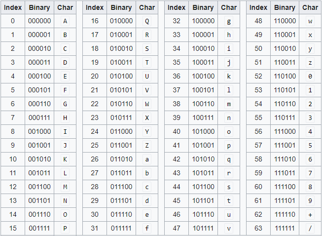

## **Base64 Encoding**

Base64 is a **binary-to-text encoding scheme** that converts **binary data** into an **ASCII string format**. This is useful when transmitting binary data (like images, encryption keys, or files) over **text-based protocols** (such as email, JSON, and URLs).

It is **not** an encryption or hashing algorithm—it is just an encoding mechanism that allows binary data to be safely stored or transmitted.

#### **Why is Base64 Needed?**

###### 1. Safe Transmission Over Text-Based Protocols

Certain systems only support **text-based** formats, but binary data might contain **non-printable characters** or special characters (`\n`, `\t`, etc.).  

- Example: Sending an **image** in an email **(SMTP)** or including **binary data in JSON**.

**2. Prevent Data Corruption**

When binary data is transmitted over protocols that may interpret control characters incorrectly (e.g., newline `\n` or tab `\t`), **Base64 encoding prevents corruption** by converting everything into **readable ASCII** characters.

**3. URL and Filename Safe Encoding**

Some characters in binary data may cause problems in URLs (`+`, `/`, `=`), so Base64 provides a **URL-safe encoding** mechanism.

#### **How Does Base64 Work?**

Base64 works by **dividing binary data into 6-bit chunks** and mapping them to a **set of 64 characters**.

- **Character Set** (64 unique characters):  
  - **A-Z (26 characters)**
  - **a-z (26 characters)**
  - **0-9 (10 characters)**
  - **+ and /** (special characters)
  - **= (Padding character to maintain byte alignment)**

##### **Binary to Base64 Conversion Example**

###### **Step 1: Convert "ABC" to Binary**
Each character in ASCII corresponds to an 8-bit binary representation:

| Character | ASCII (Decimal) | Binary     |
| --------- | --------------- | ---------- |
| A         | 65              | `01000001` |
| B         | 66              | `01000010` |
| C         | 67              | `01000011` |

The **binary string**:  
`01000001 01000010 01000011`

###### **Step 2: Break into 6-bit Groups**
Base64 **splits** the 24-bit sequence into **four 6-bit chunks**:

| Chunk | Binary   | Decimal | Base64 Char |
| ----- | -------- | ------- | ----------- |
| 1     | `010000` | 16      | `Q`         |
| 2     | `010100` | 20      | `U`         |
| 3     | `001001` | 9       | `J`         |
| 4     | `000011` | 3       | `D`         |

###### **Step 3: Map to Base64 Table**
Thus, **"ABC" in Base64 is "QUJD"**.

#### **Base64 Encoding and Decoding in Java**

#####  **1. Encoding a String**

   Using `Base64.getEncoder()`:
```java
import java.util.Base64;

public class Base64Example {
    public static void main(String[] args) {
        String text = "Hello, World!";
        String encoded = Base64.getEncoder().encodeToString(text.getBytes());

        System.out.println("Base64 Encoded: " + encoded);
    }
}
```
 **Output:**  
```
Base64 Encoded: SGVsbG8sIFdvcmxkIQ==
```

#####  **2. Decoding Base64**

```java
import java.util.Base64;

public class Base64DecodeExample {
    public static void main(String[] args) {
        String encoded = "SGVsbG8sIFdvcmxkIQ==";
        String decoded = new String(Base64.getDecoder().decode(encoded));

        System.out.println("Base64 Decoded: " + decoded);
    }
}
```
 **Output:**  
```
Base64 Decoded: Hello, World!
```

##### **Base64 for Binary Data**

  You can also use **Base64 for encoding images, files, and binary data**.

#####   **Encoding a File as Base64**

```java
import java.nio.file.Files;
import java.nio.file.Paths;
import java.util.Base64;

public class Base64FileEncoder {
    public static void main(String[] args) throws Exception {
        byte[] fileBytes = Files.readAllBytes(Paths.get("image.png"));
        String base64String = Base64.getEncoder().encodeToString(fileBytes);

        System.out.println("Base64 Encoded File: " + base64String);
    }
}
```
##### **Base64 Variants**

| Variant             | Description                         | Characters Used               |
| ------------------- | ----------------------------------- | ----------------------------- |
| **Standard Base64** | Default version                     | `A-Z`, `a-z`, `0-9`, `+`, `/` |
| **URL Safe Base64** | URL-encoded version                 | `A-Z`, `a-z`, `0-9`, `-`, `_` |
| **MIME Base64**     | Used for emails (splits into lines) | Includes `\n`                 |

#####  **Using URL-Safe Base64**

```java
String urlSafeEncoded = Base64.getUrlEncoder().encodeToString("https://example.com".getBytes());
System.out.println(urlSafeEncoded);
```
 **Output (No `/` or `+`):**  
```
aHR0cHM6Ly9leGFtcGxlLmNvbQ==
```

##### Padding in Base64 (`=`)

Base64 requires **input to be a multiple of 3 bytes**. If the input is **not a multiple of 3**, padding (`=`) is added.

 **Example:** Encoding `"Hi"` (2 bytes)  
| Bytes | Binary Representation |
| ----- | --------------------- |
| H     | `01001000`            |
| i     | `01101001`            |

**Split into 6-bit groups:**  
`010010 000110 100100`  

 **Output (With Padding):**  
```
SGk=
```
(Padded with `=` to make it a multiple of 4 characters)




### **When NOT to Use Base64?**

❌ **Not for password hashing** – Use **PBKDF2, BCrypt, or Argon2**.  
❌ **Not for encryption** – Use **AES or RSA** for security.  
❌ **Not for compression** – Base64 increases data size by **33%**.


_______________


## **What is URL Encoding?**
**URL Encoding** (also called **percent encoding**) is a method used to safely transmit data in URLs by **replacing special characters** with a **% followed by a hexadecimal value**.

####  Why is URL Encoding Needed?

URLs have **special characters** (e.g., `?`, `&`, `/`, `=`, `#`) that **serve specific purposes** in HTTP requests. If these characters appear in the **wrong place**, they might be misinterpreted by web browsers or servers.

For example:
- The **space character (` `)** is **not allowed in URLs**.
- The **& symbol (`&`)** separates **query parameters** (e.g., `?name=John&age=25`).
- The **/ symbol (`/`)** is used to separate **URL paths**.

 **URL Encoding ensures that all data in a URL is properly interpreted by web servers and browsers.**

#### **How Does URL Encoding Work?**

URL Encoding **replaces unsafe characters** with a **percent sign (`%`) followed by two hexadecimal digits**.

**Example of URL Encoding**

| Character           | URL Encoded |
| ------------------- | ----------- |
| Space (` `)         | `%20`       |
| Ampersand (`&`)     | `%26`       |
| Slash (`/`)         | `%2F`       |
| Question Mark (`?`) | `%3F`       |
| Equals (`=`)        | `%3D`       |
| Plus (`+`)          | `%2B`       |

**Original URL with unsafe characters:**  

```
https://example.com/search?query=Hello World & Java!
```
 **URL Encoded version:**  
```
https://example.com/search?query=Hello%20World%20%26%20Java%21
```
- **Space (` `) → `%20`**
- **Ampersand (`&`) → `%26`**
- **Exclamation mark (`!`) → `%21`**

#### URL Encoding in Java

##### **1. Encode a String for a URL**

  Java provides the `URLEncoder.encode()` method to **convert a string into a URL-safe format**.

```java
import java.net.URLEncoder;
import java.nio.charset.StandardCharsets;

public class URLEncodingExample {
    public static void main(String[] args) throws Exception {
        String originalText = "Hello World & Java!";
        String encoded = URLEncoder.encode(originalText, StandardCharsets.UTF_8);
        System.out.println("URL Encoded: " + encoded);
    }
}
```
 **Output:**
```
URL Encoded: Hello+World+%26+Java%21
```
- **Spaces (`  `) → `+`**
- **Ampersand (`&`) → `%26`**
- **Exclamation mark (`!`) → `%21`**

#####  **2. Decode a URL Encoded String**

To **convert a URL-encoded string back to its original form**, use `URLDecoder.decode()`.

```java
import java.net.URLDecoder;
import java.nio.charset.StandardCharsets;

public class URLDecodingExample {
    public static void main(String[] args) throws Exception {
        String encodedText = "Hello+World+%26+Java%21";
        String decoded = URLDecoder.decode(encodedText, StandardCharsets.UTF_8);
        System.out.println("URL Decoded: " + decoded);
    }
}
```
**Output:**

```
URL Decoded: Hello World & Java!
```

#### When Should You Use URL Encoding?

 **In Query Parameters**  
```java
String url = "https://example.com/search?query=" + URLEncoder.encode("Hello World!", StandardCharsets.UTF_8);
```
 **Encodes spaces, ampersands, and special characters correctly.**

**In Form Data (application/x-www-form-urlencoded)**  Form data in an HTTP **POST request** is URL-encoded by default.

```
name=John+Doe&age=25&message=Hello%21
```

**In URL Paths Containing Unsafe Characters**  If you need to include special characters in a **URL path**, you must encode them.

```java
String path = "/files/My Documents/Report.pdf";
String encodedPath = URLEncoder.encode(path, StandardCharsets.UTF_8);
```
 Ensures that the **spaces in the filename** are converted into `%20` or `+`.

###  **URL Encoding vs Base64 Encoding**
| Feature                   | **URL Encoding**                           | **Base64 Encoding**                              |
| ------------------------- | ------------------------------------------ | ------------------------------------------------ |
| **Purpose**               | Makes URLs safe for transmission           | Converts binary data into text format            |
| **Character Replacement** | Replaces **special characters** with `%XX` | Converts every **3 bytes → 4 Base64 characters** |
| **Common Use Case**       | Query strings, form data, URLs             | Encoding images, JWT tokens, encryption keys     |
| **Increases Size?**       | Slightly (depends on special characters)   | **Yes** (by ~33%)                                |
| **Example Input**         | `"Hello World!"`                           | Binary data (images, files)                      |
| **Encoded Output**        | `"Hello+World%21"`                         | `"SGVsbG8sIFdvcmxkIQ=="`                         |

