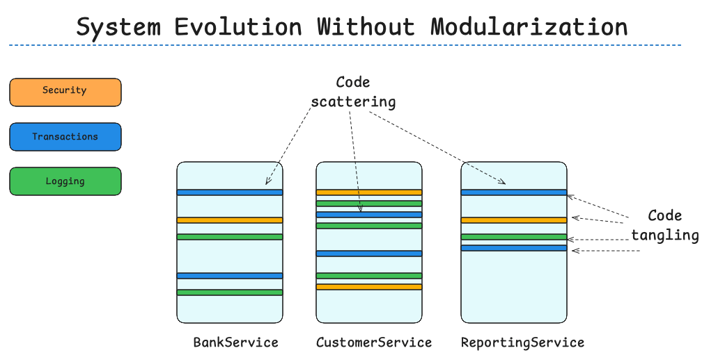
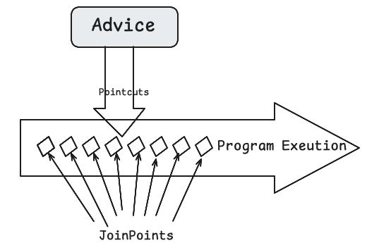

# Spring AOP

Spring AOP is a key module in the Spring Framework that enables Aspect-Oriented Programming. It allows developers to define cross-cutting concerns—like logging, auditing, authentication, authorizatrion, transaction management, and exception handling—as separate modules (aspects) and apply them declaratively to specific parts of an application.

### **AOP**

- **Concern**: Refers to any use case or area of interest within an application.
- **Core/Primary Concern**: Represents the application's main business functionality. 
- **Cross-Cutting/Secondary Concerns**: These include functionalities like logging, auditing, authentication, authorization, transaction management, caching and exception handling that impact multiple parts of the application.  
- In **Object-Oriented Programming (OOP)**, there is often **tight coupling** between core and cross-cutting concerns, which makes the system harder to maintain and extend.  
- **Aspect-Oriented Programming (AOP)** helps achieve **loose coupling** between core and cross-cutting concerns, simplifying maintenance and scalability.  
- **AOP** is essentially the **modularization of concerns**, allowing developers to isolate and manage cross-cutting concerns separately from the core business logic. 

### **Why AOP is Required**

- **Aspect-Oriented Programming (AOP)** helps overcome system-level coding challenges, such as logging, auditing, authentication, authorization, transaction management, caching, and exception handling, by modularizing cross-cutting concerns.  

- AOP addresses each aspect independently, thereby minimizing **coupling** and **code duplication**.  

- It promotes **code reuse**, improving maintainability and scalability.  

- Developers can focus on one concern at a time, enhancing productivity and reducing complexity.  

- AOP makes it easier to introduce new functionalities by adding new **aspects** and defining **weaving rules**, followed by regenerating the final code.  

- AOP helps mitigate **“Code Tangling”**, where multiple concerns are tightly coupled with business logic.  

- AOP also reduces **“Code Scattering”**, where the same concern is spread across multiple classes or modules.  

- By using AOP, developers can focus on solving core business problems while delegating cross-cutting concerns to aspects, which are woven into the application at runtime. 

  




## **AOP Terminology**

### **Concern**  
A **concern** refers to a direct or indirect functionality to be addressed in the application. For example, logging the start and end of each method invocation in service classes.

### **Aspect**  
An **Aspect** is a module that encapsulates a concern. It represents enterprise application concerns that cut across multiple classes, such as transaction management, logging, caching, auditing, or authorization.  

**Purpose:** It defines the **what** and **where** of cross-cutting behavior.

**Components:** An aspect contains:

- One or more pieces of **advice** (the action to perform).
- Pointcuts (which define where the advice applies).

**Implementation:**

- An aspect can be implemented as a regular class configured using **Spring XML configuration**.  
- Alternatively, you can use **Spring AspectJ integration** to define a class as an aspect with the `@Aspect` annotation.

```java
@Aspect
public class LoggingAspect {
    @Before("execution(* io.reactivestax.service.*.*(..))")
    public void logBefore() {
        System.out.println("Executing method...");
    }
}
```

### **Join Point**  
A **Join Point** is a specific point during the execution of a program, such as the execution of a method or the handling of an exception.  

- It represents the **“where”** part.  
- A join point is a potential candidate within the program’s execution flow where an aspect can be applied. Examples include:  
  - A **method** being called.  
  - An **exception** being thrown.  
  - A **field** being modified.  
- These are the points where the code of an **aspect** can be inserted into the application’s normal flow to add new behavior.

### **Advice**  
**Advice** defines the **action** to be taken by an aspect when a specific join point is reached or at a particular join point (specific points in the program like method execution, exception handling, etc.).

- It represents the **“what”** part.  
- Advice includes the logic or API invocations that implement system-wide concerns, executed at the specified join points.

**Purpose**: It defines the **how** of cross-cutting behavior.

**Types of Advice**:

​	•**Before Advice**: Runs before the join point (@Before).

​	•**After Advice**: Runs after the join point (@After).

​	•**After Returning Advice**: Runs after a method returns successfully (@AfterReturning).

​	•**After Throwing Advice**: Runs if a method throws an exception (@AfterThrowing).

​	•**Around Advice**: Wraps the join point, allowing custom behavior before and after the method execution (@Around).  

```java
@Before("execution(* io.reactivestax.service.*.*(..))")
public void logBefore() {
    System.out.println("Logging before method execution.");
}
```

Here, logBefore is the **advice**.

###### **Key Differences**

| **Aspect**                                                   | **Advice**                                                   |
| ------------------------------------------------------------ | ------------------------------------------------------------ |
| An aspect is a broader concept, encapsulating pointcuts and advice. | Advice is the actual code that defines the cross-cutting behavior. |
| Represents the **what** and **where** of cross-cutting concerns. | Represents the **how** (what happens at the join point).     |
| Implemented as a class annotated with `@Aspect`.             | Implemented as methods annotated with advice annotations (`@Before`, `@After`, etc.). |
| Can contain multiple pieces of advice.                       | A single unit of cross-cutting logic.                        |

---

##### Summary

- Think of an **aspect** as the "container" for cross-cutting behavior.
- **Advice** is the specific "action" taken by that container at well-defined points (join points) in the application.

### **Pointcut**  
A **Pointcut** is a predicate used to match specific **Join Points**.

- It is an **expression** that defines **which methods** or **execution points** will be affected by the associated **Advice**.  
- It represents the **“when”** part of AOP.

A pointcut determines at which **Join Points** the associated **Advice** should be applied. While advice can theoretically be applied at any **Join Point** supported by the AOP framework, applying it indiscriminately is not practical or efficient.  

- **Pointcuts** allow you to specify **where** the advice should be applied.  
- These specifications can be made using:  
  - Explicit class and method names.  
  - Regular expressions to define matching patterns for class and method names.  
  - Some frameworks enable **dynamic pointcuts**, which apply advice based on runtime conditions, such as the values of method parameters.

By narrowing down the applicable join points, pointcuts help in targeting the **exact locations** where the cross-cutting logic should be woven into the application, avoiding unnecessary or redundant advice execution.




**Let's try to understand in simple language** 

When you go to a restaurant, you look at the menu, which offers several options to choose from. You can decide to order one or more items from the menu. However, until you place an order, those items are just "opportunities to dine." Once you order and the waiter brings the items to your table, they become a meal.

In the context of Aspect-Oriented Programming (AOP):  
- **Join Points** are like the options on the menu—opportunities within your code where an aspect can potentially be applied.  
- **Pointcuts** are like the specific items you select from the menu.  

A **Join Point** represents an opportunity in the code (e.g., the execution of a method, the handling of an exception, or modifying a field) where an aspect can be woven in / applied / attached. It’s just a potential point of action.  

When you define a **Pointcut**, you are selecting specific **Join Points** where your aspect will actually be applied. Essentially, a Pointcut narrows down the available opportunities (Join Points) and determines where the aspect's logic will be executed.

### **Target Object**  
The object being advised by one or more aspects. This is the actual business object to which cross-cutting concerns are applied.

### **Weaving**

The process of linking aspects to other application types or objects to create **advised objects**. Weaving can occur at different stages:  
1. **Compile Time**: Done using tools like the AspectJ compiler.  
2. **Load Time**: Performed when the application’s classes are loaded into the JVM.  
3. **Runtime**: Performed dynamically during the application’s execution.

- **Spring AOP**, like many other pure Java AOP frameworks, performs weaving **at runtime**.  
- **Limitations in Spring AOP**:  
  - It does not support **field interception** (this can be achieved using AspectJ).  
  - It does not support interception of **protected/private methods** or constructors. For these use cases, AspectJ is recommended.

### **AOP Proxy**  
An object created by the AOP framework to implement aspect contracts, such as advising method executions.  

- In **Spring AOP**, the proxy object can be either:  
  1. A **JDK Dynamic Proxy** (used when the target object implements an interface).  
  2. A **CGLIB Proxy** (used when no interface is implemented or for certain advanced scenarios).
  
  ---
  
  **CGLIB and JDK Proxies in Java**
  
  Dynamic proxies are a powerful feature in Java, enabling the implementation of cross-cutting concerns like logging, caching, and security without altering the original code of the target object. Two popular approaches for creating dynamic proxies are **CGLIB** and **JDK proxies**.
  
  ###### **What are CGLIB and JDK Proxies?**
  
  - **CGLIB Proxies:**  CGLIB (Code Generation Library) is a third-party library that uses bytecode generation to create proxy classes. These proxy classes extend the target class, making it possible to proxy almost any non-final class.  
    
  - **JDK Proxies:**  JDK proxies are a built-in feature of Java that leverage reflection to generate proxy classes. These proxies work by implementing the same interfaces as the target class. However, JDK proxies can only proxy classes that implement at least one interface.
  
  ###### **Advantages and Disadvantages of CGLIB and JDK Proxies**
  
  ###### 1. **Performance**  
  - **CGLIB:**  CGLIB proxies tend to perform better than JDK proxies when handling a large number of method calls. This is because they use optimized bytecode, which can improve runtime efficiency.  
  - **JDK:**  JDK proxies are typically faster for scenarios with fewer method calls. Performance has also been enhanced significantly in Java versions 6, 7, and 8.
  
  ###### 2. **Complexity**  
  - **CGLIB:**  
    - More complex to set up and use.  
    - Requires the CGLIB library to be included in the classpath.  
    - Necessitates knowledge of the target class's constructor and arguments.  
  - **JDK:**  
    - Simpler to use as it’s a built-in feature.  
    - Does not require any external libraries.  
    - Works without needing details about the constructor or arguments of the target class.
  
  ###### 3. **Flexibility**  
  - **CGLIB:**  
    - Can proxy any non-final class.  
    - Capable of proxying methods that are not part of an interface.  
    - Allows selective method proxying using method filters.  
  - **JDK:**  
    - Can only proxy classes that implement at least one interface.  
    - Limited to proxying methods declared in an interface.  
    - Uses a single invocation handler for all proxied methods.
  
  ###### **When to Use Which?**
  
  - Use **CGLIB proxies** when:  
    - The target class does not implement any interface.  
    - You need to proxy methods not defined in an interface.  
    - Greater flexibility is required in selectively proxying methods.
  
  - Use **JDK proxies** when:  
    - The target class implements interfaces.  
    - You don’t need to proxy non-interface methods.  
    - You want to avoid external dependencies and prefer simplicity.
  

### **Advisor**  
An **Advisor** is a self-contained unit of AOP functionality that contains a single piece of **advice** (the action to be executed).  The **pointcut** defining when and where the advice should apply.   Advisors offer a modular way to encapsulate cross-cutting concerns and apply them selectively.

### **HOW AOP Works**

- Implment your main application logic 
  - Focus on the core problem
- Write aspects to implement your cross-cutting concersn
  - Spring provide many aspects
- Weave the apsects into your application
  - Adding the cross cutting concerns behaviour's to the right place

### **AOP Types**

**Static AOP**

- In **Static AOP**, the weaving process is an additional step in the application's build process.
- AOP is achieved by modifying the **bytecode** directly.
- This is a well-performing method of achieving weaving, as the end result is optimized **Java bytecode**.
- However, any addition of join points requires **recompilation** of the code.

**Dynamic AOP**

- **Dynamic AOP** (e.g., Spring AOP) performs the weaving process dynamically at **runtime**.
- While it offers flexibility, it is less performant compared to **Static AOP** due to the overhead of runtime weaving.

### **Different types of Advice**

1. **Before Advice:**  
   - Executes **before** a join point.  
   - Cannot prevent the execution flow from proceeding to the join point unless it throws an exception.

2. **After Returning Advice:**  
   - Executes **after** a join point completes **normally** (e.g., when a method returns without throwing an exception).

3. **After Throwing Advice:**  
   - Executes if a method exits by **throwing an exception**.

4. **After (Finally) Advice:**  
   - Executes regardless of how the join point exits, whether through a **normal return** or by **throwing an exception**.

5. **Around Advice:**  
   - Surrounds a join point, such as a **method invocation**, allowing custom behavior both **before** and **after** the join point execution.

### **Pointcut Expression Syntax**

A **pointcut expression** begins with a **pointcut designator (PCD)**, which is a keyword used to inform **Spring AOP** about what to match. Various **pointcut designators** exist, such as those for matching method executions, types, method arguments, or annotations.

**Pointcut Components**

1. **Designator:**  
   - Keywords like `execution`, `within`, or `this` to specify the type of match.

2. **Return Type:**  
   - `*` matches any return type.  

3. **Fully-Qualified Path:**  
   - Refers to the **package hierarchy** leading to the method (optional).  

4. **Method Name:**  
   - Can use `*` to match any method name.  

5. **Parameters:**  
   - Define the parameter list. Common options:  
     - `()` matches no parameters.  
     - `*` matches any single parameter.  
     - `..` matches any number of parameters.

6. **Pointcut Syntax:**  
   `Designator ({Return Type} {Fully-Qualified Path} {Method Name} {Parameters} {Throws Exception})`

For more details, refer to:  
[Baeldung: Spring AOP Pointcut Tutorial](https://www.baeldung.com/spring-aop-pointcut-tutorial)  

### **Defining Pointcuts**

- With Spring AOP you write pointcuts using AspectJ's pointcut expression language 
  - For selecting where to apply advice
- Complete expression language reference available at
  - http://www.eclipse.org/aspectj

##### **Execution Expression Example**

 - execution(void send*(String))
   - Any method starting with send and takes a single string parameter and has a void return type
 - execution(* send(int,..))
   - Any method named send who first parameter is an int(the ".." signifies 0 or more parameters may follow
 - execution(void example.MessageService+.send(*))
   - Any MessageService method named send that takes a single parameter and returns void

##### **Execution Expression Example Using Annotations**

- execution(@org.springframework.transaction.annotation.Transaction void*(..))
  - Any method marked with the @Transactional annotation
- exeuction((@privacy.Sensitive*)*(..))
  - Any method that returns a value marked with the @Sensitive annotation 

##### This Dynamic Pointcut Designator Example

- `this(io.reactivestax.MessageService)`
  - Matches any join point where the currently executing object is an instance of `MessageService`. Intercept method calls for all `MessageService` objects. This is useful for tracking actions performed on objects of a specific type.

##### **Within Scope Pointcut Designator  Example**

- `within(io.reactivestax..*)`
  - Matches all methods in any class within the `io.reactivestax` package or its sub-packages. Apply cross-cutting concerns (e.g., logging or security) to all classes within a specific package hierarchy.

##### **Combined Example**

- `execution(* send(int,..)) && this(io.reactivestax.MessageService) && within(io.reactivestax..*)`
  - Matches methods named **`send`**
    - First parameter must be an `int`.
    - Executed on an instance of `MessageService`.
    - Defined within the `io.reactivestax` package or its sub-packages.

#### **Pointcut Expression Example**

- @Pointcut("execution(public * *(..))")
  - It will be applied on all the public methods.
- @Pointcut("execution(public Operation.*(..))")
  - It will be applied on all the public mehtod of Operation class.
- @Pointcut("execution(* Operation.*(..))")
  - It will be applied on all the methods of Operation class.

##### **1. Kinded Pointcut Designators (`execution`)**
**Syntax:** `execution(* set(*))`  
**Meaning:**  
- This matches **method execution join points**. Specifically, it looks for methods where:
  - The method name starts with "set".
  - The method accepts exactly **one argument of any type**.
  - The method returns **any type** (`*`).

**Details:**
- Kinded designators focus on specific join points (e.g., method executions, constructors, etc.).
- Example: If you have a method `public void setName(String name)` in your class, this pointcut will match its execution.

**Use Case:**  
- Useful for intercepting method calls like getters, setters, or other specific operations that need consistent behavior (e.g., logging or validation).

#### **2. Dynamic Pointcut Designators (`this`)**
**Syntax:** `this(Point)`  
**Meaning:**  
- This matches when the **currently executing object** is an instance of the specified class (in this case, `Point`).

**Details:**
- The `this` designator checks the runtime type of the currently executing object.
- It does not care about the method signature or other details, just that the object is of the type specified.

**Use Case:**  
- Useful for applying aspects only to specific classes or their instances, such as tracking actions performed on objects of a particular type.

##### **3. Scope Pointcut Designators (`within`)**
**Syntax:** `within(io.reactivestax.*)`  
**Meaning:**  
- This matches **any join point** within classes in the specified package (`io.reactivestax`).
- The `*` acts as a wildcard to match all classes in the package.

**Details:**
- The `within` designator scopes the advice to a particular package or class.
- You can also specify a single class, e.g., `within(io.reactivestax.Point)` to match all join points within the `Point` class.

**Use Case:**  
- Useful for targeting all methods in a specific package or class for consistent behavior, such as logging or auditing.

##### **4. Composed Pointcut Designators**
**Syntax:** `pointcut set() : execution(* set(*)) && this(Point) && within(io.reactivestax.*);`  
**Meaning:**  
- This combines multiple pointcut designators:
  1. Matches methods where the name starts with "set" and has one argument of any type (`execution`).
  2. Ensures the executing object is an instance of the `Point` class (`this`).
  3. Limits the scope to classes within the `io.reactivestax` package (`within`).

**Details:**
- Composed pointcuts use logical operators (`&&`, `||`, `!`) to combine multiple pointcuts for finer control.
- All conditions in the example must be satisfied for the advice to execute.

**Use Case:**  
- Useful when you need to precisely control where your advice applies, such as when you want to target specific methods only within a particular package and on a specific class type.

##### **Wildcards in Pointcut Expressions**
- `*`: Matches any type or any method name.  
  - Example: `execution(* set*(..))` matches any method starting with "set" regardless of its return type or arguments.
- `..`: Matches zero or more arguments.  
  - Example: `execution(* *(..))` matches all methods regardless of their arguments.
- `()`: Matches methods with no arguments.  
  - Example: `execution(* get*())` matches all methods starting with "get" that have no arguments.

##### **Combining Pointcuts**
- You can use **logical operators** to combine pointcuts:
  - `&&`: Logical AND (both conditions must be true).
  - `||`: Logical OR (either condition can be true).
  - `!`: Logical NOT (excludes specific join points).

**Example of Combination:**  
```java
pointcut examplePointcut() : 
    execution(* set*(..)) && within(io.reactivestax.*) && !this(Point);
```
- This matches methods starting with "set" within the `io.reactivestax` package, but excludes those executed on objects of type `Point`.

##### **Use Cases for Each Designator**

| **Designator** | **Use Case**                                                 |
| -------------- | ------------------------------------------------------------ |
| `execution`    | Target specific method executions (e.g., logging setters, intercepting method calls). |
| `this`         | Apply advice to objects of a specific class type (e.g., tracking behavior of `Point` instances). |
| `within`       | Apply advice to all join points in a specific class or package (e.g., enforcing security rules). |
| Composed       | Combine multiple conditions to create precise advice (e.g., logging specific setters in a package). |

1. **Auditing All Methods in a Package:**
   
   ```java
   @Pointcut("within(io.reactivestax.*)")
   public void auditMethodsInPackage() {}
   
   @Before("auditMethodsInPackage()")
   public void logAudit() {
       System.out.println("Audit log entry for a method in io.reactivestax.");
   }
   ```
   
2. **Logging Setters on `Point` Objects:**
   
   ```java
   @Pointcut("execution(* set*(..)) && this(io.reactivestax.Point)")
   public void logPointSetters() {}
   
   @Before("logPointSetters()")
   public void logSetterCall() {
       System.out.println("Setter called on Point object.");
   }
   ```
   
3. **Applying Advice Only to Certain Methods:**
   
   ```java
   @Pointcut("execution(public * io.reactivestax..*(..)) && !execution(* get*(..))")
   public void excludeGetters() {}
   
   @Before("excludeGetters()")
   public void logNonGetterMethod() {
       System.out.println("A non-getter method was executed.");
   }
   ```

### **How does Spring process AspectJ Annotations?**

- Spring AOP interprets AspectJ annotations at run-time by a library provided by **AspectJ** framework
- Spring supports only method exeuction join points for the beans in it's **IoC container**
- So if you use join points beyond this scope in Spring, it will give you **IllegalArgumentException** at runtime

### **AspectJ Pointcut Designator** 

| **Type**     | **Syntax**                                                   | **Meaning**                                                  |
| ------------ | ------------------------------------------------------------ | ------------------------------------------------------------ |
| **Kinded**   | `execution(* set(*))`                                        | Matches a method-execution join point if the method name starts with "set" and there is exactly one argument of any type and any return type. |
| **Dynamic**  | `this(Point)`                                                | Matches when the currently executing object is an instance of the class `Point`. Note that the unqualified class name is resolved using Java's normal type lookup. |
| **Scope**    | `within(com.company.*)`                                      | Matches any join point in any type within the `com.company` package. The `*` wildcard can be used to match multiple types with one signature. |
| **Composed** | `pointcut set() : execution(* set(*)) && this(Point) && within(com.company.*);` | Matches a method-execution join point if the method name starts with "set," has any one return type, is an instance of the class `Point`, and is within the `com.company` package. |

### **Using AOP in Spring Framework**

- Using AspectJ Annotation
- Using AspectJ XML Configuration (Schema based apprach). In this scenario, an <aop:config> element can contain pointcut, advisor, and aspect elements 

###### Declaring Before Advice using AspectJ Annotation Syntax

```java
package io.reactivestax.example6.aspect;

import org.apache.commons.logging.Log;
import org.apache.commons.logging.LogFactory;
import org.aspectj.lang.JoinPoint;
import org.aspectj.lang.annotation.Aspect;
import org.aspectj.lang.annotation.Before;
import org.aspectj.lang.annotation.Pointcut;
import org.springframework.context.annotation.EnableAspectJAutoProxy;
import org.springframework.stereotype.Component;

@Aspect
@Component
@EnableAspectJAutoProxy 
//  <aop:aspectj-autoproxy /> is xml equivalent of @EnableAspectJAutoProxy
public class LoggingAspect {
    private static final Log log = LogFactory.getLog(LoggingAspect.class);

    // start version 1
    // Defining pointcut
    // Dynamic: Match methods executed on an instance of Point class
    @Pointcut("execution(* io.reactivestax.customer.service.CustomerService.create*(..))")
    public void logBeforePointCutDefinition() {
    }

    // defining before Advice
    @Before("logBeforePointCutDefinition()")
    public void logBefore(JoinPoint joinPoint) {
        log.debug("logBefore method intercepted " + joinPoint.getSignature().getName());
    }
    // end version 1


    //version2 Pointcut and Adviced are defined togehtger
    @Before("execution(* io.reactivestax.customer.service.CustomerService.create*(..))")
    public void logBeforeWithPointDefinedDirectly(JoinPoint joinPoint) {
        log.debug("logBeforeWithPointDefinedDirectly method intercepted " + joinPoint.getSignature().getName());
    }
}

```

###### **Declaring Before Advice using AspectJ XML Configuration **

```xml
<beans xmlns="http://www.springframework.org/schema/beans"
       xmlns:xsi="http://www.w3.org/2001/XMLSchema-instance"
       xmlns:aop="http://www.springframework.org/schema/aop"
       xsi:schemaLocation="http://www.springframework.org/schema/beans https://www.springframework.org/schema/beans/spring-beans-3.0.xsd
        http://www.springframework.org/schema/aop  https://www.springframework.org/schema/aop/spring-aop-3.0.xsd">

    <bean id="customerService" class="io.reactivestax.customer.service.CustomerServiceImpl"/>

    <!--@Aspect -->
    <bean id="logAspect" class="io.reactivestax.example5.aspect.LoggingAspect"/>

    <aop:config>
        <aop:aspect id="aspectLogging" ref="logAspect">

            <aop:pointcut id="createCustomer" expression="execution(* io.reactivestax.customer.service.CustomerService.createCustomer(..))"/>

            <!-- @Before -->
            <aop:before method="logBefore" pointcut-ref="createCustomer"/>
        </aop:aspect>
    </aop:config>
 </beans>                           
```

___________

**Declaring After Advice using AspectJ Annotation Syntax**

```java
package io.reactivestax.example7.aspect;

import org.apache.commons.logging.Log;
import org.apache.commons.logging.LogFactory;
import org.aspectj.lang.JoinPoint;
import org.aspectj.lang.annotation.After;
import org.aspectj.lang.annotation.Aspect;
import org.aspectj.lang.annotation.Pointcut;
import org.springframework.context.annotation.EnableAspectJAutoProxy;
import org.springframework.stereotype.Component;

@Aspect
@Component
@EnableAspectJAutoProxy 
//  <aop:aspectj-autoproxy /> is xml equivalent of @EnableAspectJAutoProxy
public class LoggingAspect {
    private static final Log log = LogFactory.getLog(LoggingAspect.class);

    // start version 1
    // Defining pointcut
    // Dynamic: Match methods executed on an instance of Point class
    @Pointcut("execution(* io.reactivestax.customer.service.CustomerService.create*(..))")
    public void logAfterPointCutDefinition() {
    }

    // defining before Advice
    @After("logAfterPointCutDefinition()")
    public void logAfter(JoinPoint joinPoint) {
        log.debug("logAfter method intercepted " + joinPoint.getSignature().getName());
    }
    // end version 1


    @After("execution(* io.reactivestax.customer.service.CustomerService.create*(..))")
    public void logAfterWithPointDefinedDirectly(JoinPoint joinPoint) {
        log.debug("logAfterWithPointDefinedDirectly method intercepted " + joinPoint.getSignature().getName());
    }

}
```

**Declaring After Advice using AspectJ XML Configuration **

```xml
<beans xmlns="http://www.springframework.org/schema/beans"
       xmlns:xsi="http://www.w3.org/2001/XMLSchema-instance"
       xmlns:aop="http://www.springframework.org/schema/aop"
       xsi:schemaLocation="http://www.springframework.org/schema/beans https://www.springframework.org/schema/beans/spring-beans-3.0.xsd
        http://www.springframework.org/schema/aop  https://www.springframework.org/schema/aop/spring-aop-3.0.xsd">

    <bean id="customerService" class="io.reactivestax.customer.service.CustomerServiceImpl"/>

    <!--@Aspect -->
    <bean id="logAspect" class="io.reactivestax.example5.aspect.LoggingAspect"/>

    <aop:config>
        <aop:aspect id="aspectLogging" ref="logAspect">
            <aop:pointcut id="createCustomer" expression="execution(* io.reactivestax.customer.service.CustomerService.createCustomer(..))"/>
            <!-- @After -->
            <aop:after method="logAfter" pointcut-ref="createCustomer"/>
        </aop:aspect>
    </aop:config>
 </beans>  
```

___________________________

**Declaring After Returning Advice using AspectJ Annotation Syntax**

```java
package io.reactivestax.example8.aspect;

import org.apache.commons.logging.Log;
import org.apache.commons.logging.LogFactory;
import org.aspectj.lang.JoinPoint;
import org.aspectj.lang.annotation.AfterReturning;
import org.aspectj.lang.annotation.Aspect;
import org.aspectj.lang.annotation.Pointcut;
import org.springframework.context.annotation.EnableAspectJAutoProxy;
import org.springframework.stereotype.Component;

@Aspect
@Component
@EnableAspectJAutoProxy 
//  <aop:aspectj-autoproxy /> is xml equivalent of @EnableAspectJAutoProxy
public class LoggingAspect {
    private static final Log log = LogFactory.getLog(LoggingAspect.class);

    // start version 1
    // Defining pointcut
    // Dynamic: Match methods executed on an instance of Point class
    @Pointcut("execution(* io.reactivestax.customer.service.CustomerService.create*(..))")
    public void logAfterReturningPointCutDefinition() {
    }

    // defining before Advice
    @AfterReturning(value = "logAfterReturningPointCutDefinition()",returning = "result")
    public void logAfterReturning(JoinPoint joinPoint, Object result) {
        log.debug("logAfterReturning method " + joinPoint.getSignature().getName() + " intercepted, returned value is " + result);
    }
    // end version 1


    @AfterReturning(value = "execution(* io.reactivestax.customer.service.CustomerService.create*(..))",returning = "result")
    public void logAfterReturningWithPointDefinedDirectly(JoinPoint joinPoint, Object result) {
        log.debug("logAfterReturning method " + joinPoint.getSignature().getName() + " intercepted, returned value is " + result);
    }

}
```

**Declaring After Returning Advice using AspectJ XML Configuration **

```xml
<beans xmlns="http://www.springframework.org/schema/beans"
       xmlns:xsi="http://www.w3.org/2001/XMLSchema-instance"
       xmlns:aop="http://www.springframework.org/schema/aop"
       xsi:schemaLocation="http://www.springframework.org/schema/beans https://www.springframework.org/schema/beans/spring-beans-3.0.xsd
        http://www.springframework.org/schema/aop  https://www.springframework.org/schema/aop/spring-aop-3.0.xsd">

    <bean id="customerService" class="io.reactivestax.customer.service.CustomerServiceImpl"/>

    <!--@Aspect -->
    <bean id="logAspect" class="io.reactivestax.example5.aspect.LoggingAspect"/>

    <aop:config>
        <aop:aspect id="aspectLogging" ref="logAspect">
            <aop:pointcut id="createCustomer" expression="execution(* io.reactivestax.customer.service.CustomerService.createCustomer(..))"/>

            <!-- @AfterReturning -->
            <aop:after-returning method="logAfterReturning" returning="result" pointcut-ref="createCustomer"/>
        </aop:aspect>
    </aop:config>
 </beans>  
```

____________

**Declaring After Throwing Advice using AspectJ Annotation Syntax**

```java
package io.reactivestax.example9.aspect;

import org.apache.commons.logging.Log;
import org.apache.commons.logging.LogFactory;
import org.aspectj.lang.JoinPoint;
import org.aspectj.lang.annotation.AfterThrowing;
import org.aspectj.lang.annotation.Aspect;
import org.aspectj.lang.annotation.Pointcut;
import org.springframework.context.annotation.EnableAspectJAutoProxy;
import org.springframework.stereotype.Component;

@Aspect
@Component
@EnableAspectJAutoProxy 
//  <aop:aspectj-autoproxy /> is xml equivalent of @EnableAspectJAutoProxy
public class LoggingAspect {
    private static final Log log = LogFactory.getLog(LoggingAspect.class);

    // start version 1
    // Defining pointcut
    // Dynamic: Match methods executed on an instance of Point class
    @Pointcut("execution(* io.reactivestax.customer.service.CustomerService.create*(..))")
    public void logAfterThrowingPointCutDefinition() {
    }

    // defining before Advice
    @AfterThrowing(value = "logAfterThrowingPointCutDefinition()",throwing = "error")
    public void logAfterThrowing(JoinPoint joinPoint, Throwable error) {
        log.debug("****************logAfterThrowing***************************");
        log.error("logAfterThrowing() is running!");
        log.error("method intercepted : " + joinPoint.getSignature().getName());
        log.error("Exception : " + error);
        log.debug("****************logAfterThrowing***************************");
    }
    // end version 1


    @AfterThrowing(pointcut = "execution(* io.reactivestax.customer.service.CustomerService.create*(..))", throwing = "error")
    public void logAfterThrowingWithPointCutDefinedDirectly(JoinPoint joinPoint, Throwable error) {
        log.debug("****************logAfterThrowingWithPointCutDefinedDirectly***************************");
        log.error("logAfterThrowing() is running!");
        log.error("method intercepted : " + joinPoint.getSignature().getName());
        log.error("Exception : " + error);
        log.debug("****************logAfterThrowingWithPointCutDefinedDirectly***************************");
    }
}
```

**Declaring After Throwing Advice using AspectJ XML Configuration **

```xml
<beans xmlns="http://www.springframework.org/schema/beans"
       xmlns:xsi="http://www.w3.org/2001/XMLSchema-instance"
       xmlns:aop="http://www.springframework.org/schema/aop"
       xsi:schemaLocation="http://www.springframework.org/schema/beans https://www.springframework.org/schema/beans/spring-beans-3.0.xsd
        http://www.springframework.org/schema/aop  https://www.springframework.org/schema/aop/spring-aop-3.0.xsd">

    <bean id="customerService" class="io.reactivestax.customer.service.CustomerServiceImpl"/>

    <!--@Aspect -->
    <bean id="logAspect" class="io.reactivestax.example5.aspect.LoggingAspect"/>

    <aop:config>

        <aop:aspect id="aspectLogging" ref="logAspect">

            <aop:pointcut id="createCustomer" expression="execution(* io.reactivestax.customer.service.CustomerService.createCustomer(..))"/>
            <!-- @AfterThrowing -->
            <aop:after-throwing method="logAfterThrowing"
                                throwing="error" pointcut-ref="createCustomer" />

        </aop:aspect>
    </aop:config>

</beans>
```

__________

**Declaring Around Advice using AspectJ Annotation Syntax**

```java
package io.reactivestax.example10.aspect;

import org.apache.commons.logging.Log;
import org.apache.commons.logging.LogFactory;
import org.aspectj.lang.ProceedingJoinPoint;
import org.aspectj.lang.annotation.Around;
import org.aspectj.lang.annotation.Aspect;
import org.aspectj.lang.annotation.Pointcut;
import org.springframework.context.annotation.EnableAspectJAutoProxy;
import org.springframework.stereotype.Component;

import java.util.Arrays;

@Aspect
@Component
@EnableAspectJAutoProxy 
//  <aop:aspectj-autoproxy /> is xml equivalent of @EnableAspectJAutoProxy
public class LoggingAspect {
    private static final Log log = LogFactory.getLog(LoggingAspect.class);

    // start version 1
    // Defining pointcut
    // Dynamic: Match methods executed on an instance
    @Pointcut("execution(* io.reactivestax.customer.service.CustomerService.create*(..))")
    public void logAroundPointCutDefinition() {
    }

    // defining before Advice
   @Around(value = "logAroundPointCutDefinition()")
    public Object logAround(ProceedingJoinPoint joinPoint) throws Throwable {

        log.debug("****************logAround***************************");
        log.debug("logAround() is running!");
        log.debug("method intercepted method : " + joinPoint.getSignature().getName());
        log.debug("method intercepted arguments : " + Arrays.toString(joinPoint.getArgs()));
        log.debug("Around before is running!");
        Object returnValue = joinPoint.proceed();

        log.debug("Around after is running!");
        log.debug("********************logAround************************");
        return returnValue;
    }
    // end version 1


    //version2 Pointcut and Advice are defined together, cannot be re-used, uncomment the line before and comment the above Pointcut
    //@Around(value = "execution(* io.reactivestax.customer.service.CustomerService.create*(..))")
    public Object logAroundWithPointDefinedDirectly(ProceedingJoinPoint joinPoint) throws Throwable {
        log.debug("****************logAroundWithPointDefinedDirectly***************************");
        log.debug("logAround() is running!");
        log.debug("method intercepted method : " + joinPoint.getSignature().getName());
        log.debug("method intercepted arguments : " + Arrays.toString(joinPoint.getArgs()));
        log.debug("Around before is running!");
        Object returnValue = joinPoint.proceed();

        log.debug("Around after is running!");
        log.debug("********************logAroundWithPointDefinedDirectly************************");
        return returnValue;
    }

}
```


**Declaring Around Advice using AspectJ XML Configuration **

```xml
<beans xmlns="http://www.springframework.org/schema/beans"
       xmlns:xsi="http://www.w3.org/2001/XMLSchema-instance"
       xmlns:aop="http://www.springframework.org/schema/aop"
       xsi:schemaLocation="http://www.springframework.org/schema/beans https://www.springframework.org/schema/beans/spring-beans-3.0.xsd
        http://www.springframework.org/schema/aop  https://www.springframework.org/schema/aop/spring-aop-3.0.xsd">

    <bean id="customerService" class="io.reactivestax.customer.service.CustomerServiceImpl"/>

    <!--@Aspect -->
    <bean id="logAspect" class="io.reactivestax.example5.aspect.LoggingAspect"/>
    <aop:config>
        <aop:aspect id="aspectLogging" ref="logAspect">
            <aop:pointcut id="createCustomer" expression="execution(* io.reactivestax.customer.service.CustomerService.createCustomer(..))"/>
            <!-- @Around -->
            <aop:around method="logAround" pointcut-ref="createCustomer"/>
        </aop:aspect>
    </aop:config>
</beans>
```

**Declaring Before, After, After Returning, After Throwing, and Around Advice using AspectJ XML Configuration **

```xml
<beans xmlns="http://www.springframework.org/schema/beans"
       xmlns:xsi="http://www.w3.org/2001/XMLSchema-instance"
       xmlns:aop="http://www.springframework.org/schema/aop"
       xsi:schemaLocation="http://www.springframework.org/schema/beans https://www.springframework.org/schema/beans/spring-beans-3.0.xsd
        http://www.springframework.org/schema/aop  https://www.springframework.org/schema/aop/spring-aop-3.0.xsd">

    <bean id="customerService" class="io.reactivestax.customer.service.CustomerServiceImpl"/>

    <!--@Aspect -->
    <bean id="logAspect" class="io.reactivestax.example5.aspect.LoggingAspect"/>

    <aop:config>

        <aop:aspect id="aspectLogging" ref="logAspect">

            <aop:pointcut id="createCustomer" expression="execution(* io.reactivestax.example5.customer.service.CustomerService.createCustomer(..))"/>

            <!-- @Before -->
            <aop:before method="logBefore" pointcut-ref="createCustomer"/>

            <!-- @After -->
            <aop:after method="logAfter" pointcut-ref="createCustomer"/>

            <!-- @AfterReturning -->
            <aop:after-returning method="logAfterReturning" returning="result" pointcut-ref="createCustomer"/>

            <!-- @AfterThrowing -->
            <aop:after-throwing method="logAfterThrowing"
                                throwing="error" pointcut-ref="createCustomer" />

            <aop:around method="logAround" pointcut-ref="createCustomer"/>

        </aop:aspect>
    </aop:config>

</beans>
```

```java
package io.reactivestax.example5.aspect;

import org.apache.commons.logging.Log;
import org.apache.commons.logging.LogFactory;
import org.aspectj.lang.JoinPoint;
import org.aspectj.lang.ProceedingJoinPoint;

import java.util.Arrays;

public class LoggingAspect {
    Log log = LogFactory.getLog(LoggingAspect.class);

    public void logBefore(JoinPoint joinPoint) {
        log.debug("logBefore method intercepted " + joinPoint.getSignature().getName());
    }

    public void logAfter(JoinPoint joinPoint) {
        log.debug("logAfter method intercepted " + joinPoint.getSignature().getName());
    }

    public void logAfterReturning(JoinPoint joinPoint, Object result) {
        log.debug("logAfterReturning method " + joinPoint.getSignature().getName() + " intercepted, returned value is " + result);
    }

    public void logAfterThrowing(JoinPoint joinPoint, Throwable error) {
        log.debug("****************logAfterThrowing***************************");
        log.error("logAfterThrowing() is running!");
        log.error("method intercepted : " + joinPoint.getSignature().getName());
        log.error("Exception : " + error);
        log.debug("****************logAfterThrowing***************************");

    }

    public void logAround(ProceedingJoinPoint joinPoint) throws Throwable {
        log.debug("****************logAround***************************");
        log.debug("logAround() is running!");
        log.debug("method intercepted method : " + joinPoint.getSignature().getName());
        log.debug("method intercepted arguments : " + Arrays.toString(joinPoint.getArgs()));
        log.debug("Around before is running!");
        joinPoint.proceed();
        log.debug("Around after is running!");
        log.debug("********************logAround************************");
    }
}
```

```java
package io.reactivestax.customer.service;

import io.reactivestax.customer.domain.Customer;

public interface CustomerService {
    String createCustomer(Customer customer);
}
```

   ```java
   package io.reactivestax.customer.service;
   
   import io.reactivestax.customer.domain.Customer;
   import org.apache.commons.logging.Log;
   import org.apache.commons.logging.LogFactory;
   import org.springframework.stereotype.Service;
   
   import java.util.UUID;
   
   @Service
   public class CustomerServiceImpl implements CustomerService {
   
       private static final Log log = LogFactory.getLog(CustomerServiceImpl.class);
   
       @Override
       public String createCustomer(Customer customer) {
           if(customer.getEmail().equalsIgnoreCase("brijesh.sood@gmail.com")) {
               throw new RuntimeException("Email already used");
           }
           log.info("Customer created: " + customer);
           customer.setCustomerId(UUID.randomUUID().toString());
           return customer.getCustomerId();
       }
   }
   ```

   ```java
   package io.reactivestax.customer.domain;
   
   public class Customer {
       private String customerId;
       private String firstName;
       private String lastName;
       private String email;
   
       public String getFirstName() {
           return firstName;
       }
   
       public void setFirstName(String firstName) {
           this.firstName = firstName;
       }
   
       public String getLastName() {
           return lastName;
       }
   
       public void setLastName(String lastName) {
           this.lastName = lastName;
       }
   
       public String getEmail() {
           return email;
       }
   
       public void setEmail(String email) {
           this.email = email;
       }
   
       public String getCustomerId() {
           return customerId;
       }
   
       public void setCustomerId(String customerId) {
           this.customerId = customerId;
       }
   
       @Override
       public String toString() {
           return "Customer{" +
                   "customerId='" + customerId + '\'' +
                   ", firstName='" + firstName + '\'' +
                   ", lastName='" + lastName + '\'' +
                   ", email='" + email + '\'' +
                   '}';
       }
   }
   
   ```


- Use the default.log4j.properties log4j properties from the spring-aop repo or spring-core

#### **Advice Execution Order (If applied on same method)**

If you apply all five types of advice to a single method, the execution order, irrespective of its implementation (whether annotation-based or XML configuration-based), will be:

1. **Before Advice**  
2. **Before Proceed** part of the **Around Advice**  
3. **Actual Method Execution**  
4. **After Advice**  
5. **After Returning Advice**  
6. **After Proceed** part of the **Around Advice**  

_____________________

#### **Choosing which AOP declarations** 

##### Spring AOP or Full AspectJ?

- If you only need to advise the execution of operations on **Spring beans**, then **Spring AOP** is the right choice.  
- If you need to advise **objects not managed by the Spring container** (such as domain objects), then you will need to use **AspectJ**.  
- Additionally, you should use **AspectJ** if you need to advise join points beyond simple method executions, such as field `get` or `set` join points.

##### @AspectJ or XML for Spring AOP?

- When using AOP as a tool to configure enterprise services, **XML configuration** can be a good choice. It provides a clearer view of the aspects present in the system through configuration files.  
- Using **XML syntax** splits the aspect implementation between:  
  1. The XML configuration file (which contains pointcut expressions).  
  2. The backing bean class (which contains advice implementation).  
- In contrast, with the **@AspectJ** syntax, both the pointcut expressions and advice implementations reside in a single **aspect class**, making it easier to manage and combine pointcut expressions. 

_______________

##### **Proxy Mechanism in Spring AOP**

- If the target object to be proxied implements **at least one interface**, a **JDK dynamic proxy** will be used. All interfaces implemented by the target type will be proxied.

- If the target object does **not implement any interfaces**, a **CGLIB proxy** will be created.Forcing the Use of CGLIB Proxying**

If you want to explicitly use CGLIB proxying, there are a few considerations to keep in mind:

1. **Final Methods Cannot Be Advised:**  
   - Final methods cannot be overridden, so they cannot be proxied or advised using CGLIB.

2. **CGLIB Dependency:**  
   - You will need the **CGLIB 2** binaries on your classpath, whereas JDK dynamic proxies are available out-of-the-box with the JDK.

3. **Spring Warnings:**  
   - If Spring requires CGLIB and the **CGLIB library classes** are not found on the classpath, Spring will automatically issue a warning.


