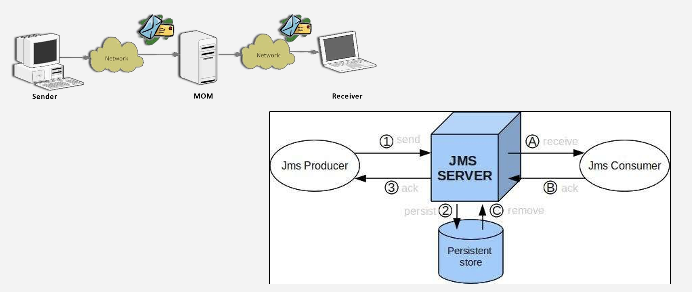
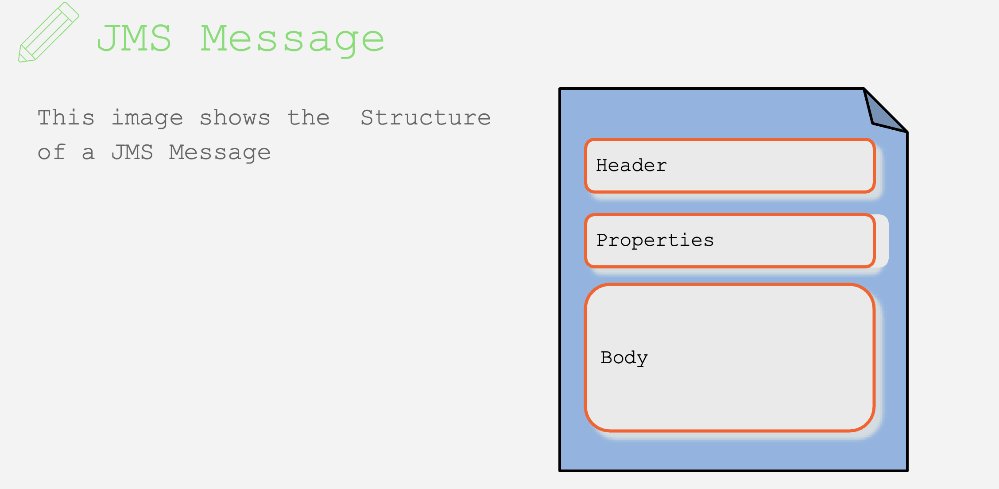
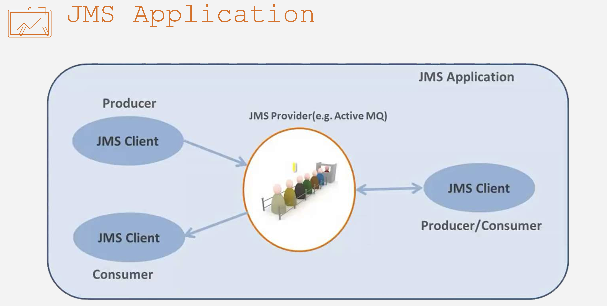
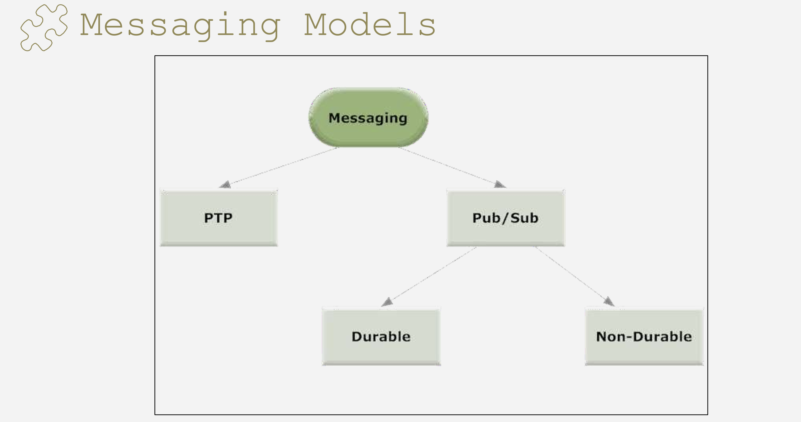
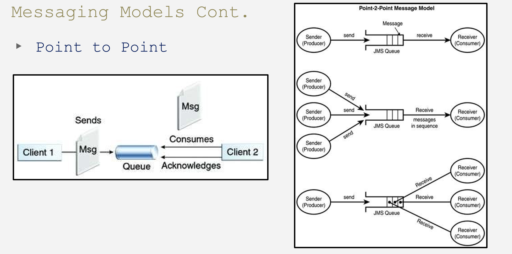
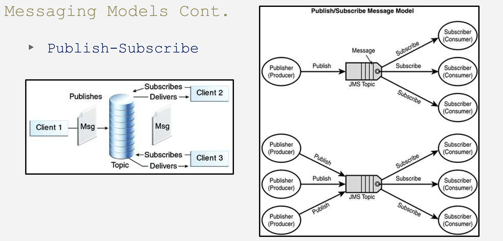
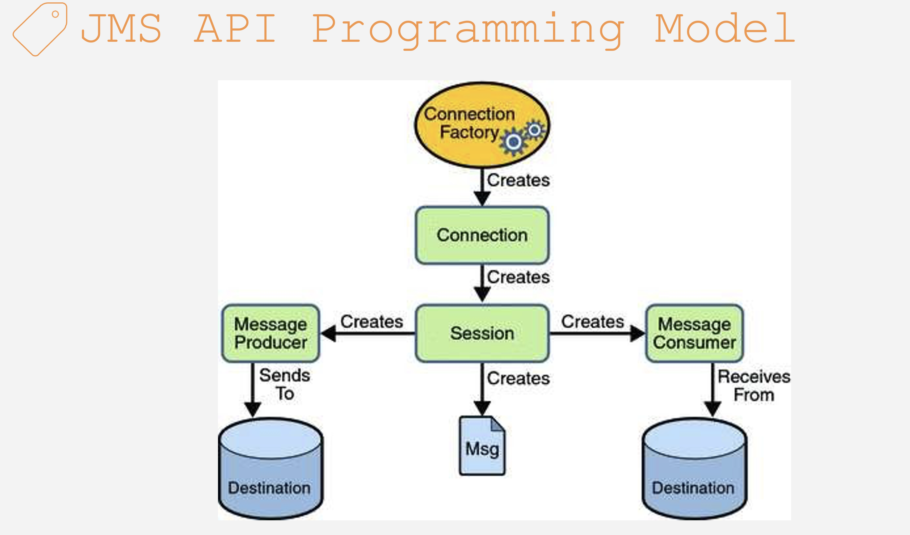
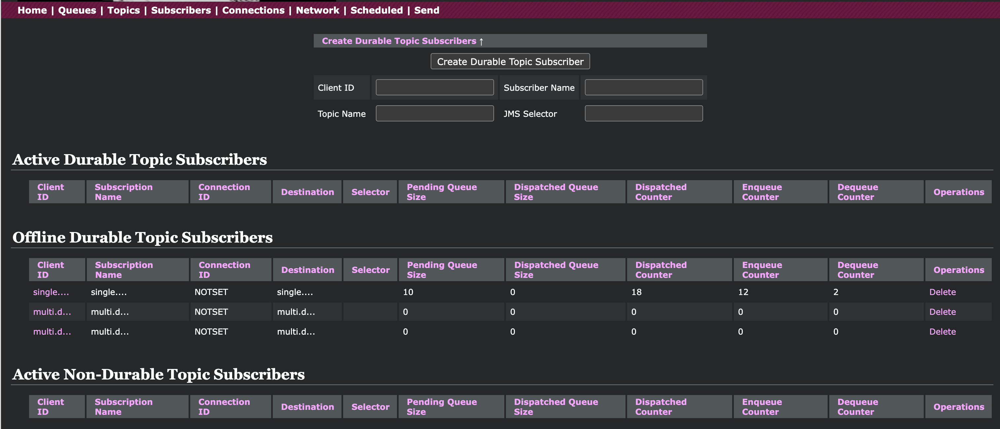

# JMS  

JMS 1.0, 1.1, 2.0 (current) 

Spec from Sun Microsystems .. basically shows how to do messaging between decoupled systems 

JMS vs (AMQP, MQTT various messaging standards)

light weight JMS 2.0 compliance then go for ActiveMQ

if you are doing AMQP & MQTT , then you do RabbitMQ 

**Topics**

- Message and Messaging
- What is JMS?
- Goals of JMS
- Benefits of JMS
- When to use JMS?
- JMS Message
- Java Mail vs JMS
- JMS Components
- JMS Application
- MOM Service Providers
- Messaging Models
- JMS API Programming Model
- Demo - JMS Pure Java
- Spring JMS
- JMSTemplate

**Message & Messaging**

**Message**

- Bytes of data that is meaningful **between the applications** which use it.
- Used to transfer information from one application to others.

**Messaging**

- **Communication** between **system components** or different **applications**.


**What is JMS?**

- JMS (Java Message Service) provides a standardized API to work with different Message Oriented Middleware (**MOM**) like JDBC allows you to work with different databases.
- Published and maintained by Sun Microsystems.
- First published in August 1998.
- **Loosely coupled** communication.
- **Asynchronous** messaging.
- **Reliable** delivery.




**Goals of JMS**

- Minimizes the set of concepts a programmer must learn to use messaging products (**programmer friendly**).
- Provides enough features to support sophisticated messaging applications.
- Maximizes the portability of JMS applications across JMS providers in the same messaging domain.

**When to use JMS?**

- The provider wants the components not to depend on information about other components' interfaces, so that components can be easily replaced.
- The provider wants the application to run **whether or not** all components are up and running simultaneously.
- The application business model allows a component to **send information to another** and to continue to operate without receiving an immediate response.

**JMS Message**



**Header, Properties, and Body**

| **Header**          | **Properties**                     | **Body**                         |
| ------------------- | ---------------------------------- | -------------------------------- |
| Identify message    | Added by the application developer | Message body                     |
| Destination         | Application-specific properties    | Can contain arbitrary data types |
| Routing Information | Key-value pairs                    | **Examples:**                    |
| Priority            | Extensions for messaging systems   | - Text messages                  |
| Timestamp           |                                    | - Map (key-value pairs)          |
| Message type        |                                    | - XML                            |
|                     |                                    | - Serialized objects (Java)      |
|                     |                                    | - Binary data                    |
|                     |                                    | - Empty                          |

**Java Mail vs JMS**

| **Java Mail**                                    | **JMS**                                                      |
| ------------------------------------------------ | ------------------------------------------------------------ |
| API for sending emails (e.g., with attachments). | Capable of exchanging messages between applications.         |
| Mainly for human information exchange.           | Application/Human to Application/Human Messaging.            |
| Delivery can be duplicated.                      | More like a database. Messages are removed once read by the recipient system. |
| Delivery not guaranteed.                         | Delivery is guaranteed (for the above reason).               |
| Designed for connectivity on the web.            | Provides different qualities of service (durable vs non-durable, queue vs topic). |


**JMS Components**

- **JMS Provider:**

  - The messaging system (**MOM**) that implements JMS.

- **JMS Clients:**

  - Java applications that produce/receive messages.

- **JMS Producer/Publisher:**

  - A JMS client that **creates and sends messages**.

- **JMS Consumer/Subscriber:**

  - A JMS client that **receives messages**.

- **JMS Application:**

  - The system composed of JMS clients and a JMS provider.

  




**MOM Service Providers**

| **Service Provider Product**   | **Company**          |
| ------------------------------ | -------------------- |
| Weblogic                       | (BEA systems) Oracle |
| WebsphereMq                    | IBM                  |
| RabbitMQ                       | OpenSource (PIvotal) |
| ZeroMQ                         | OpenSource           |
| TIBCO EMS                      | TIBCO                |
| ActiveMQ (5.x) - Artemis (6.x) | Apache Foundation    |



**Messaging Models **

- **Point to Point**
  - Message **queues**, senders, and receivers.
  - Message is sent to a queue.
  - **Each message has only one consumer.**
  - Queue may be configured to persist messages.
- **Publish-Subscribe**
  - **Publishers**, subscribers, and topics.
  - **Message may have multiple consumers, or no consumer at all.**
  - Each message is delivered to every client subscribed to a topic.

PTP vs PUB/SUB

| **Point to Point**                                           | **Publish-Subscribe**                                        |
| ------------------------------------------------------------ | ------------------------------------------------------------ |
| Each message has only one consumer.                          | Each message can have multiple consumers.                    |
| Messages first sent to a destination called Queue.           | Messages first sent to a destination called Topic.           |
| A sender and receiver of a message have no timing dependencies (receiver can fetch the message later). | Publishers and subscribers have a timing dependency (client needs to be subscribed and active). |
| The receiver acknowledges the successful processing of a message. | Does not provide acknowledgment.                             |






**JMS API Programming Model Cont.**

- **Connection Factory**

  - The client uses an object which is a connection factory used to **create a connection to a provider**.
  - It creates a connection between the JMS Provider and the JMS Client.

- **Connection**

  - A JMS connection **encapsulates a virtual connection with a JMS provider**.
  - It is an open TCP/IP socket between a client and a provider service daemon.

- **Session**

  - The session is a **single-threaded context** which is used for **producing and consuming messages**.
  - The sessions are used to create the following:
    - **Message Producers**
    - **Message Consumers**

- **Message Producer**

  - A JMS message producer object is created by a session.

  - It is used for **sending messages to a destination**.

- **Message Consumer**

  - A JMS message consumer object is created by a session.

  - It helps for **receiving messages sent to a destination**.


## Four acknowledgment modes for **ActiveMQ**:

### **1. AUTO_ACKNOWLEDGE**

- **Value**: `1`
- Description:
  - In this mode, the session automatically acknowledges receipt of a message once it has been successfully received and processed by the consumer.
  - The consumer does not need to explicitly acknowledge the message.
- Use Case:
  - This is the simplest mode and is generally used when message loss is acceptable (e.g., logging or monitoring systems).
- Advantages:
  - Simplifies the consumer code.
- Limitations:
  - If the consumer fails before processing the message, the message is considered acknowledged and may not be redelivered.

------

### **2. CLIENT_ACKNOWLEDGE**

- **Value**: `2`
- Description:
  - In this mode, the consumer explicitly acknowledges messages using the `Message.acknowledge()` method.
  - This gives the consumer control over when a message is considered successfully processed.
- Use Case:
  - Useful when you need fine-grained control over message acknowledgment (e.g., batch processing or when a message requires complex processing).
- Advantages:
  - Ensures messages are only acknowledged after successful processing.
- Limitations:
  - Requires explicit acknowledgment logic in the consumer, increasing complexity.

------

### **3. DUPS_OK_ACKNOWLEDGE**

- **Value**: `3`
- Description:
  - This mode acknowledges messages lazily. The provider can delay acknowledgment to optimize performance.
  - However, this can result in duplicate message delivery if a failure occurs before acknowledgment.
- Use Case:
  - Used in scenarios where performance is more critical than avoiding duplicate messages (e.g., telemetry systems or analytics pipelines).
- Advantages:
  - Reduces overhead by batching acknowledgments.
- Limitations:
  - Consumers must handle duplicate messages, as there is no guarantee that each message will be delivered exactly once.

------

### **4. SESSION_TRANSACTED**

- **Value**: `0`
- Description:
  - This mode uses transactions for message acknowledgment.
  - Messages are acknowledged only when the transaction is committed.
  - If the transaction is rolled back, the messages are redelivered.
- Use Case:
  - Suitable for ensuring guaranteed delivery and atomic processing of multiple messages (e.g., banking transactions or inventory updates).
- Advantages:
  - Provides the highest level of reliability and ensures atomicity for message processing.
- Limitations:
  - Higher overhead due to transaction management.
  - Requires the consumer to manage transactions explicitly using `Session.commit()` and `Session.rollback()`.

------

### **Summary Table**

| **Mode**            | **Value** | **Acknowledgment**       | **Use Case**                     | **Key Features**                              |
| ------------------- | --------- | ------------------------ | -------------------------------- | --------------------------------------------- |
| AUTO_ACKNOWLEDGE    | `1`       | Automatic                | Simple systems                   | Easy to use but may lose messages on failure. |
| CLIENT_ACKNOWLEDGE  | `2`       | Explicit by the consumer | Batch processing                 | Consumer decides when to acknowledge.         |
| DUPS_OK_ACKNOWLEDGE | `3`       | Lazy acknowledgment      | High-performance systems         | Allows duplicates to optimize performance.    |
| SESSION_TRANSACTED  | `0`       | Transaction-based        | Critical systems (e.g., finance) | Guarantees atomicity and reliability.         |

## **Spring JMS**

**Advantages**

- **No EJB container** required (no JEE container). [ Enterprise Java beans or Java enterprise edition support...from the underlying container]
- Simplified resource management.
- Connection Factory, Connections, Destinations.
- Simplified **concurrency management**.
- Simplified **transaction management**.

**JMS Template**

- Send and receive messages **synchronously**.

**Message Listener Container** (@jmsListener annotation)

- Receive messages **asynchronously**. 

- **Message-Driven POJOs (MDPs)**       [onMessage (from MDB world) - onMessage (in simple Java class MDP)]

  - how to receive the messages 

    - jmsTemplate.receive()  -- blocking call (from spring framework)

    - messageConsumer.receive() -- equivalent blocking call from javax.jms package

      <u>following are non-blocking , asynchronous calls</u>

    - MyMessageListener implements javax.jms.MessageListener   (onMessage method)  MDP - from javax.jms package 

    - MyMessageListener (any name) - any method annotated with @jmsListener annotation
       (most recommended, has transactionality, has concurrency - production grade for high throughput systems) (from spring framework)

**JMSTemplate**

| **Method**                      | **Description**                                              |
| ------------------------------- | ------------------------------------------------------------ |
| **browse()**                    | Browse messages in a queue.                                  |
| **convertAndSend()**            | Send messages synchronously. Convert a Java object to a JMS message. |
| **execute()**                   | Provides access to callbacks for more complex scenarios.     |
| **receive()**                   | Receive messages synchronously.                              |
| **receiveAndConvert()**         | Receive and convert messages synchronously.                  |
| **receiveSelected()**           | Receive filtered messages synchronously.                     |
| **receiveSelectedAndConvert()** | Receive and convert filtered messages synchronously.         |
| **send()**                      | Send a message synchronously using a MessageCreator.         |


The choice between `@JmsListener` and `JmsTemplate.receive()` in your Spring 6 applications depends on your specific use case, application architecture, and requirements for message consumption. Here’s a comparison to help you decide when to use each:

------

### **@JmsListener (Annotation-Based Listener)**

#### **Use When:**

1. **Asynchronous Message Consumption:**
   - Use `@JmsListener` for asynchronous, event-driven message processing. Messages are automatically delivered and processed without explicit polling.
2. **Simplified Configuration:**
   - It is ideal when you want the framework to manage the listener lifecycle, threading, and acknowledgment modes.
3. **Decoupled Design:**
   - You prefer a declarative and decoupled approach to consuming messages, allowing better modularity and testability.
4. **Continuous Processing:**
   - Your application needs to continuously process messages as they arrive in the queue.
5. **Built-in Error Handling:**
   - You want to leverage Spring's built-in error handling, retry mechanisms, and dead-letter queues via a `DefaultMessageListenerContainer`.

#### **Key Features:**

- Integrates seamlessly with message-driven POJOs.

- Supports concurrent message processing with minimal configuration.

- Automatically acknowledges messages based on the acknowledgment mode.

- Example:

  ```java
  @JmsListener(destination = "example.queue", containerFactory = "jmsListenerContainerFactory")
  public void receiveMessage(String message) {
      System.out.println("Received message: " + message);
  }
  ```

------

### **JmsTemplate.receive() (Manual Polling)**

#### **Use When:**

1. **Synchronous Message Consumption:**
   - Use `JmsTemplate.receive()` when you need to explicitly poll for messages in a blocking, synchronous manner.
2. **On-Demand Processing:**
   - Suitable for applications where message consumption is initiated by specific triggers or user actions.
3. **Selective Message Consumption:**
   - When you need fine-grained control over when and how to consume messages, including filtering or batch processing.
4. **Lightweight Integration:**
   - Ideal for one-off or ad-hoc message consumption, such as for administrative or monitoring purposes.
5. **Explicit Transaction Management:**
   - You want precise control over transaction boundaries, committing or rolling back based on your logic.

#### **Key Features:**

- Requires explicit configuration and invocation.

- Allows precise control over when messages are fetched.

- Does not automatically handle concurrency or acknowledgment.

- Example:

  ```java
  Message message = jmsTemplate.receive("example.queue");
  if (message != null) {
      System.out.println("Received message: " + message);
  }
  ```

------

### **Key Considerations for Decision:**

| **Factor**                       | **@JmsListener**                      | **JmsTemplate.receive()**                  |
| -------------------------------- | ------------------------------------- | ------------------------------------------ |
| **Asynchronous vs. Synchronous** | Asynchronous (non-blocking)           | Synchronous (blocking)                     |
| **Message Processing Mode**      | Continuous                            | On-demand                                  |
| **Complexity**                   | Simpler (less boilerplate)            | Manual (explicit coding required)          |
| **Error Handling**               | Built-in (with retry and DLQ support) | Custom (needs to be coded explicitly)      |
| **Thread Management**            | Automatic                             | Application-managed                        |
| **Use Case**                     | Event-driven microservices            | Ad-hoc, batch, or controlled message fetch |

------

### **Recommendations:**

- **Default Choice:** Use `@JmsListener` (replacing javax.jms.MessageListener) for most cases, especially when building event-driven or asynchronous applications, as it aligns well with modern microservice and messaging paradigms.
- **Specialized Use:** Opt for `JmsTemplate.receive()` (replacing MessageConsumer.receive()) if you have synchronous or ad-hoc requirements, such as polling during application startup, diagnostics, or administrative tasks.


The difference between **durable** and **non-durable subscribers** in the context of **ActiveMQ 5.x** revolves around message persistence and how subscribers receive messages when they are offline. Here's an explanation:

### **Durable Subscriber**
A durable subscriber ensures that messages published to a topic are not lost if the subscriber is temporarily disconnected. This is useful for scenarios where a subscriber needs to receive all messages, even those sent when it was offline.

#### **Characteristics**
1. **Persistence**: Messages are stored on the broker for the durable subscriber if it is offline.
2. **Subscription Identity**: Durable subscribers are uniquely identified by a combination of:
   - **Client ID**: A unique identifier for the connection.
   - **Subscription Name**: A unique name for the durable subscription.
3. **Message Delivery**: The subscriber receives all messages published to the topic, even those sent while it was offline.
4. **Performance**: Additional overhead for the broker because it must store messages for offline durable subscribers.
5. **Use Case**: Applications that need guaranteed message delivery, such as logging or data synchronization.

#### **How to Create a Durable Subscriber**
The client must:
- Set a unique **client ID** on the connection.
- Use a unique **subscription name** when subscribing to the topic.

```java
connection.setClientID("uniqueClientId");
Session session = connection.createSession(false, Session.AUTO_ACKNOWLEDGE);
Topic topic = session.createTopic("exampleTopic");
MessageConsumer consumer = session.createDurableSubscriber(topic, "uniqueSubscriptionName");
```

---

### **Non-Durable Subscriber**
A non-durable subscriber only receives messages while it is connected to the broker. If the subscriber disconnects, any messages sent to the topic during the disconnection are lost for that subscriber.

#### **Characteristics**
1. **No Persistence**: Messages are not stored for offline subscribers.
2. **Subscription Identity**: Non-durable subscriptions do not require a unique **client ID** or **subscription name**.
3. **Message Delivery**: The subscriber only receives messages while it is active and connected.
4. **Performance**: Less overhead for the broker since no messages are stored for non-durable subscribers.
5. **Use Case**: Applications where real-time updates are required but historical messages are not critical, such as live notifications or event streams.

#### **How to Create a Non-Durable Subscriber**
No need to set a **client ID** or **subscription name**.

```java
Session session = connection.createSession(false, Session.AUTO_ACKNOWLEDGE);
Topic topic = session.createTopic("exampleTopic");
MessageConsumer consumer = session.createConsumer(topic);
```

---

### **Comparison Table**

| Feature                   | Durable Subscriber                       | Non-Durable Subscriber        |
| ------------------------- | ---------------------------------------- | ----------------------------- |
| **Message Persistence**   | Messages stored when offline             | Messages lost when offline    |
| **Subscription Identity** | Requires client ID and subscription name | No special requirements       |
| **Message Delivery**      | All messages delivered, even offline     | Only messages while connected |
| **Performance Impact**    | Higher (due to persistence overhead)     | Lower                         |
| **Use Case**              | Reliable, guaranteed delivery            | Real-time updates only        |

---

### **Summary**
- **Durable Subscribers** are ideal for use cases where message reliability is critical, even if the subscriber is not always connected.
- **Non-Durable Subscribers** are more suited for scenarios where only real-time updates are required and missing messages during disconnection is acceptable.

- You can check "Pending Queue Size" in the web console per subscription 




## @Transactional annotation  (in code branch `spring-jms-jdbc-distributed-local-tx-mix`)

The `bitronixTransactionManager` bean in your [applicationContext.xml](vscode-file://vscode-app/Applications/Visual Studio Code.app/Contents/Resources/app/out/vs/code/electron-sandbox/workbench/workbench.html) is responsible for managing transactions in your Spring application. It is part of the Bitronix Transaction Manager (BTM), which is a JTA (Java Transaction API) compliant transaction manager. Here's a detailed explanation of its role:

### Configuration Breakdown

1. **Bitronix Configuration (`btmConfig`)**:

   

   ```xml
   
   <bean id="btmConfig" factory-method="getConfiguration" class="bitronix.tm.TransactionManagerServices">
   		<property name="serverId" value="spring-btm" />
   		<property name="DefaultTransactionTimeout" value="30" />
   </bean>
   
   ```

   

   This bean configures the Bitronix Transaction Manager. The `serverId` is a unique identifier for the transaction manager instance, and `DefaultTransactionTimeout` sets the default timeout for transactions.

2. **Bitronix Transaction Manager (`bitronixTransactionManager`)**:

   <bean id="bitronixTransactionManager" factory-method="getTransactionManager"

      class="bitronix.tm.TransactionManagerServices" depends-on="btmConfig" destroy-method="shutdown" />

   This bean creates an instance of the Bitronix Transaction Manager. It depends on the `btmConfig` bean for its configuration. The `destroy-method="shutdown"` ensures that the transaction manager is properly shut down when the application context is closed.

3. **Spring JTA Transaction Manager (`transactionManager`)**:

   ```xml
   <bean id="transactionManager" class="org.springframework.transaction.jta.JtaTransactionManager" >
   
     <property name="transactionManager" ref="bitronixTransactionManager"/>
   
     <property name="userTransaction" ref="bitronixTransactionManager"/>
   
   </bean>
   
   
   ```

   This bean integrates the Bitronix Transaction Manager with Spring's transaction management infrastructure. The `JtaTransactionManager` is a Spring-provided class that acts as a bridge between Spring's transaction management and the underlying JTA-compliant transaction manager (Bitronix in this case).

### Role in the Application

- **Transaction Management**: The `bitronixTransactionManager` manages the lifecycle of transactions, including beginning, committing, and rolling back transactions. It ensures that all resources (e.g., JMS connections, database connections) involved in a transaction are properly coordinated.
- **XA Transactions**: The `PoolingConnectionFactory` bean is configured to use `org.apache.activemq.ActiveMQXAConnectionFactory`, which supports XA transactions. The `bitronixTransactionManager` coordinates these XA transactions, ensuring that all participating resources either commit or roll back changes atomically.
- **Integration with Spring**: The `transactionManager` bean allows Spring's declarative transaction management (e.g., `@Transactional` annotations) to work with the Bitronix Transaction Manager. This means you can use Spring's transaction management features while leveraging the capabilities of Bitronix.

### Example Usage

When a method annotated with `@Transactional` is called, the `JtaTransactionManager` (backed by `bitronixTransactionManager`) will:

1. Begin a new transaction.
2. Ensure that all operations within the method participate in this transaction.
3. Commit the transaction if the method completes successfully.
4. Roll back the transaction if an exception occurs.

This ensures data consistency and integrity across multiple resources (e.g., JMS and database) involved in the transaction.

## Docker commands for running ActiveMQ 5.x and MySQL database 8.x

(Java version 8)

<u>Pending Compatibility for - update to Spring 6.x , ActiveMQ Artemis 6.x , Java 17</u> 

docker run --name mysql -e MYSQL_ROOT_PASSWORD=password123  -p 3306:3306 -e MYSQL_EXTRA_FLAGS="--max_connections=100"  bitnami/mysql:latest 

docker run -it --rm \                                                                          -e ACTIVEMQ_ADMIN_LOGIN=admin \      
  -e ACTIVEMQ_ADMIN_PASSWORD=admin \
  -p 8161:8161 \             
  -p 61616:61616 \                
  -p 5672:5672 \       
  -p 61613:61613 \
  -p 1883:1883 \
  -p 61614:61614 \
  rmohr/activemq

-----

PENDING - talk for 30 mins to compare RabbitMQ concepts against ActiveMQ concepts (routing key etc)
Also some notes for JMS vs AMQP vs MQTT 

PENDING - show Artemis console as well. 

PENDING - check why client_ack consumer is removing two messages at a time when it only acks one

PENDING -- this code is not doing load balancing , just confirm..@Test

​    public void testMessageConsumerUsingMultipleMessageListener() {

​        jmsConsumerClientManualAckMultiListener.setupListenerAndConsumerMessages(); 

​        // manual ack, spawns off MULTIPLE javax.jms.MessageListener instance

​    }


------

Apache ActiveMQ Artemis 

https://activemq.apache.org/components/artemis/documentation/1.0.0/examples.html

-----

<u>XA Transactions , 2PC commits or distributed transactions</u> 

----------

jms branches 

---------------------------------------------
  (DONE)  remotes/origin/jms-queue-producer-consumer    - simple JMS / Java based queue producer/consumer  [no spring, jms sender with ConnectionFactory, Connection etc. (various flavors (ack/noAck etc) of JMS (no spring) listeners) ]

  remotes/origin/jms-topic-publisher-subscriber - simple JMS / Java based topic publish/subscribe

  (DONE)  remotes/origin/spring-jms-mdb         - sender is jmsTemplate, receiver is consumer implementing MessageListener(JMS) - basic example
  refer to the README.txt in the project root for more details.

  (DONE)  remotes/origin/spring-jms-mdb-delayed - same as above - small delta for adding delay (Thread.sleep) while processing

  (DONE)  remotes/origin/spring-jms-demo-app    - spring jms demo app shows both @JMSListener  and Consumer implements MessageListener (JMS) - sender using jmsTemplate

  (DONE)  remotes/origin/spring-jms-producer-consumer-jmstemplatereceive - this is spring with jmsTemplate.send() and jmsTemplate.receive

  (DONE)  remotes/origin/spring-jms-pub-sub-msg-conv - same as above, small convert is happening

(DONE) remotes/origin/spring-jms-jdbc-distributed-local-tx-mix  				-- uses @Transactional annotation with bitrionix TM	


  remotes/origin/spring-jms-jdbc-distributed-tx    						--  @Transaction annotation with bitrionix TM 
  remotes/origin/spring-jms-jdbc-topic-distributed-local-tx-mix  		-- same as above with Topic pub-sub topology 

  remotes/origin/spring-jms-transaction           				- 
  remotes/origin/spring-jms-using-jndi-ctx         				- basic jndi lookup 
  remotes/origin/spring-jms-with-transaction-mgr  				- @transactional annotation
  remotes/origin/spring-jms-with-transaction-mgr-user-managed	- manual transactions 

  remotes/origin/spring-jms-gateway-pub-sub   - extends JMSGatewaySupport (minor check again)
    