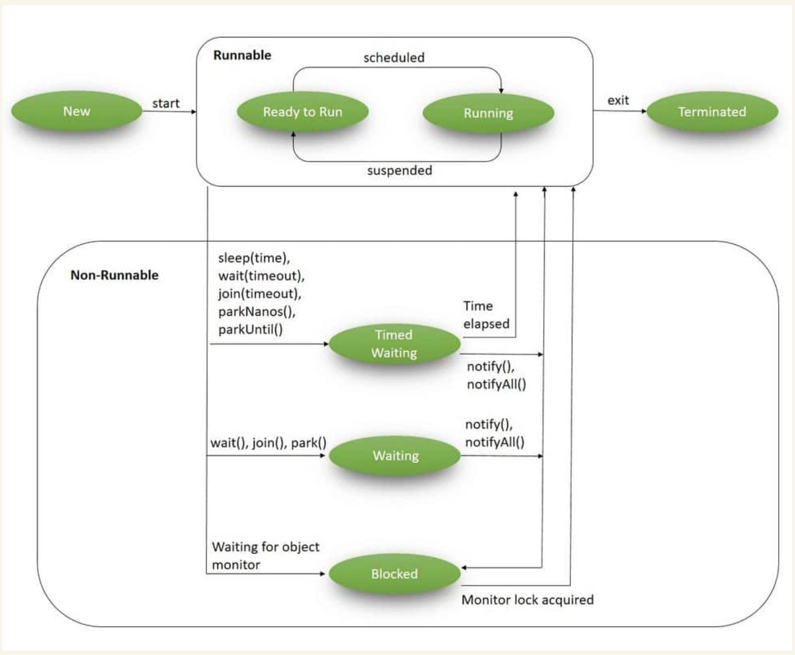
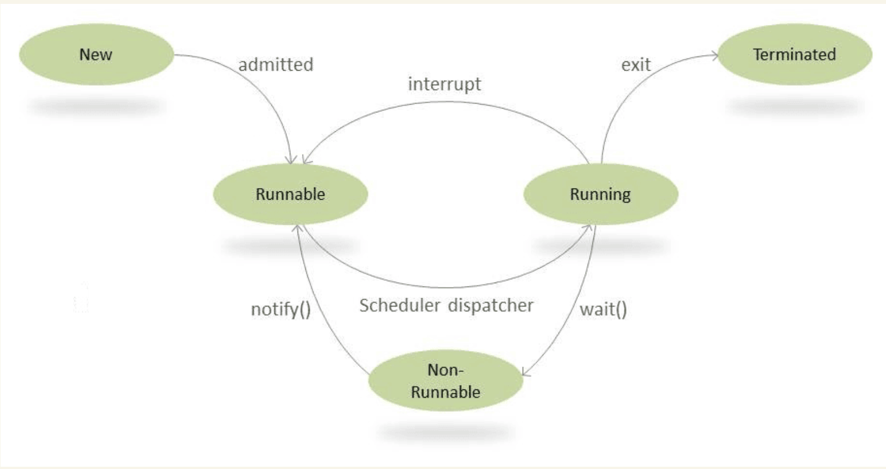
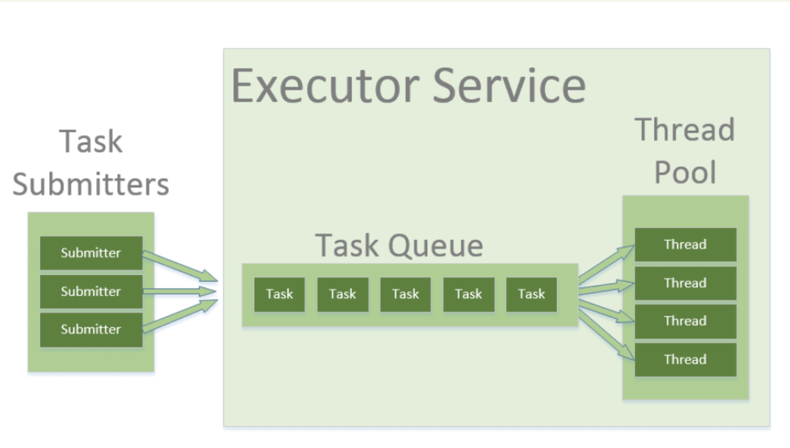
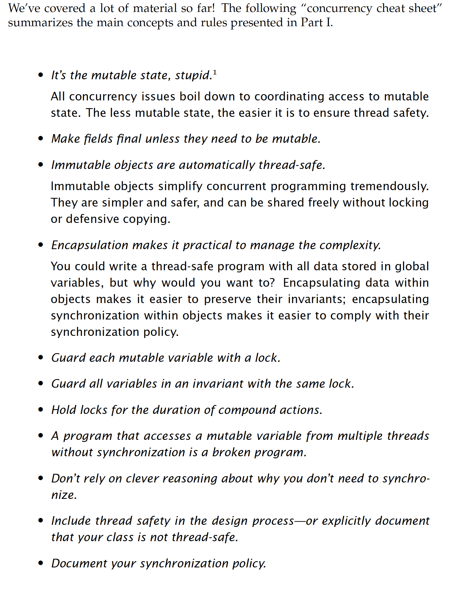

Questions -- 

`Thread.sleep() - confirm that the context will determine which thread will sleep ...`

### 

In Java, a **Thread** represents a **concurrent unit of execution** within a program. Java supports **multithreading**, which means you can run multiple threads concurrently, allowing a program to perform multiple tasks at the same time. Threads are part of the **java.lang.Thread** class, which provides methods to create, control, and manage threads.

### Key Concepts of Threads in Java

1. **Process vs Thread**:

   - A **process** is an instance of a program that runs in its own memory space. 
   - A **thread** is a smaller unit of a process, sharing the process’s memory space but running independently. Multiple threads can run within a single process(JVM).

2. **Multithreading**:

   - `**Multithreading** refers to the ability of a CPU (or single core) to execute multiple threads concurrently.`
   - This allows tasks to be performed simultaneously, making programs more efficient, especially when performing I/O-bound or CPU-intensive tasks.

3. **Creating a Thread**:
   In Java, you can create a thread in two main ways:

   - **Extending the `Thread` class**:
     You can create a class that extends `Thread` and override its `run()` method.

     ```java
     class MyThread extends Thread {
         public void run() {
             System.out.println("Thread is running...");
         }
     }
     
     public class Main {
         public static void main(String[] args) {
             MyThread thread = new MyThread();
             thread.start(); // Start the thread
         }
     }
     ```

   - **Implementing the `Runnable` interface**:
     This is the preferred way because it allows your class to implement multiple interfaces (Java supports single inheritance).

     ```java
     class MyRunnable implements Runnable {
         public void run() {
             System.out.println("Runnable thread is running...");
         }
     }
     
     public class Main {
         public static void main(String[] args) {
             Thread thread = new Thread(new MyRunnable());
             thread.start(); // Start the thread
         }
     }
     ```

4. **Lifecycle of a Thread**:
   A thread goes through different states in its lifecycle:

   - **New**: When a thread is created but not yet started (`new Thread()`).
   - **Runnable**: When the `start()` method is invoked, the thread is ready to run or is running (`thread.start()`).
   - **Blocked/Waiting**: The thread is waiting for a resource or a signal to proceed (e.g., waiting for I/O or `wait()`).
   - **Timed Waiting**: The thread is waiting for a specific period of time (e.g., using `sleep()` or `wait(timeout)`).
   - **Terminated**: The thread has finished executing its `run()` method.

5. **Important Methods in `Thread` Class**:

   - `start()`: Starts the execution of the thread. Internally, it calls the `run()` method.
   - `run()`: Contains the code that constitutes the thread's task. You override this method to define the behavior of the thread.
   - `sleep(long millis)`: Puts the current thread to sleep for the specified time.
   - `join()`: Waits for the thread to finish execution before proceeding.
   - `interrupt()`: Interrupts the thread if it's in a waiting or sleeping state.
   - `isAlive()`: Checks if the thread is still running.

6. **Thread Synchronization**:
   When multiple threads access shared resources (e.g., variables or data structures), you need to ensure **thread safety** by synchronizing threads.

   - **`synchronized` keyword**: Used to prevent multiple threads from accessing a block of code or method simultaneously.

     ```java
     public synchronized void synchronizedMethod() {
         // Only one thread can access this method at a time
     }
     ```

7. **Thread States**:
   Java threads can exist in one of several states:

   - **New**: Thread has been created but not yet started.
   - **Runnable**: Thread is ready to run and is either running or waiting for CPU time.
   - **Blocked**: Thread is waiting for a monitor lock to enter a synchronized block/method.
   - **Waiting**: Thread is waiting indefinitely for another thread to perform a particular action.
   - **Timed Waiting**: Thread is waiting for a specified amount of time.
   - **Terminated**: The thread has finished its execution.

8. **Daemon Threads**:

   - A **daemon thread** is a background thread that runs continuously but does not prevent the program from terminating.
   - They are typically used for tasks like garbage collection.
   - You can set a thread as a daemon using `setDaemon(true)`.

9. **Concurrency Utilities**:

   - Java provides higher-level concurrency utilities in the `java.util.concurrent` package, such as `ExecutorService`, `ForkJoinPool`, `CountDownLatch`, `Semaphore`, and others for managing threads more efficiently.

### Example of Multithreading with `Runnable`:

```java
class MyTask implements Runnable {
    public void run() {
        for (int i = 0; i < 5; i++) {
            System.out.println(Thread.currentThread().getName() + " - Task: " + i);
            try {
                Thread.sleep(1000);  // Simulates work
            } catch (InterruptedException e) {
                System.err.println("Thread interrupted");
            }
        }
    }
}

public class Main {
    public static void main(String[] args) {
        Thread t1 = new Thread(new MyTask());
        Thread t2 = new Thread(new MyTask());

        t1.start();  // Start the first thread
        t2.start();  // Start the second thread
    }
}
```

### Conclusion

- A **thread** in Java represents an independent path of execution within a program, allowing you to run multiple tasks concurrently.
- Java offers several ways to create and manage threads, and multithreading is useful for improving performance, especially in I/O-bound and parallelizable tasks.
- However, multithreading can introduce issues like **race conditions**, which need to be handled carefully with synchronization or concurrency utilities.


-------

### Runnable vs. Callable in Java

Since the early days of Java, multithreading has been a core aspect of the language. The **Runnable** interface has long been the standard for representing multithreaded tasks, but with Java 1.5, the **Callable** interface was introduced as an improved version.

Below, we look at the differences and applications of both interfaces.

---

### Runnable and Callable Overview

Both interfaces represent tasks that can be run by multiple threads. **Runnable** tasks can be executed using the `Thread` class or `ExecutorService`, while **Callable** tasks can only be executed using `ExecutorService`.

Let’s dive deeper into how they handle return values.

---

### Runnable Interface

The **Runnable** interface is a functional interface with a single `run()` method. This method does not accept parameters or return any values, making it suitable for tasks where no result is required, such as logging incoming events:

```java
public interface Runnable {
    public void run();
}
```

#### Example: Event Logging Task

```java
public class EventLoggingTask implements Runnable {
    private Logger logger = LoggerFactory.getLogger(EventLoggingTask.class);

    @Override
    public void run() {
        logger.info("Message");
    }
}
```

In this example, the thread reads a message from the queue and logs it to a file. Since no value is returned, we can launch the task using `ExecutorService`:

```java
public void executeTask() {
    executorService = Executors.newSingleThreadExecutor();
    Future future = executorService.submit(new EventLoggingTask());
    executorService.shutdown();
}
```

Here, the `Future` object will not hold any value.

---

### Callable Interface

The **Callable** interface is a generic interface with a single `call()` method that returns a value of type `V`:

```java
public interface Callable<V> {
    V call() throws Exception;
}
```

#### Example: Calculating Factorial

```java
public class FactorialTask implements Callable<Integer> {
    int number;

    public Integer call() throws InvalidParamaterException {
        int fact = 1;
        for (int count = number; count > 1; count--) {
            fact = fact * count;
        }
        return fact;
    }
}
```

The result of the `call()` method is returned as a `Future` object:

```java
@Test
public void whenTaskSubmitted_ThenFutureResultObtained() throws Exception {
    FactorialTask task = new FactorialTask(5);
    Future<Integer> future = executorService.submit(task);

    assertEquals(120, future.get().intValue());
}
```

---

### Exception Handling

One major difference between `Runnable` and `Callable` is how they handle exceptions.

Since the `Runnable` interface’s `run()` method doesn’t specify a `throws` clause, there is no mechanism to propagate checked exceptions.

On the other hand, **Callable**’s `call()` method contains a `throws Exception` clause, allowing checked exceptions to be propagated:

```java
public class FactorialTask implements Callable<Integer> {
    public Integer call() throws InvalidParamaterException {
        if (number < 0) {
            throw new InvalidParamaterException("Number should be positive");
        }
        // ...
    }
}
```

When using `Callable` with `ExecutorService`, exceptions are stored in the `Future` object. We can check for exceptions by calling `Future.get()`, which will throw an `ExecutionException` that wraps the original exception:

```java
@Test(expected = ExecutionException.class)
public void whenException_ThenCallableThrowsIt() throws Exception {
    FactorialCallableTask task = new FactorialCallableTask(-5);
    Future<Integer> future = executorService.submit(task);
    Integer result = future.get().intValue();
}
```

In the test above, an `ExecutionException` is thrown because we passed an invalid number. The original exception can be retrieved using the `getCause()` method.

If we don’t call `Future.get()`, the exception won’t be reported, and the task will still be marked as completed:

```java
@Test
public void whenException_ThenCallableDoesntThrowsItIfGetIsNotCalled() throws Exception {
    FactorialCallableTask task = new FactorialCallableTask(-5);
    Future<Integer> future = executorService.submit(task);

    assertEquals(false, future.isDone());
}
```

---

### Conclusion

We explored the differences between the **Runnable** and **Callable** interfaces. **Runnable** is best suited for tasks that don’t return a result, while **Callable** provides a way to return values and handle exceptions.

-------


### What Is a Race Condition?

One of the most common problems in multithreaded applications is the issue of race conditions. Let's explore what race conditions are, how to detect them, and approaches to handle them.

`By definition, a **race condition** occurs when the behavior/output of a program depends on the relative timing or interleaving of multiple threads or processes. This can result in undesirable outcomes, leading to nondeterministic behavior. A **thread-safe** program or data structure is free from race conditions when accessed by multiple threads.`

---

### Example: Funds Transfer Between Two Accounts

Let’s consider a simple function for transferring funds between two bank accounts:

```pseudo
algorithm Transfer(amount, accountSource, accountTarget):
    // INPUT
    //   amount = Amount to be transferred
    //   accountSource = Source account for the transfer
    //   accountTarget = Target account for the transfer
    // OUTPUT
    //   Transfers the specified amount from the source to the target account if possible

   // (this is conceptually closer to pessimistic locking than optimistic locking)
  //obtain lock   
      // (locks are implemented using synchronized keyword and using explicit Lock           // objects (from java.concurrency package))
   {  //CRITICAL SECTION
    if accountSource.balance < amount:
        return

    accountTarget.balance <- accountTarget.balance + amount
    accountSource.balance <- accountSource.balance - amount
   } 
   //release lock
```

In this implementation, we check if there are sufficient funds in the source account before proceeding with the transfer. However, if two transfer attempts are initiated simultaneously from different threads or processes, we may encounter an unexpected result due to a `race condition`.

---

### The Problem of Race Conditions

When operations on a shared resource (such as bank account balances) are interleaved unpredictably due to thread scheduling, it can lead to incorrect outcomes. This is a `classic race condition`.

To prevent race conditions, operations on shared resources must be `**atomic**`—executed as indivisible units. One way to achieve atomicity is by using `**critical sections**`—mutually exclusive parts of the program. <u>Another approach is to use `**atomic operations**` that leverage hardware capabilities to ensure indivisibility.</u>

---

### Check-Then-Act: A Common Race Condition

In the bank transfer example, we observed a **check-then-act** pattern. This is the most common type of race condition, where a stale observation is used to decide the next action. Bugs produced by this pattern are referred to as **Time-of-check to time-of-use (TOCTOU)** bugs.

TOCTOU bugs are common in file system access and can lead to security vulnerabilities, including privilege escalation and denial-of-service attacks. Another example of this race condition is **lazy initialization**, where initialization is deferred until the first use of a resource.

---

### Example: Race Condition in Increment Operations

Consider this pseudocode that uses a regular increment operation:

```pseudo
algorithm GenerateId():
    // INPUT
    //   counter = Global counter
    // OUTPUT
    //   Returns a unique identifier by incrementing a global counter

    return counter++ (at the cpu register level it is three operations , not 1)
```

In most languages, the `counter++` operation involves three sequential steps: read, modify, and write. Without atomicity guarantees, interleaving multiple threads attempting to execute this operation can lead to incorrect results—another example of a race condition.

---

### Dealing with Race Conditions

Race conditions can be difficult to reproduce, debug, and eliminate, leading to bugs known as **heisenbugs**. While multi-threaded unit tests can help identify race conditions, they do not guarantee 100% detection.

There are two main approaches to handle race conditions:

1. `Avoid shared state`**: Eliminating shared state prevents race conditions. For instance, **immutable objects, which cannot change after construction, are inherently thread-safe. `Similarly, thread-local variables, where each thread has its own private copy, are also thread-safe`.

2. `Use synchronization and atomic operations`: Synchronization primitives, such as critical sections and **locks**, ensure that only one thread can execute a particular section of the program at a time. **Atomic operations** execute as single, indivisible units of work, often relying on hardware capabilities to ensure that no interruptions occur during execution.

---

### The Question: Runnable or Thread?

A common question developers face is: *"Should I implement `Runnable` or extend the `Thread` class?"*

---

### Extending the `Thread` Class

Let’s first define a `SimpleThread` class that extends `Thread`:

```java
public class SimpleThread extends Thread {

    private String message;

    // standard logger, constructor

    @Override
    public void run() {
        log.info(message);
    }
}
```

To run a thread of this type:

```java
@Test
public void givenAThread_whenRunIt_thenResult() throws Exception {
    Thread thread = new SimpleThread("SimpleThread executed using Thread");
    thread.start();
    thread.join();
}
```

You can also use an `ExecutorService` to execute the thread:

```java
@Test
public void givenAThread_whenSubmitToES_thenResult() throws Exception {
    executorService.submit(new SimpleThread("SimpleThread executed using ExecutorService")).get();
}
```

That’s quite a lot of code for running a single log operation in a separate thread. Also, note that `SimpleThread` cannot extend any other class, as Java doesn’t support multiple inheritance.

---

### Implementing the `Runnable` Interface

Now, let’s create a simple task that implements the `java.lang.Runnable` interface:

```java
class SimpleRunnable implements Runnable {
    private String message;

    // standard logger, constructor

    @Override
    public void run() {
        log.info(message);
    }
}
```

The `SimpleRunnable` is just a task we want to run in a separate thread. There are several ways to run it; one approach is to use the `Thread` class:

```java
@Test
public void givenRunnable_whenRunIt_thenResult() throws Exception {
    Thread thread = new Thread(new SimpleRunnable("SimpleRunnable executed using Thread"));
    thread.start();
    thread.join();
}
```

You can also use an `ExecutorService`:

```java
@Test
public void givenARunnable_whenSubmitToES_thenResult() throws Exception {
    executorService.submit(new SimpleRunnable("SimpleRunnable executed using ExecutorService")).get();
}
```


---

### Using Lambda Expressions with `Runnable`

Starting with Java 8, any interface exposing a single abstract method is treated as a functional interface, making it a valid lambda expression target. We can rewrite the `Runnable` code using a lambda expression:

```java
@Test
public void givenARunnableLambda_whenSubmitToES_thenResult() throws Exception {
    executorService.submit(() -> log.info("Lambda runnable executed!"));
}
```

---

### Why Choose `Runnable` Over `Thread`?

In general, we encourage using `Runnable` over extending the `Thread` class for the following reasons:

- **Single Inheritance Limitation**: After extending the `Thread` class, we can’t extend any other class.

- **Lambda Expression Compatibility**: Starting from Java 8, `Runnable` can be represented as a lambda expression, making it more concise.

---

### 1. **Creating Threads (Thread Class and Runnable Interface)**

In real-world applications, threads are often used for tasks like handling concurrent requests in a server or performing background processing.

#### Example 1: Extending `Thread` Class (Real-World Use Case)
Imagine a file download manager where each download runs on a separate thread.
```java
class FileDownloadThread extends Thread {
    private String fileName;

    public FileDownloadThread(String fileName) {
        this.fileName = fileName;
    }

    public void run() {
        System.out.println("Downloading " + fileName + "...");
        try {
            Thread.sleep(2000); // Simulate file download time
        } catch (InterruptedException e) {
            e.printStackTrace();
        }
        System.out.println(fileName + " download complete.");
    }
}

public class Main {
    public static void main(String[] args) {
        FileDownloadThread download1 = new FileDownloadThread("file1.txt");
        FileDownloadThread download2 = new FileDownloadThread("file2.txt");

        download1.start();
        download2.start();
    }
}
```
This example demonstrates how each file download can run independently.

#### Example 2: Implementing `Runnable` Interface (Real-World Use Case)
In a banking application, you might want to process multiple transactions concurrently.
```java
class BankTransaction implements Runnable {
    private String transactionType;

    public BankTransaction(String transactionType) {
        this.transactionType = transactionType;
    }

    public void run() {
        System.out.println("Processing " + transactionType + " transaction...");
        try {
            Thread.sleep(1500); // Simulate transaction processing
        } catch (InterruptedException e) {
            e.printStackTrace();
        }
        System.out.println(transactionType + " transaction complete.");
    }
}

public class Main {
    public static void main(String[] args) {
        Thread transaction1 = new Thread(new BankTransaction("Deposit"));
        Thread transaction2 = new Thread(new BankTransaction("Withdrawal"));

        transaction1.start();
        transaction2.start();
    }
}
```
In a real-world system, multiple bank transactions could be processed concurrently like this.

### 2. **Thread Lifecycle** 

Real-world use cases for understanding the thread lifecycle include managing the state of threads in complex systems, like web servers handling requests, where threads can be in waiting states.

#### Example: Real-Time Thread Monitoring 
```java
class RequestHandler extends Thread {
    public void run() {
        System.out.println("Handling request...");
        try {
            Thread.sleep(2000); // Simulating request handling time
        } catch (InterruptedException e) {
            e.printStackTrace();
        }
        System.out.println("Request handled.");
    }
}

public class Main {
    public static void main(String[] args) throws InterruptedException {
        Thread requestThread = new RequestHandler();
        System.out.println("State: " + requestThread.getState()); // NEW
        requestThread.start();
        System.out.println("State: " + requestThread.getState()); // RUNNABLE
        Thread.sleep(500); // Give some time for thread to enter TIMED_WAITING
        System.out.println("State: " + requestThread.getState()); // TIMED_WAITING
        requestThread.join();
        System.out.println("State: " + requestThread.getState()); // TERMINATED
    }
}
```
This way you can monitor and understand the lifecycle of threads.

### More details on Thread Lifecycle..



### Life Cycle of a Thread

In Java, multithreading revolves around the core concept of a **Thread**. During their lifecycle, threads go through various states, as defined by the `Thread.State` enum in the `java.lang.Thread` class:

- **NEW**: A newly created thread that has not yet started execution.
- **RUNNABLE**: Either running or ready for execution but waiting for resource allocation.
- **BLOCKED**: Waiting to acquire a monitor lock to enter or re-enter a synchronized block/method.
- **WAITING**: Waiting for another thread to perform a particular action without any time limit.
- **TIMED_WAITING**: Waiting for another thread to perform a specific action for a set period.
- **TERMINATED**: Has completed its execution.

---

### NEW State

A **NEW** thread is a thread that has been created but not yet started. It remains in this state until we start it using the `start()` method. The following code shows a thread in the NEW state:

```java
Runnable runnable = new NewState();
Thread t = new Thread(runnable);
System.out.println(t.getState());  // Output: NEW
```

---

### RUNNABLE State

When a thread is started using the `start()` method, it moves from **NEW** to **RUNNABLE**. A thread in this state is either running or ready to run but waiting for resource allocation.

```java
Runnable runnable = new NewState();
Thread t = new Thread(runnable);
t.start();
System.out.println(t.getState());  // Output: RUNNABLE
```

---

### BLOCKED State

A thread enters the **BLOCKED** state when it’s trying to enter a synchronized block but another thread already holds the lock.

```java
public class BlockedState {
    public static void main(String[] args) throws InterruptedException {
        Thread t1 = new Thread(new DemoBlockedRunnable());
        Thread t2 = new Thread(new DemoBlockedRunnable());
        
        t1.start();
        t2.start();
        
        Thread.sleep(1000);
        System.out.println(t2.getState());  // Output: BLOCKED
    }
}

class DemoBlockedRunnable implements Runnable {
    public static synchronized void commonResource() {  ///THIS WILL BLOCK...other threads
        while (true) {
            // Infinite loop to simulate heavy processing
        }
    }

    @Override
    public void run() {
        commonResource();
    }
}
```

---

### WAITING State

A thread is in the **WAITING** state when it’s waiting for another thread to perform a particular action. This state can be entered via `object.wait()`, `thread.join()`, or `LockSupport.park()`.

```java
public class WaitingState implements Runnable {
    public static Thread t1;

    public static void main(String[] args) {
        t1 = new Thread(new WaitingState());
        t1.start(); //WAITING for t2
        t3.start(); //JVM could still run this in the meantime
        t4.start(); 
    }

    public void run() {
        Thread t2 = new Thread(new DemoWaitingStateRunnable());
        t2.start();

        try {
            t2.join();
        } catch (InterruptedException e) {
            Thread.currentThread().interrupt();
            e.printStackTrace();
        }
      sout("JVM guarantees happens-after relationship here..");
    }
}

class DemoWaitingStateRunnable implements Runnable {
    public void run() {
        try {
            Thread.sleep(10000000);
        } catch (InterruptedException e) {
            Thread.currentThread().interrupt();
            e.printStackTrace();
        }
        System.out.println(WaitingState.t1.getState());  // Output: WAITING
    }
}
```

---

### TIMED_WAITING State

A thread enters the **TIMED_WAITING** state when it waits for another thread to perform an action within a specified time period.

```java
public class TimedWaitingState {
    public static void main(String[] args) throws InterruptedException {
        DemoTimeWaitingRunnable runnable = new DemoTimeWaitingRunnable();
        Thread t1 = new Thread(runnable);
        t1.start();
        
        Thread.sleep(1000);
        System.out.println(t1.getState());  // Output: TIMED_WAITING
    }
}

class DemoTimeWaitingRunnable implements Runnable {
    @Override
    public void run() {
        try {
            Thread.sleep(5000);
        } catch (InterruptedException e) {
            Thread.currentThread().interrupt();
            e.printStackTrace();
        }
    }
}
```

---

### TERMINATED State

A thread is in the **TERMINATED** state when it has completed execution or was terminated abnormally.

```java
public class TerminatedState implements Runnable {
    public static void main(String[] args) throws InterruptedException {
        Thread t1 = new Thread(new TerminatedState());
        t1.start();
        
        Thread.sleep(1000);
        System.out.println(t1.getState());  // Output: TERMINATED
    }

    @Override
    public void run() {
        // No processing
    }
}
```

You can also check if a thread is alive using the `isAlive()` method:

```java
Assert.assertFalse(t1.isAlive());
```

---

We learned about the **lifecycle of a thread in Java**, covering all six states defined by `Thread.State`. 

### 3. **Synchronization (Real-World Use Case)**

In real-world applications, such as inventory management systems, you need to ensure that multiple threads don’t simultaneously modify shared resources.

#### Example: Inventory Management
```java
class Inventory {
    private int stock = 10;

    public synchronized void purchaseItem(String buyer) {
        if (stock > 0) {
            System.out.println(buyer + " is purchasing an item...");
            stock--;
            System.out.println(buyer + " completed purchase. Remaining stock: " + stock);
        } else {
            System.out.println("No stock left for " + buyer);
        }
    }
}

public class Main {
    public static void main(String[] args) {
        Inventory inventory = new Inventory();

        Thread buyer1 = new Thread(() -> inventory.purchaseItem("Buyer 1"));
        Thread buyer2 = new Thread(() -> inventory.purchaseItem("Buyer 2"));
        Thread buyer3 = new Thread(() -> inventory.purchaseItem("Buyer 3"));

        buyer1.start();
        buyer2.start();
        buyer3.start();
    }
}
```
Without synchronization, multiple buyers could purchase the same item, causing stock inconsistency.

In a multi-threaded environment, a **race condition** occurs when two or more threads attempt to update mutable shared data simultaneously. Java offers a mechanism to avoid race conditions by synchronizing thread access to shared data.

### **The `synchronized` Block**
A piece of logic marked with `synchronized` becomes a **synchronized block**, allowing only one thread to execute it at any given time.

Let’s consider a typical race condition where we calculate the sum, and multiple threads execute the `calculate()` method:

```java
public class SynchronizedMethods {

    private int sum = 0;

    public void calculate() {
        setSum(getSum() + 1);
    }

    // standard setters and getters
}
```

#### Test Case:

```java
@Test
public void givenMultiThread_whenNonSyncMethod() {
    ExecutorService service = Executors.newFixedThreadPool(3);
    SynchronizedMethods summation = new SynchronizedMethods();

    IntStream.range(0, 1000)
      .forEach(count -> service.submit(summation::calculate));
    service.awaitTermination(1000, TimeUnit.MILLISECONDS);

    assertEquals(1000, summation.getSum());
}
```

We are using an `ExecutorService` with a 3-thread pool to execute the `calculate()` method 1000 times. In a serial execution, the expected output is 1000, but in multi-threaded execution, we often get an inconsistent output:

```
java.lang.AssertionError: expected:<1000> but was:<965>
```

This result is not unexpected due to the **race condition**.

### **Avoiding Race Conditions with `synchronized`**

A simple way to avoid the race condition is to make the operation thread-safe using the `synchronized` keyword. The `synchronized` keyword can be used at different levels:
- **Instance methods**
- **Static methods**
- **Code blocks**

When we use a `synchronized` block, Java uses a **monitor lock** to provide synchronization. These monitors are bound to an object, allowing only one thread to execute synchronized blocks for that object at a time.

#### **Synchronized Method Example**:

```java
public synchronized void synchronisedCalculate() {
    setSum(getSum() + 1);
}
```

Once synchronized, the test case passes:

```java
@Test
public void givenMultiThread_whenMethodSync() {
    ExecutorService service = Executors.newFixedThreadPool(3);
    SynchronizedMethods method = new SynchronizedMethods();

    IntStream.range(0, 1000)
      .forEach(count -> service.submit(method::synchronisedCalculate));
    service.awaitTermination(1000, TimeUnit.MILLISECONDS);

    assertEquals(1000, method.getSum());
}
```

### **Static Synchronized Methods**

Static methods can also be synchronized, like instance methods:

```java
public static synchronized void syncStaticCalculate() {
    staticSum = staticSum + 1;
}
```

Static synchronized methods are synchronized on the **Class** object associated with the class. Only one thread can execute a static synchronized method per class, regardless of the number of instances.

#### Test Case:

```java
@Test
public void givenMultiThread_whenStaticSyncMethod() {
    ExecutorService service = Executors.newCachedThreadPool();

    IntStream.range(0, 1000)
      .forEach(count -> service.submit(SynchronizedMethods::syncStaticCalculate));
    service.awaitTermination(100, TimeUnit.MILLISECONDS);

    assertEquals(1000, SynchronizedMethods.staticSum);
}
```

### **Synchronized Code Blocks**

Sometimes, only specific instructions need to be synchronized rather than the entire method. In such cases, we can use a synchronized block:

```java
public void performSynchronisedTask() {
    synchronized (this) {
        setCount(getCount() + 1);
    }
}
```

#### Test Case:

```java
@Test
public void givenMultiThread_whenBlockSync() {
    ExecutorService service = Executors.newFixedThreadPool(3);
    SynchronizedBlocks synchronizedBlocks = new SynchronizedBlocks();

    IntStream.range(0, 1000)
      .forEach(count -> service.submit(synchronizedBlocks::performSynchronisedTask));
    service.awaitTermination(100, TimeUnit.MILLISECONDS);

    assertEquals(1000, synchronizedBlocks.getCount());
}
```

The `this` parameter in the synchronized block is the monitor object. Only one thread per monitor object can execute the code inside that block.

For **static methods**, we would pass the class name as the monitor object:

```java
public static void performStaticSyncTask() {
    synchronized (SynchronizedBlocks.class) {
        setStaticCount(getStaticCount() + 1);
    }
}
```

#### Test Case:

```java
@Test
public void givenMultiThread_whenStaticSyncBlock() {
    ExecutorService service = Executors.newCachedThreadPool();

    IntStream.range(0, 1000)
      .forEach(count -> service.submit(SynchronizedBlocks::performStaticSyncTask));
    service.awaitTermination(100, TimeUnit.MILLISECONDS);

    assertEquals(1000, SynchronizedBlocks.getStaticCount());
}
```

### **Reentrant Lock**

The lock behind synchronized methods and blocks is **reentrant**. This means the current thread can acquire the same synchronized lock repeatedly while holding it:

```java
Object lock = new Object();
synchronized (lock) {
    System.out.println("First time acquiring it");

    synchronized (lock) {
        System.out.println("Entering again");

        synchronized (lock) {
            System.out.println("And again");
        }
    }
}
```

### **Conclusion**

we explored different ways of using the `synchronized` keyword to achieve thread synchronization in Java. We also learned how race conditions can affect an application and how synchronization helps prevent them.


### The `Thread.join()` Method in Java

The `join()` method, like `wait()` and `notify()`, is a mechanism for inter-thread synchronization in Java. 

The `join()` method is defined in the `Thread` class as:

```java
public final void join() throws InterruptedException
```

When invoked, the calling thread enters a waiting state until the referenced thread terminates.

---

### Example of `Thread.join()`

Consider the following code that demonstrates how `join()` works:

```java
class SampleThread extends Thread {
    public int processingCount = 0;

    SampleThread(int processingCount) {
        this.processingCount = processingCount;
        LOGGER.info("Thread Created");
    }

    @Override
    public void run() {
        LOGGER.info("Thread " + this.getName() + " started");
        while (processingCount > 0) {
            try {
                Thread.sleep(1000);
            } catch (InterruptedException e) {
                LOGGER.info("Thread " + this.getName() + " interrupted");
            }
            processingCount--;
            LOGGER.info("Inside Thread " + this.getName() + ", processingCount = " + processingCount);
        }
        LOGGER.info("Thread " + this.getName() + " exiting");
    }
}

@Test
public void givenStartedThread_whenJoinCalled_waitsTillCompletion() throws InterruptedException {
    Thread t2 = new SampleThread(1);
    t2.start();
    LOGGER.info("Invoking join");
    t2.join();
    LOGGER.info("Returned from join");
    assertFalse(t2.isAlive());
}
```

When executing the code, we should expect the following log output:

```
[main] INFO: Thread Thread-1 Created
[main] INFO: Invoking join
[Thread-1] INFO: Thread Thread-1 started
[Thread-1] INFO: Inside Thread Thread-1, processingCount = 0
[Thread-1] INFO: Thread Thread-1 exiting
[main] INFO: Returned from join
```

The `join()` method causes the calling thread to wait until the referenced thread completes its execution. If the referenced thread is interrupted, `join()` will throw an `InterruptedException`.

---

### Immediate Return of `Thread.join()`

If the referenced thread is already terminated or hasn't started, the call to `join()` returns immediately:

```java
Thread t1 = new SampleThread(0);
t1.join();  // Returns immediately
```

---

### Timed `join()`

If the referenced thread is blocked or takes too long to process, the calling thread may become non-responsive. To handle these scenarios, Java provides two timed overloads for `join()`:

```java
public final void join(long millis) throws InterruptedException
```

Waits at most `millis` milliseconds for the thread to terminate.

```java
public final void join(long millis, int nanos) throws InterruptedException
```

Waits at most `millis` milliseconds plus `nanos` nanoseconds for the thread to terminate.

An example of using the timed `join()`:

```java
@Test
public void givenStartedThread_whenTimedJoinCalled_waitsUntilTimedout() throws InterruptedException {
    Thread t3 = new SampleThread(10);
    t3.start();
    t3.join(1000);
    assertTrue(t3.isAlive());
}
```

Here, the calling thread waits for roughly 1 second for thread `t3` to finish. If `t3` does not complete within that time, `join()` returns control to the calling method.

Note that timed `join()` is dependent on the OS for timing, so it may not wait for the exact time specified.

---

### Synchronization Effect of `join()`

In addition to waiting until a thread terminates, `join()` also has a synchronization effect, creating a **happens-before** relationship:

> “All actions in a thread happen-before any other thread successfully returns from a `join()` on that thread.”

This means that when a thread `t1` calls `t2.join()`, all changes made by `t2` are visible in `t1` when `t2.join()` returns. Without invoking `join()` or another synchronization mechanism, there is no guarantee that changes in one thread will be visible to another, even if the first thread has completed execution.

Here’s an example of improper synchronization:

```java
SampleThread t4 = new SampleThread(10);
t4.start();
// Not guaranteed to stop even if t4 finishes.
do {
} while (t4.processingCount > 0);
```

To properly synchronize the code, you can add a timed `t4.join()` inside the loop or use another synchronization mechanism.

---

### Conclusion

The `join()` method is a powerful tool for inter-thread synchronization in Java. It allows one thread to wait for the termination of another and ensures changes made by the terminating thread are visible to the waiting thread. 


Here, we’ll explore one of the most fundamental mechanisms in Java — thread synchronization.

We’ll first cover essential concurrency-related concepts and methodologies. Then, we’ll develop a simple application to better understand how `wait()` and `notify()` work in practice.

### **Understanding Thread Synchronization**

In a multithreaded environment, multiple threads may attempt to modify the same resource, potentially leading to consistency issues if not managed properly.

Java provides a tool to coordinate the actions of multiple threads: **guarded blocks**. These blocks check for specific conditions before resuming execution.

Key methods:
- **`Object.wait()`**: Suspends a thread.
- **`Object.notify()`**: Wakes a thread up.

The following diagram shows the life cycle of a thread using these methods:



### **The `wait()` and `notify()` Methods**

Simply put, calling `wait()` forces the current thread to wait until another thread invokes `notify()` or `notifyAll()` on the same object.

For this to work, the current thread must own the object’s monitor, which can happen in the following ways:
1. Executing a synchronized instance method for the given object.
2. Executing the body of a synchronized block on the given object.
3. Executing synchronized static methods for objects of type `Class`.

**Only one active thread can own an object’s monitor at a time.**

#### **`wait()` Method Overloads**

1. **`wait()`**: Causes the current thread to wait indefinitely until another thread invokes `notify()` or `notifyAll()`.
2. **`wait(long timeout)`**: Allows us to specify a timeout. The thread will wake up after the specified time if no other thread has called `notify()` or `notifyAll()`.
3. **`wait(long timeout, int nanos)`**: Provides higher precision for the timeout, where the total timeout is calculated as `1_000_000 * timeout + nanos`.

Calling `wait(0)` is the same as calling `wait()`.

#### **The `notify()` Method**

The `notify()` method wakes up one of the threads that are waiting for access to the object’s monitor. The specific thread chosen to wake is nondeterministic and depends on the JVM's implementation.

#### **The `notifyAll()` Method**

The `notifyAll()` method wakes all threads waiting on the object’s monitor. The awakened threads will compete to acquire the lock in the usual manner.

### **Example: Sender–Receiver Application**

Now, let’s develop a simple **Sender–Receiver** application using `wait()` and `notifyAll()` for synchronization.

#### **The Data Class**:

```java
public class Data {
    private String packet;
    private boolean transfer = true; // True if receiver should wait

    public synchronized String receive() {
        while (transfer) {
            try {
                wait();
            } catch (InterruptedException e) {
                Thread.currentThread().interrupt();
                System.err.println("Thread Interrupted");
            }
        }
        transfer = true;
        String returnPacket = packet;
        notifyAll();
        return returnPacket;
    }

    public synchronized void send(String packet) {
        while (!transfer) {
            try {
                wait();
            } catch (InterruptedException e) {
                Thread.currentThread().interrupt();
                System.err.println("Thread Interrupted");
            }
        }
        transfer = false;
        this.packet = packet;
        notifyAll();
    }
}
```

**Explanation**:

- `packet`: Denotes the data being transferred.
- `transfer`: A boolean variable to control synchronization:
  - If `true`, the receiver waits for the sender to send a message.
  - If `false`, the sender waits for the receiver to receive the message.

**Sender and Receiver Synchronization**:
- **`send()`**: Sends data when `transfer` is `false`. If `true`, the sender waits.
- **`receive()`**: Receives data when `transfer` is `true`. If `false`, the receiver waits.

#### **The Sender Class**:

```java
public class Sender implements Runnable {
    private Data data;

    public void run() {
        String packets[] = {
            "First packet", "Second packet", "Third packet", "Fourth packet", "End"
        };

        for (String packet : packets) {
            data.send(packet);
            try {
                Thread.sleep(ThreadLocalRandom.current().nextInt(1000, 5000));
            } catch (InterruptedException e) {
                Thread.currentThread().interrupt();
                System.err.println("Thread Interrupted");
            }
        }
    }
}
```

**Explanation**:

- The `Sender` sends random data packets and mimics heavy processing using `Thread.sleep()`.

#### **The Receiver Class**:

```java
public class Receiver implements Runnable {
    private Data load;

    public void run() {
        for (String receivedMessage = load.receive();
             !"End".equals(receivedMessage);
             receivedMessage = load.receive()) {

            System.out.println(receivedMessage);
            try {
                Thread.sleep(ThreadLocalRandom.current().nextInt(1000, 5000));
            } catch (InterruptedException e) {
                Thread.currentThread().interrupt();
                System.err.println("Thread Interrupted");
            }
        }
    }
}
```

**Explanation**:
- The `Receiver` reads data from the `Sender` until it receives the "End" packet.

#### **Main Method**:

```java
public static void main(String[] args) {
    Data data = new Data();
    Thread sender = new Thread(new Sender(data));
    Thread receiver = new Thread(new Receiver(data));

    sender.start();
    receiver.start();
}
```

**Output**:
```
First packet
Second packet
Third packet
Fourth packet
```

This output shows the data packets being received in the correct order, indicating that the `Sender` and `Receiver` successfully synchronized their operations.

---

### **Conclusion**

Here, we discussed how `wait()` and `notify()` can be used to solve synchronization problems in Java. We demonstrated the key concepts through a Sender–Receiver example.

Although `wait()`, `notify()`, and `notifyAll()` are useful low-level methods, higher-level APIs like Java’s `Lock` and `Condition` interfaces (available in the `java.util.concurrent.locks` package) often provide simpler and more efficient solutions.

------------

### ReEntrantLock

Here’s a simple example demonstrating how to use a **ReentrantLock** with threads in Java:

### Example: ReentrantLock with Multiple Threads

```java
import java.util.concurrent.locks.ReentrantLock;

public class ReentrantLockExample {

    // ReentrantLock instance
    private final ReentrantLock lock = new ReentrantLock();

    // Shared resource
    private int counter = 0;

    public static void main(String[] args) {
        ReentrantLockExample example = new ReentrantLockExample();

        // Create two threads that will try to access the shared resource
        Thread t1 = new Thread(example::increment, "Thread-1");
        Thread t2 = new Thread(example::increment, "Thread-2");

        // Start the threads
        t1.start();
        t2.start();
    }

    // Increment method that will use the lock to ensure thread safety
    public void increment() {
        for (int i = 0; i < 5; i++) {
            lock.lock(); // Acquire the lock
            try {
                counter++; // Critical section: shared resource modification
                System.out.println(Thread.currentThread().getName() + " - Counter: " + counter);
            } finally {
                lock.unlock(); // Release the lock in the finally block
            }

            // Simulate some processing time
            try {
                Thread.sleep(100);
            } catch (InterruptedException e) {
                Thread.currentThread().interrupt();
            }
        }
    }
}
```

### Explanation:

- **ReentrantLock**: This is a lock that allows a thread to re-acquire the lock it already holds, hence the name "reentrant." This lock provides more control compared to the `synchronized` keyword, such as tryLock, timed lock attempts, and the ability to interrupt a waiting thread.
  
- **Shared Resource**: The `counter` variable is shared between the threads and modified within the critical section (protected by the `ReentrantLock`).

- **lock.lock()**: This method acquires the lock. If another thread already holds the lock, the calling thread will wait until the lock is released.

- **lock.unlock()**: This method releases the lock, allowing other threads to proceed. It's important to call this inside a `finally` block to ensure that the lock is always released, even if an exception occurs.

- **Thread.sleep(100)**: This simulates some work being done by each thread, allowing the output to be more spaced out and demonstrating how the lock ensures that only one thread can increment the counter at a time.

### Expected Output (may vary):
```
Thread-1 - Counter: 1
Thread-1 - Counter: 2
Thread-1 - Counter: 3
Thread-1 - Counter: 4
Thread-1 - Counter: 5
Thread-2 - Counter: 6
Thread-2 - Counter: 7
Thread-2 - Counter: 8
Thread-2 - Counter: 9
Thread-2 - Counter: 10
```

In this example, the `ReentrantLock` ensures that only one thread can modify the `counter` variable at a time, preventing race conditions.


### What is Deadlock?

A **deadlock** occurs when two or more threads wait indefinitely for locks or resources held by other threads. This stalls the application as the threads cannot proceed.

A classic example of deadlock is the **dining philosophers problem**, often used to illustrate synchronization issues in multi-threaded environments.

Here’s a simple Java example of a deadlock scenario:

```java
public class DeadlockExample {

    private Lock lock1 = new ReentrantLock(true);
    private Lock lock2 = new ReentrantLock(true);

    public static void main(String[] args) {
        DeadlockExample deadlock = new DeadlockExample();
        new Thread(deadlock::operation1, "T1").start();  
      
        //regular call: deadlock.operation1()
        //in java8 "method references": deadlock::operation1
      
        new Thread(deadlock::operation2, "T2").start();
    }

    public void operation1() {
        lock1.lock();
        print("lock1 acquired, waiting to acquire lock2.");
        sleep(50);

        lock2.lock();
        print("lock2 acquired");

        print("Executing first operation.");

        lock2.unlock();
        lock1.unlock();
    }

    public void operation2() {
        lock2.lock();
        print("lock2 acquired, waiting to acquire lock1.");
        sleep(50);

        lock1.lock();
        print("lock1 acquired");

        print("Executing second operation.");

        lock1.unlock();
        lock2.unlock();
    }

    // Helper methods...
}
```

When we run this example, we observe the following:

```
Thread T1: lock1 acquired, waiting to acquire lock2.
Thread T2: lock2 acquired, waiting to acquire lock1.
```

In this case, **Thread T1** is waiting for `lock2`, held by **Thread T2**, while **Thread T2** is waiting for `lock1`, held by **Thread T1**. This results in a deadlock, and the program never exits.

---

### Avoiding Deadlock

To prevent deadlock, we can follow these strategies:

1. **Avoid acquiring multiple locks** when possible.
2. **Ensure threads acquire locks in a consistent order** to avoid cyclic dependencies.
3. Use **timed lock attempts** (like `tryLock` from the `Lock` interface) to avoid indefinite blocking if a thread can’t acquire a lock.

---

### What is Livelock?

A **livelock** is similar to deadlock, but instead of waiting indefinitely, two or more threads continuously change states in response to each other without making progress.

A common example of livelock is in a **messaging system**, where a consumer repeatedly rolls back a transaction and places a message back on the queue due to an exception. The same message keeps causing an exception, and no other message can be processed.

Here’s a modified version of the deadlock example to demonstrate livelock:

```java
public class LivelockExample {

    private Lock lock1 = new ReentrantLock(true);
    private Lock lock2 = new ReentrantLock(true);

    public static void main(String[] args) {
        LivelockExample livelock = new LivelockExample();
        new Thread(livelock::operation1, "T1").start();
        new Thread(livelock::operation2, "T2").start();
    }

    public void operation1() {
        while (true) {
            tryLock(lock1, 50);
            print("lock1 acquired, trying to acquire lock2.");
            sleep(50);

            if (tryLock(lock2)) {
                print("lock2 acquired.");
            } else {
                print("Cannot acquire lock2, releasing lock1.");
                lock1.unlock();
                continue;
            }

            print("Executing first operation.");
            break;
        }
        lock2.unlock();
        lock1.unlock();
    }

    public void operation2() {
        while (true) {
            tryLock(lock2, 50);
            print("lock2 acquired, trying to acquire lock1.");
            sleep(50);

            if (tryLock(lock1)) {
                print("lock1 acquired.");
            } else {
                print("Cannot acquire lock1, releasing lock2.");
                lock2.unlock();
                continue;
            }

            print("Executing second operation.");
            break;
        }
        lock1.unlock();
        lock2.unlock();
    }

    // Helper methods...
}
```

When we run this livelock example, we see the following:

```
Thread T1: lock1 acquired, trying to acquire lock2.
Thread T2: lock2 acquired, trying to acquire lock1.
Thread T1: cannot acquire lock2, releasing lock1.
Thread T2: cannot acquire lock1, releasing lock2.
...
```

The logs show both threads repeatedly acquiring and releasing locks, but never making progress. This is a classic **livelock** scenario.

---

### Avoiding Livelock

To prevent livelock, we can:

1. Introduce **random delays** or **back-off mechanisms** when retrying to acquire locks.
2. Use **alternative strategies** for processing messages or tasks, such as placing failed messages into a different queue for further investigation instead of retrying indefinitely.

---

### Conclusion

We explored **deadlock** and **livelock**, two common concurrency problems in multi-threaded applications. We demonstrated both issues with Java examples and discussed strategies to avoid them.

----------

#### <u>Consumer Producer Pattern</u> can be more easily implemented using ArrayBlockingQueue 

The `put()` and ` take()` operations of `ArrayBlockingQueue` are thread-safe.

`ArrayBlockingQueue` is a bounded, blocking queue that uses internal locks to manage concurrency. The `take()` operation is designed to be thread-safe, meaning that multiple threads can safely interact with the queue without causing data corruption or inconsistency.

### How `take()` Works:

- **Thread Safety**: The `take()` method will block if the queue is empty and wait until an element becomes available. The internal locking mechanism ensures that multiple threads can safely call `take()` or other operations like `put()`, without conflicts.

- **Blocking Behavior**: If the queue is empty, `take()` will make the calling thread wait until an element is available, ensuring that threads can cooperate in a concurrent environment without busy-waiting.

### Internal Mechanism:

- `ArrayBlockingQueue` uses a **ReentrantLock** for controlling access to its internal array.
- For blocking operations like `take()` and `put()`, it uses **condition variables** to manage the state of waiting and notifying threads when the queue becomes empty or full.

In summary, `take()` in `ArrayBlockingQueue` is thread-safe, and you can use it in multi-threaded applications without worrying about concurrency issues.


When two threads call the `take()` method on an `ArrayBlockingQueue` at the same time, the internal locking mechanism ensures that only one thread can access the queue at a time. Here's how it works:

1. **Locking**: `ArrayBlockingQueue` uses a single **ReentrantLock** to synchronize access to the queue. When the `take()` method is called, a thread must first acquire this lock before it can proceed to take an element from the queue.

2. **Thread Queueing**: If two threads call `take()` at the same time and the queue is empty, both threads will be blocked. The first thread that manages to acquire the lock will proceed. The other thread will have to wait until it can acquire the lock, which happens when the lock is released by the first thread.

3. **FIFO Behavior**: If both threads are waiting to take elements from the queue, the thread that gets the lock first will "win." This is typically managed by the underlying lock implementation, and the order is based on the fairness policy (if any) of the `ReentrantLock`. In the default (non-fair) lock mode, there is no strict order, and thread scheduling may be decided by the JVM's thread scheduler. In the fair mode (if the lock is configured as fair), the thread that has been waiting the longest will get the lock.

4. **Blocking Until Available**: If the queue is empty, both threads will block until an element becomes available. When an element is added, the thread that is currently holding the lock will take it, and the other thread will continue waiting until it gets its turn.

### Key Points:

- Only one thread can take an element at a time due to the lock.
- If two threads call `take()` simultaneously, the one that acquires the lock first will proceed.
- The second thread will either block (if the queue is empty) or take the next available element once it gets the lock.

In summary, the thread that "wins" is the one that acquires the lock first, and this is controlled by the internal locking mechanism of the `ArrayBlockingQueue`.

[Review this code]: https://github.com/FullStackLabsCa/boca-core-java-examples/blob/main/src/multithreading2024/retry/queue/RetryWithDequeAndDLQ.java

-----

### **What is a Thread Pool?**

In Java, threads are mapped to system-level threads, which are the operating system’s resources. Uncontrolled thread creation can quickly exhaust these resources.

The operating system performs context switching between threads to emulate parallelism. However, more threads can result in each thread spending less time doing actual work.

The **Thread Pool** pattern helps manage resources in a multithreaded application, allowing us to limit the number of threads and optimize resource usage.

By using a thread pool, we can write concurrent code as parallel tasks and submit them to a thread pool instance for execution. This instance reuses threads to execute tasks efficiently.

### **Advantages of Thread Pools:**

- Control the number of threads created.
- Schedule tasks for execution.
- Maintain incoming tasks in a queue.

The **`Executors`** helper class provides several methods to create preconfigured thread pool instances, and these are a good starting point if custom tuning isn’t needed.

------

### **Working with `Executor` and `ExecutorService`**

#### **1. `Executor` Interface**

The `Executor` interface provides a single `execute()` method to submit `Runnable` instances for execution. Here’s an example using the `Executors` API to acquire an `Executor` backed by a single thread pool:

```java
Executor executor = Executors.newSingleThreadExecutor();
executor.execute(() -> System.out.println("Hello World"));
```

#### **2. `ExecutorService` Interface**

The `ExecutorService` interface provides more advanced methods to manage task execution and termination. Using `ExecutorService`, we can submit tasks and control execution using a `Future` instance.

```java
ExecutorService executorService = Executors.newFixedThreadPool(10);
Future<String> future = executorService.submit(() -> "Hello World");
// some operations
String result = future.get();
```

In real-life scenarios, we typically don’t call `future.get()` immediately but defer it until the value is actually needed. Both `Runnable` and `Callable` can be passed as lambdas (starting with Java 8).

- **`Runnable`**: Does not throw an exception and does not return a value.
- **`Callable`**: Allows throwing an exception and returning a value.

------

### **Using `ThreadPoolExecutor` for Fine-Tuning**

`ThreadPoolExecutor` is an extensible implementation that allows fine-tuning through parameters like:

- **`corePoolSize`**: Number of core threads.
- **`maximumPoolSize`**: Maximum allowed number of threads.
- **`keepAliveTime`**: Time for which extra threads (beyond core threads) remain idle before termination.

### Example: `newFixedThreadPool()`

```java
ThreadPoolExecutor executor = (ThreadPoolExecutor) Executors.newFixedThreadPool(2);
executor.submit(() -> { Thread.sleep(1000); return null; });
executor.submit(() -> { Thread.sleep(1000); return null; });
executor.submit(() -> { Thread.sleep(1000); return null; });

assertEquals(2, executor.getPoolSize());
assertEquals(1, executor.getQueue().size());
```

In this example, only two tasks run simultaneously, while the third waits in the queue.

------

### **Other Thread Pool Configurations**

#### **1. `newCachedThreadPool()`**

This configuration allows the pool to grow without bounds to accommodate any number of tasks. Threads are removed after 60 seconds of inactivity.

```java

ThreadPoolExecutor executor = (ThreadPoolExecutor) Executors.newCachedThreadPool();
executor.submit(() -> { Thread.sleep(1000); return null; });
executor.submit(() -> { Thread.sleep(1000); return null; });
executor.submit(() -> { Thread.sleep(1000); return null; });

assertEquals(3, executor.getPoolSize());
assertEquals(0, executor.getQueue().size());
```

#### **2. `newSingleThreadExecutor()`**

This method creates a thread pool with a single thread, ideal for creating an event loop.

```java
AtomicInteger counter = new AtomicInteger();
ExecutorService executor = Executors.newSingleThreadExecutor();
executor.submit(() -> counter.set(1));
executor.submit(() -> counter.compareAndSet(1, 2));
```

#### **3. `ScheduledThreadPoolExecutor`**

The `ScheduledThreadPoolExecutor` allows scheduling tasks with delays or fixed intervals.

```java

ScheduledExecutorService executor = Executors.newScheduledThreadPool(5);
executor.schedule(() -> System.out.println("Hello World"), 500, TimeUnit.MILLISECONDS);
```

You can also schedule tasks at a fixed rate:

```java
CountDownLatch lock = new CountDownLatch(3);
ScheduledExecutorService executor = Executors.newScheduledThreadPool(5);
ScheduledFuture<?> future = executor.scheduleAtFixedRate(() -> {
    System.out.println("Hello World");
    lock.countDown();
}, 500, 100, TimeUnit.MILLISECONDS);

lock.await(1000, TimeUnit.MILLISECONDS);
future.cancel(true);
```

This code demonstrates how to schedule a repeating task using the `ScheduledExecutorService` along with a `CountDownLatch` to control task completion. Here's a breakdown of how it works:

### Key Concepts

1. **`CountDownLatch`**: 
   A synchronization aid that allows one or more threads to wait until a set of operations being performed in other threads completes. In this code, the `CountDownLatch` is initialized with a count of `3`, meaning the latch will allow the thread to proceed after three countdown events.

2. **`ScheduledExecutorService`**: 
   This service schedules commands to run after a delay or periodically. In this case, it's being used to repeatedly execute a task at fixed intervals.

3. **`ScheduledFuture`**:
   A `ScheduledFuture` represents the result of an asynchronous scheduled task. Here, it is used to control the execution of the scheduled task, allowing for cancellation when required.

### Breakdown of the Code

1. **`CountDownLatch lock = new CountDownLatch(3);`**
   - A `CountDownLatch` is created with an initial count of 3. The count is decremented each time `countDown()` is called. The `await()` method will block until this count reaches zero.

2. **`ScheduledExecutorService executor = Executors.newScheduledThreadPool(5);`**
   - A `ScheduledExecutorService` is created with a thread pool of 5 threads. This means up to 5 tasks can run concurrently if needed.

3. **`ScheduledFuture<?> future = executor.scheduleAtFixedRate(...);`**
   - A task is scheduled to run repeatedly at a fixed rate.
   - The task prints "Hello World" to the console and calls `lock.countDown()` to decrement the latch.
   - The task starts 500 milliseconds after scheduling (the initial delay) and repeats every 100 milliseconds.

4. **`lock.await(1000, TimeUnit.MILLISECONDS);`**
   - The calling thread (which is likely the main thread) waits for the `CountDownLatch` to count down to zero. 
   - The maximum wait time is 1000 milliseconds (1 second). If the latch doesn't reach zero within that time, it stops waiting.
   
   If the scheduled task successfully decrements the latch three times (via `lock.countDown()`), the waiting thread is released. Otherwise, it stops waiting after 1 second.

5. **`future.cancel(true);`**
   - After the latch either reaches zero or the wait times out, the scheduled task is canceled. The `true` parameter attempts to interrupt the task if it is currently running.
   
   This stops the periodic execution of the "Hello World" printing task.

### Execution Flow

- The task ("Hello World") will start printing 500 milliseconds after the code starts and will repeat every 100 milliseconds.
- Each time "Hello World" is printed, the latch count is decremented.
- The main thread waits for up to 1 second (`1000 milliseconds`) for the latch to count down to zero (i.e., for the task to execute three times).
- If the latch reaches zero before 1 second passes, the task is canceled immediately after the third print.
- If the latch doesn't reach zero within 1 second, the task is still canceled, but the main thread will have timed out.

### Example Output

- If the latch reaches zero within 1 second, you will see "Hello World" printed three times, and then the task will be canceled.
- If the latch doesn't reach zero within the time limit, the task will be canceled, and "Hello World" may print fewer than three times depending on the timing.

### Purpose of the Code

This pattern is useful for scheduling a repeating task (like polling or periodic updates) and having a mechanism (`CountDownLatch`) to control when the task should stop, either based on a number of iterations or after a specific timeout.


------

### <u>Honorary Mentions (very less used in the regular App-Dev work)</u>

### **Fork/Join Framework**           

Introduced in Java 7, the **Fork/Join framework** solves the problem of task spawning in recursive algorithms by using the **work-stealing algorithm**. It doesn’t create a new thread for each task, allowing more efficient use of threads.

#### **Example: Traversing a Tree of Nodes**

```java

static class TreeNode {
    int value;
    Set<TreeNode> children;

    TreeNode(int value, TreeNode... children) {
        this.value = value;
        this.children = Sets.newHashSet(children);
    }
}
```

Using a `RecursiveTask` to sum all values in the tree:

```java

public static class CountingTask extends RecursiveTask<Integer> {
    private final TreeNode node;

    public CountingTask(TreeNode node) { this.node = node; }

    @Override
    protected Integer compute() {
        return node.value + node.children.stream()
          .map(childNode -> new CountingTask(childNode).fork())
          .collect(Collectors.summingInt(ForkJoinTask::join));
    }
}
```

Running the task:

```java

TreeNode tree = new TreeNode(5, new TreeNode(3), new TreeNode(2, new TreeNode(2), new TreeNode(8)));
ForkJoinPool forkJoinPool = ForkJoinPool.commonPool();
int sum = forkJoinPool.invoke(new CountingTask(tree));
```

------

### **Using Guava's `ExecutorService`**

**Guava** offers additional concurrency utilities, including implementations of `ExecutorService` through the `MoreExecutors` class.

#### **Example: Using `directExecutor()`**

```java

Executor executor = MoreExecutors.directExecutor();
AtomicBoolean executed = new AtomicBoolean();

executor.execute(() -> {
    try { Thread.sleep(500); } catch (InterruptedException e) { e.printStackTrace(); }
    executed.set(true);
});

assertTrue(executed.get());
```

You can also use **ListenableFuture** to combine multiple tasks:

```java

ExecutorService executorService = Executors.newCachedThreadPool();
ListeningExecutorService listeningExecutorService = MoreExecutors.listeningDecorator(executorService);

ListenableFuture<String> future1 = listeningExecutorService.submit(() -> "Hello");
ListenableFuture<String> future2 = listeningExecutorService.submit(() -> "World");

String greeting = Futures.allAsList(future1, future2).get().stream().collect(Collectors.joining(" "));
assertEquals("Hello World", greeting);
```

------

<h4>ThreadPool Pattern</h4> discussion



### Introduction to `ExecutorService`**

`ExecutorService` is a Java API that simplifies running tasks asynchronously. It provides a pool of threads and an API for assigning tasks to it. 

The simplest way to create an `ExecutorService` is by using the factory methods provided by the `Executors` class.

#### **Example: Creating a Thread Pool**

```java
ExecutorService executor = Executors.newFixedThreadPool(10);
```

There are several other factory methods available for creating different types of `ExecutorService` to meet specific use cases. Consult Oracle's official documentation for more options.

Since `ExecutorService` is an interface, various implementations in the `java.util.concurrent` package can be used, or you can implement your own.

#### **Example: Manual Configuration Using `ThreadPoolExecutor`**

```java
ExecutorService executorService = new ThreadPoolExecutor(
  1, 1, 0L, TimeUnit.MILLISECONDS, new LinkedBlockingQueue<Runnable>());
```

This example is similar to the factory method `newSingleThreadExecutor()`.

This code manually configures an instance of `ThreadPoolExecutor` to behave similarly to what you would get if you used the factory method `Executors.newSingleThreadExecutor()`.

Let’s break down each parameter of the `ThreadPoolExecutor` constructor:

### **Explanation of the Code**

```java
ExecutorService executorService = new ThreadPoolExecutor(
  1, 1, 0L, TimeUnit.MILLISECONDS, new LinkedBlockingQueue<Runnable>());
```

1. **`1, 1` (Core Pool Size and Maximum Pool Size)**:
   - **Core pool size**: The number of threads to keep in the pool, even if they are idle.
   - **Maximum pool size**: The maximum number of threads allowed in the pool.
   
   In this case, both are set to `1`, which means that only one thread will ever be created or active. It makes this executor service behave like a **single-threaded executor**, meaning it will execute one task at a time.

2. **`0L, TimeUnit.MILLISECONDS` (Keep-Alive Time and Time Unit)**:
   - **Keep-alive time**: This is the time that excess idle threads (threads beyond the core pool size) will wait for new tasks before terminating.
   - In this case, since the **maximum pool size** is equal to the **core pool size** (both set to 1), no excess threads will be created, so this keep-alive time has no effect.
   - If you had more threads than the core size, the keep-alive time would dictate how long non-core threads should remain alive when idle before being removed from the pool.

3. **`new LinkedBlockingQueue<Runnable>()` (Work Queue)**:
   - The **work queue** is where tasks are stored when all threads are busy. Tasks will wait in the queue until a thread becomes available to execute them.
   - `LinkedBlockingQueue<Runnable>` is an unbounded queue, meaning that it can store an unlimited number of tasks. Tasks will never be rejected due to queue capacity since this queue is theoretically infinite.

### How It Works

- **Single Threaded**: Since both the core and maximum pool sizes are `1`, only one thread will be used to execute tasks, just like the `newSingleThreadExecutor()`.
- **Task Queueing**: When you submit multiple tasks, if the single thread is busy, the tasks will be placed in the `LinkedBlockingQueue`. These tasks will be executed one by one as the single thread finishes its current task and picks up the next one from the queue.
- **No Idle Time**: Since the pool size is fixed at `1`, there’s no need for any extra threads, and the keep-alive time of `0L` has no real impact.

### Comparison to `Executors.newSingleThreadExecutor()`

- **`newSingleThreadExecutor()`** is essentially a convenience method for creating a `ThreadPoolExecutor` configured with the same parameters as the manual configuration in your example.
- The implementation under the hood for `newSingleThreadExecutor()` will create a `ThreadPoolExecutor` with:
  - **1 core thread**
  - **1 maximum thread**
  - An **unbounded `LinkedBlockingQueue`**
  - Default keep-alive time of **0L**

Thus, the code in your example is equivalent to using the following built-in factory method:

```java
ExecutorService executorService = Executors.newSingleThreadExecutor();
```

### Key Characteristics:

- **Single-threaded execution**: Only one task will be executed at a time, even if many tasks are submitted.
- **Task ordering**: Tasks are executed sequentially in the order they are submitted.
- **Unbounded queue**: There is no limit to how many tasks can be queued.

### Use Case:

- This pattern is useful when you want to ensure that tasks are executed **sequentially** and **one at a time**. For example, you may use it for scenarios where multiple tasks should not overlap or run in parallel, such as writing to a log file or performing sequential updates in a system where concurrency could cause conflicts.

---

### **Executing Tasks with `ExecutorService`**

`ExecutorService` can execute both `Runnable` and `Callable` tasks. Here's how you can assign tasks:

#### **Runnable Task Example:**

```java
Runnable runnableTask = () -> {
    try {
        TimeUnit.MILLISECONDS.sleep(300);
    } catch (InterruptedException e) {
        e.printStackTrace();
    }
};
```

#### **Callable Task Example:**

```java
Callable<String> callableTask = () -> {
    TimeUnit.MILLISECONDS.sleep(300);
    return "Task's execution";
};

List<Callable<String>> callableTasks = Arrays.asList(callableTask, callableTask, callableTask);
```

Tasks can be assigned using several methods, including:
- **`execute()`**: This method doesn't return a result or provide task status.
  
```java
executorService.execute(runnableTask);
```

- **`submit()`**: This method returns a `Future` object with the task's result.

```java
Future<String> future = executorService.submit(callableTask);
```

- **`invokeAny()`**: This method runs multiple tasks and returns the result of the first successfully completed task.

```java
String result = executorService.invokeAny(callableTasks);
```

- **`invokeAll()`**: This method runs multiple tasks and returns a list of `Future` objects for all tasks.

```java
List<Future<String>> futures = executorService.invokeAll(callableTasks);
```

---

### **Shutting Down `ExecutorService`**

`ExecutorService` doesn't automatically shut down when it finishes executing tasks. You need to explicitly stop it using either `shutdown()` or `shutdownNow()`.

- **`shutdown()`**: This method stops the `ExecutorService` from accepting new tasks and waits for all current tasks to complete.

```java
executorService.shutdown();
```

- **`shutdownNow()`**: This method tries to stop all actively executing tasks and returns a list of tasks that were waiting to be executed.

```java
List<Runnable> notExecutedTasks = executorService.shutdownNow();
```

It's a good practice to combine these methods with `awaitTermination()` to ensure a graceful shutdown.

```java
executorService.shutdown();
try {
    if (!executorService.awaitTermination(800, TimeUnit.MILLISECONDS)) {
        executorService.shutdownNow();
    }
} catch (InterruptedException e) {
    executorService.shutdownNow();
}
```

---

### **Working with `Future`**

The `submit()` and `invokeAll()` methods return a `Future`, which allows us to retrieve the result of a task or check its status.

- **`get()`**: This blocking method returns the result of a task.

```java
Future<String> future = executorService.submit(callableTask);
try {
    String result = future.get();
} catch (InterruptedException | ExecutionException e) {
    e.printStackTrace();
}
```

To avoid long blocking, you can specify a timeout with `get()`:

```java
String result = future.get(200, TimeUnit.MILLISECONDS);
```

- **Canceling Tasks**: You can cancel tasks using the `cancel()` method and check if they were canceled with `isCancelled()`.

```java
boolean canceled = future.cancel(true);
boolean isCancelled = future.isCancelled();
```

---

### **Scheduled Tasks**

`ScheduledExecutorService` allows you to schedule tasks after a delay or periodically.

#### **Example: Scheduling a Task**

```java
ScheduledExecutorService executorService = Executors.newSingleThreadScheduledExecutor();
Future<String> resultFuture = executorService.schedule(callableTask, 1, TimeUnit.SECONDS);
```

#### **Example: Scheduling a Periodic Task**

```java
executorService.scheduleAtFixedRate(runnableTask, 100, 450, TimeUnit.MILLISECONDS);
```


---

### **Fork/Join vs. `ExecutorService`**

Although Java’s **Fork/Join** framework can provide performance improvements for tasks that can be divided recursively, **`ExecutorService`** is still the preferred choice when you need control over thread management. It is ideal for processing independent tasks like transactions or requests.

---

### **Common Pitfalls of `ExecutorService`**

1. **Leaving an `ExecutorService` Alive**: Always shut down the `ExecutorService` when it's no longer needed.

2. **Incorrect Thread Pool Size**: Choose the right thread pool size for your application. Too many threads create overhead, while too few can cause long waiting periods.

3. **Calling `Future.get()` After Task Cancellation**: This can trigger a `CancellationException`.

4. **Unexpected Blocking**: Use timeouts with `get()` to prevent long blocking times.

------------

#### <u>Example of using ThreadPoolExecutors</u> 

We use a **single-threaded pool executor** to read transactions from a file and a **multi-threaded pool executor** to write them to the database using **optimistic locking**. This will give you an idea of how the architecture works and how tasks are handled concurrently.

### Problem Breakdown:

1. **Single-Threaded Executor**: 
   - This will read transactions from a file line-by-line and submit each transaction to the multi-threaded executor.
   
2. **Multi-Threaded Executor**:
   - This will process each transaction and perform the database write using optimistic locking.
   
3. **Optimistic Locking**:
   - For optimistic locking, we'll simulate a scenario where a version number or timestamp is checked before performing the database write. This prevents overwriting the same data due to race conditions.

### Complete Example Code:

```java

--------------------------------------
//javascript
function printLine(){
    sout("printing the lines");
}

function doProcessing(funct){
    funct();
}

doProcessingForData(100);

doProcessing(printLine);


var accountBalance = 100;

-------------   functional interface -----
  public interface Runnable {
      public void run();
  }

  public interface Callable<T>{
    public T call() throws Exception; 
  }

var simpleRunnable = () -> sout("hello world");

List<Future<String>> dbFutures = new ArrayList();

Runnable fileprocessingRunnable = () -> {
                try (BufferedReader reader = new BufferedReader(new FileReader("transactions.txt"))) {
                    String line;
                    while ((line = reader.readLine()) != null) {
                        // Parse the transaction from the file
                        String[] parts = line.split(",");
                        String transactionId = parts[0];
                        double amount = Double.parseDouble(parts[1]);

                        Transaction transaction = new Transaction(transactionId, amount);

                        // Submit the transaction for processing to the multi-threaded pool
                        Future<String> future = dbThreadPoolExecutor.submit(new TransactionProcessor(transaction, connection));
                        dbFutures.add(future);
                        for(Future future: dbFutures){
                          future.get();
                        }
                    }
                } catch (IOException e) {
                    e.printStackTrace();
                }
            };

public void run (){
      //read the file 
      //submit to the multiple threads executor
      // say bye bye 
}
----------------------------------------------------------------------------
import java.io.*;
import java.sql.*;
import java.util.concurrent.*;

// Simulating a transaction read from the file
class Transaction {
    private final String id;
    private final double amount;

    public Transaction(String id, double amount) {
        this.id = id;
        this.amount = amount;
    }

    public String getId() {
        return id;
    }

    public double getAmount() {
        return amount;
    }
}

Runnable transactionProcessorRunnable = () -> { };

// Worker that processes the transaction and writes it to the database with optimistic locking
class TransactionProcessor implements Runnable {
    private final Transaction transaction;
    private final Connection connection;

    public TransactionProcessor(Transaction transaction, Connection connection) {
        this.transaction = transaction;
        this.connection = connection;
    }

    @Override
    public void run() {
        try {
            // Simulate optimistic locking by checking a version or timestamp before updating
            processTransactionWithOptimisticLocking(transaction);
        } catch (SQLException e) {
            e.printStackTrace();
        }
    }

    private void processTransactionWithOptimisticLocking(Transaction transaction) throws SQLException {
        String sqlSelect = "SELECT amount, version FROM accounts WHERE id = ? FOR UPDATE";
        String sqlUpdate = "UPDATE accounts SET amount = ?, version = version + 1 WHERE id = ? AND version = ?";

        PreparedStatement selectStmt = connection.prepareStatement(sqlSelect);
        PreparedStatement updateStmt = connection.prepareStatement(sqlUpdate);

        try {
            // Start the transaction
            connection.setAutoCommit(false);

            // Fetch the current state of the account and version number
            selectStmt.setString(1, transaction.getId());
            ResultSet rs = selectStmt.executeQuery();
            
            if (rs.next()) {
                double currentAmount = rs.getDouble("amount");
                int currentVersion = rs.getInt("version");

                // Apply transaction (increase or decrease amount)
                double newAmount = currentAmount + transaction.getAmount();

                // Perform the update with optimistic locking (check the version number)
                updateStmt.setDouble(1, newAmount);
                updateStmt.setString(2, transaction.getId());
                updateStmt.setInt(3, currentVersion);

                int rowsAffected = updateStmt.executeUpdate();
                
                if (rowsAffected == 1) {
                    // Update successful, commit the transaction
                    connection.commit();
                    System.out.println("Transaction processed successfully for ID: " + transaction.getId());
                } else {
                    // Optimistic lock failed, someone else modified the record
                    connection.rollback();
                    System.out.println("Optimistic lock failed for ID: " + transaction.getId());
                }
            }

        } catch (SQLException ex) {
            connection.rollback();
            throw ex;
        } finally {
            selectStmt.close();
            updateStmt.close();
        }
    }
}

public class Main {
    public static void main(String[] args) {
        // Create a single-threaded executor to read the transactions
        ExecutorService singleThreadExecutor = Executors.newSingleThreadExecutor();

        // Create a multi-threaded executor to process transactions in parallel
        ExecutorService dbThreadPoolExecutor = Executors.newFixedThreadPool(5); // 5 threads in the pool

        // Open connection to the database (for simplicity, using one connection here)
        try (Connection connection = DriverManager.getConnection("jdbc:mysql://localhost:3306/yourdb", "username", "password")) {

            // Simulate reading from a file and submitting tasks
            singleThreadExecutor.submit(() -> {
                try (BufferedReader reader = new BufferedReader(new FileReader("transactions.txt"))) {
                    String line;
                    while ((line = reader.readLine()) != null) {
                        // Parse the transaction from the file
                        String[] parts = line.split(",");
                        String transactionId = parts[0];
                        double amount = Double.parseDouble(parts[1]);

                        Transaction transaction = new Transaction(transactionId, amount);

                        // Submit the transaction for processing to the multi-threaded pool
                        Future<String> future = dbThreadPoolExecutor.submit(new TransactionProcessor(transaction, connection));
                        dbFutures.add(future);
                        for(Future future: dbFutures){
                          future.get();
                        }
                    }
                } catch (IOException e) {
                    e.printStackTrace();
                }
            });

        } catch (SQLException e) {
            e.printStackTrace();
        }

        // Shutdown the executors gracefully
        singleThreadExecutor.shutdown();
        dbThreadPoolExecutor.shutdown();
        try {
            if (!singleThreadExecutor.awaitTermination(60, TimeUnit.SECONDS)) {
                singleThreadExecutor.shutdownNow();
            }
            if (!dbThreadPoolExecutor.awaitTermination(60, TimeUnit.SECONDS)) {
                dbThreadPoolExecutor.shutdownNow();
            }
        } catch (InterruptedException e) {
            singleThreadExecutor.shutdownNow();
            dbThreadPoolExecutor.shutdownNow();
        }
    }
}
```

### Explanation:

1. **Transaction Class**:
   - A simple class representing a transaction with an `id` and `amount`.

2. **TransactionProcessor (Optimistic Locking)**:
   - Implements `Runnable` and is responsible for processing the transaction.
   - Uses a `Connection` to update the database, simulating **optimistic locking**.
   - The locking is achieved by checking a version column (`version`) in the `accounts` table to ensure no concurrent updates have occurred.

3. **Single-Threaded Executor**:
   - Reads the file line-by-line and submits tasks to the multi-threaded executor for processing.

4. **Multi-Threaded Executor**:
   - Processes each transaction in parallel using multiple threads.
   - The `dbThreadPoolExecutor` is configured with a pool of 5 threads, allowing multiple transactions to be written to the database concurrently.

5. **Database Connection**:
   - A single database connection is used here, but in a more sophisticated setup, you could use a connection pool to handle concurrent writes more efficiently.

### Optimistic Locking in the Database:

The example uses optimistic locking by:

- **Reading the current state** of the record (including a `version` or `timestamp` column).
- **Checking the version** when updating. If the version in the `UPDATE` statement matches the version read earlier, the update proceeds.
- If the version has changed (another thread has already updated the record), the update fails, and the transaction is retried or rolled back.

### Simulated Input File (`transactions.txt`):

Here’s an example of how the transactions might be represented in the file:

```
1001,50.00
1002,-20.00
1003,35.50
1001,-10.00
1004,75.00
```

### Important Notes:

1. **Concurrency Control**: Optimistic locking works well in environments where contention on the same records is low. If multiple threads frequently attempt to modify the same records, you may experience high failure rates due to version mismatches.
   
2. **Error Handling**: For simplicity, this example assumes all transactions are independent, and no complex error handling is done beyond rolling back failed transactions.

3. **Database Connection Pooling**: In real-world applications, you would use a connection pool (e.g., HikariCP) instead of a single connection to handle concurrent database writes.


------


We're using an `ExecutorService` created by `Executors.newFixedThreadPool(3)`. Unfortunately, the `ExecutorService` interface itself does not provide a direct method to access the internal queue size or see how many tasks are waiting.

However, you can access the queue size if you cast the `ExecutorService` to a `ThreadPoolExecutor`. The `ThreadPoolExecutor` class provides methods such as:

- **`getQueue().size()`**: To get the number of tasks waiting in the queue.
- **`getPoolSize()`**: To get the current size of the thread pool (the number of active threads).
- **`getActiveCount()`**: To get the number of actively executing threads.

Here's how you can modify your code to print the size of the queue and the number of tasks waiting:

### Updated Code:

```java
package multithreading2024.executorservice.basic;

import java.util.concurrent.ExecutorService;
import java.util.concurrent.Executors;
import java.util.concurrent.ThreadPoolExecutor;

class OrderProcessor implements Runnable {
    private String orderId;

    public OrderProcessor(String orderId) {
        this.orderId = orderId;
    }

    public void run() {
        System.out.println("Processing order: " + orderId);
        try {
            Thread.sleep(1000); // Simulating order processing time
        } catch (InterruptedException e) {
            e.printStackTrace();
        }
        System.out.println("Order processed: " + orderId);
    }
}

public class Main {
    public static void main(String[] args) {
        // Casting ExecutorService to ThreadPoolExecutor to access queue details
        ThreadPoolExecutor executor = (ThreadPoolExecutor) Executors.newFixedThreadPool(3);

        for (int i = 1; i <= 10; i++) {
            executor.submit(new OrderProcessor("Order-" + i));

            // Print the queue size and the number of elements waiting in the queue
            System.out.println("Queue size: " + executor.getQueue().size());
            System.out.println("Active threads: " + executor.getActiveCount());
            System.out.println("Completed tasks: " + executor.getCompletedTaskCount());
        }

        executor.shutdown();
    }
}
```

### Explanation:

1. **Casting to `ThreadPoolExecutor`:**
   - We cast the `ExecutorService` returned by `Executors.newFixedThreadPool(3)` to `ThreadPoolExecutor` so that we can access methods to inspect the internal state of the thread pool.

2. **Queue Size:**
   - `executor.getQueue().size()` gives the number of tasks currently waiting in the queue for execution.

3. **Active Threads:**
   - `executor.getActiveCount()` shows the number of threads actively processing tasks.

4. **Completed Tasks:**
   - `executor.getCompletedTaskCount()` shows the number of tasks that have been completed by the thread pool.

### Output Example:

```plaintext
Processing order: Order-1
Queue size: 1
Active threads: 1
Completed tasks: 0
Processing order: Order-2
Queue size: 2
Active threads: 2
Completed tasks: 0
Processing order: Order-3
Queue size: 3
Active threads: 3
Completed tasks: 0
...
```

The output will vary based on how fast the threads complete their tasks and how many tasks are waiting in the queue at any given time.


You can control the size of the queue by using a custom `BlockingQueue` when constructing the `ThreadPoolExecutor`. By default, when you use `Executors.newFixedThreadPool()`, it uses an unbounded `LinkedBlockingQueue`, which means the queue can grow indefinitely. However, if you want to restrict the size of the queue, you can use a bounded queue such as `ArrayBlockingQueue` with a fixed capacity.

### Behavior When the Queue is Full:
When the queue is full, the `ThreadPoolExecutor` uses its **rejection policy** to determine what happens to tasks that cannot be accepted due to the queue being full. By default, the policy is `AbortPolicy`, which throws a `RejectedExecutionException` if the queue is full and no threads are available to handle the task.

You can specify different rejection policies such as:
- **`AbortPolicy`**: Throws a `RejectedExecutionException` when a task cannot be submitted.
- **`CallerRunsPolicy`**: The task is run by the thread that invokes `execute`, i.e., the caller thread.
- **`DiscardPolicy`**: The task is simply discarded without any notice.
- **`DiscardOldestPolicy`**: The oldest task in the queue is discarded, and the new task is added.

### Customizing the Queue Size and Behavior:

You can modify your code to limit the queue size and handle what happens when the queue is full. Below is an example of how to set a bounded queue and use a custom rejection policy:

### Updated Code with a Bounded Queue:

```java
package multithreading2024.executorservice.basic;

import java.util.concurrent.*;

class OrderProcessor implements Runnable {
    private String orderId;

    public OrderProcessor(String orderId) {
        this.orderId = orderId;
    }

    public void run() {
        System.out.println("Processing order: " + orderId);
        try {
            Thread.sleep(1000); // Simulating order processing time
        } catch (InterruptedException e) {
            e.printStackTrace();
        }
        System.out.println("Order processed: " + orderId);
    }
}

public class Main {
    public static void main(String[] args) {
        // Create a ThreadPoolExecutor with a fixed thread pool of 3 and a bounded queue of size 5
        ThreadPoolExecutor executor = new ThreadPoolExecutor(
            3,                      // core pool size
            3,                      // maximum pool size (fixed thread pool)
            0L,                     // keep-alive time (not used with fixed pool size)
            TimeUnit.MILLISECONDS,   // time unit for keep-alive time
            new ArrayBlockingQueue<>(5),  // Bounded queue with size 5
            new ThreadPoolExecutor.CallerRunsPolicy() // Rejection policy
        );

        for (int i = 1; i <= 10; i++) {
            try {
                executor.submit(new OrderProcessor("Order-" + i));
            } catch (RejectedExecutionException e) {
                System.out.println("Task rejected: " + "Order-" + i);
            }

            // Print the queue size and the number of elements waiting in the queue
            System.out.println("Queue size: " + executor.getQueue().size());
            System.out.println("Active threads: " + executor.getActiveCount());
            System.out.println("Completed tasks: " + executor.getCompletedTaskCount());
        }

        executor.shutdown();
    }
}
```

### Explanation of Changes:

1. **`ArrayBlockingQueue` with Size 5:**
   - The `ArrayBlockingQueue` has been added as the queue for the `ThreadPoolExecutor` with a capacity of 5. This means only 5 tasks can be in the queue waiting to be executed at any given time.

2. **Rejection Policy (`CallerRunsPolicy`):**
   - We have set the rejection policy to `CallerRunsPolicy`. When the queue is full, the task will be executed by the thread that calls `submit()` (the main thread) instead of being rejected.
   - Other policies (such as `AbortPolicy`, `DiscardPolicy`, etc.) can be used depending on your requirements.

3. **Handling `RejectedExecutionException`:**
   - If the `submit()` call is rejected (which won’t happen in this case because of the `CallerRunsPolicy`), it will throw a `RejectedExecutionException`, which we catch and print out a message indicating that the task was rejected.

### Behavior:

- The thread pool has a maximum of 3 threads, and the queue can hold 5 tasks. Therefore, when more than 8 tasks (3 threads + 5 in the queue) are submitted, the `CallerRunsPolicy` kicks in, and the task will be executed by the calling thread (main thread) rather than being placed in the queue or rejected.
  
- If a different rejection policy is used (e.g., `AbortPolicy`), the system will throw an exception if the queue is full.

### Example Output:

```plaintext
Processing order: Order-1
Queue size: 0
Active threads: 1
Completed tasks: 0
Processing order: Order-2
Queue size: 0
Active threads: 2
Completed tasks: 0
Processing order: Order-3
Queue size: 0
Active threads: 3
Completed tasks: 0
Queue size: 1
Active threads: 3
Completed tasks: 0
Queue size: 2
Active threads: 3
Completed tasks: 0
Queue size: 3
Active threads: 3
Completed tasks: 0
Queue size: 4
Active threads: 3
Completed tasks: 0
Queue size: 5
Active threads: 3
Completed tasks: 0
Processing order: Order-6 by main thread (due to full queue)
Queue size: 5
Active threads: 3
Completed tasks: 0
...
```

This example shows how to manage the queue size and handle situations when the queue is full in an `ExecutorService`.


### 4. **Thread-Safe Collections (Real-World Use Case)**

In an online e-commerce application, you might have to manage a cart where multiple users (threads) add or remove items concurrently.

#### Example: Using `ConcurrentHashMap` in a Shopping Cart
```java
import java.util.concurrent.ConcurrentHashMap;

class ShoppingCart {
    private ConcurrentHashMap<String, Integer> cartItems = new ConcurrentHashMap<>();

    public void addItem(String item, int quantity) {
        cartItems.merge(item, quantity, Integer::sum);
        System.out.println("Added " + quantity + " of " + item);
    }

    public void displayCart() {
        System.out.println(cartItems);
    }
}

public class Main {
    public static void main(String[] args) throws InterruptedException {
        ShoppingCart cart = new ShoppingCart();

        Thread user1 = new Thread(() -> cart.addItem("Apple", 2));
        Thread user2 = new Thread(() -> cart.addItem("Banana", 5));
        Thread user3 = new Thread(() -> cart.addItem("Apple", 3));

        user1.start();
        user2.start();
        user3.start();

        user1.join();
        user2.join();
        user3.join();

        cart.displayCart(); // Safely displays the correct item quantities
    }
}
```
This ensures that cart operations are thread-safe.

### 5. **Executors Framework (Real-World Use Case)**

For background tasks such as processing orders in a web application, the `Executors` framework allows you to manage thread pools efficiently.

#### Example: Order Processing System
```java
import java.util.concurrent.ExecutorService;
import java.util.concurrent.Executors;

class OrderProcessor implements Runnable {
    private String orderId;

    public OrderProcessor(String orderId) {
        this.orderId = orderId;
    }

    public void run() {
        System.out.println("Processing order: " + orderId);
        try {
            Thread.sleep(1000); // Simulating order processing time
        } catch (InterruptedException e) {
            e.printStackTrace();
        }
        System.out.println("Order processed: " + orderId);
    }
}

public class Main {
    public static void main(String[] args) {
        ExecutorService executor = Executors.newFixedThreadPool(3);

        for (int i = 1; i <= 10; i++) {
            executor.submit(new OrderProcessor("Order-" + i));
        }

        executor.shutdown();
    }
}
```
This demonstrates how you can manage a pool of threads to process multiple orders concurrently.

### 6. **Concurrency Utilities (Real-World Use Case)**

Locks and synchronization help control access to shared resources. `CountDownLatch` and `CyclicBarrier` can help coordinate thread execution in real-world scenarios like waiting for tasks to complete before proceeding.

#### Example: `CountDownLatch` for Initializing Services
Imagine a system where several services must start before allowing user requests.

```java
import java.util.concurrent.CountDownLatch;

class Service extends Thread {
    private CountDownLatch latch;
    private String serviceName;

    public Service(CountDownLatch latch, String serviceName) {
        this.latch = latch;
        this.serviceName = serviceName;
    }

    public void run() {
        try {
            System.out.println(serviceName + " is starting...");
            Thread.sleep(1000); // Simulating service startup time
            System.out.println(serviceName + " has started.");
        } catch (InterruptedException e) {
            e.printStackTrace();
        } finally {
            latch.countDown();
        }
    }
}

public class Main {
    public static void main(String[] args) throws InterruptedException {
        CountDownLatch latch = new CountDownLatch(3);

        Service service1 = new Service(latch, "Service 1");
        Service service2 = new Service(latch, "Service 2");
        Service service3 = new Service(latch, "Service 3");

        service1.start();
        service2.start();
        service3.start();

        latch.await(); // Waits for all services to start
        System.out.println("All services are up, system is ready to handle requests.");
    }
}
```

### 7. **Volatile Keyword (Real-World Use Case)**

The `volatile` keyword is useful in situations where one thread writes to a shared variable, and other threads read it. A common real-world scenario is flagging an operation to stop.

#### Example: Graceful Shutdown of a Server
```java
class Server extends Thread {
    private volatile boolean running = true;

    public void run() {
        while (running) {
            System.out.println("Server is running...");
            try {
                Thread.sleep(500);
            } catch (InterruptedException e) {
                e.printStackTrace();
            }
        }
        System.out.println("Server has stopped.");
    }

    public void shutdown() {
        running = false;
    }
}

public class Main {
    public static void main(String[] args) throws InterruptedException {
        Server server = new Server();
        server.start();

        Thread.sleep(2000); // Let the server run for 2 seconds
        server.shutdown();  // Stop the server gracefully
    }
}
```

This example shows how the `volatile` keyword ensures that the `running` flag is updated and visible across all threads, allowing for a graceful shutdown of the server.

### 8. **Thread Interruption (Real-World Use Case)**

Thread interruption is useful for stopping long-running tasks. For example, you might want to interrupt a long-running batch job if the user cancels it.

#### Example: Batch Processing with Interruption
```java
class BatchJob extends Thread {
    public void run() {
        for (int i = 1; i <= 5; i++) {
            if (Thread.currentThread().isInterrupted()) {
                System.out.println("Batch job interrupted!");
                return;
            }
            System.out.println("Processing batch " + i + "...");
            try {
                Thread.sleep(1000); // Simulate time-consuming work
            } catch (InterruptedException e) {
                System.out.println("Batch job interrupted during sleep.");
                return;
            }
        }
        System.out.println("Batch job completed.");
    }
}

public class Main {
    public static void main(String[] args) throws InterruptedException {
        BatchJob job = new BatchJob();
        job.start();

        Thread.sleep(3000); // Let the batch run for a while
        job.interrupt();     // Interrupt the batch job
    }
}
```
This example illustrates how thread interruption can be handled both during normal execution and when the thread is sleeping.

### 9. **Thread Safety Best Practices (Real-World Use Case)**

In real-world applications, it's important to follow best practices to avoid concurrency issues. One key concept is avoiding deadlocks, where two or more threads are blocked forever, waiting for each other to release resources.

#### Example: Avoiding Deadlocks
```java
class Account {
    private int balance = 1000;

    public synchronized void transfer(Account toAccount, int amount) {
        this.balance -= amount;
        toAccount.balance += amount;
    }

    public int getBalance() {
        return balance;
    }
}

public class Main {
    public static void main(String[] args) throws InterruptedException {
        Account account1 = new Account();
        Account account2 = new Account();

        Thread t1 = new Thread(() -> {
            synchronized (account1) {
                System.out.println("Lock acquired on account 1 by Thread 1.");
                try { Thread.sleep(100); } catch (InterruptedException e) { }
                synchronized (account2) {
                    System.out.println("Lock acquired on account 2 by Thread 1.");
                    account1.transfer(account2, 500);
                }
            }
        });

        Thread t2 = new Thread(() -> {
            synchronized (account2) {
                System.out.println("Lock acquired on account 2 by Thread 2.");
                try { Thread.sleep(100); } catch (InterruptedException e) { }
                synchronized (account1) {
                    System.out.println("Lock acquired on account 1 by Thread 2.");
                    account2.transfer(account1, 300);
                }
            }
        });

        t1.start();
        t2.start();
        t1.join();
        t2.join();

        System.out.println("Account 1 balance: " + account1.getBalance());
        System.out.println("Account 2 balance: " + account2.getBalance());
    }
}
```
This code introduces a potential deadlock. To avoid this, you can use mechanisms such as `ReentrantLock` with `tryLock()` to avoid waiting indefinitely for a resource.

### 10. **CompletableFuture (Real-World Use Case)**

`CompletableFuture` is widely used in modern Java applications for non-blocking asynchronous programming. It is particularly useful in scenarios like fetching data from multiple services concurrently.

#### Example: Fetching Data from Multiple Services
```java
import java.util.concurrent.CompletableFuture;

class DataService {
    public static CompletableFuture<String> fetchUserData() {
        return CompletableFuture.supplyAsync(() -> {
            try { Thread.sleep(1000); } catch (InterruptedException e) { }
            return "User data";
        });
    }

    public static CompletableFuture<String> fetchOrderData() {
        return CompletableFuture.supplyAsync(() -> {
            try { Thread.sleep(1200); } catch (InterruptedException e) { }
            return "Order data";
        });
    }
}

public class Main {
    public static void main(String[] args) {
        CompletableFuture<String> userData = DataService.fetchUserData();
        CompletableFuture<String> orderData = DataService.fetchOrderData();

        userData.thenAcceptBoth(orderData, (user, order) -> {
            System.out.println("User data: " + user);
            System.out.println("Order data: " + order);
        });

        try { Thread.sleep(2000); } catch (InterruptedException e) { } // Wait for both tasks to complete
    }
}
```
In this example, data is fetched from two different services concurrently using `CompletableFuture`. This is particularly useful for applications that deal with multiple service calls that can happen simultaneously without blocking the main thread.

--------------

Ensuring thread safety in Java applications is critical when multiple threads access shared resources concurrently. To avoid concurrency issues such as race conditions, deadlocks, and inconsistent states, various measures can be taken to ensure thread safety.

Here’s a comprehensive list of measures you can take to ensure thread safety in Java applications:

### 1. **Use Synchronization**
   Synchronization ensures that only one thread can execute a block of code that modifies shared resources at a time.

   - **`synchronized` block or method**: The `synchronized` keyword can be used to protect critical sections of code.
   
     ```java
     public synchronized void increment() {
         count++;
     }
     ```
     or
     ```java
     public void increment() {
         synchronized(this) {
             count++;
         }
     }
     ```

   **Drawbacks**: Synchronization can introduce performance bottlenecks since only one thread can access the synchronized block at a time. It can also lead to deadlocks if not used carefully.

### 2. **Use Locks Instead of Synchronization**
   Java provides explicit locking mechanisms in the `java.util.concurrent.locks` package for more fine-grained control over thread synchronization.

   - **`ReentrantLock`**: Unlike the `synchronized` keyword, `ReentrantLock` provides more advanced features like timed lock acquisition, fairness policies, and better control over the lock's state.
   
     ```java
     private final ReentrantLock lock = new ReentrantLock();
     
     public void increment() {
         lock.lock();  // Acquire the lock
         try {
             count++;
         } finally {
             lock.unlock();  // Always release the lock in the finally block
         }
     }
     ```

   - **ReadWriteLock**: Provides a shared lock for reading and an exclusive lock for writing.
   
     ```java
     private final ReadWriteLock rwLock = new ReentrantReadWriteLock();
     
     public void readData() {
         rwLock.readLock().lock();
         try {
             // Read-only operations
         } finally {
             rwLock.readLock().unlock();
         }
     }
     
     public void writeData() {
         rwLock.writeLock().lock();
         try {
             // Write operations
         } finally {
             rwLock.writeLock().unlock();
         }
     }
     ```

### 3. **Use Atomic Variables**
   The `java.util.concurrent.atomic` package provides classes like `AtomicInteger`, `AtomicLong`, `AtomicReference`, etc., that allow you to perform thread-safe operations without needing synchronization.

   ```java
   private final AtomicInteger count = new AtomicInteger(0);

   public void increment() {
       count.incrementAndGet();  // Atomically increments the count
   }
   ```

   Atomic variables are lightweight compared to using locks and are well-suited for scenarios where thread contention is low.

### 4. **Thread-Safe Collections**
   Use thread-safe collection classes provided in the `java.util.concurrent` package, such as:

   - **ConcurrentHashMap**: Allows concurrent read and write operations without locking the entire map.
   - **CopyOnWriteArrayList**: Good for scenarios where reads are frequent but writes are infrequent.
   - **ArrayBlockingQueue**: Useful for producer-consumer scenarios where you need to handle thread-safe addition and removal of elements.

   Example:
   ```java
   ConcurrentHashMap<String, Integer> concurrentMap = new ConcurrentHashMap<>();
   concurrentMap.put("key", 1);
   Integer value = concurrentMap.get("key");
   ```

### 5. **Avoid Shared Mutable State**
   One of the easiest ways to ensure thread safety is by avoiding shared mutable state between threads. If a variable is immutable (i.e., cannot be changed after it's created), then there’s no need for synchronization.

   - **Immutable Objects**: Use `final` variables and design your classes to be immutable. If an object’s state never changes after construction, it is inherently thread-safe.
   
     ```java
     public final class ImmutablePerson {
         private final String name;
         private final int age;
      
         public ImmutablePerson(String name, int age) {
             this.name = name;
             this.age = age;
         }
      
         public String getName() {
             return name;
         }
      
         public int getAge() {
             return age;
         }
     }
     ```

   - Instead of modifying a shared object, create a new object and return it.

### 6. **ThreadLocal Variables**
   **ThreadLocal** provides each thread with its own instance of a variable, eliminating the need for synchronization.

   ```java
   private static ThreadLocal<Integer> threadLocal = ThreadLocal.withInitial(() -> 1);

   public static void increment() {
       threadLocal.set(threadLocal.get() + 1);
   }
   ```

   Each thread has its own copy of the `ThreadLocal` variable, and the changes made by one thread do not affect other threads.

### 7. **Use Concurrency Utilities**
   Java provides a rich set of concurrency utilities to handle complex synchronization issues:

   - **CountDownLatch**: Allows one or more threads to wait until a set of operations being performed by other threads completes.
   
     ```java
     CountDownLatch latch = new CountDownLatch(3);
     
     // Start threads that perform some task
     new Thread(() -> {
         // Perform some task
         latch.countDown();  // Decrements the count of the latch
     }).start();
      
     latch.await();  // Main thread waits until the count reaches zero
     ```

   - **CyclicBarrier**: Allows multiple threads to wait for each other at a common barrier point.
   
     ```java
     CyclicBarrier barrier = new CyclicBarrier(3);
     
     new Thread(() -> {
         // Task
         barrier.await();  // All threads wait here
     }).start();
     ```

   - **Semaphore**: Controls access to a shared resource by a set of threads, often used to limit the number of threads that can access a resource simultaneously.

### 8. **Double-Checked Locking**
   Double-checked locking is used to reduce the overhead of acquiring a lock by first checking the resource state without synchronization, then locking it only if the state is not initialized. This is often used in singleton pattern implementations.

   ```java
   private static volatile Singleton instance;

   public static Singleton getInstance() {
       if (instance == null) {  // First check without locking
           synchronized (Singleton.class) {
               if (instance == null) {  // Second check with locking
                   instance = new Singleton();
               }
           }
       }
       return instance;
   }
   ```

   **Note**: The `volatile` keyword ensures that the state of `instance` is always visible across threads.

### 9. **Use Executors and Thread Pools**
   Avoid managing threads manually by using the `Executors` framework. It allows you to manage a pool of threads and control the concurrency level effectively.

   - **FixedThreadPool**: Limits the number of threads to a predefined size, preventing system resource exhaustion.
   
     ```java
     ExecutorService executor = Executors.newFixedThreadPool(3);
     for (int i = 0; i < 5; i++) {
         executor.submit(() -> {
             // Task
         });
     }
     executor.shutdown();
     ```

   Thread pools are better at resource management, as they reuse threads instead of creating new ones for each task, reducing overhead.

### 10. **Use `volatile` for Visibility**
   The `volatile` keyword ensures that the value of a variable is always read from and written to the main memory, guaranteeing visibility across threads.

   ```java
   private volatile boolean running = true;

   public void run() {
       while (running) {
           // Task
       }
   }

   public void stopRunning() {
       running = false;  // This change is visible across all threads
   }
   ```

   **Note**: `volatile` does not guarantee atomicity, so use it only when multiple threads are reading and writing to a single variable, but no complex operations are involved.

### 11. **Minimize the Scope of Locking**
   Keeping the critical section (the synchronized part) as small as possible minimizes the contention between threads. If your critical section is too large, threads might block each other unnecessarily.

   ```java
   public void doSomething() {
       synchronized (this) {
           // Only the critical section
       }
       // Non-critical code outside the synchronized block
   }
   ```

### 12. **Deadlock Prevention**
   - **Avoid Circular Dependencies**: Make sure that threads do not hold locks in a circular chain (i.e., thread A holds lock 1 and requests lock 2, while thread B holds lock 2 and requests lock 1).
   - **Lock Ordering**: Always acquire locks in a consistent order to prevent deadlocks.
   - **Use `tryLock()`**: The `ReentrantLock` class provides the `tryLock()` method, which allows threads to acquire a lock only if it’s available. This helps avoid deadlock scenarios.

   ```java
   if (lock1.tryLock()) {
       try {
           if (lock2.tryLock()) {
               try {
                   // Critical section
               } finally {
                   lock2.unlock();
               }
           }
       } finally {
           lock1.unlock();
       }
   }
   ```

### Summary of Best Practices:
1. Use synchronization (`synchronized`, locks) carefully and minimize its use.
2. Prefer higher-level concurrency utilities (`ConcurrentHashMap`, `BlockingQueue`).
3. Use immutable objects where possible to eliminate the need for synchronization.
4. Minimize the scope of critical sections to avoid bottlenecks.
5. Avoid manual

------

The `synchronized` and `static synchronized` methods in Java both ensure that critical sections of code are accessed by only one thread at a time, but they differ in terms of what they lock.

### Basic Concept

1. **Instance-level synchronization (`synchronized`)**:
   - A `synchronized` method locks the instance (object) on which it is called. This means that only one thread can access a synchronized method for a particular instance at a time.
   - Different threads can access the synchronized methods of different instances of the same class at the same time because the lock is specific to each instance.

   ```java
   public synchronized void instanceMethod() {
       // Critical section
   }
   ```

2. **Class-level synchronization (`static synchronized`)**:
   - A `static synchronized` method locks the `Class` object associated with the class, ensuring that only one thread can execute any `static synchronized` method at a time for the entire class, regardless of which instance calls the method.
   - Even if there are multiple instances, all threads are blocked because the class-level lock is shared among all instances.

   ```java
   public static synchronized void staticMethod() {
       // Critical section
   }
   ```

### Difference between `synchronized` and `static synchronized`

| Feature                    | `synchronized`                            | `static synchronized`                                        |
| -------------------------- | ----------------------------------------- | ------------------------------------------------------------ |
| Locking mechanism          | Locks the instance (object)               | Locks the class object                                       |
| Synchronization scope      | Thread-safe for a specific instance       | Thread-safe across all instances                             |
| Access by multiple threads | Different instances can access the method | Only one thread across all instances can access static synchronized methods |

---

### Code Example: Basic `synchronized` vs `static synchronized`

#### Example 1: Instance-level (`synchronized`) Method
This example demonstrates how instance-level locking works with `synchronized`. Each thread can call the synchronized method on different instances simultaneously.

```java
class InstanceSyncExample {
    public synchronized void instanceMethod() {
        System.out.println(Thread.currentThread().getName() + " acquired lock on object: " + this);
        try {
            Thread.sleep(2000);  // Simulate work
        } catch (InterruptedException e) {
            e.printStackTrace();
        }
        System.out.println(Thread.currentThread().getName() + " released lock on object: " + this);
    }
}

public class Main {
    public static void main(String[] args) {
        InstanceSyncExample obj1 = new InstanceSyncExample();
        InstanceSyncExample obj2 = new InstanceSyncExample();

        Thread t1 = new Thread(() -> obj1.instanceMethod(), "Thread 1");
        Thread t2 = new Thread(() -> obj2.instanceMethod(), "Thread 2");

        t1.start();  // Thread 1 acquires lock on obj1
        t2.start();  // Thread 2 acquires lock on obj2 (does not block on obj1)
    }
}
```

#### Output:
```
Thread 1 acquired lock on object: InstanceSyncExample@5e91993f
Thread 2 acquired lock on object: InstanceSyncExample@1c53fd30
Thread 1 released lock on object: InstanceSyncExample@5e91993f
Thread 2 released lock on object: InstanceSyncExample@1c53fd30
```

Here, both threads can acquire the lock on different instances of `InstanceSyncExample` and execute the method concurrently because each instance has its own lock.

#### Example 2: Class-level (`static synchronized`) Method
This example shows how class-level synchronization (`static synchronized`) works. Only one thread can execute a static synchronized method across all instances of the class.

```java
class StaticSyncExample {
    public static synchronized void staticMethod() {
        System.out.println(Thread.currentThread().getName() + " acquired class-level lock.");
        try {
            Thread.sleep(2000);  // Simulate work
        } catch (InterruptedException e) {
            e.printStackTrace();
        }
        System.out.println(Thread.currentThread().getName() + " released class-level lock.");
    }
}

public class Main {
    public static void main(String[] args) {
        StaticSyncExample obj1 = new StaticSyncExample();
        StaticSyncExample obj2 = new StaticSyncExample();

        Thread t1 = new Thread(() -> obj1.staticMethod(), "Thread 1");
        Thread t2 = new Thread(() -> obj2.staticMethod(), "Thread 2");

        t1.start();  // Thread 1 acquires class-level lock
        t2.start();  // Thread 2 has to wait until Thread 1 releases the lock
    }
}
```

#### Output:
```
Thread 1 acquired class-level lock.
Thread 1 released class-level lock.
Thread 2 acquired class-level lock.
Thread 2 released class-level lock.
```

In this case, `Thread 2` has to wait until `Thread 1` releases the class-level lock, even though the methods are being called on different instances (`obj1` and `obj2`). This is because the `static synchronized` method locks the `Class` object, and all static synchronized methods on the class share the same lock.

---

### Real-World Code Examples

#### Example 3: Instance-level (`synchronized`) in a Bank System
Let’s consider a banking system where each user has their own bank account, and multiple threads (like ATM transactions) try to withdraw or deposit money concurrently. You would want each account to be thread-safe on an instance level.

```java
class BankAccount {
    private int balance = 1000;

    public synchronized void withdraw(int amount) {
        if (balance >= amount) {
            System.out.println(Thread.currentThread().getName() + " is withdrawing $" + amount);
            balance -= amount;
            System.out.println(Thread.currentThread().getName() + " completed the withdrawal. Remaining balance: $" + balance);
        } else {
            System.out.println(Thread.currentThread().getName() + " failed to withdraw due to insufficient funds.");
        }
    }
}

public class Main {
    public static void main(String[] args) {
        BankAccount account1 = new BankAccount();
        BankAccount account2 = new BankAccount();

        Thread t1 = new Thread(() -> account1.withdraw(500), "ATM 1");
        Thread t2 = new Thread(() -> account1.withdraw(700), "ATM 2");
        Thread t3 = new Thread(() -> account2.withdraw(200), "ATM 3");

        t1.start();
        t2.start();
        t3.start();
    }
}
```

#### Output:
```
ATM 1 is withdrawing $500
ATM 1 completed the withdrawal. Remaining balance: $500
ATM 2 failed to withdraw due to insufficient funds.
ATM 3 is withdrawing $200
ATM 3 completed the withdrawal. Remaining balance: $800
```

Here, `ATM 1` and `ATM 2` are both trying to access the same `account1`. The `synchronized` method ensures that one thread completes the withdrawal before another thread can access it. Meanwhile, `ATM 3` is working with `account2` without any issues since it's a separate instance with its own lock.

#### Example 4: Class-level (`static synchronized`) in a Central Logging System
Imagine a logging system where multiple services (represented by threads) are logging to a single file. You want to ensure that only one thread can write to the log file at a time across all instances.

```java
class Logger {
    public static synchronized void log(String message) {
        System.out.println(Thread.currentThread().getName() + " writing to log: " + message);
        try {
            Thread.sleep(1000);//  // Simulate time to write to a file
        } catch (InterruptedException e) {
            e.printStackTrace();
        }
        System.out.println(Thread.currentThread().getName() + " finished writing to log.");
    }
}

public class Main {
    public static void main(String[] args) {
        Thread t1 = new Thread(() -> Logger.log("Service 1 is up"), "Service 1");
        Thread t2 = new Thread(() -> Logger.log("Service 2 is up"), "Service 2");
        Thread t3 = new Thread(() -> Logger.log("Service 3 is up"), "Service 3");

        t1.start();
        t2.start();
        t3.start();
    }
}
```

#### Output:
```
Service 1 writing to log: Service 1 is up
Service 1 finished writing to log.
Service 2 writing to log: Service 2 is up
Service 2 finished writing to log.
Service 3 writing to log: Service 3 is up
Service 3 finished writing to log.
```

In this case, even though multiple services are trying to log messages simultaneously, the `static synchronized` method ensures that only one thread can write to the log at a time across all instances.

---

### Conclusion

- **`synchronized` methods** ensure that only one thread can access an instance’s synchronized method at a time, but other instances are free to execute their own synchronized methods concurrently.
- **`static synchronized` methods** ensure that only one thread can execute any static synchronized method across all instances of the class, providing class-level locking.
  

When deciding which to use:
- Use `synchronized` when you need to protect access to instance-specific resources.
- Use `static synchronized` when you need to protect access to resources that are shared across all instances of a class, such as a log file or a global counter.

