### **Hibernate Framework**

Hibernate framework simplifies the development of Java applications to interact with the database. Hibernate is an open-source, lightweight ORM (Object Relational Mapping) tool.

An ORM tool simplifies data creation, data manipulation, and data access. It is a programming technique that maps objects to data stored in the database.

### Advantages of Hibernate Framework

- **Open Source and Lightweight**: Hibernate is free to use and easy to integrate.
  
- **Fast Performance**: Provides efficient ways to access and manipulate data.

- **Database Independent Query**: HQL (Hibernate Query Language) is the object-oriented version of SQL.

- **Automatic Table Creation**: Hibernate provides the facility to create database tables automatically, eliminating the need for manual table creation.

- **Simplifies Complex Joins**: Fetching data from multiple tables is easier with Hibernate.

- **Query Caching and Statistics**: Hibernate supports query caching and provides statistics about query and database status.

---

It explains how we map the relational data model to the object model.

- **Relational Model**: Data is represented in the form of tables containing rows and columns.
- **Object Model**: Data is represented in the form of objects.

----

It consists of:

- **An API**: To perform CRUD (Create, Read, Update, Delete) operations on objects of persistent classes.
- **A Query Language**: To specify queries that refer to classes and properties of classes.
- **Mapping Metadata Facility**: To specify mapping metadata.
- **ORM Interaction Technique**: For the ORM implementation to interact with transactional objects, perform dirty checking, lazy association, fetching, and other optimization functions.

-----

It “shields” developers from “messy” SQL. This perspective assumes that object-oriented developers may not have expertise in SQL or relational databases.

### Benefits of ORM and Hibernate

- **Productivity**: Faster development with reduced boilerplate code.
- **Maintainability**: Easier to manage code with an object-oriented approach.
- **Performance**: Optimized data access and caching mechanisms.
- **Vendor Independence**: Works with various database vendors without changing code.

-----

**Persistence** means that we want our application's data to outlive the application's process.

In Java terms, this means we want the state of (some of) our objects to persist beyond the scope of 
the JVM so that the same state is available later.

Hibernate is concerned with data persistence as it applies to relational databases (RDBMS). In the world of object-oriented applications, there is often a discussion about using an object database (ODBMS) as 
opposed to an RDBMS.

-------

**Object-Relational Impedance Mismatch** means that object models and relational models do not work 
very well together. RDBMSs represent data in a tabular format, whereas object-oriented languages, such as Java, represent it as an interconnected graph of objects. Loading and storing graphs of objects using a tabular relational database exposes us to mismatch problems, such as:

- **Granularity**
- **Inheritance (Subtypes)**
- **Identity**

### Granularity

Sometimes, the object model has more classes than the corresponding tables in the database (i.e., the 
object model is more granular than the relational model), and vice versa.

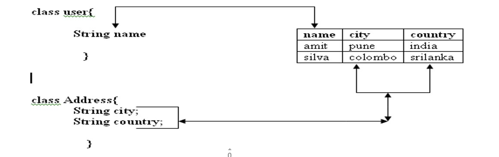

### **Inheritance (Subtypes)**

**Inheritance** is a natural paradigm in object-oriented programming languages. However, RDBMSs do not inherently define anything similar.

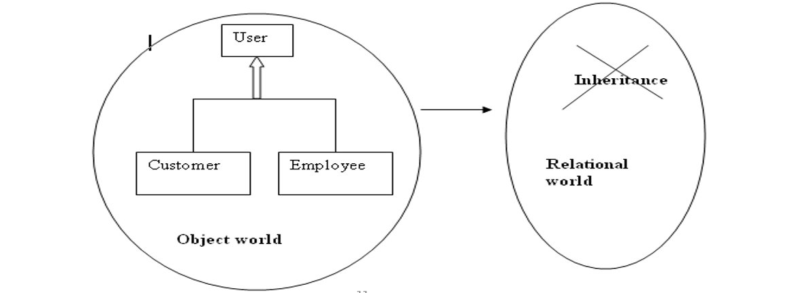

### Identity

An **RDBMS** defines exactly one notion of "sameness": the primary key.

In **Java**, however, there are two types of identity:

- **Object Identity** (`a == b`)
- **Object Equality** (`a.equals(b)`)

-----

### 1. **Introduction to ORM and Hibernate**

   **Object-Relational Mapping (ORM)**:
   - ORM is a technique to map Java objects to relational database tables, allowing developers to interact with databases using high-level object-oriented paradigms.

   **Why Hibernate?**:
   - It abstracts the JDBC complexities.
   - Supports caching, reducing database interactions.
   - Provides features like HQL, automatic table generation, and lazy loading.

### 2. **Hibernate Architecture**
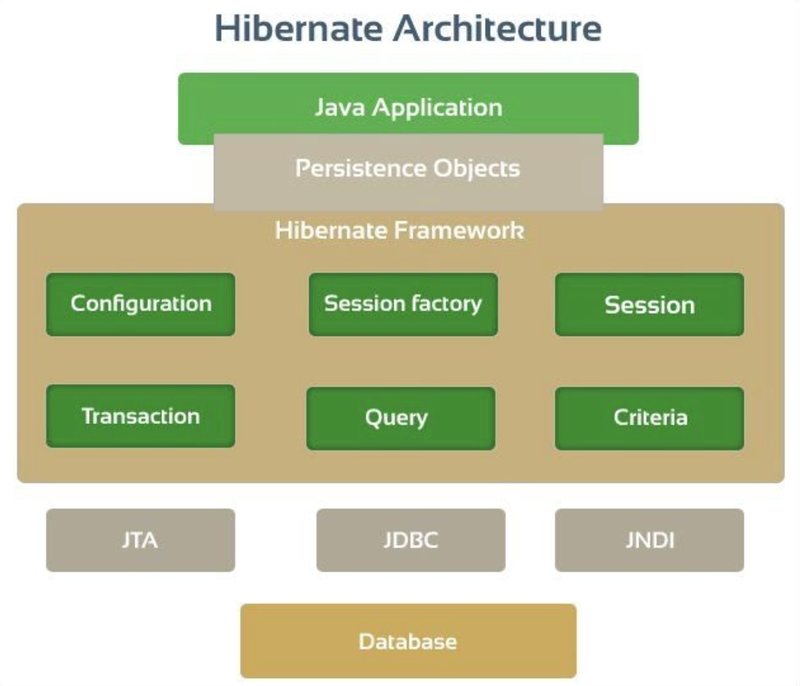

   - **SessionFactory**: A factory for `Session` objects, created once per database.
   - **Session**: Represents a connection with a database. Provides methods for CRUD operations.
   - **Transaction**: Manages a unit of work.
   - **Query and Criteria**: Used to retrieve data.

   **Code Example**:
   ```java
   SessionFactory factory = new Configuration().configure("hibernate.cfg.xml").addAnnotatedClass(Student.class).buildSessionFactory();
   Session session = factory.getCurrentSession();
   ```

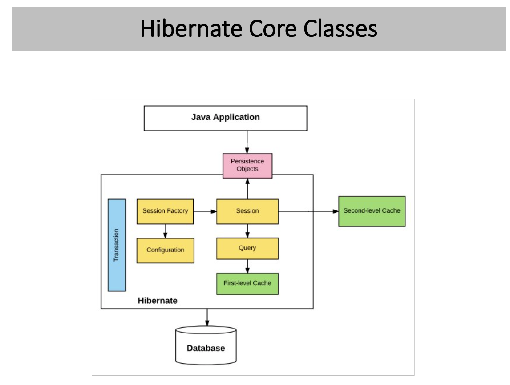

### 3. **Configuration**

   - **hibernate.cfg.xml**: Configures database connection and Hibernate properties.

   **Example: `hibernate.cfg.xml`**:
   ```xml
   <?xml version="1.0" encoding="utf-8"?>
   <!DOCTYPE hibernate-configuration PUBLIC
       "-//Hibernate/Hibernate Configuration DTD 3.0//EN"
       "http://hibernate.sourceforge.net/hibernate-configuration-3.0.dtd">
   <hibernate-configuration>
       <session-factory>
           <property name="hibernate.connection.driver_class">com.mysql.cj.jdbc.Driver</property>
           <property name="hibernate.connection.url">jdbc:mysql://localhost:3306/mydb</property>
           <property name="hibernate.connection.username">root</property>
           <property name="hibernate.connection.password">password</property>
           <property name="hibernate.dialect">org.hibernate.dialect.MySQL8Dialect</property>
           <property name="hibernate.show_sql">true</property>
           <property name="hibernate.hbm2ddl.auto">update</property>
       </session-factory>
   </hibernate-configuration>
   ```

### 4. **Mapping Entities**
   - **Entity Class Example**:
   ```java
   @Entity
   @Table(name="student")
   public class Student {
       @Id
       @GeneratedValue(strategy=GenerationType.IDENTITY)
       @Column(name="id")
       private int id;

       @Column(name="first_name")
       private String firstName;

       @Column(name="last_name")
       private String lastName;

       // Constructors, getters, setters
   }
   ```
   - **Relationships** (`@OneToMany`, `@ManyToOne`, etc.):
     ```java
     @OneToMany(mappedBy="department")
     private List<Employee> employees;
     ```

### 5. **Session and Transactions**
   - A **Session** provides methods for CRUD operations like `save()`, `update()`, and `delete()`.
   - **Transaction Management**:
     ```java
     Session session = factory.getCurrentSession();
     try {
         session.beginTransaction();
         Student student = new Student("John", "Doe");
         session.persist(student);
         session.getTransaction().commit();
     } finally {
         factory.close();
     }
     ```

### 6. **HQL and Criteria API**
   - **HQL Example**:
     ```java
     Session session = factory.getCurrentSession();
     
     List<Student> students = session.createQuery("from Student s where s.lastName='Doe'").getResultList();
     
     ```
   - **Criteria API Example**:
     ```java
     CriteriaBuilder builder = session.getCriteriaBuilder();
     CriteriaQuery<Student> query = builder.createQuery(Student.class);
     Root<Student> root = query.from(Student.class);
     query.select(root).where(builder.equal(root.get("lastName"), "Doe"));
     List<Student> students = session.createQuery(query).getResultList();
     ```

### 7. **Associations and Inheritance**
   - **One-to-Many Example**:
     ```java
     @OneToMany(mappedBy="student")
     private List<Course> courses;
     ```
   - **Inheritance Mapping**:
     ```java
     @Entity
     @Inheritance(strategy = InheritanceType.JOINED)
     public class Employee {
         @Id
         @GeneratedValue(strategy = GenerationType.IDENTITY)
         private int id;
         private String name;
     }
     
     @Entity
     public class FullTimeEmployee extends Employee {
         private int salary;
     }
     ```

### 8. **Fetching Strategies**
   - **Lazy vs Eager Loading**:
     ```java
     @OneToMany(fetch = FetchType.LAZY, mappedBy = "student")
     private List<Course> courses; // Lazy loading - data fetched on access
     ```
   - **Best Practices**:
     - Avoid unnecessary eager fetching to improve performance.

### 9. **Caching**
   - **First-Level Cache** is enabled by default and works within a session.
   - **Second-Level Cache** is optional and shared across sessions.
   - **Enable Second-Level Cache**:
     ```java
     @Entity
     @Cacheable
     @org.hibernate.annotations.Cache(usage = CacheConcurrencyStrategy.READ_WRITE)
     public class Student {
         // Fields, constructors, getters, and setters
     }
     ```
   - Configuring **EHCache**:
     ```xml
     <property name="hibernate.cache.region.factory_class">org.hibernate.cache.ehcache.EhCacheRegionFactory</property>
     ```

### 10. **Best Practices**

   - **DTO Pattern**: To avoid loading full entities for read-only operations.

     ```java
     public class StudentDTO {
         private String firstName;
         private String lastName;
     
         // Constructors, getters, setters
     }
     ```

   - **Avoid N+1 Problem**:

     - Use `join fetch` in HQL.

     ```java
     List<Student> students = session.createQuery("select s from Student s join fetch s.courses").getResultList();
     ```

   - **Batch Fetching**:

     ```java
     @BatchSize(size = 10)
     private List<Course> courses;
     ```

### 11. **Hands-On Example**

The `hibernate.hbm2ddl.auto` property in Hibernate is used to specify how the schema of the database should be managed. Here are the different values it can take and what each one does:

1. **`validate`**:
   - **Description**: Validates the schema, making sure it matches the mappings. No changes are made to the database.
   - **Use Case**: Use this in production to ensure that the schema is in sync with the mappings without making any changes.
2. **`update`**:
   - **Description**: Updates the schema by adding missing tables and columns, but does not remove existing tables or columns.
   - **Use Case**: Useful during development when you want to keep your schema up-to-date with your entity mappings without losing data.
3. **`create`**:
   - **Description**: Drops the existing schema and creates a new one. All existing data is lost.
   - **Use Case**: Use this in development or testing environments where you need a fresh schema each time.
4. **`create-drop`**:
   - **Description**: Similar to `create`, but also drops the schema when the SessionFactory is closed.
   - **Use Case**: Useful for unit testing where you want to ensure a clean schema for each test run.
5. **`none`**: (this is the default value - This means that if you do not explicitly set this property in your Hibernate configuration, Hibernate will not perform any schema management actions by default.)
   - **Description**: No action is performed.
   - **Use Case**: Use this when you want to manage the schema manually and do not want Hibernate to interfere.

   - **A CRUD Application**:
     
     ```java
     public class HibernateDemo {
         public static void main(String[] args) {
             SessionFactory factory = new Configuration()
                     .configure("hibernate.cfg.xml")
                     .addAnnotatedClass(Student.class)
                     .buildSessionFactory();
     
             Session session = factory.getCurrentSession();
     
             try {
                 // Create and save
                 Student tempStudent = new Student("Paul", "Wall");
                 session.beginTransaction();
                 session.save(tempStudent);
                 session.getTransaction().commit();
     
                 // Retrieve
                 session = factory.getCurrentSession();
                 session.beginTransaction();
                 Student myStudent = session.get(Student.class, tempStudent.getId());
                 session.getTransaction().commit();
     
                 // Update
                 session = factory.getCurrentSession();
                 session.beginTransaction();
                 myStudent.setLastName("Walker");
                 session.getTransaction().commit();
     
                 // Delete
                 session = factory.getCurrentSession();
                 session.beginTransaction();
                 session.delete(myStudent);
                 session.getTransaction().commit();
             } finally {
                 factory.close();
             }
         }
     }
     ```


Lets look at a real-world example using Hibernate that illustrates:

1. **One-to-One** relationship (e.g., `User` and `Address`)
2. **One-to-Many** relationship (e.g., `User` and `Orders`)
3. **Many-to-Many** relationship (e.g., `Orders` and `Products`)

### Real-World Example
- **User** has a one-to-one relationship with **Address**.
- **User** has a one-to-many relationship with **Order**.
- **Order** has a many-to-many relationship with **Product**.

Here's how to model these relationships in Hibernate:

### Entities and Relationships

#### 1. User Entity (`User.java`)
```java
@Entity
@Table(name = "user")
public class User {

    @Id
    @GeneratedValue(strategy = GenerationType.IDENTITY)
    private int id;

    @Column(name = "username")
    private String username;

    @OneToOne(cascade = CascadeType.ALL)
    @JoinColumn(name = "address_id")
    private Address address;

    @OneToMany(mappedBy = "user", cascade = CascadeType.ALL)
    private List<Order> orders;

    // Constructors, getters, setters
}
```

#### 2. Address Entity (`Address.java`)
```java
@Entity
@Table(name = "address")
public class Address {

    @Id
    @GeneratedValue(strategy = GenerationType.IDENTITY)
    private int id;

    @Column(name = "street")
    private String street;

    @Column(name = "city")
    private String city;

    @OneToOne(mappedBy = "address")
    private User user;

    // Constructors, getters, setters
}
```

#### 3. Order Entity (`Order.java`)
```java
@Entity
@Table(name = "order_table")  // 'order' is a reserved keyword, so we use 'order_table'
public class Order {

    @Id
    @GeneratedValue(strategy = GenerationType.IDENTITY)
    private int id;

    @Column(name = "order_date")
    private LocalDate orderDate;

    @ManyToOne
    @JoinColumn(name = "user_id")
    private User user;

    @ManyToMany(cascade = {CascadeType.PERSIST, CascadeType.MERGE})
    @JoinTable(
        name = "order_product",
        joinColumns = @JoinColumn(name = "order_id"),
        inverseJoinColumns = @JoinColumn(name = "product_id")
    )
    private List<Product> products;

    // Constructors, getters, setters
}
```

#### 4. Product Entity (`Product.java`)
```java
@Entity
@Table(name = "product")
public class Product {

    @Id
    @GeneratedValue(strategy = GenerationType.IDENTITY)
    private int id;

    @Column(name = "name")
    private String name;

    @Column(name = "price")
    private double price;

    @ManyToMany(mappedBy = "products")
    private List<Order> orders;

    // Constructors, getters, setters
}
```

### CRUD Example

#### Configuration (`hibernate.cfg.xml`)
Ensure that you have configured your `hibernate.cfg.xml` for database connectivity as mentioned previously.

#### Create and Save Data (`HibernateCRUD.java`)
```java
public class HibernateCRUD {
    public static void main(String[] args) {
        SessionFactory factory = new Configuration()
                .configure("hibernate.cfg.xml")
                .addAnnotatedClass(User.class)
                .addAnnotatedClass(Address.class)
                .addAnnotatedClass(Order.class)
                .addAnnotatedClass(Product.class)
                .buildSessionFactory();

        Session session = factory.openSession();
        // Session session = factory.getCurrentSession();

        try {
            User user = persistUserWithOrdersAndProducts(session);

            System.out.println("Saved User ID=" + user.getId());

            readEntities(factory, user);

            updateEntities(factory, user);

            deleteEntities(factory, user);

        } finally {
            factory.close();
        }
    }

    private static User persistUserWithOrdersAndProducts(Session session) {
        // Create objects
        User user = new User();
        user.setUsername("john_doe");

        Address address = new Address();
        address.setStreet("123 Main St");
        address.setCity("Metropolis");
        user.setAddress(address);

        Order order1 = new Order();
        order1.setOrderDate(LocalDate.now());

        Order order2 = new Order();
        order2.setOrderDate(LocalDate.now().plusDays(1));

        Product product1 = new Product();
        product1.setName("Laptop");
        product1.setPrice(800.0);

        Product product2 = new Product();
        product2.setName("Phone");
        product2.setPrice(500.0);

        // Set relationships
        order1.setUser(user);
        order2.setUser(user);

        // order1.setProducts(Arrays.asList(product1, product2));
        // order2.setProducts(Collections.singletonList(product1));

        user.setOrders(Arrays.asList(order1, order2));

        // Start transaction and save data
        session.beginTransaction();

        session.persist(user); // This will cascade save address, orders, and products

        session.getTransaction().commit();
        return user;
    }

    private static void readEntities(SessionFactory factory, User user) {
        Session session = null;
        try {
            /// read
            session = factory.openSession();
            session.beginTransaction();

            List<User> users = session.createQuery("from User u where u.id=" + user.getId(),
                    User.class).getResultList();
            for (User userTemp : users) {
                System.out.println(userTemp.toString());
            }
            User user2 = session.get(User.class, user.getId()); // Fetch user by ID
            System.out.println("User Details: " + user2.getUsername());
            System.out.println("Address: " + user2.getAddress().getStreet());

            
            session.getTransaction().commit();
        } finally {
            if (session != null) {
                session.close();
            }
        }
    }

    private static void updateEntities(SessionFactory factory, User user) {
        Session session = null;
        try {
            session = factory.openSession();
            session.beginTransaction();

            User user3 = session.get(User.class, user.getId());
            user3.setUsername("jane_doe" + user.getId()); // Update username
            user3.getAddress().setCity("Gotham" + user.getId()); // Update address
            session.getTransaction().commit();
        } finally {
            if (session != null) {
                session.close();
            }
        }
    }

    private static void deleteEntities(SessionFactory factory, User user) {
        Session session = null;
        try {
            session = factory.openSession();
            session.beginTransaction();

            User user4 = session.get(User.class, user.getId());
            if (user4 != null) {
            session.remove(user4); // This will delete the user and associated address, orders (cascade)
            } else {
                System.out.println("User not found!");
            }
            session.getTransaction().commit();
        } finally {
            if (session != null) {
                session.close();
            }
        }
    }

}
```

### Explanation:

1. **One-to-One (`User` and `Address`)**:
   - Defined with `@OneToOne` and mapped using `@JoinColumn(name = "address_id")` in `User` to link to `Address`.
   - `Address` has a back-reference using `@OneToOne(mappedBy = "address")`.

2. **One-to-Many (`User` and `Order`)**:
   - The `User` entity has a list of orders (`@OneToMany`).
   - The `Order` entity has a reference back to the user (`@ManyToOne`).

3. **Many-to-Many (`Order` and `Product`)**:
   - An `Order` can contain multiple `Products`, and a `Product` can be in multiple `Orders`.
   - The relationship is defined using `@ManyToMany` with a join table (`@JoinTable`).

### CRUD Operations

- **Create**: 
  The above example already demonstrated creating a `User`, `Address`, `Order`, and `Product` and persisting the data using `session.save(user)`.

- **Read**:
  
  ```java
  session = factory.getCurrentSession();
  session.beginTransaction();
  
  User user = session.get(User.class, userId);  // Fetch user by ID
  System.out.println("User Details: " + user.getUsername());
  System.out.println("Address: " + user.getAddress().getStreet());
  
  for (Order order : user.getOrders()) {
      System.out.println("Order Date: " + order.getOrderDate());
      for (Product product : order.getProducts()) {
          System.out.println("Product: " + product.getName() + ", Price: " + product.getPrice());
      }
  }
  
  session.getTransaction().commit();
  ```
  
- **Update**:
  ```java
  session = factory.getCurrentSession();
  session.beginTransaction();
  
  User user = session.get(User.class, userId);
  user.setUsername("jane_doe");  // Update username
  user.getAddress().setCity("Gotham");  // Update address
  
  session.getTransaction().commit();
  ```

- **Delete**:
  
  ```java
  session = factory.getCurrentSession();
  session.beginTransaction();
  
  User user = session.get(User.class, userId);
  session.remove(user);  // This will delete the user and associated address, orders (cascade)
  
  session.getTransaction().commit();
  ```

### Summary
- This example models real-world relationships using Hibernate annotations.
- CRUD operations (`create`, `read`, `update`, `delete`) are illustrated to interact with the database.
- Using `CascadeType` ensures related entities are saved/updated/deleted appropriately.

This example provides a robust overview of how to implement and manage different relationships using Hibernate ORM.

------

### HIBERNATE RELATIONSHIPS 

### One-to-Many Mapping with Hibernate

This quick Hibernate tutorial will guide us through an example of a **one-to-many mapping** using JPA annotations, an alternative to XML. We'll also cover:

- **Bidirectional Relationships**: What they are, how they can create inconsistencies, and how the concept of ownership can help.

**One-to-Many Mapping**: One row in a table is mapped to multiple rows in another table.

Let's look at the following entity-relationship diagram to understand a one-to-many association:

**Example**: We’ll implement a cart system where we have:
- A table for each cart
- Another table for each item
- One cart can have many items, forming a one-to-many mapping.

**Database Level**:
- **cart_id** as a primary key in the `cart` table
- **cart_id** as a foreign key in the `items` table

**Code Level**: We use `@OneToMany`.

Mapping the **Cart** class to a collection of **Item** objects:

```java
public class Cart {
    //...
    @OneToMany(mappedBy = "cart")
    private Set<Item> items;
    //...
}
```

To make this a bidirectional relationship, add a reference to **Cart** in each **Item** using `@ManyToOne`:

- **Bidirectional Relationship**: Allows access from carts to items and vice versa.
- The `mappedBy` property indicates which variable represents the parent class in the child class.

### Technologies and Libraries Used

To develop a sample Hibernate application that implements a one-to-many association, we use:

- **JDK 1.8 or later**
- **Hibernate 6**
- **Maven 3 or later**
- **H2 Database**

**Hibernate will manage the schema from the domain model**, eliminating the need to manually provide SQL statements to create tables and relationships.

### Adding Dependencies

Add the **Hibernate** and **H2 driver** dependencies to `pom.xml`:

```xml
<dependency>
    <groupId>org.hibernate.orm</groupId>
    <artifactId>hibernate-core</artifactId>
    <version>6.5.2.Final</version>
</dependency>
<dependency>
    <groupId>com.h2database</groupId>
    <artifactId>h2</artifactId>
    <version>2.2.224</version>
</dependency>
```

Visit the **Maven central repository** for the latest versions of Hibernate and H2 dependencies.

### Creating Hibernate SessionFactory

```java
public static SessionFactory getSessionFactory() {
    ServiceRegistry serviceRegistry = new StandardServiceRegistryBuilder()
        .applySettings(dbSettings())
        .build();

    Metadata metadata = new MetadataSources(serviceRegistry)
        .addAnnotatedClass(Cart.class)
        // other domain classes
        .buildMetadata();

    return metadata.buildSessionFactory();
}

private static Map<String, Object> dbSettings() {
    // return Hibernate settings
}
```

### Mapping-Related Configurations

Use **JPA annotations** in the model classes:

**Cart Class**:

```java
@Entity
@Table(name = "CART")
public class Cart {
    //...
    @OneToMany(mappedBy = "cart")
    private Set<Item> items;
    // getters and setters
}
```

Please note that the *@OneToMany* annotation is used to define the property in *Item* class that will be used to map the *mappedBy* variable. That is why we have a property named “*cart*” in the *Item* class

**Item Class**:

```java
@Entity
@Table(name = "ITEMS")
public class Item {
    //...
    @ManyToOne
    @JoinColumn(name = "cart_id", nullable = false)
    private Cart cart;

    public Item() {}
    // getters and setters
}
```

- The `@ManyToOne` annotation associates with the **Cart** class variable.
- `@JoinColumn` references the mapped column.

### Test Program

Creating a main class for getting the **Hibernate Session** and saving model objects:

```java
sessionFactory = HibernateAnnotationUtil.getSessionFactory();
session = sessionFactory.getCurrentSession();
LOGGER.info("Session created");

tx = session.beginTransaction();

session.save(cart);
session.save(item1);
session.save(item2);

tx.commit();
LOGGER.info("Cart ID={}", cart.getId());
LOGGER.info("item1 ID={}, Foreign Key Cart ID={}", item1.getId(), item1.getCart().getId());
LOGGER.info("item2 ID={}, Foreign Key Cart ID={}", item2.getId(), item2.getCart().getId());
```

**Output**:

```
Session created
Hibernate: insert into CART values ()
Hibernate: insert into ITEMS (cart_id) values (?)
Hibernate: insert into ITEMS (cart_id) values (?)
Cart ID=7
item1 ID=11, Foreign Key Cart ID=7
item2 ID=12, Foreign Key Cart ID=7
Closing SessionFactory
```

### Understanding Ownership

The **@ManyToOne** annotation lets us create **bidirectional relationships**.

- If **Cart** references **Item**, but **Item** doesn’t reference **Cart**, the relationship is **unidirectional**.
- In our case, the relationship is **bidirectional**, which can lead to **inconsistencies**.

**Example of Inconsistency**:

Let’s imagine a situation where a developer wants to add an *item1* to the *cart1* instance and an *item2* to the *cart2 instance*, but makes a mistake so that the references between *cart2* and *item2* become inconsistent:

```java
Cart cart1 = new Cart();
Cart cart2 = new Cart();

Item item1 = new Item(cart1);
Item item2 = new Item(cart2); 
Set<Item> itemsSet = new HashSet<Item>();
itemsSet.add(item1);
itemsSet.add(item2); 
cart1.setItems(itemsSet); // wrong!
```

Here, **item2** references **cart2**, but **cart2** doesn’t reference **item2**, causing ambiguity.

**Resolving Ambiguity**:
- Use the **owning side** of the relationship.
- References on the owning side take precedence and are saved to the database.

**Good Practice**: Mark the **many-to-one** side as the owning side, and the **one-to-many** side as the **inverse side**. (As stated in the [JPA specification](http://download.oracle.com/otndocs/jcp/persistence-2.0-fr-eval-oth-JSpec/) under section 2.9, `it’s a good practice to mark the many-to-one side as the owning side`)

- In our example, **Item** is the owning side, and **Cart** is the inverse side.

Going back to our “inconsistency” example, now Hibernate knows that ***item2\*‘s reference is more important and will save \*item2\*‘s reference to the database.**

Let’s check the result:

```java
item1 ID=1, Foreign Key Cart ID=1
item2 ID=2, Foreign Key Cart ID=2
```


Although *cart* references *item2* in our snippet, *item2*‘s reference to *cart2* is saved in the database.

It’s also possible to mark the *one-to-many* side as the owning side, and the *many-to-one* side as the inverse side.

Although this is not a recommended practice, let’s go ahead and give it a try.

### Unidirectional vs. Bidirectional Relationships

If the **one-to-many** side is marked as the **owning side**, the result might be unexpected:

```java
public class ItemOIO {
    @ManyToOne
    @JoinColumn(name = "cart_id", insertable = false, updatable = false)
    private CartOIO cart;
    //...
}

public class CartOIO {
    @OneToMany
    @JoinColumn(name = "cart_id") // duplicated physical information
    private Set<ItemOIO> items;
    //...
}
```


Notice how we removed the *mappedBy* element and set the *many-to-one @JoinColumn* as *insertable* and *updatable* to *false*.

If we run the same code, the result will be the opposite:

```plaintext
item1 ID=1, Foreign Key Cart ID=1
item2 ID=2, Foreign Key Cart ID=1
```

As shown above, now *item2* belongs to the *cart1* indicating a different ownership.

### Conclusion

We have demonstrated how easy it is to implement the **one-to-many** relationship with Hibernate ORM and H2 database using **JPA annotations**. We also learned about **bidirectional relationships** and how to implement the notion of an **owning side**.

# One-to-One Relationship in JPA

## 2. Description

Let’s suppose we are building a user management system, and our boss asks us to store a mailing address for each user. A user will have one mailing address, and a mailing address will have only one user tied to it.

This is an example of a one-to-one relationship, in this case between *user* and *address* entities.

Let’s see how we can implement this in the next sections.

## 3. Using a Foreign Key

### 3.1. Modeling With a Foreign Key

Let’s have a look at the following ER diagram, which represents a foreign key-based one-to-one mapping:

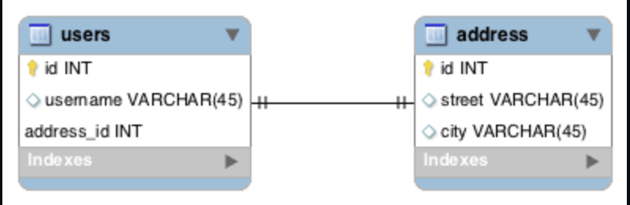

In this example, the *address_id* column in *users* is the [foreign key](https://en.wikipedia.org/wiki/Foreign_key) to *address*.

### 3.2. Implementing With a Foreign Key in JPA

First, let’s create the *User* class and annotate it appropriately:

```
@Entity
@Table(name = "users")
public class User {
    
    @Id
    @GeneratedValue(strategy = GenerationType.AUTO)
    @Column(name = "id")
    private Long id;
    //... 

    @OneToOne(cascade = CascadeType.ALL)
    @JoinColumn(name = "address_id", referencedColumnName = "id")
    private Address address;

    // ... getters and setters
}
```

Note that **we place the \*@OneToOne\* annotation** on the related entity field, *Address*.

Also, we need to place  the `@JoinColumn` annotation to configure the name of the column in the *users* table that maps to the primary key in the *address* table. If we don’t provide a name, Hibernate will [follow some rules](http://docs.jboss.org/hibernate/jpa/2.2/api/javax/persistence/JoinColumn.html) to select a default one.

Finally, note in the next entity that we won’t use the *@JoinColumn* annotation there. This is because we only need it on the owning side of the foreign key relationship. **Simply put, whoever owns the foreign key column gets the \*@JoinColumn\* annotation.**

The *Address* entity turns out a bit simpler:

```
@Entity
@Table(name = "address")
public class Address {

    @Id
    @GeneratedValue(strategy = GenerationType.AUTO)
    @Column(name = "id")
    private Long id;
    //...

    @OneToOne(mappedBy = "address")
    private User user;

    //... getters and setters
}
```

We also need to place the *@OneToOne* annotation here too. That’s because this is a [bidirectional relationship](https://docs.oracle.com/cd/E19798-01/821-1841/bnbqj/index.html). **The address side of the relationship is called the non-owning side.** 

## 4. Using a Shared Primary Key

### 4.1. Modeling With a Shared Primary Key

In this strategy, instead of creating a new column *address_id*, **we’ll mark the primary key column (\*user_id\*) of the \*address\* table as the foreign key to the \*users\* table**:

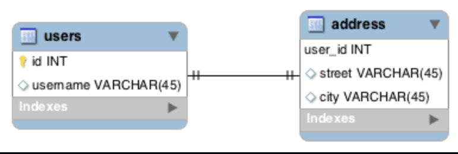We’ve optimized the storage space by utilizing the fact that these entities have a one-to-one relationship between them.

### 4.2. Implementing With a Shared Primary Key in JPA

Notice that our definitions change only slightly:

```
@Entity
@Table(name = "users")
public class User {

    @Id
    @GeneratedValue(strategy = GenerationType.AUTO)
    @Column(name = "id")
    private Long id;

    //...

    @OneToOne(mappedBy = "user", cascade = CascadeType.ALL)
    @PrimaryKeyJoinColumn
    private Address address;

    //... getters and setters
}
@Entity
@Table(name = "address")
public class Address {

    @Id
    @Column(name = "user_id")
    private Long id;

    //...

    @OneToOne
    @MapsId
    @JoinColumn(name = "user_id")
    private User user;
   
    //... getters and setters
}
```

The *mappedBy* attribute is now moved to the *User* class since the foreign key is now present in the *address* table. We’ve also added **the \*@PrimaryKeyJoinColumn\*annotation, which indicates that the primary key of the \*User\* entity is used as the foreign key value for the associated \*Address\* entity.**

We still have to define an *@Id* field in the *Address* class. But note that this references the *user_id* column, and it no longer uses the *@GeneratedValue* annotation. Also, on the field that references the *User*, we’ve added **the \*@MapsId\* annotation, which indicates that the primary key values will be copied** from the *User* entity.

## 5. Using a Join Table

One-to-one mappings can be of two types: optional and mandatory. **So far, we’ve seen only mandatory relationships.**

Now let’s imagine that our employees get associated with a workstation. It’s one-to-one, but sometimes an employee might not have a workstation and vice versa.

### 5.1. Modeling With a Join Table

The strategies that we have discussed **until now force us to put null values in the column to handle optional relationships.**

Typically, we think of many-to-many relationships when we consider a join table, **but using a join table in this case can help us to eliminate these null values**:

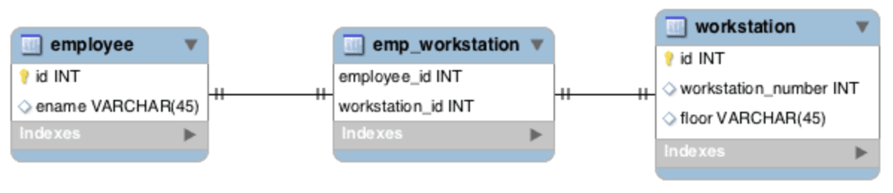

Now, whenever we have a relationship, we’ll make an entry in the *emp_workstation* table and avoid nulls altogether.

### 5.2. Implementing With a Join Table in JPA

Our first example used *@JoinColumn*. This time, we’ll use *@JoinTable*:

```
@Entity
@Table(name = "employee")
public class Employee {
    @Id
    @GeneratedValue(strategy = GenerationType.AUTO)
    @Column(name = "id")
    private Long id;

    //...

    @OneToOne(cascade = CascadeType.ALL)
    @JoinTable(name = "emp_workstation", 
      joinColumns = 
        { @JoinColumn(name = "employee_id", referencedColumnName = "id") },
      inverseJoinColumns = 
        { @JoinColumn(name = "workstation_id", referencedColumnName = "id") })
    private WorkStation workStation;

    //... getters and setters
}
@Entity
@Table(name = "workstation")
public class WorkStation {

    @Id
    @GeneratedValue(strategy = GenerationType.AUTO)
    @Column(name = "id")
    private Long id;

    //...

    @OneToOne(mappedBy = "workStation")
    private Employee employee;

    //... getters and setters
}
```

[@*JoinTable*](http://docs.jboss.org/hibernate/jpa/2.2/api/javax/persistence/JoinTable.html) instructs Hibernate to employ the join table strategy while maintaining the relationship.

Also, *Employee* is the owner of this relationship, as we chose to use the join table annotation on it.

## 6. Conclusion

In this article, we learned different ways of maintaining a one-to-one association in JPA and Hibernate, and when to use each.

-----

# Many-To-Many Relationship in JPA

### Hibernate @ManyToMany Annotation  (Straight Forward version)

Lets see how the `@ManyToMany` annotation can be used to specify many-to-many relationships in Hibernate.

Let's start with a simple Entity Relationship Diagram, which shows a many-to-many association between two entities: **Employee** and **Project**.

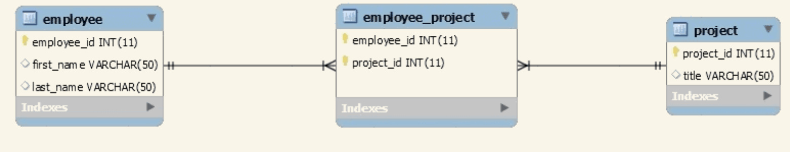


In this scenario, any given employee can be assigned to multiple projects, and a project may have multiple employees working on it, leading to a many-to-many association between the two.

### Database Schema

We have the following tables:

- **Employee**: with `employee_id` as the primary key
- **Project**: with `project_id` as the primary key
- **Employee_Project**: a join table to connect both sides, using `employee_id` and `project_id` as foreign keys

Let's assume we have already created a database named `spring_hibernate_many_to_many`. We also need to create the tables with the following SQL:

```sql
CREATE TABLE `employee` (
  `employee_id` int(11) NOT NULL AUTO_INCREMENT,
  `first_name` varchar(50) DEFAULT NULL,
  `last_name` varchar(50) DEFAULT NULL,
  PRIMARY KEY (`employee_id`)
) ENGINE=InnoDB AUTO_INCREMENT=17 DEFAULT CHARSET=utf8;

CREATE TABLE `project` (
  `project_id` int(11) NOT NULL AUTO_INCREMENT,
  `title` varchar(50) DEFAULT NULL,
  PRIMARY KEY (`project_id`)
) ENGINE=InnoDB AUTO_INCREMENT=18 DEFAULT CHARSET=utf8;

CREATE TABLE `employee_project` (
  `employee_id` int(11) NOT NULL,
  `project_id` int(11) NOT NULL,
  PRIMARY KEY (`employee_id`,`project_id`),
  KEY `project_id` (`project_id`),
  CONSTRAINT `employee_project_ibfk_1` 
    FOREIGN KEY (`employee_id`) REFERENCES `employee` (`employee_id`),
  CONSTRAINT `employee_project_ibfk_2` 
    FOREIGN KEY (`project_id`) REFERENCES `project` (`project_id`)
) ENGINE=InnoDB DEFAULT CHARSET=utf8;
```

### Hibernate Configuration

With the database set up, the next step is to prepare the Maven dependencies and Hibernate configuration. 

### JPA Model Classes

We need to create `Employee` and `Project` model classes with JPA annotations:

```java
@Entity
@Table(name = "Employee")
public class Employee { 
    // ...

    @ManyToMany(cascade = { CascadeType.ALL })
    @JoinTable(
        name = "Employee_Project", 
        joinColumns = { @JoinColumn(name = "employee_id") }, 
        inverseJoinColumns = { @JoinColumn(name = "project_id") }
    )
    Set<Project> projects = new HashSet<>();
   
    // standard constructor/getters/setters
}

@Entity
@Table(name = "Project")
public class Project {    
    // ...  

    @ManyToMany(mappedBy = "projects")
    private Set<Employee> employees = new HashSet<>();
    
    // standard constructors/getters/setters   
}
```

### Explanation

Both `Employee` and `Project` classes refer to one another, making the association bidirectional.

- The `@ManyToMany` annotation is used in both classes to establish the relationship.
- This association has two sides: **owning side** and **inverse side**. 
  - The **owning side** is `Employee`, and the join table is specified using the `@JoinTable` annotation.
  - The `@JoinTable` annotation defines the join table, which is `Employee_Project`.
  - The `@JoinColumn` annotation specifies the linking columns (`employee_id` and `project_id`).
- In the `Project` class, the `mappedBy` attribute in the `@ManyToMany` annotation indicates that the `employees` collection is mapped by the `projects` collection on the owning side.

### Testing the Many-to-Many Relationship 

To see the `@ManyToMany` annotation in action, we can write the following JUnit test:

```java
public class HibernateManyToManyAnnotationMainIntegrationTest {
    private static SessionFactory sessionFactory;
    private Session session;

    //...

    @Test
    public void givenSession_whenRead_thenReturnsMtoMdata() {
        prepareData();
        @SuppressWarnings("unchecked")
        List<Employee> employeeList = session.createQuery("FROM Employee").list();
        @SuppressWarnings("unchecked")
        List<Project> projectList = session.createQuery("FROM Project").list();

        assertNotNull(employeeList);
        assertNotNull(projectList);
        assertEquals(2, employeeList.size());
        assertEquals(2, projectList.size());
    
        for (Employee employee : employeeList) {
            assertNotNull(employee.getProjects());
            assertEquals(2, employee.getProjects().size());
        }

        for (Project project : projectList) {
            assertNotNull(project.getEmployees());
            assertEquals(2, project.getEmployees().size());
        }
    }

    private void prepareData() {
        String[] employeeData = { "Peter Oven", "Allan Norman" };
        String[] projectData = { "IT Project", "Networking Project" };
        Set<Project> projects = new HashSet<>();

        for (String proj : projectData) {
            projects.add(new Project(proj));
        }

        for (String emp : employeeData) {
            Employee employee = new Employee(emp.split(" ")[0], emp.split(" ")[1]);
            employee.setProjects(projects);

            for (Project proj : projects) {
                proj.getEmployees().add(employee);
            }

            session.persist(employee);
        }
    }

    //...
}
```


### <u>HIBERNATE MANY TO MANY RELATIONSHIP (ELABORATE VERSION)</u>

## 1. Overview

In this tutorial, we’ll see multiple ways to **deal with many-to-many relationships using JPA.**

We’ll use a model of students, courses, and various relationships between them.

For the sake of simplicity, in the code examples, we’ll only show the attributes and JPA configuration that’s related to the many-to-many relationships.

## 2. Basic Many-to-Many

### 2.1. Modeling a Many-to-Many Relationship

**A relationship is a connection between two types of entities. In the case of a many-to-many relationship, both sides can relate to multiple instances of the other side.**

Note that it’s possible for entity types to be in a relationship with themselves. Think about the example of modeling family trees: Every node is a person, so if we talk about the parent-child relationship, both participants will be a person.

However, it doesn’t make such a difference whether we talk about a relationship between single or multiple entity types. Since it’s easier to think about relationships between two different entity types, we’ll use that to illustrate our cases.

Let’s take the example of students marking the courses they like.

A student can like **many** courses, and **many** students can like the same course:


As we know, in RDBMSs we can create relationships with foreign keys. Since both sides should be able to reference the other, **we need to create a separate table to hold the foreign keys**:

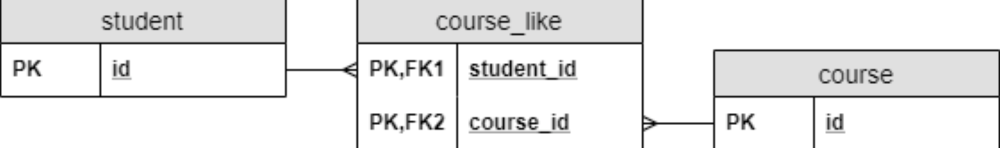

Such a table is called a **join table.** In a join table, the combination of the foreign keys will be its composite primary key.

### 2.2. Implementation in JPA

**Modeling a many-to-many relationship with POJOs** is easy. We should **include a \*Collection\* in both classes**, which contains the elements of the others.

After that, we need to mark the class with *@Entity* and the primary key with *@Id* to make them proper JPA entities.

Also, we should configure the relationship type. So, **we mark the collections with \*@ManyToMany\*** annotations:

```
@Entity
class Student {

    @Id
    Long id;

    @ManyToMany
    @JoinTable(
        @JoinColumns()
    )
    Set<Course> likedCourses;

    // additional properties
    // standard constructors, getters, and setters
}

@Entity
class Course {

    @Id
    Long id;

    @ManyToMany(mappedBy="likedCourses")
    Set<Student> students;

    // additional properties
    // standard constructors, getters, and setters
}
```

Additionally, we have to configure how to model the relationship in the RDBMS.

The owner side is where we configure the relationship. We’ll use the *Student* class.

**We can do this with the \*@JoinTable\* annotation in the \*Student\* class.** We provide the name of the join table (*course_like*) as well as the foreign keys with the *@JoinColumn *annotations. The *joinColumn* attribute will connect to the owner side of the relationship, and the *inverseJoinColumn* to the other side:

```
@ManyToMany
@JoinTable(
  name = "course_like", 
  joinColumns = @JoinColumn(name = "student_id"), 
  inverseJoinColumns = @JoinColumn(name = "course_id"))
Set<Course> likedCourses;
```

Note that using *@JoinTable* or even *@JoinColumn* isn’t required. JPA will generate the table and column names for us. However, the strategy JPA uses won’t always match the naming conventions we use. So, we need the possibility to configure table and column names.

**On the target side, we only have to provide the name of the field, which maps the relationship.**

Therefore, we set the *mappedBy* attribute of the *@ManyToMany* annotation in the *Course*class:

```
@ManyToMany(mappedBy = "likedCourses")
Set<Student> students;
```

Keep in mind that since **a many-to-many relationship doesn’t have an owner side in the database**, we could configure the join table in the *Course* class and reference it from the *Student* class.

## 3. Many-to-Many Using a Composite Key

### 3.1. Modeling Relationship Attributes

Let’s say we want to let students rate the courses. A student can rate any number of courses, and any number of students can rate the same course. Therefore, it’s also a many-to-many relationship.

What makes this example a bit more complicated is that **there is more to the rating relationship than the fact that it exists. We need to store the rating score the student gave on the course.**

Where can we store this information? We can’t put it in the *Student* entity since a student can give different ratings to different courses. Similarly, storing it in the *Course* entity wouldn’t be a good solution either.

This is a situation when **the relationship itself has an attribute.**

Using this example, attaching an attribute to a relation looks like this in an ER diagram.

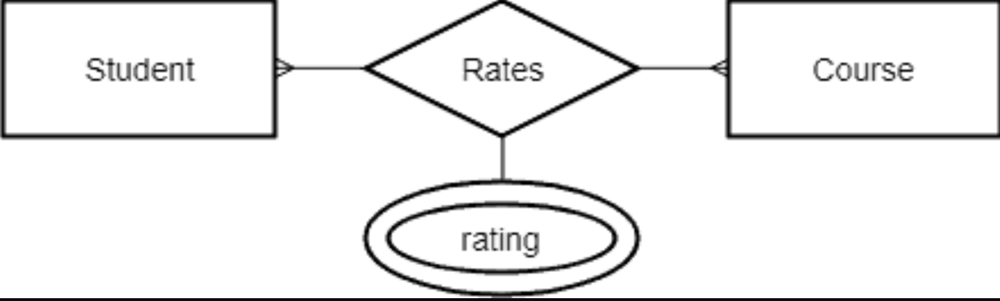

**We can model it almost the same way as the simple many-to-many relationship.** **The only difference is that we attach a new attribute to the join table:

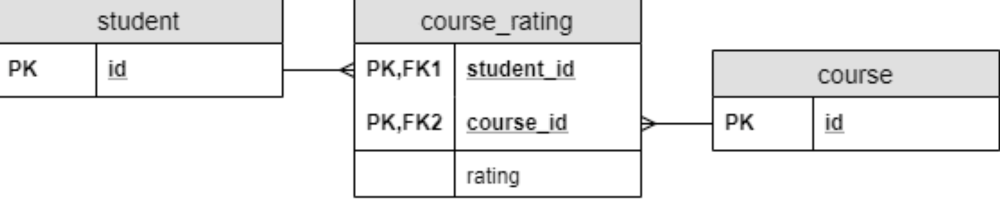

### 3.2. Creating a Composite Key in JPA

The implementation of a simple many-to-many relationship was rather straightforward. The only problem is that we cannot add a property to a relationship that way because we connected the entities directly. Therefore, **we had no way to add a property to the relationship itself.**

Since we map DB attributes to class fields in JPA, **we need to create a new entity class for the relationship.**

Of course, every JPA entity needs a primary key. **Because our primary key is a composite key, we have to create a new class that will hold the different parts of the key**:

```
@Embeddable
class CourseRatingKey implements Serializable {

    @Column(name = "student_id")
    Long studentId;

    @Column(name = "course_id")
    Long courseId;

    // standard constructors, getters, and setters
    // hashcode and equals implementation
}
```

Note that a composite key class has to fulfill some **key requirements**:

- We have to mark it with *@Embeddable*.
- It has to implement *java.io.Serializable*.
- We need to provide an implementation of the *hashcode()* and *equals()* methods.

### 3.3. Using a Composite Key in JPA

Using this composite key class, we can create the entity class, which models the join table:

```
@Entity
class CourseRating {

    @EmbeddedId
    CourseRatingKey id;
    

    @ManyToOne
    @MapsId("studentId")
    @JoinColumn(name = "student_id")
    Student student;

    @ManyToOne
    @MapsId("courseId")
    @JoinColumn(name = "course_id")
    Course course;

    int rating;
    
    // standard constructors, getters, and setters
}
```

This code is very similar to a regular entity implementation. However, we have some key differences:

- We used ***@EmbeddedId\* to mark the primary key**, which is an instance of the *CourseRatingKey* class.
- **We marked the \*student\* and \*course\* fields with \*@MapsId\*.**

*@MapsId* means that we tie those fields to a part of the key, and they’re the foreign keys of a many-to-one relationship.

After this, we can configure the inverse references in the *Student* and *Course* entities as before:

```
class Student {

    // ...

    @OneToMany(mappedBy = "student")
    Set<CourseRating> ratings;

    // ...
}

class Course {

    // ...

    @OneToMany(mappedBy = "course")
    Set<CourseRating> ratings;

    // ...
}
```

Note that there’s an alternative way to use composite keys: the `@IdClass` annotation.

### 3.4. Further Characteristics

**We configured the relationships to the \*Student\* and \*Course\* classes as \*@ManyToOne\*. We could do this because with the new entity we structurally decomposed the many-to-many relationship to two many-to-one relationships.**

Why were we able to do this? If we inspect the tables closely in the previous case, we can see that it contained two many-to-one relationships. **In other words, there isn’t any many-to-many relationship in an RDBMS. We call the structures we create with join tables many-to-many relationships because that’s what we model.**

Besides, it’s more clear if we talk about many-to-many relationships because that’s our intention. Meanwhile, a join table is just an implementation detail; we don’t really care about it.

Moreover, this solution has an additional feature we haven’t mentioned yet. The simple many-to-many solution creates a relationship between two entities. Therefore, we cannot expand the relationship to more entities. But we don’t have this limit in this solution: **we can model relationships between any number of entity types.**

For example, when multiple teachers can teach a course, students can rate how a specific teacher teaches a specific course. **That way, a rating would be a relationship between three entities: a student, a course and a teacher.**

## 4. Many-to-Many With a New Entity

### 4.1. Modeling Relationship Attributes

Let’s say we want to let students register for courses. Also, **we need to store the point when a student registered for a specific course.** On top of that, we want to store what grade she received in the course.

In an ideal world, we could solve this with the previous solution, where we had an entity with a composite key. However, the world is far from ideal, and students don’t always accomplish a course on the first try.

In this case, there are **multiple connections between the same student-course pairs**, or multiple rows, with the same *student_id-course_id* pairs. We can’t model it using any of the previous solutions because all primary keys must be unique. So, we need to use a separate primary key.

Therefore, **we can introduce an entity**, which will hold the attributes of the registration:


In this case, **the Registration entity represents the relationship** between the other two entities.

Since it’s an entity, it’ll have its own primary key.

In the previous solution, remember that we had a composite primary key we created from the two foreign keys.

Now the two foreign keys won’t be part of the primary key: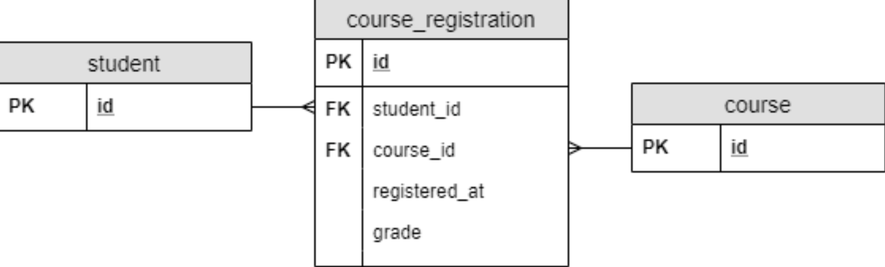

### 4.2. Implementation in JPA

Since the *course_registration* became a regular table, we can create a plain old JPA entity modeling it:

```
@Entity
class CourseRegistration {

    @Id
    Long id;

    @ManyToOne
    @JoinColumn(name = "student_id")
    Student student;

    @ManyToOne
    @JoinColumn(name = "course_id")
    Course course;

    LocalDateTime registeredAt;

    int grade;
    
    // additional properties
    // standard constructors, getters, and setters
}
```

We also need to configure the relationships in the *Student* and *Course* classes:

```
class Student {

    // ...

    @OneToMany(mappedBy = "student")
    Set<CourseRegistration> registrations;

    // ...
}

class Course {

    // ...

    @OneToMany(mappedBy = "course")
    Set<CourseRegistration> registrations;

    // ...
}
```

Again, we configured the relationship earlier, so we only need to tell JPA where can it find that configuration.

We could also use this solution to address the previous problem of students rating courses. However, it feels weird to create a dedicated primary key unless we have to.

Moreover, from an RDBMS perspective, it doesn’t make much sense since combining the two foreign keys made a perfect composite key. Besides, that **composite key had a clear meaning: which entities we connect in the relationship.**

Otherwise, the choice between these two implementations is often simply personal preference.

## 5. Conclusion

In this article, we saw what a many-to-many relationship is and how can we model it in an RDBMS using JPA.

We saw three ways to model it in JPA. All three have different advantages and disadvantages when it comes to these aspects:

- code clarity
- DB clarity
- ability to assign attributes to the relationship
- how many entities we can link with the relationship
- support for multiple connections between the same entities


---------

# Overview of JPA/Hibernate Cascade Types

Entity relationships often depend on the existence of another entity, for example the *Person*–*Address* relationship. Without the *Person*, the *Address* entity doesn’t have any meaning of its own. When we delete the *Person* entity, our *Address* entity should also get deleted.

Cascading is the way to achieve this. **When we perform some action on the target entity, the same action will be applied to the associated entity.**

### 2.1. JPA Cascade Type

All JPA-specific cascade operations are represented by the *jakarta.persistence.CascadeType* enum containing entries:

- *ALL*
- *PERSIST*
- *MERGE*
- *REMOVE*
- *REFRESH*
- *DETACH*

### 2.2. Hibernate Cascade Type

Hibernate supports three additional Cascade Types along with those specified by JPA. These Hibernate-specific Cascade Types are available in *org.hibernate.annotations.CascadeType*:

- *REPLICATE*
- *SAVE_UPDATE*
- *LOCK*

## 3. Difference Between the Cascade Types

### 3.1. *CascadeType*.*ALL*

*CascadeType.ALL* **propagates all operations — including Hibernate-specific ones — from a parent to a child entity.**

Let’s see it in an example:

```
@Entity
public class Person {
    @Id
    @GeneratedValue(strategy = GenerationType.AUTO)
    private int id;
    private String name;
    @OneToMany(mappedBy = "person", cascade = CascadeType.ALL)
    private List<Address> addresses;
}
```

**Note that in \*OneToMany\* associations, we’ve mentioned cascade type in the annotation.**

Now let’s see the associated entity *Address*:

```
@Entity
public class Address {
    @Id
    @GeneratedValue(strategy = GenerationType.AUTO)
    private int id;
    private String street;
    private int houseNumber;
    private String city;
    private int zipCode;
    @ManyToOne(fetch = FetchType.LAZY)
    private Person person;
}
```

### 3.2. *CascadeType*.*PERSIST*

The persist operation makes a transient instance persistent. **Cascade Type \*PERSIST\*propagates the persist operation from a parent to a child entity.** When we save the *person* entity, the *address* entity will also get saved.

Let’s see the test case for a persist operation:

```
@Test
public void whenParentSavedThenChildSaved() {
    Person person = new Person();
    Address address = new Address();
    address.setPerson(person);
    person.setAddresses(Arrays.asList(address));
    session.persist(person);
    session.flush();
    session.clear();
}
```

When we run the above test case, we’ll see the following SQL:

```
Hibernate: insert into Person (name, id) values (?, ?)
Hibernate: insert into Address (
    city, houseNumber, person_id, street, zipCode, id) values (?, ?, ?, ?, ?, ?)
```

### 3.3. *CascadeType*.*MERGE*

The merge operation copies the state of the given object onto the persistent object with the same identifier. ***CascadeType.MERGE\* propagates the merge operation from a parent to a child entity.**


The `CascadeType.MERGE` in Hibernate allows you to propagate the merge operation from the parent entity to its child entities. This means that when you merge a parent entity, its associated child entities (linked via relationships such as `@OneToMany`, `@ManyToOne`, etc.) will also be merged into the persistence context if they have been modified.

#### What does "merge" mean?

The merge operation in Hibernate is used to synchronize the state of a detached entity (one that is not currently managed by the persistence context) with the state of the corresponding entity in the database.

Here’s a breakdown of how the merge operation works:

1. **Detached Entity**: When an entity is detached, any changes made to it are not automatically synchronized with the database. If you want to persist these changes, you can use the `merge()` method.
2. **Merging State**: The `merge()` method updates the database with the changes made to the detached entity. It does this by copying the state of the detached entity into the existing persistent entity that matches the same identifier in the database.
3. **Cascading Merge**: When you define `CascadeType.MERGE` in a relationship between a parent and child entity, calling `merge()` on the parent entity will also trigger a merge for its associated child entities. Without this cascade type, you would need to explicitly call `merge()` on each entity you want to update.

Let’s test the merge operation:

```java
@Test
public void whenParentSavedThenMerged() {
    int addressId;
    Person person = buildPerson("devender");  // Create a new person entity
    Address address = buildAddress(person);   // Create an address entity and associate with the person
    person.setAddresses(Arrays.asList(address));  // Set the address list for the person
    session.persist(person);  // Persist the person entity, which also saves the associated address due to cascading
    session.flush();  // Synchronize the session with the database
    addressId = address.getId();  // Store the address ID for future use
    session.clear();  // Clear the session, detaching all entities (person and address)
    
    // Reload address and person
    Address savedAddressEntity = session.find(Address.class, addressId);
    Person savedPersonEntity = savedAddressEntity.getPerson();
    savedPersonEntity.setName("devender kumar");  // Update the person's name
    savedAddressEntity.setHouseNumber(24);  // Update the address's house number
    
    // Merge the detached person entity. This will cascade to the associated address entity.
    session.merge(savedPersonEntity);
    session.flush();  // Synchronize changes with the database
}

```

When we run the test case, the merge operation generates the following SQL:

```
Hibernate: select address0_.id as id1_0_0_, address0_.city as city2_0_0_, address0_.houseNumber as houseNum3_0_0_, address0_.person_id as person_i6_0_0_, address0_.street as street4_0_0_, address0_.zipCode as zipCode5_0_0_ from Address address0_ where address0_.id=?
Hibernate: select person0_.id as id1_1_0_, person0_.name as name2_1_0_ from Person person0_ where person0_.id=?
Hibernate: update Address set city=?, houseNumber=?, person_id=?, street=?, zipCode=? where id=?
Hibernate: update Person set name=? where id=?
```

Here, we can see that the merge operation first loads both *address* and *person* entities and then updates both as a result of *CascadeType.MERGE*.

### 3.4. *CascadeType.REMOVE*

As the name suggests, the remove operation removes the row corresponding to the entity from the database and also from the persistent context.

***CascadeType.REMOVE\* propagates the remove operation from parent to child entity.** **Similar to JPA’s \*CascadeType.REMOVE\*, we have \*CascadeType.DELETE\*, which is specific to Hibernate.** There is no difference between the two.

Now it’s time to test *CascadeType.Remove*:

```
@Test
public void whenParentRemovedThenChildRemoved() {
    int personId;
    Person person = buildPerson("devender");
    Address address = buildAddress(person);
    person.setAddresses(Arrays.asList(address));
    session.persist(person);
    session.flush();
    personId = person.getId();
    session.clear();

    Person savedPersonEntity = session.find(Person.class, personId);
    session.remove(savedPersonEntity);
    session.flush();
}
```

When we run the test case, we’ll see the following SQL:

```
Hibernate: delete from Address where id=?
Hibernate: delete from Person where id=?
```

The *address* associated with the *person* also got removed as a result of*CascadeType.REMOVE*.

### 3.5. *CascadeType.DETACH*

The detach operation removes the entity from the persistent context. **When we use \*CascadeType.DETACH\*, the child entity will also get removed from the persistent context.**

Let’s see it in action:

```
@Test
public void whenParentDetachedThenChildDetached() {
    Person person = buildPerson("devender");
    Address address = buildAddress(person);
    person.setAddresses(Arrays.asList(address));
    session.persist(person);
    session.flush();
    
    assertThat(session.contains(person)).isTrue();
    assertThat(session.contains(address)).isTrue();

    session.detach(person);
    assertThat(session.contains(person)).isFalse();
    assertThat(session.contains(address)).isFalse();
}
```

Here, we can see that after detaching *person*, neither *person* nor *address* exists in the persistent context.

### 3.6. *CascadeType*.*LOCK*

**Unintuitively, \*CascadeType.LOCK\* reattaches the entity and its associated child entity with the persistent context again.**

Let’s see the test case to understand *CascadeType.LOCK*:

```
@Test
public void whenDetachedAndLockedThenBothReattached() {
    Person person = buildPerson("devender");
    Address address = buildAddress(person);
    person.setAddresses(Arrays.asList(address));
    session.persist(person);
    session.flush();
    
    assertThat(session.contains(person)).isTrue();
    assertThat(session.contains(address)).isTrue();

    session.detach(person);
    assertThat(session.contains(person)).isFalse();
    assertThat(session.contains(address)).isFalse();
    session.unwrap(Session.class)
      .buildLockRequest(new LockOptions(LockMode.NONE))
      .lock(person);

    assertThat(session.contains(person)).isTrue();
    assertThat(session.contains(address)).isTrue();
}
```

As we can see, when using *CascadeType.LOCK*, we attached the entity *person* and its associated *address* back to the persistent context.

### 3.7. *CascadeType*.*REFRESH*

Refresh operations **reread the value of a given instance from the database.** In some cases, we may change an instance after persisting in the database, but later we need to undo those changes.

In that kind of scenario, this may be useful. **When we use this operation with Cascade Type \*REFRESH\*, the child entity also gets reloaded from the database whenever the parent entity is refreshed.**

For better understanding, let’s see a test case for *CascadeType.REFRESH*:

```
@Test
public void whenParentRefreshedThenChildRefreshed() {
    Person person = buildPerson("devender");
    Address address = buildAddress(person);
    person.setAddresses(Arrays.asList(address));
    session.persist(person);
    session.flush();
    person.setName("Devender Kumar");
    address.setHouseNumber(24);
    session.refresh(person);
    
    assertThat(person.getName()).isEqualTo("devender");
    assertThat(address.getHouseNumber()).isEqualTo(23);
}
```

Here, we made some changes in the saved entities *person* and *address*. When we refresh the *person* entity, the *address* also gets refreshed.

### 3.8. *CascadeType.REPLICATE*

**The replicate operation is used when we have more than one data source and we want the data in sync.** With *CascadeType.REPLICATE*, a sync operation also propagates to child entities whenever performed on the parent entity.

Now let’s test *CascadeType.**REPLICATE*:

```
@Test
public void whenParentReplicatedThenChildReplicated() {
    Person person = buildPerson("devender");
    person.setId(2);
    Address address = buildAddress(person);
    address.setId(2);
    person.setAddresses(Arrays.asList(address));
    session.unwrap(Session.class).replicate(person, ReplicationMode.OVERWRITE);
    session.flush();
    
    assertThat(person.getId()).isEqualTo(2);
    assertThat(address.getId()).isEqualTo(2);
}
```

Because of *CascadeType*.*REPLICATE*, when we replicate the *person* entity, its associated *address* also gets replicated with the identifier we set.

In scenarios where `CascadeType.REPLICATE` is used for syncing data between two databases, typically there are two sessions involved—each connected to a different database.

Let me explain how this works:

### Multiple Sessions for Different Databases

In a replication scenario, the main idea is that data from one database (source database) needs to be replicated or synchronized into another database (target database). Hibernate's `Session` object is responsible for interacting with a specific database connection. To replicate data between databases, you would have two sessions:

1. **Session 1 (Source Session)**: This session points to the **source database** (the primary database where the original data resides).
   
2. **Session 2 (Target Session)**: This session points to the **target database** (the database where you want to replicate the data).

When `CascadeType.REPLICATE` is used, you typically:
1. **Retrieve the data from the source database** using the **source session**.
2. **Replicate the data to the target database** using the **target session**.

### Example Workflow with Two Sessions

Here’s a basic conceptual workflow:

1. **Open the First Session (Source Session)**:
   - You connect to the source database.
   - You retrieve the entity (`Person`, in your case) and its associated entities (like `Address`).
   
   ```java
   Session sourceSession = sessionFactorySource.openSession();
   Person person = sourceSession.get(Person.class, personId);
   ```

2. **Open the Second Session (Target Session)**:
   - You connect to the target database.
   - You use the second session to replicate the retrieved entities from the source database into the target database.
   
   ```java
   Session targetSession = sessionFactoryTarget.openSession();
   targetSession.unwrap(Session.class).replicate(person, ReplicationMode.OVERWRITE);
   ```

3. **Flush the Second Session**:
   - The second session propagates the data from the source entity to the target database.
   - You call `flush()` on the target session to persist these changes in the target database.
   
   ```java
   targetSession.flush();
   ```

### Handling the Sessions for Different Databases

Hibernate doesn't natively handle two different databases within a single session. Instead, you need to configure separate `SessionFactory` instances (one for each database). Here’s how it might look:

1. **SessionFactory for Source Database**:
   - You configure one `SessionFactory` that manages the connection to your source database (e.g., `sessionFactorySource`).

2. **SessionFactory for Target Database**:
   - You configure another `SessionFactory` that manages the connection to your target database (e.g., `sessionFactoryTarget`).

This setup ensures that each session factory is responsible for a different database, and the sessions opened by these factories point to the appropriate databases.

### Code Example of Two Sessions

Here’s how you might write a more detailed version of the replication using two different sessions:

```java
// Session 1: Connecting to the source database
SessionFactory sessionFactorySource = new Configuration().configure("hibernate-source.cfg.xml").buildSessionFactory();
Session sourceSession = sessionFactorySource.openSession();
sourceSession.beginTransaction();

// Load the entity from the source database
Person person = sourceSession.get(Person.class, personId);
sourceSession.getTransaction().commit();
sourceSession.close();

// Session 2: Connecting to the target database
SessionFactory sessionFactoryTarget = new Configuration().configure("hibernate-target.cfg.xml").buildSessionFactory();
Session targetSession = sessionFactoryTarget.openSession();
targetSession.beginTransaction();

// Replicate the entity into the target database
targetSession.unwrap(Session.class).replicate(person, ReplicationMode.OVERWRITE);
targetSession.flush();

targetSession.getTransaction().commit();
targetSession.close();
```

### Why Two Sessions?

1. **Separate Database Connections**: Each session is tied to a specific database connection. In a replication scenario, you need a connection to both the source and target databases, and each session manages the connection for its respective database.
   
2. **Replication Mode**: When using `replicate()` with `ReplicationMode`, you are explicitly telling Hibernate to take an entity (loaded from one session) and synchronize its state with another session that points to a different database.

### When to Use Two Sessions

You would use two sessions when:
- You are working with **two different databases** (e.g., a master and a replica).
- You want to synchronize data from one database into another, keeping the state of certain entities consistent across them.

### Conclusion

Yes, in a replication scenario where `CascadeType.REPLICATE` is involved, **two sessions are used**, each pointing to a different database. The replication process requires retrieving the entity from the source database using the first session, and then replicating it into the target database using the second session.

### 3.9. *CascadeType.SAVE_UPDATE*

*CascadeType.SAVE_UPDATE* propagates the same operation to the associated child entity. It’s useful when we use **Hibernate-specific operations like \*save\*, \*update\* and \*saveOrUpdate\*.** 

Let’s see *CascadeType.**SAVE_UPDATE* in action:

```
@Test
public void whenParentSavedThenChildSaved() {
    Person person = buildPerson("devender");
    Address address = buildAddress(person);
    person.setAddresses(Arrays.asList(address));
    session.saveOrUpdate(person);
    session.flush();
}
```

Because of *CascadeType.SAVE_UPDATE*, when we run the above test case, we can see that the *person* and *address* both got saved.

Here’s the resulting SQL:

```
Hibernate: insert into Person (name, id) values (?, ?)
Hibernate: insert into Address (
    city, houseNumber, person_id, street, zipCode, id) values (?, ?, ?, ?, ?, ?)
```

## 4. Conclusion

In this article, we discussed cascading and the different cascade type options available in JPA and Hibernate.

---------

# An Overview of Identifiers in Hibernate/JPA

## **1. Overview**

Identifiers in Hibernate represent the primary key of an entity. This implies the values are unique so that they can identify a specific entity, that they aren’t null and that they won’t be modified.

Hibernate provides a few different ways to define identifiers. In this article, we’ll review each method of mapping entity ids using the library.

## **2. Simple Identifiers**

The most straightforward way to define an identifier is by using the *@Id* annotation.

Simple ids are mapped using *@Id* to a single property of one of these types: Java primitive and primitive wrapper types, *String*, *Date*, *BigDecimal* and *BigInteger*.

Let’s see a quick example of defining an entity with a primary key of type *long*:

```
@Entity
public class Student {

    @Id
    private long studentId;
    
    // standard constructor, getters, setters
}
```

## **3. Generated Identifiers**

If we want to automatically generate the primary key value, **we can add the \*@GeneratedValue\* annotation.**

This can use four generation types: AUTO, IDENTITY, SEQUENCE and TABLE.

If we don’t explicitly specify a value, the generation type defaults to AUTO.

### **3.1. \*AUTO\* Generation**

If we’re using the default generation type, the persistence provider will determine values based on the type of the primary key attribute. This type can be numerical or *UUID*.

For numeric values, the generation is based on a sequence or table generator, while *UUID*values will use the *UUIDGenerator*.

Let’s first map an entity primary key using AUTO generation strategy:

```
@Entity
public class Student {

    @Id
    @GeneratedValue
    private long studentId;

    // ...
}
```

In this case, the primary key values will be unique at the database level.

**Now we’ll look at the \*UUIDGenerator\*, which was introduced in Hibernate 5.**

In order to use this feature, we just need to declare an id of type *UUID* with *@GeneratedValue* annotation:

```
@Entity
public class Course {

    @Id
    @GeneratedValue
    private UUID courseId;

    // ...
}
```

Hibernate will generate an id of the form “8dd5f315-9788-4d00-87bb-10eed9eff566”.

### **3.2. \*IDENTITY\* Generation**

This type of generation relies on the *IdentityGenerator*, which expects values generated by an *identity* column in the database. This means they are auto-incremented.

To use this generation type, we only need to set the *strategy* parameter:

```
@Entity
public class Student {

    @Id
    @GeneratedValue (strategy = GenerationType.IDENTITY)
    private long studentId;

    // ...
}
```

`One thing to note is that IDENTITY generation disables batch updates.`

### **3.3. \*SEQUENCE\* Generation**

To use a sequence-based id, Hibernate provides the *SequenceStyleGenerator* class.

This generator uses sequences if our database supports them. It switches to table generation if they aren’t supported.

In order to customize the sequence name, we can use the *@GenericGenerator* annotation with *SequenceStyleGenerator strategy*:

```
@Entity
public class User {
    @Id
    @GeneratedValue(generator = "sequence-generator")
    @GenericGenerator(
      name = "sequence-generator",
      strategy = "org.hibernate.id.enhanced.SequenceStyleGenerator",
      parameters = {
        @Parameter(name = "sequence_name", value = "user_sequence"),
        @Parameter(name = "initial_value", value = "4"),
        @Parameter(name = "increment_size", value = "1")
        }
    )
    private long userId;
    
    // ...
}
```

In this example, we’ve also set an initial value for the sequence, which means the primary key generation will start at 4.

*SEQUENCE* is the generation type recommended by the Hibernate documentation.

**The generated values are unique per sequence.** If we don’t specify a sequence name, Hibernate will reuse the same *hibernate_sequence* for different types.

If you're using **Oracle** as your database, you can leverage Oracle’s native support for sequences with `GenerationType.SEQUENCE` in Hibernate. Oracle provides built-in sequence objects that can be easily utilized to generate unique identifiers.

Let’s go through how to use **`GenerationType.SEQUENCE`** with an Oracle database.

### Steps to Implement `GenerationType.SEQUENCE` with Oracle

1. **Create a sequence in the Oracle database**.
2. **Configure your entity to use `GenerationType.SEQUENCE`**.
3. **Test the entity to verify the auto-generation of IDs using the sequence**.

### Step 1: Create a Sequence in Oracle

In Oracle, you need to create a sequence that will be used to generate unique identifiers for your entity.

```sql
CREATE SEQUENCE person_seq
  START WITH 1 -- Starting value of the sequence
  INCREMENT BY 1 -- Increment by 1 for each new value
  NOCACHE; -- Disables caching of sequence values
```

This sequence will generate unique IDs starting from 1, and increment by 1 for each new record inserted into the table.

### Step 2: Entity with `GenerationType.SEQUENCE`

In your Java entity class, you will configure the `@Id` field to use `GenerationType.SEQUENCE` with the sequence created in Oracle.

```java
import javax.persistence.*;

@Entity
public class Person {

    @Id
    @GeneratedValue(strategy = GenerationType.SEQUENCE, generator = "person_seq_gen")
    @SequenceGenerator(name = "person_seq_gen", sequenceName = "person_seq", allocationSize = 1)
    private Long id;

    private String name;

    // Getters and setters
    public Long getId() {
        return id;
    }

    public void setId(Long id) {
        this.id = id;
    }

    public String getName() {
        return name;
    }

    public void setName(String name) {
        this.name = name;
    }
}
```

#### Explanation of Annotations:

- **@Id**: Specifies the primary key of the entity.
- **@GeneratedValue**: Configures how the primary key value is generated. In this case, we use `GenerationType.SEQUENCE` to let Oracle generate the primary key value using its sequence.
- **@SequenceGenerator**: Specifies the sequence generator configuration.
  - `name`: The name of the sequence generator, which is referenced in the `GeneratedValue` annotation.
  - `sequenceName`: The actual name of the sequence in Oracle (in this case, `person_seq`).
  - `allocationSize`: The increment size for the sequence. Setting it to `1` means that each call will get the next available value from the sequence (which matches the `INCREMENT BY 1` of the sequence in Oracle).

### Step 3: Test the Entity

Here’s a simple test case that demonstrates inserting a `Person` entity and using the Oracle sequence to auto-generate the primary key.

```java
import org.hibernate.Session;
import org.hibernate.Transaction;

public class Main {
    public static void main(String[] args) {
        Session session = HibernateUtil.getSessionFactory().openSession();
        Transaction transaction = session.beginTransaction();

        // Creating and saving person entities
        Person person1 = new Person();
        person1.setName("John Doe");
        session.save(person1);

        Person person2 = new Person();
        person2.setName("Jane Doe");
        session.save(person2);

        transaction.commit();
        session.close();

        System.out.println("Person 1 ID: " + person1.getId());
        System.out.println("Person 2 ID: " + person2.getId());
    }
}
```

When you run this code, Hibernate will interact with the Oracle database, fetch the next value from the `person_seq` sequence, and use it as the primary key for the `Person` entity.

### Generated SQL in Oracle

Here’s what the SQL will look like when Hibernate interacts with Oracle:

1. **Fetching the next value from the sequence**:
   ```sql
   select person_seq.nextval from dual;
   ```

2. **Inserting the new `Person` entity**:
   ```sql
   insert into Person (id, name) values (?, ?);
   ```

Where `?` represents the values fetched and inserted by Hibernate.

### Hibernate Configuration for Oracle

Ensure that your Hibernate configuration points to the Oracle database. Here’s an example of a Hibernate configuration for Oracle in `hibernate.cfg.xml`:

```xml
<hibernate-configuration>
    <session-factory>
        <!-- Database connection settings -->
        <property name="hibernate.connection.driver_class">oracle.jdbc.OracleDriver</property>
        <property name="hibernate.connection.url">jdbc:oracle:thin:@localhost:1521:XE</property>
        <property name="hibernate.connection.username">your_oracle_username</property>
        <property name="hibernate.connection.password">your_oracle_password</property>

        <!-- Hibernate properties -->
        <property name="hibernate.dialect">org.hibernate.dialect.Oracle12cDialect</property>
        <property name="hibernate.hbm2ddl.auto">update</property>

        <!-- Mapping class -->
        <mapping class="com.example.Person"/>
    </session-factory>
</hibernate-configuration>
```

#### Key Properties:
- **hibernate.dialect**: Set the dialect to `Oracle12cDialect` or the appropriate dialect for your Oracle version (e.g., `Oracle10gDialect` for older versions).
- **hibernate.hbm2ddl.auto**: Set this to `update` to let Hibernate create or update your tables based on the entity mappings.

### Key Points about `GenerationType.SEQUENCE` in Oracle

- **Native Support**: Oracle natively supports sequences, so Hibernate can directly use Oracle sequences when you specify `GenerationType.SEQUENCE`.
- **Customizable**: You can configure the allocation size and starting value of the sequence directly in Oracle, as well as control these via Hibernate's `@SequenceGenerator`.
- **Efficiency**: Oracle sequences are highly efficient for generating unique identifiers because they are lightweight and non-blocking.

### Conclusion

With Oracle, using `GenerationType.SEQUENCE` is straightforward. You simply create a sequence in the Oracle database, and then use Hibernate's `@SequenceGenerator` and `@GeneratedValue` annotations to configure the entity to use this sequence. This approach leverages Oracle’s native support for sequences, ensuring efficient and reliable ID generation.

### **3.4. TABLE Generation**

The *TableGenerator* uses an underlying database table that holds segments of identifier generation values.

Let’s customize the table name using the *@TableGenerator* annotation:

```
@Entity
public class Department {
    @Id
    @GeneratedValue(strategy = GenerationType.TABLE, 
      generator = "table-generator")
    @TableGenerator(name = "table-generator", 
      table = "dep_ids", 
      pkColumnName = "seq_id", 
      valueColumnName = "seq_value")
    private long depId;

    // ...
}
```

In this example, we can see that we can also customize other attributes such as the *pkColumnName* and *valueColumnName*.

However, the disadvantage of this method is that it doesn’t scale well and can negatively affect performance. (because it does pessimistic locking (select next_value from dep_ids `FOR UPDATE`) before doing the increment for the seq_value)


In MySQL, since sequences are not natively supported, you can use the `TableGenerator` strategy to simulate the behavior of sequences using a table-based generator. The `TableGenerator` stores and manages sequence-like values in a dedicated table in the database.

Let’s walk through how to implement a **table-based ID generation strategy** using Hibernate’s `@TableGenerator` in MySQL.

### Steps to Implement `TableGenerator` with MySQL

1. **Create a table to store sequence values**.
2. **Configure your entity to use `GenerationType.TABLE` with a `@TableGenerator`**.
3. **Test the entity to verify the auto-generation of IDs using the table-based generator**.

### Step 1: Create a Table to Simulate a Sequence

In MySQL, create a table that will store sequence-like values. This table will be used to generate unique IDs for entities.

```sql
CREATE TABLE id_generator_table (
    gen_name VARCHAR(50) NOT NULL,  -- Name of the sequence
    gen_value BIGINT NOT NULL,      -- Current value of the sequence
    PRIMARY KEY (gen_name)
);
```

Next, initialize the sequence value in the table:

```sql
INSERT INTO id_generator_table (gen_name, gen_value) VALUES ('person_seq', 0);
```

- `gen_name`: Stores the name of the sequence (in this case, `person_seq`).
- `gen_value`: Stores the current value of the sequence.

### Step 2: Entity with `TableGenerator`

In your entity class, you can configure a `@TableGenerator` to simulate sequence generation.

##### `Person` Entity

```java
import javax.persistence.*;

@Entity
public class Person {

    @Id
    @GeneratedValue(strategy = GenerationType.TABLE, generator = "person_table_gen")
    @TableGenerator(
        name = "person_table_gen",
        table = "id_generator_table",  // Table that stores the sequence values
        pkColumnName = "gen_name",     // Column storing the name of the sequence
        valueColumnName = "gen_value", // Column storing the current sequence value
        pkColumnValue = "person_seq",  // Sequence name specific to this entity
        allocationSize = 1             // Increment by 1 for each new entity
    )
    private Long id;

    private String name;

    // Getters and setters
    public Long getId() {
        return id;
    }

    public void setId(Long id) {
        this.id = id;
    }

    public String getName() {
        return name;
    }

    public void setName(String name) {
        this.name = name;
    }
}
```

#### Explanation of Annotations:

- **@Id**: Specifies the primary key of the entity.
- **@GeneratedValue**: Configures the primary key generation strategy. We use `GenerationType.TABLE` to tell Hibernate to use table-based ID generation.
- **@TableGenerator**: Defines the table-based generator configuration:
  - `table`: The name of the table storing the sequence values (`id_generator_table`).
  - `pkColumnName`: The column in the table that stores the name of the sequence (`gen_name`).
  - `valueColumnName`: The column in the table that stores the current value of the sequence (`gen_value`).
  - `pkColumnValue`: The value used to identify this sequence in the table (in this case, `person_seq`).
  - `allocationSize`: The increment size for the sequence (set to `1` to mimic sequence behavior).

### Step 3: Test the Entity

Here’s a simple test to demonstrate inserting a `Person` entity and using the table generator to auto-generate the primary key.

```java
import org.hibernate.Session;
import org.hibernate.Transaction;

public class Main {
    public static void main(String[] args) {
        Session session = HibernateUtil.getSessionFactory().openSession();
        Transaction transaction = session.beginTransaction();

        // Creating and saving person entities
        Person person1 = new Person();
        person1.setName("John Doe");
        session.save(person1);

        Person person2 = new Person();
        person2.setName("Jane Doe");
        session.save(person2);

        transaction.commit();
        session.close();

        System.out.println("Person 1 ID: " + person1.getId());
        System.out.println("Person 2 ID: " + person2.getId());
    }
}
```

When you run this code, Hibernate will interact with the `id_generator_table` to generate the next available value for the `Person` entity's primary key.

### SQL Generated by Hibernate

1. **Select the current sequence value**:
   ```sql
   select gen_value from id_generator_table where gen_name = 'person_seq' for update;
   ```

2. **Update the sequence value**:
   ```sql
   update id_generator_table set gen_value = gen_value + 1 where gen_name = 'person_seq';
   ```

3. **Insert the new `Person` entity**:
   ```sql
   insert into Person (id, name) values (?, ?);
   ```

Where `?` represents the values fetched from the sequence and inserted by Hibernate.

### Hibernate Configuration for MySQL

Ensure that your Hibernate configuration is set up correctly for MySQL. Example `hibernate.cfg.xml`:

```xml
<hibernate-configuration>
    <session-factory>
        <!-- Database connection settings -->
        <property name="hibernate.connection.driver_class">com.mysql.cj.jdbc.Driver</property>
        <property name="hibernate.connection.url">jdbc:mysql://localhost:3306/your_db_name</property>
        <property name="hibernate.connection.username">your_username</property>
        <property name="hibernate.connection.password">your_password</property>

        <!-- Hibernate properties -->
        <property name="hibernate.dialect">org.hibernate.dialect.MySQLDialect</property>
        <property name="hibernate.hbm2ddl.auto">update</property>

        <!-- Mapping class -->
        <mapping class="com.example.Person"/>
    </session-factory>
</hibernate-configuration>
```

### Key Points about `TableGenerator` in MySQL

- **Simulates Sequence Behavior**: Since MySQL does not support sequences natively, `TableGenerator` simulates the behavior by using a table to track and increment sequence values.
- **Increment by 1**: By setting `allocationSize = 1`, you can ensure that each new entity gets the next available ID, mimicking traditional sequence behavior.
- **Concurrency Handling**: The `for update` clause in the SQL ensures that the row is locked while the sequence value is updated, preventing race conditions.

### Conclusion

Using a table generator in MySQL is a practical way to simulate sequence-based ID generation. The `@TableGenerator` annotation configures Hibernate to manage IDs using a custom table, providing sequence-like functionality. This method is particularly useful when working with MySQL, which lacks native sequence support.

**To sum up, these four generation types will result in similar values being generated but use different database mechanisms.**

## **4. Composite Identifiers**

Besides the simple identifiers we’ve seen so far, Hibernate also allows us to define composite identifiers.

A composite id is represented by a primary key class with one or more persistent attributes.

**The primary key class must fulfil several conditions**:

- It should be defined using *@EmbeddedId* or *@IdClass* annotations.
- It should be public, serializable and have a public no-arg constructor.
- Finally, it should implement *equals()* and *hashCode()* methods.

The class’s attributes can be basic, composite or ManyToOne, while avoiding collections and *OneToOne* attributes.

### **4.1. \*@EmbeddedId\***

Now let’s look at how to define an id using *@EmbeddedId*.

First, we need a primary key class annotated with *@Embeddable*:

```
@Embeddable
public class OrderEntryPK implements Serializable {

    private long orderId;
    private long productId;

    // standard constructor, getters, setters
    // equals() and hashCode() 
}
```

Next, we can add an id of type *OrderEntryPK* to an entity using @*EmbeddedId*:

```
@Entity
public class OrderEntry {

    @EmbeddedId
    private OrderEntryPK entryId;

    // ...
}
```

Let’s see how we can use this type of composite id to set the primary key for an entity:

```
@Test
public void whenSaveCompositeIdEntity_thenOk() {
    OrderEntryPK entryPK = new OrderEntryPK();
    entryPK.setOrderId(1L);
    entryPK.setProductId(30L);
        
    OrderEntry entry = new OrderEntry();
    entry.setEntryId(entryPK);
    session.persist(entry);

    assertThat(entry.getEntryId().getOrderId()).isEqualTo(1L);
}
```

Here the *OrderEntry* object has an *OrderEntryPK* primary id formed of two attributes: *orderId* and *productId*.

### **4.2. \*@IdClass\***

The *@IdClass* annotation is similar to the *@EmbeddedId*. The difference with *@IdClass* is that the attributes are defined in the main entity class using *@Id* for each one. The primary key class will look the same as before.

Let’s rewrite the *OrderEntry* example with an *@IdClass*:

```
@Entity
@IdClass(OrderEntryPK.class)
public class OrderEntry {
    @Id
    private long orderId;
    @Id
    private long productId;
    
    // ...
}
```

Then we can set the id values directly on the *OrderEntry* object:

```
@Test
public void whenSaveIdClassEntity_thenOk() {        
    OrderEntry entry = new OrderEntry();
    entry.setOrderId(1L);
    entry.setProductId(30L);
    session.save(entry);

    assertThat(entry.getOrderId()).isEqualTo(1L);
}
```

Note that for both types of composite ids, the primary key class can also contain *@ManyToOne* attributes:

```
@Embeddable
public class OrderEntryPK implements Serializable {

    private long orderId;
    private long productId;
    @ManyToOne
    private User user;

    // ...
}
@Entity
@IdClass(OrderEntryPK.class)
public class OrderEntryIdClass {
    @Id
    private long orderId;
    @Id
    private long productId;
    @ManyToOne
    private User user;

    // ...
}
```

Hibernate also allows defining primary keys made up of *@ManyToOne* associations combined with *@Id* annotation. In this case, the entity class should also fulfil the conditions of a primary key class.

However, the disadvantage of this method is that there’s no separation between the entity object and the identifier.

## **5. Derived Identifiers**

Derived identifiers are obtained from an entity’s association using the *@MapsId* annotation.

First, let’s create a *UserProfile* entity that derives its id from a one-to-one association with the *User* entity:

```
@Entity
public class UserProfile {

    @Id
    private long profileId;
    
    @OneToOne
    @MapsId
    private User user;

    // ...
}
```

Next, let’s verify that a *UserProfile* instance has the same id as its associated *User*instance:

```
@Test
public void whenSaveDerivedIdEntity_thenOk() {        
    User user = new User();
    session.save(user);
       
    UserProfile profile = new UserProfile();
    profile.setUser(user);
    session.save(profile);

    assertThat(profile.getProfileId()).isEqualTo(user.getUserId());
}
```

## **6. Conclusion**

In this article, we’ve seen the multiple ways we can define identifiers in Hibernate.

---------


# Eager/Lazy Loading in Hibernate

## **1. Overview**

When working with an ORM, data fetching/loading can be classified into two types: eager and lazy.

In this quick tutorial, we are going to point out differences and show how we can use these in Hibernate.

## **2. Maven Dependencies**

In order to use Hibernate, let’s first define the main dependency in our *pom.xml*:

```
<dependency>
    <groupId>org.hibernate</groupId>
    <artifactId>hibernate-core</artifactId>   
    <version>6.5.2.Final</version>
</dependency>
```

The latest version of Hibernate can be found [here](https://mvnrepository.com/artifact/org.hibernate/hibernate-core).

## **3. Eager and Lazy Loading**

The first thing that we should discuss here is what lazy loading and eager loading are:

- **Eager Loading** is a design pattern in which data initialization occurs on the spot.
- **Lazy Loading** is a design pattern that we use to defer initialization of an object as long as it’s possible.

Let’s see how this works.

First, we’ll look at the *UserLazy* class:

```
@Entity
@Table(name = "USER")
public class UserLazy implements Serializable {

    @Id
    @GeneratedValue
    @Column(name = "USER_ID")
    private Long userId;

    @OneToMany(fetch = FetchType.LAZY, mappedBy = "user")
    private Set<OrderDetail> orderDetail = new HashSet();

    // standard setters and getters
    // also override equals and hashcode

}
```

Next, we’ll see the *OrderDetail* class:

```
@Entity
@Table (name = "USER_ORDER")
public class OrderDetail implements Serializable {
    
    @Id
    @GeneratedValue
    @Column(name="ORDER_ID")
    private Long orderId;
    
    @ManyToOne(fetch = FetchType.LAZY)
    @JoinColumn(name="USER_ID")
    private UserLazy user;

    // standard setters and getters
    // also override equals and hashcode

}
```

One *User* can have multiple *OrderDetails*. **In eager loading strategy, if we load the \*User\*data, it will also load up all orders associated with it and will store it in the jvm heap memory.**

But when we enable lazy loading, if we pull up a *UserLazy*, *OrderDetail* data won’t be initialized and loaded into a memory until we make an explicit call to it.

In the next section, we’ll see how we implement the example in Hibernate.

## **4. Loading Configuration**

Let’s look at how to configure fetching strategies in Hibernate.

We can enable Lazy Loading by using this annotation parameter:

```
fetch = FetchType.LAZY
```

For Eager Fetching, we use this parameter:

```
fetch = FetchType.EAGER
```

To set up Eager Loading, we have used *UserLazy*‘s twin class called *UserEager*.

In the next section, we will look at the differences between the two types of fetching.

## **5. Differences**

As we mentioned, the main difference between the two types of fetching is the moment when data gets loaded into a memory.

Let’s have a look:

```
List<UserLazy> users = sessionLazy.createQuery("From UserLazy").list();
UserLazy userLazyLoaded = users.get(3);
return (userLazyLoaded.getOrderDetail());
```

With the lazy initialization approach, *orderDetailSet* will get initialized only when we explicitly call it, using a getter or some other method:

```
UserLazy userLazyLoaded = users.get(3);
```

But with an eager approach in *UserEager*, it will be initialized immediately in the first line:

```
List<UserEager> user = sessionEager.createQuery("From UserEager").list();
```

For lazy loading, we use a proxy object and fire a separate SQL query to load the *orderDetailSet*.

The idea of disabling proxies or lazy loading is considered a bad practice in Hibernate. It can result in fetching and storing a lot of data, irrespective of the need for it.

We can use the following method to test the functionality:

```
Hibernate.isInitialized(orderDetailSet);
```

Now let’s have a look at the queries generated in either case:

```
<property name="show_sql">true</property>
```

The above setting in the *fetching.hbm.xml* shows the generated SQL queries. If we look at a console output, we can see generated queries.

For Lazy Loading, here’s the query generated to load the *User* data:

```
select user0_.USER_ID as USER_ID1_0_,  ... from USER user0_
```

However, in eager loading, we saw a join made with *USER_ORDER*:

```
select orderdetai0_.USER_ID as USER_ID4_0_0_, orderdetai0_.ORDER_ID as ORDER_ID1_1_0_, orderdetai0_ ...
  from USER_ORDER orderdetai0_ where orderdetai0_.USER_ID=?
```

The above query is generated for all *Users*, which results in much more memory use than in the other approach.

## **6. Advantages and Disadvantages**

### **6.1. Lazy Loading**

Advantages:

- Much smaller initial load time than in the other approach
- Less memory consumption than in the other approach

Disadvantages:

- Delayed initialization might impact performance during unwanted moments.
- In some cases we need to handle lazily initialized objects with special care, or we might end up with an exception.

### **6.2. Eager Loading**

Advantages:

- No delayed initialization-related performance impacts

Disadvantages:

- Long initial loading time
- Loading too much unnecessary data might impact performance

## **7.** JPA Default FetchType

As we’ve seen earlier, the fetch attribute can be either *FetchType.LAZY* or *FetchType.EAGER*. By default, *@OneToMany* and *@ManyToMany* associations use the *FetchType.LAZY* strategy while the *@OneToOne* and *@ManyToOne* use the *FetchType.EAGER* strategy instead.

## **8. Lazy Loading in Hibernate**

**Hibernate applies lazy loading approach on entities and associations by providing a proxy implementation** of classes.

Hibernate intercepts calls to an entity by substituting it with a proxy derived from an entity’s class. In our example, missing requested information will be loaded from a database before control is ceded to the *User* class implementation.

We should also note that when the association is represented as a collection class (in the above examples, it is represented as *Set<OrderDetail> orderDetailSet*), a wrapper is created and substituted for an original collection.

To know more about proxy design pattern, refer [here](https://docs.oracle.com/javase/8/docs/technotes/guides/reflection/proxy.html).

## **9. Conclusion**

In this article, we showed examples of the two main types of fetching used in Hibernate.

--------

# FetchMode in Hibernate

## 1. Introduction

In this short tutorial, we’ll take a look at different *FetchMode* values we can use in the *@org.hibernate.annotations.Fetch* annotation.

## 2. Setting up the Example

As an example, we’ll use the following *Customer* entity with just two properties – an id and a set of orders:

```java
@Entity
public class Customer {

    @Id
    @GeneratedValue
    private Long id;

    @OneToMany(mappedBy = "customer")
    @Fetch(value = FetchMode.SELECT)
    private Set<Order> orders = new HashSet<>();

    // getters and setters
}
```

Also, we’ll create an *Order* entity consisting of an id, a name and a reference to the *Customer*.

```java
@Entity
public class Order {

    @Id
    @GeneratedValue
    private Long id;

    private String name;

    @ManyToOne
    @JoinColumn(name = "customer_id")
    private Customer customer;

    // getters and setters
}
```

In each of the next sections, we’ll fetch the customer from the database and get all of its orders:

```java
Customer customer = customerRepository.findById(id).get();
Set<Order> orders = customer.getOrders();
```

## 3. *FetchMode.SELECT*

On our *Customer* entity, we’ve annotated the *orders* property with a *@Fetch* annotation:

```
@OneToMany
@Fetch(FetchMode.SELECT)
private Set<Orders> orders;
```

We use *@Fetch* to describe how Hibernate should retrieve the property when we lookup a *Customer.*

Using *SELECT* indicates that the property should be loaded lazily.

This means that for the first line:

```
Customer customer = customerRepository.findById(id).get();
```

We won’t see a join with the orders table:

```
Hibernate: 
    select ...from customer
    where customer0_.id=?
```

And that for the next line:

```
Set<Order> orders = customer.getOrders();
```

We’ll see subsequent queries for the related orders:

```
Hibernate: 
    select ...from order
    where order0_.customer_id=?
```

### Explanation:

1. **FetchMode.SELECT:**
   The `@Fetch(FetchMode.SELECT)` indicates that Hibernate should lazily load the associated `orders` collection. This behavior means that initially, Hibernate does not retrieve the `orders` when the `Customer` entity is loaded.

2. **Initial Query:**
   The first query `customerRepository.findById(id).get()` only fetches the `Customer` entity without its associated `orders` collection, as seen in the SQL:
   ```sql
   Hibernate: 
   select ... from customer 
   where customer0_.id=?
   ```

3. **Lazy Loading:**
   When you call `customer.getOrders()`, Hibernate needs to lazily fetch the `orders` associated with the customer. Therefore, it issues a separate query to load the `orders` collection, such as:
   ```sql
   Hibernate: 
   select ... from orders 
   where order0_.customer_id=?
   ```

4. **N+1 Problem:**
   If there are multiple customers, Hibernate would execute one query to load the customers, and then for each customer, it will execute an additional query to load the associated orders. If there are N customers, Hibernate will execute 1 query to load the customers and N additional queries to load their orders, which leads to a total of N+1 queries.

### Conclusion:
The problem arises because Hibernate issues an additional query for each associated collection (in this case, `orders`), instead of fetching all the data in a single query.

### Solutions to Avoid N+1 Select Problem:
You can address this issue by using a **fetch join** to load both the `Customer` and their `Orders` in one query, or by switching to **`FetchMode.JOIN`** or **`FetchType.EAGER`**:

```java
@OneToMany(fetch = FetchType.EAGER)
private Set<Orders> orders;
```

Alternatively, you can write a custom query with `JOIN FETCH`:

```java
Customer customer = session.createQuery(
    "SELECT c, o FROM Customer c JOIN FETCH c.orders o ", Customer.class)
    .setParameter("id", id)
    .getSingleResult();
```

This way, the `Customer` and their `Orders` will be fetched together in a single query, avoiding the N+1 problem.

### 3.1. @*BatchSize*

*FetchMode.SELECT* has an optional configuration annotation using the *@BatchSize* annotation:

```
@OneToMany
@Fetch(FetchMode.SELECT)
@BatchSize(size=10)
private Set<Orders> orders;
```

*Hibernate* will try to load the orders collection in batches defined by the *size* parameter.

In our example, we have just five orders so one query is enough.

We’ll still use the same query:

```
Hibernate:
    select ...from order
    where order0_.customer_id=?
```

**But it will only be run once.** Now we have just two queries: One to load the *Customer* and one to load the orders collection.

## 4. *FetchMode.JOIN*

While *FetchMode.SELECT* loads relations lazily, *FetchMode.JOIN* loads them eagerly, say via a join:

```
@OneToMany
@Fetch(FetchMode.JOIN)
private Set<Orders> orders;
```

This results in just one query for both the *Customer* and their *Order*s:

```java
Hibernate: 
    select ...
    from
        customer customer0_ 
    left outer join
        order order1 
            on customer.id=order.customer_id 
    where
        customer.id=?	
```

<u>this is not guaranteed to cause JOIN, as Hibernate may not honor it. JOIN FETCH in the .createQuery will work for sure.</u> 

## 5. *FetchMode.SUBSELECT*

Because the *orders* property is a collection, we could also use *FetchMode.SUBSELECT*:

```
@OneToMany
@Fetch(FetchMode.SUBSELECT)
private Set<Orders> orders;
```

We can only use *SUBSELECT* with collections.

With this setup, we go back to one query for the *Customer:*

```
Hibernate: 
    select ...
    from customer customer0_
```

And one query for the *Order*s, using a sub-select this time:

```
Hibernate: 
    select ...
    from
        order order0_ 
    where
        order0_.customer_id in (
            select
                customer0_.id 
            from
                customer customer0_
        )
```


### Hibernate N+1 Problem

The **Hibernate N+1 problem** occurs when you use `FetchType.LAZY` for your entity associations. If you perform a query to select N entities and then try to access the lazy association, Hibernate will perform N additional queries to load the lazily fetched objects.

#### Example:

Consider the following `Author` entity with a one-to-many `books` collection:

```java
public class Author {
    @Id
    @GeneratedValue(strategy = GenerationType.IDENTITY)
    private Integer id;
    private String fullName;
    
    @OneToMany(fetch = FetchType.LAZY)
    private Set<Book> books;
}
```

If we try to load all authors and print each author's name with their books collection size:

```java
entityManager.createQuery("select a from Author a", Author.class)
             .getResultList()
             .forEach(a -> System.out.printf("%s has written %d books\n", 
                                             a.getFullName(), a.getBooks().size()));
```

Hibernate will generate the following queries:

1. The first query fetches all authors:

    ```sql
    SELECT author0_.id AS id1_0_,
           author0_.fullName AS fullname2_0_
    FROM authors author0_;
    ```

2. When we call `size()` on the books collection, Hibernate will lazily initialize the collection and perform an additional query for each author:

    ```sql
    SELECT books0_.author_id AS author_i4_1_0_,
           books0_.id AS id1_1_0_,
           books0_.author_id AS author_i4_1_1_,
           books0_.title AS title2_1_1_,
           books0_.year AS year3_1_1_
    FROM books books0_
    WHERE books0_.author_id = ?;
    ```

For N authors, this results in N additional queries, thus the total number of queries will be **N+1**.

---

### Solutions to Eliminate N+1 Problem

#### 1. **Join Fetch**

One solution is to use a `join fetch`:

```java
entityManager.createQuery("select a from Author a left join fetch a.books", Author.class);
```

This generates a single query:

```sql
SELECT author0_.id AS id1_0_0_,
       books1_.id AS id1_1_1_,
       author0_.fullName AS fullname2_0_0_,
       books1_.author_id AS author_i4_1_1_,
       books1_.title AS title2_1_1_,
       books1_.year AS year3_1_1_
FROM authors author0_
LEFT OUTER JOIN books books1_ ON author0_.id = books1_.author_id;
```

**Issue**: This approach has a limitation — it doesn't support pagination well. If you specify `query.setMaxResults(n)`, Hibernate will fetch all rows and perform pagination in memory, which increases memory usage.

---

#### 2. **@BatchSize Annotation**

Another way to handle this is by using `@BatchSize` on the lazy association:

```java
public class Author {
    @OneToMany(fetch = FetchType.LAZY, mappedBy = "author")
    @BatchSize(size = 10)
    private Set<Book> books;
}
```

In this case, Hibernate generates the following queries:

1. Retrieve authors:

    ```sql
    SELECT author0_.id AS id1_0_,
           author0_.fullName AS fullname2_0_
    FROM authors author0_;
    ```

2. When calling `size()` on the books collection, Hibernate batches the queries:

    ```sql
    SELECT books0_.author_id AS author_i4_1_1_,
           books0_.id AS id1_1_1_,
           books0_.author_id AS author_i4_1_0_,
           books0_.title AS title2_1_0_,
           books0_.year AS year3_1_0_
    FROM books books0_
    WHERE books0_.author_id IN (?, ?, ?, ?, ?, ?, ?, ?, ?, ?);
    ```

This results in **N/M queries**, where N is the number of authors and M is the batch size. Therefore, the total number of queries will be **N/M + 1**.

---

#### 3. **Subquery with @Fetch(FetchMode.SUBSELECT)**

You can also use a subquery by setting `@Fetch(FetchMode.SUBSELECT)`:

```java
public class Author {
    @OneToMany(fetch = FetchType.LAZY, mappedBy = "author")
    @Fetch(FetchMode.SUBSELECT)
    private Set<Book> books;
}
```

Hibernate will execute the following queries:

1. First query to load all authors:

    ```sql
    SELECT author0_.id AS id1_0_,
           author0_.fullName AS fullname2_0_
    FROM authors author0_;
    ```

2. Second query to fetch books using a subquery:

    ```sql
    SELECT books0_.author_id AS author_i4_1_1_,
           books0_.id AS id1_1_1_,
           books0_.author_id AS author_i4_1_0_,
           books0_.title AS title2_1_0_,
           books0_.year AS year3_1_0_
    FROM books books0_
    WHERE books0_.author_id IN
        (SELECT author0_.id FROM authors author0_);
    ```

**Caution**: The subquery repeats the first query, which could slow performance if the first query is complex. To optimize, you can retrieve only author IDs first and then use them in the second query:

```java
List<Integer> authorIds = em.createQuery("select a.id from Author a", Integer.class)
                            .setFirstResult(5)
                            .setMaxResults(10)
                            .getResultList();

List<Author> resultList = entityManager.createQuery("select a from Author a left join fetch a.books where a.id in :authorIds", Author.class)
                                       .setParameter("authorIds", authorIds)
                                       .getResultList();
```

This approach allows you to efficiently handle the **N+1 problem** while still supporting pagination.

---

This outlines three effective strategies to avoid the **N+1 select problem** in Hibernate. Each method has trade-offs, so choose the one that best fits your use case.

This code demonstrates how to efficiently retrieve a subset of authors and their associated books while avoiding the **N+1 select problem** in Hibernate. It does so by first retrieving a list of author IDs (with pagination) and then fetching both the authors and their books in a single query using `JOIN FETCH`. Here's a breakdown of the code:

### Step 1: Retrieve Author IDs with Pagination

```java
List<Integer> authorIds = em.createQuery("select a.id from Author a", Integer.class)
                            .setFirstResult(5)
                            .setMaxResults(10)
                            .getResultList();
```

1. **Query**: 
   - The query `select a.id from Author a` selects only the `id` field of `Author` entities from the `Author` table.
   
2. **Pagination**:
   - **`.setFirstResult(5)`**: This skips the first 5 authors in the result set, essentially starting from the 6th author.
   - **`.setMaxResults(10)`**: This limits the result set to the next 10 authors (from the 6th to the 15th).
   
3. **Result**:
   - This query retrieves a list of author IDs (`List<Integer>`) for a specific range of authors (authors 6 to 15) based on pagination.
   
### Step 2: Fetch Authors and Their Books with a `JOIN FETCH`

```java
List<Author> resultList = entityManager.createQuery(
    "select a from Author a left join fetch a.books where a.id in :authorIds", Author.class)
    .setParameter("authorIds", authorIds)
    .getResultList();
```

1. **Query**: 
   - `select a from Author a left join fetch a.books`: This query selects the entire `Author` entity (`a`) and uses `JOIN FETCH` to eagerly load the `books` collection associated with each `Author`. 
   - `left join fetch a.books`: The `JOIN FETCH` ensures that both the `Author` and their associated `books` are retrieved in a single query, avoiding the **N+1 problem**.
   
2. **Filtering by Author IDs**:
   - `where a.id in :authorIds`: This filters the authors based on the list of IDs retrieved in the first step (`authorIds`). Only authors with IDs in this list will be retrieved.
   
3. **Parameter Binding**:
   - `.setParameter("authorIds", authorIds)`: The `authorIds` list (retrieved in step 1) is passed as a parameter to the query, ensuring that only the relevant authors and their books are fetched.
   
4. **Result**:
   - This query returns a list of `Author` objects (`List<Author>`) where each `Author` has its associated `books` loaded in the same query.

### Why This Approach is Efficient:
1. **Avoids N+1 Select Problem**:
   - Instead of fetching authors in one query and their books in N additional queries (one for each author), this method fetches both the authors and their books in a **single query** using `JOIN FETCH`.

2. **Supports Pagination**:
   - The first query retrieves only a specific range of author IDs, supporting pagination. The second query retrieves the full `Author` entities (with their books) for just that specific range of authors.

3. **Performance Improvement**:
   - This approach minimizes the number of database queries and allows efficient fetching of both authors and their related books, especially when dealing with large datasets. The use of `JOIN FETCH` ensures that the books are loaded eagerly in one shot, without additional queries.

In summary, this code combines pagination and `JOIN FETCH` to optimize fetching authors and their associated books while avoiding the performance hit from the N+1 select problem.

## 6. *FetchMode* vs. *FetchType*

In general, *FetchMode* defines how *Hibernate* will fetch the data (by select, join or subselect). 

*FetchType*, on the other hand, defines whether Hibernate will load data eagerly or lazily.

## 7. Conclusion

In this tutorial, we’ve learned about *FetchMode*‘s different values and also how they are related to *FetchType*.


----

### <u>How to change the JOIN type in Hibernate when loading OneToMany relationships</u>

To change the fetching behavior in your `@OneToMany` association between `Person` and `Address` from a `LEFT JOIN` to an `INNER JOIN`, you need to modify the way Hibernate fetches the associated `Address` entities. By default, when you use `@Fetch(FetchMode.JOIN)` and `FetchType.EAGER`, Hibernate usually uses a `LEFT JOIN` to fetch related entities because it includes all `Person` entities, even if they don't have any associated `Address` records.

### To force Hibernate to use `INNER JOIN` instead of `LEFT JOIN`, you'll need to:
1. **Remove the `FetchType.EAGER`**: Fetching eagerly causes Hibernate to load all associated entities immediately, which typically results in a `LEFT JOIN`. You should avoid using `FetchType.EAGER` if you want finer control over the type of join Hibernate uses.

2. **Remove `@Fetch(FetchMode.JOIN)`**: This also forces Hibernate to use a join strategy (usually `LEFT JOIN`), and we need to switch to manual query-based joins instead of automatic fetching.

3. **Use a manual `INNER JOIN` in your HQL or Criteria queries**: Hibernate does not automatically perform an `INNER JOIN` on `@OneToMany` associations. You'll need to explicitly specify the `INNER JOIN` in your query whenever you want this behavior.

### Here’s how you can modify your approach:

#### 1. Modify the entity mapping:
You can leave the entity mapping as `@OneToMany`, but remove `FetchType.EAGER` and `@Fetch(FetchMode.JOIN)`. Let it default to `FetchType.LAZY`, so you can control the join type manually when needed.

```java
@OneToMany(mappedBy = "person", fetch = FetchType.LAZY)
private Set<Address> addresses;
```

#### 2. Control the join type in your query:
When you need to fetch `Person` entities along with their associated `Address` entities using an `INNER JOIN`, specify it in your HQL or Criteria query.

##### Example using HQL with `INNER JOIN`:
```java
String hql = "SELECT p FROM Person p JOIN p.addresses a WHERE a.city = :city";
Query query = session.createQuery(hql);
query.setParameter("city", "New York");
List<Person> persons = query.list();
```
This query will use an `INNER JOIN` to fetch only those `Person` entities that have associated `Address` entities.

##### Example using Criteria API with `INNER JOIN`:
```java
CriteriaBuilder cb = session.getCriteriaBuilder();
CriteriaQuery<Person> cq = cb.createQuery(Person.class);
Root<Person> person = cq.from(Person.class);
Join<Person, Address> address = person.join("addresses", JoinType.INNER);  // INNER JOIN here
cq.where(cb.equal(address.get("city"), "New York"));
List<Person> persons = session.createQuery(cq).getResultList();
```
This will also result in an `INNER JOIN`, and only those `Person` entities with related `Address` entities will be fetched.

### Summary of Changes:
1. **Remove `@Fetch(FetchMode.JOIN)`** and use `FetchType.LAZY` for the association.
2. **Use HQL or Criteria API with `INNER JOIN`** to explicitly control when you want `INNER JOIN` behavior.

By adopting this approach, you control whether to use `INNER JOIN` or `LEFT JOIN` at the query level, while keeping the entity mapping flexible.


```java
public class QueryAPIJoinTest {
    private SessionFactory sessionFactory;
    private Session session;
    private Transaction transaction;

    @Before
    public void setUp() {
        sessionFactory = new Configuration().configure("hibernate.cfg.xml").buildSessionFactory();
        session = sessionFactory.openSession();
        transaction = session.beginTransaction();
    }

    @After
    public void tearDown() {
        if (transaction.isActive()) {
            transaction.rollback();
        }
        session.close();
        sessionFactory.close();
    }

    @Test
    public void testQueryAPIToLoadUserJoinAddressJoinOrder() {
        // Create a User with Address and multiple Orders
        Address address = new Address();
        address.setStreet("123 Main St");
        session.persist(address);

        User user = new User();
        user.setUsername("John Doe");
        user.setAddress(address);

        for (int i = 1; i <= 5; i++) {
            Order order = new Order();
            order.setOrderString("Order " + i);
            order.setUser(user);
            user.getOrders().add(order);
            session.persist(order);
        }
        session.persist(user);

        User user2 = new User();
        user2.setUsername("John Doe22");

        for (int i = 1; i <= 5; i++) {
            Order order = new Order();
            order.setOrderString("Order " + i);
            order.setUser(user2);
            user2.getOrders().add(order);
            session.persist(order);
        }
        session.persist(user2);

        transaction.commit();

        // Clear the session to force fetching from the database
        session.clear();

        // Fetch the User joined with Address and Orders and map to DTO
        TypedQuery<UserOrderDTO> query = session.createQuery(
                "select new io.reactivestax.dto.UserOrderDTO(u.username, a.street, o.orderString) " +
                        "from User u " +
                        "join u.address a " +
                        "join u.orders o",
                UserOrderDTO.class);

        List<UserOrderDTO> userOrderDTOs = query.getResultList();

        // Print the results
        for (UserOrderDTO dto : userOrderDTOs) {
            System.out.println("Username: " + dto.getUsername() + ", Address: " + dto.getAddress() + ", Order: "
                    + dto.getOrderString());
        }

        assertNotNull(userOrderDTOs);
    }
}
```


```java
public class QueryAPICriteriaTest {
    private SessionFactory sessionFactory;
    private Session session;
    private Transaction transaction;

    @Before
    public void setUp() {
        sessionFactory = new Configuration().configure("hibernate.cfg.xml").buildSessionFactory();
        session = sessionFactory.openSession();
        transaction = session.beginTransaction();
    }

    @After
    public void tearDown() {
        if (transaction.isActive()) {
            transaction.rollback();
        }
        session.close();
        sessionFactory.close();
    }

    @Test
    public void testCriteriaAPIToLoadUserJoinAddressJoinOrder() {
        // Create a User with Address and multiple Orders
        Address address = new Address();
        address.setStreet("123 Main St");
        session.persist(address);

        User user = new User();
        user.setUsername("John Doe");
        user.setAddress(address);

        for (int i = 1; i <= 5; i++) {
            Order order = new Order();
            order.setOrderString("Order " + i);
            order.setUser(user);
            user.getOrders().add(order);
            session.persist(order);
        }
        session.persist(user);

        User user2 = new User();
        user2.setUsername("John Doe22");

        for (int i = 1; i <= 5; i++) {
            Order order = new Order();
            order.setOrderString("Order " + i);
            order.setUser(user2);
            user2.getOrders().add(order);
            session.persist(order);
        }
        session.persist(user2);

        transaction.commit();

        // Clear the session to force fetching from the database
        session.clear();

        // Fetch the User joined with Address and Orders using Criteria API and map to
        // DTO
        CriteriaBuilder cb = session.getCriteriaBuilder();
        CriteriaQuery<UserOrderDTO> cq = cb.createQuery(UserOrderDTO.class);

        // Root of the query is User
        Root<User> userRoot = cq.from(User.class);

        // Join User -> Address
        Join<User, Address> addressJoin = userRoot.join("address");

        // Join User -> Orders
        Join<User, Order> orderJoin = userRoot.join("orders");

        // Construct the select clause using DTO mapping
        cq.select(cb.construct(UserOrderDTO.class,
                userRoot.get("username"),
                addressJoin.get("street"),
                orderJoin.get("orderString")));

        // Execute the query
        List<UserOrderDTO> userOrderDTOs = session.createQuery(cq).getResultList();

        // Print the results
        for (UserOrderDTO dto : userOrderDTOs) {
            System.out.println("Username: " + dto.getUsername() + ", Address: " + dto.getAddress() + ", Order: "
                    + dto.getOrderString());
        }

        assertNotNull(userOrderDTOs);
    }
```


1. **CriteriaBuilder**:
   - `CriteriaBuilder` is used to create `CriteriaQuery` objects, which build dynamic queries in a type-safe manner.
2. **Root Entity**:
   - The `Root<User>` object represents the `User` entity in the query.
3. **Joins**:
   - `Join<User, Address> addressJoin = userRoot.join("address");`: This joins the `User` entity with its `Address`.
   - `Join<User, Order> orderJoin = userRoot.join("orders");`: This joins the `User` entity with its `Orders`.
4. **Constructing DTO**:
   - `cb.construct(UserOrderDTO.class, ...)`: This constructs the result as a `UserOrderDTO` object, similar to the JPQL's `new` keyword.
5. **Executing Query**:
   - The query is executed using `session.createQuery(cq).getResultList()`, and the result is stored in a list of `UserOrderDTO` objects.

### Key Differences from HQL:

- **Criteria API** provides a type-safe way to build queries programmatically, whereas JPQL is more SQL-like and written as strings.
- **Dynamic Queries**: The Criteria API is useful for building dynamic queries where conditions are added programmatically based on user input or other factors.
