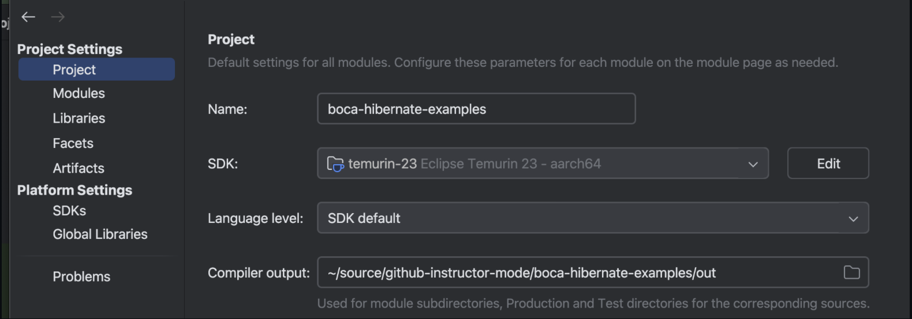
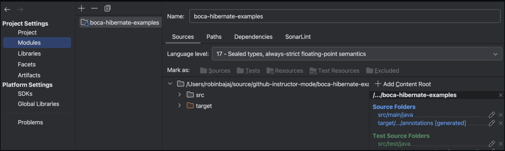
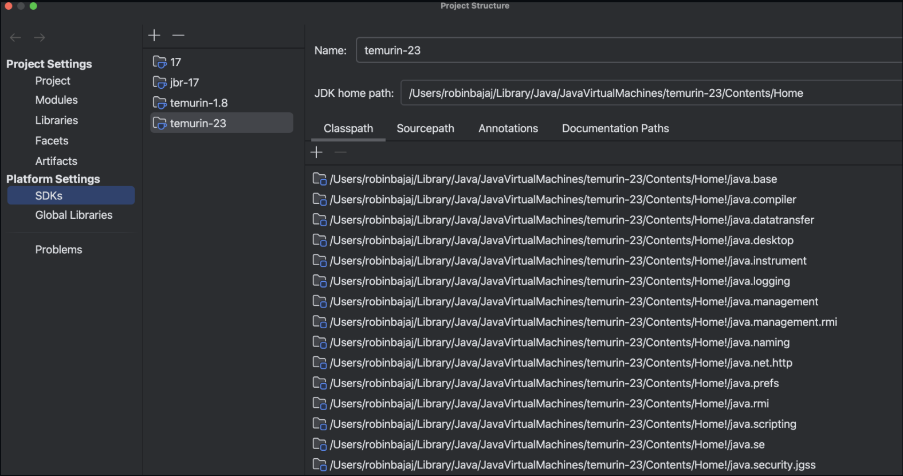
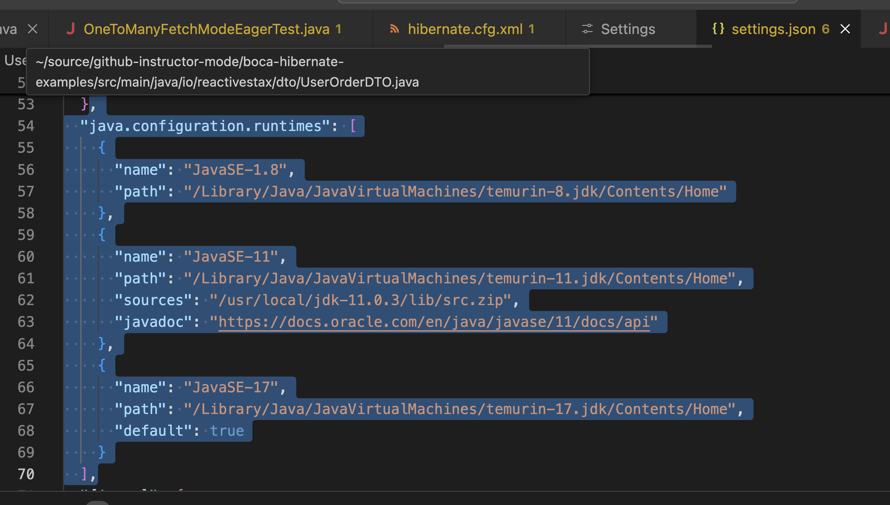

mvn -version 

Apache Maven 3.9.9 (8e8579a9e76f7d015ee5ec7bfcdc97d260186937)
Maven home: /opt/homebrew/Cellar/maven/3.9.9/libexec
Java version: 23, vendor: Eclipse Adoptium, runtime: /Users/robinbajaj/Library/Java/JavaVirtualMachines/temurin-23/Contents/Home
Default locale: en_CA, platform encoding: UTF-8
OS name: "mac os x", version: "15.0", arch: "aarch64", family: "mac"


it picks JAVA_HOME env variable


mvn uses the java jdk for building and running your apps based on the properties from your pom.xml

```xml
<properties>
    <maven.compiler.source>17</maven.compiler.source>
  <maven.compiler.target>17</maven.compiler.target>
</properties>
```


intellij project level SDK 





intellij uses langugage level support per module for compiling and running your apps 



intellij uses Java JDK from the list of Platform SDKs , at the project level.



For VS code .. the java runtimes are configured like this 


```json
,
  "java.configuration.runtimes": [
    {
      "name": "JavaSE-1.8",
      "path": "/Library/Java/JavaVirtualMachines/temurin-8.jdk/Contents/Home"
    },
    {
      "name": "JavaSE-11",
      "path": "/Library/Java/JavaVirtualMachines/temurin-11.jdk/Contents/Home",
      "sources": "/usr/local/jdk-11.0.3/lib/src.zip",
      "javadoc": "https://docs.oracle.com/en/java/javase/11/docs/api"
    },
    {
      "name": "JavaSE-17",
      "path": "/Library/Java/JavaVirtualMachines/temurin-17.jdk/Contents/Home",
      "default": true
    }
  ],
```




