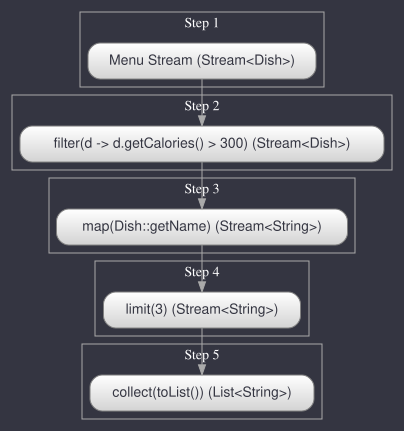
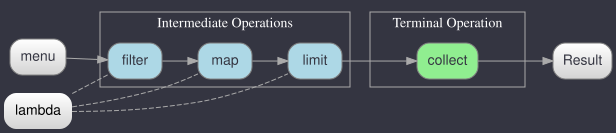
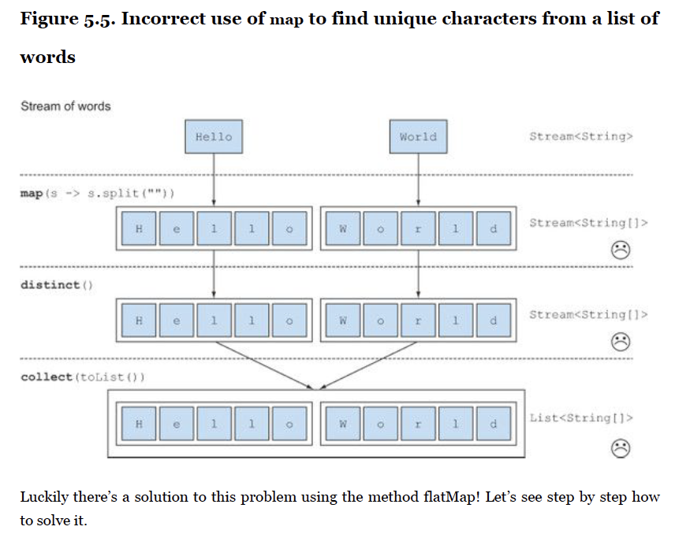
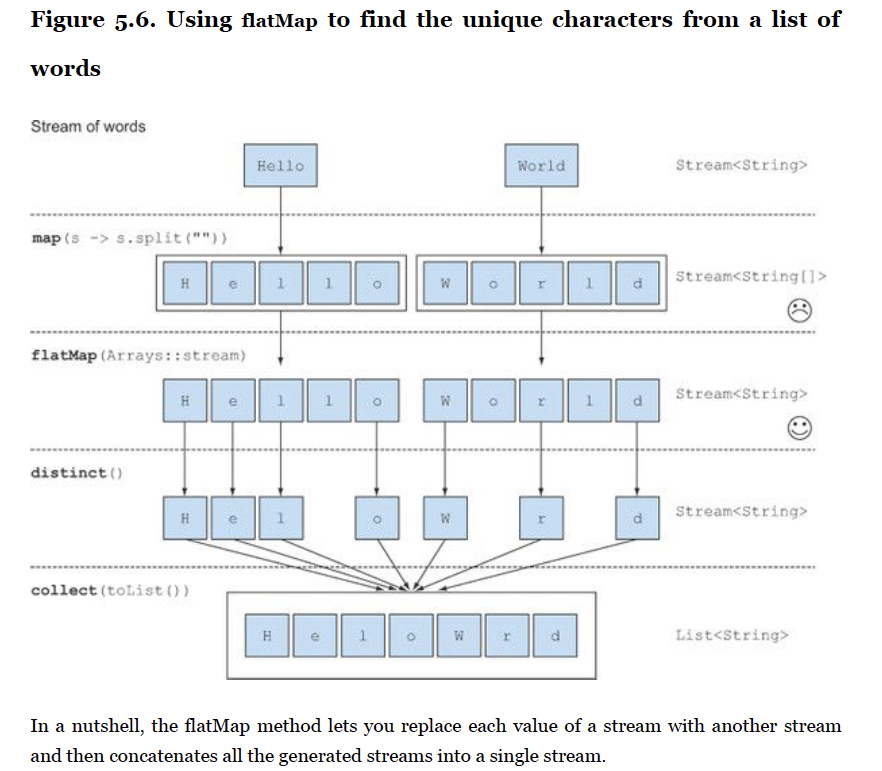
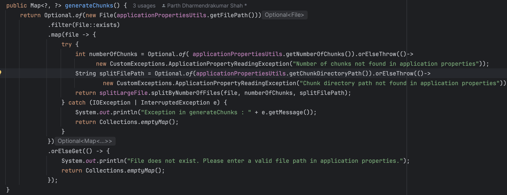
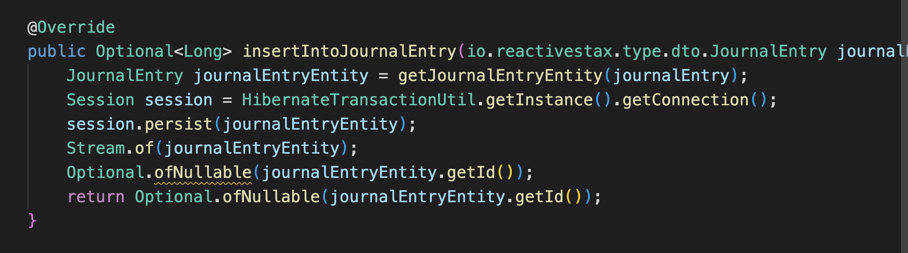
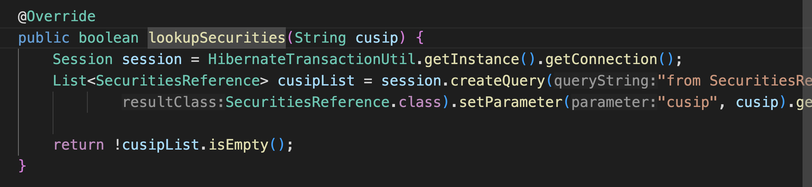
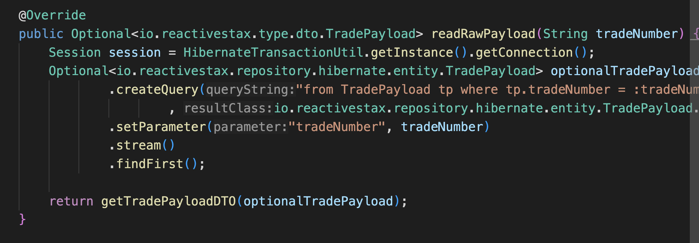
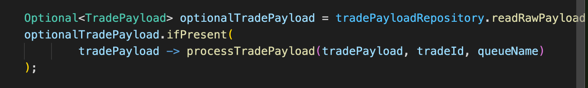

## JAVA 8 FLAGSHIP FEATURES


Java 8's flagship features were released to address a critical need: **efficient utilization of multi-core processors**. Here's an in-depth explanation of why these features were necessary and how they support multi-core processing:

### 1. **Rise of Multi-core Processors**
   - As hardware evolved, **multi-core CPUs** became the standard, offering significant performance benefits by allowing simultaneous execution of tasks.
   - Prior to Java 8, Java's concurrency model relied heavily on **threads** and **synchronization**, which were challenging to manage efficiently.
   - Traditional threading models often led to issues such as:
     - **Race conditions** due to shared mutable state.
     - **Deadlocks** when multiple threads waited indefinitely for resources.
     - **Manual thread management**, which increased the complexity of developing concurrent applications.

### 2. **Traditional Java Concurrency Was Complex and Error-prone**
   - Earlier Java versions (Java 1.0 to Java 7) introduced features like:
     - **Threads and Locks**: Basic concurrency support, but difficult to use reliably.
     - **Thread Pools (Java 5)**: Improved performance by reusing threads.
     - **Fork/Join Framework (Java 7)**: Made parallelism more practical by recursively splitting tasks into smaller subtasks.
   - However, writing code that effectively leveraged these features to achieve parallelism was still **error-prone** and **required expertise** in low-level concurrency management.
   - Developers needed a way to express **parallel operations declaratively** without manually handling the intricacies of multi-threading.


```employees.stream()
employees.parallelstream()
    .filter(checkEmployee)	
    . filter((employee) -> employee.salary > 500)
    .map (employee -> StringUtils.upperCase(employee.firstName))
     .count()   / .average () /.min()/.max()
      .groupBy()
     .partitionBy()	

10000000 million employees
employees.stream()
    .filter(checkEmployee)	
    . filter((employee) -> employee.salary > 500)
    .map (employee -> StringUtils.upperCase(employee.firstName))
			.limit(3)


// Using an anonymous class
           Greeting greeting = new Greeting() {
               @Override
               public void sayHello() {
                   System.out.println("Hello from Anonymous Class!");
               }
           };
          
           //LAMBDA
           () -> System.out.println("Hello from Anonymous Class!")
					
           //Method REference
  				 System.out::println
```


- They wanted to tap into the multi-core architectures that were coming up circa 2014 ...
- Language developers wanted to use SQL like declarative syntax in Java   (they wanted the developer to tell what needs to be done without having to tell the language HOW it is to be done)   	
- They didn't want to add "function" type in Java language - coz that will increase the cognitive load on new developers - they wanted to see if they could accomodate this concept using existing java language features. (which they did using @FunctionalInterface)
- they wanted to empower the Java Collections with more out of the box functionality 
  - they allowed interfaces to have the functionality in them -- using default keyword 	
  - the concept of function descriptor is important - (Runnable     ( ()-> void) , Predicate (  (T)-> boolean      )
- f(x)      g(x)      f(g(x))    composability of functions is also possible now 

function checkEmployee (employee){
        return employee.salary > 500 

​       1

2 

3

4

}

Integer employeeSalary = 500

function checkEmployee = (employee) -> employee.salary > 500 ;

@FunctionalInterface      
Interface Predicate<T> {
	public boolean test(T t);

}

(T) -> boolean


### 3. **Java 8's Solution: Streams and Lambdas**

   - **Java 8 introduced lambdas and the Streams API**, which enabled a **functional programming style** that is inherently better suited for parallel processing.
   - Key reasons for introducing these features:
     - **Simplicity**: 
       - Java 8's functional constructs (e.g., lambdas and method references) allow developers to write **more readable and concise code** that can be easily parallelized.
       - Instead of managing threads manually, developers could use the Streams API to specify what should be done, leaving **how** it should be done (sequential or parallel) to the framework.
     - **Internal Iteration**:
       - Prior to Java 8, collections supported **external iteration**, where developers controlled the iteration logic.
       - With Streams, iteration became **internal**—the Streams API handles the iteration, splitting, and parallel execution, making it easy to parallelize data operations.
     - **No Shared Mutable State**:
       - Functional programming principles emphasize **immutability** and **no side effects**, making parallel execution more reliable and predictable.
       - The Streams API processes data without modifying the underlying collection, avoiding common issues like race conditions.

### 4. **Parallel Streams for Effortless Multi-core Utilization**
   - Java 8 introduced **parallel streams**, allowing developers to perform operations concurrently with just a simple method call (`.parallelStream()`).
   - The internal implementation uses the **Fork/Join Framework** to split tasks into smaller chunks and process them in parallel, distributing the workload across multiple cores.
   - **Example**:
     
     ```java
     List<Integer> numbers = Arrays.asList(1, 2, 3, 4, 5, 6, 7, 8, 9, 10);
     int sum = numbers.parallelStream()
                      .mapToInt(Integer::intValue)
                      .sum();
     System.out.println("Parallel Sum: " + sum);
     ```
   - Here, the `parallelStream()` method splits the list into sublists and processes them concurrently, leveraging the available CPU cores without manual thread management.

### 5. **Performance and Scalability**
   - Parallel streams enable **scalability** across different hardware configurations:
     - On single-core systems, they behave similarly to sequential streams.
     - On multi-core systems, they automatically leverage the additional cores, resulting in significant performance gains for large data sets or CPU-intensive tasks.
   - The Streams API optimizes performance by **partitioning the workload**, **minimizing synchronization**, and reducing cache-coherency overhead, which is critical in multi-core environments.
   - It also reduces the need for locking mechanisms, which are slow and can degrade performance when scaling across multiple cores.

### 6. **Key Benefits of Java 8's Approach to Parallelism**
   - **Declarative Syntax**: Focuses on *what* needs to be done rather than *how* it should be done.
   - **Less Error-prone**: Reduces the potential for errors related to thread management, race conditions, and deadlocks.
   - **Easier to Write and Read**: Encourages a more natural, functional style of programming, which aligns with concurrent execution.
   - **Automatic Optimization**: The underlying framework handles task splitting, distribution, and parallel execution, optimizing for the best performance - (Streams API does more performance optimizations like short-circuiting, etc TODO:Robin )

### Conclusion
Java 8's flagship features, particularly **lambdas** and the **Streams API** (and **Optional** keyword), were designed to make concurrent programming easier, more intuitive, and more effective. They shifted the focus from manually managing threads to specifying **parallel operations declaratively**, making it simpler for developers to leverage the full power of **multi-core CPUs**.


### INNER CLASS vs NESTED CLASS vs ANONYMOUS CLASS in JAVA 

In Java, **inner classes**, **nested classes**, and **anonymous classes** are ways to define classes within other classes or methods, enabling encapsulation and logical grouping. Here's a detailed comparison of each:

### 1. **Inner Class**
   - An **inner class** is a non-static class defined inside another class.
   - It has access to the instance variables and methods of the outer class, even if they are private.
   - Inner classes are typically used to logically group classes that are only used in one place.
   - They require an instance of the outer class to be instantiated.

   #### Example of an Inner Class
   ```java
   public class OuterClass {
       private String outerField = "Outer Field";

       // Inner class
       public class InnerClass {
           public void display() {
               System.out.println("Accessing from Inner Class: " + outerField);
           }
       }
   }

   public class Main {
       public static void main(String[] args) {
           OuterClass outer = new OuterClass();
           OuterClass.InnerClass inner = outer.new InnerClass(); // Creating inner class instance
           inner.display(); // Output: Accessing from Inner Class: Outer Field
       }
   }
   ```
   #### Key Points
   - **Requires an instance** of the outer class to create an instance of the inner class.
   - Can access all members (fields and methods) of the outer class, including private members.
   - Inner classes are used when the behavior of the inner class is tied to the instance of the outer class.

### 2. **Nested Class**
   - A **nested class** is a **static** class defined within another class.
   - It cannot access non-static members (fields and methods) of the outer class directly.
   - Nested classes are often used to represent helper classes or utility classes that are logically tied to the outer class but do not require an instance of the outer class.

   #### Example of a Nested Class
   ```java
   public class OuterClass {
       private static String outerField = "Static Outer Field";
			 private String instanceFiled = "instanceField";
       // Nested class
       public static class NestedClass {
           public void display() {
               System.out.println("Accessing from Nested Class: " + outerField);
           }
       }
   }

   public class Main {
       public static void main(String[] args) {
           OuterClass.NestedClass nested = new OuterClass.NestedClass(); // Creating nested class instance
           nested.display(); // Output: Accessing from Nested Class: Static Outer Field
       }
   }
   ```
   #### Key Points
   - **Does not require** an instance of the outer class to be created.
   - Can only access the static members of the outer class directly.
   - Useful when you want to group classes that are related but don't need an instance of the outer class.

### 3. **Anonymous Class**
   - An **anonymous class** is an unnamed class defined at the point of instantiation.
   - It is typically used for creating quick, one-off implementations of interfaces or abstract classes.
   - Anonymous classes can also extend classes, but they are mainly used to provide implementations for functional interfaces or callback methods.

   #### Example of an Anonymous Class
   ```java
   interface Greeting {
       void sayHello();
   }

   class EnglishGreeting implements 

   public class Main {
       public static void main(String[] args) {
           // Using an anonymous class
           Greeting helloGreeting = new Greeting() {
               @Override
               public void sayHello() {
                   System.out.println("Hello from Anonymous Class!");
               }
           };
          
           //LAMBDA
           Greeting helloGreeting =  () -> System.out.println("Hello from Anonymous Class!")
					
           //Method Reference
           Greeting helloGreeting = System.out::println	   

           greeting.sayHello(); // Output: Hello from Anonymous Class!
       }
   }
   ```
   #### Key Points
   - An anonymous class is instantiated and defined at the same time.
   - It is **syntactically shorter** but can only be used once.
   - Commonly used in event handling, thread creation, and quick implementations of functional interfaces.
   - It has access to the members of the outer class, including private ones.

### Comparing Inner Class, Nested Class, and Anonymous Class

| Feature                 | Inner Class                                               | Nested Class                        | Anonymous Class                                           |
| ----------------------- | --------------------------------------------------------- | ----------------------------------- | --------------------------------------------------------- |
| **Type**                | Non-static                                                | Static                              | Nameless                                                  |
| **Access to Outer**     | Has access to all outer class members (including private) | Can access only static members      | Has access to all outer class members (including private) |
| **Instance Dependency** | Requires outer class instance                             | Independent of outer class instance | Defined and instantiated together                         |
| **Use Case**            | Tied to the outer class's instance behavior               | Helper or utility class             | One-off implementation of interfaces or classes           |
| **Reusability**         | Can be reused across outer class methods                  | Can be reused anywhere              | Cannot be reused                                          |
| **Syntax**              | Explicit class declaration                                | Explicit static class declaration   | Declared inline with instantiation                        |

### When to Use Each
- **Inner Classes**:
  - Use when you have classes that are conceptually tied to the instance of the outer class.
  - They help in achieving encapsulation when you want to logically group classes used only in one place.
  - Example: Iterator implementation within a collection class.

- **Nested Classes**:
  - Use when the behavior is related to the outer class but doesn't require access to instance-level members.
  - Commonly used for utility classes or static helpers.
  - Example: `Map.Entry` is a nested class within the `Map` interface.

- **Anonymous Classes**:
  - Use when you need a quick implementation of an interface or abstract class, usually for event handling or functional interfaces.
  - Example: Creating a `Runnable` for a thread or implementing a `Comparator` for sorting.

By using inner, nested, and anonymous classes appropriately, you can achieve better **encapsulation**, **logical grouping**, and **cleaner code organization**. Each type has its specific use case, so choose based on the context of your code. 

----

### <u>What is a LAMBDA expression</u>

A **lambda expression** can be understood as a **concise representation of an anonymous function** that can be passed around: it doesn’t have a name, but it has a list of parameters, a body, a return type, and possibly a list of exceptions that can be thrown.

Let’s break it down:

- **Anonymous**:
  - We call it anonymous because it doesn’t have an explicit name like a method would normally have. This results in **less to write and think about**.
- **Function**:
  - It is referred to as a function because a lambda isn’t associated with a particular class like a method is.
  - However, like a method, a lambda has:
    - A **list of parameters**
    - A **body**
    - A **return type**
    - A possible list of **exceptions** that can be thrown.
- **Passed Around**:
  - A lambda expression can be **passed as an argument** to a method or **stored in a variable**.
- **Concise**:
  - Lambdas do not require the verbose **boilerplate** code that is often needed for anonymous classes.

###  Before (Using Anonymous Inner Class):**

```java
Comparator<Apple> byWeight = new Comparator<Apple>() {
    @Override
    public int compare(Apple a1, Apple a2) {
        return a1.getWeight().compareTo(a2.getWeight());
    }
};
```

**After (Using Lambda Expression):**

```java
Comparator<Apple> byWeight = (Apple a1, Apple a2) -> a1.getWeight().compareTo(a2.getWeight());
```

The lambda version simplifies the code by eliminating the boilerplate of an anonymous class!

-------

Figure 3.1.** A lambda expression is composed of **parameters**, an **arrow**, and a **body**.

```java
(Apple a1, Apple a2) -> a1.getWeight().compareTo(a2.getWeight());
```

- **A list of parameters**:
  - In this example, the parameters are `(Apple a1, Apple a2)`, mirroring the parameters of the `compare` method of a `Comparator` for two `Apple` objects.

- **An arrow (`->`)**:
  - The arrow separates the list of parameters from the body of the lambda.

- **The body of the lambda**:
  - In this case, it compares two `Apple` objects using their weights. The expression `a1.getWeight().compareTo(a2.getWeight())` is considered the lambda’s return value.

-------

### Listing 3.1. Valid lambda expressions in Java 8

1. **First Lambda Expression**
   ```java
   (String s) -> s.length()
     
     String -> int   
   ```
   - **Explanation**: This lambda expression has one parameter of type `String` and returns an `int`. The lambda doesn’t require a `return` statement here because the return is implied.
   
2. **Second Lambda Expression**
   ```java
   (Apple a) -> a.getWeight() > 150      
     
     (Apple) -> boolean           T -> boolean 
   ```
   - **Explanation**: This lambda expression has one parameter of type `Apple` and returns a `boolean`, indicating whether the apple's weight is greater than 150 g.
   
3. **Third Lambda Expression**
   
   ```java
   (int x, int y) -> {
       System.out.println("Result:");
       System.out.println(x + y);
   }
   
   
   //List<String> strings = new ArrayList<>();
   
   (int, int) -> void 
   ```
   - **Explanation**: This lambda expression has two parameters of type `int` and no return (void). It contains multiple statements within the body.
   
4. **Fourth Lambda Expression**
   ```java
   () -> 42
   ```
   - **Explanation**: This lambda expression has no parameter and returns an `int` value (42).

5. **Fifth Lambda Expression**
   ```java
   (Apple a1, Apple a2) -> a1.getWeight().compareTo(a2.getWeight())
   ```
   - **Explanation**: This lambda expression has two parameters of type `Apple` and returns an `int`, which is the comparison of the weight of the two apples.

---

### Table 3.1. Examples of Lambdas

| **Use Case**                      | **Examples of Lambdas**                                      |
| --------------------------------- | ------------------------------------------------------------ |
| **A boolean expression**          | `(List<String> list) -> list.isEmpty()`                      |
| **Creating objects**              | `() -> new Apple(10)`                                        |
| **Consuming from an object**      | `(Apple a) -> { System.out.println(a.getWeight()); }`        |
| **Select/extract from an object** | `(String s) -> s.length()`                                   |
| **Combine two values**            | `(int a, int b) -> a * b`                                    |
| **Compare two objects**           | `(Apple a1, Apple a2) -> a1.getWeight().compareTo(a2.getWeight())` |

----

### Where and How to Use Lambdas

Lambda expressions can be used in Java 8 wherever a **functional interface** is expected. A **functional interface** is an interface that contains only one abstract method. Lambdas provide a clean, concise way to represent these single-method interfaces, enabling functional-style programming in Java


In the previous example, a lambda expression was assigned to a variable of type `Comparator<Apple>`. Lambdas can also be passed directly as arguments to methods that accept a functional interface.

#### Example 1: Assigning Lambda to a Variable
```java
Comparator<Apple> byWeight = (Apple a1, Apple a2) -> a1.getWeight().compareTo(a2.getWeight());
```
- Here, the lambda is assigned to a `Comparator<Apple>`, which is a functional interface.

#### Example 2: Using Lambda with the `filter` Method
```java
List<Apple> greenApples = filter(inventory, (Apple a) -> "green".equals(a.getColor()));
```
- In this code, a lambda expression is passed as the second argument to the `filter` method, which expects a `Predicate<T>`, a functional interface that takes one argument and returns a boolean.

### Where You Can Use Lambdas
You can use a lambda expression in any context where a **functional interface** is expected. This includes:

1. **Variables**:
   - You can assign a lambda to any variable that has a functional interface type.
   ```java
   Predicate<Apple> isGreen = (Apple a) -> "green".equals(a.getColor());
   ```

2. **Method Arguments**:
   - Lambdas can be passed as arguments to methods that expect a functional interface.
   ```java
   List<Apple> redApples = filter(inventory, (Apple a) -> "red".equals(a.getColor()));
   ```

3. **Return Values**:
   - Methods can return lambdas as long as the return type is a functional interface.
   ```java
   public static Predicate<Apple> isHeavyApple() {
       return (Apple a) -> a.getWeight() > 150;
   }
   ```

4. **Streams and Collections**: (Prerequisite: Streams API)
   
   - Lambdas are widely used with the **Streams API** for operations like filtering, mapping, reducing, etc.
   ```java
   List<String> names = Arrays.asList("Anna", "Bob", "Charlie");
   List<String> longNames = names.stream()
                                 .filter(name -> name.length() > 3)
                                 .collect(Collectors.toList());
   ```
   
5. **Event Handling**:
   
   - In GUI frameworks like JavaFX or Swing, lambdas can be used for event handling, replacing anonymous inner classes.
   ```java
   button.addActionListener(e -> System.out.println("Button clicked!"));
   ```

### Summary
You can use lambda expressions in Java 8 wherever a **functional interface** is expected, making your code more concise and easier to read. Lambdas work seamlessly with the Streams API, collections, predicates, comparators, and more.

---

### <u>Functional Interface</u>

- **Predicate Interface**:
  
  - The `Predicate<T>` interface from Chapter 2 is an example of a **functional interface**. It allows the behavior of the `filter` method to be parameterized.
  - **Why is it a functional interface?**
    - Because it defines only **one abstract method**:
      ```java
      public interface Predicate<T> {
          boolean test(T t);
      }
      ```
  
- **In a nutshell**:
  - A **functional interface** is an interface that specifies exactly **one abstract method**.
  - Examples of functional interfaces in the Java API include:
    1. **Comparator<T>**:
       
       ```java
       public interface Comparator<T> {
           int compare(T o1, T o2);   
       }
       ```
    2. **Runnable**:
       ```java
       public interface Runnable {
           void run();      //()->void 
       }
       ```
    3. **ActionListener**:
       
       ```java
       public interface ActionListener extends EventListener {
           void actionPerformed(ActionEvent e);       //(ActionEvent)-> void
       }
       ```
    4. **Callable<V>**:
       ```java
       public interface Callable<V> {
           V call();
       }
       ```
    5. **PrivilegedAction<V>**:
       ```java
       public interface PrivilegedAction<V> {
           V run();
       }
       ```
  
- Functional interfaces are integral to lambda expressions in Java, enabling functional programming by allowing lambdas to be used wherever a functional interface is expected.

----

The following code is valid because **Runnable** is a functional interface that defines only one abstract method, `run()`:

```java
// Using a lambda
Runnable r1 = () -> System.out.println("Hello World 1");

// Using an anonymous class
Runnable r2 = new Runnable() {
    public void run() {
        System.out.println("Hello World 2");
    }
};

public static void process(Runnable r) {
    r.run();
}

process(r1); // Prints "Hello World 1"
process(r2); // Prints "Hello World 2"

// Passing a lambda directly
process(() -> System.out.println("Hello World 3")); // Prints "Hello World 3"
process (  ()-> void ) 
```

### Explanation
- **Using a lambda**: `r1` is created using a lambda, as `Runnable` is a functional interface.
- **Using an anonymous class**: `r2` is created using an anonymous inner class.
- **Method `process`**: This method accepts a `Runnable` and invokes its `run()` method.
- The three calls to `process` demonstrate:
  1. Passing a lambda (`r1`).
  2. Passing an anonymous class (`r2`).
  3. Passing a lambda directly.

The output will be:
```
Hello World 1
Hello World 2
Hello World 3
```

---

This example illustrates how **lambda expressions** simplify the usage of functional interfaces like `Runnable`, making the code more concise.

---

The following table shows commons lambda expressions with their corresponding functional interfaces. 

---

### Table 3.3. Examples of Lambdas with Functional Interfaces

| **Use Case**                      | **Example of Lambda**                                        | **Matching Functional Interface**                            |
| --------------------------------- | ------------------------------------------------------------ | ------------------------------------------------------------ |
| **A boolean expression**          | `(List<String> list) -> list.isEmpty()`                      | `Predicate<List<String>>`                                    |
| **Creating objects**              | `() -> new Apple(10)`                                        | `Supplier<Apple>`                                            |
| **Consuming from an object**      | `(Apple a) -> System.out.println(a.getWeight())`             | `Consumer<Apple>`                                            |
| **Select/extract from an object** | `(String s) -> s.length()`                                   | `Function<String, Integer>` or `ToIntFunction<String>`       |
| **Combine two values**            | `(int a, int b) -> a * b`                                    | `IntBinaryOperator`                                          |
| **Compare two objects**           | `(Apple a1, Apple a2) -> a1.getWeight().compareTo(a2.getWeight())` | `Comparator<Apple>`, `BiFunction<Apple, Apple, Integer>`, or `ToIntBiFunction<Apple, Apple>` |

---

### Deconstructing the Type-Checking Process of a Lambda Expression

```java
List<Apple> heavierThan150g = 
    filter(inventory, (Apple a) -> a.getWeight() > 150);
```

The type-checking process is deconstructed as follows:

1. **Context Check**:
   - First, you need to look up the declaration of the `filter` method:
     ```java
     filter(List<Apple> inventory, Predicate<Apple> p)
     ```

2. **Target Type Identification**:
   
   - The second formal parameter in the method declaration is of type `Predicate<Apple>`, which becomes the **target type** for the lambda expression.
   
3. **Abstract Method Identification**:
   - `Predicate<Apple>` is a functional interface defining a single abstract method, `test`.

4. **Method Description**:
   - The `test` method in `Predicate<Apple>` takes an `Apple` and returns a `boolean`.

5. **Function Descriptor Matching**:
   - The lambda `(Apple a) -> a.getWeight() > 150` matches the function descriptor of `Predicate<Apple>` because it accepts an `Apple` and returns a boolean.

### Summary of Type-Checking Process
- **First**: Look up the declaration of the `filter` method.
- **Second**: Identify the target type, which is `Predicate<Apple>`.
- **Third**: Verify that `Predicate<Apple>` has a single abstract method, `test`.
- **Fourth**: Ensure that the lambda matches the function descriptor by accepting an `Apple` and returning a boolean.

This breakdown explains how Java type-checks lambda expressions to ensure compatibility with functional interfaces.

------

### Type Inference

You can simplify your code further. The **Java compiler** deduces what functional interface to associate with a lambda expression from its surrounding context (the target type). This means it can also deduce an appropriate **signature** for the lambda because the function descriptor is available through the target type.

The benefit is that the compiler has access to the **types of the parameters** of a lambda expression, allowing them to be **omitted** in the lambda syntax. In other words, the **Java compiler infers the types of the parameters** of a lambda.

#### Example: Type Inference
```java
List<Apple> greenApples = 
    filter(inventory, a -> "green".equals(a.getColor())); // No explicit type on 'a'
```

> **Note**: When a lambda has just one parameter whose type is inferred, the parentheses surrounding the parameter name can also be omitted.

#### Example: Comparator Creation with Type Inference
- **Without Type Inference**:
  ```java
  Comparator<Apple> c = 
      (Apple a1, Apple a2) -> a1.getWeight().compareTo(a2.getWeight());
  ```
- **With Type Inference**:
  ```java
  Comparator<Apple> c = 
      (a1, a2) -> a1.getWeight().compareTo(a2.getWeight());
  ```

### Key Points
- **Readability Benefits**: Type inference improves code readability, especially when lambda expressions have several parameters.
- **Choosing Explicit Types**: Sometimes it’s more readable to include the types explicitly, while other times it’s more readable to exclude them. There’s no strict rule for which way is better; developers should make their own choices about what makes their code more readable.

---

### Putting Lambdas into Practice: The Execute Around Pattern</u>

This section describes how lambdas, combined with behavior parameterization, can make code more **flexible** and **concise**.

#### Context
- A common pattern in **resource processing** (e.g., dealing with files or databases) involves three main steps:
  1. **Open** a resource.
  2. **Process** the resource (perform operations on it).
  3. **Close** the resource.
- The **setup** and **cleanup** phases are similar and surround the actual processing logic. This is called the **execute around pattern**.

#### Figure 3.2: Tasks A and B Surrounded by Preparation/Cleanup Code
- Tasks A and B are shown surrounded by redundant preparation and cleanup code:
  - **Task A**:
    - Initialization
    - Cleanup
  - **Task B**:
    - Initialization
    - Cleanup

#### Example: Using the Execute Around Pattern for File Processing
The following code demonstrates the pattern by showing how to read one line from a file. It uses **Java 7’s try-with-resources statement**, which simplifies the code by automatically closing the resource.

```java
public static String processFile() throws IOException {
    try (BufferedReader br = 
         new BufferedReader(new FileReader("data.txt"))) {
        return br.readLine(); // This is the line that does useful work.
    }
}
```

### Key Points
- **Setup** and **cleanup** code are similar for each task and surround the main processing logic.
- Lambdas can be used to **abstract** and **parameterize** the behavior of the core task, enabling the execute around pattern to be implemented in a more concise way.

---

This section highlights how **lambdas** make it easier to handle resource processing by focusing on the core task while abstracting setup and cleanup logic.

### 3.3.1. Step 1: Remember Behavior Parameterization

The current code is limited as it can only read the **first line** of the file. If you want to read the **first two lines** or determine the **most frequently used word**, you need to modify the code. Ideally, you want to **reuse** the setup and cleanup code and allow the `processFile` method to perform **different actions** on the file.

To achieve this, you need to **parameterize** the behavior of `processFile`. You need a way to pass behavior to `processFile` so it can execute different behaviors using a `BufferedReader`.

#### Example: Passing Behavior with Lambdas
You want a lambda that takes a `BufferedReader` and returns a `String`. Here’s how to print **two lines** of a `BufferedReader`:

```java
String result = processFile((BufferedReader br) -> 
    br.readLine() + br.readLine()
);
```

### Key Points
- **Behavior parameterization** allows you to make the code more flexible by enabling different behaviors to be passed to the same method.
- **Lambdas** allow this parameterization, making the core method more versatile without changing its core logic.


### 3.3.2. Step 2: Use a Functional Interface to Pass Behaviors

Lambdas can only be used in the context of a **functional interface**. You need to create one that matches the signature `BufferedReader -> String` and can throw an `IOException`.

#### Example: Define a Functional Interface
```java
@FunctionalInterface
public interface BufferedReaderProcessor {
    String process(BufferedReader b) throws IOException;   // (BufferedReader) -> String
}
```

- You can now use this interface as the argument to your new `processFile` method:

```java
public static String processFile(BufferedReaderProcessor p) throws IOException {
    // method implementation
}
```

### 3.3.3. Step 3: Execute a Behavior!

Any lambda of the form `BufferedReader -> String` can be passed as an argument because it matches the signature of the `process` method defined in the `BufferedReaderProcessor` interface. 

- You need a way to **execute** the code represented by the lambda inside the body of `processFile`.
- Lambdas allow you to provide the implementation of the abstract method directly inline, treating the whole expression as an **instance of a functional interface**.

#### Example: Implementing `processFile`
```java
public static String processFile(BufferedReaderProcessor p, file) throws IOException {
    try (BufferedReader br = new BufferedReader(new FileReader("data.txt"))) {
        return p.process(br); // Processing the BufferedReader object
    }
}
```

### Key Points
- The lambda expression can be treated as an **instance of the functional interface**.
- The method `processFile` accepts the `BufferedReaderProcessor` object and calls the `process` method inside its body.

### 3.3.4. Step 4: Pass Lambdas

With the **`processFile`** method now set up to accept a functional interface, you can reuse it to **process files in different ways** by passing **different lambda expressions**. This makes the code more flexible, allowing different behaviors to be executed without changing the method’s core logic.

#### Example: Reusing `processFile` with Different Lambdas

Here’s how you can use the `processFile` method to read files in different ways:

1. **Read a Single Line from a File**
   ```java
   String oneLine = processFile((BufferedReader br) -> br.readLine());
   
   String oneLine = processFile(BufferedReader::readLine());
   
   System.out.println("First Line: " + oneLine);
   ```
   
2. **Read Two Lines from a File**
   ```java
   String twoLines = processFile((BufferedReader br) -> MyClass.readMultipleLines(br));
   System.out.println("First Two Lines: " + twoLines);
   
   String twoLines = processFile(MyClass::readMultipleLines);
   
   public static String readMultipleLines (BufferedReader br){
       return br.readLine+br.readLine();
   }
   ```
   
3. **Read the First Line in Uppercase**
   ```java
   String upperCaseLine = processFile((BufferedReader br) -> br.readLine().toUpperCase());
   System.out.println("Uppercase First Line: " + upperCaseLine);
   ```

4. **Count the Number of Characters in the First Line**
   ```java
   int charCount = processFile((BufferedReader br) -> br.readLine().length());
   System.out.println("Character Count of First Line: " + charCount);
   ```

### Explanation
- **The `processFile` method** accepts different lambdas that implement the logic for processing the `BufferedReader`.
- By passing different lambda expressions, the method can handle various file-processing tasks without changing its structure.
- This demonstrates the **execute around pattern** combined with **behavior parameterization**, making the code more reusable and modular.

### Key Benefits
- **Increased Flexibility**: Different behaviors can be added easily by passing new lambdas.
- **Reduced Boilerplate**: The method can focus on resource handling while the lambda defines the actual processing logic.
- **Reusability**: The core `processFile` logic remains unchanged, making it applicable for different file-processing requirements.

---

This step shows the power of lambdas in enabling **dynamic behavior** while keeping the code simple and flexible.

These examples illustrate the versatility of lambda expressions in Java 8, showing how they can handle different scenarios based on the number of parameters, return types, and the presence of multiple statements.

The **`Consumer`**, **`Supplier`**, **`Predicate`**, and **`Function`** interfaces are part of the `java.util.function` package, introduced in Java 8 to support functional programming. Below, I'll show you the bodies of these interfaces with explanations.

### 1. **Consumer<T> Interface**
   - Represents an operation that accepts a single input argument and returns no result.
   - It is expected to operate via side effects (e.g., modifying objects, printing data).
   - **Functional Method**: `accept(T t)`

   #### Body of `Consumer<T>`
   ```java
   @FunctionalInterface
   public interface Consumer<T> {
       // Abstract method that takes one argument and returns void
       void accept(T t);

       // Default method that returns a composed Consumer
       default Consumer<T> andThen(Consumer<? super T> after) {
           if (after == null) throw new NullPointerException();
           return (T t) -> {
               accept(t);
               after.accept(t);
           };
       }
   }
   ```
   - **`accept(T t)`**: Takes an input of type `T` and performs an action.
   - **`andThen(Consumer<? super T> after)`**: Returns a composed `Consumer` that performs the current operation followed by the `after` operation.

### 2. **Supplier<T> Interface**
   - Represents a supplier of results; it takes no arguments and returns a result.
   - Often used for lazy evaluation or providing default values.
   - **Functional Method**: `get()`

   #### Body of `Supplier<T>`
   ```java
   @FunctionalInterface
   public interface Supplier<T> {
       // Abstract method that returns a value of type T
       T get();
   }
   ```
   - **`get()`**: Supplies a result of type `T`. It is used to generate or provide values, often lazily.

### 3. **Predicate<T> Interface**
   - Represents a single argument function that returns a boolean value.
   - It is often used for filtering or testing conditions.
   - **Functional Method**: `test(T t)`

   #### Body of `Predicate<T>`
   ```java
   @FunctionalInterface
   public interface Predicate<T> {
       // Abstract method that tests the condition on the input and returns boolean
       boolean test(T t);

       // Default method that returns a composed predicate that represents a short-circuiting logical AND
       default Predicate<T> and(Predicate<? super T> other) {
           if (other == null) throw new NullPointerException();
           return (T t) -> test(t) && other.test(t);
       }

       // Default method that returns a composed predicate that represents a short-circuiting logical OR
       default Predicate<T> or(Predicate<? super T> other) {
           if (other == null) throw new NullPointerException();
           return (T t) -> test(t) || other.test(t);
       }

       // Default method that returns a predicate that represents the logical negation of this predicate
       default Predicate<T> negate() {
           return (T t) -> !test(t);
       }

       // Static method that returns a predicate that tests if two arguments are equal
       static <T> Predicate<T> isEqual(Object targetRef) {
           return (null == targetRef)
               ? Objects::isNull
               : targetRef::equals;
       }
   }
   ```
   - **`test(T t)`**: Tests whether the input satisfies the condition.
   - **`and(Predicate<? super T> other)`**: Returns a predicate that represents the logical AND of this predicate and another.
   - **`or(Predicate<? super T> other)`**: Returns a predicate that represents the logical OR of this predicate and another.
   - **`negate()`**: Returns a predicate that represents the logical negation of this predicate.
   - **`isEqual(Object targetRef)`**: Returns a predicate that tests if two arguments are equal.

### 4. **Function<T, R> Interface**
   - Represents a function that takes an argument of type `T` and returns a result of type `R`.
   - Used for transforming or mapping values.
   - **Functional Method**: `apply(T t)`

   #### Body of `Function<T, R>`
   ```java
   @FunctionalInterface
   public interface Function<T, R> {
       // Abstract method that applies this function to the given argument
       R apply(T t);

       // Default method that returns a composed function that first applies this function to its input
       // and then applies the 'after' function to the result
       default <V> Function<T, V> andThen(Function<? super R, ? extends V> after) {
           if (after == null) throw new NullPointerException();
           return (T t) -> after.apply(apply(t));
       }

       // Default method that returns a composed function that first applies the 'before' function
       // to its input and then applies this function to the result
       default <V> Function<V, R> compose(Function<? super V, ? extends T> before) {
           if (before == null) throw new NullPointerException();
           return (V v) -> apply(before.apply(v));
       }

       // Static method that returns a function that always returns its input argument
       static <T> Function<T, T> identity() {
           return t -> t;
       }
   }
   ```
   - **`apply(T t)`**: Applies the function to the given argument and returns the result.
   - **`andThen(Function<? super R, ? extends V> after)`**: Returns a composed function that applies this function first and then the `after` function.
   - **`compose(Function<? super V, ? extends T> before)`**: Returns a composed function that applies the `before` function and then this function.
   - **`identity()`**: Returns a function that always returns its input argument, often used as a default mapping function.

### Summary Table of Functional Interfaces

| Functional Interface | Method Signature    | Description                                              |
| -------------------- | ------------------- | -------------------------------------------------------- |
| `Consumer<T>`        | `void accept(T t)`  | Consumes a value and performs an action, no return.      |
| `Supplier<T>`        | `T get()`           | Supplies a value of type `T`, no input required.         |
| `Predicate<T>`       | `boolean test(T t)` | Tests a condition on input of type `T`, returns boolean. |
| `Function<T, R>`     | `R apply(T t)`      | Takes input of type `T`, returns output of type `R`.     |

These functional interfaces allow for easy implementation of **lambda expressions** and functional programming constructs in Java 8 and above. Let me know if you have any specific use cases or need more examples!

----

### 3.4. Using Functional Interfaces

As explained in **section 3.2.1**, a **functional interface** specifies exactly **one abstract method**. Functional interfaces are useful because the signature of the abstract method matches the signature of a **lambda expression**. This signature is called a **function descriptor**.

To use different lambda expressions, you need a set of functional interfaces that describe common function descriptors. The Java API already includes several functional interfaces like `Comparable`, `Runnable`, and `Callable` (covered in **section 3.2**).

The Java library designers introduced several new functional interfaces in the **java.util.function** package in Java 8, including `Predicate`, `Consumer`, and `Function`.

### 3.4.1. Predicate

The **`java.util.function.Predicate<T>`** interface defines an abstract method named `test` that accepts an object of generic type `T` and returns a boolean. It’s often used when you need to represent a boolean expression that operates on objects of type `T`.

#### Listing 3.2: Working with a Predicate
```java
@FunctionalInterface
public interface Predicate<T> {
    boolean test(T t);
}

public static <T> List<T> filter(List<T> list, Predicate<T> p) {
    List<T> results = new ArrayList<>();
    for (T s : list) {
        if (p.test(s)) {
            results.add(s);
        }
    }
    return results;
}
```

#### Example Usage of Predicate
```java
Predicate<String> nonEmptyStringPredicate = (String s) -> !s.isEmpty();
List<String> nonEmpty = filter(listOfStrings, nonEmptyStringPredicate);
```

- In this example, a lambda expression is used to create a `Predicate<String>` that checks if a string is **non-empty**.
- The `filter` method uses this predicate to return a list of non-empty strings.

### Additional Functional Interface Methods
- The **Predicate** interface also contains additional methods like **`and`** and **`or`** for composing predicates. These will be covered later in **section 3.8**.

This explanation demonstrates how to use the **Predicate** interface with lambda expressions in Java 8, enabling flexible and concise boolean expressions.

### 3.4.2. Consumer

The **`java.util.function.Consumer<T>`** interface defines an abstract method named `accept` that takes an object of generic type `T` and returns **no result** (void). This interface is useful when you need to **access** an object of type `T` and **perform some operations** on it.

#### Example Use Case
You can use it to create a method called **forEach**, which takes a list of Integers and applies an operation on each element of the list. In the following example, the **forEach** method is combined with a lambda to print all the elements of the list.

#### Listing 3.3. Working with a Consumer
```java
@FunctionalInterface
public interface Consumer<T> {
    void accept(T t);
}

public static <T> void forEach(List<T> list, Consumer<T> c) {
    for (T t : list) {
        c.accept(t);
    }
}

// Example usage of forEach
forEach(
    Arrays.asList(1, 2, 3, 4, 5), 
    (Integer i) -> System.out.println(i)
);


// Example usage of forEach
forEach(
    Arrays.asList(1, 2, 3, 4, 5), 
    System.out::println
);
```

- **Explanation**: 
  - The lambda `(Integer i) -> System.out.println(i)` is the implementation of the **accept** method from the `Consumer` interface, used here to print each element of the list.

---

This demonstrates how the **Consumer** interface can be used to define operations on elements of a collection, making use of lambdas for concise code.


### 3.4.3. Supplier

The **`java.util.function.Supplier<T>`** interface defines an abstract method named **`get`** that **takes no arguments** and **returns** an object of type **`T`**. It’s useful when you want to **generate** or **supply** values without taking any input.

#### Example Use Case

You can use it to create a method called **generate**, which generates a list of values using a **`Supplier`** and adds those values to a list.

#### Listing 3.5. Working with a Supplier

```java
@FunctionalInterface
public interface Supplier<T> {
    T get();
}

public static <T> List<T> generate(int n, Supplier<T> s) {
    List<T> result = new ArrayList<>();
    for (int i = 0; i < n; i++) {
        result.add(s.get());
    }
    return result;
}

// Example usage of generate
List<Double> randomNumbers = generate(
    5, 
    () -> Math.random()
);
System.out.println(randomNumbers);
```

- **Explanation**: 
  - The lambda `() -> Math.random()` is an implementation of the **get** method from the `Supplier` interface.
  - The **`generate`** method uses this lambda to generate 5 random double values and add them to the list.
  - This example shows how to use the **`Supplier`** interface to **supply or generate values** on demand.

### Key Points
- **Consumer** is for **performing actions** on objects, while **Supplier** is for **providing or generating values**.
- The `Consumer` takes input but doesn't return anything, whereas the `Supplier` doesn’t take any input but returns a result.

This demonstrates how the **`Supplier`** interface is used to create values dynamically and how it complements the **`Consumer`** interface by focusing on value generation rather than value consumption.

### 3.4.4. Function

The **`java.util.function.Function<T, R>`** interface defines an abstract method named **`apply`** that takes an object of generic type **`T`** as input and returns an object of generic type **`R`**. 

You might use this interface when you need to define a lambda that **maps information** from an input object to an output (e.g., extracting the weight of an apple or mapping a string to its length).

The following listing shows how you can use it to create a `map` method that transforms a list of Strings into a list of Integers, where each integer represents the length of the corresponding string.

#### Listing 3.4: Working with a Function

```java
@FunctionalInterface
public interface Function<T, R> {
    R apply(T t);
}

public static <T, R> List<R> map(List<T> list, Function<T, R> f) {
    List<R> result = new ArrayList<>();
    for (T s : list) {
        result.add(f.apply(s));
    }
    return result;
}

// Example usage
List<Integer> l = map(
    Arrays.asList("lambdas", "in", "action"),
    (String s) -> s.length()
);
// Output: [7, 2, 6]
```

- **Explanation**: 
  - The `Function<T, R>` interface has a single abstract method `apply` that maps an input of type **`T`** to an output of type **`R`**.
  
  - The `map` method uses the `Function` interface to apply a mapping operation to each element of the list.
  
  - In the example, the lambda `(String s) -> s.length()` is an implementation of the `apply` method, which converts strings to their lengths.
  
    This example demonstrates how the **`Function`** interface enables behavior parameterization in Java, making it easier to transform data using lambdas.

### 3.4.5. UnaryOperator
The **`java.util.function.UnaryOperator<T>`** is a specialized version of **`Function<T, R>`** that takes a single argument of type **`T`** and returns a result of the same type **`T`**.

#### Example Use Case
You can use it to create a method that **increments** each element in a list.

#### Example: Working with a UnaryOperator
```java
@FunctionalInterface
public interface UnaryOperator<T> extends Function<T, T> {
    T apply(T t);
}

public static <T> void applyUnary(List<T> list, UnaryOperator<T> u) {
    for (int i = 0; i < list.size(); i++) {
        list.set(i, u.apply(list.get(i)));
    }
}

// Example usage
List<Integer> numbers = Arrays.asList(1, 2, 3, 4, 5);
applyUnary(numbers, (Integer x) -> x + 1);
applyUnary(numbers, (Integer x) -> x * 2);
applyUnary(numbers, (Integer x) -> x / 2);
applyUnary(numbers, (Integer x) -> x - 1);
System.out.println(numbers); // Output: [2, 3, 4, 5, 6]
```

### 3.4.6. BinaryOperator
The **`java.util.function.BinaryOperator<T>`** is a specialized version of **`BiFunction<T, U, R>`** that takes two arguments of the same type **`T`** and returns a result of the same type **`T`**.

#### Example Use Case
You can use it to **add** two numbers or **concatenate** two strings.

#### Example: Working with a BinaryOperator
```java
@FunctionalInterface
public interface BinaryOperator<T> extends BiFunction<T, T, T> {
    T apply(T t1, T t2);
}

public static <T> T applyBinary(T t1, T t2, BinaryOperator<T> b) {
    return b.apply(t1, t2);
}

// Example usage
int sum = applyBinary(10, 20, (a, b) -> a + b);
System.out.println(sum); // Output: 30

String combined = applyBinary("Hello, ", "World!", (s1, s2) -> s1 + s2);
System.out.println(combined); // Output: Hello, World!
```

### 3.4.7. BiPredicate
The **`java.util.function.BiPredicate<T, U>`** takes two arguments of types **`T`** and **`U`** and returns a **boolean** value.

#### Example Use Case
You can use it to **compare** two strings for equality or check if the sum of two numbers is greater than a threshold.

#### Example: Working with a BiPredicate
```java
@FunctionalInterface
public interface BiPredicate<T, U> {
    boolean test(T t, U u);
}

public static <T, U> boolean testBiPredicate(T t, U u, BiPredicate<T, U> bp) {
    return bp.test(t, u);
}

// Example usage
boolean isEqual = testBiPredicate("abc", "abc", (s1, s2) -> s1.equals(s2));
System.out.println(isEqual); // Output: true

boolean isGreaterThan50 = testBiPredicate(30, 25, (a, b) -> (a + b) > 50);
System.out.println(isGreaterThan50); // Output: true
```

### 3.4.8. BiConsumer
The **`java.util.function.BiConsumer<T, U>`** takes two arguments of types **`T`** and **`U`** and returns **no result** (void). It’s used to **consume** both arguments.

#### Example Use Case
You can use it to **print** pairs of values or **update** two fields of an object.

#### Example: Working with a BiConsumer
```java
@FunctionalInterface
public interface BiConsumer<T, U> {
    void accept(T t, U u);
}

public static <T, U> void applyBiConsumer(T t, U u, BiConsumer<T, U> bc) {
    bc.accept(t, u);
}

// Example usage
applyBiConsumer("Name: ", "John", (s1, s2) -> System.out.println(s1 + s2));
// Output: Name: John

applyBiConsumer(10, 5, (a, b) -> System.out.println("Sum: " + (a + b)));
// Output: Sum: 15
```

### 3.4.9. BiFunction
The **`java.util.function.BiFunction<T, U, R>`** takes two arguments of types **`T`** and **`U`**, and returns a result of type **`R`**.

#### Example Use Case
You can use it to **combine** two strings with a delimiter or **multiply** two numbers and return the result.

#### Example: Working with a BiFunction
```java
@FunctionalInterface
public interface BiFunction<T, U, R> {
    R apply(T t, U u);
}

public static <T, U, R> R applyBiFunction(T t, U u, BiFunction<T, U, R> bf) {
    return bf.apply(t, u);
}

// Example usage
String joined = applyBiFunction("Hello", "World", (s1, s2) -> s1 + " - " + s2);
System.out.println(joined); // Output: Hello - World

int product = applyBiFunction(4, 5, (a, b) -> a * b);
System.out.println(product); // Output: 20
```

---

These examples demonstrate the usage of **`UnaryOperator`**, **`BinaryOperator`**, **`BiPredicate`**, **`BiConsumer`**, and **`BiFunction`** in Java, showing how they help define operations with two arguments or transform data while making use of functional programming.

### <u>PRIMITIVE SPECIALIZATIONS OF COMMON FUNCTIONAL INTERFACES</u>

How to GROK functions

Bread & Butter Functions (functional interfaces) - Consumer, Supplier, Function, Predicate 
Domain specific cousins (multithreading domain etc) - Runnable, Callable etc. 
General purpose Functions - Comparable, Comparators..
Primitive specializations - `IntPredicate`, `LongPredicate`, `DoublePredicate`
Increased number of inputs - Bi, Tri, Quad versions fot hem.

https://github.com/FullStackLabsCa/boca-java-core-examples-mvn/blob/main/src/main/java/io/reactivestax/java8/basic/QuadFunction.java

https://github.com/FullStackLabsCa/boca-java-core-examples-mvn/blob/main/src/main/java/io/reactivestax/java8/basic/TriFunction.java

If you don't find the function that you need, make sure you refer to this complete list  here 
https://docs.oracle.com/javase/8/docs/api/java/util/function/package-summary.html

https://docs.oracle.com/en/java/javase/17/docs/api/java.base/java/util/function/package-summary.html

before you start creating your own functions.

### <u>Common Functional Interfaces in Java 8</u>

| **Functional Interface** | **Function Descriptor** | **Primitive Specializations**                                |
| ------------------------ | ----------------------- | ------------------------------------------------------------ |
| **Predicate<T>**         | `T -> boolean`          | `IntPredicate`, `LongPredicate`, `DoublePredicate`           |
| **Consumer<T>**          | `T -> void`             | `IntConsumer`, `LongConsumer`, `DoubleConsumer`              |
| **Function<T, R>**       | `T -> R`                | `IntFunction<R>`, `IntToDoubleFunction`, `IntToLongFunction` |
|                          |                         | `LongFunction<R>`, `LongToDoubleFunction`, `LongToIntFunction` |
|                          |                         | `DoubleFunction<R>`, `ToIntFunction<T>`, `ToDoubleFunction<T>` |
|                          |                         | `ToLongFunction<T>`                                          |
| **Supplier<T>**          | `() -> T`               | `BooleanSupplier`, `IntSupplier`, `LongSupplier`, `DoubleSupplier` |
| **UnaryOperator<T>**     | `T -> T`                | `IntUnaryOperator`, `LongUnaryOperator`, `DoubleUnaryOperator` |
| **BinaryOperator<T>**    | `(T, T) -> T`           | `IntBinaryOperator`, `LongBinaryOperator`, `DoubleBinaryOperator` |
| **BiPredicate<L, R>**    | `(L, R) -> boolean`     | -                                                            |
| **BiConsumer<T, U>**     | `(T, U) -> void`        | `ObjIntConsumer<T>`, `ObjLongConsumer<T>`, `ObjDoubleConsumer<T>` |
| **BiFunction<T, U, R>**  | `(T, U) -> R`           | `ToIntBiFunction<T, U>`, `ToLongBiFunction<T, U>`, `ToDoubleBiFunction<T, U>` |

---

This table summarizes the **functional interfaces** commonly used in Java 8, their function descriptors, and their **primitive specializations** to handle primitive types efficiently.

Java 8 brings specialized versions of the functional interfaces to avoid **autoboxing operations** when the inputs or outputs are primitives.

#### Example

Using an `IntPredicate` avoids a boxing operation for the value `1000`, whereas using a `Predicate<Integer>` would box the argument `1000` to an `Integer` object:

```java
// Specialized functional interface for primitives
public interface IntPredicate {
    boolean test(int t);
}

// Example usage
IntPredicate evenNumbers = (int i) -> i % 2 == 0;
evenNumbers.test(1000); // true (no boxing)

Predicate<Integer> oddNumbers = (Integer i) -> i % 2 == 1;
oddNumbers.test(1000); // false (boxing)
```

- **`IntPredicate`**: It operates directly on primitive `int` values, avoiding boxing.
  - When `evenNumbers.test(1000)` is called, there’s **no boxing**.
- **`Predicate<Integer>`**: It operates on `Integer` objects, causing autoboxing.
  - When `oddNumbers.test(1000)` is called, the argument is **boxed** into an `Integer` object.

Above we show how specialized functional interfaces (like `IntPredicate`, `LongPredicate`, etc.) in Java 8 improve performance by preventing unnecessary boxing and unboxing of primitive types.

---

### <u>METHOD REFERENCES</u>

### 3.6. Method References

Method references allow you to reuse existing method definitions and pass them just like lambdas. In some cases, they appear more readable and feel more natural than using lambda expressions.

#### Example: Sorting with a Method Reference

**Before** (using a lambda expression):

```java
inventory.sort((Apple a1, Apple a2) -> a1.getWeight().compareTo(a2.getWeight()));
```

**After** (using a method reference with `java.util.Comparator.comparing`):

```java
inventory.sort(comparing(Apple::getWeight)); // Your first method reference!
```

### 3.6.1. In a Nutshell

#### Why Use Method References?
- Method references can be seen as shorthand for lambdas that call only a specific method.
- If a lambda represents "call this method directly," it’s often better to refer to the method by name, rather than describing how to call it.
- A method reference lets you **create a lambda expression from an existing method implementation**.
- By referring to a method name explicitly, your code can achieve **better readability**.

#### How Do Method References Work?
- When you need a method reference, the target reference is placed before the delimiter **`::`**, followed by the name of the method.
  - Example: **`Apple::getWeight`** is a method reference to the `getWeight` method defined in the `Apple` class.
  - No brackets are needed, since you’re not actually calling the method. It is shorthand for the lambda expression **`(Apple a) -> a.getWeight()`**.

---

Method references provide a **more concise** and **readable** way to refer to methods, making Java code easier to understand and maintain.

### Table : Examples of Lambdas and Method Reference Equivalents

| **Lambda**                                 | **Method Reference Equivalent**     |
| ------------------------------------------ | ----------------------------------- |
| `(Apple a) -> a.getWeight()`               | `Apple::getWeight`                  |
| `() -> Thread.currentThread().dumpStack()` | `Thread.currentThread()::dumpStack` |
| `(str, i) -> str.substring(i)`             | `String::substring`                 |
| `(String s) -> System.out.println(s)`      | `System.out::println`               |

In Java 8, method references provide a shorthand way of calling a method. The `System.out::println` method reference is commonly used to print elements of a collection, typically with `forEach`. Here's an example:

### Example with `System.out::println` Method Reference

```java
import java.util.Arrays;
import java.util.List;

public class MethodReferenceExample {
    public static void main(String[] args) {
        // Create a list of strings
        List<String> names = Arrays.asList("Alice", "Bob", "Charlie", "David");

      
      ///
        names.forEach(name-> {
                    names.forEach(name-> System.out.println(name));
                    names.forEach(name-> System.out.println(name));
                    names.forEach(name-> System.out.println(name));
                    names.forEach(name-> System.out.println(name));
                    names.forEach(name-> System.out.println(name));
                    names.forEach(name-> System.out.println(name));
                    names.forEach(name-> System.out.println(name));
        });
      
        names.forEach(name-> printSpecial(name));
      
        names.forEach(MethodReferenceExample::printSpecial);
        
        
      	names.forEach(name-> System.out.println(name))
        // Use method reference to print each name in the list
        names.forEach(System.out::println);
      //
        names.forEach(MethodReferenceExample::printSpecial);
      //
        MethodReferenceExample.specialForEach ( ) ;

    }
     public static void specialForEach(Function <String, String, String> function) {
         
     }
     public static void printSpecial(String name){    // consumer 
               System.out.println("my prefix whatever etc" + name);
               System.out.println("my prefix whatever etc" + name);
               System.out.println("my prefix whatever etc" + name);
               System.out.println("my prefix whatever etc" + name);
               System.out.println("my prefix whatever etc" + name);
     }
}
```

### Explanation
- `names.forEach(System.out::println)` is equivalent to `names.forEach(name -> System.out.println(name))`.
- `System.out::println` is a method reference to the `println` method of `PrintStream` that `System.out` returns.

This approach makes the code more concise and expressive, especially when printing or performing similar single-method operations.


### Key Point

- **Method references** can be considered as **syntactic sugar** for lambdas that refer only to a single method, making the code more concise while expressing the same logic.

  

### Figure 3.5. Recipes for Constructing Method References for Three Types of Lambda Expressions

1. **Static Method Reference**
   - **Lambda**: 
     ```java
     (args) -> ClassName.staticMethod(args)
     ```
   - **Method Reference**: 
     ```java
     ClassName::staticMethod
     ```

2. **Instance Method Reference on an Object**
   - **Lambda**: 
     ```java
     (arg0, rest) -> arg0.instanceMethod(rest)
     // arg0 is of type ClassName
     ```
   - **Method Reference**: 
     ```java
     ClassName::instanceMethod
     ```

3. **Instance Method Reference on an Expression**
   - **Lambda**: 
     ```java
     (args) -> expr.instanceMethod(args)
     ```
   - **Method Reference**: 
     ```java
     expr::instanceMethod
     ```

### Explanation
- Method references are a shorthand for certain types of lambda expressions, allowing you to **refer to methods directly** without explicitly calling them.
- The method reference syntax varies depending on whether it refers to a **static method**, an **instance method** on an object, or an **instance method** on an expression.

---

This illustration helps understand how different lambda expressions can be converted into their equivalent method references in Java 8.

---

### 3.6.2. Constructor References

You can create a reference to an existing constructor using its name and the keyword `new`, like this: `ClassName::new`. This works similarly to a reference to a static method.

#### Example 1: Default Constructor
- Suppose there’s a **zero-argument constructor** for the `Apple` class. This fits the signature `() -> Apple` of the `Supplier` interface.
  - **Using Constructor Reference**:
    ```java
    Supplier<Apple> c1 = Apple::new;
    Apple a1 = c1.get();
    ```
    - **Explanation**: A constructor reference to the default `Apple()` constructor. Calling `Supplier`'s `get` method will produce a new `Apple`.
  
  - **Equivalent Lambda Expression**:
    ```java
    Supplier<Apple> c1 = () -> new Apple();
    Apple a1 = c1.get();
    ```
    - **Explanation**: A lambda expression creating an `Apple` with the default constructor.

#### Example 2: Constructor with Parameters
- If you have a constructor with the signature `Apple(Integer weight)`, it matches the signature of the `Function` interface (`Function<Integer, Apple>`).
  - **Using Constructor Reference**:
    ```java
    Function<Integer, Apple> c2 = Apple::new;
    Apple a2 = c2.apply(110);
    ```
    - **Explanation**: A constructor reference to `Apple(Integer weight)`. Calling the `Function`'s `apply` method with the requested weight will produce an `Apple`.
  
  - **Equivalent Lambda Expression**:
    
    ```java
    Function<Integer, Apple> c2 = (weight) -> new Apple(weight);
    Apple a2 = c2.apply(110);
    ```
    - **Explanation**: A lambda expression creating an `Apple` with the specified weight.

### Key Points
- Constructor references are used to create instances of classes.
- They provide a more concise way to instantiate objects compared to using lambda expressions.

In the following code, each element of a **List of Integers** is passed to the **constructor of `Apple`** using a similar `map` method defined earlier, resulting in a **List of Apples** with different weights.

#### Example: Constructor Reference in `map` Method
```java
List<Integer> weights = Arrays.asList(7, 3, 4, 10);
List<Apple> apples = map(weights, Apple::new);

public static List<Apple> map(List<Integer> list, Function<Integer, Apple> appleFunction) {
    List<Apple> result = new ArrayList<>();
    for (Integer weight : list) {
        result.add(appleFunction.apply(weight));
    }
    return result;
}
```
- **Explanation**: 
  - The constructor reference **`Apple::new`** is passed to the `map` method, creating an Apple object for each element of the list.

### Using `BiFunction` with Two-Argument Constructor

If you have a two-argument constructor, **`Apple(String color, Integer weight)`**, it fits the signature of the **`BiFunction`** interface, so you can do this:

#### Example: Using `BiFunction` with a Constructor
```java
BiFunction<String, Integer, Apple> c3 = Apple::new;
Apple c3 = c3.apply("green", 110);
```
- This is equivalent to:
  ```java
  BiFunction<String, Integer, Apple> c3 = 
      (color, weight) -> new Apple(color, weight);
  Apple c3 = c3.apply("green", 110);
  ```
  - In both cases, the **`BiFunction`**'s **`apply`** method is called with the requested color and weight, producing a new **Apple** object.

### Dynamic Object Creation Using Maps and Constructor References

The capability of referring to a constructor without instantiating it enables interesting applications. For example, you can use a **Map** to associate constructors with a string value. You can then create a method **`giveMeFruit`** that, given a **String** and an **Integer**, creates different types of fruits with different weights:

#### Example: Map with Constructor References
```java
static Map<String, Function<Integer, Fruit>> map = new HashMap<>();
static {
    map.put("apple", Apple::new);
    map.put("orange", Orange::new);
    // etc...
}

public static Fruit giveMeFruit(String fruit, Integer weight) {
    return map.get(fruit.toLowerCase())
              .apply(weight);
}
```
- **Explanation**:
  - Calling the **`apply`** method on the **Function** from the map with an Integer weight provides the requested Fruit.
  - This allows the creation of different fruit objects based on the input parameters without changing the core code.

---

This demonstrates how **constructor references** and **BiFunction** can be used to dynamically create objects, making Java code more flexible and concise.

### USING LAMBDAS</u>

Here are detailed examples of using **lambdas** in Java 8, illustrating how they can simplify code and enable functional programming:

### 1. **Basic Lambda Syntax**
   - A lambda expression can be used to represent the implementation of a functional interface (an interface with a single abstract method).
   - **Syntax**: 
     ```java
     (parameters) -> expression
     ```
     or
     ```java
     (parameters) -> { statements; }
     ```

### 2. **Example: Runnable with Lambda**
   - Before Java 8, you had to use an anonymous inner class to create a `Runnable`.
   - **Before Java 8**:
     ```java
     Runnable r = new Runnable() {
         @Override
         public void run() {
             System.out.println("Hello from Runnable");
         }
     };
     new Thread(r).start();
     ```
   - **Using Lambda in Java 8**:
     ```java
     Runnable r = () -> System.out.println("Hello from Runnable");
     new Thread(r).start();
     ```
   - In this example, the lambda expression `() -> System.out.println("Hello from Runnable")` represents the implementation of the `run()` method.

### 3. **Example: Comparator with Lambda**
   - The `Comparator` interface is a commonly used functional interface for sorting.

   - **Before Java 8**:
     
     ```java
     Comparator<Apple> byWeight = new Comparator<Apple>() {
         @Override
         public int compare(Apple a1, Apple a2) {
             return a1.getWeight().compareTo(a2.getWeight());
         }
     };
     ```
     
   - **Using Lambda in Java 8**:
     ```java
     Comparator<Apple> byWeight = (Apple a1, Apple a2) -> a1.getWeight().compareTo(a2.getWeight());
     ```
     
   - You can make it even simpler by using method reference:
     ```java
     Comparator<Apple> byWeight = Comparator.comparing(Apple::getWeight);
     ```
     
     Here's a complete class-based example demonstrating how to use the **`Comparator`** interface for sorting a list of `Apple` objects, both **before Java 8** and **using Java 8 lambdas**:
     
     ### Full Example: Using Comparator with Lambda
     
     #### 1. **Apple Class**
        - This class represents an apple with a weight attribute.
        ```java
        public class Apple {
            private Integer weight;
     
            public Apple(Integer weight) {
                this.weight = weight;
            }
     
            public Integer getWeight() {
                return weight;
            }
     
            @Override
            public String toString() {
                return "Apple{" +
                        "weight=" + weight +
                        '}';
            }
        }
        ```
     
     #### 2. **Comparator Example Class**
        - This class demonstrates sorting `Apple` objects using different approaches:
          - Traditional anonymous inner class.
          - Java 8 lambda expression.
          - Method reference.
     
        ```java
        import java.util.ArrayList;
        import java.util.Comparator;
        import java.util.List;
     
        public class ComparatorExample {
            public static void main(String[] args) {
                // List of apples to sort
                List<Apple> apples = new ArrayList<>();
                apples.add(new Apple(150));
                apples.add(new Apple(100));
                apples.add(new Apple(200));
     
                // Before Java 8: Using anonymous inner class
                Comparator<Apple> byWeightOld = new Comparator<Apple>() {
                    @Override
                    public int compare(Apple a1, Apple a2) {
                        return a1.getWeight().compareTo(a2.getWeight());
                    }
                };
                apples.sort(byWeightOld);
                System.out.println("Sorted using old Comparator: " + apples);
                // Output: [Apple{weight=100}, Apple{weight=150}, Apple{weight=200}]
     
                // Using Lambda in Java 8
                Comparator<Apple> byWeightLambda = (Apple a1, Apple a2) -> a1.getWeight().compareTo(a2.getWeight());
                apples.sort(byWeightLambda);
                System.out.println("Sorted using Lambda: " + apples);
                // Output: [Apple{weight=100}, Apple{weight=150}, Apple{weight=200}]
     
                // Using Method Reference in Java 8
                Comparator<Apple> byWeightMethodRef = Comparator.comparing(Apple::getWeight);
                apples.sort(byWeightMethodRef);
                System.out.println("Sorted using Method Reference: " + apples);
                // Output: [Apple{weight=100}, Apple{weight=150}, Apple{weight=200}]
            }
        }
        ```
     
     ### Explanation
     1. **Apple Class**:
        - It has a simple field called `weight`, with a getter and a `toString()` method for better output readability.
     
     2. **Comparator Example Class**:
        - **Before Java 8**:
          - An anonymous inner class is used to define the comparator, which compares the weights of two `Apple` objects.
        - **Using Lambda in Java 8**:
          - The same comparison logic is rewritten using a lambda expression, which is more concise.
        - **Using Method Reference**:
          - The lambda expression is further simplified using the method reference `Comparator.comparing(Apple::getWeight)`, making the code even shorter and easier to read.
     
     ### Output
     ```
     Sorted using old Comparator: [Apple{weight=100}, Apple{weight=150}, Apple{weight=200}]
     Sorted using Lambda: [Apple{weight=100}, Apple{weight=150}, Apple{weight=200}]
     Sorted using Method Reference: [Apple{weight=100}, Apple{weight=150}, Apple{weight=200}]
     ```
     
     This example shows how **Java 8 lambdas** and **method references** make code more concise and readable, while achieving the same sorting functionality. Let me know if you need further modifications or additional examples!

### 4. **Example: Filtering a List with Lambdas** (prerequisite: Streams API)
   - Lambdas can be combined with the Streams API to filter lists.
   - **Example**:
     
     ```java
     List<String> names = Arrays.asList("Anna", "Bob", "Charlie", "David");
     List<String> filteredNames = names.stream()
                                       .filter(name -> name.startsWith("C"))
                                       .collect(Collectors.toList());
     System.out.println(filteredNames); // Output: [Charlie]
     ```
   - In this example, the lambda expression `name -> name.startsWith("C")` filters names that start with "C".

### 5. **Example: Map Transformation with Lambdas** (prerequisite: Streams API)
   - You can use lambdas to transform elements of a collection.
   - **Example**:
     ```java
     List<Integer> numbers = Arrays.asList(1, 2, 3, 4, 5);
     List<Integer> squares = numbers.stream()
                                    .map(n -> n * n)
                                    .collect(Collectors.toList());
     System.out.println(squares); // Output: [1, 4, 9, 16, 25]
     ```
   - Here, `n -> n * n` is a lambda expression that squares each element in the list.

### 6. **Example: Using Lambdas with the `Predicate` Interface**
   - The `Predicate<T>` interface represents a boolean-valued function.
   - **Example**:
     
     ```java
     Predicate<Integer> isEven = n -> n % 2 == 0;
     boolean result = isEven.test(4);
     System.out.println(result); // Output: true
     ```
   - Here, `n -> n % 2 == 0` is a lambda that checks if a number is even.

### 7. **Example: Using Lambdas with the `Consumer` Interface**
   - The `Consumer<T>` interface represents an operation that takes a single argument and returns no result.
   - **Example**:
     
     ```java
     Consumer<String> printUpperCase = s -> System.out.println(s.toUpperCase());
     printUpperCase.accept("hello"); // Output: HELLO
     ```
   - In this example, the lambda expression `s -> System.out.println(s.toUpperCase())` prints the uppercase version of the input string.

### 8. **Example: Using Lambdas with the `Supplier` Interface**
   - The `Supplier<T>` interface represents a supplier of results.
   - **Example**:
     
     ```java
     Supplier<Double> randomValue = () -> Math.random();
     System.out.println(randomValue.get()); // Output: a random number
     ```
   - The lambda expression `() -> Math.random()` supplies a random number.

### 9. **Example: Using Lambdas with the `Function` Interface** 

   - The `Function<T, R>` interface is a built-in functional interface in Java 8.

   - **Example**:

     ```java
     Function<String, Integer> stringLength = s -> s.length();
     int length = stringLength.apply("Hello, Java 8");
     System.out.println(length); // Output: 11
     ```

   - In this example, the lambda expression `s -> s.length()` returns the length of a given string.

### 10. **Example: Using Lambdas in Method References**

   - Lambdas can often be replaced with **method references** for better readability.
   - **Lambda Version**:
     ```java
     Consumer<String> print = s -> System.out.println(s);
     print.accept("Hello, Java 8!");
     ```
   - **Method Reference Version**:
     ```java
     Consumer<String> print = System.out::println;
     print.accept("Hello, Java 8!");
     ```

### 11. **Using Lambdas to Create Streams**(prerequisite: Streams API)
   - **Sequential Stream Example**:
     ```java
     List<String> words = Arrays.asList("Java", "Python", "JavaScript");
     words.stream()
          .map(word -> word.toUpperCase())
          .forEach(System.out::println);
     // Output: JAVA, PYTHON, JAVASCRIPT
     ```
   - **Parallel Stream Example**:
     ```java
     List<String> words = Arrays.asList("Java", "Python", "JavaScript");
     words.parallelStream()
          .map(word -> word.toUpperCase())
          .forEach(System.out::println);
     // Output may vary due to parallel execution
     ```

### 12. **Example: Lambdas for Event Handling (GUI Applications)**
   - Lambdas simplify event handling in GUI frameworks.
   - **Example with ActionListener**:
     ```java
     JButton button = new JButton("Click Me");
     button.addActionListener(e -> System.out.println("Button Clicked!"));
     ```

These examples cover various ways lambdas can be used to simplify code and leverage functional programming in Java 8. 

---------

In Java, **lambdas** can be used in various contexts to enable functional-style programming, enhance code readability, and facilitate better concurrency. Here’s a detailed explanation of all the contexts where lambdas can be used:

### 1. **Functional Interfaces**
   - Lambdas are primarily designed to implement **functional interfaces**. A functional interface is an interface with a **single abstract method** (SAM).
   - You can use lambdas wherever a functional interface is expected.
   - **Examples of Functional Interfaces**:
     
     - **Built-in Java Functional Interfaces** in the `java.util.function` package, such as:
       - **`Predicate<T>`**: Accepts an argument of type `T` and returns a boolean.
       - **`Function<T, R>`**: Accepts an argument of type `T` and returns a result of type `R`.
       - **`Consumer<T>`**: Accepts an argument of type `T` but returns no result.
       - **`Supplier<T>`**: Supplies a result of type `T`.
       - **`BiFunction<T, U, R>`**: Accepts two arguments of types `T` and `U`, and returns a result of type `R`.
     - **Custom Functional Interfaces** that you create in your code with a single abstract method.
   - **Example with `Predicate<T>` Functional Interface**:
     ```java
     Predicate<String> isLongerThan5 = s -> s.length() > 5;
     System.out.println(isLongerThan5.test("Hello, Java 8")); // Output: true
     ```

### 2. **Using Lambdas with Collections and Streams**
   - Lambdas are widely used with the **Collections** and **Streams API** to perform operations like filtering, mapping, reducing, sorting, etc.
   - **Example: Using Lambda with Stream Filter**
     ```java
     List<String> names = Arrays.asList("Anna", "Bob", "Charlie");
     List<String> filteredNames = names.stream()
                                       .filter(name -> name.startsWith("C"))
                                       .collect(Collectors.toList());
     System.out.println(filteredNames); // Output: [Charlie]
     ```
   - **Example: Using Lambda with Stream Map**
     ```java
     List<Integer> numbers = Arrays.asList(1, 2, 3, 4);
     List<Integer> squares = numbers.stream()
                                    .map(n -> n * n)
                                    .collect(Collectors.toList());
     System.out.println(squares); // Output: [1, 4, 9, 16]
     ```

### 3. **Method References**
   - Lambdas can be replaced by **method references** when the lambda expression only calls a method directly.
   - **Example:**
     ```java
     List<String> names = Arrays.asList("Anna", "Bob", "Charlie");
     names.forEach(System.out::println);
     ```
   - **Types of Method References** that can be used in place of lambdas:
     
     - **Static Method Reference**: `ClassName::staticMethod`
     - **Instance Method Reference**: `instance::instanceMethod`
     - **Constructor Reference**: `ClassName::new`

### 4. **Event Handling (e.g., in GUI Frameworks)**
   - Lambdas are useful for handling events in GUI frameworks like **JavaFX** or **Swing**, where you need to provide quick implementations of event listeners.
   - **Example: Handling Button Clicks**
     ```java
     JButton button = new JButton("Click Me");
     button.addActionListener(e -> System.out.println("Button Clicked!"));
     ```

### 5. **Iterating over Collections**
   - The `forEach` method in Java 8 allows you to iterate over a collection using a lambda expression.
   - **Example**:
     ```java
     List<String> items = Arrays.asList("Apple", "Banana", "Cherry");
     items.forEach(item -> System.out.println(item));
     // Output: Apple, Banana, Cherry
     ```

### 6. **Custom Implementations of Functional Interfaces**
   - You can create custom functional interfaces and use lambdas to implement them.
   - **Example**:
     ```java
     @FunctionalInterface
     interface MathOperation {
         int operate(int a, int b);
     }
     
     public class LambdaDemo {
         public static void main(String[] args) {
             MathOperation addition = (a, b) -> a + b;
             MathOperation multiplication = (a, b) -> a * b;
     
             System.out.println(addition.operate(5, 3)); // Output: 8
             System.out.println(multiplication.operate(5, 3)); // Output: 15
         }
     }
     ```

### 7. **Using Lambdas in Multithreading**
   - Lambdas simplify creating threads, replacing anonymous classes for `Runnable` or `Callable` implementations.
   - **Example with `Runnable`**:
     ```java
     new Thread(() -> System.out.println("Running in a thread")).start();
     ```
   - **Example with `Callable<T>`**:
     ```java
     Callable<Integer> task = () -> {
         Thread.sleep(1000);
         return 42;
     };
     ```

### 8. **Using Lambdas in Comparators (Sorting)**
   - Lambdas simplify sorting operations with the `Comparator` functional interface.
   - **Example**:
     ```java
     List<String> names = Arrays.asList("Charlie", "Bob", "Anna");
     names.sort((a, b) -> a.compareTo(b));
     System.out.println(names); // Output: [Anna, Bob, Charlie]
     ```
   - **Using `Comparator.comparing()` with Method Reference**:
     ```java
     List<Apple> apples = Arrays.asList(new Apple(150), new Apple(100), new Apple(200));
     apples.sort(Comparator.comparing(Apple::getWeight));
     ```

### 9. **Using Lambdas in Filtering, Mapping, and Reducing**
   - The **filter**, **map**, and **reduce** operations in the Streams API rely heavily on lambda expressions.
   - **Example: Filtering with Lambdas**:
     ```java
     List<Integer> numbers = Arrays.asList(1, 2, 3, 4, 5);
     List<Integer> evenNumbers = numbers.stream()
                                        .filter(n -> n % 2 == 0)
                                        .collect(Collectors.toList());
     System.out.println(evenNumbers); // Output: [2, 4]
     ```
   - **Example: Reducing with Lambdas**:
     ```java
     List<Integer> numbers = Arrays.asList(1, 2, 3, 4, 5);
     int sum = numbers.stream().reduce(0, (a, b) -> a + b);
     System.out.println(sum); // Output: 15
     ```

### 10. **Using Lambdas with Optional**
   - The **`Optional<T>`** class in Java 8 allows you to handle optional values, avoiding `NullPointerException`.
   - **Example**:
     
     ```java
     Optional<String> optionalName = Optional.ofNullable("Java");
     optionalName.ifPresent(name -> System.out.println(name.toUpperCase())); // Output: JAVA
     ```

### 11. **Using Lambdas in Collectors**
   - Lambdas can be used with **Collectors** to collect stream results into lists, sets, maps, etc.
   - **Example: Grouping with Collectors**:
     ```java
     Map<Boolean, List<Integer>> partitionedNumbers = 
         numbers.stream()
                .collect(Collectors.partitioningBy(n -> n % 2 == 0));
     System.out.println(partitionedNumbers);
     // Output: {false=[1, 3, 5], true=[2, 4]}
     ```

### 12. **Using Lambdas in Default Methods**
   - Lambdas can be passed to default methods in interfaces that accept functional interfaces.
   - **Example: List.sort() in Java 8**:
     ```java
     List<String> names = Arrays.asList("Charlie", "Anna", "Bob");
     names.sort((a, b) -> a.compareTo(b));
     ```

### Summary of Where Lambdas Can Be Used
- **Anywhere a functional interface is expected**.
- **With built-in functional interfaces** like `Predicate`, `Consumer`, `Supplier`, `Function`, etc.
- **With Streams API** for operations like filtering, mapping, reducing, and collecting.
- **In multithreading**, event handling, sorting, and iterating over collections.
- **In method references** and optional handling.

Lambdas in Java 8 make code more **concise**, **readable**, and **easy to maintain** by allowing behavior to be passed around as first-class citizens.

------


Here are several full class-based examples that showcase the use of **lambdas** in Java 8 based on different contexts described above:

### 1. **Using Lambdas with Functional Interfaces**
   - Implementing custom functional interfaces using lambdas.
   ```java
   @FunctionalInterface
   interface MathOperation {
       int operate(int a, int b);
   }

   public class LambdaFunctionalInterfaceExample {
       public static void main(String[] args) {
           // Using lambdas for addition and multiplication
           MathOperation addition = (a, b) -> a + b;
           MathOperation multiplication = (a, b) -> a * b;

           System.out.println("Addition: " + addition.operate(5, 3)); // Output: 8
           System.out.println("Multiplication: " + multiplication.operate(5, 3)); // Output: 15
       }
   }
   ```

### 2. **Using Lambdas with Streams for Filtering and Mapping** **(prerequisite: Streams API)
   - Demonstrating filtering and mapping with the Streams API.
   ```java
   import java.util.Arrays;
   import java.util.List;
   import java.util.stream.Collectors;

   public class StreamFilterMapExample {
       public static void main(String[] args) {
           List<String> names = Arrays.asList("Anna", "Bob", "Charlie", "David");

           // Filtering names starting with 'C'
           List<String> filteredNames = names.stream()
                                             .filter(name -> name.startsWith("C"))
                                             .collect(Collectors.toList());

           System.out.println("Filtered Names: " + filteredNames); // Output: [Charlie]

           // Mapping names to uppercase
           List<String> upperCaseNames = names.stream()
                                              .map(String::toUpperCase)
                                              .collect(Collectors.toList());

           System.out.println("Uppercase Names: " + upperCaseNames); // Output: [ANNA, BOB, CHARLIE, DAVID]
       }
   }
   ```

### 3. **Using Lambdas for Event Handling**
   - Implementing an event listener using lambdas in a Swing GUI application.
   ```java
   import javax.swing.JButton;
   import javax.swing.JFrame;
   import java.awt.FlowLayout;

   public class LambdaEventHandlingExample {
       public static void main(String[] args) {
           JFrame frame = new JFrame("Lambda Event Example");
           frame.setLayout(new FlowLayout());

           JButton button = new JButton("Click Me");

           // Adding an action listener using a lambda
           button.addActionListener(e -> System.out.println("Button Clicked!"));

           frame.add(button);
           frame.setSize(200, 200);
           frame.setDefaultCloseOperation(JFrame.EXIT_ON_CLOSE);
           frame.setVisible(true);
       }
   }
   ```

### 4. **Using Lambdas with Multithreading**
   - Creating threads using lambdas instead of anonymous classes.
   ```java
   public class LambdaThreadExample {
       public static void main(String[] args) {
           // Using lambda to create a Runnable
           Runnable task = () -> {
               for (int i = 0; i < 5; i++) {
                   System.out.println("Task running... " + i);
                   try {
                       Thread.sleep(500);
                   } catch (InterruptedException e) {
                       e.printStackTrace();
                   }
               }
           };

           Thread thread = new Thread(task);
           thread.start();
       }
   }
   ```

### 5. **Using Lambdas for Sorting with Comparator**
   - Sorting a list using lambdas.
   ```java
   import java.util.Arrays;
   import java.util.Comparator;
   import java.util.List;

   public class LambdaSortingExample {
       public static void main(String[] args) {
           List<String> names = Arrays.asList("Charlie", "Anna", "Bob");

           // Sorting names using a lambda
           names.sort((a, b) -> a.compareTo(b));
           System.out.println("Sorted Names: " + names); // Output: [Anna, Bob, Charlie]

           // Sorting using method reference
           names.sort(String::compareTo);
           System.out.println("Sorted Names (Method Reference): " + names); // Output: [Anna, Bob, Charlie]
       }
   }
   ```

### 6. **Using Lambdas for Reduce Operation in Streams****(prerequisite: Streams API)
   - Demonstrating reduce operation with lambdas.
   ```java
   import java.util.Arrays;
   import java.util.List;

   public class LambdaReduceExample {
       public static void main(String[] args) {
           List<Integer> numbers = Arrays.asList(1, 2, 3, 4, 5);

           // Using lambda to sum the numbers
           int sum = numbers.stream().reduce(0, (a, b) -> a + b);
           System.out.println("Sum: " + sum); // Output: 15

           // Using method reference for reduce
           int product = numbers.stream().reduce(1, Math::multiplyExact);
           System.out.println("Product: " + product); // Output: 120
       }
   }
   ```

### 7. **Using Lambdas with Optional****(prerequisite: Optional API)
   - Demonstrating how to use lambdas with the `Optional` class.
   ```java
   import java.util.Optional;

   public class LambdaOptionalExample {
       public static void main(String[] args) {
           Optional<String> optionalName = Optional.ofNullable("Java 8");

           // Using lambda with ifPresent
           optionalName.ifPresent(name -> System.out.println("Hello, " + name)); // Output: Hello, Java 8

           // Using lambda with orElse
           String greeting = optionalName.orElse("Hello, Guest");
           System.out.println(greeting); // Output: Hello, Java 8
       }
   }
   ```

### 8. **Using Lambdas with the Supplier Interface**
   - Using lambdas with the `Supplier<T>` interface to supply values.
   ```java
   import java.util.function.Supplier;

   public class LambdaSupplierExample {
       public static void main(String[] args) {
           // Using lambda to supply a random number
           Supplier<Double> randomSupplier = () -> Math.random();

           System.out.println("Random Number: " + randomSupplier.get());
       }
   }
   ```

### 9. **Using Lambdas with Map Grouping by Collectors** **(prerequisite: Streams API)
   - Demonstrating lambdas for grouping with Collectors.
   ```java
   import java.util.Arrays;
   import java.util.List;
   import java.util.Map;
   import java.util.stream.Collectors;

   public class LambdaGroupingExample {
       public static void main(String[] args) {
           List<String> names = Arrays.asList("Anna", "Bob", "Charlie", "David", "Alice", "Brian");

           // Grouping names by their starting letter
           Map<Character, List<String>> groupedNames = names.stream()
                                                            .collect(Collectors.groupingBy(name -> name.charAt(0)));

           System.out.println(groupedNames);
           // Output: {A=[Anna, Alice], B=[Bob, Brian], C=[Charlie], D=[David]}
       }
   }
   ```

### 10. **Using Lambdas with Default Methods in Interfaces**
   - Demonstrating how lambdas work with default methods.
   ```java
   import java.util.Arrays;
   import java.util.List;

   public class LambdaDefaultMethodExample {
       public static void main(String[] args) {
           List<String> names = Arrays.asList("Charlie", "Anna", "Bob");

           // Using lambda to sort names
           names.sort((a, b) -> a.compareTo(b));
           System.out.println("Sorted Names: " + names); // Output: [Anna, Bob, Charlie]
       }
   }
   ```

These examples cover a wide range of lambda usages, demonstrating their power and flexibility across various functional programming scenarios in Java 8. Let me know if you need additional examples or explanations!


### <u>STREAMS API</u> 

<u>PROBLEM STATEMENT</u>: Give the names of dishes with calories less than 400, sorted by calories.

### Defining the Menu
```java
List<Dish> menu = Arrays.asList(
    new Dish("pork", false, 800, Dish.Type.MEAT),
    new Dish("beef", false, 700, Dish.Type.MEAT),
    new Dish("chicken", false, 400, Dish.Type.MEAT),
    new Dish("french fries", true, 530, Dish.Type.OTHER),
    new Dish("rice", true, 350, Dish.Type.OTHER),
    new Dish("season fruit", true, 120, Dish.Type.OTHER),
    new Dish("pizza", true, 550, Dish.Type.OTHER),
    new Dish("prawns", false, 300, Dish.Type.FISH),
    new Dish("salmon", false, 450, Dish.Type.FISH)
);
```

### Dish Class Definition
```java
public class Dish {
    private final String name;
    private final boolean vegetarian;
    private final int calories;
    private final Type type;

    public Dish(String name, boolean vegetarian, int calories, Type type) {
        this.name = name;
        this.vegetarian = vegetarian;
        this.calories = calories;
        this.type = type;
    }

    public String getName() {
        return name;
    }

    public boolean isVegetarian() {
        return vegetarian;
    }

    public int getCalories() {
        return calories;
    }

    public Type getType() {
        return type;
    }

    @Override
    public String toString() {
        return name;
    }

    public enum Type { MEAT, FISH, OTHER }
}
```

This code snippet defines a list of dishes and the corresponding `Dish` class, which is immutable. The `Dish` class has fields for name, vegetarian status, calories, and type, along with an inner enum `Type` for categorizing dishes into `MEAT`, `FISH`, or `OTHER`.

### Before (Java 7)  Focuses too much on the how
```java
List<Dish> lowCaloricDishes = new ArrayList<>();
for (Dish d : menu) {
    if (d.getCalories() < 400) {
        lowCaloricDishes.add(d);
    }
}

Collections.sort(lowCaloricDishes, new Comparator<Dish>() {
    public int compare(Dish d1, Dish d2) {
        return Integer.compare(d1.getCalories(), d2.getCalories());
    }
});

List<String> lowCaloricDishesName = new ArrayList<>();
for (Dish d : lowCaloricDishes) {
    lowCaloricDishesName.add(d.getName());
}
```

**Explanation:**
- **Filter the elements using an accumulator:** The `for` loop checks if the calorie count is below 400 and adds the dish to `lowCaloricDishes`.
- **Sort the dishes with an anonymous class:** The `Collections.sort()` uses an anonymous comparator class to sort by calorie count.
- **Process the sorted list to select the names of dishes:** The second loop extracts the names of dishes into `lowCaloricDishesName`.

The variable `lowCaloricDishes` is used as a temporary, intermediate container, making it a "garbage variable" as it only serves as a throwaway container.

### After (Java 8) Focuses only on the WHAT.. not the how part..
```java
import static java.util.Comparator.comparing;
import static java.util.stream.Collectors.toList;

List<String> lowCaloricDishesName =
    menu.stream()
        .filter(d -> d.getCalories() < 400)
        .sorted(comparing(Dish::getCalories))   //static import for Comparator.comparing
        .map(Dish::getName)
        .collect(toList());  //Collectors.toList is a static import
```

**Explanation:**
- **Store all the names in a list:** The stream processes the list directly, eliminating the need for intermediate containers.
- **Select dishes that are below 400 calories:** The `filter()` method filters the stream based on the calorie count.
- **Sort them by calories:** The `sorted()` method sorts the stream using a comparator based on calories.
- **Extract the names of these dishes:** The `map()` method extracts the names.
- **Collect the result:** The `collect()` method collects the results into a list.

To execute this code in parallel and exploit multi-core architecture, change `stream()` to `parallelStream()`.


---

### What is a Stream?

A short definition of a stream is “a sequence of elements from a source that supports data processing operations.” Let’s break down this definition step-by-step:

- **Sequence of elements**  
  Like a collection, a stream provides an interface to a sequenced set of values of a specific element type. While collections are data structures focused on storing and accessing elements with specific time/space complexities (e.g., an `ArrayList` vs. a `LinkedList`), streams are more about expressing computations, such as `filter`, `sorted`, and `map`. Collections are about data, while streams are about computations.

- **Source**  
  Streams consume data from sources such as collections, arrays, or I/O resources. If a stream is generated from an ordered collection, it preserves the ordering. Thus, elements of a stream from a list maintain the same order as the list.

- **Data processing operations**  
  Streams support database-like operations and common functional programming language operations for data manipulation, such as `filter`, `map`, `reduce`, `find`, `match`, `sort`, etc. These stream operations can be executed either sequentially or in parallel.

### Important Characteristics of Stream Operations

- **Pipelining**  
  Many stream operations return a stream themselves, allowing operations to be chained and form a larger pipeline. This enables certain optimizations, such as *laziness* and *short-circuiting*. A pipeline of operations can be viewed as a database-like query on the data source.

- **Internal iteration**  
  Unlike collections, which use explicit iteration via an iterator, streams handle iteration internally. Stream operations do the iteration behind the scenes.


```java
import static java.util.stream.Collectors.toList;

List<String> threeHighCaloricDishNames = 
    menu.stream()
        .filter(d -> d.getCalories() > 300)
        .map(Dish::getName)
        .limit(3)
        .collect(toList());

System.out.println(threeHighCaloricDishNames);
```

### Explanation
- **Get a stream from `menu`**: The stream starts with the `menu` list (a list of dishes).
- **Create a pipeline of operations**:
  - **Filter**: It filters dishes with calories greater than 300.
  - **Map**: It maps the dish to its name.
  - **Limit**: It limits the results to the first three high-calorie dishes.
- **Store the results in another list**: The result is collected into a new list.
- **Print the result**: The final output will be a list containing the names `[pork, beef, chicken]`.




Streams vs Collections: 

- In coarsest terms, the difference between **collections** and **streams** has to do with **when** things are computed.

  - **Collections**  
    A collection is an in-memory data structure that holds **all** the values the data structure currently has—every element in the collection has to be computed before it can be added to the collection. You can add and remove elements from a collection, but at each moment in time, every element is stored in memory; elements must be computed before becoming part of the collection.

  - **Streams**  
    A stream is a conceptually fixed data structure (you cannot add or remove elements from it) whose elements are **computed on demand**. This gives rise to significant programming benefits. For example, constructing a stream of all prime numbers (`2, 3, 5, 7, 11,...`) is possible even though there are infinitely many primes. The idea is that a user will extract only the values they require from a stream, and these elements are produced—*invisibly to the user*—only **as and when** required. This represents a producer-consumer relationship.

    Another view is that a stream is like a **lazily constructed collection**: values are computed when they’re solicited by a consumer. This is demand-driven or, in management speak, **just-in-time manufacturing**.

  In contrast, a collection is **eagerly constructed** (supplier-driven): fill your warehouse before you start selling, like a Christmas novelty that has a limited life. Applying this to the primes example, attempting to construct a collection of all prime numbers would result in a program loop that forever computes a new prime, adding it to the collection. However, the collection could never be finished, so the consumer would never get to see it.

- ### 4.3.1. Traversable Only Once
  - Similar to iterators, a **stream** can be traversed **only once**. After that, it is considered consumed.
  - To traverse again, you need to obtain a new stream from the data source, assuming it is repeatable (e.g., a collection). For non-repeatable sources (e.g., I/O channels), a second traversal is not possible.
  - Example of code that throws an exception indicating the stream has been consumed:
    ```java
    List<String> title = Arrays.asList("Java8", "In", "Action");
    Stream<String> s = title.stream();
    s.forEach(System.out::println);
    s.forEach(System.out::println); // Throws java.lang.IllegalStateException
    ```
    **Note:** You can consume a stream **only once**!

  ### 4.3.2. External vs. Internal Iteration
  - **External Iteration:** 
    - Used by collections, requires explicit iteration by the user (e.g., using a `for-each` loop). 
    - Example of external iteration:
      ```java
      List<String> names = new ArrayList<>();
      for (Dish d : menu) {
          names.add(d.getName());
      }
      ```
  - **Internal Iteration:** 
    - Used by streams, performs iteration behind the scenes.
    - Example of internal iteration:
      ```java
      List<String> names = menu.stream()
                               .map(Dish::getName)
                               .collect(toList());
      ```
    - The stream handles the iteration, storing the resulting stream values and executing operations sequentially.

  ### 4.4. Stream Operations
  - The `Stream` interface in `java.util.stream.Stream` provides many operations that can be divided into two categories:
    1. **Intermediate Operations:** 
       - Operations like `filter`, `map`, and `limit` can be connected to form a pipeline.
    2. **Terminal Operations:** 
       - Operations like `collect` execute the pipeline and close it.
    - Example of stream operations:
      ```java
      List<String> names = menu.stream()
                               .filter(d -> d.getCalories() > 300)
                               .map(Dish::getName)
                               .limit(3)
                               .collect(toList());
      ```
      - **Intermediate operations**: `filter`, `map`, `limit`.
      - **Terminal operation**: `collect`.

  The distinction between these two types of operations is important because **intermediate operations** are lazy (evaluated only when a terminal operation is executed), while **terminal operations** trigger the execution of the pipeline.



### 4.4.3. Working with Streams
To summarize, working with streams generally involves three items:
1. **A data source** (such as a collection) to perform a query on.
2. **A chain of intermediate operations** that form a stream pipeline.
3. **A terminal operation** that executes the stream pipeline and produces a result.

The idea behind a stream pipeline is similar to the builder pattern, where a chain of calls sets up a configuration (in this case, a chain of intermediate operations), followed by a call to a build method (a terminal operation).

For convenience, Tables 4.1 and 4.2 summarize the **intermediate** and **terminal** stream operations you’ve seen in the examples so far. This is not a complete list of operations provided by the Streams API.

#### Table 4.1. Intermediate Operations

| Operation | Type         | Return Type | Argument of the Operation | Function Descriptor |
| --------- | ------------ | ----------- | ------------------------- | ------------------- |
| filter    | Intermediate | Stream<T>   | Predicate<T>              | T -> boolean        |
| map       | Intermediate | Stream<R>   | Function<T, R>            | T -> R              |
| limit     | Intermediate | Stream<T>   |                           |                     |
| sorted    | Intermediate | Stream<T>   | Comparator<T>             | (T, T) -> int       |
| distinct  | Intermediate | Stream<T>   |                           |                     |

#### Table 4.2. Terminal Operations

| Operation | Type     | Purpose                                                      |
| --------- | -------- | ------------------------------------------------------------ |
| forEach   | Terminal | Consumes each element from a stream and applies a lambda to each. The operation returns void. |
| count     | Terminal | Returns the number of elements in a stream. The operation returns a `long`. |
| collect   | Terminal | Reduces the stream to create a collection (e.g., List, Map, Integer). |


### <u>SUMMARY</u>

A **stream** is a sequence of elements from a source that supports data processing operations.

Streams make use of **internal iteration**: the iteration is abstracted away through operations such as `filter`, `map`, and `sorted`.

There are two types of stream operations: **intermediate** and **terminal** operations.

- **Intermediate operations** (e.g., `filter` and `map`) return a stream and can be chained together. They're used to set up a pipeline of operations but don’t produce any result immediately.
- **Terminal operations** (e.g., `forEach` and `count`) return a non-stream value and process a stream pipeline to produce a result.

The elements of a stream are **computed on demand**.

-----

### Key Concepts of Streams

- **Filtering, slicing, and matching**
- **Finding, matching, and reducing**
- **Using numeric streams (ranges of numbers)**
- **Creating streams from multiple sources**
- **Infinite streams**

---

### External Iteration (Java Code)
#### Example
```java
List<Dish> vegetarianDishes = new ArrayList<>();
for (Dish d : menu) {
    if (d.isVegetarian()) {
        vegetarianDishes.add(d);
    }
}
```

### Internal Iteration with Streams
- You can use the Streams API to replace explicit iteration.
#### Example
```java
import static java.util.stream.Collectors.toList;

List<Dish> vegetarianDishes = menu.stream()
                                  .filter(Dish::isVegetarian)
                                  .collect(toList());
```
- The Streams API manages the iteration, enabling potential optimizations and parallel execution.

---

### 5.1. Filtering and Slicing
#### 5.1.1. Filtering with a Predicate
- The Streams interface supports a `filter()` method, which takes a predicate as an argument.
  - The predicate returns a boolean and filters the elements that match it.
  - Example:
    ```java
    List<Dish> vegetarianMenu = menu.stream()
                                    .filter(Dish::isVegetarian)
                                    .collect(toList());
    ```

#### 5.1.2. Filtering Unique Elements
- The `distinct()` method returns a stream with unique elements based on the `hashCode()` and `equals()` implementations.
  - Example:
    ```java
    List<Integer> numbers = Arrays.asList(1, 2, 1, 3, 3, 2, 4);
    numbers.stream()
           .filter(i -> i % 2 == 0)
           .distinct()
           .forEach(s -> System.out.println(s))
    			 //OR .forEach(System.out::println)	;
    ```

#### 5.1.3. Truncating a Stream
- The `limit(n)` method returns another stream truncated to `n` elements.
  - Example:
    ```java
    List<Dish> dishes = menu.stream()
                            .filter(d -> d.getCalories() > 300)
                            .limit(3)
                            .collect(toList());
    ```

#### 5.1.4. Skipping Elements
- The `skip(n)` method returns a stream that skips the first `n` elements.
  - Example:
    ```java
    List<Dish> dishes = menu.stream()
                            .filter(d -> d.getCalories() > 300)
                            .skip(2)
                            .collect(toList());
    ```

---

### 5.2. Mapping
- Mapping is a common data processing idiom to transform information.
#### 5.2.1. Applying a Function to Each Element
- The `map()` method takes a function as an argument and applies it to each element, transforming it into a new element.
  - Example to extract dish names:
    ```java
    List<String> dishNames = menu.stream()
                                 .map(Dish::getName)
                                 .collect(toList());
    ```
  - Example to find the length of dish names:
    ```java
    List<Integer> dishNameLengths = menu.stream()
                                        .map(Dish::getName)
                                        .map(String::length)
                                        .collect(toList());
    ```


### 5.2.2. Flattening Streams
- The goal is to return a list of **all the unique characters** from a list of words.
  - For example, given `["Hello", "World"]`, the output should be `["H", "e", "l", "o", "W", "r", "d"]`.
- An initial attempt using `map()` might look like this:
  ```java
  words.stream()
       .map(word -> word.split(""))
       .distinct()
       .collect(toList());
  ```
  - **Problem:** The `map()` operation returns a `String[]` for each word, resulting in a stream of arrays (`Stream<String[]>`). The desired output is a `Stream<String>` representing a stream of characters.

### Attempt Using `map()` and `Arrays.stream()`
- Example:
  ```java
  String[] arrayOfWords = {"Goodbye", "World"};
  Stream<String> streamOfWords = Arrays.stream(arrayOfWords);
  ```
- Applying it to the previous pipeline:
  ```java
  words.stream()
       .map(word -> word.split(""))
       .map(Arrays::stream)
       .distinct()
       .collect(toList());
  ```
  - **Issue:** This results in a stream of streams (`Stream<Stream<String>>`).

### Using `flatMap()`
- The `flatMap()` method solves this problem by flattening each generated stream into a single stream.
  - Correct implementation:
    ```java
    List<String> uniqueCharacters = words.stream()
                                         .map(w -> w.split(""))
                                         .flatMap(Arrays::stream)
                                         .distinct()
                                         .collect(Collectors.toList());
    ```
- **Explanation:** 
  - The `flatMap()` method replaces each value of a stream with another stream and then concatenates all the generated streams into a **single stream**.
  
  



### 5.3. Finding and Matching

The Streams API provides several methods to check whether elements in a dataset match a given predicate: **allMatch**, **anyMatch**, **noneMatch**, **findFirst**, and **findAny**.

#### 5.3.1. Checking if a Predicate Matches at Least One Element
- The **anyMatch** method returns `true` if at least one element matches the given predicate. It is a terminal operation.
  ```java
  if (menu.stream().anyMatch(Dish::isVegetarian)) {
      System.out.println("The menu is (somewhat) vegetarian friendly!");
  }
  ```

#### 5.3.2. Checking if a Predicate Matches All Elements
- The **allMatch** method checks if all elements match the given predicate.
  ```java
  boolean isHealthy = menu.stream()
                          .allMatch(d -> d.getCalories() < 1000);
  ```

#### noneMatch
- The **noneMatch** method ensures no elements match the given predicate.
  ```java
  boolean isHealthy = menu.stream()
                          .noneMatch(d -> d.getCalories() >= 1000);
  ```

#### Short-Circuiting Evaluation
- Some operations don’t need to process the entire stream to produce a result (e.g., `allMatch`, `anyMatch`, `noneMatch`, `findFirst`, `findAny`). Once an element matching the condition is found, the operation completes.

#### 5.3.3. Finding an Element
- The **findAny** method returns an arbitrary element that matches the predicate.
  ```java
  Optional<Dish> dish = menu.stream()
                            .filter(Dish::isVegetarian)
                            .findAny();
  ```

##### Optional in a Nutshell
- The `Optional<T>` class represents the presence or absence of a value.
  - **Methods**:
    - `isPresent()`: returns `true` if a value is present.
    - `ifPresent(Consumer<T> block)`: executes the block if a value is present.
    - `get()`: returns the value if present, or throws a `NoSuchElementException`.
    - `orElse(T other)`: returns the value if present, otherwise returns a default value.

#### 5.3.4. Finding the First Element
- The **findFirst** method returns the first element that matches the predicate.
  ```java
  List<Integer> someNumbers = Arrays.asList(1, 2, 3, 4, 5);
  Optional<Integer> firstSquareDivisibleByThree = someNumbers.stream()
                                                             .map(x -> x * x)
                                                             .filter(x -> x % 3 == 0)
                                                             .findFirst(); // 9
  ```
- **When to Use findFirst and findAny:**
  - Use **findFirst** when the order of elements matters.
  - Use **findAny** when the order doesn't matter and performance is the priority (less constraining in parallel streams).
  
    
  
    
  
    ```java
    menu.stream()
        .filter(Dish::isVegetarian)
        .findAny()
        .ifPresent(d -> System.out.println(d.getName()));
    ```
  
    ### Explanation
    - **`filter(Dish::isVegetarian)`**: Filters the stream to only include vegetarian dishes.
    - **`findAny()`**: Returns an `Optional<Dish>` that contains any one of the matching vegetarian dishes.
    - **`ifPresent(d -> System.out.println(d.getName()))`**: If a vegetarian dish is found, it prints the dish's name; otherwise, nothing happens.
  
    This code snippet demonstrates how to use the `Optional` to safely handle the result of a stream operation.

---

### 5.4. Reducing

The **reduce** operation combines elements of a stream into a single result.

#### 5.4.1. Summing the Elements
- Example using a for-each loop:
  ```java
  int sum = 0;
  for (int x : numbers) {
      sum += x;
  }
  ```
- Using the **reduce** method:
  ```java
  int sum = numbers.stream().reduce(0, (a, b) -> a + b);
  ```
  - Takes two arguments:
    1. Initial value (`0` in this case).
    2. Binary operator to combine two elements.

- Multiplying elements:
  ```java
  int product = numbers.stream().reduce(1, (a, b) -> a * b);
  ```


Here’s a summary of **Table 5.1** showing intermediate and terminal stream operations:

---

### Intermediate and Terminal Operations

#### Intermediate Operations
| Operation | Type         | Return Type | Type/Functional Interface Used | Function Descriptor |
| --------- | ------------ | ----------- | ------------------------------ | ------------------- |
| filter    | Intermediate | Stream<T>   | Predicate<T>                   | T -> boolean        |
| distinct  | Intermediate | Stream<T>   |                                |                     |
| skip      | Intermediate | Stream<T>   | long                           |                     |
| limit     | Intermediate | Stream<T>   | long                           |                     |
| map       | Intermediate | Stream<R>   | Function<T, R>                 | T -> R              |
| flatMap   | Intermediate | Stream<R>   | Function<T, Stream<R>>         | T -> Stream<R>      |
| sorted    | Intermediate | Stream<T>   | Comparator<T>                  | (T, T) -> int       |

#### Terminal Operations
| Operation | Type     | Return Type | Type/Functional Interface Used | Function Descriptor |
| --------- | -------- | ----------- | ------------------------------ | ------------------- |
| anyMatch  | Terminal | boolean     | Predicate<T>                   | T -> boolean        |
| noneMatch | Terminal | boolean     | Predicate<T>                   | T -> boolean        |
| allMatch  | Terminal | boolean     | Predicate<T>                   | T -> boolean        |
| findAny   | Terminal | Optional<T> |                                |                     |
| findFirst | Terminal | Optional<T> |                                |                     |
| forEach   | Terminal | void        | Consumer<T>                    | T -> void           |
| collect   | Terminal | R           | Collector<T, A, R>             |                     |
| reduce    | Terminal | Optional<T> | BinaryOperator<T>              | (T, T) -> T         |
| count     | Terminal | long        |                                |                     |

---

This table outlines the common stream operations, their types, return types, and functional descriptors

### 5.6. Numeric Streams
You saw earlier that you could use the **reduce** method to calculate the sum of the elements of a stream. For example, you can calculate the number of calories in the menu as follows:

```java
int calories = menu.stream()
                   .map(Dish::getCalories)
                   .reduce(0, Integer::sum);
```

The problem with this code is that there’s an **insidious boxing cost**. Each `Integer` needs to be unboxed to a primitive before performing the summation. In addition, wouldn’t it be nicer if you could call a **sum** method directly, like this?

```java
int calories = menu.stream()
                   .map(Dish::getCalories)
                   .sum();
```

But this isn’t possible. The issue is that the `map` method generates a `Stream<T>`. Even though the elements of the stream are of type `Integer`, the Streams interface doesn’t define a `sum` method.

#### Solution: Primitive Streams
- The **Streams API** provides **primitive stream specializations** that support specialized methods to work with streams of numbers. These include:
  - **IntStream** for `int` values.
  - **DoubleStream** for `double` values.
  - **LongStream** for `long` values.

Primitive streams help in avoiding boxing/unboxing costs and provide methods like `sum()`, `max()`, `min()`, etc., directly on numeric streams.

<u>Mapping to Numeric Streams</u>

### Example 1: Using `mapToInt` for Numeric Streams
```java
int calories = menu.stream()
                   .mapToInt(Dish::getCalories)
                   .sum();
```
- **Explanation**:
  - `mapToInt(Dish::getCalories)`: Converts a `Stream<Dish>` to an `IntStream`, allowing you to call the `sum()` method directly.
  - This avoids boxing/unboxing overhead, making it more efficient than using the general `Stream<T>`.

### Example 2: Converting back to a stream of objects 
```java
IntStream intStream = menu.stream().mapToInt(Dish::getCalories);
Stream<Integer> stream = intStream.boxed();
```
- **Explanation**:
  - `mapToInt(Dish::getCalories)`: Converts the original `Stream<Dish>` to an `IntStream`.
  - `boxed()`: Converts the `IntStream` back to a `Stream<Integer>` by boxing the primitive `int` values.

### Numeric Ranges

```java
IntStream evenNumbers = IntStream.rangeClosed(1, 100)
                                 .filter(n -> n % 2 == 0);

System.out.println(evenNumbers.count());
```

### Explanation
- **`IntStream.rangeClosed(1, 100)`**: Generates an `IntStream` representing the range from 1 to 100, inclusive.
- **`filter(n -> n % 2 == 0)`**: Filters the stream to include only even numbers.
- **`evenNumbers.count()`**: Counts the number of even numbers in the range.
  - The output will be **50**, representing 50 even numbers from 1 to 100.

### <u>Building Streams</u>

Here are some examples of generating streams from various sources:

### 1. Generating Streams from String Values
- You can use `Stream.of()` to create a stream from a list of strings.
```java
Stream<String> stringStream = Stream.of("apple", "banana", "cherry", "date");
stringStream.forEach(System.out::println);
```
- **Explanation**:
  - `Stream.of(...)` creates a stream of the specified string values.
  - `forEach()` is used here to print each element of the stream.

### 2. Generating Streams from Arrays
- You can create a stream from an array using `Arrays.stream()`.
```java
String[] fruits = {"apple", "banana", "cherry", "date"};
Stream<String> arrayStream = Arrays.stream(fruits);
arrayStream.forEach(System.out::println);
```
- **Explanation**:
  - `Arrays.stream()` converts the array into a stream.
  - Again, `forEach()` prints each element.

### 3. Generating Streams from Files
- You can use the `Files.lines()` method to read lines from a file and then flatten the lines to get a stream of words.
```java
import java.io.IOException;
import java.nio.file.Files;
import java.nio.file.Paths;
import java.util.stream.Stream;

public class FileStreamExample {
    public static void main(String[] args) {
        try (Stream<String> lines = Files.lines(Paths.get("sample.txt"))) {
            Stream<String> wordStream = lines.flatMap(line -> Stream.of(line.split("\\s+")));
            wordStream.forEach(System.out::println);
        } catch (IOException e) {
            e.printStackTrace();
        }
    }
}
```
- **Explanation**:
  - `Files.lines(Paths.get("sample.txt"))` creates a stream of lines from the specified file.
  - `flatMap(line -> Stream.of(line.split("\\s+"))` splits each line into words and flattens the resulting stream of arrays into a single stream of words.
  - `forEach()` prints each word.

### 4. Generating Streams from a Function
- You can use `Stream.iterate()` or `Stream.generate()` to create infinite streams. Here’s an example using both:

#### a. Using `Stream.iterate()`
```java
Stream<Integer> evenNumbers = Stream.iterate(0, n -> n + 2).limit(10);
evenNumbers.forEach(System.out::println);
```
- **Explanation**:
  - `Stream.iterate(0, n -> n + 2)` starts with 0 and generates the next value by adding 2.
  - `.limit(10)` limits the stream to 10 elements.
  - `forEach()` prints each even number.

#### b. Using `Stream.generate()`
```java
Stream<String> randomWords = Stream.generate(() -> "word").limit(5);
randomWords.forEach(System.out::println);
```
- **Explanation**:
  - `Stream.generate(() -> "word")` generates an infinite stream of the string `"word"`.
  - `.limit(5)` limits the stream to 5 elements.
  - `forEach()` prints the generated word 5 times.

The `Stream.iterate()` method is used to generate an **infinite sequential stream** starting from a given seed (initial value) and iteratively applying a unary operator.

### Basic Example of `Stream.iterate()`
Here’s a simple example that generates a stream of the first 10 even numbers:

```java
import java.util.stream.Stream;

public class StreamIterateExample {
    public static void main(String[] args) {
        // Generate a stream of the first 10 even numbers
        Stream.iterate(0, n -> n + 2)
              .limit(10)
              .forEach(System.out::println);
    }
}
```

- **Explanation**:
  - **`Stream.iterate(0, n -> n + 2)`**: 
    - Starts from 0 (seed value).
    - Iterates by adding 2 to the previous value, generating an infinite stream of even numbers.
  - **`limit(10)`**: Limits the infinite stream to 10 elements.
  - **`forEach(System.out::println)`**: Prints each element of the stream.

### Example with a Conditional Predicate
Starting from Java 9, `Stream.iterate()` has an overload that takes a **predicate** to control when to stop the iteration. Here’s an example that generates even numbers up to 20:

```java
import java.util.stream.Stream;

public class StreamIterateWithPredicate {
    public static void main(String[] args) {
        // Generate even numbers up to 20
        Stream.iterate(0, n -> n <= 20, n -> n + 2)
              .forEach(System.out::println);
    }
}
```

- **Explanation**:
  - **`Stream.iterate(0, n -> n <= 20, n -> n + 2)`**:
    - Starts from 0.
    - Adds 2 at each step.
    - Stops when the value of `n` exceeds 20.
  - This approach generates a finite stream using the condition in the second argument.

### Example with Fibonacci Sequence
Here's how you can use `Stream.iterate()` to generate a stream representing the Fibonacci sequence:

```java
import java.util.stream.Stream;

public class FibonacciExample {
    public static void main(String[] args) {
        // Generate the first 10 Fibonacci numbers
        Stream.iterate(new int[]{0, 1}, fib -> new int[]{fib[1], fib[0] + fib[1]})
              .limit(10)
              .map(fib -> fib[0])
              .forEach(System.out::println);
    }
}
```

- **Explanation**:
  - **`Stream.iterate(new int[]{0, 1}, fib -> new int[]{fib[1], fib[0] + fib[1]})`**:
    - Starts with an initial array `{0, 1}` representing the first two Fibonacci numbers.
    - Each iteration calculates the next Fibonacci number by shifting and summing the previous two values.
  - **`map(fib -> fib[0])`** extracts the first element of the array to represent the current Fibonacci number.
  - **`limit(10)`** limits the stream to 10 elements.

These examples illustrate different ways to use `Stream.iterate()` for generating streams. 


The **`Stream.iterate()`** and **`Stream.generate()`** methods are both used to create **infinite streams**, but they have different behaviors and use cases. Here's a detailed comparison:

### 1. **Stream.iterate()**
   - **Purpose**: Primarily used for creating **sequential streams** where each element depends on the previous one.
   - **Signature**:
     ```java
     Stream.iterate(T seed, UnaryOperator<T> f)
     ```
   - **How it works**:
     - It starts with an initial **seed value**.
     - Each subsequent element is generated by applying a **unary operator** to the previous element.
   - **Use Case**: Best for generating sequences or streams where each value is calculated based on the previous value (e.g., generating numbers in an arithmetic progression, the Fibonacci sequence, etc.).
   - **Example**:
     ```java
     // Generate a stream of the first 5 multiples of 3
     Stream.iterate(0, n -> n + 3)
           .limit(5)
           .forEach(System.out::println);
     ```
     - Output: `0, 3, 6, 9, 12`
     - Here, it starts from 0 and adds 3 at each step.

   - **Predicate Overload (Java 9+)**:
     - In Java 9, `Stream.iterate()` was overloaded to include a **termination predicate**:
       ```java
       Stream.iterate(T seed, Predicate<T> hasNext, UnaryOperator<T> next)
       ```
     - This allows generating **finite streams** based on a condition.
     - Example:
       ```java
       // Generate even numbers up to 20
       Stream.iterate(0, n -> n <= 20, n -> n + 2)
             .forEach(System.out::println);
       ```
       - Output: `0, 2, 4, 6, 8, 10, 12, 14, 16, 18, 20`

### 2. **Stream.generate()**
   - **Purpose**: Used to create streams where each element is generated **independently** of the others.
   - **Signature**:
     ```java
     Stream.generate(Supplier<T> s)
     ```
   - **How it works**:
     - It repeatedly calls the provided **supplier function** to generate each element.
     - Unlike `iterate()`, there’s no initial seed or dependency on the previous element.
   - **Use Case**: Best suited for generating **random values**, constant values, or values that don’t rely on the previous element.
   - **Example**:
     ```java
     // Generate a stream of 5 random numbers
     Stream.generate(Math::random)
           .limit(5)
           .forEach(System.out::println);
     ```
     - Output: 5 random numbers.
     - Here, each element is generated independently using the `Math.random()` method.

### Key Differences

| **Feature**            | **`Stream.iterate()`**                                | **`Stream.generate()`**                           |
| ---------------------- | ----------------------------------------------------- | ------------------------------------------------- |
| **Initialization**     | Starts with a **seed value**                          | No seed value, uses a **supplier function**       |
| **Element Generation** | Each element is dependent on the **previous element** | Each element is **independent** of others         |
| **Common Use Cases**   | Sequences, progressions, Fibonacci series, etc.       | Random values, constants, fixed repetitive values |
| **Function Type**      | Takes a **unary operator**                            | Takes a **supplier**                              |
| **Predicate Overload** | Supports termination predicate (Java 9+)              | No termination predicate                          |

### Example: Generate vs. Iterate

#### Using `Stream.iterate()` to generate the first 5 natural numbers:
```java
Stream.iterate(1, n -> n + 1)
      .limit(5)
      .forEach(System.out::println);
// Output: 1, 2, 3, 4, 5
```

#### Using `Stream.generate()` to generate a constant value:
```java
Stream.generate(() -> "hello")
      .limit(5)
      .forEach(System.out::println);
// Output: hello, hello, hello, hello, hello
```

### Summary
- Use **`Stream.iterate()`** when the stream elements depend on the **previous element** or follow a specific sequence.
- Use **`Stream.generate()`** when you need to **generate elements independently**, like constant or random values.
- Both methods produce **infinite streams**, so remember to **limit** them using methods like `limit()` or by setting a termination condition (in the case of `iterate()` with a predicate).


You can now process collections more effectively. Indeed, streams let you express sophisticated data processing queries concisely. In addition, streams can be parallelized transparently. Here are some key concepts to take away from this chapter:

- **The Streams API** lets you express complex data processing queries. Common stream operations are summarized in **Table 5.1**.
- You can **filter and slice a stream** using the `filter`, `distinct`, `skip`, and `limit` methods.
- You can **extract or transform elements** of a stream using the `map` and `flatMap` methods.
- You can **find elements** in a stream using the `findFirst` and `findAny` methods. You can **match a given predicate** in a stream using the `allMatch`, `noneMatch`, and `anyMatch` methods.
- These methods make use of **short-circuiting**: a computation stops as soon as a result is found; there’s no need to process the whole stream.
- You can **combine all elements** of a stream iteratively to produce a result using the `reduce` method, for example, to calculate the **sum** or find the **maximum** of a stream.
- Some operations such as `filter` and `map` are **stateless**; they don’t store any state. Some operations such as `reduce` **store state** to calculate a value. Some operations such as `sorted` and `distinct` also store state because they need to **buffer all the elements** of a stream before returning a new stream. Such operations are called **stateful operations**.
- There are three **primitive specializations** of streams: **IntStream**, **DoubleStream**, and **LongStream**. Their operations are also specialized accordingly.
- Streams can be created not only from a **collection** but also from **values**, **arrays**, **files**, and specific methods such as `iterate` and `generate`.
- An **infinite stream** is a stream that has no fixed size.


The `Collectors` class provides several utility methods for collecting the results of a stream into different collection types. Here are examples of how to use `Collectors.toList()`, `Collectors.toSet()`, and `Collectors.toMap()`.

### 1. **Using `Collectors.toList()`**
   - Converts the elements of a stream into a **List**.
```java
import java.util.Arrays;
import java.util.List;
import java.util.stream.Collectors;

public class CollectorsToListExample {
    public static void main(String[] args) {
        List<String> fruits = Arrays.asList("apple", "banana", "cherry", "date");

        // Collect to a List
        List<String> fruitList = fruits.stream()
                    
          .filter(CollectorsToListExample::checkFruits)
                                     .collect(Collectors.toList());

        System.out.println(fruitList); // Output: [apple, banana]
    }
  
  public static boolean checkFruits(Fruit f){
        return f.startsWith("a") || f.startsWith("b");
  }
}
```
- **Explanation**:
  - Filters the stream to include only elements starting with 'a' or 'b'.
  - Uses `Collectors.toList()` to collect the filtered elements into a list.

### 2. **Using `Collectors.toSet()`**
   - Converts the elements of a stream into a **Set**, ensuring that only distinct elements are collected.
```java
import java.util.Arrays;
import java.util.Set;
import java.util.stream.Collectors;

public class CollectorsToSetExample {
    public static void main(String[] args) {
        List<String> fruits = Arrays.asList("apple", "banana", "cherry", "apple", "banana");

        // Collect to a Set
        Set<String> fruitSet = fruits.stream()
                                     .collect(Collectors.toSet());

        System.out.println(fruitSet); // Output: [banana, apple, cherry]
    }
}
```
- **Explanation**:
  - The stream contains duplicate elements ("apple" and "banana").
  - `Collectors.toSet()` collects elements into a set, which automatically removes duplicates.

### 3. **Using `Collectors.toMap()`**
   - Converts the elements of a stream into a **Map**, where you need to specify a key and a value mapping function.
```java
import java.util.Arrays;
import java.util.List;
import java.util.Map;
import java.util.stream.Collectors;

public class CollectorsToMapExample {
    public static void main(String[] args) {
        List<String> fruits = Arrays.asList("apple", "banana", "cherry");

        // Collect to a Map with fruit as key and length of fruit as value
        Map<String, Integer> fruitMap = 
          fruits
          .stream()
          .collect(Collectors.toMap(
            fruit -> fruit,       // Key Mapper: fruit itself
            fruit -> fruit.length()   // Value Mapper: length of the fruit
            ));

        System.out.println(fruitMap); // Output: {banana=6, apple=5, cherry=6}
    }
}
```
- **Explanation**:
  - Each fruit becomes a key in the map, and the length of each fruit becomes the corresponding value.
  - The `toMap()` collector requires two functions:
    - A **key mapper**: `fruit -> fruit`
    - A **value mapper**: `fruit -> fruit.length()`

### 4. **Using `Collectors.toMap()` with Duplicate Key Resolution**
   - In case of duplicate keys, you need to provide a **merge function** to handle collisions.
```java
import java.util.Arrays;
import java.util.List;
import java.util.Map;
import java.util.stream.Collectors;

public class CollectorsToMapMergeExample {
    public static void main(String[] args) {
        List<String> fruits = Arrays.asList("apple", "banana", "avocado");

        // Collect to a Map with key as first character and value as fruit
        Map<Character, String> fruitMap = fruits.stream()
                                                .collect(Collectors.toMap(
                                                    fruit -> fruit.charAt(0),    // Key Mapper: first character
                                                    fruit -> fruit,              // Value Mapper: fruit itself
                                                    (existing, replacement) -> existing + ", " + replacement // Merge function
                                                ));

        System.out.println(fruitMap); // Output: {a=apple, avocado, b=banana}
    }
}
```
- **Explanation**:
  - The map uses the **first character** of each fruit as the key.
  - The **merge function** (`(existing, replacement) -> existing + ", " + replacement`) concatenates values when a key collision occurs.

### Summary of `Collectors` Methods
- **`toList()`**: Collects elements into a `List`.
- **`toSet()`**: Collects elements into a `Set`, removing duplicates.
- **`toMap()`**: Collects elements into a `Map`, with specified key-value mapping and optional merge function for duplicate keys.


## Use of Function.identity


In Java 8, the `Function.identity()` method is a static method provided by the `Function` interface in the `java.util.function` package. It returns a function that always returns its input argument, effectively acting as an identity function.

Here's how the `Function.identity()` method works and how to use it:

### Signature
```java
static <T> Function<T, T> identity()
```
- **Type Parameter `<T>`**: The type of the input and output of the function.

### Usage
The `Function.identity()` method is useful when you need to pass a function to a method, such as `map`, where the function should return the input as-is without any modification.

### Example
Consider a scenario where you want to transform a list of strings but just want to use each string as it is (no transformation):

```java
import java.util.Arrays;
import java.util.List;
import java.util.function.Function;
import java.util.stream.Collectors;

public class IdentityFunctionExample {
    public static void main(String[] args) {
        List<String> names = Arrays.asList("Alice", "Bob", "Charlie");

        // Using Function.identity() to map each name to itself
        List<String> result = names.stream()
                                   .map(Function.identity())
                                   .collect(Collectors.toList());

        System.out.println(result); // Output: [Alice, Bob, Charlie]
    }
}
```

### Explanation
- `Function.identity()` returns a function that simply returns the input value it receives. This can be particularly handy when you want to map elements in a stream without transforming them.
- In the `map()` method, passing `Function.identity()` makes it clear that no change to the elements is intended.

### Common Use Cases
1. **Collectors.toMap()**: When building a map where the key or value should be the element itself:
    ```java
    Map<String, String> nameMap = names.stream()
                                       .collect(Collectors.toMap(Function.identity(), name -> name.toUpperCase()));
    System.out.println(nameMap); // Output: {Alice=ALICE, Bob=BOB, Charlie=CHARLIE}
    ```

2. **Default Identity Mapping**: When an API requires a `Function` but you don't want to modify the input, `Function.identity()` provides a clear way to express that behavior.

In summary, `Function.identity()` is used when you need a function that returns the input it receives, allowing for more readable code in functional programming scenarios.


## OPTIONAL Keyword

### 10.1. How do you model the absence of a value?

Imagine you have the following nested object structure for a person owning a car and having car insurance.

**Listing 10.1. The `Person`/`Car`/`Insurance` data model**

```java
public class Person {
    private Car car;

    public Car getCar() {
        return car;
    }
}

public class Car {
    private Insurance insurance;

    public Insurance getInsurance() {
        return insurance;
    }
}

public class Insurance {
    private String name;

    public String getName() {
        return name;
    }
}
```

### Then, what’s possibly problematic with the following code?

```java
public String getCarInsuranceName(Person person) {
    return person.getCar().getInsurance().getName();
}
```

This code looks pretty reasonable, but many people don’t own a car. So what’s the result of calling the method `getCar()`? A common unfortunate practice is to return the `null` reference to indicate the absence of a value, here to indicate the absence of a car. As a consequence, the call to `getInsurance()` will return the insurance of a `null` reference, which will result in a `NullPointerException` at run-time and stop your program from running further. But that’s not all. What if `person` was `null`? What if the method `getInsurance()` returned `null` too?


### 10.1.1. Reducing NullPointerExceptions with Defensive Checking

What can you do to avoid running into an unexpected `NullPointerException`? Typically, you can add null checks where necessary (and sometimes, in an excess of defensive programming, even where not necessary) and often with different styles. A first attempt to write a method preventing a `NullPointerException` is shown in the following listing.

#### Listing 10.2. Null-safe attempt 1: deep doubts

```java
public String getCarInsuranceName(Person person) {

    if (person != null) {
        Car car = person.getCar();
        if (car != null) {
            Insurance insurance = car.getInsurance();
            if (insurance != null) {
                return insurance.getName();
            }
        }
    }
    return "Unknown";
}
```

> Each `null` check increases the nesting level of the remaining part of the invocation chain.

This method performs a null check every time it dereferences a variable, returning the string "Unknown" if any of the variables traversed in this dereferencing chain is a null value. The only exception to this is that you’re not checking to see if the name of the insurance company is null because, like any other company, you **know** it must have a name. Note that you can avoid this last check only because of your knowledge of the business domain, but that isn’t reflected in the Java classes modeling your data.

We labeled the method in listing 10.2 **“deep doubts”** because it shows a recurring pattern: every time you have a doubt that a variable could be `null`, you’re obliged to add a further nested `if` block, increasing the indentation level of the code. This clearly scales poorly and compromises the readability, so maybe you'd like to attempt another solution. Let’s try to avoid this problem by doing something different in the next listing.

### Listing 10.3. Null-safe attempt 2: too many exits

```java
public String getCarInsuranceName(Person person) {
    if (person == null) {
        return "Unknown"; // Each null check adds a further exit point.
    }

    Car car = person.getCar();
    if (car == null) {
        return "Unknown"; // Each null check adds a further exit point.
    }

    Insurance insurance = car.getInsurance();
    if (insurance == null) {
        return "Unknown";
    }

    return insurance.getName();
}  
```

### Explanation:
In this second attempt, you try to avoid the deeply nested `if` blocks by adopting a different strategy: every time you encounter a `null` variable, you return the string "Unknown." Nevertheless, this solution is also far from ideal; now the method has four distinct exit points, making it hard to maintain. Even worse, the default value to be returned in the case of a `null`, the string "Unknown," is repeated in three places—and hopefully not misspelled! You may wish to extract it into a constant to avoid this problem.

Furthermore, it’s an error-prone process; what if you forget to check that one property could be `null`? This chapter argues that using `null` to represent the absence of a value is the wrong approach. What you need is a better way to model the absence and presence of a value.

### 10.1.2. Problems with `null`
To recap our discussion so far, the use of `null` references in Java causes both theoretical and practical problems:

- **It’s a source of error**. `NullPointerException` is by far the most common exception in Java.
- **It bloats your code**. It worsens readability by making it necessary to fill your code with often deeply nested `null` checks.
- **It’s meaningless**. It doesn’t have any semantic meaning and represents the wrong way to model the absence of a value in a statically typed language.
- **It breaks Java philosophy**. Java always hides pointers from developers except in one case: the `null` pointer.
- **It creates a hole in the type system**. `null` carries no type or other information, meaning it can be assigned to any reference type. This is a problem because, when it’s propagated to another part of the system, you have no idea what that `null` was initially supposed to be.

To provide some context for what other solutions are available for this problem, let’s briefly look at what other programming languages have to offer.

### 10.2. Introducing the Optional class

Java 8 introduces a new class called `java.util.Optional<T>` that's inspired by the ideas of Haskell and Scala. It’s a class that encapsulates an optional value. This means, for example, that if you know a person might or might not have a car, the `car` variable inside the `Person` class shouldn't be declared as `Car` and assigned to a `null` reference when the person doesn’t own a car, but instead should be of type `Optional<Car>`, as illustrated in **Figure 10.1**.

#### Figure 10.1. An optional Car

When a value is present, the `Optional` class just wraps it. Conversely, the absence of a value is modeled with an "empty" optional returned by the method `Optional.empty`. It’s a static factory method that returns a special singleton instance of the `Optional` class. Semantically, a `null` reference and `Optional.empty()` could be seen as the same thing, but in practice, the difference is huge: trying to dereference `null` will invariably cause a `NullPointerException`, whereas `Optional.empty()` is a valid, workable object of type `Optional` that can be invoked in useful ways.

### Important Differences

An important, practical semantic difference in using optionals instead of `null` is that declaring a variable of type `Optional<Car>` instead of `Car` clearly signals that a missing value is permitted. Conversely, always using the type `Car` and possibly assigning a `null` reference to a variable implies you don’t have any help, other than your knowledge of the business model, to understand whether the `null` belongs to the valid domain of that variable or not.

### Redefining the `Person`/`Car`/`Insurance` data model using `Optional`

```java
public class Person {
    private Optional<Car> car;

    public Optional<Car> getCar() {
        return car;
    }
}

public class Car {
    private Optional<Insurance> insurance;

    public Optional<Insurance> getInsurance() {
        return insurance;
    }
}

public class Insurance {
    private String name;

    public String getName() {
        return name;
    }
}
```

### Explanation:

Note how the use of the `Optional` class enriches the semantics of your model. The fact that a person references an `Optional<Car>`, and a car an `Optional<Insurance>`, makes it explicit in the domain that a person *might or might not* own a car, and that a car *might or might not* be insured.

At the same time, the fact that the name of the insurance company is declared as type `String` instead of `Optional<String>` makes it evident that it’s mandatory for an insurance company to have a name. This ensures you know for certain whether you’ll get a `NullPointerException` when dereferencing the name of an insurance company; you don’t have to add a `null` check because doing so would just hide the problem instead of fixing it. An insurance company must have a name, so if one is missing, it indicates an issue with the data.

Using `Optional` consistently disambiguates beyond any doubt the case of a value that can be structurally missing from a case of a value that’s absent due to a bug in your algorithm or data. It’s important to note that the intention of the `Optional` class is not to replace every single `null` reference. Instead, its purpose is to help you design more-comprehensible APIs so that by reading the method signature, you can tell whether to expect an optional value. This forces you to actively unwrap an `Optional` to deal with the absence of a value.


### 10.3. Patterns for Adopting `Optional`

So far, so good; you've learned how to employ `Optional` in types to clarify your domain model and the advantages this offers over representing missing values with `null` references. But how can you use them now? What can you do with them, or more specifically how can you actually use a value wrapped in an `Optional`?

#### 10.3.1. Creating `Optional` Objects

The first step before working with `Optional` is to learn how to create `Optional` objects! There are several ways.

**Empty Optional**

As mentioned earlier, you can get hold of an empty `Optional` object using the static factory method `Optional.empty`:

```java
Optional<Car> optCar = Optional.empty();
```

**Optional from a Non-Null Value**

You can also create an `Optional` from a non-null value with the static factory method `Optional.of`:

```java
Optional<Car> optCar = Optional.of(car);
```

If `car` were `null`, a `NullPointerException` would be immediately thrown (rather than getting a latent error once you try to access properties of the car).

**Optional from `null`**

Finally, by using the static factory method `Optional.ofNullable`, you can create an `Optional` object that may hold a `null` value:

```java
Optional<Car> optCar = Optional.ofNullable(car);
```

If `car` were `null`, the resulting `Optional` object would be empty.

---

You might imagine we'll continue by investigating “how to get a value out of an `Optional`.” In particular, there’s a `get` method that does precisely this, and we'll talk more about it later. But `get` raises an exception when the `Optional` is empty, and so using it in an ill-disciplined manner effectively re-creates all the maintenance problems caused by using `null`. So instead, we start by looking at ways of using `Optional` values that avoid explicit tests; these are inspired by similar operations on streams.

### 10.3.2. Extracting and Transforming Values from Optionals with `map`

A common pattern is to extract information from an object. For example, you may want to extract the name from an insurance company. You'd need to check whether `insurance` is `null` before extracting the name as follows:

```java
String name = null;
if (insurance != null) {
    name = insurance.getName();
}
```

`Optional` supports a `map` method for this pattern. It works as follows (from here on we use the model presented in Listing 10.4):

```java
Optional<Insurance> optInsurance = Optional.ofNullable(insurance);
Optional<String> name = optInsurance.map(Insurance::getName);
```

It’s conceptually similar to the stream’s `map` method you saw in previous chapters. The `map` operation applies the provided function to each element of a stream. You could also think of an `Optional` object as a particular collection of data, containing at most a single element. If the `Optional` contains a value, then the function passed as an argument to `map` transforms that value. If the `Optional` is empty, then nothing happens.

### 10.3.3. Chaining Optional objects with `flatMap`

Because you've just learned how to use `map`, your first reaction may be that you can rewrite the previous code using `map` as follows:

```java
Optional<Person> optPerson = Optional.of(person);
Optional<String> name = 
    optPerson.map(Person::getCar)
             .map(Car::getInsurance)
             .map(Insurance::getName);
```

Unfortunately, this code doesn't compile. Why? The variable `optPerson` is of type `Optional<Person>`, so it’s perfectly fine to call the `map` method. But `getCar` returns an object of type `Optional<Car>` (as presented in **Listing 10.4**). This means the result of the `map` operation is an object of type `Optional<Optional<Car>>`. As a result, the call to `getInsurance` is invalid because the outermost `Optional` contains another `Optional` as its value, which of course doesn’t support the `getInsurance` method. **Figure 10.3** illustrates the nested optional structure you'd get.

#### Figure 10.3. A two-level `Optional`

```
Optional
  └── Optional
        └── Car
```

### Solving the Problem with `flatMap`

So how can we solve this problem? We can use a pattern you've seen with streams: the `flatMap` method. The `flatMap` method in streams takes a function as an argument, which returns another stream. This function is applied to each element of a stream, resulting in a stream of streams. `flatMap` then flattens these into a single stream. Here, you want to flatten a two-level `Optional` into one.

**Figures 10.2** and **10.4** illustrate the similarities between the `flatMap` methods of the `Stream` and `Optional` classes.

#### Comparing the `flatMap` methods of `Stream` and `Optional`

- **Stream:**
  - A function passed to `flatMap` transforms each element into a stream, and `flatMap` flattens the result into a single stream.
- **Optional:**
  - A function passed to `flatMap` transforms an `Optional` containing an element into another `Optional`, and `flatMap` flattens this two-level `Optional` into a single `Optional`.

### Finding a Car's Insurance Company Name with `Optional`

Now that you know how `map` and `flatMap` work with `Optional`, you can rewrite the code from **Listings 10.2** and **10.3** using the `Optional`-based data model from **Listing 10.4** as follows:

**Listing 10.5. Finding a car’s insurance company name with `Optional`**

```java
public String getCarInsuranceName(Optional<Person> person) {
    return person.flatMap(Person::getCar)
                 .flatMap(Car::getInsurance)
                 .map(Insurance::getName)
                 .orElse("Unknown"); // A default value if the resulting Optional is empty
}
```

This approach provides a clear and readable way to chain `Optional` objects and handle the absence of values gracefully.

### 10.3.4. Default actions and unwrapping an `Optional`

We decided to read this value using the `orElse` method that allows you to provide a default value that will be returned in the case of an empty optional. The `Optional` class provides several instance methods to read the value contained by an `Optional` instance:

- **`get()`** is the simplest but also the least safe of these methods. It returns the wrapped value if present but throws a `NoSuchElementException` otherwise. For this reason, using this method is almost always a bad idea unless you're sure the optional contains a value. It’s not much of an improvement over nested `null` checks.
- **`orElse(T other)`** is the method used in **Listing 10.5**, and as noted, it allows you to provide a default value when the optional doesn’t contain a value.
- **`orElseGet(Supplier<? extends T> other)`** is the lazy counterpart of `orElse`, because the supplier is invoked only if the optional contains no value. Use this method when the default value is time-consuming to create or needs to be generated only if the optional is empty.
- **`orElseThrow(Supplier<? extends X> exceptionSupplier)`** is similar to `get()` in that it throws an exception when the optional is empty, but it allows you to choose the type of exception to throw.
- **`ifPresent(Consumer<? super T> consumer)`** lets you execute the action given as an argument if a value is present; otherwise, no action is taken.

The analogies between the `Optional` class and the `Stream` interface aren't limited to `map` and `flatMap` methods. There’s also a `filter` method that behaves similarly, which is explored in the next section.

### 10.3.5. Combining two optionals

Suppose you have a method that, given a `Person` and a `Car`, queries external services and implements business logic to find the insurance company offering the cheapest policy:

```java
public Insurance findCheapestInsurance(Person person, Car car) {
    // queries services provided by the different insurance companies
    // compare all those data
    return cheapestCompany;
}
```

Now, suppose you want to develop a null-safe version of this method taking two `Optional` arguments and returning an `Optional<Insurance>` that will be empty if any input is empty. The `Optional` class provides an `isPresent` method, so an initial attempt could look like this:

```java
public Optional<Insurance> nullSafeFindCheapestInsurance(
    Optional<Person> person, Optional<Car> car) {
    if (person.isPresent() && car.isPresent()) {
        return Optional.of(findCheapestInsurance(person.get(), car.get()));
    } else {
        return Optional.empty();
    }
}
```

### Improved Approach with `flatMap`

To write a more idiomatic method without using conditional checks, use a combination of `map` and `flatMap`:

**Quiz 10.1: Combining two optionals without unwrapping them**

**Answer:**

```java
public Optional<Insurance> nullSafeFindCheapestInsurance(
    Optional<Person> person, Optional<Car> car) {
    return person.flatMap(p -> car.map(c -> findCheapestInsurance(p, c)));
}
```

### Explanation:

- `flatMap` is invoked on the first `Optional`. If it's empty, the lambda expression won't execute, and the method will return an empty `Optional`.
- If `person` is present, it uses the value as input for a `Function` returning an `Optional<Insurance>`.
- The body of this function invokes `map` on the second `Optional`. If the `car` is empty, the `map` function returns an empty `Optional`, propagating the empty state.
- If both `person` and `car` are present, the lambda expression safely invokes `findCheapestInsurance` with them.

This approach avoids explicit `null` checks and leverages `Optional` to make the code clearer and more functional.

### 10.3.6. Rejecting certain values with `filter`

Often, you need to call a method on an object and check some property. For example, you might need to check whether the insurance’s name is equal to "Cambridge-Insurance." To do this in a safe way, you first need to check whether the reference pointing to an `Insurance` object is `null` and then call the `getName` method, as follows:

```java
Insurance insurance = ...;
if (insurance != null && "CambridgeInsurance".equals(insurance.getName())) {
    System.out.println("ok");
}
```

This pattern can be rewritten using the `filter` method on an `Optional` object, as follows:

```java
Optional<Insurance> optInsurance = Optional.ofNullable(insurance);
optInsurance
  	.filter(insurance -> 	 
             	 					"CambridgeInsurance".equals(insurance.getName()))
    .ifPresent(x -> System.out.println("ok"));
```

### Explanation:
The `filter` method takes a predicate as an argument. If a value is present in the `Optional` object and it matches the predicate, the `filter` method returns that value; otherwise, it returns an empty `Optional` object. If you think of an `Optional` as a stream containing at most one element, the behavior of this method should be clear. If the `Optional` is already empty, it doesn’t have any effect; otherwise, it applies the predicate to the value contained in the `Optional`. If this application returns `true`, the `Optional` remains unchanged; otherwise, the value is filtered out, leaving the `Optional` empty.

### Quiz 10.2: Filtering an `Optional`

Suppose the `Person` class in the `Person/Car/Insurance` model has a method `getAge` to access the age of the person. Modify the `getCarInsuranceName` method from **Listing 10.5** using the following signature:

```java
public String getCarInsuranceName(Optional<Person> person, int minAge)
```

Ensure that the insurance company name is returned **only** if the person has an age greater than or equal to the `minAge` argument.

### Answer:
You can filter the `Optional` to ensure it contains a person whose age is greater than or equal to `minAge` by encoding this condition in a predicate and passing it to the `filter` method, as follows:

```java
public String getCarInsuranceName(Optional<Person> person, int minAge) {
    return person.filter(p -> p.getAge() >= minAge)
                 .flatMap(Person::getCar)
                 .flatMap(Car::getInsurance)
                 .map(Insurance::getName)
                 .orElse("Unknown");
}
```

This ensures that the insurance company name is only returned if the person meets the age requirement; otherwise, "Unknown" is returned.

### <u>Default values of Optional is null</u>

If you put car.insurance null then you will get NullPointerException on map() call because insurance is null
and you try to access map method on it. 
To avoid getting this NullPointerException error, you should make sure all the Optional fields have default values of Optional.empty like shown below.

Java doesn’t have built-in support to automatically initialize `Optional` fields to `Optional.empty()`. By default, uninitialized fields are `null`, so if you want to avoid dealing with a `null Optional`, you have to explicitly initialize each field to `Optional.empty()` when declaring it.

### Why Java Doesn't Do This Automatically
Java emphasizes backward compatibility and minimal performance overhead. Automatically initializing fields to `Optional.empty()` would add implicit behavior that might be unexpected, so Java leaves it to the developer to make the initialization explicit.

In summary, while it would be convenient if Java could auto-initialize `Optional` fields to `Optional.empty()`, this is not available natively, and explicit initialization is needed.

Java doesn’t have built-in support to automatically initialize `Optional` fields to `Optional.empty()`. By default, uninitialized fields are `null`, so if you want to avoid dealing with a `null Optional`, you have to explicitly initialize each field to `Optional.empty()` when declaring it.

There are a couple of common patterns to handle this, though:

### 1. Initialize Directly
You can directly initialize `Optional` fields to `Optional.empty()` when declaring them:

```java
public class Person {
    private Optional<Car> car = Optional.empty(); // Avoids null by setting Optional.empty at declaration

    // Constructor, getters, setters, etc.
}
```

### 2. Use a Constructor
You could use a constructor that sets `Optional.empty()` by default if no `Car` is provided:

```java
public class Person {
    private Optional<Car> car;

    public Person() {
        this.car = Optional.empty(); // Constructor initializes to Optional.empty
    }

    public Person(Car car) {
        this.car = Optional.ofNullable(car);
    }
    
    // Getters, setters, etc.
}
```

### 3. Enforce Initialization in a Getter
A common practice is to use a getter that ensures the field is never returned as `null` by checking for null and returning `Optional.empty()` if necessary:

```java
public class Person {
    private Optional<Car> car;

    public Optional<Car> getCar() {
        return car != null ? car : Optional.empty(); // Ensures no null Optional is returned
    }

    // Other methods
}
```

### Why Java Doesn't Do This Automatically
Java emphasizes backward compatibility and minimal performance overhead. Automatically initializing fields to `Optional.empty()` would add implicit behavior that might be unexpected, so Java leaves it to the developer to make the initialization explicit.

In summary, while it would be convenient if Java could auto-initialize `Optional` fields to `Optional.empty()`, this is not available natively, and explicit initialization is needed.


### Table 10.1. The Methods of the `Optional` Class


## SUMMARY OF OPTIONAL USAGE

<u>Creation Optionals</u>
Optional.empty
Optional.of
Optional.ofNullable

<u>Chaining methods</u>
Optional.map
Optional.flatMap
Optional.filter

<u>Unwrapping Optionals (getting the values out of the optionals)</u>
Optional.get
Optional.orElseGet
Optional.orElseThrow
Optional.ifPresent
Optional.isPresent


| **Method**    | **Description**                                              |
| ------------- | ------------------------------------------------------------ |
| `empty`       | Returns an empty `Optional` instance.                        |
| `filter`      | If the value is present and matches the given predicate, returns this `Optional`; otherwise, returns the empty one. |
| `flatMap`     | If a value is present, returns the `Optional` resulting from the application of the provided mapping function to it; otherwise, returns the empty `Optional`. |
| `get`         | Returns the value wrapped by this `Optional` if present; otherwise throws a `NoSuchElementException`. |
| `ifPresent`   | If a value is present, invokes the specified consumer with the value; otherwise does nothing. |
| `isPresent`   | Returns `true` if there is a value present; otherwise `false`. |
| `map`         | If a value is present, applies the provided mapping function to it. |
| `of`          | Returns an `Optional` wrapping the given value or throws a `NullPointerException` if this value is `null`. |
| `ofNullable`  | Returns an `Optional` wrapping the given value or the empty `Optional` if this value is `null`. |
| `orElse`      | Returns the value if present or the given default value otherwise. |
| `orElseGet`   | Returns the value if present or the one provided by the given `Supplier` otherwise. |
| `orElseThrow` | Returns the value if present or throws the exception created by the given `Supplier` otherwise. |


### 10.4. Practical examples of using Optional

As you’ve learned, effective use of the new `Optional` class implies a complete rethink of how you deal with potentially missing values. This rethink involves not only the code you write but, possibly even more importantly, how you interact with native Java APIs.

---

Indeed, we believe that many of those APIs would have been written differently if the `Optional` class had been available at the time they were developed. For backward-compatibility reasons, old Java APIs can’t be changed to make proper use of optionals, but all is not lost. You can fix, or at least work around, this issue by adding into your code small utility methods that allow you to benefit from the power of optionals. You’ll see how to do this with a couple of practical examples.

### 10.4.1. Wrapping a potentially null value in an optional

An existing Java API almost always returns a `null` to signal the absence of the required value or that the computation to obtain it failed for some reason. For instance, the `get` method of a `Map` returns `null` as its value if it contains no mapping for the requested key. But for the reasons we listed earlier, in most cases like this, you’d prefer that these methods could return an `Optional`. You can’t modify the signature of these methods, but you can easily wrap the value they return with an `Optional`.

Continuing with the `Map` example, and supposing you have a `Map<String, Object>`, then accessing the value indexed by the key with:

```java
Object value = map.get("key");
```

will return `null` if there’s no value in the map associated with the `String` "key." You can improve this by wrapping the value returned by the map in an `Optional`:

```java
Optional<Object> value = Optional.ofNullable(map.get("key"));
```

You can use this method every time you want to safely transform a value that could be potentially `null` into an `Optional`.

### 10.4.2. Exceptions vs. Optional

Throwing an exception is another common alternative in the Java API to returning a `null` when, for any reason, a value can’t be provided. A typical example of this is the conversion of a `String` into an `int`, provided by the `Integer.parseInt(String)` static method. In this case, if the `String` doesn’t contain a parseable integer, this method throws a `NumberFormatException`. The net effect is that the code signals an invalid argument in the case of a `String` not representing an integer, but this time you have to handle it with a `try/catch` block instead of using an `if` condition.

---

You could also model the invalid value caused by non-convertible `String`s with an empty `Optional`, so you’d prefer that `parseInt` could return an `Optional`. While you can’t change the original Java method, you can implement a small utility method that wraps it, as shown in the following listing:

**Listing 10.6. Converting a `String` into an `Integer` returning an `Optional`**

```java
public static Optional<Integer> stringToInt(String s) {
    try {
        return Optional.of(Integer.parseInt(s)); // If the String can be converted into an Integer, return an optional containing it.
    } catch (NumberFormatException e) {
        return Optional.empty(); // Otherwise, return an empty optional.
    }
}
```

Our suggestion is to collect several methods like this in a utility class (e.g., `OptionalUtility`). This way, you’ll always be able to convert a `String` into an `Optional<Integer>`, using `OptionalUtility.stringToInt`. This approach encapsulates the try/catch logic.

### 10.4.3. Putting It All Together

To demonstrate how the methods of the `Optional` class presented so far can be used together in a more compelling use case, suppose you have some `Properties` that are passed as configuration arguments to your program. For the purpose of this example and to test the code you'll develop, create some sample `Properties` as follows:

```java
Properties props = new Properties();
props.setProperty("a", "5");
props.setProperty("b", "true");
props.setProperty("c", "-3");
```

Now let’s also suppose your program needs to read a value from these `Properties` that it will interpret as a duration in seconds. Because a duration has to be a positive number, you'll want a method with the following signature:

```java
public int readDuration(Properties props, String name)
```

This method, when the value of a given property is a `String` representing a positive integer, returns that integer but returns zero in all other cases. To clarify this requirement, you can formalize it with a few JUnit assertions:

```java
assertEquals(5, readDuration(props, "a"));
assertEquals(0, readDuration(props, "b"));
assertEquals(0, readDuration(props, "c"));
assertEquals(0, readDuration(props, "d"));
```

These assertions reflect the original requirement: the `readDuration` method returns `5` for the property `"a"` because the value of this property is a `String` that’s convertible to a positive number; it returns `0` for `"b"` because it isn’t a number, returns `0` for `"c"` because it’s a number but negative, and returns `0` for `"d"` because a property with that name doesn’t exist.

#### Listing 10.7. Reading Duration from a Property Imperatively

```java
public int readDuration(Properties props, String name) {
    String value = props.getProperty(name);
    if (value != null) {
        try {
            int i = Integer.parseInt(value);
            if (i > 0) {
                return i;
            }
        } catch (NumberFormatException nfe) {
            // Return 0 if any of the conditions fail
        }
    }
    return 0;
}
```

As you might expect, the resulting implementation is quite convoluted and not very readable, presenting multiple nested conditions coded both as `if` statements and as a `try/catch` block. 

### Quiz 10.3: Reading Duration from a Property Using an Optional

Using the features of the `Optional` class and the utility method from Listing 10.6, try to reimplement the imperative method of Listing 10.7 with a single fluent statement.

**Answer:**

Because the value returned by the `Properties.getProperty(String)` method is `null` when the required property doesn't exist, it’s convenient to turn this value into an `Optional` with the `ofNullable` factory method. You can then convert the `Optional<String>` into an `Optional<Integer>`, passing to its `flatMap` method a reference to the `OptionalUtility.stringToInt` method. Finally, you can easily filter away the negative number. If any of these operations return an empty optional, the method will return the `0` passed as the default value to the `orElse` method; otherwise, it will return the positive integer contained in the optional.

```java
public int readDuration(Properties props, String name) {
    return Optional.ofNullable(props.getProperty(name))
                   .flatMap(OptionalUtility::stringToInt)
                   .filter(i -> i > 0)
                   .orElse(0);
}
```

**Note:** The common style in using `Optional` and streams is reminiscent of a database query where several operations are chained together.


### <u>NOTES ON OPTIONAL USAGE in REAL CODEBASES</u>

https://github.com/FullStackLabsCa/anja-bootcamp-2024/pull/16/commits/fb89531962d6a8de70e0b39b3ae51507f2ee3ec2

**NOTE on OPTIONAL USAGE-1** only very critical properties like Messaging tech and persistence tech have several options , those are kinda optional where you can check whether they came with the right values or not
otherwise the properties like numberOfChunks - they are mandatory for your app to work, they are not optional, so i have created two methods, one that gives
readOptionalFromApplicationProperties that will give Optional<String>
readFromApplicationProperties that will give String back 


**NOTE on OPTIONAL USAGE-2** if you see the above codebase its centralizing the loading of application properties, if its not able to find it, it will throw PropertyNotFoundRuntimeException - WE WANT THISthe exact reverse of this pattern will be the following case, where every class that loads the property assumes its optional and then does ifPresent orElseThrow pattern - WE DONT WANT THIS




NOTE on OPTIONAL USage-3

- DTOs can have **Optional** fields, because we allowed those fields to be optional from the front-end

- Hibernate entities will manage their nullable fields on the database design we did , they are just a reflection of the DB design. They don't need **Optional** fields in them

- Some business methods in your App that can return

   

  Optionals

  - **readRawPayload** may not be able to find the trade payload by tradeNumber
  - **lookupSecurities** may not be able to find the cusip in the reference table
  - insertIntoJournalEntry is supposed to give journalEntryID back and may mess up things with the sequence generation or id generation so this can be optional
  - and on the receiving side (look at the last screenshot), you can do ifPresent (consumer) 











