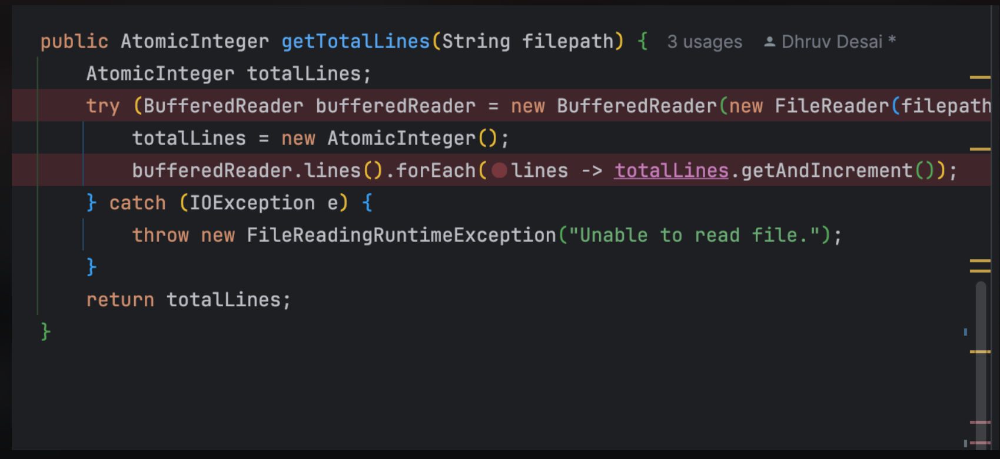
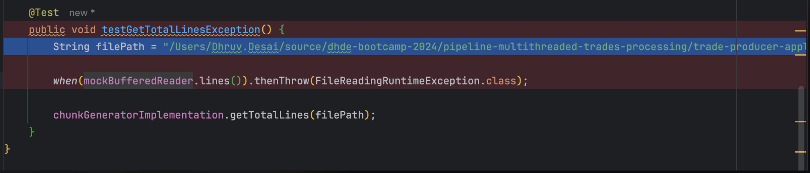
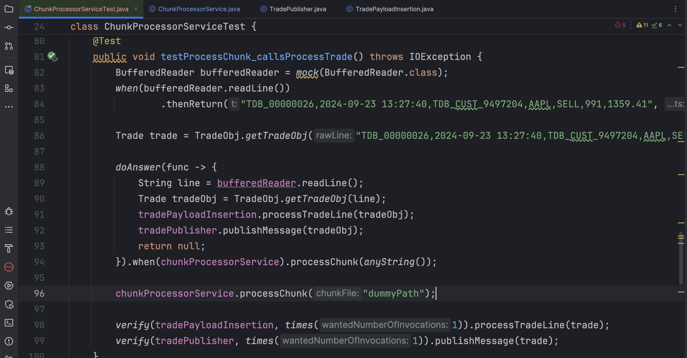
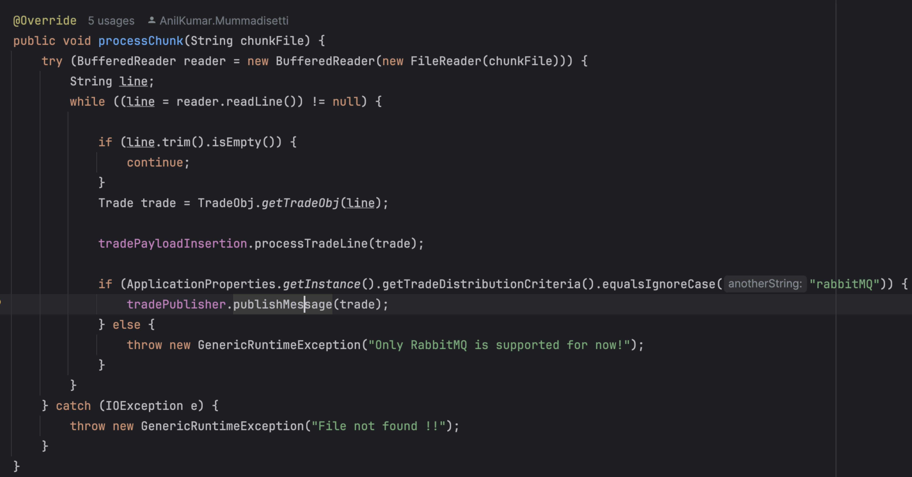

# What is Mockito? 

Mockito is a popular mocking framework used in Java to create and configure mock objects for unit tests. It's particularly helpful for writing tests for classes that have external dependencies (like databases, APIs, or other services). Instead of using these real dependencies in tests, which can be time-consuming and unpredictable, Mockito allows you to use mock objects in their place.

### Unit tests vs Integration Tests vs Slice based (Mock tests)

- Unit tests to be written for the functions that do not have other layer dependencies or other infrastructure dependencies. They run really fast, but they cover the unit level functionality.
- Integration tests - they test all the layers from A to Z . end to end flow, give most confidence, harder to write, take longer to execute, Ideally we should have about 20% integration tests when possible. 
  At least for the good cases, if you have integration tests, it gives a lot of confidence while releasing the software. 
- Slice based / Layer based / Mock tests - (closer to Unit tests than integration tests) - they test a specific layer at a time, while mocking the dependencies or  layers subsequent to (after) them.
  - Mock Tests allow you to write tests against the alternate realities of your system much easily. (eg. its very hard to reproduce OptimisticLocking Exception case in a real database)
  - Sometimes, you depend on other teams' APIs. Those APIs cannot be guaranteed to be up and running at a given time, You have no choice in that case but to Mock those dependencies.

# Advantages of Mockito

**Isolation:** It helps in isolating the unit of work from its dependencies, making unit tests more focused and faster. 

**Clean Syntax:** Mockito provides a very readable and expressive syntax. 

**Flexibility:** With Mockito, you can verify method calls, set up custom return values, and trigger specific behaviors like exceptions. 

**No need for setup files:** Unlike some other mocking frameworks, Mockito doesn't require XML or annotations to set up and configure mock objects. 

**Integrated Argument Matchers:** Mockito offers built-in matchers and the ability to create custom ones. 

**Spies:** Beyond traditional mocks, Mockito offers spies to partially mock objects (i.e., mix real and mocked methods).

# Best Practices

**Mock external systems and services:** It's ideal for mocking databases, third-party services, etc., but avoid mocking everything.

**Keep tests clean and readable:** Mockito's syntax is expressive. Ensure your tests are easy to read and understand. 

**Don't over-stub:** Only stub what's necessary for a test to avoid unnecessary complexity. Always close resources: If you open resources (like streams) in your mock methods, ensure they're closed. 


# Mockito Annotations with Examples - `@Mock`, `@InjectMocks`, `@Spy`, `@Captor`, and `@ExtendWith`

## **Introduction**
Mockito is a popular mocking framework for Java, used to create and configure mock objects for unit testing. It simplifies the process of creating test doubles and helps isolate the code being tested. This guide explores some key Mockito annotations: `@Mock`, `@InjectMocks`, `@Spy`, `@Captor`, and `@ExtendWith`.

---

## **Maven Dependencies**
To use Mockito with JUnit 5, add the following dependencies in your `pom.xml` file: (CORRECT WORKING VERSIONS)

```xml
<!-- JUnit 5 dependency -->
    <dependency>
      <groupId>org.junit.jupiter</groupId>
      <artifactId>junit-jupiter</artifactId>
      <version>5.9.3</version>
      <scope>test</scope>
    </dependency>

    <!-- Mockito Core dependency -->
    <dependency>
      <groupId>org.mockito</groupId>
      <artifactId>mockito-core</artifactId>
      <version>5.5.0</version>
      <scope>test</scope>
    </dependency>
    <dependency>
      <groupId>org.mockito</groupId>
      <artifactId>mockito-junit-jupiter</artifactId>
      <version>5.5.0</version>
      <scope>test</scope>
    </dependency>
    <dependency>
      <groupId>org.mockito</groupId>
      <artifactId>mockito-inline</artifactId>
      <version>5.2.0</version>
      <scope>test</scope>
    </dependency>
```

Ensure these dependencies are added to keep your Mockito and JUnit libraries up-to-date.

---

## **@Mock**
The `@Mock` annotation is used to create and inject mock objects, commonly for mocking dependencies in unit tests.

**Example**:
```java
import static org.mockito.Mockito.*;
import org.junit.jupiter.api.Test;
import org.mockito.Mock;
import org.mockito.junit.jupiter.MockitoExtension;
import org.junit.jupiter.api.extension.ExtendWith;

//TRADITIONAL WAY for working with Mockito 
public class MockExampleTest {

    @Mock
    private List<String> mockList;
  
    @BeforeEach
    public void setup(){
      MockitoAnnotations.openMocks(this);
    }

    @Test
    public void testMock() {
        mockList.add("test");
      
        Mockito.verify(mockList).add("test");  //verification only  -- will PASS
        Mockito.verify(mockList).add("test1");  //verification only -- will FAIL
    }
}


//Junit 4 way 
@RunWith(MockitoJUnitRunner.class)
public class MockExampleTest {

    @Mock
    private List<String> mockList;

    @Test
    public void testMock() {
        mockList.add("test");
      
        Mockito.verify(mockList).add("test");  //verification only  -- will PASS
        Mockito.verify(mockList).add("test1");  //verification only -- will FAIL
    }
}


//Junit5 way
@ExtendWith(MockitoExtension.class)
public class MockExampleTest {

    @Mock
    private List<String> mockList;

    @Test
    public void testMock() {
        mockList.add("test");
      
        Mockito.verify(mockList).add("test");  //verification only  -- will PASS
        Mockito.verify(mockList).add("test1");  //verification only -- will FAIL
    }
}
```

**Key Points**:

- `@Mock` creates a mock instance of the class.
- `verify` checks that the `add` method was called with the argument `"test"`.

---

## **@InjectMocks**
The `@InjectMocks` annotation injects mock objects into the class being tested, automatically adding mocks marked with `@Mock` or `@Spy` into the tested object.

**Example**:
```java
import static org.mockito.Mockito.*;
import org.junit.jupiter.api.Test;
import org.mockito.InjectMocks;
import org.mockito.Mock;
import org.mockito.junit.jupiter.MockitoExtension;
import org.junit.jupiter.api.extension.ExtendWith;

class Service {
    private final Repository repository;

    public Service(Repository repository) {
        this.repository = repository;
    }

    public String fetchData() {
      	//10 lines of business logic
        return repository.getData();
    }
}

interface Repository {
    String getData();
}

@ExtendWith(MockitoExtension.class)
public class InjectMocksExampleTest {

    @Mock
    private Repository mockRepository;

    @InjectMocks
    private Service service;

    @Test
    public void testServiceFetchData() {
        //ARRANGE
        when(mockRepository.getData()).thenReturn("mocked data");
				//ACT
        String result = service.fetchData();
				//ASSERT
        assertEquals("mocked data", result);
    }
}
```

**Key Points**:
- `@InjectMocks` automatically injects mocks into `service`.
- `when` defines the behavior of the mock object.

---

## **@Spy**
The `@Spy` annotation creates a spy of a real object, allowing partial mocking where you can mock some methods while using real implementations for others.

**Example**:
```java
import static org.mockito.Mockito.*;
import org.junit.jupiter.api.Test;
import org.mockito.Spy;
import org.mockito.junit.jupiter.MockitoExtension;
import org.junit.jupiter.api.extension.ExtendWith;

class User {
    public String getName() {
        return "Real Name";
    }
}

@ExtendWith(MockitoExtension.class)
public class SpyExampleTest {

    @Spy
    private User user;

    @Test
    public void testSpy() {
        when(user.getName()).thenReturn("Mocked Name");
        String name = user.getName();
        assertEquals("Mocked Name", name);
      //if i call other user methods, it will call the real methods not the mocked ones
    }
}
```

**Key Points**:
- `@Spy` creates a spy instance.
- Partial mocking is achieved by defining specific behaviors.

---

## **@Captor**
The `@Captor` annotation creates an argument captor to capture argument values passed to mocked methods.

**Example**:
```java
import static org.mockito.Mockito.*;
import org.junit.jupiter.api.Test;
import org.mockito.Captor;
import org.mockito.Mock;
import org.mockito.junit.jupiter.MockitoExtension;
import org.junit.jupiter.api.extension.ExtendWith;
import org.mockito.ArgumentCaptor;

import java.util.List;

@ExtendWith(MockitoExtension.class)
public class CaptorExampleTest {

    @Mock
    private List<String> mockList;

    @Captor
    private ArgumentCaptor<String> captor;

    @Test
    public void testCaptor() {
        mockList.add("test");
        verify(mockList).add(captor.capture());
        assertEquals("test", captor.getValue());
    }
}
```

**Key Points**:
- `@Captor` creates an argument captor instance.
- Captured arguments can be verified.

---

## **@ExtendWith**
The `@ExtendWith` annotation registers extensions in JUnit 5 and is used to initialize Mockito annotations.

**Example**:
```java
import org.junit.jupiter.api.Test;
import org.mockito.Mock;
import org.mockito.junit.jupiter.MockitoExtension;
import org.junit.jupiter.api.extension.ExtendWith;

import java.util.List;

@ExtendWith(MockitoExtension.class)
public class ExtendWithExampleTest {

    @Mock
    private List<String> mockList;

    @Test
    public void testExtendWith() {
        mockList.add("test");
        verify(mockList).add("test");
    }
}
```

**Key Points**:
- `@ExtendWith(MockitoExtension.class)` initializes Mockito annotations.
- Ensures proper setup and teardown for Mockito in JUnit 5 tests.

---

## **Conclusion**
Mockito annotations simplify the creation and management of mock objects in unit tests. By using `@Mock`, `@InjectMocks`, `@Spy`, `@Captor`, and `@ExtendWith`, you can write more readable and maintainable test code. These annotations help you focus on testing your code's behavior without worrying about dependency management and object creation.

Remember to include the latest versions of Mockito and JUnit dependencies in your project to leverage the latest features and improvements.

-----

### **Mockito `@RunWith` Example**

---

#### **1. Introduction**

When writing tests with Mockito, annotations like `@Mock`, `@InjectMocks`, `@Spy`, and `@Captor` help simplify mock creation. To make these annotations effective, they must be initialized. One way to automatically initialize them is with the `@RunWith(MockitoJUnitRunner.class)` annotation. This annotation ensures that all Mockito annotations are initialized, so you don't need to manually call `MockitoAnnotations.initMocks(this)`.

---

#### **2. Example Steps**

1. Define an interface and its implementation.
2. Create a service class that uses the interface.
3. Create a test class.
4. Annotate the test class with `@RunWith(MockitoJUnitRunner.class)`.
5. Use Mockito annotations like `@Mock` and `@InjectMocks` within the test class.
6. Write the test methods.
7. Run the tests.

---

#### **3. Mockito `@RunWith` Example**

```java
import org.junit.Test;
import org.junit.runner.RunWith;
import org.mockito.InjectMocks;
import org.mockito.Mock;
import org.mockito.runners.MockitoJUnitRunner;

interface Calculator {
    int add(int a, int b);
}

class SimpleCalculator implements Calculator {
    @Override
    public int add(int a, int b) {
        return a + b;
    }
}

@RunWith(MockitoJUnitRunner.class)
public class CalculatorTest {

    @Mock
    Calculator mockCalculator;

    @InjectMocks
    SimpleCalculator simpleCalculator;

    @Test
    public void testAddition() {
        // Mock the add method of mockCalculator
        when(mockCalculator.add(10, 20)).thenReturn(30);

        // Call the add method
        int result = simpleCalculator.add(10, 20);

        // Assert the result
        assertEquals(30, result);
    }
}
```

**Output**:  
The test will pass, ensuring that the mocked `add` method of the `Calculator` interface is used within the `SimpleCalculator` implementation.

---

#### **4. Step-by-Step Explanation**

1. **Define Interface and Implementation**:  
   - Create an interface `Calculator` and a simple implementation `SimpleCalculator`.

2. **Test Class Setup**:  
   - In `CalculatorTest`, use the `@RunWith(MockitoJUnitRunner.class)` annotation to automatically initialize all Mockito annotations, eliminating the need to call `MockitoAnnotations.initMocks(this)` manually.

3. **Mock Declaration**:  
   - Declare a mock for the `Calculator` interface with the `@Mock` annotation.

4. **Injection of Mocks**:  
   - Use `@InjectMocks` for the `SimpleCalculator`, allowing it to use the mocked `Calculator`.

5. **Mock Behavior**:  
   - In `testAddition`, mock the `add` method of `mockCalculator` to return `30` when called with `10` and `20`.

6. **Method Call and Assertion**:  
   - Call the `add` method of `simpleCalculator` and check the result with `assertEquals(30, result)`.

7. **Automatic Initialization**:  
   - The `@RunWith(MockitoJUnitRunner.class)` annotation ensures that mock initialization and injection into `simpleCalculator` happen automatically, keeping the test setup simple and efficient.

---

This example demonstrates how `@RunWith(MockitoJUnitRunner.class)` facilitates efficient testing by automatically initializing mocks and injecting them into classes under test.

# Using `@ExtendWith` Annotation with Mockito for Testing Dependencies in Java

## **Introduction**
The `@ExtendWith` annotation in JUnit 5 is used to register extensions. Mockito provides a `MockitoExtension` class, which can be used with `@ExtendWith` to enable Mockito annotations and simplify the creation of mocks. This tutorial demonstrates how to use `@ExtendWith` with `MockitoExtension` to mock dependencies in a `PaymentService` class.

---

## **Maven Dependencies**
To use Mockito with JUnit 5, add the following dependencies in your `pom.xml`:

```xml
 <!-- JUnit 5 dependency -->
        <dependency>
            <groupId>org.junit.jupiter</groupId>
            <artifactId>junit-jupiter</artifactId>
            <version>5.9.3</version>
            <scope>test</scope>
        </dependency>

        <!-- Mockito Core dependency -->
        <dependency>
            <groupId>org.mockito</groupId>
            <artifactId>mockito-core</artifactId>
            <version>5.5.0</version>
            <scope>test</scope>
        </dependency>
        <dependency>
            <groupId>org.mockito</groupId>
            <artifactId>mockito-junit-jupiter</artifactId>
            <version>5.5.0</version>
            <scope>test</scope>
        </dependency>
        <dependency>
            <groupId>org.mockito</groupId>
            <artifactId>mockito-inline</artifactId>
            <version>5.2.0</version>
            <scope>test</scope>
        </dependency>
```

---

## **Example Scenario**
We will create a `PaymentService` class with dependencies on a `PaymentRepository` and a `NotificationService`. The goal is to test the `PaymentService` methods using Mockito’s `@ExtendWith` annotation to mock dependencies.

### **Classes for PaymentService, PaymentRepository, and NotificationService**

```java
public class Payment {
    private String transactionId;
    private double amount;

    // Constructor, getters, and setters
    public Payment(String transactionId, double amount) {
        this.transactionId = transactionId;
        this.amount = amount;
    }

    // Getters and setters...
}

public interface PaymentRepository {
    void savePayment(Payment payment);
    Payment findPaymentByTransactionId(String transactionId);
}

public class NotificationService {
    public void notifyCustomer(String message) {
        // Code to notify customer
    }
}

public class PaymentService {
    private final PaymentRepository paymentRepository;
    private final NotificationService notificationService;

    public PaymentService(PaymentRepository paymentRepository, NotificationService notificationService) {
        this.paymentRepository = paymentRepository;
        this.notificationService = notificationService;
    }

    public void processPayment(Payment payment) {
        paymentRepository.savePayment(payment);
        notificationService.notifyCustomer("Payment processed: " + payment.getTransactionId());
    }

    public Payment getPayment(String transactionId) {
        return paymentRepository.findPaymentByTransactionId(transactionId);
    }
}
```

---

## **JUnit 5 Test Class with Mockito**

Here is the test class for `PaymentService` using JUnit 5 and Mockito.

```java
import static org.mockito.Mockito.*;
import static org.junit.jupiter.api.Assertions.*;
import org.junit.jupiter.api.Test;
import org.mockito.ArgumentCaptor;
import org.mockito.Captor;
import org.mockito.InjectMocks;
import org.mockito.Mock;
import org.mockito.junit.jupiter.MockitoExtension;
import org.junit.jupiter.api.extension.ExtendWith;

@ExtendWith(MockitoExtension.class)
public class PaymentServiceTest {

    @Mock
    private PaymentRepository paymentRepository;

    @Mock
    private NotificationService notificationService;

    @InjectMocks
    private PaymentService paymentService;

    @Captor
    private ArgumentCaptor<Payment> paymentCaptor;

    @Test
    public void testProcessPayment() {
        // Given
        Payment payment = new Payment("12345", 100.0);

        // When
        paymentService.processPayment(payment);

        // Then
        verify(paymentRepository).savePayment(paymentCaptor.capture());
        Payment capturedPayment = paymentCaptor.getValue();
        assertEquals("12345", capturedPayment.getTransactionId());
        assertEquals(100.0, capturedPayment.getAmount());
        verify(notificationService).notifyCustomer("Payment processed: 12345");
    }

    @Test
    public void testGetPayment() {
        // Given
        Payment mockPayment = new Payment("12345", 100.0);
        when(paymentRepository.findPaymentByTransactionId("12345")).thenReturn(mockPayment);

        // When
        Payment result = paymentService.getPayment("12345");

        // Then
        assertNotNull(result);
        assertEquals("12345", result.getTransactionId());
        assertEquals(100.0, result.getAmount());
        verify(paymentRepository).findPaymentByTransactionId("12345");
    }
}
```

---

## **Explanation of Annotations**

- **`@ExtendWith(MockitoExtension.class)`**:  
   - Integrates Mockito with JUnit 5, enabling Mockito-specific features and processing annotations like `@Mock`, `@InjectMocks`, and `@Captor`.
   - Automatically initializes mocks, removing the need for manual initialization.

- **`@Mock`**:  
   - Creates a mock instance of the specified class or interface, such as `paymentRepository` and `notificationService` in this example.
   - Useful for simulating dependencies in isolation.

- **`@InjectMocks`**:  
   - Injects mock instances marked with `@Mock` into the tested class (`PaymentService`).
   - Ensures the class under test receives mock instances instead of real dependencies.

- **`@Captor`**:  
   - Creates an `ArgumentCaptor` to capture arguments passed to mock methods. Here, `paymentCaptor` captures the `Payment` object passed to `savePayment`.

---

## **Test Methods**

### `testProcessPayment`
- **Given**: A `Payment` object with a transaction ID and amount.
- **When**: Calling `processPayment` on `paymentService`.
- **Then**:
   - Verifies that `savePayment` was called on `paymentRepository` with the captured `Payment`.
   - Asserts that the captured payment’s transaction ID and amount match expected values.
   - Verifies `notifyCustomer` was called on `notificationService` with the correct message.

### `testGetPayment`
- **Given**: A mock `Payment` configured to be returned by `paymentRepository`.
- **When**: Calling `getPayment` with a transaction ID.
- **Then**:
   - Asserts that the returned payment is not null and has the correct transaction ID and amount.
   - Verifies `findPaymentByTransactionId` was called on `paymentRepository`.

---

## **Conclusion**
Using `@ExtendWith` with Mockito’s `MockitoExtension` in JUnit 5 simplifies the creation and injection of mock objects in unit tests. With `@Mock`, `@InjectMocks`, and `@Captor`, you can set up mock dependencies and focus on testing your code’s behavior. This guide demonstrated effective use of `@ExtendWith` and `MockitoExtension` for comprehensive testing of the `PaymentService` class.


### **Mockito `@Mock` Annotation Tutorial**

---

**Introduction**

The `@Mock` annotation is a shorthand way of creating mock objects. Instead of manually creating a mock using `Mockito.mock(Class)`, you can annotate a field with `@Mock` to automatically create a mock instance.

In many software applications, business logic and data access logic are separated into service and repository layers, respectively. When testing the service layer, it's often beneficial to mock the repository to ensure it is tested in isolation.

This tutorial will demonstrate step-by-step how to mock the `EmployeeService` and `EmployeeRepository` using Mockito's `@Mock` annotation and the Given/When/Then format.


---

### Step-by-Step Example

**Step 1: Create the `Employee` and `EmployeeRepository` Classes**

First, create the `Employee` class and the `EmployeeRepository` interface.

```java
public class Employee {
    private String name;
    private String position;

    // Constructor
    public Employee(String name, String position) {
        this.name = name;
        this.position = position;
    }

    // Getters and Setters
    public String getName() {
        return name;
    }

    public void setName(String name) {
        this.name = name;
    }

    public String getPosition() {
        return position;
    }

    public void setPosition(String position) {
        this.position = position;
    }
}

public interface EmployeeRepository {
    Employee findEmployeeByName(String name);
}
```

**Step 2: Create the `EmployeeService` Class**

Create the `EmployeeService` class that depends on the `EmployeeRepository`.

```java
public class EmployeeService {
    private final EmployeeRepository employeeRepository;

    public EmployeeService(EmployeeRepository employeeRepository) {
        this.employeeRepository = employeeRepository;
    }

    public Employee getEmployee(String name) {
        return employeeRepository.findEmployeeByName(name);
    }
}
```

**Step 3: Set Up JUnit 5 Test Class with Mockito**

Create a test class for `EmployeeService` using JUnit 5 and Mockito.

```java
import static org.mockito.Mockito.*;
import static org.junit.jupiter.api.Assertions.*;
import org.junit.jupiter.api.Test;
import org.mockito.InjectMocks;
import org.mockito.Mock;
import org.mockito.junit.jupiter.MockitoExtension;
import org.junit.jupiter.api.extension.ExtendWith;

@ExtendWith(MockitoExtension.class)
public class EmployeeServiceTest {

    @Mock
    private EmployeeRepository employeeRepository;

    @InjectMocks
    private EmployeeService employeeService;

    @Test
    public void testGetEmployee() {
        // Given
        Employee mockEmployee = new Employee("John Doe", "Developer");
        when(employeeRepository.findEmployeeByName("John Doe")).thenReturn(mockEmployee);

        // When
        Employee result = employeeService.getEmployee("John Doe");

        // Then
        assertNotNull(result);
        assertEquals("John Doe", result.getName());
        assertEquals("Developer", result.getPosition());
        verify(employeeRepository).findEmployeeByName("John Doe");
    }
}
```

---

### Explanation

**Annotations:**

- `@ExtendWith(MockitoExtension.class)`: Integrates Mockito with JUnit 5, enabling the use of Mockito annotations.
- `@Mock`: Creates a mock instance of the `EmployeeRepository` interface.
- `@InjectMocks`: Injects the mock `EmployeeRepository` into the `EmployeeService` instance.

**Given:**

```java
Employee mockEmployee = new Employee("John Doe", "Developer");
when(employeeRepository.findEmployeeByName("John Doe")).thenReturn(mockEmployee);
```

Creates a mock `Employee` object and configures the mock `EmployeeRepository` to return this object when `findEmployeeByName` is called with the argument `"John Doe"`.

**When:**

```java
Employee result = employeeService.getEmployee("John Doe");
```

Calls the `getEmployee` method on the `EmployeeService` instance.

**Then:**

```java
assertNotNull(result);
assertEquals("John Doe", result.getName());
assertEquals("Developer", result.getPosition());
verify(employeeRepository).findEmployeeByName("John Doe");
```

Asserts the returned `Employee` object has the expected properties and verifies the repository method was called.

---

### Additional Scenarios

**Scenario 1: Employee Not Found**

```java
@Test
public void testGetEmployee_NotFound() {
    // Given
    when(employeeRepository.findEmployeeByName("Jane Doe")).thenReturn(null);

    // When
    Employee result = employeeService.getEmployee("Jane Doe");

    // Then
    assertNull(result);
    verify(employeeRepository).findEmployeeByName("Jane Doe");
}
```

**Scenario 2: Employee with Different Position**

```java
@Test
public void testGetEmployee_DifferentPosition() {
    // Given
    Employee mockEmployee = new Employee("John Doe", "Manager");
    when(employeeRepository.findEmployeeByName("John Doe")).thenReturn(mockEmployee);

    // When
    Employee result = employeeService.getEmployee("John Doe");

    // Then
    assertNotNull(result);
    assertEquals("John Doe", result.getName());
    assertEquals("Manager", result.getPosition());
    verify(employeeRepository).findEmployeeByName("John Doe");
}
```

---

### Conclusion

The `@Mock` annotation in Mockito simplifies the creation and injection of mock objects in unit tests. By using `@Mock` and `@InjectMocks`, you can easily set up mock dependencies and focus on testing the behavior of your code. This step-by-step guide covered different scenarios using the Given/When/Then format to demonstrate how to effectively use the `@Mock` annotation in your unit tests.

### **Mockito `@Spy` Annotation Tutorial**

---

#### **Introduction**

The `@Spy` annotation in Mockito is used to create a spy instance of a real object, allowing for partial mocking. Some methods of the object are mocked, while others retain their original behavior. This approach is useful when testing a class where certain methods should be real, and others should be mocked. This tutorial demonstrates the use of `@Spy` in Mockito step-by-step.

---


#### **Example Scenario**

We will create a `Calculator` class with methods for addition and subtraction. Using Mockito’s `@Spy` annotation, we’ll partially mock the `subtract` method while keeping the `add` method real.

---

#### **Calculator Class**

Define the `Calculator` class as follows:

```java
public class Calculator {
    public int add(int a, int b) {
        return a + b;
    }

    public int subtract(int a, int b) {
        return a - b;
    }
}
```

---


### <u>MOCKITO BEGINNER DEBUGGING TIPS:</u> 

- If i have a service class into which I @injectMocks, i should bring up the app, put the breakpoint on the service class, and inspect to ensure it is showing the mocked fields are showing as ClassName$Mockito$Mock  - this will confirm your @mock @injectMocks setup was successful 
- If I have @spy variable , then i should breakpoints in its methods
  - if the method has been mocked, then it should not hit the real method
  - if the method has not been mocked, , then it should hit the real method 

#### **JUnit 5 Test Class with Mockito**

Create a test class for `Calculator` using JUnit 5 and Mockito.

```java
import static org.mockito.Mockito.*;
import static org.junit.jupiter.api.Assertions.*;
import org.junit.jupiter.api.Test;
import org.mockito.Spy;
import org.mockito.junit.jupiter.MockitoExtension;
import org.junit.jupiter.api.extension.ExtendWith;

@ExtendWith(MockitoExtension.class)
public class CalculatorTest {

    @Spy
    private Calculator calculator;

    @Test
    public void testAdd() {
        // No need to mock the add method; using the real method
        int result = calculator.add(10, 20);
        assertEquals(30, result);
    }

    @Test
    public void testSubtract() {
        // Mocking the subtract method
        doReturn(1).when(calculator).subtract(10, 5); //DOING WRONG RESULT DELIBERATELY TO PROVE THE REAL METHOD IS NOT GETTING HIT 
        int result = calculator.subtract(10, 5);
        assertEquals(1, result);
        verify(calculator).subtract(10, 5);
    }

    @Test
    public void testSubtractRealMethod() {
        // Calling the real subtract method
        int result = calculator.subtract(10, 5);
        assertEquals(5, result);
    }
}
```

---

#### **Explanation**

**Annotations**:
- `@ExtendWith(MockitoExtension.class)`: Integrates Mockito with JUnit 5, enabling the use of Mockito annotations.
- `@Spy`: Creates a spy instance of the `Calculator` class.

**Test Methods**:
- **`testAdd()`**:
  - **Given**: No need to mock the `add` method, as we want the real behavior.
  - **When**: Calls `add` on `calculator`.
  - **Then**: Asserts the result is `30`.

- **`testSubtract()`**:
  - **Given**: Uses `doReturn(5).when(calculator).subtract(10, 5);` to mock the `subtract` method.
  - **When**: Calls `subtract` on `calculator`.
  - **Then**: Asserts the result is `5` and verifies that `subtract` was called with `10` and `5`.

- **`testSubtractRealMethod()`**:
  - **Given**: No stubbing for `subtract`, so the real method is called.
  - **When**: Calls `subtract` on `calculator`.
  - **Then**: Asserts the result is `5`, confirming the real method execution.

---

#### **Additional Scenario: Combining Real and Mocked Methods**

This scenario demonstrates combining real and mocked methods in a single test.

```java
@Test
public void testAddAndSubtract() {
    // Mocking the subtract method
    doReturn(3).when(calculator).subtract(7, 4);

    // Calling both add and subtract methods
    int additionResult = calculator.add(2, 3);
    int subtractionResult = calculator.subtract(7, 4);

    assertEquals(5, additionResult); // Real method
    assertEquals(3, subtractionResult); // Mocked method
}
```

**Explanation**:

- **Given**: Uses `doReturn(3).when(calculator).subtract(7, 4);` to mock the `subtract` method.
- **When**: Calls both `add` and `subtract` on `calculator`.
- **Then**: Asserts that `add` (real method) returns `5` and `subtract` (mocked method) returns `3`.

---

#### **Conclusion**

The `@Spy` annotation in Mockito allows for partial mocking of real objects. By using `@Spy`, you can keep real behavior for some methods while mocking others, providing flexibility in unit tests. This guide covered various scenarios for using `@Spy` effectively to test the `Calculator` class, combining real and mocked methods for comprehensive testing.


----

## When to Use `@Mock` vs `@Spy`

In Mockito, **`@Mock`** and **`@Spy`** serve different purposes, depending on how you want to test your classes. Here’s a breakdown of when to use each:

### When to Use `@Mock`

A **mock** is a fully "dummy" object that has no actual behavior of its own, except what you explicitly define. You use `@Mock` when you want to:

1. **Isolate Behavior Completely**: When you want to fully isolate the class being tested from any dependencies, you can use mocks to ensure the class does not depend on the real behavior of any objects.
  
2. **Simulate Simple Dependency**: If the dependency does not have complex logic or if you don’t want any of its real methods to execute, you should use a mock.
   
3. **Define Explicit Behavior**: You only define specific, expected method behaviors within the mock, ignoring all other methods (untested methods return default values).
   
4. **Replace External Dependencies**: For external classes like databases, web services, or complex third-party libraries, mocks are useful for ensuring the test does not depend on actual external states.

**Example:**
```java
@Mock
private EmployeeRepository employeeRepository;
```

### When to Use `@Spy`

A **spy** is a partial mock. It allows you to call real methods of the class under test but also lets you stub certain behaviors. Use `@Spy` when you want to:

1. **Test Real Implementation Partially**: If the class contains complex behavior that you want to test with some real method executions, `@Spy` can be useful. This is particularly helpful if the class has side effects or performs computations.

2. **Verify Internal Method Calls**: When you want to verify whether certain methods are called within a class, `@Spy` lets you observe method interactions in the class while executing real code.

3. **Override Specific Behavior**: If the class has many methods, and you want only a few to behave differently (e.g., return a predefined value), `@Spy` lets you mock individual methods, allowing the rest of the methods to behave normally.

4. **Refactor Untestable Code**: Sometimes legacy code is hard to test because of dependencies or complex interactions. `@Spy` can help make the class more testable without having to refactor too much immediately.

**Example:**
```java
@Spy
private EmployeeService employeeService;
```

### Example to Differentiate `@Mock` vs. `@Spy`

Suppose you have an `EmployeeService` class that calls an `EmployeeRepository` to retrieve an employee and has some additional logic to handle if an employee is not found.

1. **Using `@Mock`** for `EmployeeRepository`:

    - You mock `EmployeeRepository` because you don't need any actual retrieval logic—just a stubbed response.

2. **Using `@Spy`** for `EmployeeService`:

    - You want to test `EmployeeService` but verify that only certain methods are called or override specific parts of its logic while still using the rest of the real logic.

### Summary Table

| Feature               | `@Mock`                          | `@Spy`                                  |
| --------------------- | -------------------------------- | --------------------------------------- |
| Behavior              | Completely mocked behavior       | Partially real, partially mocked        |
| Use Case              | Simple, isolated dependency      | Real code with some overridden behavior |
| Real Method Execution | No                               | Yes (unless explicitly mocked)          |
| Useful For            | Full isolation from dependencies | Partial method calls and verifications  |
| Typical Usage         | Dependency classes               | Class under test with internal methods  |


## `doReturn().when()`    VS  `when().thenReturn()` syntax 

In Mockito, both `doReturn().when()` and `when().thenReturn()` are used to define the behavior of mocked methods, but they have key differences in terms of syntax and use cases. Here’s a breakdown of when and why you might use each:

### `when().thenReturn()` Syntax

This syntax is more commonly used in Mockito because it's straightforward and intuitive. However, it has some limitations:

- **Usage**: Works well when you mock a method that is publicly accessible and doesn't throw any exceptions.
- **Limitations**: It cannot be used for methods that are `final`, `static`, or `private`, or for methods that involve complex logic, such as `void` methods or methods that throw exceptions.
- **Example**:
  ```java
  when(mockedObject.someMethod()).thenReturn("someValue");
  ```

### `doReturn().when()` Syntax

This syntax is more flexible and can be used in cases where `when().thenReturn()` does not work. This is especially helpful in the following scenarios:

1. **Spying on Real Objects**: When you use `@Spy` to partially mock a real object and want to override a specific method without calling the real implementation, `doReturn().when()` is ideal.
  
2. **Mocking `void` Methods**: Since `void` methods don’t return anything, you can't use `when().thenReturn()` for them. `doReturn().when()` allows you to define behavior for `void` methods.
  
3. **Handling Exceptions**: For methods that throw exceptions, `doReturn().when()` avoids calling the actual method directly during the setup phase, which is useful for exception handling.

4. **Avoiding Unintended Side Effects**: When the real method could have unintended side effects, such as modifying state, `doReturn().when()` prevents the actual call from happening.

**Example with a `void` method**:
```java
doNothing().when(mockedObject).voidMethod();
```

**Example with `@Spy`**:
```java
List<String> list = spy(new ArrayList<>());
doReturn(5).when(list).size(); // Overrides size without calling the real method
```

### Key Differences

| Aspect                 | `when().thenReturn()`                                        | `doReturn().when()`                                          |
| ---------------------- | ------------------------------------------------------------ | ------------------------------------------------------------ |
| Typical Use Case       | Public methods that do not throw exceptions and return  values.. | Methods that are `void`, throw exceptions, or are `final`    |
| Works with `@Mock`     | Yes                                                          | Yes                                                          |
| Works with `@Spy`      | Limited (calls the real method by default)                   | Yes (does not call the real method) ****** VERY IMPORTANT DIFFERENCE |
| Exception Handling     | Will call the real method if not mocked                      | Avoids calling the real method during setup                  |
| Mocking `void` Methods | No                                                           | Yes                                                          |
| Syntax Example         | `when(obj.method()).thenReturn(value);`                      | `doReturn(value).when(obj).method();`                        |

In general, `when().thenReturn()` is more commonly used, but `doReturn().when()` is essential in specific scenarios, especially when working with spies, `void` methods, and methods with side effects.

## Comprehensive Example 

Here’s a comprehensive example using Mockito with JUnit 5 that demonstrates various Mockito methods and behaviors such as `mock`, `spy`, `when`, `thenReturn`, `doReturn`, `doNothing`, `doThrow`, `doAnswer`, `times`, `never`, `any`, `eq`, and `inOrder`.

This example tests a simple `OrderService` class that interacts with an `InventoryService` and a `NotificationService` to place an order and send notifications.

### Example Classes to Test

```java
public class OrderService {
    private final InventoryService inventoryService;
    private final NotificationService notificationService;

    public OrderService(InventoryService inventoryService, NotificationService notificationService) {
        this.inventoryService = inventoryService;
        this.notificationService = notificationService;
    }

    public boolean placeOrder(String item, int quantity) {
        if (inventoryService.isAvailable(item, quantity)) {
            inventoryService.deduct(item, quantity);
            notificationService.sendConfirmation(item, quantity);
            return true;
        }
        return false;
    }
}

public class InventoryService {
    public boolean isAvailable(String item, int quantity) {
        // Check if the item is available (dummy method for example)
        return true;
    }

    public void deduct(String item, int quantity) {
        // Deduct item quantity from inventory
    }
}

public class NotificationService {
    public void sendConfirmation(String item, int quantity) {
        // Send confirmation (dummy method for example)
    }
}
```

### Mockito Test with Various Mockito Methods

```java
import org.junit.jupiter.api.BeforeEach;
import org.junit.jupiter.api.Test;
import org.mockito.*;
import org.mockito.invocation.InvocationOnMock;
import org.mockito.stubbing.Answer;

import static org.junit.jupiter.api.Assertions.*;
import static org.mockito.Mockito.*;

class OrderServiceTest {

    @Mock
    private InventoryService inventoryService;

    @Mock
    private NotificationService notificationService;

    @InjectMocks    ////  IMPORTANT NOTE
    private OrderService orderService;

    @Spy					////  IMPORTANT NOTE
    private OrderService orderServiceSpy;

    @BeforeEach
    void setUp() {
        MockitoAnnotations.openMocks(this);
        orderServiceSpy = new OrderService(inventoryService, notificationService);
    }

    @Test
    void testPlaceOrder_Success() {
        // Mock method behavior using when().thenReturn()
        when(inventoryService.isAvailable("item1", 10)).thenReturn(true);

        // Use doNothing() for void methods that don’t need actual behavior
        doNothing().when(inventoryService).deduct("item1", 10);
        doNothing().when(notificationService).sendConfirmation("item1", 10);

        // Test the method
        boolean result = orderService.placeOrder("item1", 10);

        // Assertions and Verifications
        assertTrue(result);
        verify(inventoryService, times(1)).isAvailable("item1", 10);
        verify(inventoryService).deduct(eq("item1"), anyInt());
        verify(notificationService).sendConfirmation("item1", 10);
    }

    @Test
    void testPlaceOrder_InsufficientStock() {
        // Mock behavior for insufficient stock
        when(inventoryService.isAvailable("item2", 5)).thenReturn(false);

        // Test the method
        boolean result = orderService.placeOrder("item2", 5);

        // Assertions and Verifications
        assertFalse(result);
        verify(inventoryService, times(1)).isAvailable("item2", 5);
        verify(inventoryService, never()).deduct(anyString(), anyInt());
        verify(notificationService, never()).sendConfirmation(anyString(), anyInt());
    }

    @Test
    void testPlaceOrder_WithSpyAndDoReturn() {
        // Use a spy to test the real behavior of the OrderService
        doReturn(true).when(orderServiceSpy).placeOrder("item3", 1);

        // Call the method
        boolean result = orderServiceSpy.placeOrder("item3", 1);

        // Assertions and Verifications
        assertTrue(result);
        verify(orderServiceSpy, times(1)).placeOrder("item3", 1);
    }

    @Test
    // JUNIT4 style -- @Expected(RuntimeException.class)
    void testDeductThrowsException() {
        // Use doThrow() to simulate an exception
        doThrow(new RuntimeException("Inventory deduction failed")).when(inventoryService).deduct("item4", 5);

        // Test exception handling   -- JUNIT 4 style for expecting exceptions 
        Exception exception = assertThrows(RuntimeException.class, () -> {
            orderService.placeOrder("item4", 5);
        });

        // Assertion
        assertEquals("Inventory deduction failed", exception.getMessage());
    }

    @Test
    void testDoAnswerForSendConfirmation() {
        // Use doAnswer() to simulate a custom response
        doAnswer(new Answer<Void>() {
            @Override
            public Void answer(InvocationOnMock invocation) {
                String item = invocation.getArgument(0);
                int quantity = invocation.getArgument(1);
                System.out.println("Sending confirmation for " + item + " x" + quantity);
                return null;
            }
        }).when(notificationService).sendConfirmation(anyString(), anyInt());

        // Call the method
        orderService.placeOrder("item5", 2);

        // Verifications
        verify(notificationService, times(1)).sendConfirmation("item5", 2);
    }

    @Test
    void testInOrderVerification() {
        // Arrange method call order
        when(inventoryService.isAvailable("item6", 3)).thenReturn(true);
        doNothing().when(inventoryService).deduct("item6", 3);
        doNothing().when(notificationService).sendConfirmation("item6", 3);

        // Call the method
        orderService.placeOrder("item6", 3);

        // Verify method call order
        InOrder inOrder = inOrder(inventoryService, notificationService);
        inOrder.verify(inventoryService).isAvailable("item6", 3);
        inOrder.verify(inventoryService).deduct("item6", 3);
        inOrder.verify(notificationService).sendConfirmation("item6", 3);
    }
}7
```

### Explanation of Mockito Methods Used

- **`@Mock` and `@Spy`**: Create mock objects for `InventoryService` and `NotificationService`. Use `@Spy` on `OrderService` to test real behavior.
- **`when().thenReturn()`**: Stubs a method to return specific values when invoked with certain arguments.
- **`doReturn().when()`**: Used with a spy to control behavior without calling the real method.
- **`doNothing().when()`**: For `void` methods to specify that nothing should happen.
- **`doThrow().when()`**: Stubs a method to throw an exception.
- **`doAnswer().when()`**: Allows custom behavior for a method, logging output to illustrate usage.
- **Verification with `times`, `never`, `any`, and `eq`**: 
  - `times(1)`: Verifies the method is called exactly once.
  - `never()`: Ensures the method is never called.
  - `any()`: Matches any argument of a specified type.
  - `eq()`: Matches a specific argument value.
- **`inOrder` Verification**: Ensures methods were called in a specific order. 

This test suite effectively covers various Mockito methods and verification techniques, providing a comprehensive example of how to use Mockito in JUnit 5 tests.


Here’s a table of common Mockito methods, along with their functionality and usage context.

| Mockito Method                                | Functionality                                                | Example Usage                                                |
| --------------------------------------------- | ------------------------------------------------------------ | ------------------------------------------------------------ |
| **`mock(Class<T> classToMock)`**              | Creates a mock object of the specified class.                | `List mockedList = mock(List.class);`                        |
| **`spy(T object)`**                           | Creates a spy object that allows calling real methods while stubbing specific behaviors. | `List spyList = spy(new ArrayList<>());`                     |
| **`when(T methodCall)`**                      | Sets up a stubbed return value for a method call on a mock or spy. | `when(mockedList.size()).thenReturn(10);`                    |
| **`thenReturn(T value)`**                     | Specifies the value to return when the mocked method is called. | `when(mockedList.get(0)).thenReturn("Mockito");`             |
| **`doReturn(T value).when(T mock)`**          | Specifies a return value on a spy without calling the real method. | `doReturn(10).when(spyList).size();`                         |
| **`doNothing().when(T mock)`**                | Specifies that a void method should do nothing when called.  | `doNothing().when(mockedList).clear();`                      |
| **`doThrow(Throwable t).when(T mock)`**       | Specifies an exception to throw when the method is called.   | `doThrow(new RuntimeException("error")).when(mockedList).clear();` |
| **`doAnswer(Answer<?> answer).when(T mock)`** | Defines custom behavior for a method.                        | `doAnswer(invocation -> { return "response"; }).when(mockedService).doAction();` |
| **`verify(T mock)`**                          | Verifies that a method was called on a mock or spy.          | `verify(mockedList).add("test");`                            |
| **`verify(T mock, times(int))`**              | Verifies that a method was called a specific number of times. | `verify(mockedList, times(2)).add("test");`                  |
| **`verify(T mock, never())`**                 | Verifies that a method was never called on the mock.         | `verify(mockedList, never()).clear();`                       |
| **`verify(T mock, atLeast(int))`**            | Verifies that a method was called at least a certain number of times. | `verify(mockedList, atLeast(1)).add("test");`                |
| **`verify(T mock, atMost(int))`**             | Verifies that a method was called at most a certain number of times. | `verify(mockedList, atMost(3)).add("test");`                 |
| **`inOrder(T... mocks)`**                     | Verifies the order of method calls across multiple mocks or spies. | `InOrder inOrder = inOrder(mock1, mock2); inOrder.verify(mock1).method1(); inOrder.verify(mock2).method2();` |
| **`any(Class<T> type)`**                      | Matches any argument of the specified type.                  | `when(mockedList.get(anyInt())).thenReturn("element");`      |
| **`eq(T value)`**                             | Matches a specific value as an argument.                     | `verify(mockedList).add(eq("test"));`                        |
| **`ArgumentCaptor.forClass(Class<T> type)`**  | Captures arguments passed to methods on a mock for later inspection. | `ArgumentCaptor<String> captor = ArgumentCaptor.forClass(String.class); verify(mock).add(captor.capture()); assertEquals("test", captor.getValue());` |
| **`timeout(long millis)`**                    | Verifies that a method was called within a specific time limit. | `verify(mock, timeout(100)).someMethod();`                   |
| **`after(long millis)`**                      | Verifies that a method was called after a specific time duration. | `verify(mock, after(200)).someMethod();`                     |
| **`reset(T... mocks)`**                       | Resets the interactions on the specified mocks, clearing any previous stubbing and verifications. | `reset(mock1, mock2);`                                       |
| **`clearInvocations(T... mocks)`**            | Clears the recorded interactions without removing stubbing.  | `clearInvocations(mock);`                                    |
| **`verifyNoInteractions(T... mocks)`**        | Verifies that there were no interactions with the specified mocks. | `verifyNoInteractions(mock1, mock2);`                        |
| **`verifyNoMoreInteractions(T... mocks)`**    | Verifies that there are no additional interactions on the mocks beyond specified ones. | `verify(mockedList).add("test"); verifyNoMoreInteractions(mockedList);` |
| **`doCallRealMethod().when(T mock)`**         | Calls the real method instead of mocking it (mainly used with spies). | `doCallRealMethod().when(spy).realMethod();`                 |
| **`MockitoAnnotations.openMocks(this)`**      | Initializes mocks and spies annotated with `@Mock` and `@Spy` in the test class. | `MockitoAnnotations.openMocks(this);`                        |
| **`mockStatic(Class<T> classToMock)`**        | Creates a mock for static methods of a class (available from Mockito 3.4.0 onwards). | `try (MockedStatic<MyClass> mock = mockStatic(MyClass.class)) { mock.when(MyClass::staticMethod).thenReturn("value"); }` |
| **`verifyZeroInteractions(T... mocks)`**      | Deprecated; use `verifyNoInteractions()` instead.            | `verifyZeroInteractions(mock);`                              |

This table covers most of the frequently used methods in Mockito. These methods provide fine-grained control over the behavior of mocks and spies, allowing you to set up stubbing, verify interactions, control method calls, and handle different argument matchers.


## MockitoAnnotations.openMocks vs initMocks

The difference between `MockitoAnnotations.openMocks(this)` and `MockitoAnnotations.initMocks(this)` lies primarily in the version of Mockito and the lifecycle management of mocks. Here’s a detailed breakdown:

### 1. **Version Compatibility**

   - **`MockitoAnnotations.openMocks(this)`**: Introduced in Mockito 3.2.0, this method is the preferred way to initialize mocks in newer versions of Mockito.
   - **`MockitoAnnotations.initMocks(this)`**: This was the original method for initializing mocks, now deprecated as of Mockito 3.2.0.

### 2. **Lifecycle Management**

   - **`openMocks()`** returns an `AutoCloseable` resource that you can close after your test finishes running. This is particularly useful in environments where you want to release mock resources after the test, such as when using a `@BeforeEach` and `@AfterEach` setup in JUnit 5.
   - **`initMocks()`** does not support `AutoCloseable`, meaning it doesn’t provide an automatic way to release resources. It initializes mocks, but you are responsible for any cleanup, which can be less efficient.

### 3. **Recommended Usage in Modern Testing**

   - **Using `openMocks(this)`** is now considered best practice as it aligns with Mockito’s resource management improvements. It’s also more compatible with modern JUnit 5 features, where resources like mocks are often managed within test lifecycle methods.
   - **`initMocks(this)`** is retained for backward compatibility but is generally avoided in favor of `openMocks()`.

### Example Usage

#### Using `MockitoAnnotations.openMocks(this)` in JUnit 5:

```java
import org.junit.jupiter.api.BeforeEach;
import org.junit.jupiter.api.AfterEach;
import org.junit.jupiter.api.Test;
import org.mockito.MockitoAnnotations;
import java.lang.AutoCloseable;

class MyServiceTest {

    private AutoCloseable mocks;

    @BeforeEach
    void setUp() {
        mocks = MockitoAnnotations.openMocks(this); // Initializes mocks
    }

    @AfterEach
    void tearDown() throws Exception {
        mocks.close(); // Closes mocks, releases resources
    }

    @Test
    void someTest() {
        // Test logic
    }
}
```

#### Using `MockitoAnnotations.initMocks(this)` (Deprecated)

```java
import org.junit.jupiter.api.BeforeEach;
import org.junit.jupiter.api.Test;
import org.mockito.MockitoAnnotations;

class MyServiceTest {

    @BeforeEach
    void setUp() {
        MockitoAnnotations.initMocks(this); // Initializes mocks (no resource cleanup)
    }

    @Test
    void someTest() {
        // Test logic
    }
}
```

### Summary

- **Use `openMocks(this)`** for new tests as it’s the current, resource-managed way to initialize mocks in Mockito.
- **Avoid `initMocks(this)`** in favor of `openMocks()` for compatibility with newer versions of Mockito and efficient resource management.


JournalEntryDTO(id=1, tradeId=TDB_00000000, accountNumber=TDB_CUST_5214938, securityCusip=V, direction=SELL, quantity=683, postedStatus=null, transactionTimestamp=2024-09-19 22:16:18)


## Learnings -

we don't want to use System.out for any logging, 

All logging should be done with logger.info , logger.error 

----

Also show the @Log4j2 annotation and use of Suppliers in the logging 

---

we want to use Log4j2 

-----

file I/o 

- in control - any files that you can control in src/test/resources folder
- out of control - any files that you expect to read from the fileSystem and any chunks / folder that you expect to be able to create.
  

rabbitMQ 

- in control - if you have an embedded in-memory broker 

- out of control - if you do not have an embedded in-memory broker 

  right now, we will defer the broker tests until we start working with spring framework.

Database 

- in control - if you write tests against H2 in memory database (we will do this )
- out of control - if you cannot then you have to mock you repo layer
  

-----

NOTE on the naming schemes --

ChunkGenerator - interface   (ChunkGeneratorInterface -  wrong)
FileChunkGenerator  - concrete class  (ChunkGeneratorImplementation - wrong)

we should create the files in src/test/resources - the ones we control for our tests 
chunk generate files and folders we have to mock because we don't usually have write permissions on our jenkins servers 

take example for applicationHibernateRabbitMQH2Test.properties file 

I have to show the new BufferedReader and new BufferedWriter mocking 

if some class is doing new in the method , whether or not it has depeendency on the BufferedReader, is meaningless 

this is hard wiring or hard coding the dependency , we should make sure our dependencies are being put in through 
Constructor, setter or via get instance methods (calling private constructors again)
if you do this following (`new BufferedReader()`) way of working with dependencies, you are basically not allowing a test to pass a mocked dependency 






### DO NOT DO THIS ...

(1) Doing DoAnswer for the Code (this is anti-pattern)





(2) Open all Static Mocks in the tryWithResources block otherwise they will linger on to other test methods 
and cause unexpected side effects. 

(3) DO NOT LOAD - any files with absolute paths - you should never any file path with absolute path in your properties files and in your code base 

```
try (InputStream input = ApplicationPropertiesUtils.class.getClassLoader()
        .getResourceAsStream(applicationPropertiesFileName)) {
```

(4) In ChunkGenerator, we will 

- Because we cannot assume having the write permissions on the TEST / BUILD server, 
  - mock the Files.createDirectories 
  - mock the BufferedWriter calls  
- However, we will 
  - NOT mock the applicationPropertiesUtils.getInstance to load application.properties
  - NOT mock the read of main trade file, we can create multiple trade files with 10, 100, 1000, 10000 records carefully curated of our choice. 


