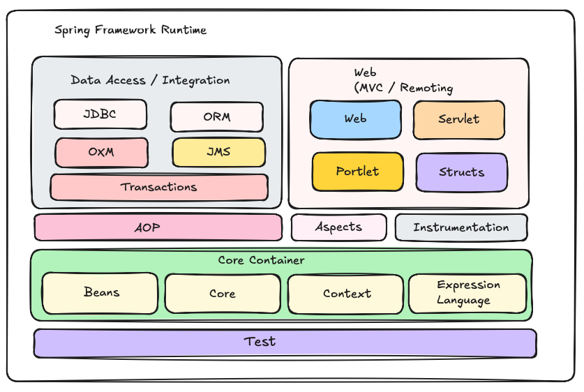
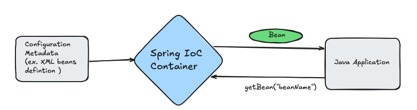
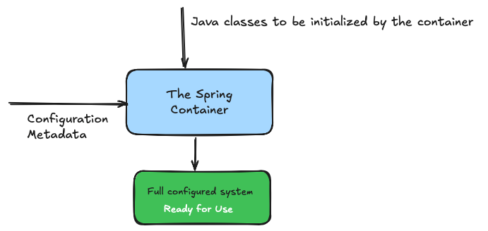
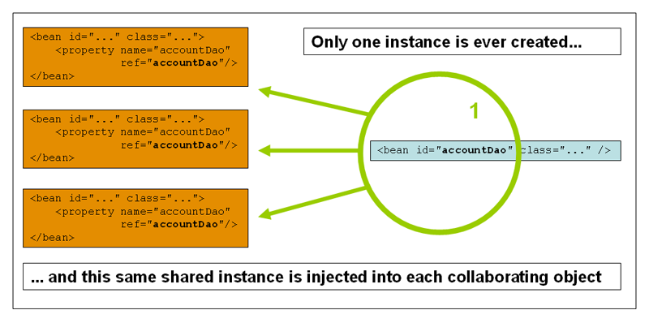
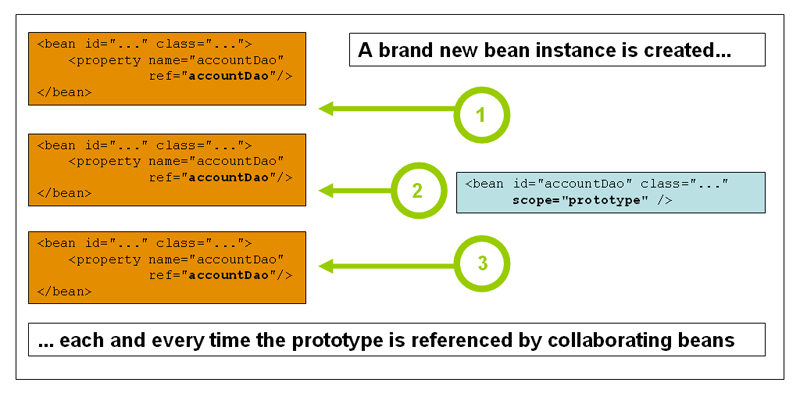

# **Spring Framework**

##### The Spring Framework was initially created in 2002 by **Rod Johnson**. He published his ideas in a book titled *Expert One-on-One J2EE Design and Development*, there he introduced a framework to simplify enterprise Java development. Spring’s first official release, version 1.0, came out in March 2004. It quickly gained popularity for its lightweight container, dependency injection, and modular approach to building Java applications.

- It's an open source application framework

- Spring is designed to simplify Java application development by handling complex tasks like managing dependencies and configurations. This allows developers to focus on writing the core logic of their applications rather than worrying about the underlying setup.

- It is **modular**, which means developers can use only the parts of the framework they need, rather than adopting the entire system. This makes Spring highly flexible and adaptable to various project requirements.

- Spring handles the infrastructure  so you can focus on on your application

  - Handling and Managing Database Connections Pool 
  - Handling and Managing Connection to the Messaging System (e.g Apache ActiveMQ, Artemis, RabbitMQ, Kafka and many other)
  - Simplify Transaction Management by configuring Spring Managed Transaction Manager
  - AOP support to handle **cross cutting concerns** in an enterprise application (Logging, Security, Transactions)

- Spring supports all major application servers and JEE standards

- Aspect Oriented Programming

  

  ### **Core Container**

  - **Core and Beans -** provide the fundamental parts of the framework, include IoC and Dependency Ibjection features
  - **Context** - it' is a means to access objects in framework - style manner that is similar to a JNDI Registry (**Java Naming and Directory Interface** provided under JEE (Java Enterprise Edition)
  - **Expression language**: provides a powerful expression language for querying and manipulating an object graph at runtime

  ### **AOP, Aspect, Instrumentation**

  ##### **AOP**: provides an AOP Alliance-compliant aspect-oriented programming implementation allowing you to define, for example, method-interceptors and pointcuts to clealy decouple code that implements functionality that should separated

  **Aspect:** provides integration with AspectJ

  **Instrumentation:** provides class instrumentation support and classloader implementation to be used in certain application servers	

  - Spring can be used to build a variety of applications, from simple **Java programs** to complex 
    - Web applications
    - SOAP Services
    - RESTful Services
    - Messagging and Streaming App
    - Cloud enabled Microservices that allows integration with various services / capabilities provided by different cloud platforms
      - Amazon Web Services
      - Microsoft Azure
      - Google Cloud Platform (GCP) 


Core of the Spring Framework is based on the two main **Design patterns** and few commonly used patterns

- Dependency Injection
- Inversion of control (IoC)

**Dependency Injection:** Dependency injection is a pattern where the container passes objects by name to other objects, via either constructors, properties, or factory methods. 

An injection is the passing of a dependency (a service) to a dependent object (a client). Passing the service to the client, rather than allowing a client to build or find the service, is the fundamental requirement of the pattern.

It's the technology and key concepts the actually defines Spring Framework (Heat of Spring)

Dependency Injection help us to keep our classes as independent  as possible

- Increase resume of applying low coupling (Spring IoC container will connect and wire the different objects based on the dependencies specified)
- Easy testing (e.g. due to the low couple we can easily replace one database with another)
- Make code more understand and allow developers to focus on the actual business logic

**Inversion of control (IoC) :** IoC or inversion of control is a principle in software engineering by which the control of the object is transferred from the programmer into the framework especially a container, in our case the IoC container. The Inversion of Control (IoC) is a general concept, and it can be expressed in many different ways  

#### 				**IoC Container and Dependency Injection**

- The Spring container (IoC Container) is at the core of the Spring Framework.

- The container will create the objects, wire them together, configure them, and manage their complete lifecycle from creation till destruction.



- The container gets it's instructions  on what objects to instantiate, configure, and assemble by reading configuration metadata provided.

- The configuration metadata can be represented by 

  - XML 

  - Java annotations

  - Java code

    


```
package io.reactivestax.spring.beans;

public class Foo {
    private String name;

    public Foo() {
    }
    public Foo(String name) {}

    public String getName() {
        return name;
    }

    public void setName(String name) {
        this.name = name;
    }
}
```

```
package io.reactivestax.spring.beans;

public class Bar {

    private String name;
    private int age;
    private Foo foo;

    public Bar() {
    }

    public Bar(String name, int age, Foo foo) {
        this.name = name;
        this.age = age;
    }

    public void setFoo(Foo foo) {
        this.foo = foo;
    }

    public void processFooName() {
        System.out.println("Name in injected Foo is : "+foo.getName());
    }

    @Override
    public String toString() {
        return "Bar has name = " + this.name + ", age = " + this.age;
    }
}
```

To instantiate the above classes, one way is to do the usual new operastor like **new Foo() and new Bar()** or we can use the Spring Depdency injection to instantiate these classes and set the properties accordingly.

In **Spring Framework 3.0**, one can create Spring beans using **Spring Core** by defining them in XML configuration files or using annotations with Java configuration. Since you want to use only **Spring Core**, here's how you can define beans and manage them.

```
<beans xmlns="http://www.springframework.org/schema/beans"
       xmlns:xsi="http://www.w3.org/2001/XMLSchema-instance"
       xsi:schemaLocation="http://www.springframework.org/schema/beans https://www.springframework.org/schema/beans/spring-beans-3.0.xsd">

    <bean id="foo" class="io.reactivestax.spring.beans.Foo">
        <constructor-arg index="0" value="fooBean"/>
    </bean>

    <bean id="bar" class="io.reactivestax.spring.beans.Bar">
        <constructor-arg type="int" value="45"/>
        <constructor-arg type="java.lang.String" value="BrijeshBar"/>
        <property name="foo" ref="foo"/>
    </bean>
</beans>
```

To use Spring Framework (IoC), we need to create a new project using Apache Maven or Gradle. Here we will use apache maven to create a new project using **mvn archetype** plugin

- run the command `mvn archetype:generate` to trigger the project creation and select the plug-in to create a new project. We use maven plugin `org.apache.maven.archetypes:maven-archetype-quickstart` from the list. To select a given archetype one needs to enter a given archetype plug-in **number**  and   select the latest version of the plug-in and provide the project coordinates 
  - groupId [e.g io.reactivestax]
  - artifactId [e.g. spring-app]
  - version [key the default version selected]

- once the new project is created, make sure we update the java compiler in the pom.xm; by updating the property`<maven.compiler.release>1.8</maven.compiler.release>`. 

- Initially we will be using JDK 8 with Spring Framework 3. Here is the my sample pom.xml, please don't copy paste. 

- Make sure you have JDK8 installed and jenv working to manage different version of Java

  ```
  <?xml version="1.0" encoding="UTF-8"?>
  <project xmlns="http://maven.apache.org/POM/4.0.0" xmlns:xsi="http://www.w3.org/2001/XMLSchema-instance"
    xsi:schemaLocation="http://maven.apache.org/POM/4.0.0 http://maven.apache.org/xsd/maven-4.0.0.xsd">
    <modelVersion>4.0.0</modelVersion>
  
    <groupId>io.reactivestax</groupId>
    <artifactId>boca-spring-core</artifactId>
    <version>1.0-SNAPSHOT</version>
  
    <name>boca-spring-core</name>
    <url>http://www.reactivestax.io</url>
  
    <properties>
      <project.build.sourceEncoding>UTF-8</project.build.sourceEncoding>
      <maven.compiler.release>1.8</maven.compiler.release>
      <spring.version>3.0.0.RELEASE</spring.version>
    </properties>
  
    <dependencies>
      <!-- This tag is used to write comments in the xml file -->
      <!-- In case you are seeing any warnings reported by intellij for the maven dependencies defined below, please ignore it for now-->
      <dependency>
        <groupId>org.springframework</groupId>
        <artifactId>spring-core</artifactId>
        <version>${spring.version}</version>
      </dependency>
      <dependency>
        <groupId>org.springframework</groupId>
        <artifactId>spring-beans</artifactId>
        <version>${spring.version}</version>
      </dependency>
      <dependency>
        <groupId>junit</groupId>
        <artifactId>junit</artifactId>
        <version>4.12</version>
        <scope>test</scope>
      </dependency>
    </dependencies>
  </project>
  ```

  - Please see the dependencies above 
    - org.springframework:spring-core
    - org.springframework:spring-beans

```
package io.reactivestax;

import io.reactivestax.spring.beans.Bar;
import io.reactivestax.spring.beans.Foo;
import org.springframework.beans.factory.BeanFactory;
import org.springframework.beans.factory.xml.XmlBeanFactory;
import org.springframework.core.io.ClassPathResource;

public class XMLBeanFactoryFooBarLauncher {
    public static void main(String[] args) {
        BeanFactory beanFactory = new XmlBeanFactory(new 	ClassPathResource("applicationContext.xml"));
        Bar bar = beanFactory.getBean("bar", Bar.class);
        bar.processFooName();
        System.out.println(bar.toString());

        Foo foo = beanFactory.getBean(Foo.class);
        System.out.println(foo.getName());
    }
}
```

Here we are using **`XmlBeanFactory`** to load beans defined in an XML configuration file in **Spring Core**. However, note that **`XmlBeanFactory`**was deprecated starting from **Spring 3.1** and removed in later versions, so it’s generally recommended to use `ApplicationContext` or other modern approaches.

In Spring, there are several ways to initialize the **ApplicationContext**, depending on the source of the configuration and the type of application. Some of most commonly used one are

**ClassPathXmlApplicationContext**

ClassPathXmlApplicationContext is a class in the Spring Framework used to load a Spring application context from one or more XML configuration files located in the classpath. It is ideal when your configuration files are packaged within your application, such as in src/main/resources in a Maven or Gradle project.

**Key Features:**

- *Classpath Dependency*: It resolves the configuration files using the classpath. This is suitable when your configuration files are packaged inside your application JAR/WAR.

- **Easy to Use**: Requires minimal configuration since it automatically searches the classpath for the XML file(s).

- **XML-based Configuration**: Supports the legacy Spring XML-based bean configuration.

Here is the example code using `ClassPathXmlApplicationContext` to initialize Spring IoC container. 

```
import io.reactivestax.spring.beans.Bar;
import io.reactivestax.spring.beans.Foo;
import org.springframework.context.ApplicationContext;
import org.springframework.context.support.ClassPathXmlApplicationContext;

public class ApplicationContextTestFooBarLauncher {
    public static void main(String[] args) {

        ApplicationContext context = new ClassPathXmlApplicationContext("applicationContext.xml");
        Bar bar = context.getBean("bar", Bar.class);
        bar.processFooName();
        System.out.println(bar.toString());

        Foo foo = context.getBean(Foo.class);
        System.out.println(foo.getName());

    }
}
```

**FileSystemXmlApplicationContext:** FileSystemXmlApplicationContext is another class in the Spring Framework used to load a Spring application context from one or more XML configuration files located in the file system (outside the classpath). It allows you to specify absolute or relative file paths.

**Key Features:**

- **File System Dependency**: It resolves the configuration files from the file system. This is suitable when configuration files are stored externally, allowing for easier modification without rebuilding the application.

- **Flexible Path Handling**: Supports absolute file paths or relative paths (relative to the current working directory of the JVM process).

- **XML-based Configuration**: Similar to ClassPathXmlApplicationContext, it supports legacy XML-based configuration.

Here is the example code using `FileSystemXmlApplicationContext` to initialize Spring IoC container. 

```
import io.reactivestax.spring.beans.Bar;
import io.reactivestax.spring.beans.Foo;
import org.springframework.context.ApplicationContext;
import org.springframework.context.support.FileSystemXmlApplicationContext;

import java.io.File;

public class FileSystemApplicationContextTestFooBarLauncher {
    public static void main(String[] args) {
        File projectHome = new File(System.getProperty("user.dir"));
        ApplicationContext context = new FileSystemXmlApplicationContext("file:"+projectHome.getAbsolutePath()+"/src/main/resources/applicationContext.xml");
        Bar bar = context.getBean("bar", Bar.class);
        bar.processFooName();
        System.out.println(bar.toString());

        Foo foo = context.getBean(Foo.class);
        System.out.println(foo.getName());
    }
}

```

Please note the **"file:"**  Plain paths will always be interpreted as relative to the current VM working directory, even if they start with a slash.  **Use an explicit "file:" prefix to enforce an absolute file path.**

In order to use the **ClassPathXmlApplicationContext and FileSystemXmlApplicationContext** we need to include `spring-context` dependecy in the pom.xml

```
<dependency>
  <groupId>org.springframework</groupId>
  <artifactId>spring-context</artifactId>
  <version>${spring.version}</version>
</dependency>
```

Please note we only need to include `spring-context` **dependency** in pom.xml to use ClassPathXmlApplicationContext and FileSystemXmlApplicationContext we don't need to include the `spring-core` and `spring-bean` maven dependencies in the pom.xml file because `spring-context` has the **transitive** dependencies on these modules due the transitive dependecy of `spring-context` on the `spring-beans and spring-core` maven modules

Here we have multiple xml bean defintion files provided to `ClassPathXmlApplicationContext` class to create beans

```
package io.reactivestax;

import io.reactivestax.spring.beans.Bar;
import io.reactivestax.spring.beans.Foo;
import io.reactivestax.spring.beans.JavaBeanWithProperties;
import io.reactivestax.spring.beans.SimpleJavaBean;
import org.springframework.context.ApplicationContext;
import org.springframework.context.support.ClassPathXmlApplicationContext;

public class ClasspathApplicationContextTestFooBarLauncher {
    public static void main(String[] args) {

        // specifying the multiple spring beans xml definition files
        ApplicationContext context = new ClassPathXmlApplicationContext(new String[] {"applicationContext.xml", "spring-beans.xml"});
        Bar bar = context.getBean("bar", Bar.class);
        bar.processFooName();
        System.out.println(bar.toString());

        Foo foo = context.getBean(Foo.class);
        System.out.println(foo.getName());

        SimpleJavaBean simpleJavaBean = context.getBean("bean1", SimpleJavaBean.class);

        //not passing any file object for now
        System.out.println("Java bean1 name is: " + simpleJavaBean.getName());

        //Simple Java beans initialized and set the properties using bean setter method
        JavaBeanWithProperties beanPropertySetter1 = context.getBean("bean2", JavaBeanWithProperties.class);

        //not passing any file object for now
        System.out.println("Java bean2 property 1 " + beanPropertySetter1.getProperty1());
        System.out.println("Java bean2 property 2 " + beanPropertySetter1.getProperty2());


        //Simple Java beans initialized and set the properties using bean setter method and value is set using setter reference beans
        JavaBeanWithProperties beanPropertySetter2 = context.getBean("bean3", JavaBeanWithProperties.class);

        //not passing any file object for now
        System.out.println("Java bean2 property 1 " + beanPropertySetter2.getProperty1());
        System.out.println("Java bean2 property 2 " + beanPropertySetter2.getProperty2());


        String value2Bean = context.getBean("value2Bean", String.class);
        System.out.println("Java value2Bean " + value2Bean);
    }
}
```

_______________

A **Maven transitive dependency** is a dependency that your project inherits indirectly from the libraries it explicitly depends on. Maven automatically resolves and includes these dependencies in your project, saving you from having to declare them manually.

​	•	**Direct Dependency**: A library that you explicitly declare in your pom.xml.

​	•	**Transitive Dependency**: A library that your direct dependency depends on.

____________________

### **Spring Bean Scopes**

- **Singleton**

  - **Definition**: A single instance of the bean is created for the entire Spring IoC container. Only one shared instance of a singleton bean is managed, and all requests for beans with an ID or IDs that match that bean definition result in that one specific bean instance being returned by the Spring container.

  - **Scope**: Shared across the entire application context.

  - **Use Case**: Stateless beans, such as service components.

    

- **Prototype** 

  - **Definition**: The non-singleton prototype scope of bean deployment results in the creation of a new bean instance every time a request for that specific bean is made.hat is, the bean is injected into another bean or you request it through a `getBean()` method call on the container. As a rule, you should use the prototype scope for all stateful beans and the singleton scope for stateless beans. .

  - **Scope**: Shared across the entire application context.

  - **Use Case**: Stateless beans, such as service components.

    

  ### **Singleton Beans with Prototype-bean Dependencies**

  When you use singleton-scoped beans with dependencies on prototype beans, be aware that dependencies are resolved at instantiation time. Thus, if you dependency-inject a prototype-scoped bean into a singleton-scoped bean, a new prototype bean is instantiated and then dependency-injected into the singleton bean. The prototype instance is the sole instance that is ever supplied to the singleton-scoped bean.

  However, suppose you want the singleton-scoped bean to acquire a new instance of the prototype-scoped bean repeatedly at runtime. **You cannot dependency-inject a prototype-scoped bean into your singleton bean, because that injection occurs only once, when the Spring container instantiates the singleton bean and resolves and injects its dependencies.** 

  If you need a new instance of a prototype bean at runtime more than once, see [Method Injection](https://docs.spring.io/spring-framework/reference/core/beans/dependencies/factory-method-injection.html).

- **Request (Web Applications)**
  
  - **Definition**: A new bean instance is created for each HTTP request.**
  - **Scope**: Tied to the lifecycle of a single HTTP request.
  - **Use Case**: Components related to request data processing.
  
- **Session (Web Applications)**
  
  - **Definition**: A new bean instance is created for each HTTP session.
  - **Scope**: Tied to the lifecycle of an HTTP session.
  - **Use Case**: Stateful components specific to a user session.
  
- **Application (Web Applications)**
  
  - **Definition**: A single instance is created for the lifecycle of a ServletContext.
  - **Scope**: Shared across the entire application context within the ServletContext.
  - **Use Case**: Application-wide shared state.
  
- **WebSocket (WebSocket Applications)**
  
  - **Definition**: A new instance is created for each WebSocket session.
  - **Scope**: Tied to the lifecycle of a WebSocket session.
  - **Use Case**: Handling WebSocket-specific interactions.

****** https://docs.spring.io/spring-framework/reference/core/beans/factory-scopes.html 

****** Request, Session, Application and Websocket of the beans will be covered when we work with Spring Rest, Spring Web

#### **Creating Spring Beans with a constructor**

 - Simple Class 

   ```
   <bean id="helloBean "class="io.reactivestax.spring.beans.HelloBean"/>
   ```
   
   ```
   package io.reactivestax.spring.beans;
   
   public class HelloBean {
       public HelloBean() {
               System.out.println("HelloBean constructor is called");
       }
       public void sayHello() {
           System.out.println("Hello World!");	
       }
   }
   ```

- Inner Class

  ```
  <bean id="hiBean" class="io.reactivestax.spring.beans.HelloBean$HiBean"/>
  ```

  ```
  package io.reactivestax.spring.beans;
  
  public class HelloBean {
      public HelloBean() {
                  System.out.println("HelloBean constructor is called");
      }
  
      public void sayHello() {
          System.out.println("Hello World!");
      }
  
      public static class HiBean {
          public HiBean() {
                      System.out.println("Hi constructor is called");
          }
  
          public void sayHi() {
              System.out.println("Hello World!");
          }
  
      }
  }
  ```

### **Instantiating with a static method**

```
<bean id="processor" class="io.reactivestax.spring.beans.RuleSetProcessor"
      factory-method="getInstance"/>
```

```
package io.reactivestax.spring.beans;

public class RuleSetProcessor {
    private static final RuleSetProcessor INSTANCE = new RuleSetProcessor();

    private RuleSetProcessor() {
        System.out.println("RuleSetProcessor constructor is called");
    }

    public static RuleSetProcessor getInstance() {
        System.out.println("calling getInstance");
        return INSTANCE;
    }
}
```

**Using an instance factory method** : Using the **instance factory approach** in Spring allows you to use an existing bean (factory bean) to produce other beans. This is useful for scenarios like creating different types of objects dynamically, such as different types of bank accounts

```
package io.reactivestax.spring.beans;

public interface BankAccount {
  void accountType();
}

package io.reactivestax.spring.beans;

public class SavingsAccount implements BankAccount {

    @Override
    public void accountType() {
        System.out.println("This is a Savings Account");
    }
}

package io.reactivestax.spring.beans;

public class CurrentAccount implements BankAccount {

    @Override
    public void accountType() {
        System.out.println("This is a Current Account");
    }
}

package io.reactivestax.spring.beans;

public class BankAccountFactory {

    public BankAccount createSavingsAccount() {
        return new SavingsAccount();
    }


    public BankAccount createCurrentAccount() {
        return new CurrentAccount();
    }
}


```

```
package io.reactivestax;

import io.reactivestax.spring.beans.BankAccount;
import org.springframework.context.ApplicationContext;
import org.springframework.context.support.ClassPathXmlApplicationContext;

public class Main {
    public static void main(String[] args) {
        ApplicationContext context = new ClassPathXmlApplicationContext("factoryBeans.xml");

        BankAccount savingsAccount = (BankAccount) context.getBean("savingsAccount");
        savingsAccount.accountType(); // Output: This is a Savings Account

        BankAccount currentAccount = (BankAccount) context.getBean("currentAccount");
        currentAccount.accountType(); // Output: This is a Current Account
    }
}
```

```
<beans xmlns="http://www.springframework.org/schema/beans"
       xmlns:xsi="http://www.w3.org/2001/XMLSchema-instance"
       xsi:schemaLocation="http://www.springframework.org/schema/beans https://www.springframework.org/schema/beans/spring-beans-3.0.xsd">

    <!-- Define the factory bean -->

    <bean id="bankAccountFactory" class="io.reactivestax.spring.beans.BankAccountFactory"/>

    <!-- Define the beans created using the factory -->
    <bean id="savingsAccount" factory-bean="bankAccountFactory" factory-method="createSavingsAccount"/>
    
    <bean id="currentAccount" factory-bean="bankAccountFactory" factory-method="createCurrentAccount"/>

</beans>
```

___________

#### **Question:** 

When and why would use the **Instance factory approach** to create Spring Beans? (This will not be discussed in detail here.) The factory approach involves setting up and implementing the **Factory Design Pattern** for object creation.

Using this approach is recommended when object creation involves complex logic, such as applying specific rules or evaluating conditions before constructing the object

______________

#### **Constructor-based DI**

- **Mandatory Initialization** In constructor-based DI, all dependencies must be provided when the object is created. This ensures that the object is fully initialized and ready to use right after its creation. Once the object is created, the dependencies cannot be modified because:

  ​	•	The dependencies are declared as final fields in the class.

  ​	•	final fields must be initialized during object construction and cannot be reassigned afterward.

- **Immutability by Design** Immutability means that the state of the object cannot change after its creation. Constructor-based DI helps achieve this because:

  ​	•	Dependencies are injected once during object construction.

  ​	•	No setter methods are available to change these dependencies later.

  ​	•	Any attempt to modify the object state would require reflection or breaking encapsulation, which is generally avoided in well-designed systems.

- Constructor based DI is accomplished by the container invoking a constructor with a number of arguments, each representing a dependency

- Calling a static factory method with specific arguments to construct the bean is nearly equivalent

###### **Constructor argument resolution**

- Argument resolution 	

  ```
  <bean id="ruleSetService" class="io.reactivestax.spring.beans.RuleSetService">
              <constructor-arg ref="parser"/>
              <constructor-arg ref="dao"/>
      </bean>
  ```

- Argument type match

  ```
  <bean id="parserFactory" class="io.reactivestax.spring.beans.processor.RuleSetParserFactory" factory-method="getInstance">
      <constructor-arg type="java.lang.String" value="DB"/>
      <constructor-arg type="int" value="10"/>
  </bean>
  ```

- Arugment Index

  ```
  <bean factory-bean="bankAccountFactory" factory-method="createBankAccount">
      <constructor-arg index="0" value="Saving"/>
      <constructor-arg index="1" value="10000"/>
      <constructor-arg index="2" value="4.0"/>
      <constructor-arg index="3" value="5.0"/>
  </bean>
  ```
  
  ```
  package io.reactivestax.spring.beans;
  
  public class CurrentAccount implements BankAccount {
  
      private double fees;
      private double interestRate;
      private double initialBalance;
  
      public CurrentAccount() {
      }
  
      public CurrentAccount(double fees, double interestRate, double initialBalance) {
          this.fees = fees;
          this.interestRate = interestRate;
          this.initialBalance = initialBalance;
      }
  
      @Override
      public void accountType() {
          System.out.println("This is a Current Account");
      }
  }
  
  package io.reactivestax.spring.beans;
  
  public class SavingsAccount implements BankAccount {
  
      private double fees;
      private double interestRate;
      private double initialBalance;
  
      public SavingsAccount() {
      }
  
      public SavingsAccount(double fees, double interestRate, double initialBalance) {
          this.fees = fees;
          this.interestRate = interestRate;
          this.initialBalance = initialBalance;
      }
  
      @Override
      public void accountType() {
          System.out.println("This is a Savings Account");
      }
  }
  
  package io.reactivestax.spring.beans;
  
  public class BankAccountFactory {
  
      public BankAccount createSavingsAccount(double bankFee, 
      																			  double interestRate, 
      																			  double openingBalance) {
          return new SavingsAccount(bankFee, interestRate, openingBalance);
      }
  
      public BankAccount createCurrentAccount(double bankFee, 
      																				double interestRate, 
      																				double openingBalance) {
          return new CurrentAccount(bankFee, interestRate, openingBalance);
      }
  
  
  
      public BankAccount createBankAccount(String accountType, 
      																		 double openingBalance, 
      																		 double interestRate, 
      																		 double bankFee) {
          if(accountType.equalsIgnoreCase("Savings")) {
              return  new SavingsAccount(bankFee, interestRate, openingBalance);
          }  else if(accountType.equalsIgnoreCase("Current")) {
              return  new CurrentAccount(bankFee, interestRate, openingBalance);
          } else {
              throw new IllegalArgumentException("Unsupported bank account type: " + accountType);
          }
      }
  }
  ```

#### **Setter-based DI**

Setter-based Dependency Injection (DI) is another method of injecting dependencies into Spring-managed beans, where dependencies are provided through **public setter methods** rather than the constructor. This approach has its advantages and limitations, and it is important to understand its implications

- In setter-based DI, Spring uses setter methods to inject dependencies after the bean is instantiated. Here’s an example:

```
   <bean id="bean2" class="io.reactivestax.spring.beans.JavaBeanWithProperties">
        <property name="property1" value="value1"/>
        <property name="property2" value="value2"/>
    </bean>
```

- Setter-based Dependency Injection (DI) is another method of injecting dependencies into Spring-managed beans, where dependencies are provided through **public setter methods** rather than the constructor. This approach has its advantages and limitations, and it is important to understand its implications.

**Example: Setter-Based DI**

```
@Component
public class UserService {
  private UserRepository userRepository;
  // Setter method for dependency injection

  
  @Autowired
  public void setUserRepository(UserRepository userRepository) {
    this.userRepository = userRepository;
  }

  public void performService() {
    // Use the injected dependency
    System.out.println("Performing service with " + userRepository);
  }
}
```

In this case:

​	•	The userRepository field is set via the setUserRepository method after the UserService object is instantiated.

**Advantages of Setter-Based DI**

1.	**Flexibility and Optional Dependencies**:
    - Setter-based DI allows injecting optional dependencies. If some dependencies are not mandatory, you can skip providing them without breaking the object creation process.

2.	**Readable Configuration**:
    - For large beans with many optional properties, setter-based DI can make configuration more readable in XML or annotation-based configuration.

3.	**Changing Dependencies at Runtime** (Rare Use Case):
    - Although not recommended in most scenarios, setter-based DI allows replacing dependencies at runtime by invoking the setter methods.

4.	**Clear Separation of Concerns**:
    - Object construction and dependency injection are separated, which can make testing and mocking simpler in some cases.

**Disadvantages of Setter-Based DI**

 1. **Lack of Immutability**: Setter-based DI inherently allows dependencies to be mutable. This means the state of the object can be modified after creation, which may lead to bugs or unintended behavior in multithreaded environments.

    Example of a mutable dependency: 
    
    ```
    userService.setUserRepository(new DifferentRepository());
    ```

2.	**Not Fully Initialized Object**:  The object is not guaranteed to be fully initialized right after its constructor is called. The dependencies are injected  later, which may lead to a partially initialized object if methods are invoked before all setters are called.

3.	**Hidden Dependencies**: The required dependencies are not always clear from the class definition. Unlike constructor-based DI, where dependencies are explicit in the constructor, setter-based DI can make it harder to understand what a class needs to function correctly

4. **Violation of Best Practices**: Dependency injection principles often encourage immutability and clear dependency requirements. Setter-based DI can violate these principles, making the code less predictable and harder to maintain.

##### **When to Use Setter-Based DI**

Setter-based DI can be useful in the following scenarios:

1. **Optional Dependencies**:
   - If a bean has optional properties that may not always need to be set, setter-based DI provides flexibility.
2. **Configuration Changes After Object Creation**:
   - If dependencies need to be reconfigured or replaced dynamically (e.g., in prototyping or testing).
3. **Backward Compatibility**:
   - If working with legacy code that already relies on setters for dependency injection.

**Example with Spring XML Configuration**

Here’s how setter-based DI would look in XML-based configuration:

Example: Setter-Based DI

```
<bean id="userService" class="io.reactivestax.service..UserService">
    <property name="userRepository" ref="userRepository" />
</bean>

<bean id="userRepository" class="io.reactivestax.dao.UserRepository" />
```

In this case:

- The userRepository bean is injected into the userService bean using the property element, which maps to the setter method.

##### **Comparison: Constructor-Based DI vs Setter-Based DI**

| **Aspect**                 | **Constructor-Based DI**                            | **Setter-Based DI**                                |
| -------------------------- | --------------------------------------------------- | -------------------------------------------------- |
| **Immutability**           | Promotes immutability (dependencies are `final`).   | Does not enforce immutability (fields can change). |
| **Mandatory Dependencies** | Enforces mandatory dependencies at object creation. | Dependencies can be optional or set later.         |
| **Readability**            | Makes dependencies explicit in the constructor.     | Dependencies may be implicit or less clear.        |
| **Object Initialization**  | Object is fully initialized after construction.     | Object may remain partially initialized.           |
| **Flexibility**            | Less flexible for optional dependencies.            | More flexible for optional dependencies.           |

#### **Straight values**

- Here we are directly using values in the XML Bean definition

```
<bean id="dataSource"  class="org.apache.commons.dbcp.BasicDataSource" >
  <!-- results in a setDriverClassName(String) call -->
  <property name="driverClassName" value="com.mysql.jdbc.Driver"/>
  <property name="url">
     <value>jdbc:mysql://localhost:3306/mydb</value>
  </property>
  <property name="username" value="root"/>
   <property name="password" value="masterkaoli"/>
</bean>

```

#### **Null and empty values**

```
<!-- is equivalent to the following code: bean.setEmail("").-->
    <bean id="userDetails" class="io.reactivestax.spring.beans.UserDetails">
        <property name="name" value="Brijesh Sood"/>
        <property name="email" value=""/>
    </bean>
    
<!-- The <null/> element handles null values. -->
    <bean id="userDetails" class="io.reactivestax.spring.beans.UserDetails">
        <property name="name" value="Brijesh Sood"/>
				<property name="email"><null/></property>
		</bean>
    
```

#### **PropertyPlaceholderConfigurer**

is a Spring bean factory post-processor used to resolve placeholders in bean definitions from property files. It replaces placeholders like ${property.name} with actual values from property files, enabling externalization of configuration.

Although it has been replaced by PropertySourcesPlaceholderConfigurer in modern Spring, it is still relevant for legacy applications. 

##### **Key Features of `PropertyPlaceholderConfigurer`**

1. **External Configuration**:
   - Allows configuration values to be stored outside the application (e.g., `.properties` files).
2. **Placeholder Resolution**:
   - Resolves placeholders in bean properties or XML configuration.
3. **Multiple Property Files**:
   - Supports loading multiple property files.
4. **Default Values**:
   - Allows specifying default values for placeholders.
5. **System Properties Override**:
   - Enables system properties (e.g., JVM arguments) to override property file values

```
<!-- Loading a single property file-->
<bean class="org.springframework.beans.factory.config.PropertyPlaceholderConfigurer">
	<property name="locations" value="classpath:jdbc.properties"/>
</bean>

<!-- Loading multiple property files-->
<bean id="propertyConfigurer" class="org.springframework.beans.factory.config.PropertyPlaceholderConfigurer">
    <property name="locations">
        <list>
            <value>classpath:application.properties</value>
            <value>classpath:database.properties</value>
        </list>
    </property>
    <property name="ignoreUnresolvablePlaceholders" value="true" />
</bean>

<bean id="dataSource" destroy-method="close"  class="org.apache.commons.dbcp.BasicDataSource">
	<property name="driverClassName" value="${jdbc.driverClass}"/>
	<property name="url" >	<value>${jdbc.url}</value></property>
	<property name="username" value="${jdbc.username:testUser}"/>
	<property name="password" value="${jdbc.password:testPassw0rd}"/>
</bean>
```

**`locations`**: Specifies property files to load.

**`ignoreUnresolvablePlaceholders`**: When set to `true`, unresolved placeholders are ignored.

**Property Usage:** In order to use the properties loaded by the `PropertyPlaceholderConfigurer` we use use `${}` and provide the property name with in the curly braces

**Default Value Syntax**: For the username and password properties we are `:` after the property name jdbc.username to specify the default username in case jdbc.username is not present in the `database.properties or application.properties` files

**Custom Placeholder Prefix/Suffix**: Change `${}` to custom delimiter

```
<property name="placeholderPrefix" value="[" />
<property name="placeholderSuffix" value="]" />
```

```
<bean class="org.springframework.beans.factory.config.PropertyPlaceholderConfigurer">
    <property name="locations" value="classpath:application.properties"/>
    <property name="placeholderPrefix" value="["/>
    <property name="placeholderSuffix" value="]"/>
</bean>

<!-- Here we have defined the property place holder prefix as [ instead of ${ and suffix as ] so in order to use th properties -->

    <bean id="bean2" class="io.reactivestax.spring.beans.JavaBeanWithProperties">
        <property name="property1" value="[property1]"/>
        <property name="property2" value="[property2]"/>
    </bean>
```

### **idref**  

 the <idref> tag is used in XML-based configuration to reference the id of another bean. Unlike a direct bean reference (ref), which injects the bean instance, <idref> ensures that the string value of the bean's id is passed.

- The `<idref>` tag is used when you need the **string identifier** (i.e., `id`) of a bean, rather than the actual bean instance.

- It is a safer and more descriptive alternative to hardcoding the bean's ID as a string in the configuration

In the Spring Framework, the `idref` element is a specific feature used in XML-based configuration to reference the **ID of a bean** as a string value. It ensures that the referenced bean exists in the application context but does not inject the actual bean instance. Instead, it injects the **ID of the bean as a string**.

---

##### **Why Use `idref`?**
The `idref` element is used when you need to pass the **ID of a bean** (not the bean itself) as a property to another bean. This is particularly useful in scenarios where a bean might need to know the ID of another bean to interact with it indirectly.

---

##### **Syntax**

Here’s the syntax for using `idref` in Spring XML configuration:

```xml
<bean id="beanA" class="com.example.BeanA" />

<bean id="beanB" class="com.example.BeanB">
    <property name="beanId">
        <idref bean="beanA" />
    </property>
</bean>
```

---

##### **Explanation**
1. **`beanA`**:
   - Declares a bean with the ID `beanA`.

2. **`beanB`**:
   - Declares another bean, `beanB`, which has a property `beanId`.
   - The `idref` element ensures that the value assigned to the `beanId` property is the ID (`beanA`) of an existing bean.
   - If `beanA` does not exist, the application context will fail to initialize, throwing an error.

---

###### **How It Works in Code**

###### **Bean Classes**
```java
public class BeanB {
    private String beanId;

    public void setBeanId(String beanId) {
        this.beanId = beanId;
    }

    public void printBeanId() {
        System.out.println("Referenced bean ID: " + beanId);
    }
}
```

---

##### **Difference Between `idref` and Regular String Injection**

1. **With `idref`**:
   - Ensures that the referenced bean ID exists in the application context at runtime.
   - Validates the reference, preventing typos or referencing non-existent beans.

2. **Without `idref` (Regular String)**:
   - No validation occurs; you might reference a non-existent bean ID, leading to runtime errors.

Example of non-validated string injection:
```xml
<property name="beanId" value="beanA" />
```

Here, there’s no guarantee that a bean with ID `beanA` actually exists.

---

##### **Key Points**
- **Validation**: The `idref` element ensures that the referenced bean exists.
- **String Value**: It injects the bean's ID as a string, not the bean itself.
- **Error Prevention**: Helps avoid runtime errors caused by referencing non-existent beans.

---

##### **Deprecated in Modern Spring**
In modern Spring applications (using Java-based or annotation-based configuration), the `idref` element is rarely used. Instead:
- You can use Spring's `@Value` annotation or environment properties to achieve similar functionality (will be covering annotation based spring beans).
- Direct bean references or injection are more common.

Example in Java configuration:
```java
@Configuration
public class AppConfig {

    @Bean
    public String beanAId() {
        return "beanA";
    }

    @Bean
    public BeanB beanB(String beanAId) {
        BeanB beanB = new BeanB();
        beanB.setBeanId(beanAId);
        return beanB;
    }
}
```

### **local**

In the Spring Framework, the `local` attribute in XML-based bean configuration is used to specify **local references to beans within the same `<beans>` configuration file**. This attribute was used in older versions of Spring XML configuration to distinguish between local and global bean references, particularly in contexts involving parent-child bean definitions.

---

##### **Key Characteristics of `local`**
1. **Scope**: 
   - Refers to beans defined within the same Spring `<beans>` configuration file.
   - Ensures the reference does not accidentally point to a bean defined in a parent context.

2. **Resolution**: 
   - The `local` attribute specifically restricts the reference lookup to the local context, avoiding ambiguity with beans defined in parent or global contexts.

---

##### **Example Usage**
```xml
<bean id="localBean" class="com.example.LocalBean" />

<bean id="anotherBean" class="com.example.AnotherBean">
    <property name="dependency">
        <ref local="localBean" />
    </property>
</bean>
```

##### **Explanation**:
1. **`localBean`**:
   - A bean defined locally within the same `<beans>` configuration file.

2. **`anotherBean`**:
   - A bean that references `localBean` using the `local` attribute.

3. **`<ref local="localBean" />`**:
   - Ensures that only a bean with the ID `localBean` in the current configuration file is referenced.

---

##### **Difference Between `local` and `bean`**

| **Aspect**     | **`local` Attribute**                              | **`bean` Attribute**                                         |
| -------------- | -------------------------------------------------- | ------------------------------------------------------------ |
| **Scope**      | Restricts reference to beans within the same file. | Allows referencing beans across the application context hierarchy. |
| **Use Case**   | Avoids ambiguity in parent-child contexts.         | Used for general bean references in Spring XML.              |
| **Resolution** | Only checks beans in the local `<beans>` file.     | Checks beans in local and parent contexts.                   |

---

##### **Deprecated Usage**
The `local` attribute is **rarely used in modern Spring applications** because:

1. **Parent-child context distinctions** are less commonly needed in typical setups.
2. **Global resolution** (using `bean` or annotations) is the preferred and more flexible approach.
3. With Java-based and annotation-based configuration, these concerns are naturally avoided.

____________

##### **Reference to other Bean**

- Here we are using `<ref bean="foo"/>` to wire the foo bean. The foo bean can be defined in the **same** beansconfiguration file or it could be **another xml bean configuraiton file** 
- Here we are using `<ref local="foo"/>` use **local** attribute to specify the foo bean is defined in the same xml bean 

```
<beans xmlns="http://www.springframework.org/schema/beans"
       xmlns:xsi="http://www.w3.org/2001/XMLSchema-instance"
       xsi:schemaLocation="http://www.springframework.org/schema/beans https://www.springframework.org/schema/beans/spring-beans-3.0.xsd">

    <bean id="foo" class="io.reactivestax.spring.beans.Foo">
        <constructor-arg index="0" value="fooBean"/>
    </bean>

    <bean id="bar1" class="io.reactivestax.spring.beans.Bar">
        <constructor-arg type="int" value="45"/>
        <constructor-arg type="java.lang.String" value="BrijeshBar"/>
        <property name="foo"><ref bean="foo"/></property>
    </bean>

    <bean id="bar2" class="io.reactivestax.spring.beans.Bar">
        <constructor-arg type="int" value="55"/>
        <constructor-arg type="java.lang.String" value="BrijeshBar2"/>
        <property name="foo"><ref local="foo"/></property>
    </bean>

</beans>
```

### **Spring ApplicationContext Hierarchy**

The **Spring ApplicationContext hierarchy** is a mechanism that allows creating a parent-child relationship between multiple `ApplicationContext` instances. This enables beans defined in a **parent context** to be shared across one or more **child contexts**, while each child context can also have its own specific beans.

In a hierarchical structure:
1. The **parent context** contains shared or common beans that are accessible to all child contexts.
2. The **child context** can:
   - Access beans from its parent context.
   - Define its own specific beans that are not visible to other child contexts or the parent.

---

#### **How the Hierarchy Works**

- **Parent Context**:
  - Acts as a global or shared configuration.
  - Commonly used for shared resources like data sources, security configurations, or core services.

- **Child Context**:
  - Adds additional beans or customizes existing functionality.
  - Can override or extend parent beans via proxying or additional configurations.

- **Visibility**:
  - Child contexts can access beans from the parent context.
  - Parent contexts cannot access beans defined in child contexts.

---

#### **Creating ApplicationContext Hierarchies**

##### **XML-Based Configuration**
Example of a parent-child relationship:

##### **Parent Context:**

```xml
<!-- parentContext.xml -->
<beans>
    <bean id="dataSource" class="com.reactivestax.DataSource" />
    <bean id="accountService" class="com.reactivestax.AccountService" />
</beans>
```

##### **Child Context:**

```xml
<!-- childContext.xml -->
<beans>
    <bean id="userService" class="com.reactivestax.UserService">
        <property name="accountService" ref="accountService" />
    </bean>
</beans>
```

##### **Setting Up Hierarchy in Code:**

```java
ApplicationContext parentContext = new ClassPathXmlApplicationContext("parentContext.xml");
ApplicationContext childContext = new ClassPathXmlApplicationContext(new String[]{"childContext.xml"}, parentContext);

// Access beans from both contexts
DataSource dataSource = parentContext.getBean("dataSource", DataSource.class);
UserService userService = childContext.getBean("userService", UserService.class);
```

---

#### **Use Cases for ApplicationContext Hierarchy**

1. **Shared Resources**:
   - Define shared beans like `DataSource`, `TransactionManager`, or `MessageSource` in the parent context, accessible to all child contexts.
2. **Modular Applications**:
   - Modularize an application into multiple contexts:
     - A core module defined in the parent context.
     - Feature-specific modules in child contexts.
3. **Web Applications**:
   - In Spring Web MVC, Web Services , Rest Services, the **root application context** (parent) holds shared beans (e.g., services, repositories).
   - Each **DispatcherServlet** creates its own child context for web-specific beans (e.g., controllers, view resolvers).
4. **Customizing Beans per Module**:
   - Use a base bean from the parent context and customize or proxy it in child contexts.
5. **Overriding Parent Beans**:
   - A child context can override a parent bean by defining a new bean with the same ID. This is useful for testing or environment-specific configurations.

```
<!-- below bean is defined in the parentApplicationContext.ml -->
<bean id="accountService" class="io.reactivestax.accounting.services.SimpleAccountService"/>

<!-- below bean is defined in the childApplicationContext.xml -->
<bean id="loggingInterceptor" class="io.reactivestax.utils.LoggingInterceptor" />

<bean id="accountService" class="org.springframework.ProxyFactoryBean">
   	<property name="target">
		  <ref parent="accountService"/>
	  </property>
		<!-- Here we have defined the interceptor names property to intercept the call to the account service, LoggingInterceptor is AOP -->
	  <property name="interceptorNames">
        <list>
            <value>loggingInterceptor</value>
        </list>
    </property>
</bean>

```

The `ProxyFactoryBean` in Spring is a special bean that creates a **proxy object** for a target bean, allowing you to add extra behavior like logging, security, or transactions without changing the target bean's code. It works by wrapping the target bean and applying interceptors or advice (like methods to run before or after the target bean's methods). 

For example, you might use it to log method calls on a service bean automatically. This is particularly useful for implementing **Aspect-Oriented Programming (AOP)** in Spring, enabling you to keep the core logic of your beans clean and focus on the cross-cutting concerns separately. We will cover AOP separate in details.

Here the `parent` attribute on the `<ref>` tag in XML configuration is used to refer to a **bean defined in a parent Spring ApplicationContext**. This build the hierarchical application contexts, such as when using a parent-child relationship between ApplicationContexts. 

The `parent` attribute allows a bean in a child context to reference a bean defined in the parent context. This is useful for sharing common beans (like configurations or services) across multiple child contexts without redefining them.

---

#### **Key Points**

- **Spring ApplicationContext Hierarchy** organizes beans into parent-child contexts, promoting modularity and reusability.
- The **parent context** provides shared beans, while **child contexts** add customizations or module-specific beans.
- Common in large, modular applications or multi-module web applications.
- Modern Spring practices (e.g., Spring Boot) often simplify configurations, reducing the need for explicit hierarchy setups.

__________

#### **Inner Bean**

```
<bean id="orderService" class="com.amazon.ecom.service.OrderServiceImpl">
	<property name="repository" ref="orderRepository"/>
	<property name="builder">
		<bean class="com.amazon.ecom.service.OrderBuilderImpl">
			<constructor-arg ref="accountService"/>
			<constructor-arg ref="currencyService"/>
		</bean>
	</property>
</bean>

<!-- Omitting the accountService, currencyService and orderRepository beans defintion-->
```

OrderBuilderImpl as an inner bean in the configuration simplifies the setup by declaring it inline within the orderService bean, emphasizing that the OrderBuilderImpl instance is exclusively tied to orderService

##### **Key Features of Using `OrderBuilderImpl` as an Inner Bean**

1. **Encapsulation**:
   - `OrderBuilderImpl` is scoped only within the `orderService` bean. It is not visible or accessible elsewhere in the application context.
2. **Simplicity**:
   - It avoids cluttering the global bean configuration with standalone bean definitions for components that are used only by a single parent bean.
3. **Direct Dependency Injection**:
   - `OrderBuilderImpl`'s dependencies (`accountService` and `currencyService`) are resolved and injected during its construction as part of the nested bean definition.
4. **Reduced Reusability**:
   - Since `OrderBuilderImpl` is defined as an inner bean, it cannot be shared with other beans. This is ideal when the inner bean is only relevant to its parent bean.
5. **Cleaner XML Configuration**:
   - Keeping `OrderBuilderImpl` inline makes the relationship between `orderService` and its dependencies more explicit and reduces the need for multiple top-level bean IDs

##### **When to Use Inner Beans**

- When the bean (`OrderBuilderImpl`) is not reused elsewhere.
- To indicate that the lifecycle and scope of the inner bean are bound to the parent bean (`orderService`).
- To keep the configuration concise for single-use or context-specific beans

#### **Spring Beans using Java Utils Collections**

Here we got the spring bean created using java util collection package

```
<beans xmlns="http://www.springframework.org/schema/beans"
       xmlns:xsi="http://www.w3.org/2001/XMLSchema-instance"
       xsi:schemaLocation="http://www.springframework.org/schema/beans https://www.springframework.org/schema/beans/spring-beans-3.0.xsd">
    
    <bean id="listBean" class="java.util.ArrayList">
        <constructor-arg>
            <list>
                <value>Element1</value>
                <value>Element2</value>
                <value>Element3</value>
                <ref bean="propertiesBean"/>
            </list>
        </constructor-arg>
    </bean>

    <bean id="setBean" class="java.util.HashSet">
        <constructor-arg>
            <set>
                <value>ElementA</value>
                <value>ElementB</value>
                <value>ElementC</value>
            </set>
        </constructor-arg>
    </bean>

    <bean id="mapBean" class="java.util.HashMap">
        <constructor-arg>
            <map>
                <entry key="Key1" value="Value1"/>
                <entry key="Key2" value="Value2"/>
                <entry key="Key3" value="Value3"/>
            </map>
        </constructor-arg>
    </bean>

    <bean id="propertiesBean" class="java.util.Properties">
        <constructor-arg>
            <props>
                <prop key="prop1">value1</prop>
                <prop key="prop2">value2</prop>
                <prop key="prop3">value3</prop>
            </props>
        </constructor-arg>
    </bean>
</beans>
```

Spring Framework also provides specialized **XSD schemas** for defining collections and other advanced configurations in XML. Specifically, for collections like `<list>`, `<set>`, `<map>`, Spring uses the **`util` namespace** defined in the `spring-util` schema.

```
<beans xmlns="http://www.springframework.org/schema/beans"
       xmlns:xsi="http://www.w3.org/2001/XMLSchema-instance"
       xmlns:util="http://www.springframework.org/schema/util"
       xsi:schemaLocation="
           http://www.springframework.org/schema/beans 
           https://www.springframework.org/schema/beans/spring-beans.xsd
           http://www.springframework.org/schema/util 
           https://www.springframework.org/schema/util/spring-util.xsd">
           
           
    <util:list id="listBean">
    	<value>Element1</value>
    	<value>Element2</value>
	    <value>Element3</value>
		</util:list>

    <util:set id="setBean">
        <value>ElementA</value>
        <value>ElementB</value>
        <value>ElementC</value>
    </util:set>
    
    
    <util:map id="mapBean">
      <entry key="Key1" value="Value1" />
      <entry key="Key2" value="Value2" />
      <entry key="Key3" value="Value3" />
		</util:map>

</beans>
```

```
import org.springframework.context.ApplicationContext;
import org.springframework.context.support.ClassPathXmlApplicationContext;

import java.util.List;
import java.util.Map;
import java.util.Set;

public class JavaUtilsBeansApplicationContextLaunder {
    public static void main(String[] args) {

        // specifying the multiple spring beans xml definition files
        ApplicationContext context = new ClassPathXmlApplicationContext(new String[]{"utilsBeans.xml"});

        System.out.println("_______________________________________________");
        List listBean = context.getBean("listBean", List.class);
        listBean.stream().forEach(System.out::println);

        System.out.println("_______________________________________________");
        Set setBean = context.getBean("setBean", Set.class);
        setBean.stream().forEach(System.out::println);

        System.out.println("_______________________________________________");
        Map mapBean = context.getBean("mapBean", Map.class);
        mapBean.entrySet().stream().forEach(System.out::println);
    }
}
```


##### **Root  <beans>  tag in the xml application context file**

The `<beans>` tag in a Spring XML configuration file defines the configuration of the application context and specifies the XML namespaces and schema locations used in the file. Here's an explanation of the components you mentioned:

---

##### **Components of `<beans>` Tag**

1. **`xmlns="http://www.springframework.org/schema/beans"`**  
   
   - This declares the default namespace for the `beans` schema.  
   - The `beans` namespace is where the standard Spring bean definitions and configurations belong.  
   - It allows the use of Spring-specific elements like `<bean>` and `<property>` without prefixing them with a namespace.
   
2. **`xmlns:xsi="http://www.w3.org/2001/XMLSchema-instance"`**  
   - This is the XML Schema Instance namespace.  
   - It's used to define attributes like `xsi:schemaLocation`, which specify the schema's location for validation.  
   - It ensures the XML configuration adheres to the rules defined in the provided XSD (XML Schema Definition).

3. **`xmlns:util="http://www.springframework.org/schema/util"`**  
   - This adds an additional namespace for the `util` schema, which provides utility features like collections (`<util:list>`, `<util:map>`) and property placeholder management.  
   - By declaring this namespace, you can use `util`-specific tags in your XML.

4. **`xsi:schemaLocation` Attribute**  
   - This attribute maps namespaces to their corresponding XSD files, enabling validation and autocompletion of the XML configuration.
   - The format is:
     ```
     namespace1 schema1 namespace2 schema2 ...
     ```
   - The provided schema locations ensure that the XML elements defined in this file are validated against the correct XSDs.

---

##### **Breakdown of the `xsi:schemaLocation` Mapping**

1. **`http://www.springframework.org/schema/beans`**  
   - Namespace for the `beans` schema.  
   - Mapped to `https://www.springframework.org/schema/beans/spring-beans.xsd`.  
   - This schema defines the structure and rules for standard Spring bean configuration elements.

2. **`http://www.springframework.org/schema/util`**  
   - Namespace for the `util` schema.  
   - Mapped to `https://www.springframework.org/schema/util/spring-util.xsd`.  
   - This schema provides utility elements like `<util:list>` and `<util:map>`.

---

##### **Purpose and Functionality**

1. **Namespace Declaration**  
   - Enables the use of elements from different schemas (`beans` and `util` in this case).  
   - Elements from the `beans` namespace can be used without a prefix, while `util` elements require the `util:` prefix.

2. **Schema Validation**  
   - Ensures the configuration file is syntactically correct and adheres to the rules defined in the XSDs.  
   - Prevents runtime errors due to invalid or incorrect XML configurations.

3. **Extensibility**  
   - Allows combining features from multiple Spring namespaces, such as core bean configurations and utility functionality.

___________

#### Initialization and Destruction callbacks

In the Spring Framework, **Initialization and Destruction Callbacks** refer to lifecycle methods that allow you to execute custom logic during the initialization (bean creation) and destruction (bean removal) phases of a bean's lifecycle.

---

##### **1. Bean Lifecycle in Spring**
When a bean is managed by the Spring IoC container, its lifecycle includes the following steps:
1. Bean instantiation.
2. Dependency injection (properties or constructor arguments are set).
3. Custom initialization logic (Initialization callback).
4. Bean is ready to use.
5. Bean destruction before removal from the container (Destruction callback).

---

##### **2. Initialization Callbacks**
Initialization callbacks let you execute custom logic **after the bean is fully initialized** but **before it's ready for use**.

##### **3. Destruction Callbacks**
Destruction callbacks let you execute custom logic **just before the bean is removed from the container**, such as releasing resources or cleaning up.

---

##### **4. Configuring Initialization and Destruction Callbacks**

Spring provides multiple ways to define these callbacks:

---

##### **Implementing `InitializingBean` and `DisposableBean` Interfaces**
Spring provides two lifecycle interfaces:
- `InitializingBean`: Defines the `afterPropertiesSet()` method for initialization logic.
- `DisposableBean`: Defines the `destroy()` method for destruction logic.

```java
import org.springframework.beans.factory.DisposableBean;
import org.springframework.beans.factory.InitializingBean;

public class MyBean implements InitializingBean, DisposableBean {
    @Override
    public void afterPropertiesSet() throws Exception {
        System.out.println("Initialization logic executed.");
    }

    @Override
    public void destroy() throws Exception {
        System.out.println("Destruction logic executed.");
    }
}
```

- **Advantages**: Directly ties lifecycle logic to the bean.
- **Limitations**: Tightly couples the bean with Spring.

---

##### **Using `init-method` and `destroy-method` in XML Configuration**
Specify methods for initialization and destruction in the XML configuration.

```xml
<bean id="myBean" class="io.reactivestax.MyBean" init-method="init" destroy-method="cleanup" />
```

```java
package io.reactivestax;

public class MyBean {
    public void init() {
        System.out.println("Initialization logic executed.");
    }

    public void cleanup() {
        System.out.println("Destruction logic executed.");
    }
}
```

- **Advantages**: No dependency on Spring-specific interfaces or annotations.
- **Limitations**: Requires XML configuration.

---

##### **Example with XML Configuration**

```xml
<bean id="exampleBean" class="com.example.MyBean" init-method="init" destroy-method="destroy" />
```

```java
public class MyBean {
    public void init() {
        System.out.println("Custom initialization logic.");
    }

    public void destroy() {
        System.out.println("Custom destruction logic.");
    }
}
```

When the application context is closed:
- The `init` method is called after bean creation.
- The `destroy` method is called before the bean is destroyed.

---

- Initialization and destruction callbacks are optional but useful for resource management.
- For prototype-scoped beans, **destruction callbacks will not be called**, as Spring does not manage their lifecycle after instantiation.


__________________

### **Spring Core Container**

The **Spring Core Container** is the foundation of the Spring Framework, providing the core functionality that enables dependency injection (DI) and inversion of control (IoC) across the application. The primary components of the Core Container are:

1. **BeanFactory**: 
   - The **BeanFactory** is the core IoC container in Spring, responsible for instantiating, configuring, and managing beans.
   - It provides the mechanism for dependency injection, enabling Spring to create and manage beans based on configuration metadata, typically in XML format or annotations in later versions.
   - **Key interface**: `BeanFactory`

2. **ApplicationContext**:
   - The **ApplicationContext** extends `BeanFactory` and provides additional features for enterprise applications, such as event propagation, declarative mechanisms for creating beans, and support for internationalization.
   - Unlike `BeanFactory`, which lazily instantiates beans (only when requested), `ApplicationContext` eagerly instantiates singleton beans on startup.
   - **Key classes**: `ClassPathXmlApplicationContext`, `FileSystemXmlApplicationContext`, `AnnotationConfigApplicationContext`

3. **Core Framework Classes**:
   These classes and interfaces form the backbone of Spring's Core Container, with each serving a specific role in DI and bean lifecycle management.
   - **BeanDefinition**:
     - Defines the configuration metadata for a bean. It includes properties like bean class, scope (singleton or prototype), initialization method, and more.
     - Spring uses `BeanDefinition` instances to store information about each bean in the container.
     - **Key class**: `BeanDefinition`
   
   - **BeanWrapper**:
     - Wraps a bean instance and provides a way to set its properties dynamically. It allows for setting properties through reflection, which is essential for DI.
     - BeanWrapper is used internally by Spring for populating bean properties.
     - **Key class**: `BeanWrapper`
   
   - **Dependency Injection with Property Editors**:
     - Spring uses `PropertyEditor` classes to convert property values, especially for complex properties like dates or custom objects, during injection.
     - Property Editors parse configuration values (from XML, for example) and set them on beans.
   
   - **Resource**:
     - A `Resource` is a general representation of any type of resource (like a file, URL, or classpath resource).
     - It abstracts different sources of resources in Spring, so the application can use files, URLs, or other external sources without knowing their exact location.
     - **Key class**: `Resource`, `ClassPathResource`, `FileSystemResource`
   
4. **How Core Container Works**:

   - **Configuration Loading**:
     - The configuration for beans is usually defined in XML files (or annotations in later versions). The `ApplicationContext` loads these configurations at startup, reading `BeanDefinition` information for each bean.

   - **Bean Instantiation**:
     - Based on the configuration, the container uses the `BeanDefinition` to create instances of beans. Spring uses reflection to instantiate the bean classes.

   - **Dependency Injection**:
     - Spring resolves dependencies between beans based on the `BeanDefinition`. It injects dependencies via constructor injection or setter injection.
     - Beans are wired by type or by name, and in cases of ambiguity, developers can provide explicit wiring instructions.

   - **Bean Lifecycle Management**:
     - After instantiation, beans go through various lifecycle steps, such as post-processing and initialization. 
     - The container calls specific lifecycle methods (like `@PostConstruct` or `InitializingBean.afterPropertiesSet`) and applies any registered `BeanPostProcessors`.

   - **Event Handling and Context Support**:
     - `ApplicationContext` provides support for event handling, where components can publish events and other components can subscribe to them.
     - The context also supports features like internationalization and bean scope (singleton, prototype, etc.).

In summary, the Spring Core Container manages the entire lifecycle of beans, from instantiation to dependency injection and destruction, using key framework classes to create and assemble beans as defined in configuration. This allows for a clean separation between application code and configuration, enabling flexibility, modularity, and ease of testing.


Here is the **hierarchical representation** of some of the key classes and interfaces of the **Spring Core Framework**. This structure highlights how Spring organizes its components, especially those involved in the **Core Container** for managing beans, dependency injection, and application context.

### **Spring Core Framework Class Hierarchy**

```
1. org.springframework.beans
   ├── BeanFactory (interface)
   │    ├── HierarchicalBeanFactory (interface)
   │    │    ├── ConfigurableBeanFactory (interface)
   │    │         ├── AbstractBeanFactory (abstract class)
   │    │              ├── DefaultListableBeanFactory (class)
   │    │
   │    ├── ListableBeanFactory (interface)
   │    │    ├── ConfigurableListableBeanFactory (interface)
   │    │         ├── DefaultListableBeanFactory (class)
   │
   ├── BeanWrapper (interface)
   │    ├── BeanWrapperImpl (class)
   │
   ├── BeanDefinition (interface)
   │    ├── AbstractBeanDefinition (abstract class)
   │    │    ├── RootBeanDefinition (class)
   │    │    ├── ChildBeanDefinition (class)
   │
   ├── PropertyEditor (interface)
   │    ├── CustomDateEditor (class)
   │    ├── CustomNumberEditor (class)
   │

2. org.springframework.context
   ├── ApplicationContext (interface)
   │    ├── ConfigurableApplicationContext (interface)
   │    │    ├── AbstractApplicationContext (abstract class)
   │    │         ├── ClassPathXmlApplicationContext (class)
   │    │         ├── FileSystemXmlApplicationContext (class)
   │    │         ├── AnnotationConfigApplicationContext (class)
   │
   ├── ApplicationEventPublisher (interface)
   │    ├── AbstractApplicationContext (abstract class)
   │
   ├── ApplicationListener (interface)
   │    ├── GenericApplicationListener (interface)
   │
   ├── MessageSource (interface)
   │    ├── AbstractMessageSource (abstract class)
   │
   ├── ResourceLoader (interface)
   │    ├── ApplicationContext (interface)

3. org.springframework.core
   ├── Resource (interface)
   │    ├── ClassPathResource (class)
   │    ├── FileSystemResource (class)
   │    ├── UrlResource (class)
   │
   ├── Ordered (interface)
   ├── PriorityOrdered (interface)

4. org.springframework.beans.factory.config
   ├── BeanPostProcessor (interface)
   │    ├── InstantiationAwareBeanPostProcessor (interface)
   │    ├── DestructionAwareBeanPostProcessor (interface)
   │
   ├── SingletonBeanRegistry (interface)
   │    ├── DefaultSingletonBeanRegistry (class)
   │
   ├── AutowireCapableBeanFactory (interface)
   │    ├── AbstractAutowireCapableBeanFactory (abstract class)
   │

5. org.springframework.beans.factory.support
   ├── BeanDefinitionRegistry (interface)
   │    ├── DefaultListableBeanFactory (class)
   │    ├── GenericApplicationContext (class)
   │
   ├── AbstractBeanDefinitionReader (abstract class)
   │    ├── XmlBeanDefinitionReader (class)
   │    ├── PropertiesBeanDefinitionReader (class)
```

###  **Key Classes**

1. **BeanFactory**: 
   - The root interface for accessing the Spring IoC container, responsible for instantiating, configuring, and managing beans.

2. **ApplicationContext**: 
   - Extends `BeanFactory` to provide additional enterprise-level features such as event propagation, AOP, and internationalization.
   - Common implementations include `ClassPathXmlApplicationContext`, `FileSystemXmlApplicationContext`, and `AnnotationConfigApplicationContext`.

3. **BeanWrapper**:
   - Provides a way to interact with and manipulate JavaBeans, typically used internally to set bean properties using reflection.

4. **Resource**:
   - Abstracts different types of external resources, such as files or URLs, making it easier to load configuration resources.

5. **BeanDefinition**:
   - Describes the configuration of beans, including their properties, constructor arguments, and lifecycle hooks.
   - Classes like `RootBeanDefinition` and `ChildBeanDefinition` define different scopes of bean definitions.

6. **BeanPostProcessor**:
   - Used for performing operations before and after the initialization of beans. Developers can register custom post-processors to modify bean behavior or inject additional logic during the bean lifecycle.

This class hierarchy illustrates how Spring's core container is built upon fundamental interfaces and abstract classes, providing a robust foundation for bean lifecycle management, dependency injection, and enterprise-level features. It helps to keep Spring's architecture modular, flexible, and capable of evolving as the framework grows.


______________


**Dependency Injection (DI)** and **Inversion of Control (IoC)** are related but distinct concepts that are often discussed together in the context of object-oriented programming, particularly within frameworks like Spring.

### Inversion of Control (IoC)

**Inversion of Control (IoC)** is a broad design principle used in software development, especially in object-oriented programming. The idea behind IoC is to invert the flow of control in a system from what is typically expected in a traditional program. In a traditional program, the flow of control (when and how objects are created, their dependencies, etc.) is managed by the programmer explicitly. With IoC, the control is inverted — that is, the control over these operations is handed over to a container or framework.

##### Key Points:

- **Control Shift**: IoC means that the framework controls the program flow instead of individual objects controlling themselves.
- **Framework's Responsibility**: The IoC container (e.g., Spring) is responsible for managing the lifecycle of objects, including creation, initialization, and dependency resolution.
- Examples of IoC
  - **Event Listeners**: The system or framework listens for events and triggers callbacks when necessary.
  - **Hollywood Principle**: Often described as "Don't call us, we'll call you." This means that instead of the program's components calling each other directly, the framework determines the flow.

### Dependency Injection (DI)

**Dependency Injection (DI)** is one of the ways to implement IoC. DI focuses specifically on how an object receives its dependencies. Instead of the object creating its dependencies (which would result in tightly coupled code), these dependencies are "injected" into the object by an external entity, usually an IoC container.

DI ensures that components do not have hard-coded dependencies, which makes the code more modular, easier to test, and easier to maintain.

______________

### **Annotation based configuration**

Spring Framework also provides**Annotation-Based Application Context**  where annotations are used to define the application context, replacing or complementing XML configuration files. It is a part of the broader Spring Application Context, which is responsible for managing the lifecycle and dependencies of beans in the Spring container.

- It's an alternative  to XML setup. 
- Annoation injections are performed before XML

**Basic Annoations** 

- Spring Annotations
  - @Autowired
  - @Qualifier
  - @Required
  - @Value
- JSR 250 
  - @Resource
  - @PostConstruct
  - PreDestroy
- Stereotype
  - @Component
    - @Configuration - Class marked with @Configuration annoation will have method marked with @Bean annotation
    - @Service - Services Classes to write busienss logic
    - @Controller - Spring MVC
    - @Repository - Data Access 
- Context
  - @Scope
  - @Bean
  - @DependsOn
  - @Lazy


To enable the support for annoation based spring bean configuraiton along with XML based bean configuraiton we need to use 

```
<!-- looks for annoations on Java classes-->
<context:annotation-config/>

<!– scan stereotyped classes and register BeanDefinition -->
<context:component-scan base-package="io.reactivestax.spring.beans">

```


#### **Basic Configuration**

#### **@Component and @Value**

```
@Component("authenticationProvider")
public class AuthenticationProvider {

  /** The provider api connection url. */
  @Value("${provider.api.url}")  
  private String apiUrl;

  /** The provider api connection username. */
  private @Value("${provider.api.username}") 
  String apiUsername;

  /** The provider api connection password. */
  @Value("${provider.api.password}")
  private String apiPassword;
}

```

#### **@Service and @Autowired**

```
@Service("accountService")
public class AccountServiceImpl {
	
	//Property based DI
	@Autowired
	private AccountRepository repository;
	
	//Constructor based DI
	@Autowired
  public AccountServiceImpl(AccountRepository repository) {
  	 this.repository = repository;
  }

  //Setter method DI with required false in case AccountRepository bean is not available 
  //the code will not fail
  @Autowired(required = false)
  public void setRepository(AccountRepository repository)  {
    this.repository = repository;
  }

  //Custom method with Autowired to inject beans
  @Autowired
  public void populate(Repository repository, OrderService service) {
  	this.repository = repo;
  	this.orderService = service;
  }
}

```

#### **@Service**

```
public class AccountServiceImpl {

  @Autowired
  private AccountRepository[] repositories;
  
  private Map<String,AccountRepository> idAccountRepositoryMap;

  @Autowired
  public AccountServiceImpl(Set<AccountRepository> setRepositories) {
    this.repositories = setRepositories;
  }

  @Autowired(required = false)
  public void setRepositories(Map<String,AccountRepository> mappedRepository){
  	this.idAccountRepositoryMap = mappedRepository;
  }
}
```

#### **@Required and @Service**

```
@Service
public class AccountServiceImpl {
  private AccountRepository repository;

  //repository is required for spring application context to initialize
  @Required
  public void setRepository(AccountRepository repository) {
  	this.repository = repository;
  }
}

// below is the XML equivalent of above

<bean name="accountService" class="AccountServiceImpl">
	<property name="repository" ref="accountRepository"/>
</bean>
```

#### **@Required** 

```

public class AccountServiceImpl {
	private AccountRepository repository;

  @Mandatory
  public void setRepository (AccountRepository repository) {
  	this.repository = repository;
  }
 }

<bean class="org.springframework.beans.factory.annotation.RequiredAnnotationBeanPostProcessor">
	<property name="requiredAnnotationType" value="io.reactivestax.annoation.Mandatory"/>
</bean>

@Retention(RetentionPolicy.RUNTIME)  
@Target(ElementType.METHOD)
public @interface Mandatory {}

```

#### **@Qualifier and @Autowired**

```
public class ReportServiceImpl {
  @Autowired
  @Qualifier("main")
  private DataSource mainDataSource;

  @Autowired
  @Qualifier("freeDS")
  private DataSource freeDataSource;
}

```

```
<beans xmlns="http://www.springframework.org/schema/beans"
       xmlns:xsi="http://www.w3.org/2001/XMLSchema-instance"
       xsi:schemaLocation="http://www.springframework.org/schema/beans https://www.springframework.org/schema/beans/spring-beans-3.0.xsd">
       
       

  <!-- this is just bean defintion -->
  <bean class="org.apache.commons.dbcp.BasicDataSource">
        <property name="driverClassName" value="${database.driver}"/>
        <property name="url" value="${database.url}"/>
        <property name="username" value="${database.user:root}"/>
        <property name="password" value="${database.password}"/>
  	<qualifier value="main"/>
 </bean>
 
    <bean id="dataSource"  class="org.apache.commons.dbcp.BasicDataSource" >
        <property name="driverClassName" value="${database.driver}"/>
        <property name="url" value="${database.url}"/>
        <property name="username" value="${database.user:root}"/>
        <property name="password" value="${database.password}"/>
    </bean>

</beans>
```

#### **@Resource**

```
public class AccountServiceImpl {

  //option 1: defined at the class level properties
  @Resource(name = "orderService")
  private OrderService orderService;

  //option 2: defined as the setter method level only one of the option should be used
  // please note setting is still required
  @Resource(name = "orderService")
  public void setOrderService(OrderService orderService){
  	this.orderService = orderService;
  }

  //option 1: defined at the class level properties
  @Resource
  private AuditService auditService;

  //option 2: defined as the setter method level only one of the option should be used
  // please note setting is still required
  @Resource
  public void setAuditService(AuditService auditService){
  	this.auditService = auditService;
  }
}
```


#### **@Scope**

```
@Service
@Scope("prototype")
public class AccountServiceImpl implements AccountService {
}

```

#### @Lazy and @DependsOn

```
@Lazy
@Service
@DependsOn({"orderService", "currencyService"})
public class AccountServiceImpl implements AccountService {
}

```

#### **@Configuration, @Bean and @Qualifier **

```
@Configuration
public class SpringBeansConfig {

  @Bean
  @Qualifier("currencyRepository")
  public CurrencyRepository getCurrencyRepository() {
	  return new CurrencyMapRepository();
  }
}
```

```
//Factory method to create spring beans

@Configuration
public class SpringBeansConfig {

 // we have added @Scope annoation to create new currency repository every time
 // and also marked it @Lazy so the object will be created only when it's required by some other   //beans
 
  @Bean
  @Lazy
  @Qualifier("currencyRepository")
  @Scope("prototype")
  public CurrencyRepository getCurrencyRepository() {
	  return new CurrencyMapRepository();
  }
  // CurrencyMapRepository is implementation of CurrencyRepository
}
```

#### Java-based configuration 

Instantiating for standlone annotation based application context

- **Simple**

  ```
  AnnotationConfigApplicationContext context = new AnnotationConfigApplicationContext(SpringBeansConfig.class);
  ```

- **Programmatically**

  ```
  AnnotationConfigApplicationContext context = new AnnotationConfigApplicationContext();  
  context.register(SpringBeansConfig.class);
  context.refresh();
  ```

- **Scanning**

  ```
  AnnotationConfigApplicationContext context = new AnnotationConfigApplicationContext();  
  context.scan("io.reactivestax.spring.beans");  
  context.refresh();
  ```

  #### Instantiating bean

  ```
  @Configuration
  public class ExchangerRepositoryConfg {
  
    @Bean(name = "accountRepository", initMethod = "init")
    public AccountRepository accountRepository() {
  	  return new AccountMapRepository();
    }
  
    @Bean
    public AuditRepository auditRepository() {
    	return new AuditMapRepository();
    }
  }
  ```

  #### @Import

  ```
  @Configuration
  @Import({RepositoryConfig.class, ServiceConfig.class})
  public class ExchangerConfig {
  }
  
  @Configuration
  public class RepositoryConfg {}
  
  @Configuration
  public class ServiceConfig {}
  ```

  #### **@ImportResources**

  ```
  @Configuration  
  @ImportResource("classpath:jdbc.properties")  
  public class ExchangerConfig {
  
  	@Value("jdbc.url")  
  	private String jdbcUrl;
  
  	@Bean
  	public DataSourse dataSource() {
    return new SimpleDataSource(jdbcUrl);
    }
  }
  
  ```

  #### Dependency injection

  ```
  @Configuration
  public class ExchangerServiceConfig {
  
    @Autowired
    private CurrencyRepository currencyRepository;
  
    @Bean
    public CurrencyService currencyService() {
      return new CurrencyServiceImpl(currencyRepository);
    }
  
  	@Bean(name = {"orderBuilder", "builder"})
  	public OrderBuilder orderBuilder() {
  		return new OrderBuilder(currencyService(), accountService());
  	}
  }
  ```

  

__________


#### Apache Common Log 

The Apache Commons Logging framework is a lightweight and flexible Java-based logging utility designed to provide a unified logging interface that can work with various underlying logging implementations, such as **Log4j**, **java.util.logging (JUL)**, or others. It acts as an abstraction layer, enabling developers to write logging code without being tied to a specific logging framework. 

Key Features:

1. **Framework Independence**: Allows switching between different logging implementations without changing the application's code.
2. **Automatic Detection**: Dynamically detects and uses the available logging library (e.g., Log4j or JUL) at runtime.
3. **Simple API**: Provides a straightforward API for logging messages with different severity levels (e.g., `debug`, `info`, `warn`, `error`, `fatal`).
4. **Backward Compatibility**: Supports a wide range of Java versions, making it suitable for legacy systems.
5. **Minimal Configuration**: Requires little to no configuration, especially if the default logging mechanism (JUL) suffices.

Spring Framework uses  Apache Commons Logging framework as the underlying logging framework . To use log4j with Spring Framework we need to add the log4j maven dependency and also need to add **log4j.properties** file in the classpath. We can create the file in **src/main/resources** for the project.


   **Maven Dependency**

```
<dependency>
  <groupId>log4j</groupId>
  <artifactId>log4j</artifactId>
  <version>1.2.17</version>
</dependency>
```

​	**log4j.properties**

```
log4j.rootLogger=DEBUG, Console

log4j.appender.Console=org.apache.log4j.ConsoleAppender
log4j.appender.Console.layout=org.apache.log4j.PatternLayout
log4j.appender.Console.layout.ConversionPattern=%d{ISO8601} [%t] %-5p %c - %m%n
```

​      **Above configuration uses console appender to print the logs in the system console**

```
log4j.rootLogger=DEBUG, file

# Direct log messages to stdout
log4j.appender.file=org.apache.log4j.FileAppender
log4j.appender.file.File=application.log
log4j.appender.file.layout=org.apache.log4j.PatternLayout
log4j.appender.file.layout.ConversionPattern=%d{yyyy-MM-dd HH:mm:ss} %-5p %c{1} - %m%n

```

​      **Above configuration uses file appender to print the logs in the application log file**

```
log4j.rootLogger=DEBUG, rfile

log4j.appender.rfile=org.apache.log4j.RollingFileAppender
log4j.appender.rfile.File=rolling-application.log
log4j.appender.rfile.layout=org.apache.log4j.PatternLayout
log4j.appender.rfile.layout.ConversionPattern=%d{yyyy-MM-dd HH:mm:ss} %-5p %c{1} - %m%n
log4j.appender.rfile.MaxFileSize=10KB
log4j.appender.rfile.MaxBackupIndex=10
log4j.appender.rfile.Threshold=INFO
```

Above configuration uses rolling file appender to print the logs in the rolling-application log file. The rolling file means when the size of the log goes above 10KB the logging framework would create the new log and rename the last role log

________________


