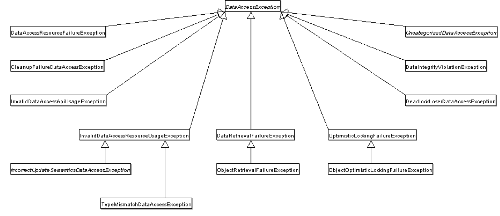

The **Spring DAO** (Data Access Object) module is a key part of the Spring Framework that simplifies interaction with databases and other persistence layers. It provides a consistent API to abstract away the complexities of raw data access code and integrate smoothly with different persistence frameworks and APIs, such as **JDBC**, **Hibernate**, **JPA**, and **MyBatis**.

### Key Features of Spring DAO
1. **Unified Exception Handling:**
   - Spring DAO provides a consistent approach to handling exceptions by wrapping persistence-related exceptions (such as `SQLException` in JDBC) into a unified hierarchy of unchecked exceptions (e.g., `DataAccessException`). This reduces boilerplate code and allows for a cleaner error-handling strategy.

2. **Template Design Pattern:**
   - Spring's `JdbcTemplate`, `HibernateTemplate`, and similar templates simplify database access by handling common tasks like opening/closing connections, managing transactions, and handling exceptions.

3. **Transaction Management:**
   - The DAO module works seamlessly with Spring's declarative or programmatic transaction management, allowing you to manage transactions without writing explicit transaction management code.

4. **Resource Management:**
   - The module ensures proper resource management by automatically handling database connections, result sets, and statements, reducing the likelihood of resource leaks.

5. **Integration with ORM Frameworks:**
   - It provides support for popular ORM frameworks like Hibernate and JPA, making it easier to switch between different persistence technologies without significant changes in the data access code.

### Core Components
1. **`JdbcTemplate`:**
   - Simplifies JDBC code by handling the boilerplate logic for establishing connections, executing SQL queries, and mapping results to objects.

2. **DAO Support Classes:**
   - Spring provides DAO support classes for ORM frameworks (e.g., `HibernateDaoSupport` for Hibernate and `JpaDaoSupport` for JPA).

3. **Exception Hierarchy:**
   - A unified exception translation layer converts specific persistence-related exceptions into a common exception hierarchy (`DataAccessException`).


# DAO Support

The Data Access Object (DAO) support in Spring is aimed at making it easy to work with data access technologies (such as JDBC, Hibernate, or JPA) in a consistent way. This lets you switch between the aforementioned persistence technologies fairly easily, and it also lets you code without worrying about catching exceptions that are specific to each technology.

## Consistent Exception Hierarchy

Spring provides a convenient translation from technology-specific exceptions, such as `SQLException` to its own exception class hierarchy, which has `DataAccessException` as the root exception. These exceptions wrap the original exception so that there is never any risk that you might lose any information about what might have gone wrong.

In addition to JDBC exceptions, Spring can also wrap JPA- and Hibernate-specific exceptions, converting them to a set of focused runtime exceptions. This lets you handle most non-recoverable persistence exceptions in only the appropriate layers, without having annoying boilerplate catch-and-throw blocks and exception declarations in your DAOs. (You can still trap and handle exceptions anywhere you need to though.) As mentioned above, JDBC exceptions (including database-specific dialects) are also converted to the same hierarchy, meaning that you can perform some operations with JDBC within a consistent programming model.

The following image shows the exception hierarchy that Spring provides. (Note that the class hierarchy detailed in the image shows only a subset of the entire`DataAccessException` hierarchy.)




### Example of Spring DAO with `JdbcTemplate`

```java
@Repository // Indicates that this class is a DAO
public class EmployeeDAO {

    @Autowired
    private JdbcTemplate jdbcTemplate;

    public List<Employee> getAllEmployees() {
        String sql = "SELECT * FROM employees";
        return jdbcTemplate.query(sql, new BeanPropertyRowMapper<>(Employee.class));
    }

    public int addEmployee(Employee employee) {
        String sql = "INSERT INTO employees (name, age, department) VALUES (?, ?, ?)";
        return jdbcTemplate.update(sql, employee.getName(), employee.getAge(), employee.getDepartment());
    }
}
```

### Benefits
1. **Reduced Boilerplate Code:**
   - Eliminates the need for repetitive and verbose data access code.
2. **Ease of Integration:**
   - Works with multiple data access technologies (JDBC, Hibernate, JPA, etc.).
3. **Improved Maintainability:**
   - Consistent API and exception handling make code easier to maintain.
4. **Loose Coupling:**
   - Abstracts away the specific implementation details of the persistence layer, allowing for easier technology replacement.

Spring DAO is a vital tool for developers looking to build efficient, maintainable, and scalable data access layers in enterprise applications.

Here’s a step-by-step guide to build a sample **Spring JDBC project using `JdbcTemplate`**. We'll create a simple Employee Management application that allows CRUD operations on an **Employee** table in a database.

---

### **1. Project Setup**
#### **Dependencies**
Add the following dependencies to your `pom.xml` (if using Maven):

```xml
<dependencies>
    <!-- Spring Context for Core Spring features -->
    <dependency>
        <groupId>org.springframework</groupId>
        <artifactId>spring-context</artifactId>
        <version>6.0.2</version>
    </dependency>

    <!-- Spring JDBC for JdbcTemplate -->
    <dependency>
        <groupId>org.springframework</groupId>
        <artifactId>spring-jdbc</artifactId>
        <version>6.0.2</version>
    </dependency>

    <!-- MySQL JDBC Driver -->
    <dependency>
        <groupId>mysql</groupId>
        <artifactId>mysql-connector-java</artifactId>
        <version>8.0.33</version>
    </dependency>

    <!-- HikariCP (Optional, for connection pooling) -->
    <dependency>
        <groupId>com.zaxxer</groupId>
        <artifactId>HikariCP</artifactId>
        <version>5.0.1</version>
    </dependency>
</dependencies>
```

---

### **2. Database Setup**
Create a database and a table.

```sql
CREATE DATABASE spring_jdbc_demo;

USE spring_jdbc_demo;

CREATE TABLE employees (
    id INT AUTO_INCREMENT PRIMARY KEY,
    name VARCHAR(100),
    age INT,
    department VARCHAR(50)
);
```

---

### **3. Application Code**

#### **Configuration with Java-based Spring**
```java
import org.springframework.context.annotation.Bean;
import org.springframework.context.annotation.Configuration;
import org.springframework.jdbc.core.JdbcTemplate;
import org.springframework.jdbc.datasource.DriverManagerDataSource;

import javax.sql.DataSource;

@Configuration
//@ComponentScan("io.reactivestax.repo", "io.reactivestax.service")

public class AppConfig {

  		//DB related 
    @Bean
    public DataSource dataSource() {
        DriverManagerDataSource dataSource = new DriverManagerDataSource();
        dataSource.setDriverClassName("com.mysql.cj.jdbc.Driver");
        dataSource.setUrl("jdbc:mysql://localhost:3306/spring_jdbc_demo");
        dataSource.setUsername("root"); // Replace with your DB username
        dataSource.setPassword("password"); // Replace with your DB password
        return dataSource;
      
      //HikariCP if you need better connection pooling etc.
      @Bean
      public DataSource dataSource() {
          HikariDataSource dataSource = new HikariDataSource();
          dataSource.setDriverClassName("com.mysql.cj.jdbc.Driver");
          dataSource.setJdbcUrl("jdbc:mysql://localhost:3306/spring_jdbc_demo");
          dataSource.setUsername("root");
          dataSource.setPassword("password");

          // Connection pooling settings
          dataSource.setMaximumPoolSize(10);
          dataSource.setMinimumIdle(2);
          dataSource.setIdleTimeout(30000); // 30 seconds
          dataSource.setConnectionTimeout(20000); // 20 seconds
          return dataSource;
      }  
    }

    @Bean
    public JdbcTemplate jdbcTemplate(DataSource dataSource) {
        return new JdbcTemplate(dataSource);
    }
  
     //Service layer related 
  
     //Controller layer related
}
```

---

#### **DAO Layer**
```java
import org.springframework.beans.factory.annotation.Autowired;
import org.springframework.jdbc.core.JdbcTemplate;
import org.springframework.jdbc.core.RowMapper;
import org.springframework.stereotype.Repository;

import java.sql.ResultSet;
import java.sql.SQLException;
import java.util.List;

@Repository  // (@Component, @Service)
public class EmployeeDAO {

    @Autowired
    private JdbcTemplate jdbcTemplate;

    // Add Employee
    public int addEmployee(Employee employee) {
        String sql = "INSERT INTO employees (name, age, department) VALUES (?, ?, ?)";
        return jdbcTemplate.update(sql, employee.getName(), employee.getAge(), employee.getDepartment());
    }

    // Get All Employees
    public List<Employee> getAllEmployees() {
        String sql = "SELECT * FROM employees";
        return jdbcTemplate.query(sql, new EmployeeRowMapper());
    }

    // Update Employee
    public int updateEmployee(Employee employee) {
        String sql = "UPDATE employees SET name = ?, age = ?, department = ? WHERE id = ?";
        return jdbcTemplate.update(sql, employee.getName(), employee.getAge(), employee.getDepartment(), employee.getId());
    }

    // Delete Employee
    public int deleteEmployee(int id) {
        String sql = "DELETE FROM employees WHERE id = ?";
        return jdbcTemplate.update(sql, id);
    }

    // Custom RowMapper
    private static class EmployeeRowMapper implements RowMapper<Employee> {
        @Override
        public Employee mapRow(ResultSet rs, int rowNum) throws SQLException {
            Employee employee = new Employee();
            employee.setId(rs.getInt("id"));
            employee.setName(rs.getString("name"));
            employee.setAge(rs.getInt("age"));
            employee.setDepartment(rs.getString("department"));
            return employee;
        }
    }
}
```

---

#### **Entity Class**
```java
public class Employee {
    private int id;
    private String name;
    private int age;
    private String department;

    // Getters and Setters
    public int getId() {
        return id;
    }

    public void setId(int id) {
        this.id = id;
    }

    public String getName() {
        return name;
    }

    public void setName(String name) {
        this.name = name;
    }

    public int getAge() {
        return age;
    }

    public void setAge(int age) {
        this.age = age;
    }

    public String getDepartment() {
        return department;
    }

    public void setDepartment(String department) {
        this.department = department;
    }
}
```

---

#### **Main Application**
```java
import org.springframework.context.annotation.AnnotationConfigApplicationContext;

import java.util.List;

public class SpringJdbcApp {
    public static void main(String[] args) {
        AnnotationConfigApplicationContext context = new AnnotationConfigApplicationContext(AppConfig.class);
      //if AppConfig.class was replaced with application-context.xml it can get 
      // loaded with ClassPathXMLApplicationContext instead 
      // you will need to create application-context.xml to replace the AppConfig
        EmployeeDAO employeeDAO = context.getBean(EmployeeDAO.class);

        // Add Employees
        employeeDAO.addEmployee(new Employee(0, "Alice", 30, "HR"));
        employeeDAO.addEmployee(new Employee(0, "Bob", 25, "IT"));

        // Get All Employees
        List<Employee> employees = employeeDAO.getAllEmployees();
        employees.forEach(emp -> System.out.println(emp.getName() + " works in " + emp.getDepartment()));

        // Update Employee
        Employee empToUpdate = employees.get(0);
        empToUpdate.setDepartment("Finance");
        employeeDAO.updateEmployee(empToUpdate);

        // Delete Employee
        employeeDAO.deleteEmployee(employees.get(1).getId());

        context.close();
    }
}
```

---

### **4. Run the Application**
1. Compile and run the `SpringJdbcApp` class.
2. Observe the database changes using your database client (e.g., MySQL Workbench).

---

### **Key Notes**
- Spring manages the `JdbcTemplate` lifecycle.
- Resource management (like closing connections) is handled automatically.
- The configuration can be switched to XML-based if needed.
- Use connection pooling (e.g., HikariCP) in production for better performance.

This simple project demonstrates the core capabilities of **Spring DAO with `JdbcTemplate`** for performing database operations.


Here’s a table summarizing the division of responsibilities between **Spring JDBC** and the **Developer**:

| **Responsibility**                 | **Spring JDBC**                                              | **Developer**                                                |
| ---------------------------------- | ------------------------------------------------------------ | ------------------------------------------------------------ |
| **Database Connection Management** | Automatically manages database connections, including opening and closing connections. | Configures the `DataSource` (e.g., connection details like URL, username, password). |
| **SQL Execution**                  | Executes SQL queries (e.g., `SELECT`, `INSERT`, `UPDATE`, `DELETE`) via the `JdbcTemplate` API. | Writes the SQL queries for specific operations.              |
| **Transaction Management**         | Provides declarative or programmatic transaction management using Spring's transaction abstraction. | Configures transaction boundaries if needed, such as annotating methods with `@Transactional`. |
| **Error Handling**                 | Converts database-specific exceptions (e.g., `SQLException`) into Spring’s unified `DataAccessException`. | Implements custom logic for handling application-level errors, using the translated exceptions. |
| **Resource Management**            | Automatically manages resources like connections, statements, and result sets to prevent leaks. | No involvement; Spring ensures resources are properly handled and closed. |
| **Row Mapping**                    | Provides helper interfaces (`RowMapper`, `ResultSetExtractor`) for mapping database rows to objects. | Defines mapping logic (e.g., custom `RowMapper` implementation for mapping columns to object fields). |
| **Prepared Statement Creation**    | Handles the creation and execution of prepared statements transparently. | Passes parameters to prepared statements in queries using Spring’s `JdbcTemplate` methods. |
| **Connection Pooling**             | Can integrate with third-party connection pools like HikariCP. | Configures the connection pool settings (e.g., max pool size, timeout) if connection pooling is used. |
| **Logging**                        | Logs SQL queries and execution details (if configured in logging framework). | Configures the logging framework (e.g., Log4j, SLF4J) for debugging or monitoring database operations. |
| **Exception Propagation**          | Wraps checked exceptions into unchecked exceptions to avoid verbose try-catch blocks. | Writes code to handle exceptions appropriately based on business logic. |
| **Performance Optimization**       | Optimizes repetitive tasks like creating prepared statements and managing result sets. | Writes efficient SQL queries and indexes database tables for better performance. |

---

### **Key Takeaways:**
- **Spring JDBC** abstracts away the repetitive, boilerplate tasks of interacting with the database.
- The **developer’s focus** shifts to writing business logic, SQL queries, and mapping logic, which are specific to the application's needs.
- Using **transaction management** and **error handling** effectively requires collaboration between the developer and Spring JDBC.


### Data Access with JDBC**

The value provided by the Spring Framework JDBC abstraction is perhaps best shown by the sequence of actions outlined in the table below. The table shows which actions Spring takes care of and which actions are your responsibility.

| **Action**                                                   | **Spring Framework** | **Developer** |
| ------------------------------------------------------------ | -------------------- | ------------- |
| **Define connection parameters.**                            |                      | X             |
| **Open the connection.**                                     | X                    |               |
| **Specify the SQL statement.**                               |                      | X             |
| **Declare parameters and provide parameter values**          |                      | X             |
| **Prepare and run the statement.**                           | X                    |               |
| **Set up the loop to iterate through the results (if any).** | X                    |               |
| **Do the work for each iteration.**                          |                      | X             |
| **Process any exception (and converting them to spring **runtime exception hierarchy) | X                    |               |
| **Handle transactions.**                                     | X                    |               |
| **Close the connection, the statement, and the result set.** | X                    |               |

---

The Spring Framework takes care of all the low-level details that can make JDBC such a tedious API. 


Here’s a detailed comparison of **DriverManagerDataSource**, **SingleConnectionDataSource**, **JNDI DataSource**, and **PooledDataSource**, their features, use cases, and when to use them.

---

### **1. DriverManagerDataSource**
- **Overview:**
  - Provided by Spring, it uses **`DriverManager`** to open new connections for each database request.
  - It does not offer connection pooling.
  - Primarily useful in testing or development environments.

- **Key Features:**
  - Simple implementation.
  - Opens a new database connection for every request.
  - Minimal configuration required.

- **Use Case:**
  - **Testing and development**, where performance and scalability are not critical.

- **Advantages:**
  - Simple to set up.
  - Useful for environments where connection pooling is unnecessary (e.g., unit tests).

- **Disadvantages:**
  - No connection pooling, so it’s inefficient for high-concurrency scenarios.

---

### **2. SingleConnectionDataSource**
- **Overview:**
  - A Spring-provided DataSource implementation that wraps a **single database connection**.
  - Reuses the same connection for all database operations.
  - Suitable only for single-threaded scenarios.

- **Key Features:**
  - Shares a single connection across multiple requests.
  - Mainly for testing scenarios where connection pooling is unnecessary.

- **Use Case:**
  - **Testing environments** where multiple threads or concurrent connections are not required.

- **Advantages:**
  - Simplifies connection management for single-threaded applications.
  - Easy to configure.

- **Disadvantages:**
  - Not thread-safe.
  - Not suitable for production or multi-threaded environments.

---

### **3. JNDI DataSource**
- **Overview:**
  - Leverages a **DataSource** configured in the application server or servlet container (e.g., Tomcat, JBoss).
  - Looks up the DataSource using Java Naming and Directory Interface (**JNDI**).
  - Typically configured outside the application, allowing connection pooling and centralized connection management.

- **Key Features:**
  - Connection pooling is managed by the application server.
  - Decouples the database configuration from the application code.

- **Use Case:**
  - **Production environments** where connection pooling and centralized management are essential.
  - Ideal for container-managed applications deployed in application servers.

- **Advantages:**
  - Centralized management of database connections.
  - Supports connection pooling, scalability, and better resource management.
  - Separation of concerns: no hard-coded database configuration in the application.

- **Disadvantages:**
  - Slightly more complex to configure as it depends on the application server’s setup.

---

### **4. PooledDataSource** (not the name of the class, its a concept)
- **Overview:**
  - A generic term for DataSources that support **connection pooling**.
  - Examples include **HikariCP**, **Apache Commons DBCP**, and **C3P0**.
  - Maintains a pool of reusable connections to avoid the overhead of creating and destroying connections frequently.

- **Key Features:**
  - Efficient management of database connections.
  - Improves performance in high-concurrency applications.
  - Supports advanced features like idle connection timeout, connection leak detection, etc.

- **Use Case:**
  - **Production environments** requiring high performance and scalability.

- **Advantages:**
  - Reduces overhead of creating/destroying connections.
  - Scalable and efficient for multi-threaded applications.

- **Disadvantages:**
  - More complex to configure than basic DataSources.

---

### **Comparison Table**

| **Feature**                  | **DriverManagerDataSource**               | **SingleConnectionDataSource** | **JNDI DataSource**                     | **PooledDataSource**              |
| ---------------------------- | ----------------------------------------- | ------------------------------ | --------------------------------------- | --------------------------------- |
| **Connection Pooling**       | No                                        | No                             | Yes (managed by the application server) | Yes                               |
| **Connection Reuse**         | No                                        | Yes (single connection)        | Yes                                     | Yes                               |
| **Thread-Safe**              | Yes (but opens a new connection per call) | No                             | Yes                                     | Yes                               |
| **Performance**              | Low                                       | Low                            | Medium to High                          | High                              |
| **Configuration Complexity** | Simple                                    | Simple                         | Moderate                                | Moderate to High                  |
| **Use Case**                 | Testing, development                      | Single-threaded apps, testing  | Production, container-managed apps      | Production, high-concurrency apps |

---

### **When to Use**
1. **DriverManagerDataSource:**
   - Simple use cases, unit tests, or applications where connection pooling is unnecessary.
   
2. **SingleConnectionDataSource:**
   - Unit tests or debugging scenarios requiring a single reusable connection.
   - Not suitable for production.

3. **JNDI DataSource:**
   - Enterprise production applications deployed in application servers or servlet containers (e.g., Tomcat, JBoss).
   - Allows centralized management of connections.

4. **PooledDataSource:**
   - Modern production systems requiring high performance and scalability.
   - Recommended for almost all production-grade applications (e.g., HikariCP).

---

### **Recommendation**
- For **testing and development**, use `DriverManagerDataSource` or `SingleConnectionDataSource`.
- For **production**, prefer **JNDI DataSource** in a container-managed environment or **PooledDataSource** (e.g., HikariCP) in standalone applications.


Spring JDBC supports working with three main types of **DataSources** to manage database connections:

---

### **1. DriverManagerDataSource**
- **Overview:**
  - This is the simplest `DataSource` implementation provided by Spring.
  - It uses the **`DriverManager`** class from the JDBC API to establish database connections.
  - It is primarily used for **testing and development** purposes as it does not include advanced features like connection pooling.

- **Key Features:**
  - Creates a new connection every time a database request is made.
  - Does not provide connection pooling.

- **Configuration:**
```java
import org.springframework.jdbc.datasource.DriverManagerDataSource;

@Bean
public DataSource dataSource() {
    DriverManagerDataSource dataSource = new DriverManagerDataSource();
    dataSource.setDriverClassName("com.mysql.cj.jdbc.Driver");
    dataSource.setUrl("jdbc:mysql://localhost:3306/spring_jdbc_demo");
    dataSource.setUsername("root");
    dataSource.setPassword("password");
    return dataSource;
}
```

- **When to Use:**
  - Suitable for small applications, testing, or simple scenarios where connection pooling is not required.
  
---

### **2. BasicDataSource (Apache Commons DBCP)**
- **Overview:**
  - This is an implementation of `DataSource` provided by **Apache Commons DBCP (Database Connection Pooling)**.
  - It adds connection pooling capabilities, which improves the efficiency of managing database connections in multi-threaded environments.

- **Key Features:**
  - Connection pooling support.
  - Configurable properties such as maximum number of active connections, idle connections, and timeout.

- **Configuration:**
```java
import org.apache.commons.dbcp2.BasicDataSource;

@Bean
public DataSource dataSource() {
    BasicDataSource dataSource = new BasicDataSource();
    dataSource.setDriverClassName("com.mysql.cj.jdbc.Driver");
    dataSource.setUrl("jdbc:mysql://localhost:3306/spring_jdbc_demo");
    dataSource.setUsername("root");
    dataSource.setPassword("password");

    // Connection pooling settings
    dataSource.setInitialSize(5);
    dataSource.setMaxTotal(10);
    dataSource.setMaxIdle(5);
    dataSource.setMinIdle(2);
    return dataSource;
}
```

- **When to Use:**
  - Suitable for medium-sized applications where connection pooling is required but simplicity is still a priority.

---

### **3. HikariCP (Preferred in Modern Applications)**
- **Overview:**
  - **HikariCP** is a high-performance and lightweight JDBC connection pooling framework.
  - It is the **default DataSource in Spring Boot** starting from version 2.0, due to its excellent performance and reliability.

- **Key Features:**
  - Extremely fast connection pooling.
  - Lower memory footprint and optimized resource usage.
  - Advanced features like connection leak detection and idle connection timeout.

- **Configuration:**
```java
import com.zaxxer.hikari.HikariDataSource;

@Bean
public DataSource dataSource() {
    HikariDataSource dataSource = new HikariDataSource();
    dataSource.setDriverClassName("com.mysql.cj.jdbc.Driver");
    dataSource.setJdbcUrl("jdbc:mysql://localhost:3306/spring_jdbc_demo");
    dataSource.setUsername("root");
    dataSource.setPassword("password");

    // Connection pooling settings
    dataSource.setMaximumPoolSize(10);
    dataSource.setMinimumIdle(2);
    dataSource.setIdleTimeout(30000); // 30 seconds
    dataSource.setConnectionTimeout(20000); // 20 seconds
    return dataSource;
}
```

- **When to Use:**
  - Ideal for production-grade applications requiring high performance and scalability.
  - Recommended for modern Spring applications, especially with Spring Boot.

---

### **Comparison**

| **Feature**            | **DriverManagerDataSource** | **BasicDataSource (DBCP)** | **HikariCP**          |
| ---------------------- | --------------------------- | -------------------------- | --------------------- |
| **Connection Pooling** | No                          | Yes                        | Yes                   |
| **Performance**        | Low                         | Medium                     | High                  |
| **Complexity**         | Simple                      | Moderate                   | Moderate              |
| **Use Case**           | Testing or small apps       | Medium apps                | Production-grade apps |
| **Configuration**      | Easy                        | Moderate                   | Advanced              |

---

### **Recommendation**
- For **testing** or **development**, use `DriverManagerDataSource`.
- For **small to medium applications**, use `BasicDataSource`.
- For **large-scale production systems**, use **HikariCP** due to its superior performance.


Here are **code examples** for each of the mentioned `DataSource` types, demonstrating their usage in a **Spring application**:

---

### **1. DriverManagerDataSource**
**Setup:**
This is the simplest `DataSource` implementation, suitable for testing or development environments.

```java
import org.springframework.context.annotation.Bean;
import org.springframework.context.annotation.Configuration;
import org.springframework.jdbc.datasource.DriverManagerDataSource;

import javax.sql.DataSource;

@Configuration
public class DriverManagerDataSourceConfig {

    @Bean
    public DataSource dataSource() {
        DriverManagerDataSource dataSource = new DriverManagerDataSource();
        dataSource.setDriverClassName("com.mysql.cj.jdbc.Driver");
        dataSource.setUrl("jdbc:mysql://localhost:3306/test_db");
        dataSource.setUsername("root");
        dataSource.setPassword("password");
        return dataSource;
    }
}
```

**Usage:**
This will create a new connection for every database operation. Best used in **unit tests or small-scale apps**.

---

### **2. SingleConnectionDataSource**
**Setup:**
This reuses a single connection across the application. Use it only for single-threaded testing scenarios.

```java
import org.springframework.context.annotation.Bean;
import org.springframework.context.annotation.Configuration;
import org.springframework.jdbc.datasource.SingleConnectionDataSource;

import javax.sql.DataSource;

@Configuration
public class SingleConnectionDataSourceConfig {

    @Bean
    public DataSource dataSource() {
        SingleConnectionDataSource dataSource = new SingleConnectionDataSource();
        dataSource.setDriverClassName("com.mysql.cj.jdbc.Driver");
        dataSource.setUrl("jdbc:mysql://localhost:3306/test_db");
        dataSource.setUsername("root");
        dataSource.setPassword("password");
        dataSource.setSuppressClose(true); // Ensures the same connection is reused
        return dataSource;
    }
}
```

**Usage:**
Useful in **unit testing** or **debugging**. Not thread-safe, so avoid in production environments.

---

### **3. JNDI DataSource**
**Setup:**
This integrates with an application server's or servlet container's JNDI system.

1. **Configure JNDI in Application Server:**
   In Tomcat, add the following to `context.xml` (under `META-INF`):
   
   ```xml
   <Resource name="jdbc/MyDataSource"
             auth="Container"
             type="javax.sql.DataSource"
             username="root"
             password="password"
             driverClassName="com.mysql.cj.jdbc.Driver"
             url="jdbc:mysql://localhost:3306/test_db"
             maxActive="20"
             maxIdle="10"
             maxWait="10000" />
   ```
   
2. **Spring Configuration:**
   Use the JNDI name to look up the DataSource:
   ```java
   import org.springframework.context.annotation.Bean;
   import org.springframework.context.annotation.Configuration;
   import org.springframework.jndi.JndiObjectFactoryBean;
   
   import javax.sql.DataSource;
   
   @Configuration
   public class JndiDataSourceConfig {
   
       @Bean
       public DataSource dataSource() {
           JndiObjectFactoryBean jndiFactory = new JndiObjectFactoryBean();
           jndiFactory.setJndiName("java:comp/env/jdbc/MyDataSource");
           jndiFactory.setResourceRef(true);
           jndiFactory.setProxyInterface(DataSource.class);
           return (DataSource) jndiFactory.getObject();
       }
   }
   ```

**Usage:**
Ideal for **enterprise applications** deployed in application servers like Tomcat, JBoss, or WebLogic.

---

### **4. PooledDataSource (HikariCP Example)**
**Setup:**
HikariCP is a modern, high-performance connection pooling library.

```java
import com.zaxxer.hikari.HikariDataSource;
import org.springframework.context.annotation.Bean;
import org.springframework.context.annotation.Configuration;

import javax.sql.DataSource;

@Configuration
public class HikariCPDataSourceConfig {

    @Bean
    public DataSource dataSource() {
        HikariDataSource dataSource = new HikariDataSource();
        dataSource.setDriverClassName("com.mysql.cj.jdbc.Driver");
        dataSource.setJdbcUrl("jdbc:mysql://localhost:3306/test_db");
        dataSource.setUsername("root");
        dataSource.setPassword("password");

        // Pool settings
        dataSource.setMaximumPoolSize(10);
        dataSource.setMinimumIdle(2);
        dataSource.setIdleTimeout(30000); // 30 seconds
        dataSource.setConnectionTimeout(20000); // 20 seconds
        return dataSource;
    }
}
```

**Usage:**
Recommended for **production environments** that require high performance, scalability, and reliability.

---

### **5. PooledDataSource (Apache Commons DBCP Example)**
**Setup:**
Apache Commons DBCP is another popular library for connection pooling.

```java
import org.apache.commons.dbcp2.BasicDataSource;
import org.springframework.context.annotation.Bean;
import org.springframework.context.annotation.Configuration;

import javax.sql.DataSource;

@Configuration
public class DBCPDataSourceConfig {

    @Bean
    public DataSource dataSource() {
        BasicDataSource dataSource = new BasicDataSource();
        dataSource.setDriverClassName("com.mysql.cj.jdbc.Driver");
        dataSource.setUrl("jdbc:mysql://localhost:3306/test_db");
        dataSource.setUsername("root");
        dataSource.setPassword("password");

        // Pool settings
        dataSource.setInitialSize(5);
        dataSource.setMaxTotal(10);
        dataSource.setMaxIdle(5);
        dataSource.setMinIdle(2);
        return dataSource;
    }
}
```

**Usage:**
Good for **medium-sized applications**. It offers connection pooling but is less efficient than HikariCP.

---

### **Summary of When to Use**

| **DataSource Type**            | **When to Use**                                              |
| ------------------------------ | ------------------------------------------------------------ |
| **DriverManagerDataSource**    | Testing or small development applications where performance is not critical. |
| **SingleConnectionDataSource** | Single-threaded unit tests or debugging. Not suitable for production. |
| **JNDI DataSource**            | Enterprise applications deployed in application servers with container-managed pools. |
| **HikariCP** (Pooled)          | High-performance production applications requiring scalability and efficiency. |
| **Apache DBCP** (Pooled)       | Medium-sized applications with moderate performance needs.   |

These examples provide you with the configuration for different scenarios, allowing you to choose the right `DataSource` based on your application's requirements.


# Choosing an Approach for JDBC Database Access

You can choose among several approaches to form the basis for your JDBC database access. In addition to three flavors of `JdbcTemplate`, a `SimpleJdbcInsert` and `SimpleJdbcCall` approach optimizes database metadata, and the RDBMS Object style results in a more object-oriented approach. Once you start using one of these approaches, you can still mix and match to include a feature from a different approach.

- `JdbcTemplate` is the classic and most popular Spring JDBC approach. This “lowest-level” approach and all others use a `JdbcTemplate` under the covers.
- `NamedParameterJdbcTemplate` wraps a `JdbcTemplate` to provide named parameters instead of the traditional JDBC `?` placeholders. This approach provides better documentation and ease of use when you have multiple parameters for an SQL statement.
- `SimpleJdbcInsert` and `SimpleJdbcCall` optimize database metadata to limit the amount of necessary configuration. This approach simplifies coding so that you only need to provide the name of the table or procedure and a map of parameters matching the column names. This works only if the database provides adequate metadata. If the database does not provide this metadata, you have to provide explicit configuration of the parameters.
- RDBMS objects — including `MappingSqlQuery`, `SqlUpdate`, and `StoredProcedure` — require you to create reusable and thread-safe objects during initialization of your data-access layer. This approach allows you to define your query string, declare parameters, and compile the query. Once you do that, `execute(…)`, `update(…)`, and `findObject(…)` methods can be called multiple times with various parameter values.


# Package Hierarchy

The Spring Framework’s JDBC abstraction framework consists of four different packages:

`org.springframework.jdbc.core`  => `jdbcTemplate`

`org.springframework.jdbc.core.simple` => `SimpleJdbcInsert(batch)` and `SimpleJdbcCall(storedProcedure calls)` 

`org.springframework.jdbc.core.namedparam` => `NamedParameterJdbcTemplate`

`org.springframework.jdbc.datasource` => ``various types of datasource options` 

`org.springframework.jdbc.core.datasource.embedded`=> `various types of embedded datasources`

`org.springframework.jdbc.object` =>  Object oriented approach with spring jdbc without the cognitive overhead of learning orm frameworks like hibernate or jpa 

`org.springframework.jdbc.support` => provides SQLException translation functionality 

- `core`: The `org.springframework.jdbc.core` package contains the `JdbcTemplate` class and its various callback interfaces, plus a variety of related classes. A subpackage named `org.springframework.jdbc.core.simple` contains the `SimpleJdbcInsert` and`SimpleJdbcCall` classes. Another subpackage named `org.springframework.jdbc.core.namedparam` contains the `NamedParameterJdbcTemplate` class and the related support classes. See [Using the JDBC Core Classes to Control Basic JDBC Processing and Error Handling](https://docs.spring.io/spring-framework/reference/data-access/jdbc/core.html), [JDBC Batch Operations](https://docs.spring.io/spring-framework/reference/data-access/jdbc/advanced.html), and [Simplifying JDBC Operations with the `SimpleJdbc` Classes](https://docs.spring.io/spring-framework/reference/data-access/jdbc/simple.html).
- `datasource`: The `org.springframework.jdbc.datasource` package contains a utility class for easy `DataSource` access and various simple `DataSource` implementations that you can use for testing and running unmodified JDBC code outside of a Jakarta EE container. A subpackage named `org.springframework.jdbc.datasource.embedded` provides support for creating embedded databases by using Java database engines, such as HSQL, H2, and Derby. See [Controlling Database Connections](https://docs.spring.io/spring-framework/reference/data-access/jdbc/connections.html) and [Embedded Database Support](https://docs.spring.io/spring-framework/reference/data-access/jdbc/embedded-database-support.html).
- `object`: The `org.springframework.jdbc.object` package contains classes that represent RDBMS queries, updates, and stored procedures as thread-safe, reusable objects. See [Modeling JDBC Operations as Java Objects](https://docs.spring.io/spring-framework/reference/data-access/jdbc/object.html). This style results in a more object-oriented approach, although objects returned by queries are naturally disconnected from the database. This higher-level of JDBC abstraction depends on the lower-level abstraction in the `org.springframework.jdbc.core` package.
- `support`: The `org.springframework.jdbc.support` package provides `SQLException` translation functionality and some utility classes. Exceptions thrown during JDBC processing are translated to exceptions defined in the `org.springframework.dao` package. This means that code using the Spring JDBC abstraction layer does not need to implement JDBC or RDBMS-specific error handling. All translated exceptions are unchecked, which gives you the option of catching the exceptions from which you can recover while letting other exceptions be propagated to the caller. See [Using `SQLExceptionTranslator`](https://docs.spring.io/spring-framework/reference/data-access/jdbc/core.html#jdbc-SQLExceptionTranslator).


# Using the JDBC Core Classes to Control Basic JDBC Processing and Error Handling

This section covers how to use the JDBC core classes to control basic JDBC processing, including error handling. It includes the following topics:

- [Using `JdbcTemplate`](https://docs.spring.io/spring-framework/reference/data-access/jdbc/core.html#jdbc-JdbcTemplate)
- [Using `NamedParameterJdbcTemplate`](https://docs.spring.io/spring-framework/reference/data-access/jdbc/core.html#jdbc-NamedParameterJdbcTemplate)
- [Unified JDBC Query/Update Operations: `JdbcClient`](https://docs.spring.io/spring-framework/reference/data-access/jdbc/core.html#jdbc-JdbcClient)
- [Using `SQLExceptionTranslator`](https://docs.spring.io/spring-framework/reference/data-access/jdbc/core.html#jdbc-SQLExceptionTranslator)
- [Running Statements](https://docs.spring.io/spring-framework/reference/data-access/jdbc/core.html#jdbc-statements-executing)
- [Running Queries](https://docs.spring.io/spring-framework/reference/data-access/jdbc/core.html#jdbc-statements-querying)
- [Updating the Database](https://docs.spring.io/spring-framework/reference/data-access/jdbc/core.html#jdbc-updates)
- [Retrieving Auto-generated Keys](https://docs.spring.io/spring-framework/reference/data-access/jdbc/core.html#jdbc-auto-generated-keys)

## Using `JdbcTemplate`

`JdbcTemplate` is the central class in the JDBC core package. It handles the creation and release of resources, which helps you avoid common errors, such as forgetting to close the connection. It performs the basic tasks of the core JDBC workflow (such as statement creation and execution), leaving application code to provide SQL and extract results. The `JdbcTemplate` class:

- Runs SQL queries
- Updates statements and stored procedure calls
- Performs iteration over `ResultSet` instances and extraction of returned parameter values.
- Catches JDBC exceptions and translates them to the generic, more informative, exception hierarchy defined in the `org.springframework.dao`package. (See [Consistent Exception Hierarchy](https://docs.spring.io/spring-framework/reference/data-access/dao.html#dao-exceptions).)

When you use the `JdbcTemplate` for your code, you need only to implement callback interfaces, giving them a clearly defined contract. Given a `Connection` provided by the `JdbcTemplate` class, the `PreparedStatementCreator` callback interface creates a prepared statement, providing SQL and any necessary parameters. The same is true for the `CallableStatementCreator` interface, which creates callable statements. The`RowCallbackHandler` interface extracts values from each row of a `ResultSet`.

You can use `JdbcTemplate` within a DAO implementation through direct instantiation with a `DataSource` reference, or you can configure it in a Spring IoC container and give it to DAOs as a bean reference.

|      | The `DataSource` should always be configured as a bean in the Spring IoC container. In the first case the bean is given to the service directly; in the second case it is given to the prepared template. |
| ---- | ------------------------------------------------------------ |
|      |                                                              |

All SQL issued by this class is logged at the `DEBUG` level under the category corresponding to the fully qualified class name of the template instance (typically `JdbcTemplate`, but it may be different if you use a custom subclass of the `JdbcTemplate` class).

The following sections provide some examples of `JdbcTemplate` usage. These examples are not an exhaustive list of all of the functionality exposed by the `JdbcTemplate`. See the attendant [javadoc](https://docs.spring.io/spring-framework/docs/6.2.1/javadoc-api/org/springframework/jdbc/core/JdbcTemplate.html) for that.

### Querying (`SELECT`)

The following query gets the number of rows in a relation:

```java
int rowCount = this.jdbcTemplate.queryForObject("select count(*) from t_actor", Integer.class);
```

The following query uses a bind variable:

```java
int countOfActorsNamedJoe = this.jdbcTemplate.queryForObject(
		"select count(*) from t_actor where first_name = ?", Integer.class, "Joe");
```

The following query looks for a `String`:

```java
String lastName = this.jdbcTemplate.queryForObject(
		"select last_name from t_actor where id = ?",
		String.class, 1212L);
```

The following query finds and populates a single domain object:

```java
Actor actor = jdbcTemplate.queryForObject(
		"select first_name, last_name from t_actor where id = ?",
		(resultSet, rowNum) -> {
			Actor newActor = new Actor();
			newActor.setFirstName(resultSet.getString("first_name"));
			newActor.setLastName(resultSet.getString("last_name"));
			return newActor;
		},
		1212L);
```

The following query finds and populates a list of domain objects:

```java
List<Actor> actors = this.jdbcTemplate.query(
		"select first_name, last_name from t_actor",
		(resultSet, rowNum) -> {
			Actor actor = new Actor();
			actor.setFirstName(resultSet.getString("first_name"));
			actor.setLastName(resultSet.getString("last_name"));
			return actor;
		});
```

If the last two snippets of code actually existed in the same application, it would make sense to remove the duplication present in the two `RowMapper`lambda expressions and extract them out into a single field that could then be referenced by DAO methods as needed. For example, it may be better to write the preceding code snippet as follows:

```java
private final RowMapper<Actor> actorRowMapper = (resultSet, rowNum) -> {
	Actor actor = new Actor();
	actor.setFirstName(resultSet.getString("first_name"));
	actor.setLastName(resultSet.getString("last_name"));
	return actor;
};

public List<Actor> findAllActors() {
	return this.jdbcTemplate.query("select first_name, last_name from t_actor", actorRowMapper);
}
```

### Updating (`INSERT`, `UPDATE`, and `DELETE`) with `JdbcTemplate`

You can use the `update(..)` method to perform insert, update, and delete operations. Parameter values are usually provided as variable arguments or, alternatively, as an object array.

The following example inserts a new entry:

```java
this.jdbcTemplate.update(
		"insert into t_actor (first_name, last_name) values (?, ?)",
		"Leonor", "Watling");
```

The following example updates an existing entry:

```java
this.jdbcTemplate.update(
		"update t_actor set last_name = ? where id = ?",
		"Banjo", 5276L);
```

The following example deletes an entry:

```java
this.jdbcTemplate.update(
		"delete from t_actor where id = ?",
		Long.valueOf(actorId));
```

### Other `JdbcTemplate` Operations

You can use the `execute(..)` method to run any arbitrary SQL. Consequently, the method is often used for DDL statements. It is heavily overloaded with variants that take callback interfaces, binding variable arrays, and so on. The following example creates a table:

```java
this.jdbcTemplate.execute("create table mytable (id integer, name varchar(100))");
```

The following example invokes a stored procedure:

```java
this.jdbcTemplate.update(
		"call SUPPORT.REFRESH_ACTORS_SUMMARY(?)",
		Long.valueOf(unionId));
```

More sophisticated stored procedure support is [covered later](https://docs.spring.io/spring-framework/reference/data-access/jdbc/object.html#jdbc-StoredProcedure).

### `JdbcTemplate` Best Practices

<u>Instances of the `JdbcTemplate` class are thread-safe, once configured. This is important because it means that you can configure a single instance of a `JdbcTemplate` and then safely inject this shared reference into multiple DAOs (or repositories). The `JdbcTemplate` is stateful, in that it maintains a reference to a `DataSource`, but this state is not conversational state.</u>

A common practice when using the `JdbcTemplate` class (and the associated [`NamedParameterJdbcTemplate`](https://docs.spring.io/spring-framework/reference/data-access/jdbc/core.html#jdbc-NamedParameterJdbcTemplate) class) is to configure a `DataSource` in your Spring configuration file and then dependency-inject that shared `DataSource` bean into your DAO classes. The `JdbcTemplate` is created in the setter for the `DataSource` or in the constructor. This leads to DAOs that resemble the following:

```java
public class JdbcCorporateEventDao implements CorporateEventDao {

	private final JdbcTemplate jdbcTemplate;

	public JdbcCorporateEventDao(DataSource dataSource) {
		this.jdbcTemplate = new JdbcTemplate(dataSource);
	}

	// JDBC-backed implementations of the methods on the CorporateEventDao follow...
}
```

The following example shows the corresponding configuration:

```java
@Bean
JdbcCorporateEventDao corporateEventDao(DataSource dataSource) {
	return new JdbcCorporateEventDao(dataSource);
}

@Bean(destroyMethod = "close")
BasicDataSource dataSource() {
	BasicDataSource dataSource = new BasicDataSource();
	dataSource.setDriverClassName("org.hsqldb.jdbcDriver");
	dataSource.setUrl("jdbc:hsqldb:hsql://localhost:");
	dataSource.setUsername("sa");
	dataSource.setPassword("");
	return dataSource;
}
```

An alternative to explicit configuration is to use component-scanning and annotation support for dependency injection. In this case, you can annotate the class with `@Repository` (which makes it a candidate for component-scanning). The following example shows how to do so:

```java
package org.example.jdbc;

@Repository
public class JdbcCorporateEventRepository implements CorporateEventRepository {

	private JdbcTemplate jdbcTemplate;

	// Implicitly autowire the DataSource constructor parameter
	public JdbcCorporateEventRepository(DataSource dataSource) {
		this.jdbcTemplate = new JdbcTemplate(dataSource);
	}

	// JDBC-backed implementations of the methods on the CorporateEventRepository follow...
}
```

The following example shows the corresponding configuration:

```java
@Configuration
@ComponentScan("org.example.jdbc")
public class JdbcCorporateEventRepositoryConfiguration {

   
	@Bean(destroyMethod = "close")
	BasicDataSource dataSource() {
		BasicDataSource dataSource = new BasicDataSource();
		dataSource.setDriverClassName("org.hsqldb.jdbcDriver");
		dataSource.setUrl("jdbc:hsqldb:hsql://localhost:");
		dataSource.setUsername("sa");
		dataSource.setPassword("");
		return dataSource;
	}

}
```

If you use Spring’s `JdbcDaoSupport` class and your various JDBC-backed DAO classes extend from it, your sub-class inherits a `setDataSource(..)` method from the `JdbcDaoSupport` class. You can choose whether to inherit from this class. The `JdbcDaoSupport` class is provided as a convenience only.

Regardless of which of the above template initialization styles you choose to use (or not), it is seldom necessary to create a new instance of a `JdbcTemplate` class each time you want to run SQL. Once configured, a `JdbcTemplate` instance is thread-safe. If your application accesses multiple databases, you may want multiple `JdbcTemplate` instances, which requires multiple `DataSources` and, subsequently, multiple differently configured `JdbcTemplate` instances.

## Using `NamedParameterJdbcTemplate`

The `NamedParameterJdbcTemplate` class adds support for programming JDBC statements by using named parameters, as opposed to programming JDBC statements using only classic placeholder ( `'?'`) arguments. The `NamedParameterJdbcTemplate` class wraps a `JdbcTemplate` and delegates to the wrapped `JdbcTemplate` to do much of its work. This section describes only those areas of the `NamedParameterJdbcTemplate`class that differ from the `JdbcTemplate` itself — namely, programming JDBC statements by using named parameters. The following example shows how to use `NamedParameterJdbcTemplate`:

```java
// some JDBC-backed DAO class...
private NamedParameterJdbcTemplate namedParameterJdbcTemplate;

public void setDataSource(DataSource dataSource) {
	this.namedParameterJdbcTemplate = new NamedParameterJdbcTemplate(dataSource);
}

public int countOfActorsByFirstName(String firstName) {
	String sql = "select count(*) from t_actor where first_name = :first_name";
	SqlParameterSource namedParameters = new MapSqlParameterSource("first_name", firstName);
	return this.namedParameterJdbcTemplate.queryForObject(sql, namedParameters, Integer.class);
}
```

Notice the use of the named parameter notation in the value assigned to the `sql` variable and the corresponding value that is plugged into the `namedParameters` variable (of type `MapSqlParameterSource`).

Alternatively, you can pass along named parameters and their corresponding values to a `NamedParameterJdbcTemplate` instance by using the `Map`-based style. The remaining methods exposed by the `NamedParameterJdbcOperations` and implemented by the`NamedParameterJdbcTemplate` class follow a similar pattern and are not covered here.

The following example shows the use of the `Map`-based style:

```java
// some JDBC-backed DAO class...
private NamedParameterJdbcTemplate namedParameterJdbcTemplate;

public void setDataSource(DataSource dataSource) {
	this.namedParameterJdbcTemplate = new NamedParameterJdbcTemplate(dataSource);
}

public int countOfActorsByFirstName(String firstName) {
	String sql = "select count(*) from t_actor where first_name = :first_name";
	Map<String, String> namedParameters = Collections.singletonMap("first_name", firstName);
	return this.namedParameterJdbcTemplate.queryForObject(sql, namedParameters, Integer.class);
}
```

One nice feature related to the `NamedParameterJdbcTemplate` (and existing in the same Java package) is the `SqlParameterSource` interface. You have already seen an example of an implementation of this interface in one of the previous code snippets (the `MapSqlParameterSource` class). An `SqlParameterSource` is a source of named parameter values to a `NamedParameterJdbcTemplate`. The `MapSqlParameterSource` class is a simple implementation that is an adapter around a `java.util.Map`, where the keys are the parameter names and the values are the parameter values.

Another `SqlParameterSource` implementation is the `BeanPropertySqlParameterSource` class. This class wraps an arbitrary JavaBean (that is, an instance of a class that adheres to [the JavaBean conventions](https://www.oracle.com/technetwork/java/javase/documentation/spec-136004.html)) and uses the properties of the wrapped JavaBean as the source of named parameter values.

The following example shows a typical JavaBean:

```java
public class Actor {

	private Long id;
	private String firstName;
	private String lastName;

	public String getFirstName() {
		return this.firstName;
	}

	public String getLastName() {
		return this.lastName;
	}

	public Long getId() {
		return this.id;
	}

	// setters omitted...
}
```

The following example uses a `NamedParameterJdbcTemplate` to return the count of the members of the class shown in the preceding example:

```java
// some JDBC-backed DAO class...
private NamedParameterJdbcTemplate namedParameterJdbcTemplate;

public void setDataSource(DataSource dataSource) {
	this.namedParameterJdbcTemplate = new NamedParameterJdbcTemplate(dataSource);
}

public int countOfActors(Actor exampleActor) {
	// notice how the named parameters match the properties of the above 'Actor' class
	String sql = "select count(*) from t_actor where first_name = :firstName and last_name = :lastName";
	SqlParameterSource namedParameters = new BeanPropertySqlParameterSource(exampleActor);
	return this.namedParameterJdbcTemplate.queryForObject(sql, namedParameters, Integer.class);
}
```

Remember that the `NamedParameterJdbcTemplate` class wraps a classic `JdbcTemplate` template. If you need access to the wrapped `JdbcTemplate` instance to access functionality that is present only in the `JdbcTemplate` class, you can use the `getJdbcOperations()` method to access the wrapped `JdbcTemplate` through the `JdbcOperations` interface.

See also [`JdbcTemplate` Best Practices](https://docs.spring.io/spring-framework/reference/data-access/jdbc/core.html#jdbc-jdbctemplate-idioms) for guidelines on using the `NamedParameterJdbcTemplate` class in the context of an application.

## Unified JDBC Query/Update Operations: `JdbcClient`

As of 6.1, the named parameter statements of `NamedParameterJdbcTemplate` and the positional parameter statements of a regular `JdbcTemplate` are available through a unified client API with a fluent interaction model.

For example, with positional parameters:

```java
private JdbcClient jdbcClient = JdbcClient.create(dataSource);

public int countOfActorsByFirstName(String firstName) {
	return this.jdbcClient.sql("select count(*) from t_actor where first_name = ?")
			.param(firstName)
			.query(Integer.class)
    	.single();
}
```

For example, with named parameters:

```java
private JdbcClient jdbcClient = JdbcClient.create(dataSource);

public int countOfActorsByFirstName(String firstName) {
	return this.jdbcClient
    	.sql("select count(*) from t_actor where first_name = :firstName")
			.param("firstName", firstName)
			.query(Integer.class)
    	.single();
}
```

`RowMapper` capabilities are available as well, with flexible result resolution:

```java
List<Actor> actors = this.jdbcClient
  	.sql("select first_name, last_name from t_actor")
		.query((rs, rowNum) -> new Actor(rs.getString("first_name"), rs.getString("last_name")))
		.list();
```

Instead of a custom `RowMapper`, you may also specify a class to map to. For example, assuming that `Actor` has `firstName` and `lastName` properties as a record class, a custom constructor, bean properties, or plain fields:

```java
List<Actor> actors = this.jdbcClient
  	.sql("select first_name, last_name from t_actor")
		.query(Actor.class)
		.list();
```

With a required single object result:

```java
Actor actor = this.jdbcClient
  	.sql("select first_name, last_name from t_actor where id = ?")
		.param(1212L)
		.query(Actor.class)
		.single();
```

With a `java.util.Optional` result:

```java
Optional<Actor> actor = this.jdbcClient
  	.sql("select first_name, last_name from t_actor where id = ?")
		.param(1212L)
		.query(Actor.class)
		.optional();
```

And for an update statement:

```java
this.jdbcClient
  	.sql("insert into t_actor (first_name, last_name) values (?, ?)")
		.param("Leonor").param("Watling")
		.update();
```

Or an update statement with named parameters:

```java
this.jdbcClient
    .sql("insert into t_actor (first_name, last_name) values (:firstName, :lastName)")
		.param("firstName", "Leonor").param("lastName", "Watling")
		.update();
```

Instead of individual named parameters, you may also specify a parameter source object – for example, a record class, a class with bean properties, or a plain field holder which provides `firstName` and `lastName` properties, such as the `Actor` class from above:

```java
this.jdbcClient
    .sql("insert into t_actor (first_name, last_name) values (:firstName, :lastName)")
		.paramSource(new Actor("Leonor", "Watling")
		.update();
```

The automatic `Actor` class mapping for parameters as well as the query results above is provided through implicit `SimplePropertySqlParameterSource` and `SimplePropertyRowMapper` strategies which are also available for direct use. They can serve as a common replacement for `BeanPropertySqlParameterSource` and `BeanPropertyRowMapper`/`DataClassRowMapper`, also with `JdbcTemplate` and `NamedParameterJdbcTemplate` themselves.

|      | `JdbcClient` is a flexible but simplified facade for JDBC query/update statements. Advanced capabilities such as batch inserts and stored procedure calls typically require extra customization: consider Spring’s `SimpleJdbcInsert` and `SimpleJdbcCall` classes or plain direct `JdbcTemplate` usage for any such capabilities not available in `JdbcClient`. |
| ---- | ------------------------------------------------------------ |
|      |                                                              |

## Using `SQLExceptionTranslator`

`SQLExceptionTranslator` is an interface to be implemented by classes that can translate between `SQLException`s and Spring’s own `org.springframework.dao.DataAccessException`, which is agnostic in regard to data access strategy. Implementations can be generic (for example, using SQLState codes for JDBC) or proprietary (for example, using Oracle error codes) for greater precision. This exception translation mechanism is used behind the common `JdbcTemplate` and `JdbcTransactionManager` entry points which do not propagate `SQLException` but rather `DataAccessException`.

|      | As of 6.0, the default exception translator is `SQLExceptionSubclassTranslator`, detecting JDBC 4 `SQLException` subclasses with a few extra checks, and with a fallback to `SQLState` introspection through `SQLStateSQLExceptionTranslator`. This is usually sufficient for common database access and does not require vendor-specific detection. For backwards compatibility, consider using `SQLErrorCodeSQLExceptionTranslator` as described below, potentially with custom error code mappings. |
| ---- | ------------------------------------------------------------ |
|      |                                                              |

`SQLErrorCodeSQLExceptionTranslator` is the implementation of `SQLExceptionTranslator` that is used by default when a file named `sql-error-codes.xml` is present in the root of the classpath. This implementation uses specific vendor codes. It is more precise than `SQLState` or `SQLException` subclass translation. The error code translations are based on codes held in a JavaBean type class called `SQLErrorCodes`. This class is created and populated by an `SQLErrorCodesFactory`, which (as the name suggests) is a factory for creating `SQLErrorCodes` based on the contents of a configuration file named `sql-error-codes.xml`. This file is populated with vendor codes and based on the `DatabaseProductName`taken from `DatabaseMetaData`. The codes for the actual database you are using are used.

The `SQLErrorCodeSQLExceptionTranslator` applies matching rules in the following sequence:

1. Any custom translation implemented by a subclass. Normally, the provided concrete `SQLErrorCodeSQLExceptionTranslator` is used, so this rule does not apply. It applies only if you have actually provided a subclass implementation.
2. Any custom implementation of the `SQLExceptionTranslator` interface that is provided as the `customSqlExceptionTranslator` property of the `SQLErrorCodes` class.
3. The list of instances of the `CustomSQLErrorCodesTranslation` class (provided for the `customTranslations` property of the `SQLErrorCodes` class) are searched for a match.
4. Error code matching is applied.
5. Use the fallback translator. `SQLExceptionSubclassTranslator` is the default fallback translator. If this translation is not available, the next fallback translator is the `SQLStateSQLExceptionTranslator`.

|      | The `SQLErrorCodesFactory` is used by default to define error codes and custom exception translations. They are looked up in a file named `sql-error-codes.xml` from the classpath, and the matching `SQLErrorCodes` instance is located based on the database name from the database metadata of the database in use. |
| ---- | ------------------------------------------------------------ |
|      |                                                              |

You can extend `SQLErrorCodeSQLExceptionTranslator`, as the following example shows:

```java
public class CustomSQLErrorCodesTranslator extends SQLErrorCodeSQLExceptionTranslator {

	protected DataAccessException customTranslate(String task, String sql, SQLException sqlEx) {
		if (sqlEx.getErrorCode() == -12345) {
			return new DeadlockLoserDataAccessException(task, sqlEx);
		}
		return null;
	}
}
```

In the preceding example, the specific error code (`-12345`) is translated while other errors are left to be translated by the default translator implementation. To use this custom translator, you must pass it to the `JdbcTemplate` through the method `setExceptionTranslator`, and you must use this `JdbcTemplate` for all of the data access processing where this translator is needed. The following example shows how you can use this custom translator:

```java
private JdbcTemplate jdbcTemplate;

public void setDataSource(DataSource dataSource) {
	// create a JdbcTemplate and set data source
	this.jdbcTemplate = new JdbcTemplate();
	this.jdbcTemplate.setDataSource(dataSource);

	// create a custom translator and set the DataSource for the default translation lookup
	CustomSQLErrorCodesTranslator tr = new CustomSQLErrorCodesTranslator();
	tr.setDataSource(dataSource);
	this.jdbcTemplate.setExceptionTranslator(tr);
}

public void updateShippingCharge(long orderId, long pct) {
	// use the prepared JdbcTemplate for this update
	this.jdbcTemplate.update("update orders" +
		" set shipping_charge = shipping_charge * ? / 100" +
		" where id = ?", pct, orderId);
}
```

The custom translator is passed a data source in order to look up the error codes in `sql-error-codes.xml`.

## Running Statements

Running an SQL statement requires very little code. You need a `DataSource` and a `JdbcTemplate`, including the convenience methods that are provided with the `JdbcTemplate`. The following example shows what you need to include for a minimal but fully functional class that creates a new table:

```java
public class ExecuteAStatement {

	private JdbcTemplate jdbcTemplate;

	public void setDataSource(DataSource dataSource) {
		this.jdbcTemplate = new JdbcTemplate(dataSource);
	}

	public void doExecute() {
		this.jdbcTemplate.execute("create table mytable (id integer, name varchar(100))");
	}
}
```

## Running Queries

Some query methods return a single value. To retrieve a count or a specific value from one row, use `queryForObject(..)`. The latter converts the returned JDBC `Type` to the Java class that is passed in as an argument. If the type conversion is invalid, an`InvalidDataAccessApiUsageException` is thrown. The following example contains two query methods, one for an `int` and one that queries for a `String`:

```java
public class RunAQuery {

	private JdbcTemplate jdbcTemplate;

	public void setDataSource(DataSource dataSource) {
		this.jdbcTemplate = new JdbcTemplate(dataSource);
	}

	public int getCount() {
		return this.jdbcTemplate.queryForObject("select count(*) from mytable", Integer.class);
	}

	public String getName() {
		return this.jdbcTemplate.queryForObject("select name from mytable", String.class);
	}
}
```

In addition to the single result query methods, several methods return a list with an entry for each row that the query returned. The most generic method is `queryForList(..)`, which returns a `List` where each element is a `Map` containing one entry for each column, using the column name as the key. If you add a method to the preceding example to retrieve a list of all the rows, it might be as follows:

```java
private JdbcTemplate jdbcTemplate;

public void setDataSource(DataSource dataSource) {
	this.jdbcTemplate = new JdbcTemplate(dataSource);
}

public List<Map<String, Object>> getList() {
	return this.jdbcTemplate.queryForList("select * from mytable");
}
```

The returned list would resemble the following:

```
[{name=Bob, id=1}, {name=Mary, id=2}]
```

## Updating the Database

The following example updates a column for a certain primary key:

```java
public class ExecuteAnUpdate {

	private JdbcTemplate jdbcTemplate;

	public void setDataSource(DataSource dataSource) {
		this.jdbcTemplate = new JdbcTemplate(dataSource);
	}

	public void setName(int id, String name) {
		this.jdbcTemplate.update("update mytable set name = ? where id = ?", name, id);
	}
}
```

In the preceding example, an SQL statement has placeholders for row parameters. You can pass the parameter values in as varargs or, alternatively, as an array of objects. Thus, you should explicitly wrap primitives in the primitive wrapper classes, or you should use auto-boxing.

## Retrieving Auto-generated Keys

An `update()` convenience method supports the retrieval of primary keys generated by the database. This support is part of the JDBC 3.0 standard. See Chapter 13.6 of the specification for details. The method takes a `PreparedStatementCreator` as its first argument, and this is the way the required insert statement is specified. The other argument is a `KeyHolder`, which contains the generated key on successful return from the update. There is no standard single way to create an appropriate `PreparedStatement` (which explains why the method signature is the way it is). The following example works on Oracle but may not work on other platforms:

```java
final String INSERT_SQL = "insert into my_test (name) values(?)";
final String name = "Rob";

KeyHolder keyHolder = new GeneratedKeyHolder();
jdbcTemplate.update(connection -> {
	PreparedStatement ps = connection.prepareStatement(INSERT_SQL, new String[] { "id" });
	ps.setString(1, name);
	return ps;
}, keyHolder);

// keyHolder.getKey() now contains the generated key
```