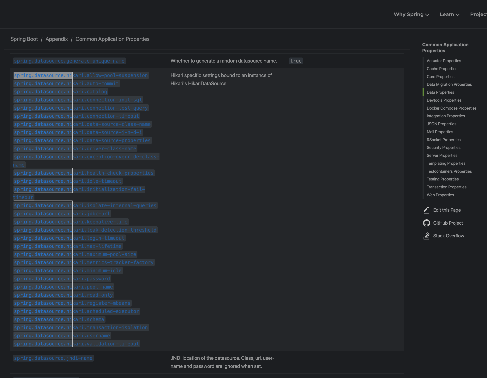
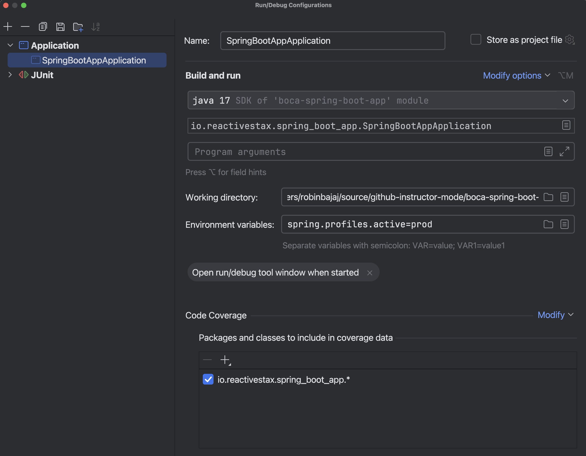
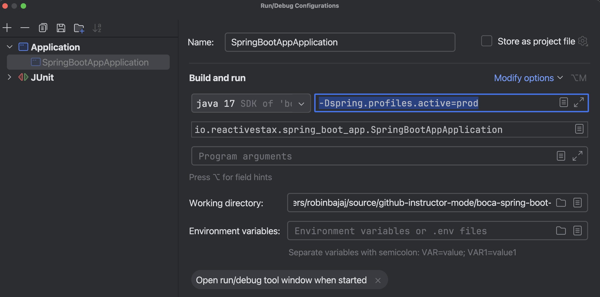
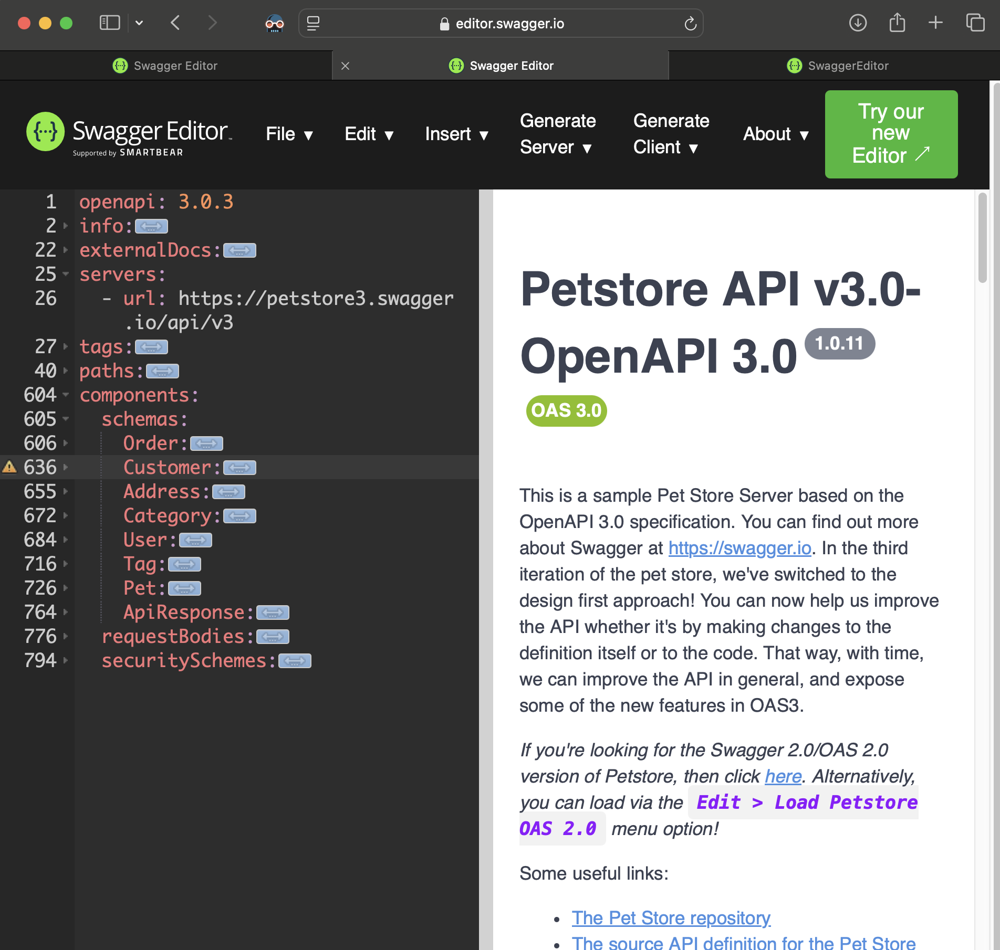
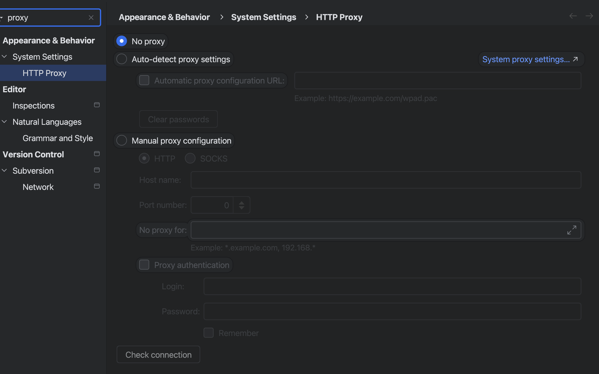
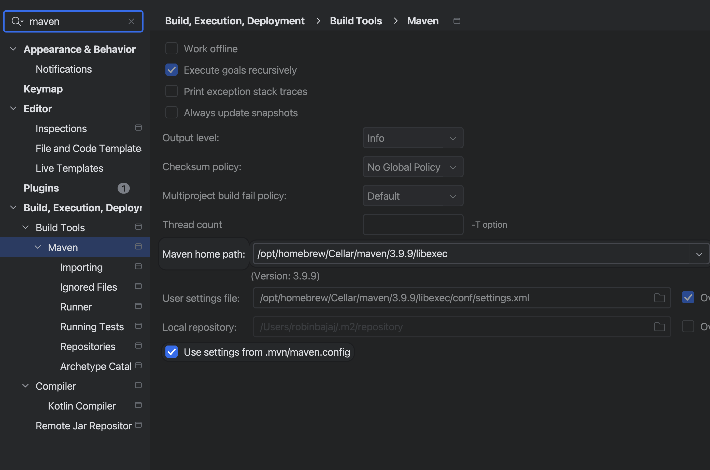
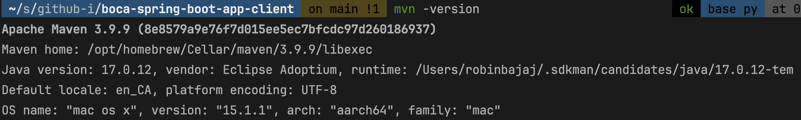

[TOC]

# lecture 26 - Spring Boot 

## RELEASE Notes and Documentation Links for Spring & Spring Boot

Get in the habit of reading the release notes , reference docs and java docs for any spring / spring boot framework release. 

- https://github.com/spring-projects/spring-boot/wiki/Spring-Boot-2.7-Release-Notes#upgrading-from-spring-boot-26
- https://docs.spring.io/spring-framework/docs/
- https://docs.spring.io/spring-boot/index.html
- https://docs.spring.io/spring-framework/reference/
- https://docs.spring.io/spring-framework/docs/6.1.15/javadoc-api/

## Note about M2 Repo

.m2 repo lives in your home folder  ( ll ~/.m2/repository/org/springframework/boot/spring-boot/3.4.1)

With Spring 

-- CONVENTION OVER CONFIGURATION

-- FAT JAR   (easy fat jar creation - )  spring-boot-maven-plugin

-- version management 

-- ✅application.properties treatment is very cumbersome, especially to add support for app properties per environment( like dev, sit, uat, prod), profile support (for environments)   spring-boot natively does that 

- Robin to show how the auto init scripts can be used to create employee_test_db for the tests (if needed)
- Robin to discuss more about Environment / @Value 
- Robin to show the scripts.sql support to create employee_test_db 
  - ​	✅Robin will complete the setup for setup-database.sql and data.sql for creating tables and insert statemetns. (*test_employee_db will be created outside of the app like mentioned in the class)
  - the src/test/resources/data.sql can insert data that you will need for all your tests. 
    - For more specific test data needs, you can use @beforeEach, @beforeAll in your Test class
    - or simply your test should create its own test data , before executing its Classes under test. 
    - show the use of JdbcTemplate or TestJDBCTemplate for quick SQL queries inside the Tests.

--transactionality (AOP)     

--boilerplate reduction - using spring-boot-starters

## Spring Boot Starters 

OOTB provide by Spring/Pivotal team 
https://docs.spring.io/spring-boot/reference/using/build-systems.html#using.build-systems.starters

Community Contributions for various spring boot starters 
https://github.com/spring-projects/spring-boot/blob/main/spring-boot-project/spring-boot-starters/README.adoc

## Pending Items 

 - Share common http status codes for Developers 
   
   - 200 , all ok series
   
      - 201 Resource Created 
      - 204 No Content 
   
   - 4-series , client doing mistake
   
      - 400 BAD Request
      - 401 / 403 authentication/authorization related 
      - 415 http media not supported 
      - 429 too many requests 
      - 404 resource not found 
   
   - 5-series , server doing mistake
   
      - 500 internal server error
      - 502 bad_gateway 
   
      
   
 - Robin - to show Swagger stuff - and talk about bottom-up and top-down service development work 

 - Robin - to Cover CORS call and Http Options Call

 - Kiran - we should use curl and httpie as well on command line to debug things when Postman goes corrupt

 - Nimanshu - PUT vs PATCH in the code with implementation and general discussion about SPEC etc.

 - show Actuator support - there is no consistent way to do things for production support - taking thread dumps , to check diff env values in a given running instance (spring boot provides actuator services for this ) (spring-boot-actuator)

- Logging Support 

- Robin - how to use @valid and @validated together ,

  - how to use @NotBlank before @ValidZipCode (jakarta OOTB validation along side custom validation)
  - if we use validation groups, do we have to mention them then on all fields (looks like yes)
  - if we use groupSequence, then @valid does not work, which does not work either way when you do @Validated 

 - Robin - difference between @Validated and @Valid annotations 
   - consumes vs produces attributes  --- accept vs content-type request headers
   -  also show command line clients - CuRL , httpie etc 
   - setup https (for later on..)

- show Actuator support - there is no consistent way to do things for production support - taking thread dumps , to check diff env values in a given running instance (spring boot provides actuator services for this ) (spring-boot-actuator)

- @value with default value - how to override etc. 

  -----------

  - show the mapstruct for mapping the dto to entity (pending)
  - cover the details of DispatcherServlet and MVC pattern (pending)

  ---------------

- Robin -to update ActiveMQ code to use Spring Boot 

- Robin - to show networking stuff for end to end flow with DNS resolution and reverse proxy setup

 - Robin - to show postgres sequences 

 - Robin - to show the upsert / optimistic locking support while using spring data jpa module 

 - Gurpreet - show interceptors in play and explain their architecture (and interaction with DispatcherServlet)

 - Anant - DirtiesContext discussion *pending

 - ##### Gurpreet/Sukhvir implementation - employeeRepo.save one time or employeeRepo.save then departementRepo.save 

- if we need a server to host our apps, we configure our own server manually and bring up the apps and deploy the latest versions manually.

- sort out the namespace resolution for jakarta.persistence vs org.hiberante namespace (pending)

  

- native binary support (from spring boot)

  

- deployment part exposing the services on the internet via reverse proxy etc. 

- show the way to give errors from Jackson library for extra fields being passed from the postman

## DONE Items

✅ JSR 303, 380 (for bean validation) 

✅ make sure lombok support is working in IntelliJ 

✅talk about environment property handling precedence graph (server.port in application.properties vs pass it in the command line )

✅show the @Transactional part in the saving of employee and address and other relationships 

✅REST best practices 

https://www.vinaysahni.com/best-practices-for-a-pragmatic-restful-api

✅Out of the box - hot deploy support for the apps (using spring boot dev-tools)

✅ database drivers support (you provide jdbc driver in pom.xml and include the spring-boot-starter-jdbc)

 ✅Manpreet - BackReference vs managedReference 

 Shifa - questions about api vs api server vs (Akshita questions) - the end to end flow related how the payload goes and hits who / when etc. 

✅Shifa - when to use intellij run/debug, vs mvn spring-boot:run vs java -jar FATJAR

 ✅Manpreet - Hikari overrides to be configured in AppConfiguration 

 ✅Shifa - questions about api vs api server vs (Akshita questions) - the end to end flow related how the payload goes and hits who / when etc. 

### **1. Introduction to Spring Boot**

**Purpose and Benefits of Spring Boot**  

- **Simplified Configuration:** Automates a lot of boilerplate setup (e.g., no need to manually define `DispatcherServlet`, DataSource configuration).
- **Production-Ready Features:** Includes built-in tools like Spring Actuator for monitoring and metrics.
- **Faster Development:** Pre-configured settings enable developers to get started quickly without diving deep into XML configurations.
- **Embedded Servers:** Supports Tomcat, Jetty, and Undertow for running applications without external servers.
- **Microservices-Friendly:** Lightweight and modular, making it ideal for microservices.

**Differences Between Spring Framework and Spring Boot**  
- Spring Framework requires significant manual setup and configuration (XML or Java-based), while Spring Boot automates most of this with `@SpringBootApplication` and auto-configuration.
- Spring Boot emphasizes convention over configuration, whereas Spring Framework provides only foundational features.
  

**Use Cases for Spring Boot Applications**  

- Building RESTful APIs
- Microservices architecture
- Monolithic applications with modular structure
- Batch processing
- Event-driven systems (Kafka, RabbitMQ integration)

---

### **2. Setting Up the Environment**

**Tools**  
- **IDE:** IntelliJ IDEA (Community/Ultimate), Eclipse, or Visual Studio Code
- **Build Tools:** Maven or Gradle (Spring Boot supports both)
- **Java Development Kit (JDK):** Java 8 or higher (Java 17+ recommended for modern features)

**Spring Initializr**  
- Visit [Spring Initializr](https://start.spring.io/) to create a new Spring Boot project.
- Input project details like:
  - **Project Type:** Maven or Gradle
  - **Language:** Java (default)
  - **Spring Boot Version:** Choose a stable release (e.g., 3.x for Java 17+)
  - **Dependencies:** Add components such as Spring Web, Spring Data JPA, Spring Security, H2 Database, etc.

**Overview of Project Structure**  
- **`src/main/java`**: Contains your application code.
  - **`com.example.demo`**: Default package; contains the main class annotated with `@SpringBootApplication`.
- **`src/main/resources`**: Stores application properties, static assets, and templates.
  - `application.properties` or `application.yml` for configuration.
- **`pom.xml` or `build.gradle`**: Dependency management file.

**Running the Application**
- Using the IDE: Run the `main` method in the `@SpringBootApplication` class.
- Command Line: Use `mvn spring-boot:run` or `gradle bootRun`.

---

### **3. Core Concepts**

**Auto-Configuration**  
- Spring Boot automatically configures beans based on the classpath and application properties.
- Example: If `spring-boot-starter-web` is added, Spring Boot configures an embedded Tomcat server, a `DispatcherServlet`, and JSON support automatically.
- Can be customized using:
  - Exclusion: `@EnableAutoConfiguration(exclude = {DataSourceAutoConfiguration.class})`
  - Override: Define your own beans in the application.

**Starter Dependencies**  

- Predefined Maven/Gradle dependencies for different use cases:
  - `spring-boot-starter-web`: Includes Spring MVC, JSON support, and Tomcat.
  - `spring-boot-starter-data-jpa`: Includes Hibernate, Spring Data JPA, and database drivers.
  - `spring-boot-starter-security`: Adds Spring Security for authentication/authorization.
- Reduces the need to manage individual library versions manually.
- We can see the underlying dependencies using "Show Effective POM" in the pom.xml 

**Application Properties/YAML**  
- **`application.properties`**:
  ```properties
  server.port=8081
  spring.datasource.url=jdbc:h2:mem:testdb
  logging.level.org.springframework=DEBUG
  ```
- **`application.yml`**:
  ```yaml
  server:
    port: 8081
  spring:
    datasource:
      url: jdbc:h2:mem:testdb
  logging:
    level:
      org.springframework: DEBUG
  ```

---

### **Understanding REST Principles and Endpoint Design**

#### **What is REST?**

**REST (Representational State Transfer)** is an architectural style for designing web services. It uses standard HTTP methods and resources to enable communication between a client and a server in a stateless manner.

---

### **Core Principles of REST**

1. **Client-Server Separation**
   - The client and server are independent of each other.
   - The client only knows the resource URI and interacts with the server using standard HTTP methods.

2. **Stateless Communication**
   - Each request from a client must contain all the information needed to process it (e.g., authentication, resource details).
   - The server does not store client session data.

3. **Resource-Based**
   - Everything is treated as a resource (e.g., users, products, orders).
   - Resources are identified by unique URIs (Uniform Resource Identifiers).

4. **Uniform Interface**
   - The API follows standard methods like GET, POST, PUT, DELETE, etc.
   - These methods have predefined meanings in the context of CRUD operations.

5. **Representation of Resources**
   - Resources can be represented in different formats like JSON, XML, or even plain text.
   - The client specifies the desired format via the `Accept` header.

6. **Stateless Caching**
   - Responses should be cacheable wherever possible to improve performance.

7. **Layered Architecture**
   - The client interacts with an intermediate layer (e.g., proxies, gateways), which then communicates with the server.

---

### **Purpose of REST**

- **Scalability:** RESTful APIs can handle large numbers of requests because they are stateless and cacheable.
- **Interoperability:** They allow different clients (web, mobile, etc.) to interact with the same API.
- **Flexibility:** Clients can consume resources in various formats (e.g., JSON, XML).
- **Ease of Integration:** Standard HTTP methods and response codes make REST APIs easy to use and integrate.

---

### **Key RESTful Endpoints and Their Purpose**

Each endpoint corresponds to a resource and adheres to HTTP methods for performing actions.

| **HTTP Method** | **CRUD Operation** | **Purpose**                           | **Example Endpoint**  | **Example Use Case**                                    |
| --------------- | ------------------ | ------------------------------------- | --------------------- | ------------------------------------------------------- |
| **GET**         | Read               | Retrieve data                         | `/api/employees`      | Fetch all employees.                                    |
| **GET**         | Read               | Retrieve a specific resource          | `/api/employees/{id}` | Fetch details of an employee with ID `{id}`.            |
| **POST**        | Create             | Create a new resource                 | `/api/employees`      | Add a new employee.                                     |
| **PUT**         | Update/Replace     | Update an existing resource           | `/api/employees/{id}` | Replace all data for the employee with ID `{id}`.       |
| **PATCH**       | Update/Modify      | Partially update an existing resource | `/api/employees/{id}` | Update specific fields for the employee with ID `{id}`. |
| **DELETE**      | Delete             | Delete an existing resource           | `/api/employees/{id}` | Remove the employee with ID `{id}`.                     |

---

### **RESTful Endpoints and Their Meanings**

1. **Collection Resource (Plural Noun)**
   - Represents a group of resources.
   - Example: `/api/employees`
   - HTTP Methods:
     - `GET`: Retrieve all resources.
     - `POST`: Create a new resource.

2. **Single Resource (Singular Noun with Identifier)**
   - Represents a specific resource within a collection.
   - Example: `/api/employees/{id}`
   - HTTP Methods:
     - `GET`: Retrieve a specific resource by ID.
     - `PUT`: Update/replace the resource with new data.
     - `PATCH`: Partially update the resource.
     - `DELETE`: Remove the resource.

3. **Sub-Resources**
   - Represents a hierarchy or relationship between resources.
   - Example: `/api/employees/{id}/address`
   - HTTP Methods:
     - `GET`: Fetch the sub-resource.
     - `PUT`: Update/replace the sub-resource.
     - `POST`: Create a new sub-resource.

4. **Query Parameters**
   - Used to filter or sort the data being fetched.
   - Example: `/api/employees?department=HR&sortBy=name`
   - HTTP Method:
     - `GET`: Retrieve filtered or sorted data.

---

### **Best Practices for REST API Design**

1. **Use Nouns, Not Verbs, for Resources**
   - Use `/employees` instead of `/getEmployees` or `/createEmployee`.

2. **Follow Standard HTTP Methods**
   - Use `GET` for fetching, `POST` for creating, `PUT/PATCH` for updating, and `DELETE` for deleting.

3. **Use Meaningful and Consistent URIs**
   - Good: `/api/employees/{id}`
   - Bad: `/api/employees/getEmployeeById`

4. **Provide Proper HTTP Status Codes**
   - `200 OK`: Successful request.
   - `201 Created`: Resource created successfully.
   - `400 Bad Request`: Client sent an invalid request.
   - `401 Unauthorized`: Authentication required.
   - `404 Not Found`: Resource not found.
   - `500 Internal Server Error`: Server-side issue.

5. **Support Multiple Representations**
   - Allow clients to request JSON, XML, etc., using the `Accept` header.

6. **Handle Errors Gracefully**
   - Provide meaningful error messages and use proper HTTP status codes.

7. **Enable Pagination and Filtering**
   - Example: `/api/employees?page=1&size=10`

8. **Use HATEOAS (Optional for Advanced APIs)**
   - Include links in responses to guide clients on available actions.

---

### **Examples of RESTful Endpoints**

1. **Employee Resource**
   - `/api/employees` (GET): Retrieve all employees.
   - `/api/employees` (POST): Add a new employee.
   - `/api/employees/{id}` (GET): Retrieve an employee by ID.
   - `/api/employees/{id}` (PUT): Update an employee.
   - `/api/employees/{id}` (DELETE): Delete an employee.

2. **Address Sub-Resource**
   - `/api/employees/{id}/address` (GET): Retrieve the address of an employee.
   - `/api/employees/{id}/address` (PUT): Update the address of an employee.

3. **Department Resource**
   - `/api/departments` (GET): Retrieve all departments.
   - `/api/departments/{id}/employees` (GET): Get all employees in a department.

------------

### **4. Developing REST APIs**

**Creating REST Controllers**  
- Use `@RestController` for handling HTTP requests and returning JSON responses:
  ```java
  @RestController
  @RequestMapping("/api")
  public class HelloController {
      @GetMapping("/hello")
      public String sayHello() {
          return "Hello, Spring Boot!";
      }
  }
  ```

**Handling HTTP Methods**  
- `@GetMapping`, `@PostMapping`, `@PutMapping`, `@DeleteMapping`
  ```java
  @PostMapping("/create")
  public ResponseEntity<String> create(@RequestBody MyObject obj) {
      // Process the request body
      return ResponseEntity.ok("Created Successfully");
  }
  ```

**`@RequestMapping` and `@PathVariable`**  
- Use `@RequestMapping` for specifying a base path and `@PathVariable` for dynamic URL segments:
  ```java
  @GetMapping("/users/{id}")
  public User getUserById(@PathVariable("id") Long id) {
      return userService.findById(id);
  }
  ```

**Returning JSON Data**  
- Spring Boot uses Jackson to convert objects to JSON by default:
  ```java
  @GetMapping("/user")
  public User getUser() {
      return new User(1L, "John Doe", "john@example.com");
  }
  ```


Here’s how you can create a REST API for managing employees with Spring Boot and Spring Data JPA, using PostgreSQL as the database.

---

### **Step 1: Set Up the Project**

1. **Create a Spring Boot Project**
   
   - Use [Spring Initializr](https://start.spring.io/):
     - Project: Maven
     - Language: Java
     - Dependencies: Spring Web, Spring Data JPA, PostgreSQL Driver, Spring Boot DevTools (optional).
   
2. **Configure `application.properties`**
   Add your PostgreSQL database configuration:
   ```properties
   spring.datasource.url=jdbc:postgresql://localhost:5432/employee_db
   spring.datasource.username=your_username
   spring.datasource.password=your_password
   spring.jpa.hibernate.ddl-auto=update
   spring.jpa.show-sql=true
   ```

---

### **Step 2: Create the Employee Entity**

```java
package com.example.demo.model;

import jakarta.persistence.Entity;
import jakarta.persistence.GeneratedValue;
import jakarta.persistence.GenerationType;
import jakarta.persistence.Id;

@Entity
public class Employee {

    @Id
    @GeneratedValue(strategy = GenerationType.IDENTITY)
    private Long id;

    private String firstName;
    private String lastName;
    private String email;

    // Getters and Setters
    public Long getId() {
        return id;
    }

    public void setId(Long id) {
        this.id = id;
    }

    public String getFirstName() {
        return firstName;
    }

    public void setFirstName(String firstName) {
        this.firstName = firstName;
    }

    public String getLastName() {
        return lastName;
    }

    public void setLastName(String lastName) {
        this.lastName = lastName;
    }

    public String getEmail() {
        return email;
    }

    public void setEmail(String email) {
        this.email = email;
    }
}
```

---

### **Step 3: Create the Repository**

```java
package com.example.demo.repository;

import com.example.demo.model.Employee;
import org.springframework.data.jpa.repository.JpaRepository;

public interface EmployeeRepository extends JpaRepository<Employee, Long> {
    // No need to implement anything, CRUD operations are auto-configured
}
```

---

### **Step 4: Create the Service Layer**

```java
package com.example.demo.service;

import com.example.demo.model.Employee;
import com.example.demo.repository.EmployeeRepository;
import org.springframework.beans.factory.annotation.Autowired;
import org.springframework.stereotype.Service;

import java.util.List;
import java.util.Optional;

@Service
public class EmployeeService {

    @Autowired
    private EmployeeRepository repository;

    public List<Employee> getAllEmployees() {
        return repository.findAll();
    }

    public Optional<Employee> getEmployeeById(Long id) {
        return repository.findById(id);
    }

    public Employee saveEmployee(Employee employee) {
        return repository.save(employee);
    }

    public void deleteEmployee(Long id) {
        repository.deleteById(id);
    }
}
```

-----

Spring Boot, through **Spring Data JPA**, simplifies the implementation of repository-based CRUD operations and finder methods. Here’s how it achieves this:

---

### 1. **Dynamic Proxy Mechanism**
Spring Data JPA leverages Java's dynamic proxy mechanism to provide implementations for repository interfaces. When the application starts, Spring scans for repository interfaces (annotated with `@Repository` or extending `JpaRepository`), and for each one, it generates a proxy class that handles the interactions with the database.

---

### 2. **Predefined CRUD Methods**
When you extend interfaces like `JpaRepository`, `CrudRepository`, or `PagingAndSortingRepository`, you inherit predefined methods such as:

- **CRUD Operations**:
  - `save()`: Insert or update an entity.
  - `findById()`: Retrieve an entity by its ID.
  - `deleteById()`: Delete an entity by its ID.
  - `findAll()`: Retrieve all entities.

- **Paging and Sorting** (from `PagingAndSortingRepository`):
  - `findAll(Pageable pageable)`: Retrieve entities with pagination.
  - `findAll(Sort sort)`: Retrieve entities with sorting.

Spring Boot provides these methods out of the box by delegating calls to the underlying JPA `EntityManager`.

---

### 3. **Query Derivation for Finder Methods**
Finder methods (query methods) are generated based on the naming convention of the method in the repository interface. For example:

#### a. **Method Naming Conventions**
```java
List<User> findByFirstName(String firstName);
List<User> findByLastNameAndAge(String lastName, int age);
```

Spring Data JPA parses these method names to derive the appropriate SQL or JPQL queries. The following steps occur:
1. **Parsing**: It analyzes the method name to determine the query's intent.
   - `findBy`: Specifies the operation (SELECT).
   - `FirstName` and `LastNameAndAge`: Specify the criteria.
2. **Query Generation**: Based on the entity and its fields, it constructs a JPQL query like:
   ```sql
   SELECT u FROM User u WHERE u.firstName = :firstName
   ```
   or
   ```sql
   SELECT u FROM User u WHERE u.lastName = :lastName AND u.age = :age
   ```

#### b. **Supported Keywords**
Spring supports many keywords for query derivation, such as:
- Comparisons: `Is`, `Equals`, `LessThan`, `GreaterThan`, etc.
- Logical Operators: `And`, `Or`
- Null Handling: `IsNull`, `IsNotNull`
- Like Operations: `Like`, `StartingWith`, `EndingWith`, `Containing`
- Sorting: `OrderBy`

For example:
```java
List<User> findByFirstNameContainingOrderByAgeDesc(String nameFragment);
```

---

### 4. **@Query for Custom Queries**
If the query cannot be derived or you need a custom one, you can use the `@Query` annotation:
```java
@Query("SELECT u FROM User u WHERE u.age > :age")
List<User> findUsersOlderThan(@Param("age") int age);
```

You can also use native SQL queries:
```java
@Query(value = "SELECT * FROM users WHERE age > :age", nativeQuery = true)
List<User> findUsersOlderThan(@Param("age") int age);
```

---

### 5. **Transaction Management**
Spring Boot automatically wraps repository methods in transactions by default. Methods like `save()` or `delete()` are executed within a transactional context, ensuring data consistency.

---

### 6. **Paging and Sorting**
For pageable and sortable queries, Spring generates the appropriate SQL using the `Pageable` and `Sort` parameters. For example:
```java
Page<User> findByLastName(String lastName, Pageable pageable);
```
This translates to a paginated query like:
```sql
SELECT * FROM users WHERE last_name = ? LIMIT ? OFFSET ?
```

---

### Advantages of Spring Data JPA in CRUD and Finder Methods:
1. **Reduced Boilerplate Code**: You don’t need to write repetitive DAO implementations.
2. **Custom Queries**: Easily extend functionality with `@Query`.
3. **Seamless Integration**: Works directly with JPA providers like Hibernate.
4. **Transaction Management**: Automatically managed transactions simplify application logic.
5. **Dynamic Proxies**: Enables runtime flexibility and faster development cycles.

By following these conventions, Spring Boot allows developers to focus on business logic while handling the database layer efficiently.

---

### **Step 5: Create the Controller**

```java
package com.example.demo.controller;

import com.example.demo.model.Employee;
import com.example.demo.service.EmployeeService;
import org.springframework.beans.factory.annotation.Autowired;
import org.springframework.http.ResponseEntity;
import org.springframework.web.bind.annotation.*;

import java.util.List;

@RestController
@RequestMapping("/api/employees")
public class EmployeeController {

    @Autowired
    private EmployeeService service;

    @GetMapping
    public List<Employee> getAllEmployees() {
        return service.getAllEmployees();
    }

    @GetMapping("/{id}")
    public ResponseEntity<Employee> getEmployeeById(@PathVariable Long id) {
        return service.getEmployeeById(id)
                .map(ResponseEntity::ok)
                .orElse(ResponseEntity.notFound().build());
    }

    @PostMapping
    public Employee createEmployee(@RequestBody Employee employee) {
        return service.saveEmployee(employee);
    }

    @PutMapping("/{id}")
    public ResponseEntity<Employee> updateEmployee(@PathVariable Long id, @RequestBody Employee employeeDetails) {
        return service.getEmployeeById(id)
                .map(employee -> {
                    employee.setFirstName(employeeDetails.getFirstName());
                    employee.setLastName(employeeDetails.getLastName());
                    employee.setEmail(employeeDetails.getEmail());
                    return ResponseEntity.ok(service.saveEmployee(employee));
                })
                .orElse(ResponseEntity.notFound().build());
    }

    @DeleteMapping("/{id}")
    public ResponseEntity<Void> deleteEmployee(@PathVariable Long id) {
        return service.getEmployeeById(id)
                .map(employee -> {
                    service.deleteEmployee(id);
                    return ResponseEntity.noContent().build();
                })
                .orElse(ResponseEntity.notFound().build());
    }
}
```


make observation for deleting the same employee twice. First time it will delete the employee id "1" successfully and return 204 No Content. And then second time if you delete the same non-existent employee again it will return "404" Not Found

---


### **Step 6: Database Setup**

1. Create a PostgreSQL database named `employee_db`:
   ```sql
   CREATE DATABASE employee_db;
   ```
2. Run the application, and Spring Boot will auto-create the `employee` table.

---

### **Step 7: Test the API**

You can test the API using tools like **Postman** or **cURL**:

- **GET All Employees**
  ```
  GET http://localhost:8080/api/employees
  ```

- **GET Employee by ID**
  ```
  GET http://localhost:8080/api/employees/{id}
  ```

- **POST Create Employee**
  ```
  POST http://localhost:8080/api/employees
  Content-Type: application/json
  
  {
      "firstName": "John",
      "lastName": "Doe",
      "email": "john.doe@example.com"
  }
  ```

- **PUT Update Employee**
  ```
  PUT http://localhost:8080/api/employees/{id}
  Content-Type: application/json
  
  {
      "firstName": "Jane",
      "lastName": "Doe",
      "email": "jane.doe@example.com"
  }
  ```

- **DELETE Employee**
  ```
  DELETE http://localhost:8080/api/employees/{id}
  ```

---

### **Entities with Relationships**

#### **1. Address (One-to-One with Employee)**

```java
package com.example.demo.model;

import jakarta.persistence.*;

@Entity
public class Address {

    @Id
    @GeneratedValue(strategy = GenerationType.IDENTITY)
    private Long id;

    private String street;
    private String city;
    private String state;
    private String zipCode;

    @OneToOne(mappedBy = "address")
    private Employee employee;

    // Getters and Setters
}
```

#### **2. Department (One-to-Many with Employee)**

```java
@Entity
public class Department {

    @Id
    @GeneratedValue(strategy = GenerationType.IDENTITY)
    private Long id;

    private String name;

    @OneToMany(mappedBy = "department", cascade = CascadeType.ALL)
    private List<Employee> employees = new ArrayList<>();

    // Getters and Setters
}
```

#### **3. WorkGroup (Many-to-Many with Employee)**

```java
@Entity
public class WorkGroup {

    @Id
    @GeneratedValue(strategy = GenerationType.IDENTITY)
    private Long id;

    private String name;

    @ManyToMany
    @JoinTable(
        name = "employee_workgroup",
        joinColumns = @JoinColumn(name = "workgroup_id"),
        inverseJoinColumns = @JoinColumn(name = "employee_id")
    )
    private List<Employee> employees = new ArrayList<>();

    // Getters and Setters
}
```

#### **4. Update Employee Entity**

```java
@Entity
public class Employee {

    @Id
    @GeneratedValue(strategy = GenerationType.IDENTITY)
    private Long id;

    private String firstName;
    private String lastName;
    private String email;

    @OneToOne(cascade = CascadeType.ALL)
    @JoinColumn(name = "address_id", referencedColumnName = "id")
    private Address address;

    @ManyToOne
    @JoinColumn(name = "department_id")
    private Department department;

    @ManyToMany(mappedBy = "employees")
    private List<WorkGroup> workGroups = new ArrayList<>();

    // Getters and Setters
}
```

---

### **Spring Data Repositories**

#### **1. AddressRepository**

```java
public interface AddressRepository extends JpaRepository<Address, Long> {}
```

#### **2. DepartmentRepository**

```java
public interface DepartmentRepository extends JpaRepository<Department, Long> {}
```

#### **3. WorkGroupRepository**

```java
public interface WorkGroupRepository extends JpaRepository<WorkGroup, Long> {}
```

#### **4. EmployeeRepository**

```java
public interface EmployeeRepository extends JpaRepository<Employee, Long> {}
```

---

### **Service Layer**

#### **Associate Employee with Address**

```java
public void associateEmployeeWithAddress(Long employeeId, Address address) {
    Employee employee = employeeRepository.findById(employeeId)
        .orElseThrow(() -> new RuntimeException("Employee not found"));
    address.setEmployee(employee);
    employee.setAddress(address);
    addressRepository.save(address);
    employeeRepository.save(employee);
}
```

#### **Add Employee to Department**

```java
public void addEmployeeToDepartment(Long employeeId, Long departmentId) {
    Employee employee = employeeRepository.findById(employeeId)
        .orElseThrow(() -> new RuntimeException("Employee not found"));
    Department department = departmentRepository.findById(departmentId)
        .orElseThrow(() -> new RuntimeException("Department not found"));
    employee.setDepartment(department);
    employeeRepository.save(employee);
}
```

#### **Add Employee to WorkGroups**

```java
public void addEmployeeToWorkGroups(Long employeeId, List<Long> workGroupIds) {
    Employee employee = employeeRepository.findById(employeeId)
        .orElseThrow(() -> new RuntimeException("Employee not found"));
    List<WorkGroup> workGroups = workGroupRepository.findAllById(workGroupIds);
    employee.getWorkGroups().addAll(workGroups);
    workGroups.forEach(workGroup -> workGroup.getEmployees().add(employee));
    workGroupRepository.saveAll(workGroups);
}
```

---

### **Controller Layer**

#### **Associate Employee with Address**

```java
@PostMapping("/{employeeId}/address")
public ResponseEntity<String> associateEmployeeWithAddress(
        @PathVariable Long employeeId,
        @RequestBody Address address) {
    service.associateEmployeeWithAddress(employeeId, address);
    return ResponseEntity.ok("Address associated with Employee");
}
```

#### **Add Employee to Department**

```java
@PostMapping("/{employeeId}/department/{departmentId}")
public ResponseEntity<String> addEmployeeToDepartment(
        @PathVariable Long employeeId,
        @PathVariable Long departmentId) {
    service.addEmployeeToDepartment(employeeId, departmentId);
    return ResponseEntity.ok("Employee added to Department");
}
```

#### **Add Employee to WorkGroups**

```java
@PostMapping("/{employeeId}/workgroups")
public ResponseEntity<String> addEmployeeToWorkGroups(
        @PathVariable Long employeeId,
        @RequestBody List<Long> workGroupIds) {
    service.addEmployeeToWorkGroups(employeeId, workGroupIds);
    return ResponseEntity.ok("Employee added to WorkGroups");
}
```

---

### **REST Endpoints**

#### **Employee CRUD**
- **GET** `/api/employees` - List all employees
- **GET** `/api/employees/{id}` - Get an employee by ID
- **POST** `/api/employees` - Create a new employee
- **PUT** `/api/employees/{id}` - Update an employee
- **DELETE** `/api/employees/{id}` - Delete an employee

#### **Address CRUD**
- **GET** `/api/addresses`
- **GET** `/api/addresses/{id}`
- **POST** `/api/addresses`
- **PUT** `/api/addresses/{id}`
- **DELETE** `/api/addresses/{id}`

#### **Department CRUD**
- **GET** `/api/departments`
- **GET** `/api/departments/{id}`
- **POST** `/api/departments`
- **PUT** `/api/departments/{id}`
- **DELETE** `/api/departments/{id}`

#### **WorkGroup CRUD**
- **GET** `/api/workgroups`
- **GET** `/api/workgroups/{id}`
- **POST** `/api/workgroups`
- **PUT** `/api/workgroups/{id}`
- **DELETE** `/api/workgroups/{id}`

#### **Associations**
- **POST** `/api/employees/{employeeId}/address` - Associate address with employee

- **POST** `/api/employees/{employeeId}/department/{departmentId}` - Add employee to department

- **POST** `/api/employees/{employeeId}/workgroups` - Add employee to workgroups

  


------------

  

  ## NOTE:  Should we return EmployeeDTO or ResponseEntity<EmployeeDTO>

  what is the difference between returning EmployeeDTO vs ResponseEntity<EmployeeDTO> in a POSTMapping call in EmployeeController

  @PostMapping("/employee") public EmployeeDTO createEmployee(@Valid @RequestBody EmployeeDTO employeeDTO) { return service.save(employeeDTO); }

  vs

  @PostMapping("/employee") public ResponseEntity<EmployeeDTO> createEmployee(@Valid @RequestBody EmployeeDTO employeeDTO) { return ResponseEntity<service.save(employeeDTO)>; }

  

  The difference between returning **`EmployeeDTO`** directly and wrapping it in **`ResponseEntity<EmployeeDTO>`** in a `@PostMapping` is about the level of control you have over the HTTP response. Here’s a detailed explanation of the two approaches:

---

  ### **1. Returning `EmployeeDTO`**

  ```java
  @PostMapping("/employee")
  public EmployeeDTO createEmployee(@Valid @RequestBody EmployeeDTO employeeDTO) {
      return service.save(employeeDTO);
  }
  ```

  #### **Behavior**
  - The `EmployeeDTO` is returned directly, and Spring Boot automatically wraps it in a `ResponseEntity` with a default HTTP status of **200 OK**.
  - The response body will contain the serialized `EmployeeDTO`.

  #### **Advantages**
  - **Simplicity:** Requires less boilerplate code for simple use cases.
  - **Default Behavior:** Automatically uses **200 OK** status, which is often acceptable for `GET` and other idempotent operations.

  #### **Disadvantages**
  - **Limited Control:** You cannot customize the HTTP status, headers, or other response metadata.
    - For example, if you want to return **201 Created** (which is the correct status for a successful `POST` that creates a resource), you can’t do this without manually adding additional annotations or logic.
  - **Less Flexibility:** You cannot include additional response metadata (e.g., custom headers).

---

  ### **2. Returning `ResponseEntity<EmployeeDTO>`**

  ```java
  @PostMapping("/employee")
  public ResponseEntity<EmployeeDTO> createEmployee(@Valid @RequestBody EmployeeDTO employeeDTO) {
      return ResponseEntity.status(HttpStatus.CREATED).body(service.save(employeeDTO));
  }
  ```

  #### **Behavior**
  - The `EmployeeDTO` is explicitly wrapped in a `ResponseEntity`, allowing you to control:
    - **HTTP Status:** You can set it to **201 Created**, which is the correct status for a resource creation.
    - **Headers:** Add custom headers, like a `Location` header pointing to the created resource.

  #### **Advantages**
  - **Full Control Over HTTP Response:**
    - You can specify the correct HTTP status (`201 Created`) and include additional metadata.
    - Example:
      ```java
      return ResponseEntity
          .created(URI.create("/api/employees/" + savedEmployee.getId()))
          .body(savedEmployee);
      ```
  - **Flexible Metadata Handling:**
    - You can set headers, cookies, etc., in the response.

  #### **Disadvantages**
  - **Additional Code Overhead:** Slightly more verbose than directly returning the `EmployeeDTO`.

---

  ### **Comparison**

  | **Aspect**                  | **Return `EmployeeDTO`**                                     | **Return `ResponseEntity<EmployeeDTO>`**          |
  | --------------------------- | ------------------------------------------------------------ | ------------------------------------------------- |
  | **Default HTTP Status**     | Always returns **200 OK**.                                   | Can specify **201 Created**, or any other status. |
  | **Response Headers**        | Cannot modify headers.                                       | Full control over headers (e.g., `Location`).     |
  | **Simplicity**              | Simpler, suitable for basic use cases.                       | More verbose, better for advanced use cases.      |
  | **Standard REST Practices** | May not align with REST standards (e.g., missing **201 Created** for `POST`). | Aligns better with REST principles.               |
  | **Error Handling**          | Relies on global exception handlers.                         | Can include custom error responses inline.        |

---

  ### **When to Use Each?**

  #### **Use `EmployeeDTO` Directly:**
  - For simple use cases where the default behavior (`200 OK` with the entity as the response body) is sufficient.
  - Example: `GET` requests or basic `POST`/`PUT` operations without additional metadata.

  #### **Use `ResponseEntity<EmployeeDTO>`:**
  - When you need more control over the response, such as:
    - Returning **201 Created** for resource creation.
    - Adding custom headers like `Location`.
    - Including additional metadata in the response.
  - Example: REST APIs adhering to best practices, where each HTTP method has specific status codes and headers.

---

  ### **Example: Best Practice for Resource Creation**

  ```java
  @PostMapping("/employee")
  public ResponseEntity<EmployeeDTO> createEmployee(@Valid @RequestBody EmployeeDTO employeeDTO) {
      EmployeeDTO savedEmployee = service.save(employeeDTO);
      URI location = URI.create("/api/employees/" + savedEmployee.getId());
      return ResponseEntity.created(location).body(savedEmployee);
  }
  ```

  #### **Response**
  - **HTTP Status:** `201 Created`
  - **Headers:** `Location: /api/employees/{id}`
  - **Body:** The created `EmployeeDTO`.

  This aligns with REST principles for resource creation.

  

---

## **Path Variables vs Query Parameters**

Path variables and query parameters are common ways to pass data to REST API endpoints. Here's a breakdown:

---

### **1. Path Variables**

#### **Definition:**
Path variables are part of the URL itself. They are used to identify specific resources.

#### **Example URL:**
```
GET /api/employees/{id}
```

- `id` is a path variable, representing a specific employee's ID.

#### **Spring Boot Example:**

**Controller:**
```java
@GetMapping("/employees/{id}")
public ResponseEntity<Employee> getEmployeeById(@PathVariable Long id) {
    Employee employee = employeeService.findById(id);
    if (employee != null) {
        return ResponseEntity.ok(employee);
    } else {
        return ResponseEntity.notFound().build();
    }
}
```

**Usage:**
```
GET /api/employees/10
```

- Here, `10` is passed as the value for the `id` path variable.

---

### **2. Query Parameters**

#### **Definition:**
Query parameters are appended to the URL after a `?` and are used to filter or provide additional data.

#### **Example URL:**
```
GET /api/employees?department=HR&sortBy=name
```

- `department` and `sortBy` are query parameters.

#### **Spring Boot Example:**

**Controller:**
```java
@GetMapping("/employees")
public ResponseEntity<List<Employee>> getEmployeesByDepartmentAndSort(
        @RequestParam(required = false) String department,
        @RequestParam(required = false, defaultValue = "id") String sortBy) {
    List<Employee> employees = employeeService.findByDepartmentAndSort(department, sortBy);
    return ResponseEntity.ok(employees);
}
```

**Usage:**

```
GET /api/employees?department=HR&sortBy=name
```

- `department=HR` filters employees in the HR department.
- `sortBy=name` sorts employees by name.

---

### **3. Combining Path Variables and Query Parameters**

You can use both path variables and query parameters in a single endpoint.

#### **Example URL:**
```
GET /api/departments/{id}/employees?sortBy=name
```

#### **Spring Boot Example:**

**Controller:**
```java
@GetMapping("/departments/{id}/employees")
public ResponseEntity<List<Employee>> getEmployeesByDepartment(
        @PathVariable Long id,
        @RequestParam(required = false, defaultValue = "id") String sortBy) {
    List<Employee> employees = employeeService.findByDepartmentIdAndSort(id, sortBy);
    return ResponseEntity.ok(employees);
}
```

**Usage:**
```
GET /api/departments/5/employees?sortBy=name
```

- `5` is the department ID passed as a path variable.
- `sortBy=name` is a query parameter used for sorting.

---

## **Key Differences Between Path Variables and Query Parameters**

| **Feature**   | **Path Variables**                             | **Query Parameters**                            |
| ------------- | ---------------------------------------------- | ----------------------------------------------- |
| **Purpose**   | Identify a specific resource                   | Filter, sort, or provide additional information |
| **Position**  | Part of the URL path                           | Appended after a `?` in the URL                 |
| **Mandatory** | Typically mandatory                            | Can be optional or have default values          |
| **Use Case**  | Resource identification (e.g., `/employees/1`) | Filters (e.g., `/employees?department=HR`)      |

---

### **4. Best Practices**

1. **Use Path Variables for Resource Identification:**
   - Example: `/employees/{id}` for accessing a specific employee.

2. **Use Query Parameters for Filtering, Sorting, or Pagination:**
   - Example: `/employees?department=HR&sortBy=name&page=2`.

3. **Default Values for Query Parameters:**
   - Provide default values to make query parameters optional.
   - Example: `@RequestParam(required = false, defaultValue = "id")`.

4. **Validation:**
   - Use validation annotations for path variables and query parameters, e.g., `@Min`, `@NotNull`.

---

### **Notes on `@Consumes` and `@Produces` in Spring Boot**

In Spring Boot, the `@Consumes` and `@Produces` annotations are not directly used as they are in JAX-RS. Instead, the content type of requests and responses is controlled through:

1. **`@RequestMapping`** or specific HTTP method mappings (`@GetMapping`, `@PostMapping`, etc.) with `consumes` and `produces` attributes.
2. **HTTP Headers**: `Content-Type` (for `consumes`) and `Accept` (for `produces`).

---

### **1. Consumes**

#### **Definition:**
The `consumes` attribute specifies the media type(s) that the endpoint can accept in the request body.

#### **Example:**
An endpoint that accepts JSON input:
```java
@PostMapping(value = "/employees", consumes = "application/json")
public ResponseEntity<Employee> createEmployee(@RequestBody Employee employee) {
    Employee savedEmployee = employeeService.save(employee);
    return ResponseEntity.ok(savedEmployee);
}
```

- `consumes = "application/json"`: The endpoint will only accept requests with the `Content-Type: application/json` header.

#### **Request Example:**
```http
POST /api/employees
Content-Type: application/json

{
    "firstName": "John",
    "lastName": "Doe",
    "email": "john.doe@example.com"
}
```

---

### **2. Produces**

#### **Definition:**
The `produces` attribute specifies the media type(s) that the endpoint can return in the response body.

#### **Example:**
An endpoint that returns JSON output:
```java
@GetMapping(value = "/employees/{id}", produces = "application/json")
public ResponseEntity<Employee> getEmployeeById(@PathVariable Long id) {
    Employee employee = employeeService.findById(id);
    if (employee != null) {
        return ResponseEntity.ok(employee);
    } else {
        return ResponseEntity.notFound().build();
    }
}
```

- `produces = "application/json"`: The endpoint will return the response with the `Content-Type: application/json` header.

#### **Response Example:**
```http
HTTP/1.1 200 OK
Content-Type: application/json

{
    "id": 1,
    "firstName": "John",
    "lastName": "Doe",
    "email": "john.doe@example.com"
}
```

---

### **3. Combining Consumes and Produces**

#### **Example:**
An endpoint that accepts XML and returns JSON:
```java
@PostMapping(value = "/employees", consumes = "application/xml", produces = "application/json")
public ResponseEntity<Employee> createEmployee(@RequestBody Employee employee) {
    Employee savedEmployee = employeeService.save(employee);
    return ResponseEntity.ok(savedEmployee);
}
```

- `consumes = "application/xml"`: The endpoint will only accept requests with `Content-Type: application/xml`.
- `produces = "application/json"`: The endpoint will return the response in JSON format.

#### **Request Example (XML):**
```http
POST /api/employees
Content-Type: application/xml

<Employee>
    <firstName>John</firstName>
    <lastName>Doe</lastName>
    <email>john.doe@example.com</email>
</Employee>
```

#### **Response Example (JSON):**
```http
HTTP/1.1 200 OK
Content-Type: application/json

{
    "id": 1,
    "firstName": "John",
    "lastName": "Doe",
    "email": "john.doe@example.com"
}
```

---

### **4. Handling Multiple Media Types**

#### **Example:**
An endpoint that supports both JSON and XML:
```java
@GetMapping(value = "/employees/{id}", produces = {"application/json", "application/xml"})
public ResponseEntity<Employee> getEmployeeById(@PathVariable Long id) {
    Employee employee = employeeService.findById(id);
    if (employee != null) {
        return ResponseEntity.ok(employee);
    } else {
        return ResponseEntity.notFound().build();
    }
}
```

- If the `Accept` header specifies `application/json`, the response will be in JSON.
- If the `Accept` header specifies `application/xml`, the response will be in XML.

---

### **5. Default Behavior Without `consumes` and `produces`**

- **Without `consumes`:** The endpoint will accept any request content type.
- **Without `produces`:** The response type is determined by the `Accept` header or defaults to JSON if not specified.

#### **Example Without `consumes` or `produces`:**
```java
@PostMapping("/employees")
public ResponseEntity<Employee> createEmployee(@RequestBody Employee employee) {
    Employee savedEmployee = employeeService.save(employee);
    return ResponseEntity.ok(savedEmployee);
}
```

- The endpoint will accept any content type and return the response in JSON format by default.

---

### **6. Testing with Tools**

- **Postman or cURL**:
  - Set `Content-Type` in the request headers for `consumes`.
  - Set `Accept` in the request headers for `produces`.

#### **cURL Example:**
```bash
curl -X POST http://localhost:8080/api/employees \
     -H "Content-Type: application/json" \
     -H "Accept: application/json" \
     -d '{"firstName":"John", "lastName":"Doe", "email":"john.doe@example.com"}'
```

---

### **7. Error Handling for Invalid Content-Type**

If the client sends a request with a `Content-Type` that the endpoint does not support, Spring Boot will respond with:
```http
HTTP/1.1 415 Unsupported Media Type
```

---

### **8. Best Practices**

1. **Specify `consumes` and `produces` for APIs with strict requirements** to make the API contract clear.
2. **Use default values sparingly** and only when the application logic can handle multiple types seamlessly.
3. **Test with all supported media types** to ensure compatibility and proper content negotiation.

----

When the wrong `Content-Type` is mentioned in the request, Spring Boot responds with an **HTTP 415 Unsupported Media Type** error. This error occurs because the server cannot process the payload in the format specified by the `Content-Type` header.

---

### **Example of HTTP 415 Unsupported Media Type**

#### **Scenario**
You have a REST API that accepts JSON (`Content-Type: application/json`) but the client sends data with an incorrect `Content-Type`, such as `text/plain`.

#### **API Definition**

```java
@PostMapping(value = "/employees", consumes = "application/json")
public ResponseEntity<Employee> createEmployee(@RequestBody Employee employee) {
    Employee savedEmployee = employeeService.save(employee);
    return ResponseEntity.ok(savedEmployee);
}
```

#### **Correct Request**

```http
POST /api/employees
Content-Type: application/json

{
    "firstName": "John",
    "lastName": "Doe",
    "email": "john.doe@example.com"
}
```

- **Response:** HTTP 200 OK (Employee is created successfully).

---

#### **Incorrect Request**

```http
POST /api/employees
Content-Type: text/plain

{
    "firstName": "John",
    "lastName": "Doe",
    "email": "john.doe@example.com"
}
```

- **Response:**
```http
HTTP/1.1 415 Unsupported Media Type
Content-Type: application/json

{
    "timestamp": "2025-01-06T12:34:56.789+00:00",
    "status": 415,
    "error": "Unsupported Media Type",
    "message": "Content type 'text/plain' not supported",
    "path": "/api/employees"
}
```

---

### **Why This Happens**
1. The `Content-Type` header specifies the format of the request body.
2. The server checks the `Content-Type` against the `consumes` attribute of the endpoint.
3. If there is a mismatch, Spring Boot throws an `HttpMediaTypeNotSupportedException`, resulting in a 415 error.

---

### **Solution for the Client**

To resolve the issue, ensure the `Content-Type` header matches the API's `consumes` attribute.

#### **Correct cURL Example**
```bash
curl -X POST http://localhost:8080/api/employees \
     -H "Content-Type: application/json" \
     -d '{"firstName":"John", "lastName":"Doe", "email":"john.doe@example.com"}'
```

#### **Incorrect cURL Example**
```bash
curl -X POST http://localhost:8080/api/employees \
     -H "Content-Type: text/plain" \
     -d '{"firstName":"John", "lastName":"Doe", "email":"john.doe@example.com"}'
```
- This will result in a 415 error.

---

### **Customizing the 415 Error Response**

You can customize the response for unsupported media types by adding an exception handler in your controller or a global exception handler.

#### **Example: Custom Exception Handler**

```java
@ControllerAdvice
public class GlobalExceptionHandler {

    @ExceptionHandler(HttpMediaTypeNotSupportedException.class)
    public ResponseEntity<String> handleUnsupportedMediaType(HttpMediaTypeNotSupportedException ex) {
        return ResponseEntity.status(HttpStatus.UNSUPPORTED_MEDIA_TYPE)
                             .body("Unsupported Content-Type. Please use 'application/json'.");
    }
}
```

#### **Custom Response:**
```http
HTTP/1.1 415 Unsupported Media Type
Content-Type: text/plain

Unsupported Content-Type. Please use 'application/json'.
```

---

Spring Boot provides robust exception-handling support at various levels, from global to controller-specific. Here's a fully working example of a **global exception handler** and an overview of the levels of support provided by Spring Boot for exception handling.

---

## **Global Exception Handling in Spring Boot**

A global exception handler handles exceptions across the entire application. This is typically implemented using the `@ControllerAdvice` annotation.

### **Fully Working Global Exception Handler**

```java
package com.example.demo.exception;

import org.springframework.http.HttpStatus;
import org.springframework.http.ResponseEntity;
import org.springframework.web.bind.annotation.ControllerAdvice;
import org.springframework.web.bind.annotation.ExceptionHandler;
import org.springframework.web.bind.annotation.RestControllerAdvice;
import org.springframework.web.context.request.WebRequest;

import java.time.LocalDateTime;
import java.util.HashMap;
import java.util.Map;

@RestControllerAdvice // Use @ControllerAdvice for non-REST controllers
public class GlobalExceptionHandler {

    // Handle a specific exception (e.g., ResourceNotFoundException)
    @ExceptionHandler(ResourceNotFoundException.class)
    public ResponseEntity<Map<String, Object>> handleResourceNotFoundException(
            ResourceNotFoundException ex, WebRequest request) {
        Map<String, Object> body = new HashMap<>();
        body.put("timestamp", LocalDateTime.now());
        body.put("status", HttpStatus.NOT_FOUND.value());
        body.put("error", "Not Found");
        body.put("message", ex.getMessage());
        body.put("path", request.getDescription(false).replace("uri=", ""));
        return new ResponseEntity<>(body, HttpStatus.NOT_FOUND);
    }

    // Handle general exceptions
    @ExceptionHandler(Exception.class)
    public ResponseEntity<Map<String, Object>> handleGlobalException(
            Exception ex, WebRequest request) {
        Map<String, Object> body = new HashMap<>();
        body.put("timestamp", LocalDateTime.now());
        body.put("status", HttpStatus.INTERNAL_SERVER_ERROR.value());
        body.put("error", "Internal Server Error");
        body.put("message", ex.getMessage());
        body.put("path", request.getDescription(false).replace("uri=", ""));
        return new ResponseEntity<>(body, HttpStatus.INTERNAL_SERVER_ERROR);
    }

    // Handle unsupported media type exceptions
    @ExceptionHandler(HttpMediaTypeNotSupportedException.class)
    public ResponseEntity<Map<String, Object>> handleHttpMediaTypeNotSupported(
            HttpMediaTypeNotSupportedException ex, WebRequest request) {
        Map<String, Object> body = new HashMap<>();
        body.put("timestamp", LocalDateTime.now());
        body.put("status", HttpStatus.UNSUPPORTED_MEDIA_TYPE.value());
        body.put("error", "Unsupported Media Type");
        body.put("message", ex.getMessage());
        body.put("path", request.getDescription(false).replace("uri=", ""));
        return new ResponseEntity<>(body, HttpStatus.UNSUPPORTED_MEDIA_TYPE);
    }
}
```

### **Custom Exception Class**

```java
package com.example.demo.exception;

public class ResourceNotFoundException extends RuntimeException {
    public ResourceNotFoundException(String message) {
        super(message);
    }
}
```

---

## **Levels of Exception Handling in Spring Boot**

Spring Boot provides exception-handling support at three main levels:

### **1. Method-Level Exception Handling**

- Use `@ExceptionHandler` inside a specific controller.
- Handles exceptions thrown by methods in that controller.

**Example:**
```java
@RestController
@RequestMapping("/employees")
public class EmployeeController {

    @GetMapping("/{id}")
    public Employee getEmployee(@PathVariable Long id) {
        throw new ResourceNotFoundException("Employee not found with ID " + id);
    }

    @ExceptionHandler(ResourceNotFoundException.class)
    public ResponseEntity<String> handleResourceNotFoundException(ResourceNotFoundException ex) {
        return ResponseEntity.status(HttpStatus.NOT_FOUND).body(ex.getMessage());
    }
}
```

---

### **2. Controller-Level Exception Handling**

- Use `@ControllerAdvice` for centralized exception handling across multiple controllers.
- This approach supports exception handling for specific packages or all controllers globally.

**Example:**
```java
@ControllerAdvice(basePackages = "com.example.demo.controller")
public class CustomExceptionHandler {

    @ExceptionHandler(ResourceNotFoundException.class)
    public ResponseEntity<String> handleResourceNotFoundException(ResourceNotFoundException ex) {
        return ResponseEntity.status(HttpStatus.NOT_FOUND).body(ex.getMessage());
    }
}
```

---

### **3. Global Exception Handling**

- Use `@RestControllerAdvice` or `@ControllerAdvice` to handle exceptions for all controllers in the application.
- Covers exceptions not handled by method-level or controller-level handlers.

**Key Annotations:**

- `@ExceptionHandler`: Marks methods that handle specific exceptions.
- `@RestControllerAdvice`: Combines `@ControllerAdvice` with `@ResponseBody` for REST APIs.
- `@ControllerAdvice`: Global handler for traditional MVC controllers.

---

## **Key Features of Spring Boot Exception Handling**

1. **Exception Hierarchy:**
   - Define multiple `@ExceptionHandler` methods for different exceptions.
   - Spring matches exceptions to handlers by type (most specific first).

2. **Customizing Response Status:**
   - Use `@ResponseStatus` to set the HTTP status for a specific exception.
   ```java
   @ResponseStatus(HttpStatus.NOT_FOUND)
   public class ResourceNotFoundException extends RuntimeException {
       public ResourceNotFoundException(String message) {
           super(message);
       }
   }
   ```

3. **Default Error Response (Spring Boot Behavior):**
   When no custom handling is defined, Spring Boot provides a default error response:
   ```json
   {
       "timestamp": "2025-01-06T12:34:56.789+00:00",
       "status": 404,
       "error": "Not Found",
       "message": "Resource not found",
       "path": "/api/employees/10"
   }
   ```

4. **Controller-Specific Behavior:**
   - Use `@RestControllerAdvice` for REST controllers.
   - Use `@ControllerAdvice` for MVC controllers.

---

### **Testing Exception Handling**

Use tools like Postman or cURL to test endpoints that intentionally throw exceptions. For example:

#### **Request:**
```http
GET /api/employees/999
```

#### **Response (Global Handler):**
```json
{
    "timestamp": "2025-01-06T12:34:56.789+00:00",
    "status": 404,
    "error": "Not Found",
    "message": "Employee not found with ID 999",
    "path": "/api/employees/999"
}
```


## **Writing Slice-Based Tests for Spring Boot APIs**

Spring Boot provides **slice-based testing** to focus on specific layers of the application, such as the controller, service, or repository layers. Here's how you can write slice-based tests for your APIs using **`@WebMvcTest`** and mock dependencies.

---

### **1. Dependencies**

Ensure the following dependencies are included in your `pom.xml`:

```xml
<dependencies>
    <!-- Spring Boot Starter Test -->
    <dependency>
        <groupId>org.springframework.boot</groupId>
        <artifactId>spring-boot-starter-test</artifactId>
        <scope>test</scope>
        <exclusions>
            <exclusion>
                <groupId>org.junit.vintage</groupId>
                <artifactId>junit-vintage-engine</artifactId>
            </exclusion>
        </exclusions>
    </dependency>
</dependencies>
```

---

### **2. Slice-Based Testing with `@WebMvcTest`**

`@WebMvcTest` focuses on testing only the controller layer. Other beans are mocked automatically.

#### **Controller Test Example**

```java
package com.example.demo.controller;

import com.example.demo.exception.ResourceNotFoundException;
import com.example.demo.model.Employee;
import com.example.demo.service.EmployeeService;
import com.fasterxml.jackson.databind.ObjectMapper;
import org.junit.jupiter.api.Test;
import org.mockito.Mockito;
import org.springframework.beans.factory.annotation.Autowired;
import org.springframework.boot.test.autoconfigure.web.servlet.WebMvcTest;
import org.springframework.boot.test.mock.mockito.MockBean;
import org.springframework.http.MediaType;
import org.springframework.test.web.servlet.MockMvc;

import java.util.Arrays;
import java.util.Optional;

import static org.mockito.ArgumentMatchers.any;
import static org.springframework.test.web.servlet.request.MockMvcRequestBuilders.*;
import static org.springframework.test.web.servlet.result.MockMvcResultMatchers.*;

@WebMvcTest(EmployeeController.class)
class EmployeeControllerTest {

    @Autowired
    private MockMvc mockMvc;

    @MockBean
    private EmployeeService employeeService;

    @Autowired
    private ObjectMapper objectMapper;

    @Test
    void getEmployeeById_shouldReturnEmployee_whenExists() throws Exception {
        Employee employee = new Employee();
        employee.setId(1L);
        employee.setFirstName("John");
        employee.setLastName("Doe");
        employee.setEmail("john.doe@example.com");

        Mockito.when(employeeService.findById(1L)).thenReturn(Optional.of(employee));

        mockMvc.perform(get("/api/employees/1"))
                .andExpect(status().isOk())
                .andExpect(jsonPath("$.id").value(1))
                .andExpect(jsonPath("$.firstName").value("John"))
                .andExpect(jsonPath("$.lastName").value("Doe"))
                .andExpect(jsonPath("$.email").value("john.doe@example.com"));
    }

    @Test
    void getEmployeeById_shouldReturn404_whenNotFound() throws Exception {
        Mockito.when(employeeService.findById(1L)).thenReturn(Optional.empty());

        mockMvc.perform(get("/api/employees/1"))
                .andExpect(status().isNotFound());
    }

    @Test
    void createEmployee_shouldReturnCreatedEmployee() throws Exception {
        Employee employee = new Employee();
        employee.setId(1L);
        employee.setFirstName("Jane");
        employee.setLastName("Smith");
        employee.setEmail("jane.smith@example.com");

        Mockito.when(employeeService.save(any(Employee.class))).thenReturn(employee);

        mockMvc.perform(post("/api/employees")
                        .contentType(MediaType.APPLICATION_JSON)
                        .content(objectMapper.writeValueAsString(employee)))
                .andExpect(status().isOk())
                .andExpect(jsonPath("$.id").value(1))
                .andExpect(jsonPath("$.firstName").value("Jane"))
                .andExpect(jsonPath("$.lastName").value("Smith"))
                .andExpect(jsonPath("$.email").value("jane.smith@example.com"));
    }
}
```

---

### **3. Slice-Based Testing with `@DataJpaTest`**

`@DataJpaTest` focuses on testing only the repository layer. It uses an in-memory database like H2 for testing.

#### **Repository Test Example**

```java
package com.example.demo.repository;

import com.example.demo.model.Employee;
import org.junit.jupiter.api.Test;
import org.springframework.beans.factory.annotation.Autowired;
import org.springframework.boot.test.autoconfigure.orm.jpa.DataJpaTest;

import java.util.Optional;

import static org.assertj.core.api.Assertions.assertThat;

@DataJpaTest
class EmployeeRepositoryTest {

    @Autowired
    private EmployeeRepository employeeRepository;

    @Test
    void saveEmployee_shouldPersistData() {
        Employee employee = new Employee();
        employee.setFirstName("John");
        employee.setLastName("Doe");
        employee.setEmail("john.doe@example.com");

        Employee savedEmployee = employeeRepository.save(employee);

        assertThat(savedEmployee).isNotNull();
        assertThat(savedEmployee.getId()).isNotNull();
        assertThat(savedEmployee.getFirstName()).isEqualTo("John");
    }

    @Test
    void findById_shouldReturnEmployee_whenExists() {
        Employee employee = new Employee();
        employee.setFirstName("Jane");
        employee.setLastName("Smith");
        employee.setEmail("jane.smith@example.com");

        Employee savedEmployee = employeeRepository.save(employee);

        Optional<Employee> foundEmployee = employeeRepository.findById(savedEmployee.getId());

        assertThat(foundEmployee).isPresent();
        assertThat(foundEmployee.get().getFirstName()).isEqualTo("Jane");
    }
}
```

---

### **4. Slice-Based Testing with `@WebMvcTest` and Custom Exception Handling**

To test exception handling, we can mock services to throw exceptions and verify the response.

#### **Example Test for Global Exception Handling**

```java
@WebMvcTest(EmployeeController.class)
class GlobalExceptionHandlerTest {

    @Autowired
    private MockMvc mockMvc;

    @MockBean
    private EmployeeService employeeService;

    @Test
    void getEmployeeById_shouldReturn404_whenResourceNotFound() throws Exception {
        Mockito.when(employeeService.findById(1L))
                .thenThrow(new ResourceNotFoundException("Employee not found with ID 1"));

        mockMvc.perform(get("/api/employees/1"))
                .andExpect(status().isNotFound())
                .andExpect(jsonPath("$.message").value("Employee not found with ID 1"))
                .andExpect(jsonPath("$.error").value("Not Found"));
    }
}
```

---

### **5. Best Practices for Slice-Based Testing**

1. **Mock Dependencies:** Use `@MockBean` to mock service/repository dependencies.
2. **Focus on One Layer:** Avoid testing multiple layers in slice-based tests.
3. **Use In-Memory Databases:** For `@DataJpaTest`, use H2 or an embedded database to test persistence logic.
4. **Test Edge Cases:** Verify the behavior for invalid inputs, exceptions, and boundary conditions.
5. **Leverage Utility Libraries:** Use tools like `ObjectMapper` for JSON serialization/deserialization.


-------

## **Understanding the Role of `DispatcherServlet` and MVC Pattern in Spring Boot REST APIs**

Spring Boot uses the **Spring MVC framework** to handle REST API requests. At the core of this framework lies the **DispatcherServlet**, which acts as the front controller in the **Model-View-Controller (MVC)** design pattern.

Here’s how these components work together in Spring Boot REST APIs:

---

### **1. Role of `DispatcherServlet`**

The `DispatcherServlet` is the central component in Spring MVC, responsible for processing incoming HTTP requests and coordinating their flow. It acts as the <u>**Front Controller**</u>, managing the entire request lifecycle.

#### **Responsibilities of `DispatcherServlet`:**

1. **Routing Requests**
   - Receives all incoming HTTP requests.
   - Delegates requests to appropriate controllers based on the URL (http://localhost:8080<u>/api/addresses</u> and HTTP (GET) method.

2. **Handler Mapping**
   - Matches the request URL to the correct controller method using `@RequestMapping`, `@GetMapping`, `PutMapping`,`PostMapping`,`DeleteMapping`,`PatchMapping`, etc.

3. **Interception**
   - Invokes any configured interceptors (e.g., `HandlerInterceptor` for logging, authentication).

4. **Invoking Controllers**
   - Calls the method in the appropriate controller class to handle the request.

5. **Response Handling**
   - Converts the controller’s response (e.g., a Java object) into a suitable format (e.g., JSON) using `HttpMessageConverter`.
   - Sends the response back to the client.

---

### **2. MVC Pattern in Spring Boot REST APIs**

Spring MVC applies the **Model-View-Controller** pattern, even for REST APIs. The roles of the components in REST APIs are as follows:

#### **Model**
- Represents the data or domain objects (e.g., `Employee`, `Department`).
- Typically managed using entities in Spring Data JPA or plain Java classes.

#### **Controller**
- Contains the business logic to handle incoming HTTP requests.
- Maps endpoints to methods using annotations like `@RestController` and `@RequestMapping`.

#### **View**
- In traditional MVC, the view generates the user interface (e.g., HTML templates with Thymeleaf).
- In REST APIs, the view layer is often replaced by **JSON** or **XML** responses, generated by Spring's `HttpMessageConverter`.

---

### **Flow of a REST API Request in Spring Boot**

1. **Client Request**
   - A client sends an HTTP request (e.g., `GET /api/employees/1`).

2. **DispatcherServlet (Front Controller)**
   - Intercepts the request and determines the appropriate handler (controller).

3. **Handler Mapping**
   - Maps the request URL and HTTP method to a specific controller method.

4. **Controller**
   - Executes the mapped method, interacts with the service layer, and retrieves/updates the model.

5. **Model**
   - Represents the data retrieved from or persisted to the database.

6. **HttpMessageConverter**
   - Converts the response (model or exception message) into the requested format (e.g., JSON or XML).

7. **DispatcherServlet**
   - Sends the response back to the client.

---

### **Illustrative Example**

#### **Model (Domain Object)**

```java
@Entity
public class Employee {
    @Id
    @GeneratedValue(strategy = GenerationType.IDENTITY)
    private Long id;
    private String firstName;
    private String lastName;
    private String email;
    // Getters and setters
}
```

#### **Controller**

```java
@RestController
@RequestMapping("/api/employees")
public class EmployeeController {

    @Autowired
    private EmployeeService employeeService;

    @GetMapping("/{id}")
    public ResponseEntity<Employee> getEmployeeById(@PathVariable Long id) {
        Employee employee = employeeService.getEmployeeById(id);
        return ResponseEntity.ok(employee);
    }
}
```

#### **Service Layer**

```java
@Service
public class EmployeeService {

    @Autowired
    private EmployeeRepository employeeRepository;

    public Employee getEmployeeById(Long id) {
        return employeeRepository.findById(id).orElseThrow(() -> new RuntimeException("Employee not found"));
    }
}
```

#### **Repository**

```java
@Repository
public interface EmployeeRepository extends JpaRepository<Employee, Long> {}
```

#### **Flow**

1. **Request:**
   ```
   GET /api/employees/1
   ```

2. **DispatcherServlet:**
   - Maps `/api/employees/1` to the `getEmployeeById` method in `EmployeeController`.

3. **Controller:**
   - Calls `employeeService.getEmployeeById(1)`.

4. **Service Layer:**
   - Fetches the employee data using `employeeRepository`.

5. **Model:**
   - Retrieves the `Employee` object from the database.

6. **HttpMessageConverter:**
   - Converts the `Employee` object into JSON format.

7. **Response:**
   ```json
   {
       "id": 1,
       "firstName": "John",
       "lastName": "Doe",
       "email": "john.doe@example.com"
   }
   ```

---

## **Spring Boot Features Supporting DispatcherServlet and MVC**

1. **Auto-Configuration**
   - Spring Boot auto-configures the `DispatcherServlet` based on the classpath and application properties.

2. **Annotations**
   - `@RestController`, `@GetMapping`, `@PostMapping`, etc., help define endpoints and map them to controller methods.
   - `@ResponseBody` is implicit in `@RestController`.

3. **HttpMessageConverter**
   - Handles serialization and deserialization of objects (e.g., Java to JSON, JSON to Java).

4. **Exception Handling**
   - Centralized handling of errors using `@ControllerAdvice`.

---

### **Why Is This Design Important?**

1. **Separation of Concerns:**
   - The controller handles HTTP requests, the service contains business logic, and the model represents data.

2. **Scalability:**
   - The stateless nature of REST and modularity of MVC make the application easier to scale and maintain.

3. **Flexibility:**
   - Easily adapt controllers to support additional endpoints or formats.

------

## **Understanding JSR 380 (Bean Validation 2.0)**

JSR 380 is the specification for **Bean Validation 2.0**. It provides a standard way to validate objects, fields, and method parameters using annotations. Spring Boot has out-of-the-box support for Bean Validation, making it easy to integrate.

---

### **Key Concepts of JSR 380 / JSR 303**  (just IETF specs)

1. **Validation Annotations:**
   - Annotations are used to declare constraints on fields, method parameters, and return values.
   - Common annotations include:
     - `@NotNull`: Ensures the field is not null.
     - `@Size`: Ensures the size of a field (e.g., string length, collection size).
     - `@Min` and `@Max`: Validate numeric values.
     - `@Email`: Ensures the field contains a valid email address.
     - `@Pattern`: Validates a string against a regex pattern.

2. **Validation Groups:**
   - Allows grouping validations to apply different rules in different contexts (e.g., create vs. update).

3. **Custom Validators:**
   - Custom constraints can be created with a custom annotation and a validator class.

4. **Integration with Spring Boot:**
   - Spring Boot uses Hibernate Validator as the default implementation for JSR 380.
   - Validations are triggered automatically for incoming JSON payloads in REST controllers.

---

### **Steps to Add Validation**

1. **Add Dependency**
   Ensure your `pom.xml` includes the following dependency:
   ```xml
   <dependency>
       <groupId>org.springframework.boot</groupId>
       <artifactId>spring-boot-starter-validation</artifactId>
   </dependency>
   ```

2. **Enable Validation**
   Use `@Valid` or `@Validated` annotations in the controller to trigger validation.

3. **Handle Validation Errors**
   Spring Boot automatically returns a `400 Bad Request` response with validation error messages. You can customize this behavior if needed.

---

### **Code Changes for Validation**

#### **1. Address DTO**

Add validation annotations to the Address DTO class:

```java
package com.example.demo.dto;

import jakarta.validation.constraints.NotBlank;
import jakarta.validation.constraints.Pattern;
import jakarta.validation.constraints.Size;

public class AddressDTO {

    @NotBlank(message = "Street must not be blank")
    @Size(max = 100, message = "Street must not exceed 100 characters")
    private String street;

    @NotBlank(message = "City must not be blank")
    @Size(max = 50, message = "City must not exceed 50 characters")
    private String city;

    @NotBlank(message = "State must not be blank")
    @Size(max = 50, message = "State must not exceed 50 characters")
    private String state;

    @NotBlank(message = "Zip Code must not be blank")
    @Pattern(regexp = "\\d{5}", message = "Zip Code must be a 5-digit number")
    private String zipCode;

    // Getters and Setters
}
```

---

#### **2. Employee DTO**

```java
package com.example.demo.dto;

import jakarta.validation.constraints.Email;
import jakarta.validation.constraints.NotBlank;
import jakarta.validation.constraints.Size;

public class EmployeeDTO {

    @NotBlank(message = "First name must not be blank")
    @Size(max = 50, message = "First name must not exceed 50 characters")
    private String firstName;

    @NotBlank(message = "Last name must not be blank")
    @Size(max = 50, message = "Last name must not exceed 50 characters")
    private String lastName;

    @NotBlank(message = "Email must not be blank")
    @Email(message = "Email must be a valid email address")
    private String email;

    // Getters and Setters
}
```

---

#### **3. Controller Layer**

Use `@Valid` to trigger validation in the controller:

```java
package com.example.demo.controller;

import com.example.demo.dto.AddressDTO;
import com.example.demo.dto.EmployeeDTO;
import com.example.demo.service.EmployeeService;
import org.springframework.beans.factory.annotation.Autowired;
import org.springframework.http.ResponseEntity;
import org.springframework.validation.annotation.Validated;
import org.springframework.web.bind.annotation.*;

import jakarta.validation.Valid;

@RestController
@RequestMapping("/api/employees")
@Validated
public class EmployeeController {

    @Autowired
    private EmployeeService employeeService;

    @PostMapping
    public ResponseEntity<String> createEmployee(@Valid @RequestBody EmployeeDTO employeeDTO) {
        employeeService.createEmployee(employeeDTO);
        return ResponseEntity.ok("Employee created successfully");
    }

    @PostMapping("/{id}/address")
    public ResponseEntity<String> associateAddress(
            @PathVariable Long id, @Valid @RequestBody AddressDTO addressDTO) {
        employeeService.associateAddress(id, addressDTO);
        return ResponseEntity.ok("Address associated successfully");
    }
}
```

---

#### **4. Custom Error Handling (Optional)**

If you want to customize the validation error responses, create a global exception handler:

```java
package com.example.demo.exception;

import org.springframework.http.HttpStatus;
import org.springframework.http.ResponseEntity;
import org.springframework.validation.FieldError;
import org.springframework.web.bind.MethodArgumentNotValidException;
import org.springframework.web.bind.annotation.ControllerAdvice;
import org.springframework.web.bind.annotation.ExceptionHandler;

import java.util.HashMap;
import java.util.Map;

@ControllerAdvice
public class GlobalExceptionHandler {

    @ExceptionHandler(MethodArgumentNotValidException.class)
    public ResponseEntity<Map<String, String>> handleValidationExceptions(MethodArgumentNotValidException ex) {
        Map<String, String> errors = new HashMap<>();
        for (FieldError error : ex.getBindingResult().getFieldErrors()) {
            errors.put(error.getField(), error.getDefaultMessage());
        }
        return new ResponseEntity<>(errors, HttpStatus.BAD_REQUEST);
    }
}
```

---

### **Testing the Validation**

1. **Valid Request**
   ```http
   POST /api/employees
   Content-Type: application/json
   
   {
       "firstName": "John",
       "lastName": "Doe",
       "email": "john.doe@example.com"
   }
   ```

   **Response:**
   ```http
   HTTP/1.1 200 OK
   ```

2. **Invalid Request**
   ```http
   POST /api/employees
   Content-Type: application/json
   
   {
       "firstName": "",
       "lastName": "Doe",
       "email": "invalid-email"
   }
   ```

   **Response:**
   ```http
   HTTP/1.1 400 Bad Request
   Content-Type: application/json
   
   {
       "firstName": "First name must not be blank",
       "email": "Email must be a valid email address"
   }
   ```

---

The **`@Min`** and **`@Max`** annotations are used to validate **numeric values** (like `int`, `long`, or `BigDecimal`), not the size of collections or strings. They ensure that a numeric field lies within a specified range.

In contrast, **`@Size`** is specifically designed to validate the size of a collection, map, array, or the length of a string.

---

### **Key Differences Between `@Size` and `@Min/@Max`**

| **Aspect**           | **`@Size`**                         | **`@Min` / `@Max`**                   |
| -------------------- | ----------------------------------- | ------------------------------------- |
| **Applicable To**    | Strings, Collections, Maps, Arrays  | Numeric fields (int, long, etc.)      |
| **Purpose**          | Validates length/size of the object | Validates a numeric range             |
| **Example Use Case** | String length or collection size    | Minimum and maximum value of a number |

---

### **Example Use Cases**

#### **`@Min` and `@Max`**
These are great for validating **numeric values**, such as ensuring a number falls within a range.

```java
public class EmployeeDTO {

    @Min(value = 18, message = "Age must be at least 18")
    @Max(value = 65, message = "Age must not exceed 65")
    private int age;

    // Getters and setters
}
```

For `age`:
- Valid: `25`
- Invalid: `16` (Triggers "Age must be at least 18")
- Invalid: `70` (Triggers "Age must not exceed 65")

---

#### **`@Size` for Strings and Collections**
Use `@Size` for validating the **length of strings** or the **size of collections**.

```java
public class DepartmentDTO {

    @Size(max = 50, message = "Name must not exceed 50 characters")
    private String name;

    @Size(max = 5, message = "A department cannot have more than 5 employees")
    private List<Long> employeeIds;

    // Getters and setters
}
```

For `employeeIds`:
- Valid: `[1, 2, 3, 4, 5]`
- Invalid: `[1, 2, 3, 4, 5, 6]` (Triggers "A department cannot have more than 5 employees")

---

### **Why Not Use `@Min` and `@Max` for Collections?**
- `@Min` and `@Max` are meant for numeric values, not for validating the size of collections or strings.
- Using them for collection sizes or string lengths will not work as intended because they do not operate on the collection's `size()` or string's `length()`.

For instance:
```java
@Min(value = 1, message = "Must have at least 1 employee")
private List<Long> employeeIds;
```
This won't work because `@Min` expects a numeric value, not the size of the list.

---

### **Best Practices**
1. Use **`@Size`** for validating the size of collections or length of strings.
2. Use **`@Min`** and **`@Max`** for validating numeric values.
3. Combine both when you have a mix of collection and numeric constraints.

---

### **Custom Validation and Group-Based Validation in JSR 380**

#### **1. Custom Validation**

Custom validation allows you to define your own constraints beyond the standard ones provided by JSR 380 (like `@NotNull`, `@Size`, etc.).

---

#### **Steps to Create Custom Validation**

1. **Define a Custom Annotation**
   - Create a custom annotation to apply the validation.

2. **Implement a Validator**
   - Create a validator class that contains the logic for validating the annotated field.

3. **Use the Custom Annotation**
   - Apply the custom annotation to the DTO fields.

---

#### **Example: Custom Validation for a Valid Zip Code**

##### **Step 1: Create the Custom Annotation**

```java
package com.example.demo.validation;

import jakarta.validation.Constraint;
import jakarta.validation.Payload;

import java.lang.annotation.ElementType;
import java.lang.annotation.Retention;
import java.lang.annotation.RetentionPolicy;
import java.lang.annotation.Target;

@Constraint(validatedBy = ZipCodeValidator.class)
@Target({ElementType.FIELD, ElementType.PARAMETER})
@Retention(RetentionPolicy.RUNTIME)
public @interface ValidZipCode {
    String message() default "Invalid zip code. Must be 5 digits.";
    Class<?>[] groups() default {};
    Class<? extends Payload>[] payload() default {};
}
```

---

##### **Step 2: Create the Validator Class**

```java
package com.example.demo.validation;

import jakarta.validation.ConstraintValidator;
import jakarta.validation.ConstraintValidatorContext;

public class ZipCodeValidator implements ConstraintValidator<ValidZipCode, String> {

    @Override
    public boolean isValid(String value, ConstraintValidatorContext context) {
        // A valid zip code must be exactly 5 digits
        return value != null && value.matches("\\d{5}");
    }
}
```

---

##### **Step 3: Apply the Custom Annotation**

```java
package com.example.demo.dto;

import com.example.demo.validation.ValidZipCode;
import jakarta.validation.constraints.NotBlank;

public class AddressDTO {

    @NotBlank(message = "Street must not be blank")
    private String street;

    @NotBlank(message = "City must not be blank")
    private String city;

    @NotBlank(message = "State must not be blank")
    private String state;

    @ValidZipCode
    private String zipCode;

    // Getters and Setters
}
```

---

##### **Testing Custom Validation**

- **Valid Payload:**
  ```json
  {
      "street": "123 Main St",
      "city": "Springfield",
      "state": "IL",
      "zipCode": "62704"
  }
  ```

- **Invalid Payload:**
  ```json
  {
      "street": "123 Main St",
      "city": "Springfield",
      "state": "IL",
      "zipCode": "ABCDE"
  }
  ```

  **Response:**
  ```json
  {
      "zipCode": "Invalid zip code. Must be 5 digits."
  }
  ```

---

#### **2. Group-Based Validation**

Group-based validation allows you to apply different validation rules depending on the context (e.g., `Create` vs. `Update` operations).

---

#### **Steps for Group-Based Validation**

1. **Define Validation Groups**
   - Create marker interfaces to represent different validation contexts.

2. **Annotate Fields with Groups**
   - Apply constraints to specific groups.

3. **Trigger Group Validation**
   - Use `@Validated` and specify the group when validating.

---

#### **Example: Create and Update Validation Groups**

##### **Step 1: Define Marker Interfaces**

```java
package com.example.demo.validation;

public interface CreateGroup {}
public interface UpdateGroup {}
```

---

##### **Step 2: Apply Groups to Fields**

```java
package com.example.demo.dto;

import com.example.demo.validation.CreateGroup;
import com.example.demo.validation.UpdateGroup;
import jakarta.validation.constraints.NotBlank;
import jakarta.validation.constraints.NotNull;

public class EmployeeDTO {

    @NotNull(groups = UpdateGroup.class, message = "ID must not be null for update operations")
    private Long id;

    @NotBlank(groups = {CreateGroup.class, UpdateGroup.class}, message = "First name must not be blank")
    private String firstName;

    @NotBlank(groups = {CreateGroup.class, UpdateGroup.class}, message = "Last name must not be blank")
    private String lastName;

    @NotBlank(groups = {CreateGroup.class, UpdateGroup.class}, message = "Email must not be blank")
    private String email;

    // Getters and Setters
}
```

---

##### **Step 3: Use Group-Based Validation in Controller**

```java
package com.example.demo.controller;

import com.example.demo.dto.EmployeeDTO;
import com.example.demo.validation.CreateGroup;
import com.example.demo.validation.UpdateGroup;
import org.springframework.validation.annotation.Validated;
import org.springframework.web.bind.annotation.*;

@RestController
@RequestMapping("/api/employees")
public class EmployeeController {

    @PostMapping
    public String createEmployee(@Validated(CreateGroup.class) @RequestBody EmployeeDTO employeeDTO) {
        // Create logic
        return "Employee created";
    }

    @PutMapping
    public String updateEmployee(@Validated(UpdateGroup.class) @RequestBody EmployeeDTO employeeDTO) {
        // Update logic
        return "Employee updated";
    }
}
```

---

##### **Testing Group-Based Validation**

1. **Create Operation:**
   - Payload:
     ```json
     {
         "firstName": "John",
         "lastName": "Doe",
         "email": "john.doe@example.com"
     }
     ```
   - Response: `Employee created`.

2. **Update Operation:**
   - Payload:
     ```json
     {
         "id": null,
         "firstName": "John",
         "lastName": "Doe",
         "email": "john.doe@example.com"
     }
     ```
   - Response:
     ```json
     {
         "id": "ID must not be null for update operations"
     }
     ```

---

### **When to Use Custom vs. Group-Based Validation**

| **Use Case**              | **Approach**                                                 |
| ------------------------- | ------------------------------------------------------------ |
| Specific validation logic | Use custom validation (e.g., validating custom formats, cross-field validation). |
| Context-specific rules    | Use group-based validation (e.g., different rules for create and update operations). |
| Reusable validation       | Combine both approaches (e.g., custom validators applied only in specific validation groups). |

---

### **Cross-Field Validation in JSR 380**

Cross-field validation involves validating multiple fields in relation to each other, such as ensuring two fields are consistent (e.g., `startDate` must be before `endDate`) or that a specific combination of fields is valid.

JSR 380 supports cross-field validation using custom constraints and validators.

---

### **Steps for Cross-Field Validation**

1. **Define a Custom Annotation**
   - Create a constraint annotation to specify the validation logic.
   - Apply this annotation at the **class level** to validate across multiple fields.

2. **Implement the Validator**
   - Write the logic for checking relationships between the fields in the class.

3. **Apply the Annotation**
   - Use the annotation on the target DTO.

---

### **Example: Validating `startDate` and `endDate`**

#### **Step 1: Create the Custom Annotation**

```java
package com.example.demo.validation;

import jakarta.validation.Constraint;
import jakarta.validation.Payload;

import java.lang.annotation.ElementType;
import java.lang.annotation.Retention;
import java.lang.annotation.RetentionPolicy;
import java.lang.annotation.Target;

@Constraint(validatedBy = DateRangeValidator.class)
@Target(ElementType.TYPE) // Apply at the class level
@Retention(RetentionPolicy.RUNTIME)
public @interface ValidDateRange {
    String message() default "End date must be after start date";
    Class<?>[] groups() default {};
    Class<? extends Payload>[] payload() default {};
}
```

---

#### **Step 2: Create the Validator Class**

```java
package com.example.demo.validation;

import com.example.demo.dto.EventDTO;
import jakarta.validation.ConstraintValidator;
import jakarta.validation.ConstraintValidatorContext;

import java.time.LocalDate;

public class DateRangeValidator implements ConstraintValidator<ValidDateRange, EventDTO> {

    @Override
    public boolean isValid(EventDTO eventDTO, ConstraintValidatorContext context) {
        if (eventDTO.getStartDate() == null || eventDTO.getEndDate() == null) {
            return true; // Null values are handled by @NotNull on individual fields
        }
        return eventDTO.getStartDate().isBefore(eventDTO.getEndDate());
    }
}
```

---

#### **Step 3: Apply the Custom Annotation**

```java
package com.example.demo.dto;

import com.example.demo.validation.ValidDateRange;
import jakarta.validation.constraints.NotNull;

import java.time.LocalDate;

@ValidDateRange
public class EventDTO {

    @NotNull(message = "Start date must not be null")
    private LocalDate startDate;

    @NotNull(message = "End date must not be null")
    private LocalDate endDate;

    // Getters and Setters
    public LocalDate getStartDate() {
        return startDate;
    }

    public void setStartDate(LocalDate startDate) {
        this.startDate = startDate;
    }

    public LocalDate getEndDate() {
        return endDate;
    }

    public void setEndDate(LocalDate endDate) {
        this.endDate = endDate;
    }
}
```

---

#### **Step 4: Use in Controller**

```java
package com.example.demo.controller;

import com.example.demo.dto.EventDTO;
import org.springframework.http.ResponseEntity;
import org.springframework.validation.annotation.Validated;
import org.springframework.web.bind.annotation.*;

import jakarta.validation.Valid;

@RestController
@RequestMapping("/api/events")
@Validated
public class EventController {

    @PostMapping
    public ResponseEntity<String> createEvent(@Valid @RequestBody EventDTO eventDTO) {
        // Process the event
        return ResponseEntity.ok("Event created successfully");
    }
}
```

---

### **Testing Cross-Field Validation**

1. **Valid Request**
   ```json
   {
       "startDate": "2025-01-01",
       "endDate": "2025-01-10"
   }
   ```
   **Response:**
   ```http
   HTTP/1.1 200 OK
   ```

2. **Invalid Request**
   ```json
   {
       "startDate": "2025-01-10",
       "endDate": "2025-01-01"
   }
   ```
   **Response:**
   ```json
   {
       "message": "End date must be after start date"
   }
   ```

---

### **Adding Cross-Field Validation with Nested Objects**

You can also validate relationships between nested objects.

#### Example: Ensure Address is Valid for an Employee

##### **Step 1: Update the DTO**

```java
package com.example.demo.dto;

import com.example.demo.validation.ValidAddress;
import jakarta.validation.Valid;
import jakarta.validation.constraints.NotBlank;

@ValidAddress
public class EmployeeWithAddressDTO {

    @NotBlank(message = "Name must not be blank")
    private String name;

    @Valid
    private AddressDTO address;

    // Getters and Setters
}
```

##### **Step 2: Create the Validator**

```java
package com.example.demo.validation;

import com.example.demo.dto.EmployeeWithAddressDTO;
import jakarta.validation.ConstraintValidator;
import jakarta.validation.ConstraintValidatorContext;

public class AddressValidator implements ConstraintValidator<ValidAddress, EmployeeWithAddressDTO> {

    @Override
    public boolean isValid(EmployeeWithAddressDTO employee, ConstraintValidatorContext context) {
        if (employee.getAddress() == null) {
            return false; // Address must be provided
        }
        return employee.getAddress().getCity() != null && employee.getAddress().getState() != null;
    }
}
```

##### **Step 3: Create the Custom Annotation**

```java
package com.example.demo.validation;

import jakarta.validation.Constraint;
import jakarta.validation.Payload;

import java.lang.annotation.ElementType;
import java.lang.annotation.Retention;
import java.lang.annotation.RetentionPolicy;
import java.lang.annotation.Target;

@Constraint(validatedBy = AddressValidator.class)
@Target(ElementType.TYPE)
@Retention(RetentionPolicy.RUNTIME)
public @interface ValidAddress {
    String message() default "Address is invalid";
    Class<?>[] groups() default {};
    Class<? extends Payload>[] payload() default {};
}
```

---

### **Key Points for Cross-Field Validation**

1. **Class-Level Validation:**
   - Apply the custom annotation to the entire DTO to validate relationships between fields.

2. **Integration with Other Validations:**
   - Combine field-level and cross-field validations for comprehensive checks.

3. **Customizing Error Messages:**
   - Use `ConstraintValidatorContext` to set dynamic error messages if needed.

---

### **Use Case for Class-Level `@Validated` in Spring Boot**

The `@Validated` annotation at the **class level** can be beneficial when you want to apply **validation consistently across multiple methods** or when you need to validate **method parameters** in addition to request bodies (DTOs). Here's a scenario where class-level `@Validated` makes sense:

---

### **Scenario: Validating Path Variables and Request Parameters**

You have a controller that deals with employee management, and you need to:
1. Validate **path variables** (e.g., `id` should be greater than 0).
2. Validate **query parameters** (e.g., `page` and `size` for pagination).
3. Maintain consistent validation logic across multiple endpoints without repeating `@Validated`.

---

### **Implementation**

#### **1. Define the Controller with Class-Level `@Validated`**

Annotating the controller class with `@Validated` enables Spring to validate **method parameters** (like `@PathVariable` and `@RequestParam`) across all methods in the controller.

```java
import jakarta.validation.constraints.Min;
import jakarta.validation.constraints.NotBlank;
import org.springframework.http.ResponseEntity;
import org.springframework.validation.annotation.Validated;
import org.springframework.web.bind.annotation.*;

@Validated // Enables validation at the method parameter level
@RestController
@RequestMapping("/api/employees")
public class EmployeeController {

    @GetMapping("/{id}")
    public ResponseEntity<String> getEmployeeById(@PathVariable @Min(1) Long id) {
        // If `id` is less than 1, validation will fail
        return ResponseEntity.ok("Employee details for ID: " + id);
    }

    @GetMapping
    public ResponseEntity<String> getAllEmployees(
            @RequestParam(defaultValue = "0") @Min(0) int page,
            @RequestParam(defaultValue = "10") @Min(1) int size) {
        // Validation ensures `page` is >= 0 and `size` is >= 1
        return ResponseEntity.ok("Fetching employees with pagination: page=" + page + ", size=" + size);
    }

    @PostMapping
    public ResponseEntity<String> createEmployee(@RequestBody @NotBlank String name) {
        // Validates that the name is not blank
        return ResponseEntity.ok("Employee created: " + name);
    }
}
```

---

#### **2. Key Points in This Example**

1. **Class-Level `@Validated`:**
   - Enables validation for all method parameters annotated with `@PathVariable`, `@RequestParam`, or any other validation annotations.

2. **Validation of Path Variables:**
   - Ensures the `id` in `@PathVariable` is greater than or equal to 1 (`@Min(1)`).

3. **Validation of Query Parameters:**
   - Ensures pagination parameters (`page` and `size`) meet the specified constraints.

4. **Validation of Request Body:**
   - Ensures the `name` in `@RequestBody` is not blank.

---

#### **3. Global Exception Handler**

To handle validation errors, you can use a global exception handler.

```java
import org.springframework.http.HttpStatus;
import org.springframework.http.ResponseEntity;
import org.springframework.web.bind.annotation.ControllerAdvice;
import org.springframework.web.bind.annotation.ExceptionHandler;
import org.springframework.validation.BindException;

import java.util.HashMap;
import java.util.Map;

@ControllerAdvice
public class GlobalExceptionHandler {

    @ExceptionHandler(jakarta.validation.ConstraintViolationException.class)
    public ResponseEntity<Map<String, String>> handleValidationErrors(
            jakarta.validation.ConstraintViolationException ex) {
        Map<String, String> errors = new HashMap<>();
        ex.getConstraintViolations().forEach(violation->{
            errors.put(violation.getMessage(), violation.getMessage());
        });
        return new ResponseEntity<>(errors, HttpStatus.BAD_REQUEST);
    }
}
```

---

### **Testing the Application**

#### **Request 1: Get Employee by ID**
```http
GET /api/employees/0
```

**Validation Rule:** `id` must be `>= 1`.

**Response:**
```json
{
    "id": "must be greater than or equal to 1"
}
```

---

#### **Request 2: Get All Employees with Pagination**
```http
GET /api/employees?page=-1&size=0
```

**Validation Rule:** 
- `page` must be `>= 0`.
- `size` must be `>= 1`.

**Response:**
```json
{
    "page": "must be greater than or equal to 0",
    "size": "must be greater than or equal to 1"
}
```

---

#### **Request 3: Create Employee**
```http
POST /api/employees
Content-Type: text/plain

"  "
```

**Validation Rule:** `name` must not be blank.

**Response:**
```json
{
    "name": "must not be blank"
}
```

---

### **When to Use Class-Level `@Validated`**

- **Consistent Validation Across Methods:**
  - When you need to validate `@PathVariable`, `@RequestParam`, or other parameters across multiple methods.
- **Reduce Redundancy:**
  - Prevents having to annotate every method with `@Validated`.
- **Complex Validation Logic:**
  - When validation logic spans across multiple methods in a controller and needs to be uniformly applied.

---

### **When to Avoid Class-Level `@Validated`**

- If validation is limited to **request body** DTOs (e.g., using `@Valid`) because each controller method can specify validation independently without requiring `@Validated` at the class level.

---

# Discussion about Environments and how the code is developer, merged, and deployed

1) developer machine (developer feature branch will be tested here)
   then PR is sent to main branch 
   then the team lead approves and merges 
   then your Devops pipeline will build the code and run the tests , if they all pass 
   then you will deploy that same code in the next env (DEV)
2) DEV env (DEVeloper integration env )  - only developers test their merged code here (<u>main</u> branch)
   then once all DEVs have confirmed their features are working fine, the team lead will deploy the code to SIT env for the QA to start testing. we will announce the version #101 for the app, the tested features that are being deployed into SIT with this version #101
3) SIT env (system integration test env) QA is testing version# 101 here , once they are satisfied their QA lead will promote the same code version # 101 to UAT env
4) UAT env (user acceptance test env) Business folks who know the end to end usecases from the business angle and have access to the business data in lower env (UAT)- will run their business usecases to make sure everything works.  Once they are satisfied, team will decide the golive date, the version# details will be shared with the PROD support team on Confluence and on the go-live date, PROD SUPPORT team will promote the app version #101 to Prod on the go-live data
5) PROD env (real go live )  here the DEV lead, QA lead, Busines lead will all test for the important usecases. 


You will have a profile in your spring boot app for each of the environments above.

application.properties  
application-{env}.properties  (where env will be "dev", "sit", "uat", "prod")

## <u>spring-boot-starter-data-jpa</u> 

- will look for jdbc driver 
- then look for spring.datasource.* properties
- then will make the JPARepository classes available to you at classpath


## <u>Basic Docker commands</u>

```
docker run --name postgres-container-dev \
  -e POSTGRES_USER=postgres_dev \
  -e POSTGRES_PASSWORD=postgres_dev \
  -e POSTGRES_DB=employee_dev_db \
  -p 5433:5432 \
  -d postgres:15-alpine

docker logs -f postgres-container-dev

docker ps (to confirm ports etc)
```

###  

# **How Properties and their Precedence Order work in Spring Boot**

Spring Boot provides a flexible and hierarchical way to manage and override properties. This allows applications to use different configurations based on the environment, profiles, or deployment settings.

---

### **Sources of Properties**
Spring Boot reads properties from multiple sources in a specific order. Each source can override the properties of the previous source. Here is the order of precedence (highest to lowest):

1. **`@TestPropertySource` Annotations** (for tests).
2. **Command Line Arguments**.
3. **Java System Properties** (`-Dproperty=value`).
4. **Environment Variables**.
5. **`application-{profile}.properties`** or **YAML** files (Profile-Specific).
6. **`application.properties`** or **YAML** file (Default).
7. **External Configurations** (e.g., in JAR or directory).
8. **Defaults Provided by Spring Boot**.

---

### **Detailed Explanation**

#### **1. `@TestPropertySource`**
- Highest precedence, used only in tests.
- Example:
  ```java
  @TestPropertySource(properties = "server.port=9090")
  ```

---

#### **2. Command Line Arguments**
- Overrides all other property sources.
- Example:
  ```bash
  java -jar app.jar --server.port=9090
  ```

---

#### **3. Java System Properties**
- Set using the `-D` flag in the JVM.
- Example:
  ```bash
  java -Dserver.port=9090 -jar app.jar
  ```

---

#### **4. Environment Variables**
- Environment variables can define properties, typically in uppercase with underscores (e.g., `SERVER_PORT`).
- Spring Boot automatically maps these to property names (e.g., `server.port`).

---

#### **5. Profile-Specific Properties**
- **`application-{profile}.properties` or YAML** files are loaded when a specific profile is active.
- Example:
  - `application-dev.properties`:
    ```properties
    server.port=8081
    ```
  - Activate profile using:
    ```bash
    java -Dspring.profiles.active=dev -jar app.jar
    ```
    
  - Support for Environment / @value annotations 
    
  - ```java
       @Autowired
        Environment environment;
          
        @Value("${spring.application.name:DefaultSpringBootAppName}")
        String springApplicationName;
  
  
    log.debug("spring application name is "+ springApplicationName);
    //environment.getActiveProfiles()
    //environment.getProperty();
    //environment.getRequiredProperty();
    ```

---


#### **6. Default `application.properties`**

- Acts as the fallback if no profile-specific properties or other overrides are provided.
- Example:
  ```properties
  server.port=8080
  ```

---

#### **7. External Configuration**
- Spring Boot can load properties from external locations:
  - `/config/` directory outside the JAR.
  - Directory specified by `SPRING_CONFIG_LOCATION`.
  - Example:
    ```bash
    java -Dspring.config.location=/custom/config/ -jar app.jar
    ```

---

#### **8. Spring Boot Defaults**
- Default values provided by Spring Boot if no configuration is specified.
- Example:
  - Default port: `8080`.

---

### **Properties Resolution Order Example**

#### Given:
1. `application.properties`:
   
   ```properties
   server.port=8080
   ```
2. `application-dev.properties`:
   
   ```properties
   server.port=8081
   ```
3. Environment Variable:
   ```bash
   export SERVER_PORT=8082
   ```
4. Command Line:
   ```bash
   java -jar app.jar --server.port=9090
   ```

#### Resolution:
- **Result:** `9090` (Command-line argument takes precedence).

---

### **Profiles and Environment-Specific Overrides**

#### Activating Profiles:
- Profiles allow environment-specific configurations (e.g., `dev`, `prod`).
- Activate profiles using:
  - `spring.profiles.active=dev` in `application.properties`.
  - `-Dspring.profiles.active=dev` JVM argument.
  - `SPRING_PROFILES_ACTIVE=dev` environment variable.

#### Profile-Specific Properties:
- `application-dev.properties` or `application-dev.yml` is loaded when the `dev` profile is active.
- Example:
  - Default:
    ```properties
    logging.level.root=INFO
    ```
  - `application-dev.properties`:
    ```properties
    logging.level.root=DEBUG
    ```

---

### **Overriding Properties in Tests**

1. **`@TestPropertySource`**
   - Example:
     ```java
     @SpringBootTest
     @TestPropertySource(properties = "server.port=9090")
     public class MyAppTests { }
     ```

2. **`@SpringBootTest` with Properties**
   - Example:
     ```java
     @SpringBootTest(properties = "server.port=9090")
     public class MyAppTests { }
     ```

---

### **Useful Commands for Debugging Property Sources**

1. **Enable Configuration Debugging:**
   Add `--debug` when running the application:
   ```bash
   java -jar app.jar --debug
   ```

   **Output Example:**
   ```
   Positive matches:
      ...
   Negative matches:
      ...
   Property Sources:
      CommandLinePropertySource (server.port=9090)
      application-dev.properties (server.port=8081)
      application.properties (server.port=8080)
   ```

2. **Accessing Properties Programmatically:**
   - Use `Environment` to retrieve resolved properties:
     ```java
     @Autowired
     private Environment environment;
     
     public void printProperty() {
         System.out.println(environment.getProperty("server.port"));
     }
     ```

---


How to overrides properties for Hikari DataSource in Spring Boot 


https://docs.spring.io/spring-boot/appendix/application-properties/index.html#appendix.application-properties.data




Here’s how you can define and override HikariCP properties in your `AppConfiguration` class:

---

### **Updated Configuration Class**

```java
import com.zaxxer.hikari.HikariConfig;
import com.zaxxer.hikari.HikariDataSource;
import org.springframework.context.annotation.Bean;
import org.springframework.context.annotation.Configuration;

import javax.sql.DataSource;

@Configuration
public class AppConfiguration {

    @Bean
    public DataSource dataSource() {
        HikariConfig hikariConfig = new HikariConfig();

        // Override default HikariCP properties
        hikariConfig.setJdbcUrl("jdbc:mysql://localhost:3306/mydatabase"); // Database URL
        hikariConfig.setUsername("myuser"); // Database username
        hikariConfig.setPassword("mypassword"); // Database password
        hikariConfig.setMaximumPoolSize(10); // Maximum number of connections in the pool
        hikariConfig.setMinimumIdle(5); // Minimum number of idle connections
        hikariConfig.setIdleTimeout(30000); // Idle timeout (in milliseconds)
        hikariConfig.setConnectionTimeout(20000); // Connection timeout (in milliseconds)
        hikariConfig.setDriverClassName("com.mysql.cj.jdbc.Driver"); // JDBC Driver

        return new HikariDataSource(hikariConfig);
    }
}
```

---

### **How It Works**

1. **Define Hikari Configuration:**
   - Use the `HikariConfig` object to set custom properties like `jdbcUrl`, `username`, `password`, `maximumPoolSize`, etc.

2. **Return a `HikariDataSource`:**
   - Pass the `HikariConfig` instance to the `HikariDataSource` constructor to create a custom-configured `DataSource`.

3. **Spring Boot Override:**
   - By defining a `DataSource` bean in the `@Configuration` class, you override Spring Boot's default auto-configuration for the `DataSource`.

---

### **Alternative: Using Application Properties**

If you prefer not to define a `DataSource` bean explicitly, you can configure HikariCP properties in the `application.properties` or `application.yml` file:

#### **Example in `application.properties`:**
```properties
spring.datasource.url=jdbc:mysql://localhost:3306/mydatabase
spring.datasource.username=myuser
spring.datasource.password=mypassword
spring.datasource.driver-class-name=com.mysql.cj.jdbc.Driver
spring.datasource.hikari.maximum-pool-size=10
spring.datasource.hikari.minimum-idle=5
spring.datasource.hikari.idle-timeout=30000
spring.datasource.hikari.connection-timeout=20000
```

#### **Example in `application.yml`:**
```yaml
spring:
  datasource:
    url: jdbc:mysql://localhost:3306/mydatabase
    username: myuser
    password: mypassword
    driver-class-name: com.mysql.cj.jdbc.Driver
    hikari:
      maximum-pool-size: 10
      minimum-idle: 5
      idle-timeout: 30000
      connection-timeout: 20000
```

---

### **When to Use Each Approach**

| **Approach**                    | **Use Case**                                                 |
| ------------------------------- | ------------------------------------------------------------ |
| **Custom `DataSource` Bean**    | When you need to programmatically configure or override HikariCP properties. |
| **Application Properties/YAML** | For simpler configurations or when sticking to Spring Boot's auto-configuration is preferred. |

---

# How to use Profiles in Spring Boot

Adding **profiles support** in Spring Boot allows you to define environment-specific configurations (e.g., `dev`, `test`, `prod`) in separate files or sections within `application.yml` or `application.properties`. Profiles can be activated based on the environment or deployment needs.

---

### **1. Adding Profiles in `application.properties`**

You can create profile-specific property files by appending the profile name to `application.properties` (e.g., `application-dev.properties`, `application-prod.properties`).

#### **Example Files**

- **`application.properties`** (Default)
  ```properties
  server.port=8080
  logging.level.root=INFO
  spring.profiles.active=dev
  ```

- **`application-dev.properties`** (Development Profile)
  ```properties
  server.port=8081
  logging.level.root=DEBUG
  ```

- **`application-prod.properties`** (Production Profile)
  ```properties
  server.port=8082
  logging.level.root=WARN
  ```

---

### **2. Adding Profiles in `application.yml`**

You can include profile-specific configurations directly in the same `application.yml` file using the `spring.profiles` property.

#### **Example `application.yml`**

```yaml
server:
  port: 8080
logging:
  level:
    root: INFO

spring:
  profiles:
    active: dev # Activate 'dev' profile by default

---

spring:
  profiles: dev
server:
  port: 8081
logging:
  level:
    root: DEBUG

---

spring:
  profiles: prod
server:
  port: 8082
logging:
  level:
    root: WARN
```

- The first section is the default configuration.
- Subsequent sections are loaded only when the corresponding profile is active.

---

### **3. Activating a Profile**

You can activate a profile in several ways:

#### **a. Using `spring.profiles.active`**
- Add it to the default `application.properties` or `application.yml`:
  ```properties
  spring.profiles.active=dev
  ```

#### **b. Command Line Arguments**
- Pass the profile as an argument when running the application:
  ```bash
  java -jar app.jar --spring.profiles.active=prod
  ```

#### **c. Environment Variables**
- Set the `SPRING_PROFILES_ACTIVE` environment variable:
  ```bash
  export SPRING_PROFILES_ACTIVE=prod
  ```

#### **d. System Properties**
- Use the `-D` JVM argument:
  ```bash
  java -Dspring.profiles.active=prod -jar app.jar
  ```

---

### **4. Using Profiles in the Code**

You can inject profile-specific beans or configurations using the `@Profile` annotation.

#### Example:

```java
@Configuration
public class ProfileConfig {

    @Bean
    @Profile("dev")
    public DataSource devDataSource() {
        System.out.println("Using Development DataSource");
        return new HikariDataSource(); // Configure dev datasource
    }

    @Bean
    @Profile("prod")
    public DataSource prodDataSource() {
        System.out.println("Using Production DataSource");
        return new HikariDataSource(); // Configure prod datasource
    }
}
```

---

### **5. Testing Profiles**

- To test profile switching, run the application with different `spring.profiles.active` values and observe changes in properties like `server.port` or logging levels.

---

### **Best Practices**

1. **Organize Profiles Clearly:**
   - Use separate files (`application-dev.properties`, `application-prod.properties`) for better maintainability.

2. **Set Default Profiles:**
   - Define sensible defaults in `application.properties` or `application.yml`.

3. **Environment-Specific Secrets:**
   - Store sensitive information (like database credentials) in external configurations or environment variables, not in source code.<span style="color:red;"> [PENDING: this needs CyberArk like setup or Spring-Cloud configuration-server setup to be covered later]</span>

4. **Test All Profiles:**
   - Ensure all profiles work as expected before deploying.

---

Adding **profiles support** in Spring Boot allows you to define environment-specific configurations (e.g., `dev`, `test`, `prod`) in separate files or sections within `application.yml` or `application.properties`. Profiles can be activated based on the environment or deployment needs.

---

### **1. Adding Profiles in `application.properties`**

You can create profile-specific property files by appending the profile name to `application.properties` (e.g., `application-dev.properties`, `application-prod.properties`).

#### **Example Files**

- **`application.properties`** (Default)
  
  ```properties
  server.port=8080
  logging.level.root=INFO
  spring.profiles.active=dev
  ```
  
- **`application-dev.properties`** (Development Profile)
  ```properties
  server.port=8081
  logging.level.root=DEBUG
  ```

- **`application-prod.properties`** (Production Profile)
  ```properties
  server.port=8082
  logging.level.root=WARN
  ```

---

### **2. Adding Profiles in `application.yml`**

You can include profile-specific configurations directly in the same `application.yml` file using the `spring.profiles` property.

#### **Example `application.yml`**

```yaml
server:
  port: 8080
logging:
  level:
    root: INFO

spring:
  profiles:
    active: dev # Activate 'dev' profile by default

---

spring:
  profiles: dev
server:
  port: 8081
logging:
  level:
    root: DEBUG

---

spring:
  profiles: prod
server:
  port: 8082
logging:
  level:
    root: WARN
```

- The first section is the default configuration.
- Subsequent sections are loaded only when the corresponding profile is active.

---

### **3. Activating a Profile**

You can activate a profile in several ways:

#### **a. Using `spring.profiles.active`**
- Add it to the default `application.properties` or `application.yml`:
  ```properties
  spring.profiles.active=dev
  ```

#### **b. ✅Command Line Arguments**✅
- Pass the profile as an argument when running the application:
  ```bash
  --FAT JAR
  
  java -jar app.jar --spring.profiles.active=prod (works in spring boot 3.4.1)
  
  java -Dspring.profiles.active=prod -jar app.jar  
  
  --MVN COMMAND 
  mvn spring-boot:run -Dspring-boot.run.arguments="--spring.profiles.active=dev" (works in spring boot 3.4.1)
  
  mvn spring-boot:run -Dspring.profiles.active=prod  (DOES NOT WORK in spring boot 3.4.1)
  
  ```

b.1  from With in IntelliJ 

as Environment property 



- as JVM Argument 

  

#### **c. Environment Variables**

- Set the `SPRING_PROFILES_ACTIVE` environment variable:
  ```bash
  export SPRING_PROFILES_ACTIVE=prod  (works in spring boot 3.4.1)
  ```

#### **d. System Properties**
- Use the `-D` JVM argument:
  ```bash
  java -Dspring.profiles.active=prod -jar app.jar  
  ```

---

### **4. Using Profiles in the Code**

You can inject profile-specific beans or configurations using the `@Profile` annotation.

#### Example:

```java
@Configuration
public class ProfileConfig {

    @Bean
    @Profile("dev")
    public DataSource devDataSource() {
        System.out.println("Using Development DataSource");
        return new HikariDataSource(); // Configure dev datasource
    }

    @Bean
    @Profile("prod")
    public DataSource prodDataSource() {
        System.out.println("Using Production DataSource");
        return new HikariDataSource(); // Configure prod datasource
    }
}
```

---

### **5. Testing Profiles**

- To test profile switching, run the application with different `spring.profiles.active` values and observe changes in properties like `server.port` or logging levels.

---

### **Best Practices**

1. **Organize Profiles Clearly:**
   - Use separate files (`application-dev.properties`, `application-prod.properties`) for better maintainability.

2. **Set Default Profiles:**
   - Define sensible defaults in `application.properties` or `application.yml`.

3. **Environment-Specific Secrets:**
   - Store sensitive information (like database credentials) in external configurations or environment variables, not in source code.

4. **Test All Profiles:**
   - Ensure all profiles work as expected before deploying.

---

# Responsibilities of each layer in Spring Boot App:

## Controller layer

- Deserialization of data 
- kicking off the validations using jakarta validations 
- consumes/produces is correct - whether you are really getting the deserialized DTO from the passed in JSON or XML payload
- global error handling is working or not 
- http response status codes are coming correct or not for various positive and negative flows.

## Service layer

- Accepts the DTO , 
- Runs the business logic 
  - converts to Entity 
- calls the repo layer
- throws business level exceptions 

## Repository layer

- Accepts the Entity, 
- Performs the CRUD operations against a given DB technology (RDBMS, NoSql, Embedded database 
  deal with DB technologies like Sequence, Stored Procedures)
- ✅😂Doing all this but TRANSACTIONALLY..... (without pollutiong the backend database with test (garbage) data)
  - if we write tests to actual DB (lets say MySQL , we will / Shall / ALWAYS WILL -- do all db work TRANSACTIONALLY using @Transactional annotation -- AND you will always use a separate TEST DB for your tests. Not the real DB at aLL....)
  - otherwise we will write tests against the Embedded dbs like H2, HSQL, Derby

# For Testing The Controller Layer

### **Summary of the Code**

This code is a test class for the **`EmployeeController`** using the `@WebMvcTest` annotation, which focuses on testing the **web layer** of the Spring Boot application. It isolates the controller and mocks the dependencies (like the `EmployeeService`) to verify the behavior of REST endpoints without loading the full application context.

---

### **Key Points:**

1. **`@WebMvcTest`:**
   - Configures a Spring application context that includes only the web layer (controller, filters, and configuration related to MVC).
   - Excludes other layers like service and repository, which are mocked using `@MockitoBean`.

2. **`MockMvc`:**
   - A utility for simulating HTTP requests and verifying the responses.
   - Used to send requests (e.g., `GET`, `POST`, `PUT`, `DELETE`) and validate response status, headers, and body content.

3. **`@MockitoBean`:**
   - Replaces the actual `EmployeeService` bean with a mock to avoid interacting with the database or other dependencies.

4. **Test Cases Overview:**
   - **`GET /api/employees`**: Tests fetching all employees.
   - **`GET /api/employees/{id}`**: Tests fetching an employee by ID.
   - **`POST /api/employees/employee`**: Tests creating an employee, including validation for missing fields.
   - **`PUT /api/employees/employee`**: Tests updating an employee, including handling cases where the employee does not exist.
   - **`DELETE /api/employees/{id}`**: Tests deleting an employee, including both found and not found scenarios.

5. **Validation Tests:**
   - Example: Missing `firstName` in the request body triggers a validation error (`400 Bad Request`).

6. **Mocks and Expectations:**
   - `when(employeeService.findAll()).thenReturn(employees)`: Mocks the service to return predefined employee data.
   - `andExpect(content().json(...))`: Verifies the response body matches the expected JSON.

---

### **Notes on `@WebMvcTest`**

1. **Purpose:**
   - Tests only the **web layer** (controllers, HTTP requests, and responses).
   - Excludes service and repository beans, making the tests lightweight and fast.

2. **Use Cases:**
   - Verify REST endpoint behavior.
   - Test request validation.
   - Validate response formats, HTTP status codes, and error handling.

3. **Mocking Dependencies:**
   - External dependencies (like services) are mocked using tools like Mockito to ensure the tests are isolated.

4. **Annotations:**
   - `@WebMvcTest`: Focuses on the web layer.
   - `@MockitoBean`: Mocks dependencies.
   - `@Autowired MockMvc`: Provides the ability to perform HTTP requests and validate responses.

---

# **Spring Boot Slice-Based Testing**

1. **What is Slice-Based Testing?**
   - A technique to test specific layers of the application in isolation (e.g., controller, service, repository).
   - Reduces the complexity of loading the entire application context.

2. **Supported Testing Annotations:**

| **Annotation**    | **Purpose**                                                  |
| ----------------- | ------------------------------------------------------------ |
| `@WebMvcTest`     | Tests the web layer (controllers, filters, etc.).            |
| `@DataJpaTest`    | Tests the repository layer with an embedded or real database. |
| `@RestClientTest` | Tests REST clients (`RestTemplate` or `WebClient`).          |
| `@JsonTest`       | Tests JSON serialization and deserialization.                |
| `@JdbcTest`       | Tests JDBC interactions with a focus on SQL queries.         |

3. **Benefits of Slice-Based Testing:**
   - Faster execution due to reduced context loading.
   - Clear focus on testing specific layers, making debugging easier.
   - Simplifies mocking and test setup.

---

### **Example Usage of @WebMvcTest**

#### Test Class Overview:
- The test focuses on the `EmployeeController` using mock dependencies.

```java
@WebMvcTest(EmployeeController.class) // Load only the EmployeeController and related beans
public class EmployeeControllerTest {

    @Autowired
    private MockMvc mockMvc;

    @MockitoBean
    private EmployeeService employeeService; // Mock service dependency

    @Test
    public void whenGetAllEmployees_thenReturnEmployees() throws Exception {
        // Mock service response
        List<EmployeeDTO> employees = Arrays.asList(
            new EmployeeDTO(1L, "John", "Doe", "john.doe@example.com", null, null, null, 30),
            new EmployeeDTO(2L, "Jane", "Smith", "jane.smith@example.com", null, null, null, 25)
        );
        when(employeeService.findAll()).thenReturn(employees);

        // Perform GET request and verify response
        mockMvc.perform(get("/api/employees").contentType(MediaType.APPLICATION_JSON))
               .andExpect(status().isOk())
               .andExpect(content().json("[{\"id\":1,\"firstName\":\"John\",\"lastName\":\"Doe\",\"email\":\"john.doe@example.com\",\"age\":30},{\"id\":2,\"firstName\":\"Jane\",\"lastName\":\"Smith\",\"email\":\"jane.smith@example.com\",\"age\":25}]"));
    }
}
```

---

### **Best Practices for @WebMvcTest:**

1. **Mock External Dependencies:**
   - Use `@MockitoBean` or similar tools to mock service or repository layers.
   - Avoid real database or network calls.

2. **Isolated Tests:**
   - Focus on controller behavior (e.g., request validation, response structure, error handling).

3. **Custom Error Handling:**
   - Test custom exception handlers to ensure consistent error responses.

4. **Validation Tests:**
   - Validate constraints on request payloads and ensure proper error responses.

---

# For Testing The Service Layer


### **Summary of the Code**

This code is a **service layer test** for the `EmployeeService` class in a Spring Boot application. It uses the `@SpringBootTest` annotation to load the entire Spring application context and mocks the repository layer using `@MockitoBean`. The goal is to test the business logic in the service layer while isolating it from the persistence layer.

---

### **Key Points**

1. **`@SpringBootTest`:**
   - Loads the full Spring Boot application context.
   - Ensures the service layer is tested with actual Spring beans, but external dependencies like repositories are mocked.

2. **`@MockitoBean`:**
   - Used to mock the `EmployeeRepository`, which the service interacts with.
   - Avoids database interactions, ensuring isolated tests for the service logic.

3. **Test Cases Overview:**
   - **`testFindAll`**: Verifies that `EmployeeService.findAll()` retrieves the expected list of employees.
   - **`testFindById`**: Ensures `EmployeeService.findById()` retrieves the correct employee by ID.
   - **`testSave`**: Validates that `EmployeeService.save()` properly saves an employee and returns the expected DTO.

4. **Mocking Repository:**
   - The repository methods (`findAll`, `findById`, `save`) are mocked using `Mockito.when(...)`.
   - Mocked data is provided to simulate repository behavior without needing a real database.

5. **Assertions:**
   - **`assertThat()`** (from AssertJ): Used to validate the results, such as checking list size, presence of optional values, and field values.

---

### **Notes on `@SpringBootTest`**

1. **Purpose:**
   - Tests the service layer in an environment close to the production setup.
   - Loads the complete Spring context, including all configurations and beans.

2. **Use Cases:**
   - Validate business logic that spans multiple dependencies (e.g., repository, utility classes).
   - Test transactional behavior or integration with other Spring components.

3. **Mocking Dependencies:**
   - External dependencies like repositories are mocked using `@MockitoBean` to ensure isolation.
   - Only the service logic is tested, not the persistence layer.

4. **Annotations:**
   - `@SpringBootTest`: Loads the full application context.
   - `@MockitoBean`: Mocks dependencies, such as the repository layer.

---

### **Spring Boot Slice-Based Testing: Service Layer**

1. **What is Slice-Based Testing for Services?**
   - Focuses on testing the **service layer** in isolation.
   - Mocks dependencies like repositories to avoid interactions with other layers (e.g., database).

2. **Approach:**
   - Use `@SpringBootTest` to load the application context and inject the service bean.
   - Mock repository methods using `MockitoBean` to control the behavior of external dependencies.

3. **Benefits of Testing the Service Layer:**
   - Ensures business logic correctness.
   - Validates integration between the service and repository layers.
   - Tests transformations (e.g., converting entities to DTOs).

---

### **Example Usage: Service Layer Test**

Here’s how a service layer test typically works:

#### Test Class:
```java
@SpringBootTest // Loads the full application context
public class EmployeeServiceTest {

    @Autowired
    private EmployeeService employeeService;

    @MockitoBean
    private EmployeeRepository employeeRepository;

    @Test
    public void testFindAll() {
        // Mock repository response
        Mockito.when(employeeRepository.findAll()).thenReturn(
                Arrays.asList(Employee.builder().firstName("John").lastName("Doe").build())
        );

        // Call service method
        List<EmployeeDTO> employees = employeeService.findAll();

        // Assert the results
        assertThat(employees).hasSize(1);
        assertThat(employees.get(0).getFirstName()).isEqualTo("John");
    }

    @Test
    public void testFindById() {
        // Mock repository response
        Mockito.when(employeeRepository.findById(1L)).thenReturn(
                Optional.of(Employee.builder().id(1L).firstName("John").lastName("Doe").build())
        );

        // Call service method
        Optional<EmployeeDTO> employee = employeeService.findById(1L);

        // Assert the results
        assertThat(employee).isPresent();
        assertThat(employee.get().getFirstName()).isEqualTo("John");
    }

    @Test
    public void testSave() {
        // Mock repository response
        Employee employee = Employee.builder().id(1L).firstName("John").lastName("Doe").build();
        Mockito.when(employeeRepository.save(any(Employee.class))).thenReturn(employee);

        // Prepare input DTO
        EmployeeDTO employeeDTO = EmployeeDTO.builder().firstName("John").lastName("Doe").build();

        // Call service method
        EmployeeDTO savedEmployee = employeeService.save(employeeDTO);

        // Assert the results
        assertThat(savedEmployee.getFirstName()).isEqualTo("John");
    }
}
```

---

### **Key Differences Between Service Layer and Controller Layer Testing**

| **Aspect**         | **Controller Layer Test (`@WebMvcTest`)**                    | **Service Layer Test (`@SpringBootTest`)**                   |
| ------------------ | ------------------------------------------------------------ | ------------------------------------------------------------ |
| **Focus**          | Tests the web layer (controllers, request/response behavior). | Tests the service layer (business logic and transformations). |
| **Dependencies**   | Mocks service layer and external dependencies.               | Mocks repository layer and other lower-level dependencies.   |
| **Annotations**    | `@WebMvcTest`, `@MockMvc`, `@MockitoBean`.                   | `@SpringBootTest`, `@MockitoBean`.                           |
| **Spring Context** | Loads only the web layer.                                    | Loads the full application context.                          |
| **Purpose**        | Validate REST endpoints, HTTP status codes, and response formats. | Validate business logic, transformations, and service methods. |

---

### **Best Practices for Service Layer Testing**

1. **Isolate Business Logic:**
   - Use mocks for repositories and focus on testing the logic within the service methods.

2. **Assert Transformations:**
   - Verify transformations between entities and DTOs.

3. **Mocking:**
   - Use `MockitoBean` to mock repositories and control their behavior.

4. **Coverage:**
   - Include edge cases, such as:
     - Empty or null repository responses.
     - Invalid inputs.
     - Exceptions from the repository.

5. **Transactional Tests:**
   - If service methods involve transactions, test rollback behavior and side effects.

---


# For Testing The Repository Layer

 These tests will use **`@DataJpaTest`** to validate the persistence behavior of the `Employee` entity, including cascading and associations.

---

### **Test Class: `EmployeeRepositoryTest`**

```java
import io.reactivestax.spring_boot_app.domain.Address;
import io.reactivestax.spring_boot_app.domain.Department;
import io.reactivestax.spring_boot_app.domain.Employee;
import io.reactivestax.spring_boot_app.domain.WorkGroup;
import io.reactivestax.spring_boot_app.repository.EmployeeRepository;
import org.junit.jupiter.api.Test;
import org.springframework.beans.factory.annotation.Autowired;
import org.springframework.boot.test.autoconfigure.orm.jpa.DataJpaTest;
import org.springframework.data.domain.Sort;

import java.util.ArrayList;
import java.util.List;

import static org.assertj.core.api.Assertions.assertThat;

@DataJpaTest
public class EmployeeRepositoryTest {

    @Autowired
    private EmployeeRepository employeeRepository;

    @Test
    public void testSaveAndRetrieveEmployeeWithAddress() {
        // Arrange: Create Address and Employee
        Address address = new Address();
        address.setStreet("123 Main St");
        address.setCity("New York");
        address.setPostalCode("10001");

        Employee employee = Employee.builder()
                .firstName("John")
                .lastName("Doe")
                .email("john.doe@example.com")
                .address(address) // Associate address with employee
                .build();

        // Act: Save and retrieve employee
        Employee savedEmployee = employeeRepository.save(employee);
        Employee foundEmployee = employeeRepository.findById(savedEmployee.getId()).orElse(null);

        // Assert
        assertThat(foundEmployee).isNotNull();
        assertThat(foundEmployee.getAddress()).isNotNull();
        assertThat(foundEmployee.getAddress().getStreet()).isEqualTo("123 Main St");
    }

    @Test
    public void testSaveAndRetrieveEmployeeWithDepartment() {
        // Arrange: Create Department and Employee
        Department department = new Department();
        department.setName("IT");

        Employee employee = Employee.builder()
                .firstName("Jane")
                .lastName("Smith")
                .email("jane.smith@example.com")
                .department(department) // Associate department with employee
                .build();

        // Act: Save and retrieve employee
        Employee savedEmployee = employeeRepository.save(employee);
        Employee foundEmployee = employeeRepository.findById(savedEmployee.getId()).orElse(null);

        // Assert
        assertThat(foundEmployee).isNotNull();
        assertThat(foundEmployee.getDepartment()).isNotNull();
        assertThat(foundEmployee.getDepartment().getName()).isEqualTo("IT");
    }

    @Test
    public void testSaveAndRetrieveEmployeeWithWorkGroups() {
        // Arrange: Create WorkGroups and Employee
        WorkGroup group1 = new WorkGroup();
        group1.setName("Team A");

        WorkGroup group2 = new WorkGroup();
        group2.setName("Team B");

        List<WorkGroup> workGroups = new ArrayList<>();
        workGroups.add(group1);
        workGroups.add(group2);

        Employee employee = Employee.builder()
                .firstName("Alice")
                .lastName("Johnson")
                .email("alice.johnson@example.com")
                .workGroups(workGroups) // Associate work groups with employee
                .build();

        group1.setEmployees(List.of(employee)); // Associate employee with group1
        group2.setEmployees(List.of(employee)); // Associate employee with group2

        // Act: Save and retrieve employee
        Employee savedEmployee = employeeRepository.save(employee);
        Employee foundEmployee = employeeRepository.findById(savedEmployee.getId()).orElse(null);

        // Assert
        assertThat(foundEmployee).isNotNull();
        assertThat(foundEmployee.getWorkGroups()).hasSize(2);
        assertThat(foundEmployee.getWorkGroups().get(0).getName()).isEqualTo("Team A");
        assertThat(foundEmployee.getWorkGroups().get(1).getName()).isEqualTo("Team B");
    }

    @Test
    public void testCascadingSaveForAddress() {
        // Arrange: Create Employee with Address
        Address address = new Address();
        address.setStreet("456 Elm St");
        address.setCity("San Francisco");
        address.setPostalCode("94101");

        Employee employee = Employee.builder()
                .firstName("Bob")
                .lastName("Williams")
                .email("bob.williams@example.com")
                .address(address) // Associate address with employee
                .build();

        // Act: Save employee
        Employee savedEmployee = employeeRepository.save(employee);

        // Assert: Verify address is saved due to cascading
        assertThat(savedEmployee.getAddress()).isNotNull();
        assertThat(savedEmployee.getAddress().getStreet()).isEqualTo("456 Elm St");
    }

    @Test
    public void testDeleteEmployeeWithAddress() {
        // Arrange: Create Employee with Address
        Address address = new Address();
        address.setStreet("789 Pine St");
        address.setCity("Los Angeles");
        address.setPostalCode("90001");

        Employee employee = Employee.builder()
                .firstName("Charlie")
                .lastName("Brown")
                .email("charlie.brown@example.com")
                .address(address) // Associate address with employee
                .build();

        Employee savedEmployee = employeeRepository.save(employee);

        // Act: Delete employee
        employeeRepository.deleteById(savedEmployee.getId());

        // Assert: Verify cascading delete of address
        assertThat(employeeRepository.findById(savedEmployee.getId())).isEmpty();
    }
}
```

---

### **Explanation of the Tests**

1. **`testSaveAndRetrieveEmployeeWithAddress`**
   - Ensures that the `Address` associated with an `Employee` is saved and retrieved correctly.

2. **`testSaveAndRetrieveEmployeeWithDepartment`**
   - Ensures that the `Department` associated with an `Employee` is saved and retrieved correctly.

3. **`testSaveAndRetrieveEmployeeWithWorkGroups`**
   - Validates that multiple `WorkGroup` associations are saved and retrieved for an `Employee`.

4. **`testCascadingSaveForAddress`**
   - Confirms that saving an `Employee` also saves the associated `Address` due to cascading.

5. **`testDeleteEmployeeWithAddress`**
   - Verifies that deleting an `Employee` also deletes the associated `Address` due to cascading.

---

### **Key Points**

1. **`@DataJpaTest`**
   - ✅ Configures an in-memory database to test JPA functionality in isolation.✅ 

2. **Cascading**
   - The `@OneToOne` and `@ManyToOne` relationships with `CascadeType.ALL` ensure that associated entities are persisted and deleted automatically.

3. **Assertions**
   - Use **AssertJ** (`assertThat`) for readable and expressive assertions.

4. **Transactional Rollback**
   - Each test runs in its own transaction, rolled back after execution to ensure isolation.

---


## For Testing Repository tests against Real DB with test_db 


Here's the updated `EmployeeRepositoryTest` class to use **PostgreSQL** (or any real database like `test_employee_db`) with `@DataJpaTest` and **`@Transactional`** support:

---

### **Prerequisites**

1. **Dependencies**
   Ensure you have the PostgreSQL driver in your `pom.xml` or `build.gradle`:

   **Maven:**
   ```xml
   <dependency>
       <groupId>org.springframework.boot</groupId>
       <artifactId>spring-boot-starter-data-jpa</artifactId>
   </dependency>
   <dependency>
       <groupId>org.postgresql</groupId>
       <artifactId>postgresql</artifactId>
   </dependency>
   ```

   **Gradle:**
   ```groovy
   implementation 'org.springframework.boot:spring-boot-starter-data-jpa'
   implementation 'org.postgresql:postgresql'
   ```

2. **Test Database Configuration**
   Add the database connection details in `src/test/resources/application-test.properties`:

   ```properties
   spring.datasource.url=jdbc:postgresql://localhost:5432/test_employee_db
   spring.datasource.username=test_user
   spring.datasource.password=test_password
   spring.datasource.driver-class-name=org.postgresql.Driver
   
   spring.jpa.hibernate.ddl-auto=create-drop
   spring.jpa.show-sql=true
   spring.jpa.properties.hibernate.format_sql=true
   ```

   Replace `test_employee_db`, `test_user`, and `test_password` with your actual test database details.

3. **Database Setup**
   Ensure `test_employee_db` exists in your PostgreSQL server.

---

### **EmployeeRepositoryTest Using PostgreSQL**

```java
package io.reactivestax.spring_boot_app.repository;

import io.reactivestax.spring_boot_app.domain.Address;
import io.reactivestax.spring_boot_app.domain.Department;
import io.reactivestax.spring_boot_app.domain.Employee;
import io.reactivestax.spring_boot_app.domain.WorkGroup;
import org.junit.jupiter.api.Test;
import org.springframework.beans.factory.annotation.Autowired;
import org.springframework.boot.test.autoconfigure.orm.jpa.DataJpaTest;
import org.springframework.test.context.ActiveProfiles;
import org.springframework.transaction.annotation.Transactional;

import java.util.ArrayList;
import java.util.List;

import static org.assertj.core.api.Assertions.assertThat;

@DataJpaTest
@ActiveProfiles("test") // Ensure the application-test.properties is used
@Transactional // Ensures each test runs in its own transaction and rolls back after execution
public class EmployeeRepositoryTest {

    @Autowired
    private EmployeeRepository employeeRepository;

    @Test
    public void testSaveAndRetrieveEmployeeWithAddress() {
        // Arrange
        Address address = new Address();
        address.setStreet("123 Main St");
        address.setCity("New York");

        Employee employee = Employee.builder()
                .firstName("John")
                .lastName("Doe")
                .email("john.doe@example.com")
                .address(address)
                .build();

        // Act
        Employee savedEmployee = employeeRepository.save(employee);
        Employee foundEmployee = employeeRepository.findById(savedEmployee.getId()).orElse(null);

        // Assert
        assertThat(foundEmployee).isNotNull();
        assertThat(foundEmployee.getAddress()).isNotNull();
        assertThat(foundEmployee.getAddress().getStreet()).isEqualTo("123 Main St");
    }

    @Test
    public void testSaveAndRetrieveEmployeeWithDepartment() {
        // Arrange
        Department department = new Department();
        department.setName("IT");

        Employee employee = Employee.builder()
                .firstName("Jane")
                .lastName("Smith")
                .email("jane.smith@example.com")
                .department(department)
                .build();

        // Act
        Employee savedEmployee = employeeRepository.save(employee);
        Employee foundEmployee = employeeRepository.findById(savedEmployee.getId()).orElse(null);

        // Assert
        assertThat(foundEmployee).isNotNull();
        assertThat(foundEmployee.getDepartment()).isNotNull();
        assertThat(foundEmployee.getDepartment().getName()).isEqualTo("IT");
    }

    @Test
    public void testSaveAndRetrieveEmployeeWithWorkGroups() {
        // Arrange
        WorkGroup group1 = new WorkGroup();
        group1.setName("Team A");

        WorkGroup group2 = new WorkGroup();
        group2.setName("Team B");

        List<WorkGroup> workGroups = new ArrayList<>();
        workGroups.add(group1);
        workGroups.add(group2);

        Employee employee = Employee.builder()
                .firstName("Alice")
                .lastName("Johnson")
                .email("alice.johnson@example.com")
                .workGroups(workGroups)
                .build();

        group1.setEmployees(List.of(employee));
        group2.setEmployees(List.of(employee));

        // Act
        Employee savedEmployee = employeeRepository.save(employee);
        Employee foundEmployee = employeeRepository.findById(savedEmployee.getId()).orElse(null);

        // Assert
        assertThat(foundEmployee).isNotNull();
        assertThat(foundEmployee.getWorkGroups()).hasSize(2);
        assertThat(foundEmployee.getWorkGroups().get(0).getName()).isEqualTo("Team A");
        assertThat(foundEmployee.getWorkGroups().get(1).getName()).isEqualTo("Team B");
    }

    @Test
    public void testCascadingSaveForAddress() {
        // Arrange
        Address address = new Address();
        address.setStreet("456 Elm St");
        address.setCity("San Francisco");

        Employee employee = Employee.builder()
                .firstName("Bob")
                .lastName("Williams")
                .email("bob.williams@example.com")
                .address(address)
                .build();

        // Act
        Employee savedEmployee = employeeRepository.save(employee);

        // Assert
        assertThat(savedEmployee.getAddress()).isNotNull();
        assertThat(savedEmployee.getAddress().getStreet()).isEqualTo("456 Elm St");
    }

    @Test
    public void testDeleteEmployeeWithAddress() {
        // Arrange
        Address address = new Address();
        address.setStreet("789 Pine St");
        address.setCity("Los Angeles");

        Employee employee = Employee.builder()
                .firstName("Charlie")
                .lastName("Brown")
                .email("charlie.brown@example.com")
                .address(address)
                .build();

        Employee savedEmployee = employeeRepository.save(employee);

        // Act
        employeeRepository.deleteById(savedEmployee.getId());

        // Assert
        assertThat(employeeRepository.findById(savedEmployee.getId())).isEmpty();
    }
}
```

---

### **Key Points**

1. **Profiles:**
   - ✅Ensure `@ActiveProfiles("test")` is specified to load `application-test.properties`.✅

2. **Database Isolation:**
   - ✅Each test runs in its own transaction, and the database state is rolled back after the test due to `@Transactional`.✅

3. **Real Database:**
   - ✅The test runs against `test_employee_db` (configured in `application-test.properties`).✅

4. **Custom Assertions:**
   - Validates cascading relationships and associations like `Address`, `Department`, and `WorkGroup`.

---

## Spring Boot Actuator

## Actuator Endpoints are listed here 

https://docs.spring.io/spring-boot/api/rest/actuator/index.html

### **Spring Boot Actuator in 3.4.1: A Comprehensive Overview**

Spring Boot Actuator provides a suite of production-ready features for monitoring, managing, and interacting with your application. It exposes various endpoints that give insights into the application's health, metrics, environment, and more.

---

### **1. Enabling Actuator**

#### **Add Dependency**
Add the Spring Boot Actuator dependency in your `pom.xml` or `build.gradle`:

**Maven:**
```xml
<dependency>
    <groupId>org.springframework.boot</groupId>
    <artifactId>spring-boot-starter-actuator</artifactId>
</dependency>
```

**Gradle:**
```groovy
implementation 'org.springframework.boot:spring-boot-starter-actuator'
```

---

#### **Basic Configuration**

Add the following to your `application.properties` or `application.yml` to expose all Actuator endpoints:
```properties
management.endpoints.web.exposure.include=*
```

By default, only the `health` and `info` endpoints are exposed over HTTP.

---

### **2. Key Features of Actuator**

#### **2.1. Monitoring and Metrics**
- **Endpoint**: `/actuator/metrics`
- Provides system and application metrics, such as memory usage, garbage collection, thread pools, HTTP request statistics, etc.

Example: Query a specific metric:
```bash
GET /actuator/metrics/jvm.memory.used
```

#### **2.2. Health Checks**
- **Endpoint**: `/actuator/health`
- Displays the overall health of the application and its dependencies.
- Custom health indicators can be added (e.g., database, external APIs).

Example of a health response:
```json
{
  "status": "UP",
  "components": {
    "db": {
      "status": "UP",
      "details": {
        "database": "PostgreSQL",
        "result": 1
      }
    },
    "diskSpace": {
      "status": "UP",
      "details": {
        "total": 499963174912,
        "free": 423456789012,
        "threshold": 10485760
      }
    }
  }
}
```

#### **2.3. Environment**
- **Endpoint**: `/actuator/env`
- Displays properties in the application environment, including system properties, environment variables, and configuration files.

Example: Query a specific property:
```bash
GET /actuator/env/spring.datasource.url
```

#### **2.4. Application Info**
- **Endpoint**: `/actuator/info`
- Displays application-specific information (e.g., version, build time).
- Customize this by adding properties in `application.properties`:
  ```properties
  info.app.name=My Spring Boot App
  info.app.version=1.0.0
  info.app.description=This is a demo app.
  ```

Response:
```json
{
  "app": {
    "name": "My Spring Boot App",
    "version": "1.0.0",
    "description": "This is a demo app."
  }
}
```

#### **2.5. Thread Dump**
- **Endpoint**: `/actuator/threaddump`
- Provides a thread dump for debugging thread-related issues.

#### **2.6. HTTP Trace**
- **Endpoint**: `/actuator/httptrace`
- Displays the last few HTTP request/response exchanges.

#### **2.7. Beans**
- **Endpoint**: `/actuator/beans`
- Lists all Spring beans in the application context and their dependencies.

#### **2.8. Configuration Properties**
- **Endpoint**: `/actuator/configprops`
- Displays all configuration properties bound in the application.

#### **2.9. Loggers**
- **Endpoint**: `/actuator/loggers`
- Displays and allows runtime changes to log levels for specific packages.

Change log level dynamically:
```bash
POST /actuator/loggers/io.reactivestax
{
  "configuredLevel": "DEBUG"
}
```

---

### **3. Advanced Features**

#### **3.1. Security for Actuator Endpoints**
- Protect Actuator endpoints using Spring Security:
  ```properties
  management.endpoints.web.exposure.include=*
  management.endpoint.health.probes.enabled=true
  management.endpoint.health.group.liveness.include=liveness
  management.endpoint.health.group.readiness.include=readiness
  spring.security.user.name=admin
  spring.security.user.password=secret
  ```
- By default, all endpoints except `/health` and `/info` are secured.

---

#### **3.2. Custom Health Indicators**
- Add custom health indicators by implementing the `HealthIndicator` interface:
  ```java
  @Component
  public class CustomHealthIndicator implements HealthIndicator {
      @Override
      public Health health() {
          boolean serverRunning = checkServer();
          return serverRunning ? Health.up().build() : Health.down().withDetail("Error", "Server is down").build();
      }
  
      private boolean checkServer() {
          // Custom logic
          return true;
      }
  }
  ```

---

#### **3.3. Customizing Endpoints**
- **Rename Endpoints**:
  ```properties
  management.endpoints.web.base-path=/management
  management.endpoints.web.path-mapping.health=healthcheck
  ```

- **Disable Endpoints**:
  ```properties
  management.endpoint.beans.enabled=false
  ```

---

### **4. Actuator with Micrometer**

Actuator integrates seamlessly with **Micrometer** to provide metrics and monitoring.

#### **Supported Monitoring Systems**:
- Prometheus
- Grafana
- Datadog
- New Relic
- CloudWatch

#### Example: Adding Prometheus Integration
1. Add dependency:
   ```xml
   <dependency>
       <groupId>io.micrometer</groupId>
       <artifactId>micrometer-registry-prometheus</artifactId>
   </dependency>
   ```

2. Expose Prometheus metrics:
   - Endpoint: `/actuator/prometheus`.

---

### **5. Production Monitoring**

#### **5.1. Tools for Integration**
- **Prometheus and Grafana**: Use Prometheus to scrape metrics and Grafana for visualization.
- **Spring Boot Admin**: A web application for monitoring Spring Boot applications.

#### **5.2. Logs and Metrics Integration**
- Actuator supports publishing logs and metrics to external systems like Elasticsearch, Kafka, or Splunk.

---

### **6. Common Actuator Endpoints**

| **Endpoint**            | **Description**                               | **Default Access** |
| ----------------------- | --------------------------------------------- | ------------------ |
| `/actuator/health`      | Reports application health.                   | Public             |
| `/actuator/info`        | Displays application-specific information.    | Public             |
| `/actuator/metrics`     | Displays application metrics.                 | Secured            |
| `/actuator/env`         | Shows application environment properties.     | Secured            |
| `/actuator/threaddump`  | Provides a thread dump of the application.    | Secured            |
| `/actuator/loggers`     | Displays and modifies application log levels. | Secured            |
| `/actuator/httptrace`   | Shows HTTP request/response traces.           | Secured            |
| `/actuator/beans`       | Lists all Spring beans in the application.    | Secured            |
| `/actuator/configprops` | Displays configuration properties.            | Secured            |

---

### **7. Benefits of Actuator**

1. **Visibility:**
   - Gain insights into application health, metrics, and configurations.
2. **Troubleshooting:**
   - Diagnose issues with logs, thread dumps, and HTTP traces.
3. **Integration:**
   - Seamless integration with external monitoring tools.
4. **Customizability:**
   - Extend and customize endpoints to fit application needs.
5. **Security:**
   - Protect endpoints with authentication and authorization.

---

## SWAGGER (OPENAPI Specification for Designing REST APIs)

Here’s a detailed explanation of the first two topics in the lecture outline:

---

### **1. Introduction to Swagger and OpenAPI**

#### **What is Swagger/OpenAPI?**
- **Swagger**: Originally created as a specification for documenting RESTful APIs. It allows developers to describe the structure of APIs in a format that both humans and machines can understand.
- **OpenAPI**: Evolved from Swagger and became a standard maintained by the OpenAPI Initiative. OpenAPI is a specification for defining APIs in a format that facilitates understanding, testing, and generating documentation.

#### **Key Terminology**:
- **RESTful API**: An architectural style for designing networked applications, relying on HTTP methods like GET, POST, PUT, and DELETE.
- **API Specification**: A contract that defines the endpoints, request formats, response formats, and error codes of an API.History**:

- Swagger started as a private project by Tony Tam in 2011.
- In 2015, Swagger was donated to the Linux Foundation, which formed the OpenAPI Initiative.
- Swagger Specification 2.0 evolved into the OpenAPI Specification (OAS) 3.0.

#### **Why Use Swagger/OpenAPI?**
1. **Documentation**: Generates interactive and human-readable API documentation (e.g., Swagger UI).
2. **Collaboration**: Helps backend and frontend developers work together using the same API contract.
3. **Validation**: Ensures the API conforms to a well-defined structure, avoiding runtime errors.
4. **Code Generation**: Generates client SDKs, server stubs, and API documentation automatically.

#### **Key Benefits**:
- Enhances the developer experience.
- Reduces development time and errors.
- Facilitates testing through tools like Swagger UI and Postman.

---

### **2. Key Components of Swagger Spec**

The Swagger Specification (or OpenAPI Specification) consists of a structured document that defines an API’s behavior. It is typically written in YAML or JSON. Here are its key components:

#### **2.1 Info Object**:
- Contains metadata about the API.
- **Example**:
  ```yaml
  info:
    title: Product API
    version: 1.0.0
    description: API for managing products in the system.
    termsOfService: https://example.com/terms
    contact:
      name: API Support
      email: support@example.com
    license:
      name: MIT
      url: https://opensource.org/licenses/MIT
  ```
  - **Fields**:
    - `title`: Name of the API.
    - `version`: API version.
    - `description`: Brief description of what the API does.
    - `termsOfService`: Link to the terms of service.
    - `contact`: Contact information for API support.
    - `license`: License information.

---

#### **2.2 Paths Object**:
- Describes the endpoints (paths) that the API exposes.
- Each path contains operations (GET, POST, PUT, DELETE, etc.).
- **Example**:
  ```yaml
  paths:
    /products:
      get:
        summary: Retrieve a list of products.
        responses:
          200:
            description: A list of products.
            content:
              application/json:
                schema:
                  type: array
                  items:
                    $ref: '#/components/schemas/Product'
  ```
  - **Fields**:
    - `summary`: Brief description of the operation.
    - `responses`: Expected HTTP responses, with descriptions and data schemas.

---

#### **2.3 Components Object**:
- Stores reusable definitions for schemas, responses, parameters, and security schemes.
- **Schemas**:
  - Defines the structure of request/response data.
  - **Example**:
    ```yaml
    components:
      schemas:
        Product:
          type: object
          properties:
            id:
              type: integer
            name:
              type: string
            description:
              type: string
            price:
              type: number
    ```

---

#### **2.4 Parameters Object**:
- Defines inputs for the API, such as query, path, header, and cookie parameters.
- **Example**:
  ```yaml
  parameters:
    - name: id
      in: path
      required: true
      description: ID of the product.
      schema:
        type: integer
    - name: category
      in: query
      required: false
      description: Filter by category.
      schema:
        type: string
  ```

---

#### **2.5 Responses Object**:
- Describes possible responses for each API endpoint, including status codes, descriptions, and schemas.
- **Example**:
  ```yaml
  responses:
    200:
      description: Successful operation.
      content:
        application/json:
          schema:
            $ref: '#/components/schemas/Product'
    404:
      description: Product not found.
  ```

---

#### **2.6 Security Object**:
- Describes security mechanisms for the API, like API keys, OAuth2, or JWT.
- **Example**:
  ```yaml
  securitySchemes:
    ApiKeyAuth:
      type: apiKey
      in: header
      name: X-API-KEY
  security:
    - ApiKeyAuth: []
  ```

---

#### **2.7 Tags Object**:
- Provides a way to group API operations logically.
- **Example**:
  ```yaml
  tags:
    - name: Products
      description: Operations related to products.
    - name: Users
      description: Operations related to users.
  ```

---

#### **2.8 Example Object**:
- Shows example data for requests and responses.
- **Example**:
  ```yaml
  examples:
    ProductExample:
      summary: Example product
      value:
        id: 1
        name: "Sample Product"
        description: "This is an example product."
        price: 19.99
  ```

---

#### **2.9 External Documentation Object**:
- Links to additional documentation or resources.
- **Example**:
  ```yaml
  externalDocs:
    description: Learn more about this API
    url: https://example.com/docs
  ```

---

In the OpenAPI Specification (Swagger), you can specify required **request headers** using the `parameters` section for an operation. Here’s how to define required headers:

---

### **How to Define Required Request Headers**

#### **Basic Structure**:
- The `parameters` section is used to specify request headers.
- Use `in: header` to indicate it’s a header parameter.
- Set `required: true` to mark the header as mandatory.

---

### **Example 1: A Required API Key in the Header**
```yaml
paths:
  /products:
    get:
      summary: Get all products
      parameters:
        - name: X-API-KEY
          in: header
          description: API key to authorize requests
          required: true
          schema:
            type: string
      responses:
        200:
          description: Successful response
```

#### Key Elements:
- `name`: The header name (`X-API-KEY` in this example).
- `in`: Specifies where the parameter is located (`header`).
- `description`: Provides information about the header.
- `required`: Indicates whether the header is mandatory (`true` or `false`).
- `schema`: Defines the data type of the header value (e.g., `string`, `integer`, etc.).

---

### **Example 2: Multiple Required Headers**
If multiple headers are required, each is defined as a separate parameter:
```yaml
paths:
  /orders:
    post:
      summary: Create a new order
      parameters:
        - name: X-Auth-Token
          in: header
          description: Authentication token
          required: true
          schema:
            type: string
        - name: X-Correlation-ID
          in: header
          description: Correlation ID for request tracking
          required: true
          schema:
            type: string
      responses:
        201:
          description: Order created successfully
```

---

### **Using `components` for Reusable Header Definitions**
You can define reusable headers in the `components` section and reference them in operations.

#### **Reusable Header Example**:
```yaml
components:
  headers:
    X-API-KEY:
      description: API key to authorize requests
      schema:
        type: string
    X-Correlation-ID:
      description: Correlation ID for request tracking
      schema:
        type: string
paths:
  /products:
    get:
      summary: Get all products
      parameters:
        - $ref: '#/components/headers/X-API-KEY'
        - $ref: '#/components/headers/X-Correlation-ID'
      responses:
        200:
          description: Successful response
```

---

### **Defining Headers in Security Schemes**
For authentication headers like API keys, you can use the `securitySchemes` section.

#### **Example: API Key Authentication in Header**:
```yaml
components:
  securitySchemes:
    ApiKeyAuth:
      type: apiKey
      in: header
      name: X-API-KEY
paths:
  /products:
    get:
      summary: Get all products
      security:
        - ApiKeyAuth: []
      responses:
        200:
          description: Successful response
```

---

### **Best Practices**
1. **Use Descriptive Names**:
   - Name headers clearly, such as `X-Auth-Token` or `X-Correlation-ID`.
2. **Provide Descriptions**:
   - Always explain what the header is used for in the `description` field.
3. **Reuse Components**:
   - Use the `components` section for headers that are used across multiple endpoints.
4. **Avoid Overloading Headers**:
   - Use headers for metadata or authentication, not for data that belongs in the body.

---


### 3. Writing Swagger Spec for a Given Entity Model**

#### **Steps to Write a Swagger Spec**:
1. **Define the Info Object**:
   - Provide metadata such as title, version, description, and contact details.

2. **Identify Endpoints (Paths)**:
   - Break down the functionality of the application into endpoints (e.g., `/products`, `/products/{id}`).

3. **Define the Components**:
   - Include schemas for request and response payloads.
   - Reuse components to avoid duplication.

4. **Add Parameters and Responses**:
   - Specify query, path, header, or body parameters.
   - Define all possible HTTP responses for each operation.

#### **Example: Writing a Swagger Spec for the `Product` Entity**:
Given the entity model:
```java
class Product {
    private Long id;
    private String name;
    private String description;
    private Double price;
    private String category;
}
```

The Swagger Spec would look like this:
```yaml
openapi: 3.0.0
info:
  title: Product API
  version: 1.0.0
  description: API for managing products.
paths:
  /products:
    get:
      summary: Get all products
      tags:
        - Products
      responses:
        200:
          description: A list of products
          content:
            application/json:
              schema:
                type: array
                items:
                  $ref: '#/components/schemas/Product'
    post:
      summary: Create a new product
      tags:
        - Products
      requestBody:
        description: Product to add
        required: true
        content:
          application/json:
            schema:
              $ref: '#/components/schemas/Product'
      responses:
        201:
          description: Product created
  /products/{id}:
    get:
      summary: Get a product by ID
      parameters:
        - name: id
          in: path
          required: true
          schema:
            type: integer
      responses:
        200:
          description: Product details
          content:
            application/json:
              schema:
                $ref: '#/components/schemas/Product'
        404:
          description: Product not found
components:
  schemas:
    Product:
      type: object
      properties:
        id:
          type: integer
        name:
          type: string
        description:
          type: string
        price:
          type: number
        category:
          type: string
```

---

### **4. Modeling APIs for a Business Requirement**

#### **Steps to Model APIs**:
1. **Understand the Business Requirement**:
   - Analyze the system’s functionality (e.g., CRUD operations, filtering, authentication).
2. **Define Resources**:
   - Identify the entities involved (e.g., Product, User, Order).
3. **Design Endpoints**:
   - Create a logical structure for URLs based on the entities and their relationships.
   - Use REST principles: `GET`, `POST`, `PUT`, `DELETE`.
4. **Specify Input and Output**:
   - Determine required parameters and request bodies.
   - Define response payloads and status codes.

#### **Example: Business Requirement**
**Requirement**: Build APIs for an e-commerce platform allowing CRUD operations on `Product` and filtering by category or price range.

---

**API Design**:
1. **Endpoints**:
   - `/products`:
     - `GET`: Retrieve all products.
     - `POST`: Create a new product.
   - `/products/{id}`:
     - `GET`: Retrieve a product by ID.
     - `PUT`: Update product details.
     - `DELETE`: Delete a product.
   - `/products/search`:
     - `GET`: Filter products by category or price range.
       - Query parameters: `category`, `minPrice`, `maxPrice`.

2. **Swagger Spec**:
   
   ```yaml
   paths:
     /products/search:
       get:
         summary: Search products
         parameters:
           - name: category
             in: query
             schema:
               type: string
           - name: minPrice
             in: query
             schema:
               type: number
           - name: maxPrice
             in: query
             schema:
               type: number
         responses:
           200:
             description: Filtered list of products
             content:
               application/json:
                 schema:
                   type: array
                   items:
                     $ref: '#/components/schemas/Product'
   ```

---

### **5. Hands-On Practice**

#### **Exercise 1**: Write Swagger Spec for `Order` Entity
Entity model:
```java
class Order {
    private Long id;
    private Long userId;
    private List<Long> productIds;
    private Double totalPrice;
    private String status; // pending, shipped, delivered
}
```

**Endpoints**:
1. `/orders`:
   - `GET`: Retrieve all orders.
   - `POST`: Create a new order.
2. `/orders/{id}`:
   - `GET`: Retrieve an order by ID.
   - `PUT`: Update order status.

---

#### **Exercise 2**: Debugging Swagger Specs
Provide students with a flawed YAML spec (missing required fields, incorrect types, etc.) and ask them to fix it.

---

#### **Exercise 3**: Group Work – Design an API for our App that models Employee, Department,Address, Workgroups
**Entities**: `Employee`,`Department`,`WorkGroup` `Address`.  
**Tasks**:

- Write Swagger Specs for the CRUD operations of each entity.
- Define relationships between various entities.

---

POST /api/employees/employee/{employeeId}/department/{departmentId}

POST /api/employees/employee/{employeeId}/workgroups/{workgroupId}

POST /api/employees/employee/{employeeId}/address/{addressID}

POST /api/employees/employee/1/address/1

BODY empty 


POST /api/employees/employee/1/address

Body 

 { street, city, province, postalCode }


-------------

## How the Discussion is done For API Design/API Contract  

- Project Sponsor (they fund the project) / Business Owner 
- Business Analyst 
- Front-end Lead Architect 
- <u>Back-end Lead Architect</u> 
- QA Architect 

#BLA Backend Lead Architect will share the petstore-api.yaml file with everybody 
They will author it in the 

editor.swagger.io 



POST http://localhost:8080/library-api/book

POST / GET http://localhost:8080/organization-api/employee

http://hostname:portnumber/context-path/resource 


## OVERALL FLOW 

httpClient --> sends json/xml --> localhost/8080 (tomcat) 
-> context-path -> Dispatcher Servlet -> controller postmapping --> service layer--> repo --> DB

browser --> sends payload(json/url-encoded) 
    --> localhost:8080/facilities-app (or localhost:8080/organization-app) ->filters -->  servlet (/hello  or /cart )

-----------

## MAVEN Discussion

## When i do clean package on mvn 

it will consult the proxy server in .m2/settings.xml and if it finds one it will use that proxy server to make connect outside to pull the dependenceis if they do not exist already in .m2/repo 

for doing that it will need to have proxy server setup done in the m2/settings.xml (or m2-home/config/settings.xml)

in addition to the proxy setup, you will need to import your orgs cert-issuer names in your underlying java's lib/security/cacerts truststore

mvn is doing centralized dependency managment - its keeping all dependencies in one place (pom.xml)

mvn is avioding the need for downloading the deps multiple times and re-uses the deps from .m2 home while doing the compile 

then spring boot plus maven package a FAT jar for you (courtesy spring-boot maven plugin).  so that all deps from your pom.xml (not effective-pom.xml) are packaged inside your fat.jar 

mvn dependency:tree shows you all effective dep versions that your project is using 

all transitive deps are showin in that graph. 

you need to make sure your mvn -version output shows mvn home , java home getting used by the command line maven 

that you should align with the intellij maven version and sdk version to get the consistent expereince from the command line and from intellij 

proxy in intellij and maven settings.xml should be aligned 







## CODE BUILD / PROMOTION / DEVOPS CYCLE NOTES 

- 3 Developers push their feature branches 
- then they raise the pull requests , which get merged into the main branch 
- DEVOPS server will run the build, as part of which, it will run all unit tests, mock tests, slice tests, integration tests and if they all pass, the coverage is about <configured_percentage> it will proceed with generating the build .jar and deploy it to the DEV server
- DEV lead can run their integration tests with application-dev profile which point to the DEV server and check/confirm if the tests are still passing. 
- if passing, then they will promote the build from DEV server to SIT/QA server
- QA people will then run their SOAPUI / Postman or RestAssured based integration tests against the SIT/QA server to confirm all business functionality is covered. 
