## SPRING BOOT WITH SPRING SECURITY

- Spring Security **(Spring Acegi, started in 2003)** is a framework focuses on providing both **authentication** and **authorization** (or **access-controls**) to Java applications and SOAP/RESTful web servcies.
- Use the spring boot customer project and add spring security related maven dependency as shown.

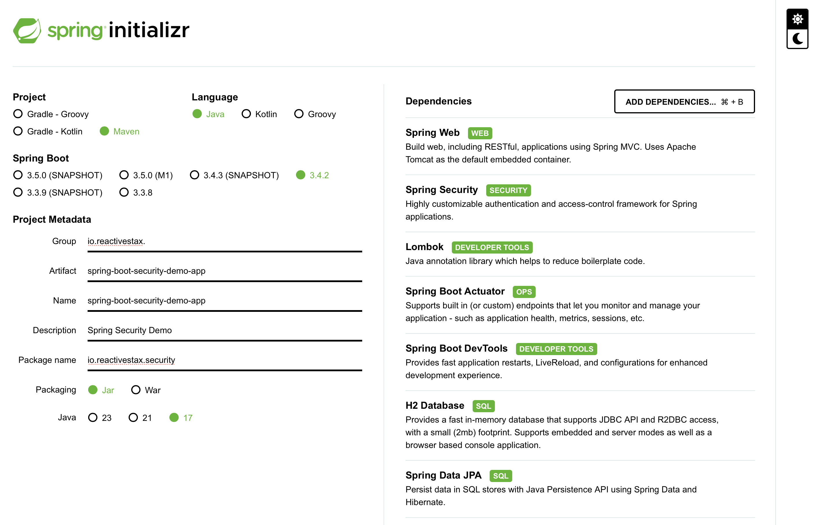

- Along with above dependencies selected at the spring boot starter we have also added a dependency to enable automatically swagger client generation for User Rest Controller's

  ```xml
  		<!-- starter auto generates the swagger for the spring rest controllers  -->
  		<dependency>
  			<groupId>org.springdoc</groupId>
  			<artifactId>springdoc-openapi-starter-webmvc-ui</artifactId>
  			<version>2.8.4</version>
  		</dependency>
  ```

- If we want to see the actuator rest endpoint available in generated swagger client we can add the below properties in the application.yml file

  ```yaml
  # below property will enable actuator endpoints in swagger
  springdoc:
    show-actuator: true
  
  # below endpoints enable health endpoints to show all details
  management:
    endpoint:
      health:
        show-details: always
        show-components: always
  ```

- When we create any spring boot project, it's a good idea we should also enable logging in the application.yml file, here I have defined the root level of logging as error and info level logging for complete spring framework classes and trace logging level for spring security framework classes.

  ```yaml
  logging:
    level:
      root: error
      org.springframework: info
      org.springframework.security: trace
  ```

- Spring Security’s Servlet support is based on **Servlet Filters** . The client sends a request to the application, and the 

  servlet container creates a **FilterChain** which contains the set of **Filters** and a **Servlet** that should process the **HttpServletRequest** based on the path of the **request URI**. 

- In a Spring MVC/REST application the Servlet is an instance of **DispatcherServlet** . At most **one Servlet** can handle a single HttpServletRequest and HttpServletResponse . However, more than one Filter can be used.

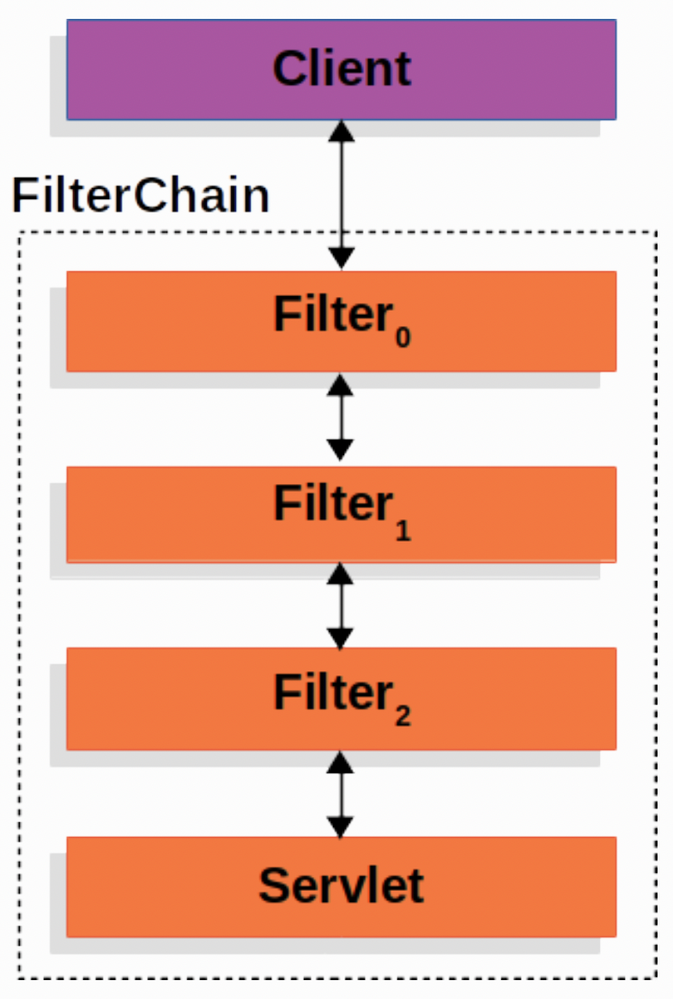

- **DelegatingFilterProxy** - In a traditional Java web application, servlet filters are managed by the **servlet container** (e.g., Tomcat, Jetty). However, **Spring Security filters** (like `FilterChainProxy`) are part of the Spring application context, which is **not** managed by the servlet container directly. This creates a challenge:

  - **Servlet containers** expect security filters to be registered in `web.xml` (or via `@WebFilter` in modern Java).
  - **Spring Security filters** are beans managed by the Spring container, which initializes them only **after** the application context is loaded.

  This is where **`DelegatingFilterProxy`** comes in. 

  Spring provides a **Filter** implementation called **DelegatingFilterProxy**, which acts as a bridge between the servlet container (e.g., Tomcat, Jetty, Undertow) and Spring's application context. Servlet containers allow registering filters using standard mechanisms (such as defining filters in **`web.xml`**), but they are unaware of Spring-managed beans. `DelegatingFilterProxy` enables the integration by being registered through the servlet container while delegating all filter operations to a Spring-managed bean that implements the `Filter` interface.

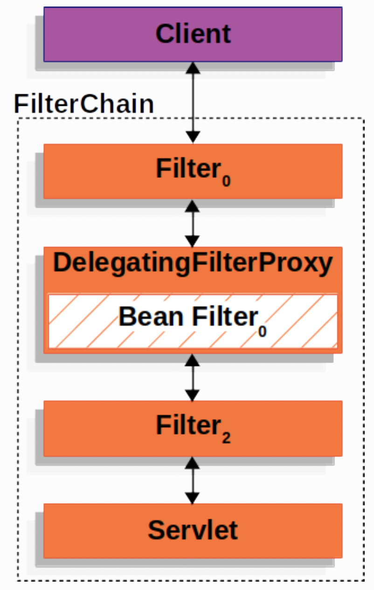

- Spring Security provides Servlet-based security through **`FilterChainProxy`**, which is responsible for delegating HTTP requests to multiple security filters managed within **SecurityFilterChain**. The `FilterChainProxy` is registered as a Spring-managed Bean and is typically wrapped by `DelegatingFilterProxy` when used in non-Spring servlet containers to ensure Spring-managed filters are applied to incoming requests.

- In **Spring Security**, the **DelegatingFilterProxy** and **FilterChainProxy** play distinct but interconnected roles in handling authentication and authorization. 

  **Execution Sequence**

  - **DelegatingFilterProxy** is executed **first**. It acts as a bridge between the web application container and Spring's application context.

  - **FilterChainProxy** is executed **next**, as it is the actual Spring-managed filter that performs security processing. It acts as a **composite filter**, managing a **chain** of **Spring Security filters** configured within the application

  

  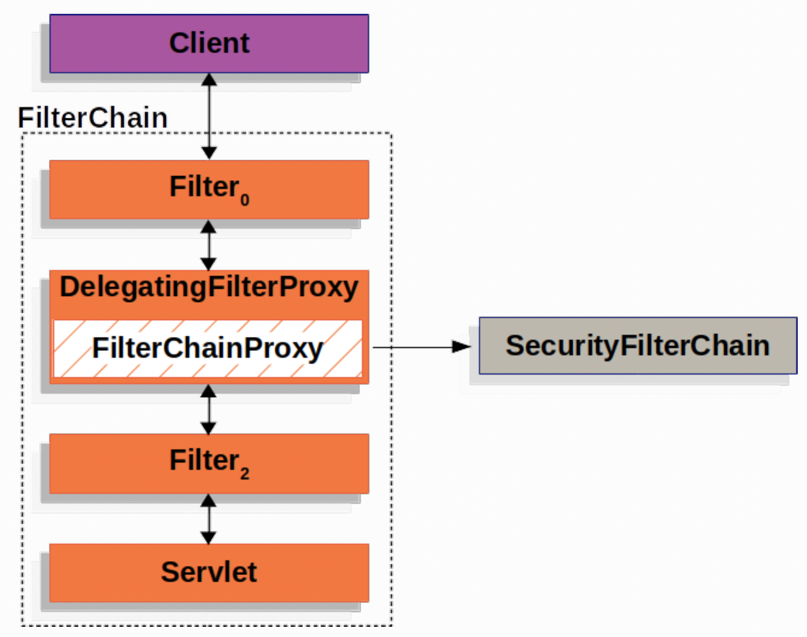

- **SecurityFilterChain** - is used by FilterChainProxy to determine which Spring Security Filter s should be invoked for this request.

  - The **`DelegatingFilterProxy`** acts as a **bridge** between the **servlet container (Tomcat, Jetty, etc.)** and **Spring's application context**.
    - **Intercepts incoming HTTP requests** at the servlet container level (like a normal servlet filter).
    - **Looks up the actual Spring-managed security filter bean** (usually `FilterChainProxy`) by its name in the application context.
    - **Delegates the request** to the Spring-managed filter chain (`FilterChainProxy`).
    - **Ensures Spring Security filters work inside the standard servlet filter mechanism**.

  

  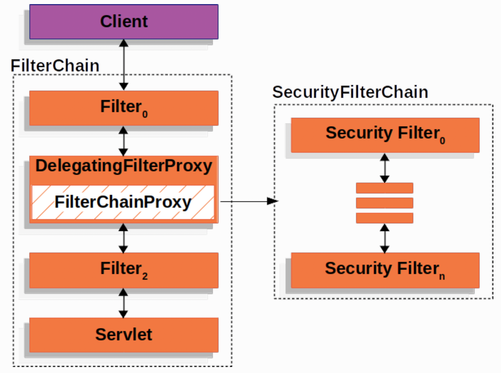

### **Spring Security Fundamentals terms and definitions**

- **Principal** - User that performs the action

- **User Authentication** - Confirming truth of credentials -> process of validating username and password

- **User Authorization** - Define access policy for principal -> validate the roles assigned to Principal / User is authorized to perform the required action

- **GrantedAuthority** - Spring Security Domain Object models application permissions granted to a principal (User).  

- **SecurityContext** -  Spring Security Domain Object Hold the authentication and other security information (It's a domain object initialized after successful authentication)

- **SecurityContextHolder** - Spring Security Utils Class Provides access to SecurityContext.  SecurityContextHolder and SecurityContext are key classes provides access to **Principal** and **GrantedAuthority** Domain objects anywhere in the application 

  ```java
  // org.springframework.security.core.context.SecurityContextHolder
  // org.springframework.security.core.context.SecurityContext
  
  // retrieve the security context of the authenticated user anywhere in the application
  SecurityContext securityContext = SecurityContextHolder.getContext();
  ```

- **AuthenticationManager** - The **`AuthenticationManager`** is a **core interface** in **Spring Security** responsible for **authenticating users**. It is the primary component that verifies user credentials and decides whether authentication should succeed or fail. The `AuthenticationManager` interface processes authentication requests and returns an authenticated **Authentication** object if successful, or throws an exception if authentication fails.

- **AuthenticationProvider** -  The **`AuthenticationProvider`** is an interface in **Spring Security** that defines the actual **authentication logic**. It is responsible for:

  	- **Verifying user credentials** (e.g., username/password, OAuth token, JWT, etc.).
  	- **Returning an authenticated `Authentication` object** if authentication succeeds.

  - **Throwing an exception** (e.g., UsernameNotFoundException, `BadCredentialsException`, AuthenticationException) if user is not found, authentication fails due to wrong password or some additional checks.

- **Authentication** - Spring Security Domain Object is created upon authentication, which holds the login credentials.

- **UserDetails** - Spring Security Domain Data object which contains the user credentials, but also the Roles of the user.

- **UserDetailsService** - Collects the user credentials, authorities(roles) and build an UserDetails object.

- **Realm** - A realm is a security policy domain defined for a web or application server. The protected resources on a server can be partitioned into a set of protection spaces, each with its own authentication scheme and/or authorization database containing a collection of users and groups. For a web application, a realm is a complete database of users and groups identified as valid users of a web application or a set of web applications and controlled by the same authentication policy. https://docs.oracle.com/cd/E19798-01/821-1841/6nmq2cpjd/index.html


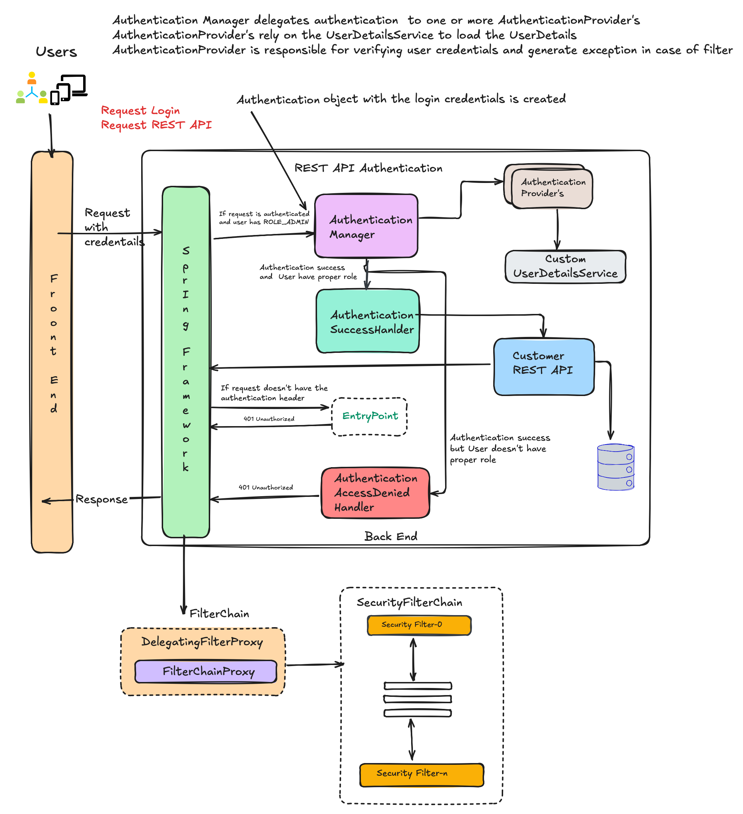

- After adding the Spring Security Maven dependency, all endpoints are automatically secured, as security is enabled by default. When we start the Spring Boot application, the console logs will display a message indicating that Spring Security is active, along with a list of enabled security filters. Additionally, a random password is generated for the default user **"user"**, based on the default Spring Security configuration

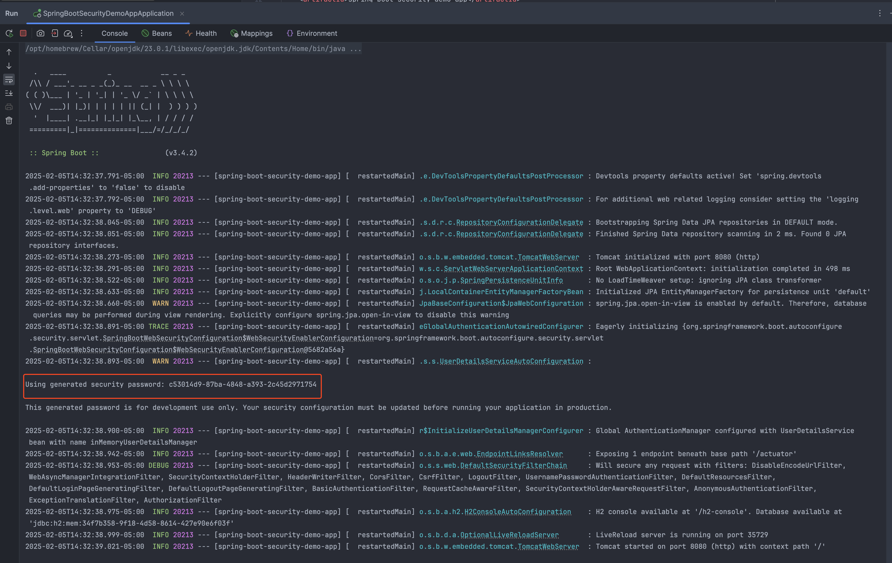

- When the Spring Security dependency is added, a default password is automatically generated and displayed in the Spring Boot console log. Alternatively, we can override the default username and password in the application properties file as shown below. These credentials can then be used to log in via a web browser, which will display the Swagger client page. Additionally, the same credentials can be used to make API requests through headless clients such as `curl` or `httpie`, or via REST clients like Postman and Insomnia.

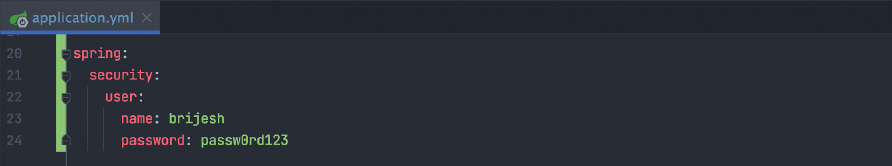

- List of default security filters (as of spring spring web 6.4.2 maven compatiable with spring boot 3.4.2) added automatically after adding spring security starter dependency and here is request flow when a client makes a HTTP request, shows all the filters configured by the **SecurityFilterChain**

  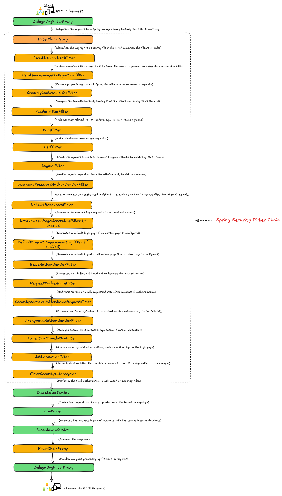

- If we try to access the swagger URL (http://localhost:8080/swagger-ui/index.html) spring security will redirect us to the default login page (http://localhost:8080/login) generated by the **DefaultLoginPageGeneratingFilter**. This filter is one of the filters listed above.

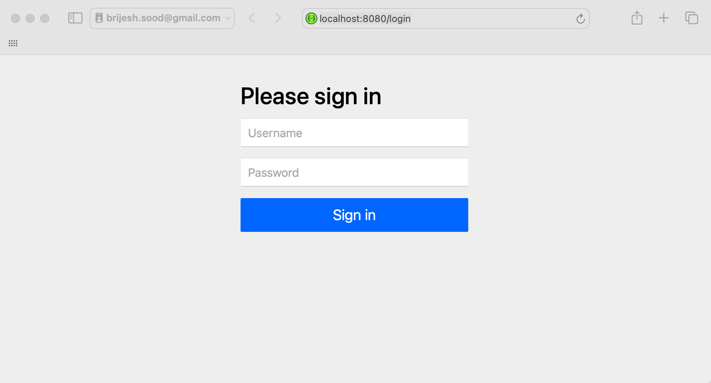

​								**spring security default login page**

- When we try access the swagger client (web client that allows us to test the rest API in the browser) to test the customer API endpoints defined at /api/v1/customers. Spring Security will redirect (HTTP 302) us to the login page. If attempt to access the same endpoint in postman, curl or httpie, it will generate HTTP 401 error. 

  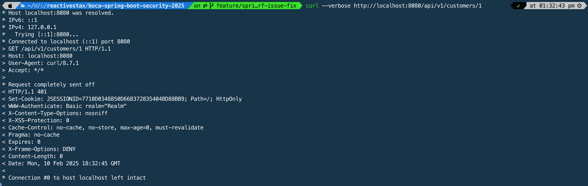

- We observe a difference in behavior when trying to access the `/api/v1/customers` endpoint. In a web browser, Spring Security redirects the request to the default login page, whereas when accessed via `curl` or an HTTP client, it returns an HTTP 401 (Unauthorized) response. This difference occurs because Spring Security evaluates the `"Accept"` HTTP header and generates an appropriate response based on the expected content type. If the request originates from a browser, it serves the default login page, while for headless clients like `curl`, it responds with a 401 status code.

## **How to completely Disable Spring Security**

Once the Spring Security dependency is added, it is enabled by default. If we need to disable it, we can either exclude the Spring Boot Security autoconfiguration annotations in the `@SpringBootApplication` annotation or disable it by defining properties in the `application.properties` or `application.yml` file. Ideally, we should use a property file to disable it, but for testing purposes, we can define a Spring profile with Spring Security disabled.

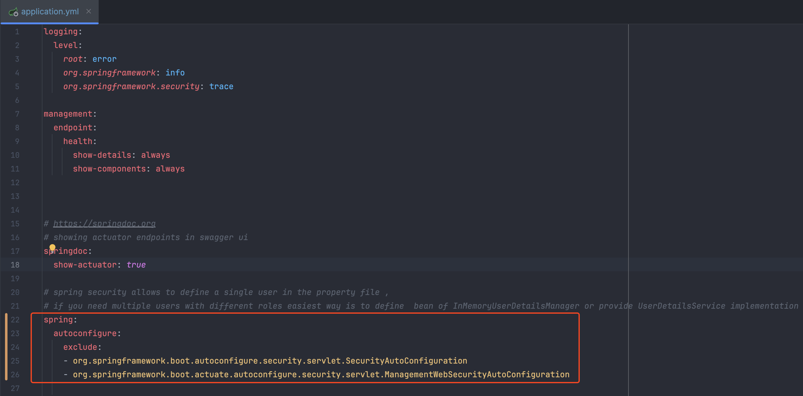

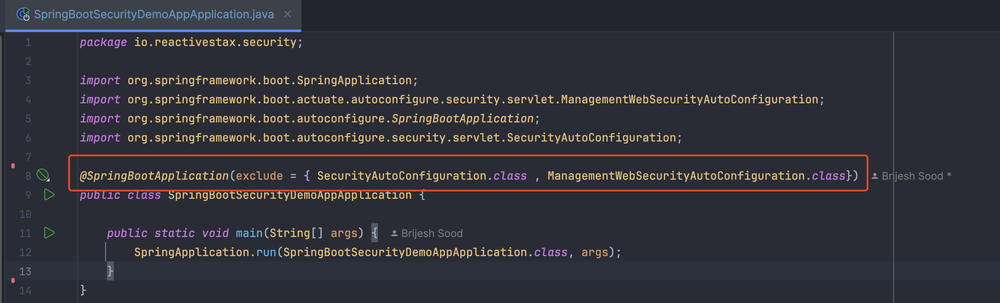

## Customize Spring Security Rule

Spring Security's auto-configuration is enabled when **SecurityAutoConfiguration.java** configuration is present in the application's classpath. This happens automatically when we add the Spring Security starter dependency in `pom.xml`. If we examine the source code of `SecurityAutoConfiguration.java`, we can see that it imports `SpringBootWebSecurityConfiguration.java`, which defines the default security configuration.

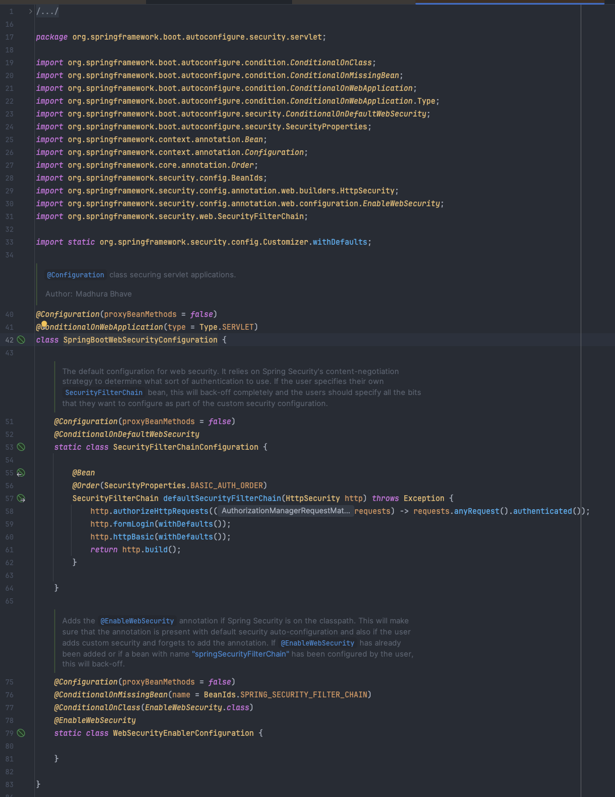

Here are the Spring Boot security features

- https://docs.spring.io/spring-boot/docs/2.0.x/reference/html/boot-features-security.html

In order to customize the Spring Security rules, we can define a `@Bean` of type **SecurityFilterChain** to customize the security rules. In this case, we have created a configuration class **ApplicationSecurityConfig.java**, annotated with **@EnableWebSecurity and @Configuration,** to apply the security rules defined by created a **SecurityFilterChain** bean.

Here we have SecurityFilterChain`  bean is customized to allow unauthenticated access to the Swagger client, while access to other endpoints requires authentication. CSRF protection  and CORS IS also disabled. Additionally, an authorization rule is defined, which requires an authenticated user accessing the `/api/v1/customers` endpoint to have the **ADMIN** role and Form and Basic Login enabled.

``` java
import org.springframework.context.annotation.Bean;
import org.springframework.context.annotation.Configuration;
import org.springframework.http.HttpMethod;
import org.springframework.security.config.Customizer;
import org.springframework.security.config.annotation.web.builders.HttpSecurity;
import org.springframework.security.config.annotation.web.configuration.EnableWebSecurity;
import org.springframework.security.web.SecurityFilterChain;

@Configuration
@EnableWebSecurity
// Added Spring Config to create SecurityFilterChain to define customize the security rules
// In older version of spring boot + spring security we used to define custom class that extends WebSecurityConfigurerAdapter and customize the security rules

// 	Spring Security 5.7 (April 2022) → Deprecated WebSecurityConfigurerAdapter.
//  Spring Security 6 (November 2022) → Removed WebSecurityConfigurerAdapter.
//	Use SecurityFilterChain instead to configure Spring Security in a cleaner and more modular way
public class ApplicationSecurityConfig {

    @Bean
    public SecurityFilterChain securityFilterChain(HttpSecurity http) throws Exception {
        //disabling the CSRF
        http.csrf(csrfConfigurer -> csrfConfigurer.disable())
             .cors(corsConfigurer -> corsConfigurer.disable()) // also disabling cors, we shouldn't diable cors 
                .authorizeHttpRequests(authorizeRequests -> authorizeRequests.requestMatchers(HttpMethod.GET, "/swagger-ui/**").permitAll())
                .authorizeHttpRequests(authorizeRequests -> authorizeRequests.requestMatchers(HttpMethod.GET, "/v3/api-docs/swagger-config").permitAll())
                .authorizeHttpRequests(authorizeRequests -> authorizeRequests.requestMatchers(HttpMethod.GET, "/v3/api-docs/**").permitAll())
                .authorizeHttpRequests(authorizeRequests -> authorizeRequests.requestMatchers(HttpMethod.GET, "/api/v1/customers").hasAuthority("ROLE_ADMIN"))
                .authorizeHttpRequests(authorizeRequests -> authorizeRequests.anyRequest().authenticated())
                .httpBasic(Customizer.withDefaults()) // http basic login is enabled
                .formLogin(Customizer.withDefaults()) // form login is enabled
        ;
        return http.build();
    }
}
```

Also, check **UserDetailsServiceAutoConfiguration**.java, which provides auto-configuration for a Spring Security in-memory `AuthenticationManager`. It adds an **InMemoryUserDetailsManager** with a default user and a generated password. The default auto-configuration creates a single user for the application to support. We can override these user properties to some extent using the configuration defined in the `application.properties` or application.yml file. For example, you can change the default username, replace the generated password with a static one, and specify custom roles, as shown below.

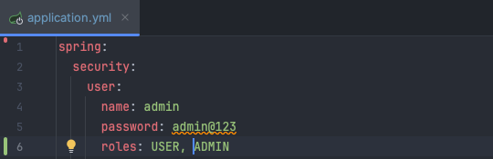

- With spring security maven dependency added to pom.xml spring security would enforces the default security rules like 

  - all requests should be authenticated

  - **CSRF** (Cross-site request forgery)security is enabled and all HTTP post/put/patch call required CSRF token presented in the http body so spring security can validated the requests and disable reply request

  - **CORS** (Cross-origin resource sharing)- defines a way for client web applications that are loaded in one domain to interact with resources in a different domain. By default spring doesn't the process the request coming from different origin.

  - Since security is enabled by default, all requests need to be authenticated. This can be done when a user opens a URL in the browser, where Spring Security will show the login page. The user can then enter the default username and password defined in the property file. If the user tries to access the URL using `curl` or an HTTP client, they will need to pass the username and password in the **Basic Authentication** header.

    **Basic Authentication** :  (Basic Auth) is a simple authentication mechanism where a client (e.g., browser, API client) sends a **username and password** encoded in **Base64** within the Authorization header of an HTTP request.

    **How Does Basic Authentication Work?**

    - **Client sends a request to a protected resource** (e.g., an API endpoint).

    - **Server responds with `401 Unauthorized`** and includes a `WWW-Authenticate: Basic` header.

    - **Client resends the request with credentials**:

      - Username and password are combined as `username:password`.

      - This string is encoded in **Base64** (not encrypted, just encoded).

      - Sent in the `Authorization: Basic` header.

      **Server decodes and verifies credentials**:

      - If valid, access is granted.
      - If invalid, access is denied.

- So what is **Basic Authentication** ? Basic authentication is way for client apps (postman, curl , http, spring boot rest template or any other client) to send authentication details by passing Authorization Header in the HTTP request header

  1. Basically we encode the username:password and do the Base64 encoding on it then pass the encoded value in the HTTP Request Header

  2. macOS and Linux come with the `base64` command-line utility, which can encode any set of characters into base64 encoding and decode it back to the original set of characters. For example, here I am running the `echo` command and passing `brijesh:sood` as an argument. Then, I specify the pipe (`|`) to redirect the output of the `echo` command to `base64`, which will encode the characters into base64 format.

     ```
     echo -n "brijesh:sood"|base64
     YnJpamVzaDpzb29k
     ```

     See the output generated by the above command **YnJpamVzaDpzb29k** , it can be converted back to the original text using 

     ```bash
     echo -n YnJpamVzaDpzb29kCg=|base64 -d
     brijesh:sood% 
     # when running base64 -d command in zsh , it may append % sign the output it's due the zsh terminal configuration how it handles certain characters
     ```

- Please note Spring Boot relies on Spring Security’s **content-negotiation** strategy to determine whether to use httpBasic or formLogin

```yaml
# spring security allows to define a single user in the property file ,
# if you need multiple users with different roles easiest way is to define  bean of InMemoryUserDetailsManager or provide UserDetailsService implementation
spring:
  security:
    user:
      name: admin
      password: admin@123
```

- Here we have the defined the default spring security user which can be used to make the API call. Please note we need pass basic auth credentails to http clients (httpie and curl)

  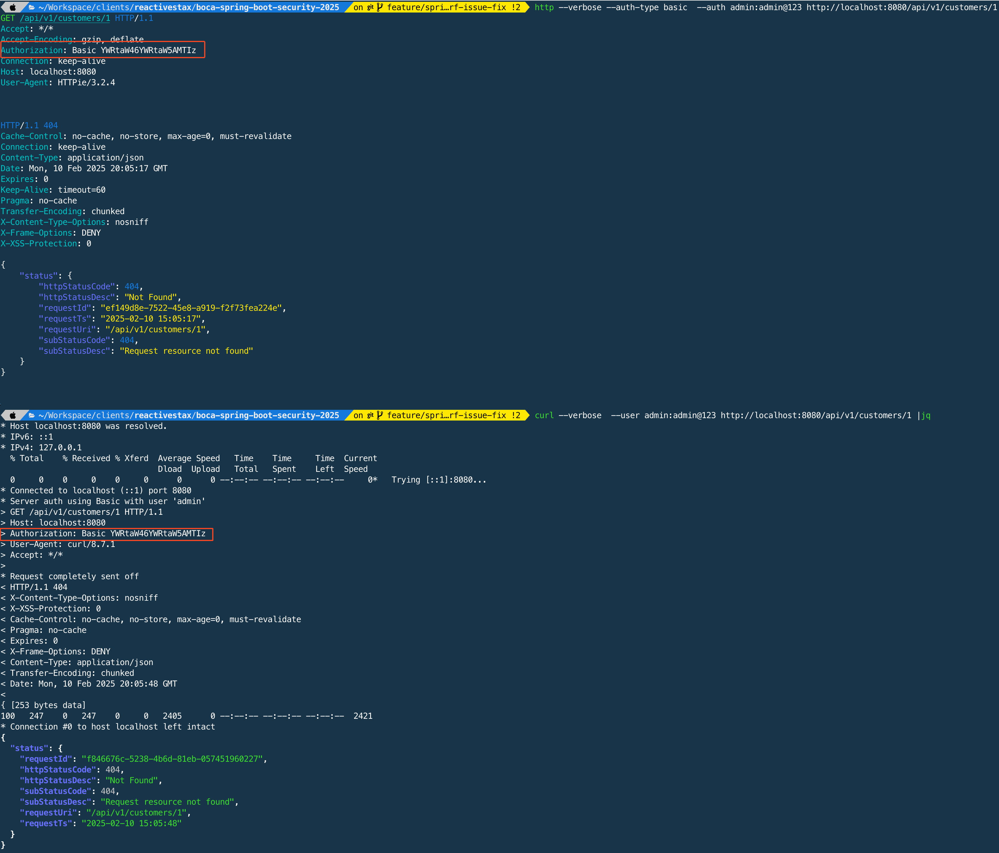

- Please see the `ApplicationSecurityConfig` class, where we have defined a special rule for accessing the **`"/api/v1/customers"` endpoint**. Specifically, users must have the **ADMIN** role **[`authorizeRequests.requestMatchers(HttpMethod.GET, "/api/v1/customers").hasAuthority("ROLE_ADMIN")`]** to make API calls to this endpoint. For all other endpoints, users only need to be authenticated. As a result, when an API call is made to **`"/api/v1/customers"`** without the required role, it results in an **HTTP 403 Forbidden** error instead of an **HTTP 404 Not Found** error, which indicates a missing resource.

  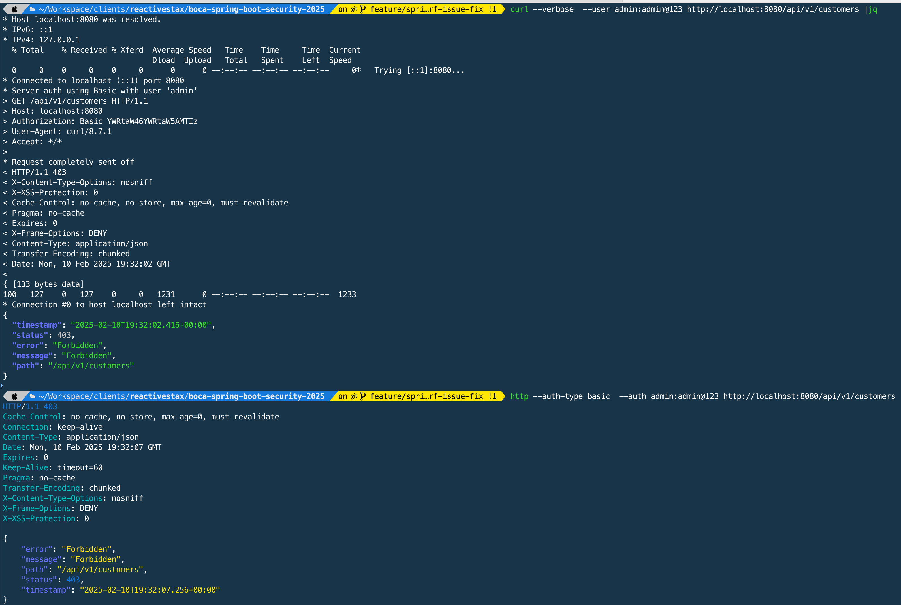

- In order to access the endpoint we are going to update application.yml property file to define the default role for the user  admin. Here we have defined the default role as **ADMIN**

  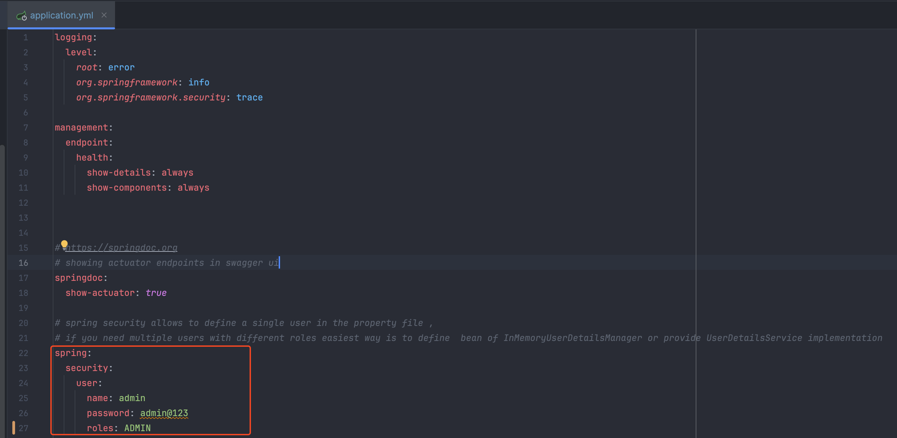

- Here is the API call for the admin user without any error. Please see the HTTP Authorization Header password

  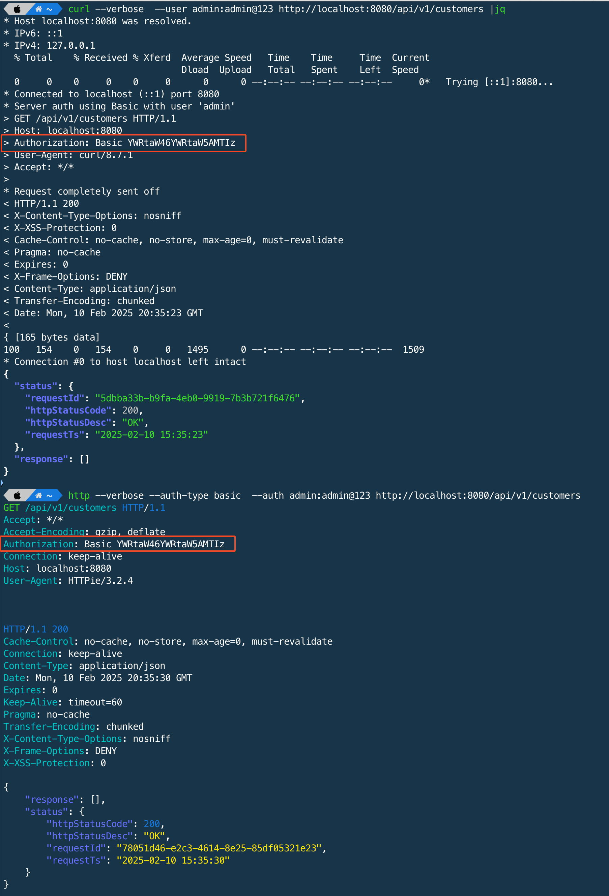

As per the current setup we have a single user's defined in the application.yml, spring provides integration with various datastore to read user details for authentication and authorization. 

Here are few options

Using **InMemoryUserDetailsManager** bean for testing to define multiple user's with different roles

```java
   @Bean
    public UserDetailsService users() {
        // The builder will ensure the passwords are encoded before saving in memory
        User.UserBuilder users = User.withDefaultPasswordEncoder();
        UserDetails user = users
                .username("user")
                .password("Passw0rd123")
                .roles("USER") // user with USER ROLE
                .build();
        UserDetails admin = users
                .username("admin")
                .password("Passw0rd123")
                .roles("USER", "ADMIN") // admin user with USER and ADMIN role
                .build();
        return new InMemoryUserDetailsManager(user, admin);
    }
// above we have defined UserDetailsService with two users stored in memory
```

 **Here we have defined UserDetailsService with Passcode encoders (enable one of the passcode bean)**

```java

    @Bean
    public UserDetailsService createUserDetailsServiceWithPasswordEncoder() {
        // enable pbkdf2PasswordEncoder or bCryptPasswordEncoder password encoder bean and use the same bean
        PasswordEncoder passwordEncoder = bCryptPasswordEncoder();
        UserDetails user = User.withUsername("user").password(passwordEncoder.encode("Passw0rd@123")).roles("USER").build();
        UserDetails admin = User.withUsername("admin").password(passwordEncoder.encode("Passw0rd@123")).roles("USER","ADMIN").build();
        return new InMemoryUserDetailsManager(user, admin);
    }

    //@Bean
    public PasswordEncoder pbkdf2PasswordEncoder() {
        return  Pbkdf2PasswordEncoder.defaultsForSpringSecurity_v5_8();
    }

    @Bean
    public PasswordEncoder bCryptPasswordEncoder() {
        return new BCryptPasswordEncoder();
    }
```

- *We can also provide custom implementation of UserDetailsService with*  username, password, and roles are stored in the database. Please refer to the database model https://docs.spring.io/spring-security/reference/servlet/appendix/database-schema.html to manage users , roles based on the data model implemented by spring security.

  ```java
  
  import org.springframework.context.annotation.Bean;
  import org.springframework.context.annotation.Configuration;
  import org.springframework.security.core.userdetails.User;
  import org.springframework.security.core.userdetails.UserDetails;
  import org.springframework.security.core.userdetails.UserDetailsService;
  import org.springframework.security.core.userdetails.UsernameNotFoundException;
  import org.springframework.security.crypto.bcrypt.BCryptPasswordEncoder;
  import org.springframework.security.crypto.password.PasswordEncoder;
  import org.springframework.stereotype.Service;
  
  @Service
  //Dummy UserDetailsService implementation
  //Ideally we should load the user detail from the table with authorities (attached) to it or directory service like ldap
  //To know all the roles belongs to a user check interface UserDetails interface
  //
  @Configuration
  public class AppUserDetailsServiceImpl implements UserDetailsService {
  
      //jdbctemplate
      //user repostory
  
      @Override
      public UserDetails loadUserByUsername(String username) throws UsernameNotFoundException {
          return User.withUsername(username)
                  .accountExpired(false)
                  .accountLocked(false)
                  .disabled(false)
                  .password("Passw0rd123")
                  .credentialsExpired(false)
                  .roles(username.toUpperCase().contains("ADMIN") ? "ADMIN": "USER") // hack if username container admin we give user admin role otherwise user role, it should be coming from datastore
                  .passwordEncoder(password -> new BCryptPasswordEncoder().encode(password))
                  .build();
      }
  
      @Bean
      public PasswordEncoder passwordEncoder() {
          return new BCryptPasswordEncoder();
      }
  }
  ```

  

- Making api request to /api/v1/customers endpoint using httpie client with admin user

  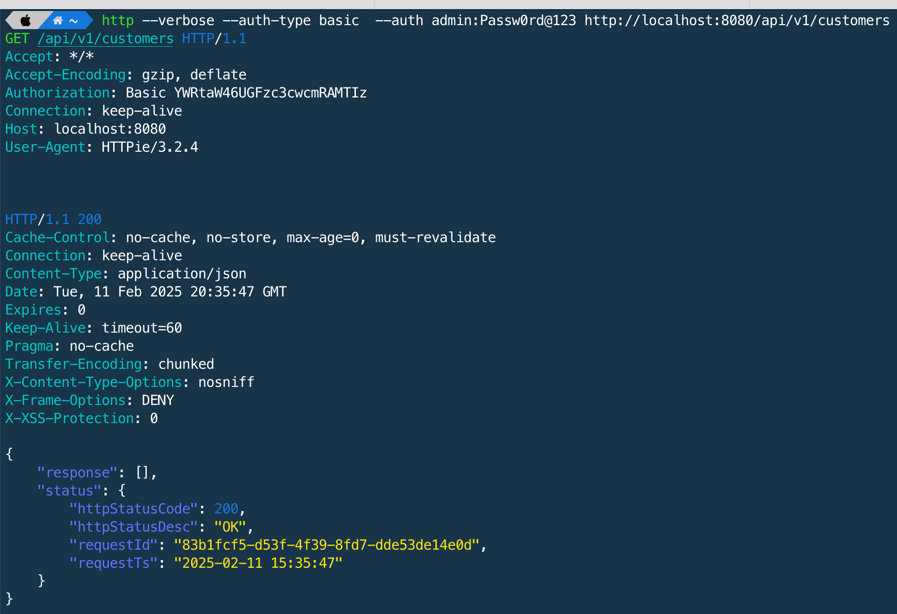

Making api request to /api/v1/customers/1 endpoint using http client with basic auth username as user and password as Passw0rd@123

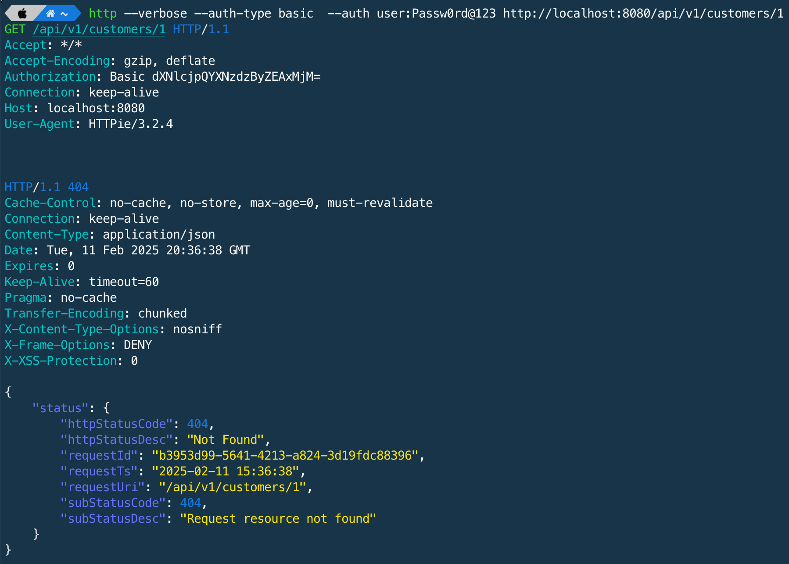

Making api request to /api/v1/customers  endpoint with username as user and password as Passw0rd@123 and getting http 403 Foribidden error

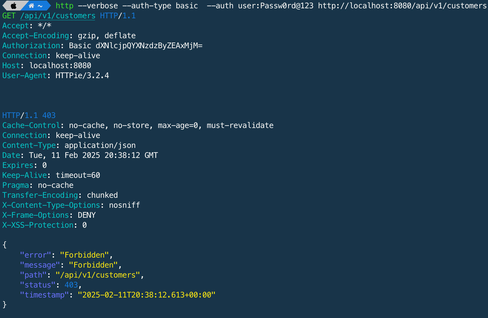

## **CSRF**

##### What is CSRF (Cross-Site Request Forgery)?
**Cross-Site Request Forgery (CSRF)** is an attack where an **unauthorized request** is sent from an **authenticated user's session** to a web application **without their consent**. 

✅ **CSRF allows attackers to perform actions on behalf of authenticated users.**  
🔴 **Attackers do NOT need to steal credentials, they just exploit an active session!**

##### How Does a CSRF Attack Work?
###### Example Scenario: Banking Application
- You log into **your online banking account** (`https://mybank.com`).
- Your session is active, and your browser stores the **session cookies**.
- While logged in, you visit a malicious site (**attacker.com**).
- The malicious site contains an **invisible form** that submits a **transfer request** to `https://mybank.com/transfer`.

###### 🔴 **Malicious Auto-Submit Form**

```html
<form action="https://mybank.com/transfer" method="POST">
    <input type="hidden" name="amount" value="10000">
    <input type="hidden" name="toAccount" value="attacker123">
    <script>document.forms[0].submit();</script>
</form>
```
✅ Since you are **already logged into your bank**, your browser **automatically** includes the session cookies in the request!  ✅ The bank **processes the request as if YOU sent it**, transferring money to the attacker's account!  

###### Why Does Spring Security Enable CSRF Protection by Default?
- Spring Security enables CSRF protection by default to prevent such attacks.  
- Since **Spring Security 4.0**, CSRF protection is **enabled for all state-changing HTTP methods (`POST`, `PUT`, `DELETE`, `PATCH`)**.

###### 🚀 **CSRF is enabled because:**  

✅ Most modern applications **store user authentication in cookies**.  
✅ Web browsers **automatically send cookies** with every request, even from a malicious site.  
✅ Attackers can exploit this to perform **unauthorized actions**.  

###### How Does Spring Security Protect Against CSRF?
Spring Security mitigates CSRF attacks by requiring a **special CSRF token** for state-changing requests (`POST`, `PUT`, `DELETE`, `PATCH`).

###### CSRF Token-Based Protection
- A unique **CSRF token** is generated **per session**.
- The token must be included **explicitly in the request body** or **as a request header**.
- If the token is missing or invalid, Spring Security **rejects the request**.

###### How to Use CSRF in Spring Security?
###### 🔹 Default Behavior (CSRF Enabled)
By default, Spring Security expects the **CSRF token** to be included in every `POST`, `PUT`, `DELETE`, or `PATCH` request.

**HTML Form Example:**

```html
<form action="/transfer" method="POST">
    <input type="hidden" name="_csrf" value="e9f7a8c4-1234-4e00-b6fd">
    <input type="text" name="amount" placeholder="Enter amount">
    <button type="submit">Transfer</button>
</form>
```

✅ The `_csrf` token is added to every form submission.

###### **🔹 How to Get CSRF Token in JavaScript?**
If using JavaScript for AJAX requests, you need to **fetch the CSRF token** from the page's meta tag or a REST API endpoint.

```html
<meta name="_csrf" content="e9f7a8c4-1234-4e00-b6fd">
<meta name="_csrf_header" content="X-CSRF-TOKEN">
```
###### **AJAX Request with CSRF Token:**

```javascript
let csrfToken = document.querySelector('meta[name="_csrf"]').content;
let csrfHeader = document.querySelector('meta[name="_csrf_header"]').content;

fetch('/transfer', {
    method: 'POST',
    headers: {
        [csrfHeader]: csrfToken,
        'Content-Type': 'application/json'
    },
    body: JSON.stringify({ amount: 100 })
});
```

✅ The CSRF token is sent in the `X-CSRF-TOKEN` header.

---

##### How to Disable CSRF Protection?
If you're building a **REST API** (which does not use cookies for authentication), you **can disable CSRF protection**:

```java
@Configuration
public class ApplicationSecurityConfig {
    @Bean
    public SecurityFilterChain securityFilterChain(HttpSecurity http) throws Exception {
        http
            .csrf(csrf -> csrf.disable()); // 🚨 WARNING: Disabling CSRF is risky for web a
      // define/customize the rules as per your application requriement
        return http.build();
    }
}
```
✅ **Only disable CSRF if your API uses JWT or OAuth for authentication** (not cookies).

| Feature                                    | Description                                                  |
| ------------------------------------------ | ------------------------------------------------------------ |
| **CSRF (Cross-Site Request Forgery)**      | An attack where a **malicious site tricks a logged-in user** into performing actions without their consent. |
| **Why is it Dangerous?**                   | Exploits **authenticated sessions** to perform unauthorized actions (e.g., transferring money). |
| **How Does Spring Security Prevent It?**   | **CSRF token-based protection** for `POST`, `PUT`, `DELETE`, `PATCH` requests. |
| **Is CSRF Protection Enabled by Default?** | ✅ **Yes, enabled since Spring Security 4.0**.                |
| **When to Disable It?**                    | Only for **REST APIs using JWT/OAuth** (not for web apps with cookies). |


With the Spring Security dependency enabled, it automatically enables CSRF protection (https://www.imperva.com/learn/application-security/csrf-cross-site-request-forgery/) to  HTTP POST, PUT, PATCH, and DELETE rest endpoints. Therefore, when we try to make an HTTP request, it may result in an HTTP 401 or 403 error (older version of spring security returns HTTP 403 and spring security 6.x return HTTP 401). 

There is considerable debate over whether CSRF protection should be used for REST APIs. The general rule is that if the application is not using cookies for session management, it is safe to disable CSRF protection. 

Here are a few links discussing the implications and use of CSRF with RESTful APIs.

- https://jemurai.com/2018/08/27/csrf-tokens-with-restful-apis/
-  https://security.stackexchange.com/questions/166724/should-i-use-csrf-protection-on-rest-api-endpoints
-  https://www.imperva.com/learn/application-security/csrf-cross-site-request-forgery/).

**Question:** Why is Spring Security Returning `401 Unauthorized` Instead of `403 Forbidden` for a POST, PUT, PATCH, and DELETE Requests with CSRF Enabled, despite providing authentication?

##### Scenario

- We are using Basic Authentication (`-u admin:Passw0rd@123`).
- GET requests work fine (authentication is successful)
- DELETE requests fail with **`401 Unauthorized`**, even though the logs **show `403 Forbidden`** from the CSRF filter.

###### **1️⃣ Why Is This Happening?**

1. ###### **Authentication Works for GET Requests**  
   
   - The same authentication headers work fine when using `GET` requests.
   
2. ###### **DELETE Request Fails Due to Missing CSRF Token**
   
   ```
   DEBUG o.s.security.web.csrf.CsrfFilter : Invalid CSRF token found for DELETE /api/v1/customers/1
   DEBUG o.s.s.w.access.AccessDeniedHandlerImpl : Responding with 403 status code
   ```
   - The **CSRF filter detects a missing CSRF token** and rejects the request.
   - **Spring Security logs `403 Forbidden`**.
   
3. ###### **Spring Security Then Redirects to Authentication Entry Point (`401 Unauthorized`)**
   
   ```
   DEBUG s.w.a.DelegatingAuthenticationEntryPoint : No match found. Using default entry point org.springframework.security.web.authentication.www.BasicAuthenticationEntryPoint
   ```
   - Instead of sending `403 Forbidden`, **Spring Security redirects to the authentication entry point**, resulting in `401 Unauthorized`.

###### **2️⃣ Why Does This Happen Only for POST, PUT, PATCH, and DELETE Requests?**

Spring Security has **different handling for safe (GET, OPTIONS) and unsafe (DELETE, POST, PUT, PATCH) HTTP methods** when CSRF is enabled:

**GET Request Flow (Works Fine)**

​	✔️ User is authenticated → **No CSRF check for GET requests** → **Returns 200 OK**.

**DELETE Request Flow (Fails With 401)**

​	✔️ User is authenticated → ❌ **CSRF token is missing** → ❌ **Spring Security denies the request (`403 Forbidden`)** → 	❌ **Triggers Authentication Entry Point (`401 Unauthorized`)**.

###### Why Does the Authentication Entry Point Get Triggered?
- Spring Security considers CSRF failures an **"access denied" scenario**.
- However, if the authentication context is not **fully established**, it **triggers re-authentication** instead of enforcing `403 Forbidden`.
- This causes Spring Security to **redirect to the Basic Authentication entry point**, leading to a `401 Unauthorized` response.

**3️⃣ How to Ensure Spring Security Returns `403 Forbidden` Instead of `401 Unauthorized`**

To fix this issue, **we need to ensure that CSRF failures do not trigger re-authentication**.

##### **✅ Solution 1 : Use a Custom Authentication Entry Point**

###### Step 1: Create a Custom Entry Point
```java
package io.reactivestax.security.web.security;

import jakarta.servlet.http.HttpServletRequest;
import jakarta.servlet.http.HttpServletResponse;
import org.springframework.security.core.AuthenticationException;
import org.springframework.security.web.AuthenticationEntryPoint;
import org.springframework.stereotype.Component;

import java.io.IOException;

@Component
public class CustomAuthenticationEntryPoint implements AuthenticationEntryPoint {

    @Override
    public void commence(HttpServletRequest request,
                         HttpServletResponse response,
                         AuthenticationException authException) throws IOException {
        String method = request.getMethod();
        // Only enforce CSRF failures for unsafe methods (POST, PUT, DELETE, PATCH)
        if ((method.equalsIgnoreCase("POST") || method.equalsIgnoreCase("PUT") ||
                method.equalsIgnoreCase("DELETE") || method.equalsIgnoreCase("PATCH"))
                && request.getAttribute("_csrf") != null) {
            response.setContentType("application/json");
            response.setStatus(HttpServletResponse.SC_FORBIDDEN); // 403 Forbidden for CSRF failures
            response.getWriter().write("{\"error\": \"Forbidden\", \"message\": \"CSRF token missing or invalid\"}");
        } else {
            // Authentication failure for GET and other requests should return 401 Unauthorized
            response.sendError(HttpServletResponse.SC_UNAUTHORIZED, "Unauthorized");
        }
    }

}

```

###### **Step 2: Register It in Security Configuration**
```java
public class ApplicationSecurityConfig {

    @Autowired
    private CustomAuthenticationEntryPoint entryPoint;

    @Bean
    public SecurityFilterChain securityFilterChain(HttpSecurity http) throws Exception {
        http
                .authorizeHttpRequests(authorizeRequests -> authorizeRequests.requestMatchers(HttpMethod.OPTIONS).permitAll())
                .authorizeHttpRequests(authorizeRequests -> authorizeRequests.requestMatchers(HttpMethod.GET, "/swagger-ui/**").permitAll())
                .authorizeHttpRequests(authorizeRequests -> authorizeRequests.requestMatchers(HttpMethod.GET, "/v3/api-docs/swagger-config").permitAll())
                .authorizeHttpRequests(authorizeRequests -> authorizeRequests.requestMatchers(HttpMethod.GET, "/v3/api-docs/**").permitAll())
                .authorizeHttpRequests(authorizeRequests -> authorizeRequests.requestMatchers(HttpMethod.GET, "/api/v1/customers").hasAuthority("ROLE_ADMIN"))

                .authorizeHttpRequests(authorizeRequests -> authorizeRequests.anyRequest().authenticated())
                .httpBasic(Customizer.withDefaults()) // http basic login is enabled
                .formLogin(Customizer.withDefaults()) // form login is enabled
                .exceptionHandling(ex -> ex.authenticationEntryPoint(entryPoint)) // Use custom entry point
                .sessionManagement(sessionManagement -> sessionManagement.sessionCreationPolicy(SessionCreationPolicy.STATELESS));
        return http.build();
    }
}
```
✅ Now, CSRF failures will correctly return `403 Forbidden` instead of `401 Unauthorized`.

##### ✅ Solution 2: If Using a Stateless API, Disable CSRF

If your API is **stateless** (e.g., using JWT, OAuth2, or Basic Auth), **CSRF is unnecessary**.

###### **Modify Spring Security Configuration**
```java
    @Bean
    public SecurityFilterChain securityFilterChain(HttpSecurity http) throws Exception {
        http
                .csrf(csrfConfigurer -> csrfConfigurer.disable())
                .authorizeHttpRequests(authorizeRequests -> authorizeRequests.requestMatchers(HttpMethod.OPTIONS).permitAll())
                .authorizeHttpRequests(authorizeRequests -> authorizeRequests.requestMatchers(HttpMethod.GET, "/swagger-ui/**").permitAll())
                .authorizeHttpRequests(authorizeRequests -> authorizeRequests.requestMatchers(HttpMethod.GET, "/v3/api-docs/swagger-config").permitAll())
                .authorizeHttpRequests(authorizeRequests -> authorizeRequests.requestMatchers(HttpMethod.GET, "/v3/api-docs/**").permitAll())
                .authorizeHttpRequests(authorizeRequests -> authorizeRequests.requestMatchers(HttpMethod.GET, "/api/v1/customers").hasAuthority("ROLE_ADMIN"))

                .authorizeHttpRequests(authorizeRequests -> authorizeRequests.anyRequest().authenticated())
                .httpBasic(Customizer.withDefaults()) // http basic login is enabled
                .formLogin(Customizer.withDefaults()) // form login is enabled
                .exceptionHandling(ex -> ex.authenticationEntryPoint(entryPoint)) // Use custom entry point
                .sessionManagement(sessionManagement -> sessionManagement.sessionCreationPolicy(SessionCreationPolicy.STATELESS))

        ;
        return http.build();
    }
```
✅ **Now, DELETE requests will not require a CSRF token and will only fail if authentication is incorrect.**

** Summary**

| **Issue**                                                    | **Cause**                                                    | **Fix**                                                      |
| ------------------------------------------------------------ | ------------------------------------------------------------ | ------------------------------------------------------------ |
| **Spring logs `403 Forbidden`, but cURL gets `401 Unauthorized`** | Spring redirects to the authentication entry point instead of enforcing `403`. | **Use `Http403ForbiddenEntryPoint` or a custom authentication entry point**. |
| **Authenticated DELETE request fails due to missing CSRF token** | CSRF is enabled by default for state-changing HTTP methods.  | **Send CSRF token or disable CSRF if API is stateless**.     |
| **Stateless APIs shouldn’t require CSRF**                    | CSRF is only needed for session-based authentication.        | **Disable CSRF for API endpoints if using JWT/OAuth2**.      |

**Final Recommendation**

- If you want to **keep CSRF enabled**, **use `CustomAuthenticationEntryPoint` to ensure `403 Forbidden` is returned**.
- If your API is **stateless (JWT, OAuth2, Basic Auth)**, **disable CSRF for API endpoints**.

Spring Security default error response without using **authenticationEntryPoint**

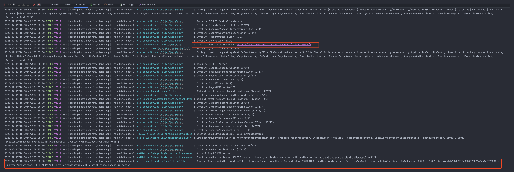

Spring Security default error and success response with using **authenticationEntryPoint**

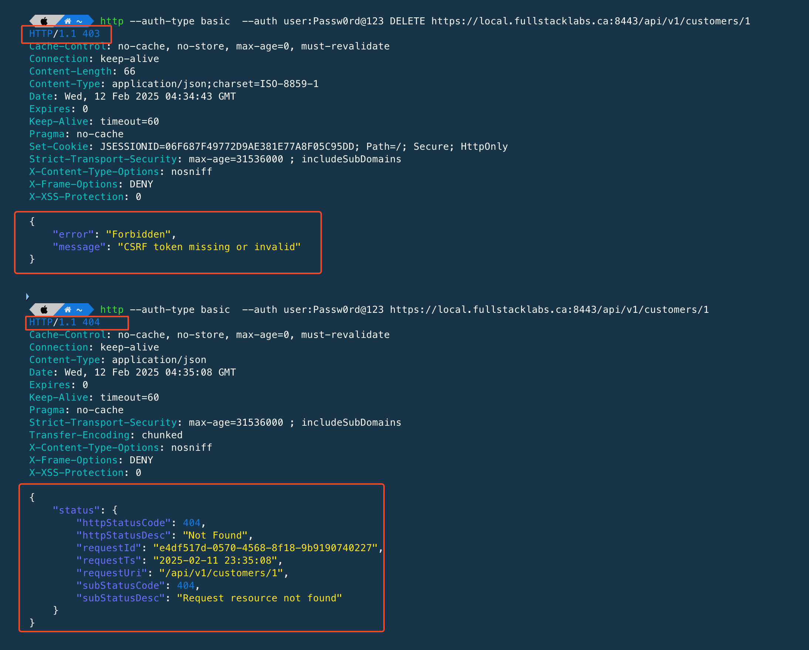

**In a nutshell, if we are using cookie based sessions in SPA (single page apps) then we should have CSRF protection.**


## CORS

Cross-origin requests occur when the origin of the request (the source) differs from the target (the destination). For example, this happens when a web application hosted on one domain sends an AJAX request to a server on a different domain. To handle cross-origin requests, the server must implement a mechanism called CORS (Cross-Origin Resource Sharing).

The first step in CORS is when the origin sends a pre-flight request to the target to verify whether the request is permitted. The server then responds to the pre-flight request with a set of headers indicating whether the cross-origin request is allowed.

A **preflight request** is a part of the **CORS mechanism** in which the browser first sends an `OPTIONS` request before making the actual request (e.g., `POST`, `PUT`, or `DELETE`). This is done to determine if the server allows the cross-origin request

**1. Why Is a Preflight Request Needed?**

- **Browsers enforce CORS restrictions** to prevent unauthorized requests across different origins.
- If a request is **"complex"**, the browser **sends a preflight request first** to **ask the server for permission**.
- The server **responds with allowed methods, headers, and origins**.
- If the response is valid, the browser **sends the actual request**.

**2. What Triggers a Preflight Request?**

A browser automatically sends a **preflight request (`OPTIONS` request)** when:
- **The request method is not a "simple" method** (not `GET`, `POST`, or `HEAD`).
- **Custom headers are included** (e.g., `Authorization`, `X-Auth-Token`).
- **`Content-Type` is anything other than `application/x-www-form-urlencoded`, `multipart/form-data`, or `text/plain`**.

> **Example:** A `DELETE` request with an `Authorization` header **will trigger a preflight request**.

**3. How a Preflight Request Works**

**Step 1: The Browser Sends a Preflight `OPTIONS` Request**

​	Before making the actual request, the browser sends an **HTTP `OPTIONS` request** to ask the server whether the actual 	request is allowed.

​	**Example: Preflight Request**

```http
OPTIONS /api/v1/offered-courses HTTP/1.1
Origin: https://activelifecanada.com
Access-Control-Request-Method: DELETE
Access-Control-Request-Headers: Authorization, X-Custom-Header
```
 **Key Headers in Preflight Request:**
- **`Access-Control-Request-Method`** → Indicates the actual request method (`DELETE` in this case).
- **`Access-Control-Request-Headers`** → Lists custom headers (`Authorization`, `X-Custom-Header`).
- **`Origin`** → Specifies the origin making the request.

**Step 2: The Server Responds with Allowed CORS Rules**

​	If the request is allowed, the server responds with:
```http
HTTP/1.1 200 OK
Access-Control-Allow-Origin: https://activelifecanada.com
Access-Control-Allow-Methods: GET, POST, DELETE
Access-Control-Allow-Headers: Authorization, X-Custom-Header
Access-Control-Max-Age: 3600
```
 **Key Headers in Preflight Response:**
- **`Access-Control-Allow-Origin`** → Specifies which domains are allowed (`https://frontend.com`).
- **`Access-Control-Allow-Methods`** → Lists allowed HTTP methods (`GET`, `POST`, `DELETE`).
- **`Access-Control-Allow-Headers`** → Lists allowed headers (`Authorization`, `X-Custom-Header`).
- **`Access-Control-Max-Age`** → Tells the browser how long it can cache this response (3600 sec = 1 hour).

**Step 3: The Browser Sends the Actual Request**

If the preflight response allows the request, the browser **sends the actual `DELETE` request**:
```http
DELETE /api/v1/offered-courses HTTP/1.1
Origin: https://activelifecanada.com
Authorization: Bearer token123
X-Custom-Header: myvalue
```
Now the request is processed by the server!

**4 When Does a Request NOT Trigger a Preflight?**

A **preflight request is NOT triggered** if:
1. **The request uses a "simple" method** (`GET`, `POST`, `HEAD`).
2. **It does not include custom headers** (only standard ones like `Content-Type: application/x-www-form-urlencoded`).
3. **The `Content-Type` is one of the allowed types**:
   - `application/x-www-form-urlencoded`
   - `multipart/form-data`
   - `text/plain`

> **Example of a request that does NOT trigger preflight:**
```http
POST /api/login HTTP/1.1
Content-Type: application/x-www-form-urlencoded
```

**5. Handling Preflight Requests in Spring Boot**

If your API should allow CORS, you must **handle preflight requests** properly.

**Allow Preflight Requests in Spring Boot**

```java
@Bean
public WebMvcConfigurer corsConfigurer() {
    return new WebMvcConfigurer() {
        @Override
        public void addCorsMappings(CorsRegistry registry) {
            registry.addMapping("/**")
                    .allowedOrigins("https://activelifecanada.com")
                    .allowedMethods("GET", "POST", "PUT", "DELETE", "OPTIONS") // Include OPTIONS
                    .allowedHeaders("Authorization", "Content-Type", "X-Custom-Header")
                    .allowCredentials(true)
                    .maxAge(3600); // Cache preflight response for 1 hour
        }
    };
}
```
### **Access-Control-Allow-Origin** 

- The `Access-Control-Allow-Origin` header is an **HTTP response header** used in **Cross-Origin Resource Sharing (CORS)** to control which domains are allowed to access resources on a server from a different origin.

  **1 Why Is It Needed?**

  By default, browsers enforce the **Same-Origin Policy**, meaning a web page **can only make requests to the same domain** that served the page. 

  However, sometimes we need to allow **cross-origin requests** (e.g., when a frontend on `http://example.com` calls an API at `http://api.example.com`).

  **The `Access-Control-Allow-Origin` header relaxes this restriction** by explicitly allowing certain origins to access the server’s resources.

  **2 How Does It Work?**

  **Example of a Cross-Origin Request**

  Let's say a frontend application hosted at:
  ```
  https://activelifecanada.com
  ```
  makes a request to an API hosted at:
  ```
  https://api.activelifecanada.com
  ```
  Since these domains **don’t match**, the browser blocks the request **unless the server explicitly allows it** using CORS headers.

  **3 Example: Server Allowing a Specific Origin**

  If the API server wants to **allow requests from `https://activelifecanada.com`**, it must include the `Access-Control-Allow-Origin` header in its response:
  ```http
  HTTP/1.1 200 OK
  Access-Control-Allow-Origin: https://activelifecanada.com
  ```
  Now, the browser **allows the request** because the server explicitly permitted it.

  **4 Possible Values for `Access-Control-Allow-Origin`**

  | **Header Value**               | **Meaning**                                                  |
  | ------------------------------ | ------------------------------------------------------------ |
  | `*`                            | Allows requests from **any origin** (not recommended for security reasons). |
  | `https://activelifecanada.com` | Allows requests **only from this specific origin**.          |
  | `null`                         | Used when requests are made from **sandboxed iframes**.      |
  | **Multiple Domains**           | Not supported directly. The server must dynamically set the origin. |

  **5 What Happens If This Header Is Missing?**

  If a **cross-origin request is made** but the server does not include `Access-Control-Allow-Origin`, the browser blocks the request:
  ```
  Access to fetch at 'https://api.activelifecanada.com' from origin 'https://activelifecanada.com'
  has been blocked by CORS policy: No 'Access-Control-Allow-Origin' header is present on the requested resource.
  ```

  **6 Handling CORS in Spring Boot**

  **Allow Any Origin (`*`)**

  ```java
  @Bean
  public WebMvcConfigurer corsConfigurer() {
      return new WebMvcConfigurer() {
          @Override
          public void addCorsMappings(CorsRegistry registry) {
              registry.addMapping("/**")
                      .allowedOrigins("*") // Allow all origins (not recommended in production)
                      .allowedMethods("GET", "POST", "PUT", "DELETE");
          }
      };
  }
  ```

  **Allow Specific Origin**

  ```java
  registry.addMapping("/**")
          .allowedOrigins("https://activelifecanada.com"); // Allow only this origin
  ```

  ### **Access-Control-Allow-Methods**

  The `Access-Control-Allow-Methods` HTTP response header is used in **Cross-Origin Resource Sharing (CORS)** to specify **which HTTP methods (GET, POST, PUT, DELETE, etc.)** are **allowed** when making a cross-origin request.

  **1. Why Is `Access-Control-Allow-Methods` Needed?**

  By default, **browsers block cross-origin requests** unless the server explicitly allows them using CORS headers.  If a client sends a **non-simple request** (like `PUT`, `DELETE`, or `POST` with a custom header), the browser sends a **preflight request (`OPTIONS`)** before making the actual request.   The server must respond with `Access-Control-Allow-Methods` to indicate which HTTP methods are permitted.

  **2. How It Works**

  **Example: Client Sends a Preflight `OPTIONS` Request**

  If a frontend app (`https://activelifecanada..com`) wants to send a `DELETE` request to an API (`https://api.activelifecanada.com`),  the **browser automatically sends a preflight request first**:

  **Preflight Request (Sent by Browser)**

  ```http
  OPTIONS /api/v1/offered-courses HTTP/1.1
  Origin: https://activelifecanada.com
  Access-Control-Request-Method: DELETE
  ```
  Here, the browser is asking:
  > *"Hey server, can I make a `DELETE` request?"*

  **Server Responds with Allowed Methods**

  The API server must **respond with `Access-Control-Allow-Methods`** to explicitly allow the requested method:

  **Preflight Response (Sent by Server)**

  ```http
  HTTP/1.1 200 OK
  Access-Control-Allow-Origin: https://activelifecanda.com
  Access-Control-Allow-Methods: GET, POST, PUT, DELETE
  Access-Control-Allow-Headers: Authorization, Content-Type
  Access-Control-Max-Age: 3600
  ```
   **Now, the browser allows the actual `DELETE` request.**

  **3. Commonly Used Values for `Access-Control-Allow-Methods`**

  | **Header Value** | **Meaning**                                                  |
  | ---------------- | ------------------------------------------------------------ |
  | `GET`            | Allows cross-origin `GET` requests.                          |
  | `POST`           | Allows cross-origin `POST` requests.                         |
  | `PUT`            | Allows cross-origin `PUT` requests.                          |
  | `DELETE`         | Allows cross-origin `DELETE` requests.                       |
  | `OPTIONS`        | Allows preflight `OPTIONS` requests.                         |
  | `*`              | Allows **all HTTP methods** (not recommended for security reasons). |

  **4. What Happens If This Header Is Missing?**

  If a **preflight request is made** and the server **does not include `Access-Control-Allow-Methods`**, the browser blocks the request with this error:

  ```
  Access to fetch at 'https://api.activelifecanda.com' from origin 'https://activelifecanada.com'
  has been blocked by CORS policy: Method DELETE is not allowed by Access-Control-Allow-Methods in preflight response.
  ```
   **Solution:** The server **must include `Access-Control-Allow-Methods`** in the response.

  **5. How to Configure `Access-Control-Allow-Methods` in Spring Boot**

  **Allow Specific HTTP Methods**

  To allow only specific HTTP methods in **Spring Boot**, use `CorsRegistry`:
  ```java
  @Bean
  public WebMvcConfigurer corsConfigurer() {
      return new WebMvcConfigurer() {
          @Override
          public void addCorsMappings(CorsRegistry registry) {
              registry.addMapping("/**")
                      .allowedOrigins("https://frontend.com") // Allow requests from frontend.com
                      .allowedMethods("GET", "POST", "PUT", "DELETE", "OPTIONS") // Allowed methods
                      .allowedHeaders("Authorization", "Content-Type") // Allowed headers
                      .allowCredentials(true)
                      .maxAge(3600); // Cache preflight response for 1 hour
          }
      };
  }
  ```
   Now, the API properly responds to preflight requests and allows `DELETE`, `PUT`, and other methods.

  **6. Summary**

  | **Feature**                                 | **Description**                                              |
  | ------------------------------------------- | ------------------------------------------------------------ |
  | **What is `Access-Control-Allow-Methods`?** | Specifies which HTTP methods can be used in cross-origin requests. |
  | **Why is it needed?**                       | Allows cross-origin API calls for methods like `POST`, `DELETE`, `PUT`. |
  | **When is it used?**                        | During **CORS preflight (`OPTIONS`) requests**.              |
  | **What happens if it’s missing?**           | The browser blocks cross-origin requests with non-allowed methods. |
  | **How to configure it in Spring Boot?**     | Use `allowedMethods("GET", "POST", "DELETE", etc.)` in `CorsRegistry`. |

  ### **Access-Control-Allow-Headers**

  **What Is the `Access-Control-Allow-Headers` Header?**

  The `Access-Control-Allow-Headers` HTTP response header is part of **Cross-Origin Resource Sharing (CORS)** and specifies which **HTTP headers** are **allowed** in a cross-origin request.

  **1. Why Is `Access-Control-Allow-Headers` Needed?**

  When making **cross-origin requests**, browsers **automatically block** requests that contain **custom headers** unless the server explicitly allows them.

  For example:
  - If a client (frontend) sends a request with a **custom header** (`X-Auth-Token`), but the API server doesn’t allow it, the browser **blocks the request**.
  - The server must **explicitly permit** such headers using `Access-Control-Allow-Headers`.

  **2. How Does It Work?**

  **Example of a Cross-Origin Request with Custom Headers**

  ###### **Request (Client → Server)**
  A frontend application (`https://activelifecanada.com`) sends a request to an API (`https://api.activelifecanada.com`) with a custom header:
  ```http
  OPTIONS /api/v1/offered-courses HTTP/1.1
  Origin: https://activelifecanada.com
  Access-Control-Request-Method: POST
  Access-Control-Request-Headers: X-Auth-Token, Content-Type
  ```
  > Here, `Access-Control-Request-Headers` is used by the **browser** to inform the server that the request includes `X-Auth-Token` and `Content-Type`.

  **Server Response Allowing These Headers**

  If the server allows these headers, it must **respond with `Access-Control-Allow-Headers`**:
  ```http
  HTTP/1.1 200 OK
  Access-Control-Allow-Origin: https://activelifecanada.com
  Access-Control-Allow-Methods: POST, GET, OPTIONS
  Access-Control-Allow-Headers: X-Auth-Token, Content-Type
  ```
  Now, the browser **allows the request** because the server explicitly permitted these headers.

  **3. Commonly Used Values for `Access-Control-Allow-Headers`**

  | **Header Value**                   | **Meaning**                                                  |
  | ---------------------------------- | ------------------------------------------------------------ |
  | `*`                                | Allows all headers (not recommended for security reasons).   |
  | `Content-Type`                     | Allows `Content-Type` header (used for JSON, XML, etc.).     |
  | `Authorization`                    | Allows `Authorization` header (for Bearer tokens, Basic Auth, etc.). |
  | `X-Auth-Token`                     | Allows custom authentication headers.                        |
  | `Accept, Origin, X-Requested-With` | Allows headers commonly used in AJAX requests.               |

  **4. What Happens If This Header Is Missing?**

  If a client sends a request with custom headers but the server **doesn’t include `Access-Control-Allow-Headers` in the response**, the browser blocks the request with an error:

  ```
  Access to fetch at 'https://api.activelifecanada.com' from origin 'https://activelifecanada.com'
  has been blocked by CORS policy: Request header field X-Auth-Token is not allowed by Access-Control-Allow-Headers in preflight response.
  ```

  **5. How to Configure `Access-Control-Allow-Headers` in Spring Boot**

  ###### **Allow Specific Headers**

  To allow specific headers in Spring Boot, use the `CorsRegistry`:
  ```java
  @Bean
  public WebMvcConfigurer corsConfigurer() {
      return new WebMvcConfigurer() {
          @Override
          public void addCorsMappings(CorsRegistry registry) {
              registry.addMapping("/**")
                      .allowedOrigins("https://activelifecanada.com") // Allow specific origin
                      .allowedMethods("GET", "POST", "PUT", "DELETE", "OPTIONS")
                      .allowedHeaders("Authorization", "Content-Type", "X-Auth-Token"); // Allow custom headers
          }
      };
  }
  ```
  **Allow All Headers (Not Recommended for Security)**

  ```java
  registry.addMapping("/**")
          .allowedHeaders("*");
  ```


So, all these headers are used to configure CORS requests. If the pre-flight (OPTIONS) request doesn't meet the conditions determined by these response headers, the actual follow-up request will throw errors related to the cross-origin request.

It's easy to add **CORS support to our Spring-powered service**, but if configured incorrectly, the pre-flight request will always fail with a 401 error. Additionally, improper configuration may unintentionally open up API requests to unwanted origins

We have been using the **Postman REST Client** to make API calls. Postman also provides a browser-based client. However, since Postman is loaded from a different website, it attempts to make requests to the localhost, which is problematic due to security policies. Browsers are not allowed to make cross-origin requests.

Before the actual resource is accessed, the client application (e.g., the browser) makes an **HTTP OPTIONS** call. The HTTP OPTIONS method is used to describe the allowed options for a target resource, such as an API endpoint. By adding the **`@CrossOrigin`** annotation, we enable the HTTP OPTIONS endpoint for the given controller.

With Spring Security's default configuration, it enables security on the OPTIONS endpoint. As a result, when we make an OPTIONS call using tools like HTTPie, cURL, or Postman, it might be blocked or fail due to these security settings and return HTTP 401 errors back unless we add Authorization header for the OPTION http request

To add the CORS support directly in the controller we can also use @CrossOrigin annotations and specify the origins allowed to make the requests to the API backend


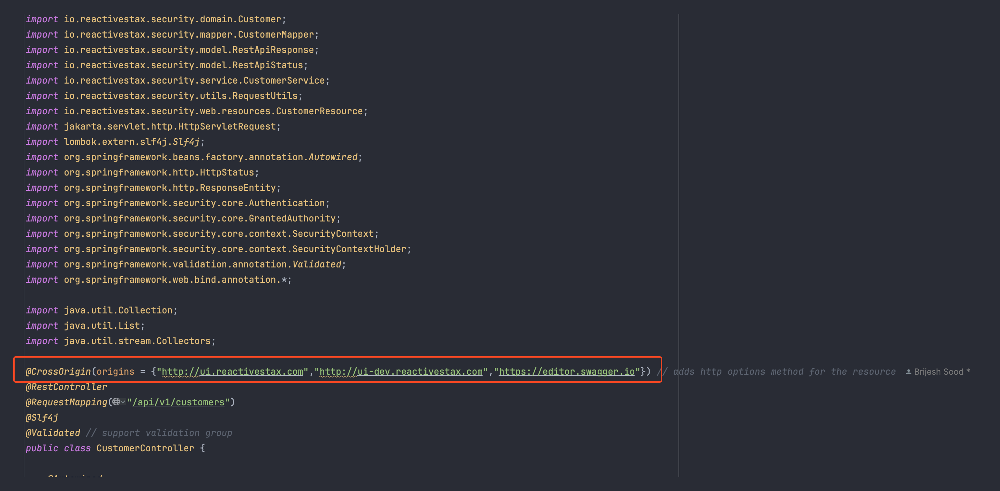
