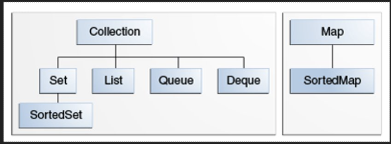
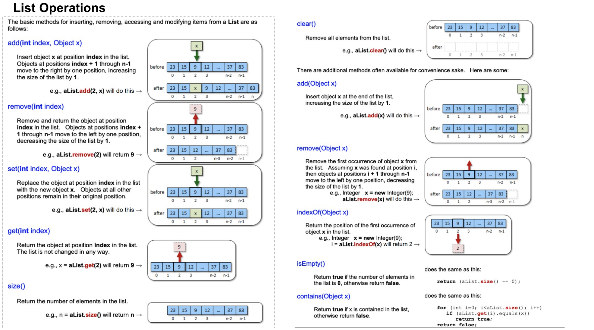
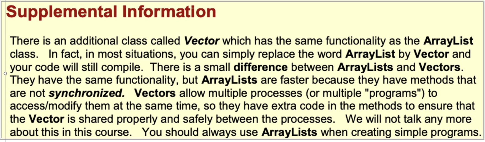
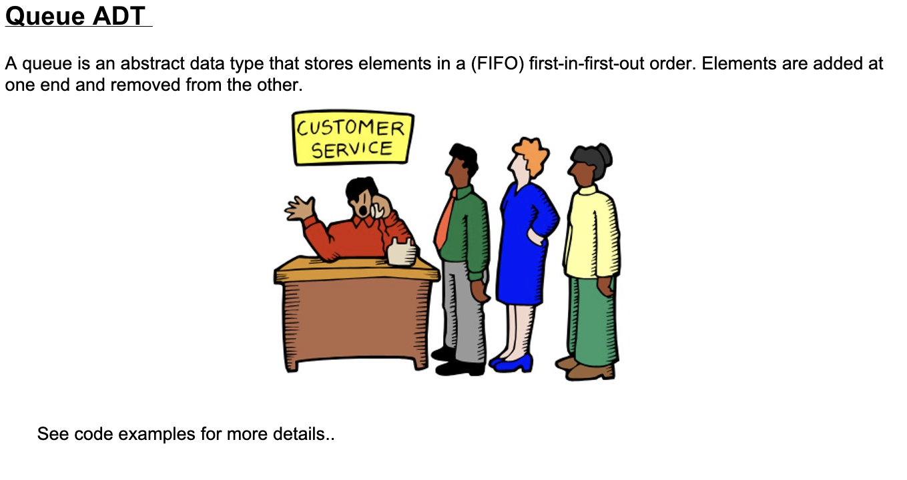
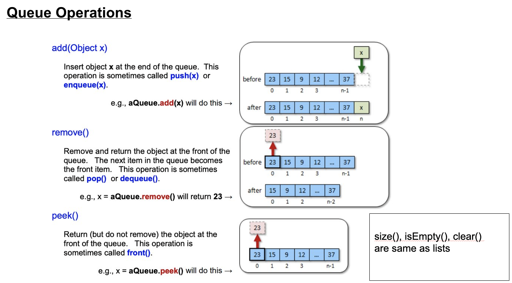
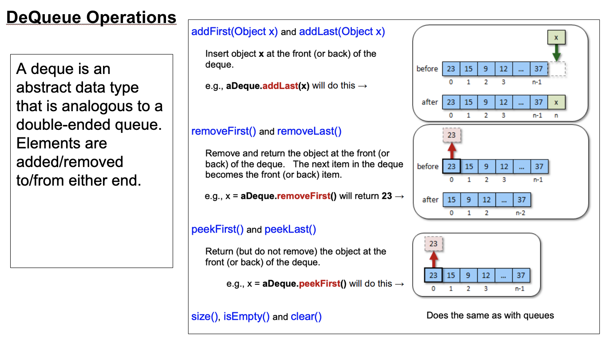
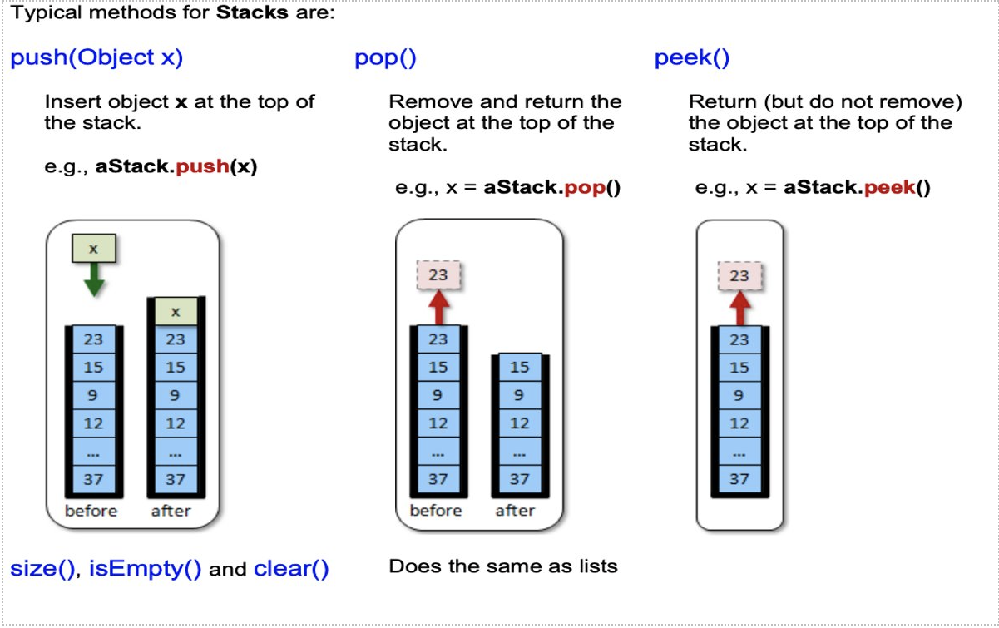
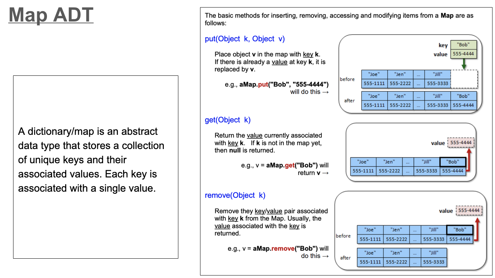
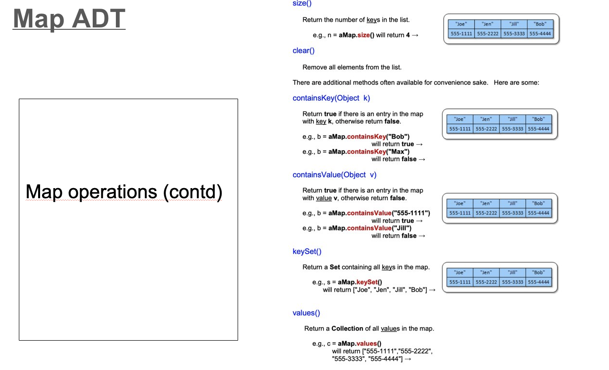
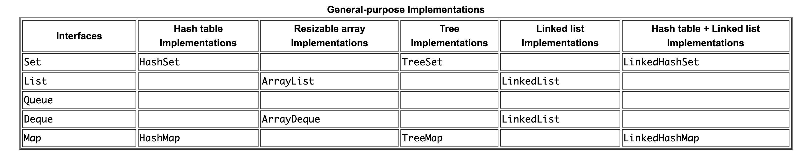

## **<u>COLLECTIONS</u>**

- What are collections
  - Collections of certain things 
  - Collections framework provides 
    - Interfaces
    - Implementations
    - Algorithms
- Provide out of the box functionality to reduce programmer effort, programming errors, and promotes software reuse.




**Abstract Data Types** - Every time we define a new object, we are actually defining a new data type. That is, we are grouping attributes and behaviors to form a new type of data (i.e., object) we can use throughout our programs as if it were a single piece of data. There are actually some commonly used models for defining similar types of data:


ADTs ( Abstract Data Types) - we discuss Data Types in General. There are different types of ADTs, each with their own unique way for storing, accessing and modifying the data. Typically, ADTs will store general data of any kind, although usually the data inside the ADT is all of the same kind ... or at least has something in common.


ADTs are a vital part of any programming language since they are used to collect data together in an "easy-to-use" way. We often use the term collection to represent one of these data types. There are advantages of using ADTs: 


1. They help to simplify descriptions of abstract algorithms, thereby allowing us to write simplified pseudocode with less details (e.g., we can write pseudocode such as "Add x to the list" instead of "Put x at position size in the array and then let size = size+1"). ​


2. They allow us to classify and evaluate data structures in regards to the common behaviors between data types (e.g., one ADT may have a more efficient remove operation while another may have a more efficient add or search operation. We could choose the ADT that best fits our needs). As we have already seen with Arrays, collections allow many objects to be collected/stored together and then passed around as a single object (i.e., the array itself is an object). ​


Just about every useful application of any kind requires collections for situations such as: 

• storing products on shelves in a store 

• maintaining information on customers 

• keeping track of cars for sale, for rental or for servicing 

• a personal collection of books, CDs, DVDs, cards, etc... 

• maintaining a shopping cart of items to be purchased from a website


-------

Equals() 

hashCode()

compareTo()

ConcurrentModificationException


ThreadSafety >> a data structure is thread safe if it can guarantee that no two threads will access at the same time. It has be accessed one at a time only. 
​

**Basic Characteristics to evaluate a data structure’s applicability for a given problem.** 

1. is the data going to be a one-D array like structure - list 

2. if no duplicates allowed- set 

3. if its FIFO structure - queues, if its LIFO - its a stack , 

4. if its key value like structure (vowel -> number Of Occurences), its a Map 

5. --------------

6. Does it Keeps the insertion Order ?

7. Does it Allow Nulls ?

8. Does it Allow Duplicates ?

9. Does it support LIFO vs FIFO ?

10. Does it ensure ThreadSafety ?

11. Does it sort the Data ?

12. What’s the time/space complexity of doing the most common operations (from your problem) on that data structure 

Time and Space Complexity 

**Most Commonly Used implementations--**

Set - Hashset (for sorted TreeSet)

List - ArrayList 

Queue - ArrayBlockingQueue , PriorityQueue

Map - HashMap (for sorted TreeMap)

------------

object1 == object2 (they are equal at the memory reference level) 

Person1  **EQUALS**   Person2   (at the language level and at the business level(this is **MORE** important mostly))

`Person1 = new Person()`

`Person2 = new Person()     person1==person2 (false)  person1.equals(Person2)`

In Java, the `equals()` and `hashCode()` methods are critical because they define how objects are compared for equality and how they are stored in collections that use hashing mechanisms, such as `HashMap`, `HashSet`, and `Hashtable`. Understanding their importance is key to writing correct and efficient Java code.

### 1. `equals()` Method

- **Purpose**: The `equals()` method determines whether two objects are considered equal. By default, the `equals()` method in the `Object` class checks for reference equality, meaning it returns `true` if and only if the two references point to the same object in memory.

- **Custom Implementation**: Often, you need to compare the contents of objects rather than their memory addresses. For example, if you have a `Person` class with `name` and `age` fields, you might want two `Person` objects with the same `name` and `age` to be considered equal, even if they are different instances. To achieve this, you must override the `equals()` method.
  
  ```java
  public class Person {
      private String name;
      private int age;
  
      // Constructors, getters, and setters
  
      @Override
      public boolean equals(Object o) {
          if (this == o) return true;
          if (o == null || getClass() != o.getClass()) return false;
          Person person = (Person) o;
          return age == person.age && name.equals(person.name);
      }
  }
  ```

- **Importance**: Without a properly overridden `equals()` method, your objects might not behave as expected when stored in collections or compared. For instance, two `Person` objects with the same name and age might not be treated as equal if `equals()` is not correctly implemented.

### 2. `hashCode()` Method

- **Purpose**: The `hashCode()` method returns an integer value, called a hash code, that is used by hash-based collections like `HashMap` and `HashSet` to efficiently locate objects. The hash code determines the "bucket" where an object will be placed in a hash table.

- **Contract with `equals()`**: The `hashCode()` method is closely related to `equals()`. The general contract is:
  - If two objects are equal according to the `equals()` method, then they must have the same hash code.
  - However, two objects with the same hash code do not necessarily have to be equal according to the `equals()` method.

- **Why This Matters**: If you override `equals()` but not `hashCode()`, or if the two methods are inconsistent, you can get incorrect behavior in hash-based collections. For example, if two objects are considered equal by `equals()` but have different hash codes, they might end up in different buckets in a `HashMap`, leading to one of them being "lost" in terms of retrieval.

  ```java
  public class Person {
      private String name;
      private int age;
  
      // Constructors, getters, and setters
  
      @Override
      public boolean equals(Object o) {
          if (this == o) return true;
          if (o == null || getClass() != o.getClass()) return false;
          Person person = (Person) o;
          return age == person.age && name.equals(person.name);
      }
  
      @Override
      public int hashCode() {
          return Objects.hash(name, age);
      }
  }
  ```

### Summary of Their Importance:

1. ## THEY WILL GET YOU THE JOB IF YOU CAN EXPLAIN THEM PROPERLY, NO JOKES. 

2. **Correctness in Collections**: Properly implementing `equals()` and `hashCode()` ensures that your objects behave correctly when used in collections like `HashMap`, `HashSet`, and `Hashtable`. These collections rely on these methods to determine object equality and to efficiently store and retrieve objects(buckets discussion).

3. **Efficiency**: A good `hashCode()` implementation distributes objects evenly across the hash table, minimizing collisions and ensuring efficient retrieval.

4. **Contractual Obligations**: Adhering to the contract between `equals()` and `hashCode()` is critical. Failing to do so can lead to subtle and difficult-to-debug issues in your code, especially when working with (hash-based) collections.

In summary, `equals()` and `hashCode()` are fundamental to how objects are compared and stored in Java. Proper implementation of these methods ensures that your objects behave as expected in collections, leading to correct and efficient Java programs.

In Java, you can check whether two references point to the exact same memory location (i.e., they are the same object) by using the `==` operator. **This operator checks for (memory) reference equality**, meaning it returns `true` if both references point to the same object in memory.

However, if you want to see the actual memory reference (or a unique identifier for the memory location) of an object, you can use the `System.identityHashCode()` method, which returns the hash code of the object as computed by the `Object` class's implementation of `hashCode()`. This hash code is typically based on the memory address where the object is stored, though it's not guaranteed to be the actual memory address due to Java's memory management.

### 1. Checking Reference Equality with `==`
This is the simplest way to check if two references are pointing to the same object.

```java
public class ReferenceCheck {
    public static void main(String[] args) {
        String str1 = new String("hello");
        String str2 = new String("hello");
        String str3 = str1;

        // Check reference equality
        System.out.println(str1 == str2); // false, different objects
        System.out.println(str1 == str3); // true, same object
    }
}
```

### 2. Getting the Unique Identifier (Memory Reference) with `System.identityHashCode()`
The `System.identityHashCode()` method can be used to get a hash code that is based on the memory address of the object (or something similar, depending on the JVM implementation).

```java
public class ReferenceCheck {
    public static void main(String[] args) {
        String str1 = new String("hello");
        String str2 = new String("hello");
        String str3 = str1;

        // Print identity hash codes
        System.out.println(System.identityHashCode(str1)); // Unique hash code for str1
        System.out.println(System.identityHashCode(str2)); // Different hash code, as str2 is a different object
        System.out.println(System.identityHashCode(str3)); // Same hash code as str1, since str3 is the same object as str1
    }
}
```

### Explanation:
- **`==` Operator**: Compares whether the two references point to the same object. It returns `true` if they do, otherwise `false`.
- **`System.identityHashCode()`**: Provides a hash code that is typically based on the object's memory address, helping you distinguish different objects even if they are logically equal (i.e., `equals()` returns `true`).

### Example Output:
```plaintext
false
true
1836019247
1829164700
1836019247
```

In this example, `str1` and `str3` are the same object, so they have the same identity hash code, while `str2` is a different object with a different identity hash code.

### Note:
- **Memory Address**: Java abstracts away direct access to memory addresses for safety reasons (such as preventing memory corruption and improving garbage collection). `System.identityHashCode()` is the closest you get to something like a memory address, but it’s still an abstracted, managed concept.
- **Hash Code Collision**: While unlikely, two different objects can have the same identity hash code, as `hashCode` values are integers and may collide. However, within a single JVM execution, it’s rare and usually safe to assume different objects will have different identity hash codes.

This approach is useful for debugging or low-level identity checks where you need to ensure that you’re working with the exact same object instance.

### **List ADT** 


A list is an abstract data type that implements an ordered collection of values, where the same value may occur more than once.


The elements in a general list are stored in a particular position in the list. As with arrays, elements in a general list are accessed according to their index position in the list.


#### **ArrayLists:**

Following are few key points to note about ArrayList in Java -

- An ArrayList is a re-sizable array, also called a dynamic array. It grows its size to accommodate new elements and shrinks the size when the elements are removed.
- ArrayList internally uses an array to store the elements. Just like arrays, It allows you to retrieve the elements by their index.
- Java ArrayList allows duplicate and null values.
- Java ArrayList is an ordered collection. maintains the insertion order of the elements.
- You cannot create an ArrayList of primitive types like int, char etc. You need to use boxed types (Wrapper Classes) like Integer, Character, Boolean etc.
- Java ArrayList is not synchronized (thread-safe). If multiple threads try to modify an ArrayList at the same time, then the final outcome will be non-deterministic. You must explicitly synchronize access to an ArrayList if multiple threads are going to modify it.







### Internal vs External Iteration in Java 8

**Internal Iteration** and **External Iteration** refer to how elements in a collection are processed.

1. **External Iteration**: This is when the control of the iteration is managed by the programmer. You explicitly instruct the program on how to traverse the collection, typically using loops like `for`, `while`, or an `Iterator`.

   - **Example 1: Enhanced for-loop**
     ```java
     public class IterationExamples {
         public static void main(String[] args){
             List<String> alphabets = Arrays.asList("a", "b", "c", "d");
     
             //enhanced for-loop
             for(String letter: alphabets){
                 System.out.println(letter.toUpperCase());
             }
           //index based iteration
           for (i=0;i<alphabets.length;i++){
                 System.out.println(letter.toUpperCase());
           }
         }
     }
     ```
     
   - **Example 2: Using Iterator**
     
     ```java
     public class IterationExamples {
         public static void main(String[] args){
             List<String> alphabets = Arrays.asList("a", "b", "c", "d");
     
             Iterator<String> iterator = alphabets.listIterator();
             while(iterator.hasNext()){
                 System.out.println(iterator.next().toUpperCase());
             }
         }
     }
     ```

   In both cases above, you are manually controlling how each element in the list is accessed and processed. This gives you more flexibility, but also more responsibility, as you must handle the loop's state, termination condition, etc.

2. **Internal Iteration**: Here, the control of the iteration is abstracted away, typically managed by the library or the framework. In Java 8, the most common way to achieve internal iteration is through the `Stream` API. This approach allows you to focus on what you want to do with the elements rather than how to do it.

   - **Example: Using Streams**
     ```java
     import java.util.Arrays;
     import java.util.List;
     
     public class IterationExamples {
         public static void main(String[] args){
             List<String> alphabets = Arrays.asList("a", "b", "c", "d");
             int counter;
     				alphabets
     					.filter(alphabets.startsWith("A"))
               .map()
               .reduce()
               .min(persons)
               .max()
               .average()
               .forEach(alphabet ->   alphabet.toToUpperCase);
     			}
     }
     ```
   
   In this example, the iteration happens internally within the `stream()` method, and you only provide the operations to be performed on each element (`map` to convert to uppercase and `forEach` to print).
   
   
   **External iteration is straightforward enough, but it has several problems:**

1) Java’s for-each loop/iterator is inherently sequential, and must process the elements in the order specified by the collection.​
2) It limits the opportunity to manage the control flow, which might be able to provide better performance by exploiting reordering of the data, parallelism, short-circuiting, or laziness. (Java 8 lectures will cover these terms in full detail)​
3) Sometimes the strong guarantees of the for-each loop (sequential, in-order) are desirable, but often are just an disadvantage to performance. The alternative to external iteration is internal iteration, where instead of controlling the iteration, client let it handle by library and only provide the code which must be executed for all/some of data elements.

### Key Points:

- **External Iteration**: Programmer controls the loop.
  - Pros: Full control over the iteration process.
  - Cons: More verbose and error-prone.

- **Internal Iteration**: Library or framework manages the iteration.
  - Pros: Concise, easier to parallelize, and less prone to errors.
  - Cons: Less control over the iteration process.

Java 8's `Stream` API encourages the use of internal iteration, promoting a more declarative style of programming that is easier to read and maintain, especially for complex data transformations.







A **PriorityQueue** is a queue in which the elements also maintain a priority.

add(int priority, Object x) However, in JAVA, we simply include the priority of an object as part of the object itself, and so we will just use add(Object x) for priority queues





### **Stack ADT** 

A stack is an abstract data type that stores elements in a last in-first-out (LIFO) order. Elements are added and removed to/from the top only





#### **Set ADT**

A set is an abstract data type that does not allow duplicate elements to be added.

Typical operations for Sets are: • add(Object x) • remove(Object x)

Hashset vs Treeset(for ordering)

equals () method

hashcode() method 

compareTo() method 

Hashset throws away duplicates based on the equals and hashcode implementations. 
TreeSet sorts/orders the elements based on the compareTo implementation (but additionally throws away duplicates if compareTo finds them equal)

**Following are few key points to note about HashSet in Java** -

- HashSet cannot contain duplicate values.
- HashSet allows null value.
- HashSet is an unordered collection. It does not maintain the order in which the elements are inserted.
- HashSet internally uses a [HashMap](https://www.callicoder.com/java-hashmap/) to store its elements (ADVANCED).
- HashSet is not thread-safe. If multiple threads try to modify a HashSet at the same time, then the final outcome is not-deterministic. You must explicitly synchronize concurrent access to a HashSet in a multi-threaded environment.







Following are few key points to note about HashMaps in Java -

- A HashMap cannot contain duplicate keys.
- Java HashMap allows null values and the null key.
- HashMap is an unordered collection. It does not guarantee any specific order of the elements.
- Java HashMap is not thread-safe. You must explicitly synchronize concurrent modifications to the HashMap.

[Lesson: Implementations (The Java™ Tutorials > Collections) (oracle.com)](https://docs.oracle.com/javase/tutorial/collections/implementations/index.html)

### <u>SUMMARY FOR ALL COLLECTIONS:</u>



Here’s the updated summary of commonly used collections in Java, explicitly highlighting thread-safe implementations for each collection type:

### 1. **List**
   - **Description**: An ordered collection (also known as a sequence). Lists can contain duplicate elements.
   - **Common Implementations**:
     - **ArrayList**: A resizable array implementation. It is fast for random access but slow for insertions/deletions (except at the end).
     - **LinkedList**: A doubly linked list implementation. It is fast for insertions/deletions but slower for random access.
   - **Thread-Safe Implementations**:
     - **Vector**: Similar to `ArrayList`, but synchronized (thread-safe). It’s slower due to synchronization overhead.
     - **`Collections.synchronizedList()`**: Wraps any `List` implementation to make it thread-safe. Explicit synchronization is required for iteration.
   - **Common Methods**: `add()`, `get()`, `set()`, `remove()`, `indexOf()`

### 2. **Set**
   - **Description**: A collection that does not allow duplicate elements.
   - **Common Implementations**:
     - **HashSet**: Implements the `Set` interface, backed by a hash table. It provides constant-time performance for basic operations (add, remove, contains) but does not guarantee any specific order of elements.
     - **LinkedHashSet**: Like `HashSet`, but maintains a linked list of entries in the set, thus preserving insertion order.
     - **TreeSet**: Implements the `NavigableSet` interface, backed by a tree (typically a Red-Black tree). It orders elements based on their values (natural ordering or via a comparator).
   - **Thread-Safe Implementations**:
     - **`Collections.synchronizedSet()`**: Wraps a `Set` to make it thread-safe. Explicit synchronization is required for iteration.
     - **`ConcurrentSkipListSet`**: A thread-safe `NavigableSet` based on a `ConcurrentSkipListMap`, providing elements in a sorted order.
     - **`CopyOnWriteArraySet`**: A thread-safe `Set` backed by a `CopyOnWriteArrayList`. Ideal for read-heavy workloads with infrequent modifications.
   - **Common Methods**: `add()`, `remove()`, `contains()`, `size()`

### 3. **Map**
   - **Description**: A collection that maps keys to values. Each key can map to at most one value (no duplicate keys).
   - **Common Implementations**:
     - **HashMap**: Implements the `Map` interface, backed by a hash table. It provides constant-time performance for basic operations but does not guarantee any specific order of elements.
     - **LinkedHashMap**: Like `HashMap`, but maintains a linked list of entries in the map, thus preserving insertion order.
     - **TreeMap**: Implements the `NavigableMap` interface, backed by a tree (typically a Red-Black tree). It orders elements based on the keys.
   - **Thread-Safe Implementations**:
     - **Hashtable**: Similar to `HashMap`, but synchronized (thread-safe). It is slower due to synchronization overhead.
     - **`Collections.synchronizedMap()`**: Wraps any `Map` implementation to make it thread-safe. Explicit synchronization is required for iteration.
     - **`ConcurrentHashMap`**: A highly concurrent implementation of `Map`, designed for scalability and high throughput in multi-threaded environments.
   - **Common Methods**: `put()`, `get()`, `remove()`, `containsKey()`, `keySet()`, `values()`

### 4. **Queue**
   - **Description**: A collection designed for holding elements prior to processing. Queues typically, but do not necessarily, order elements in a FIFO (first-in-first-out) manner.
   - **Common Implementations**:
     - **LinkedList**: Can also be used as a `Queue` implementation.
     - **PriorityQueue**: A priority-based queue, where elements are ordered based on their natural ordering or a provided comparator.
     - **ArrayDeque**: A resizable array implementation of the `Deque` interface, which can function as both a queue and a deque (double-ended queue).
   - **Thread-Safe Implementations**:
     - **`ConcurrentLinkedQueue`**: A thread-safe, non-blocking queue based on linked nodes. Ideal for highly concurrent, non-blocking applications.
     - **`LinkedBlockingQueue`**: A thread-safe blocking queue, which blocks on operations that cannot be immediately satisfied.
     - **`ArrayBlockingQueue`**: A thread-safe, bounded blocking queue backed by an array. (consumer-producer patterns are commonly implemented using ArrayBlockingQueue)
   - **Common Methods**: `offer()`, `poll()`, `peek()`

### 5. **Deque**
   - **Description**: A double-ended queue that supports element insertion and removal at both ends.
   - **Common Implementations**:
     - **ArrayDeque**: A resizable array implementation of the `Deque` interface.
     - **LinkedList**: Can also be used as a `Deque` implementation.
   - **Thread-Safe Implementations**:
     - **`ConcurrentLinkedDeque`**: A thread-safe, non-blocking deque based on linked nodes.
     - **`LinkedBlockingDeque`**: A thread-safe blocking deque, which blocks on operations that cannot be immediately satisfied.
   - **Common Methods**: `addFirst()`, `addLast()`, `removeFirst()`, `removeLast()`, `peekFirst()`, `peekLast()`

### 6. **Stack** (Legacy, but still used)
   - **Description**: A subclass of `Vector` that represents a last-in, first-out (LIFO) stack of objects.
   - **Thread-Safe Implementation**:
     - **Stack**: Inherently thread-safe due to being a subclass of `Vector`, which is synchronized.
   - **Common Methods**: `push()`, `pop()`, `peek()`, `isEmpty()`

### 7. **PriorityQueue**
   - **Description**: A queue that orders its elements according to their natural ordering or by a comparator provided at queue construction time.
   - **Common Methods**: `offer()`, `poll()`, `peek()`
   - **Thread-Safe Implementations**:
     - **`PriorityBlockingQueue`**: A thread-safe implementation of a priority queue that supports concurrent operations and is typically used in concurrent applications.

# 8. **Collection<u>s</u> Utility Class**
   - **Description**: Provides static methods for various operations on collections, such as sorting, searching, and modifying collections.
   - **Common Methods**: `sort()`, `reverse()`, `shuffle()`, `binarySearch()`, `synchronizedList()`, `synchronizedSet()`, `synchronizedMap()`

### Summary:
- **Lists**: Thread-safe options include `Vector` and `Collections.synchronizedList()`.
- **Sets**: Thread-safe options include `Collections.synchronizedSet()`, `ConcurrentSkipListSet`, and `CopyOnWriteArraySet`.
- **Maps**: Thread-safe options include `Hashtable`, `Collections.synchronizedMap()`, and `ConcurrentHashMap`.
- **Queues**: Thread-safe options include `ConcurrentLinkedQueue`, `LinkedBlockingQueue`, and `ArrayBlockingQueue`.
- **Deques**: Thread-safe options include `ConcurrentLinkedDeque` and `LinkedBlockingDeque`.
- **Stacks**: `Stack` is thread-safe by design.
- **PriorityQueues**: `PriorityBlockingQueue` is a thread-safe option.

This summary ensures that you are aware of both the common and thread-safe implementations available for each collection type in Java.


#### <u>WHY JAVA COLLECTIONS DON'T ALLOW PRIMITIVES</u>

Java Collections, as part of the Java Collections Framework (JCF), do not allow primitive types (like `int`, `char`, `boolean`, etc.) because Java collections are designed to work with objects, not primitive data types. Here's a detailed explanation of why this is the case:

### 1. **Object-Oriented Design**
   - Java is an object-oriented programming language, and its collections framework is designed around objects. Collections in Java, such as `List`, `Set`, `Map`, etc., store and operate on instances of `Object`.
   - Primitives in Java are not objects; they are simple data types that hold their values directly. This means that primitives don't have methods, inheritance, or other object-oriented features.

### 2. **Generics**
   - Java collections are implemented using generics, which allow them to be type-safe and flexible. Generics in Java work with reference types, not primitive types.
   - For example, `List<T>` expects `T` to be a reference type. If Java allowed primitive types in generics, it would complicate the design and implementation of the collections framework.

### 3. **Type Erasure**
   - Java uses a feature called type erasure to implement generics. During runtime, the generic type information is erased, and all generic types are treated as `Object`.
   - Since primitive types like `int`, `char`, and `boolean` are not subclasses of `Object`, they cannot be used directly in generics.

### 4. **Boxing and Unboxing**
   - To allow primitives to be used with collections, Java provides wrapper classes for each primitive type, such as `Integer` for `int`, `Character` for `char`, `Boolean` for `boolean`, etc.
   - When you add a primitive value to a collection, Java automatically converts it to its corresponding wrapper type. This process is called **autoboxing**.
   - Similarly, when you retrieve a value from a collection and assign it to a primitive variable, Java automatically converts it back to the primitive type. This process is called **unboxing**.

#### Example:
```java
List<Integer> intList = new ArrayList<>();
intList.add(10);  // Autoboxing: int to Integer
int value = intList.get(0);  // Unboxing: Integer to int
```

### 5. **Performance Considerations**
   - While autoboxing and unboxing make it convenient to work with primitives in collections, they do introduce some overhead because of the additional object creation and conversion between types.
   - However, this design allows Java to maintain a clean, consistent API for collections without mixing primitive types with objects.

### Summary
Java Collections don't allow primitives because they are designed to work with objects, and Java's generics and type system are based on reference types (objects). Primitives are not objects, and therefore cannot be used directly in collections. Instead, Java provides wrapper classes and the mechanisms of autoboxing and unboxing to allow primitives to be used in collections indirectly.

This design choice helps maintain a consistent object-oriented approach and simplifies the implementation of the collections framework while still providing flexibility for developers to use primitive types when needed.