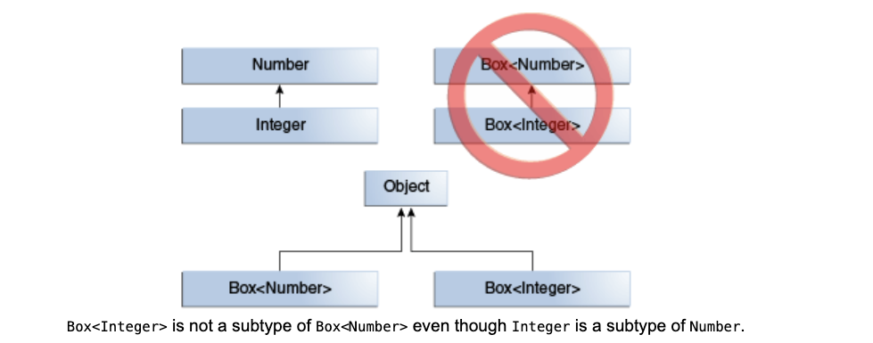
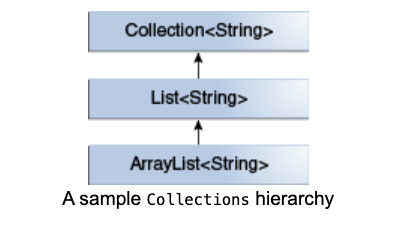
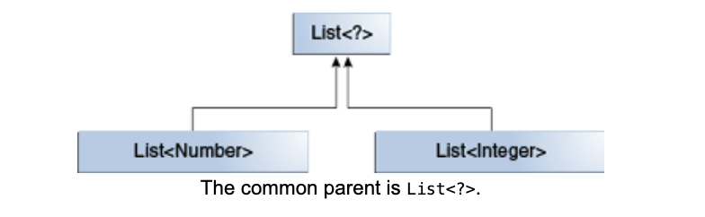
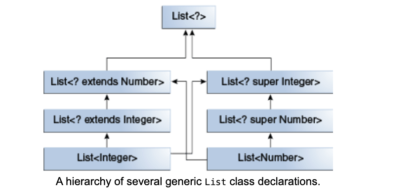

### Why Use Generics?

In a nutshell, generics enable types (classes and interfaces) to be parameters when defining classes, interfaces, and methods. Much like formal parameters in method declarations, type parameters provide a way to re-use the same code with different inputs. The difference is that the inputs to formal parameters are values, while the inputs to type parameters are types.

Code that uses generics has many benefits over non-generic code:

1. **Stronger Type Checks at Compile Time**  
   A Java compiler applies strong type checking to generic code and issues errors if the code violates type safety. Fixing compile-time errors is easier than fixing runtime errors, which can be difficult to find.

2. **Elimination of Casts**  
   The following code snippet without generics requires casting:
   ```java
   Integer salary = 100000;
   salary = "another string"; //compiler error
   
   List list = new ArrayList(); //Raw List type
   list.add("hello");
   String s = (String) list.get(0);
   ```
   When re-written to use generics, the code does not require casting:
   ```java
   List<E>  // E is type parameter 
     
   public class SalaryCalculator{
     //method definition
   	Double calculateAnnualSalary(Employee employee); //method parameter  
   }
   public static void main (String args[]){
     SalaryCalculator salaryCalculator = new SalaryCalculator();
   	//method invocation
     salaryCalculator.calculateAnnualSalary(employee);//method argument
   }
   
   
   List<String> list = new ArrayList<String>();//generic List type
   List<String> list = new ArrayList<>(); //Java 7 type inference happening
   StringList stringList = new StringList();//type safety if generics were not introduced
   list.add("hello");
   //list.add(123423);//compile-time error
   String s = list.get(0);   // no cast
   
   Conceptual mapping...
   		Method parameter  <=> Type Parameter
       method invocation <=> Generic Type invocation
       method argument   <=> Type Argument   
   ```
   
3. **Enabling Programmers to Implement Generic Algorithms**  
   By using generics, programmers can implement generic algorithms that work on collections of different types, which can be customized, are type-safe, and are easier to read.
   
   
   
   
   
   ### Generic Types
   
   A **generic type** is a generic class or interface that is parameterized over types. This allows classes, interfaces, and methods to operate on different data types without being rewritten for each type. The following Box class will be modified to demonstrate the concept.
   
   #### A Simple Box Class
   
   `term - Non-Generic Box class      vs     Generic Box Class`
   
   Let's begin by examining a <u>**non-generic**</u> Box class that operates on objects of any type. It provides two methods: `set`, which adds an object to the box, and `get`, which retrieves it:
   
   ```java
   public class Box {
       private Object object;
   
       public void set(Object object) { this.object = object; }
       public Object get() { return object; }
   }
   ```
   
   Since its methods accept or return an `Object`, you can pass in any object, provided it's not a primitive type. However, there's no way to verify at compile time how the class is used. One part of the code may place an `Integer` in the box and expect to get `Integer` out, while another part may mistakenly pass in a `String`, resulting in a runtime error.
   
   #### A Generic Version of the Box Class
   
   A **generic class** is defined with the following format:
   
   ```java
   class name<T1, T2, ..., Tn> { /* ... */ }
   ```
   
   The type parameter section, delimited by angle brackets (`<>`), follows the class name and specifies the type parameters (also called type variables) `T1, T2, ..., Tn`.
   
   To update the Box class to use generics, create a generic type declaration by changing the code `public class Box` to `public class Box<T>`. This introduces the type variable `T`, which can be used anywhere inside the class.

**<u>TIP: For writing your first few generic classes</u>**, First you write your Type Specific Class 

 ```java
   public class BoxSpecific {
    private Integer object;

    public void set(Integer object) { this.object = object; }
    public Integer get() { return object; }
}

class Course {
  String studentId;
  Integer grade;
  Map<String,Integer> map = new HashMap<>();
}
   ===>>  (specific to Generic version)
class Course <S,G>{
  S studentId;
  G grade;
  Map<S,G> map = new HashMap<>();
}
 ```
   Then introduce Type Parameter after the class name with angular braces <T> and then replace the specific type with Type Parameter everywhere like the following code snippet

  ```java
   public class BoxSpecificToGeneric<T> {
    private T object;

    public void set(T object) { this.object = object; }
    public T get() { return object; }
}
  ```

   With this change, the Box class becomes:

   ```java
   public class BoxSpecificToGeneric<T> {
    private T object;

    public void set(T object) { this.object = object; }
    public T get() { return object; }
}
   ```

   As you can see, all occurrences of `Object` are replaced by `T`. A type variable can be any non-primitive type you specify: any class type, interface type, array type, or even another type variable.

   This same technique can be applied to create generic interfaces.

   ### Type Parameter Naming Conventions

   By convention, type parameter names are single, uppercase letters. This stands in contrast to variable naming conventions, and with good reason: without this convention, it would be difficult to distinguish between a type variable and an ordinary class or interface name.

   Common type parameter names include:
   - **E** - Element (used extensively by the Java Collections Framework)
   - **K** - Key
   - **N** - Number
   - **T** - Type
   - **V** - Value
   - **S, U, V, etc.** - 2nd, 3rd, 4th types

   These names are used throughout the Java SE API and in this lesson.

   ### Invoking and Instantiating a Generic Type

   To reference the generic Box class from within your code, perform a **generic type invocation**, which replaces `T` with a concrete type, such as `Integer`:

   ```java
   Box<Integer> integerBox;
   ```

   You can think of a generic type invocation as similar to an ordinary method invocation, but instead of passing an method argument, you are passing a type argument (e.g., `Integer`) to the Box class itself.

   #### Type Parameter and Type Argument Terminology
   Many developers use "type parameter" and "type argument" interchangeably, but these terms are not the same. When coding, you provide type arguments to create a parameterized type. Therefore, the `T` in `Foo<T>` is a type parameter, and the `String` in `Foo<String> f` is a type argument. This lesson observes this distinction.

   To instantiate this class, use the `new` keyword, placing `<Integer>` between the class name and parentheses:

   ```java
   Box<Integer> integerBox = new Box<Integer>();
   ```

   #### The Diamond
   In Java SE 7 and later, you can replace the type arguments required to invoke the constructor of a generic class with an empty set of type arguments (`<>`) as long as the compiler can infer the type arguments from the context. This pair of angle brackets (`<>`) is informally called the **diamond**. For example, you can create an instance of `Box<Integer>` with the following statement:

   ```java
   Box<Integer> integerBox = new Box<>();
   ```

   ### Multiple Type Parameters

   A generic class can have multiple type parameters. For example, the generic `OrderedPair` class, which implements the generic `Pair` interface:

   ```java
   public interface Pair<K, V> {
       public K getKey();
       public V getValue();
   }
   
   public class OrderedPair<K, V> implements Pair<K, V> {
   
       private K key;
       private V value;
   
       public OrderedPair(K key, V value) {
           this.key = key;
           this.value = value;
       }
   
       public K getKey() { return key; }
       public V getValue() { return value; }
   }
   ```

   The following statements create two instantiations of the `OrderedPair` class:

   ```java
   Pair<String, Integer> p1 = new OrderedPair<String, Integer>("Even", 8);//pre-Java7
   Pair<String, Integer> p1 = new OrderedPair<>("Even", 8);//Type inference with Dimaond operator post-Java7
   Pair<String, String>  p2 = new OrderedPair<String, String>("hello", "world");
   ```

   The code `new OrderedPair<String, Integer>` instantiates `K` as a `String` and `V` as an `Integer`. Therefore, the parameter types of `OrderedPair`'s constructor are `String` and `Integer`, respectively. Due to autoboxing, it is valid to pass a `String` and an `int` to the class.

   As mentioned in **The Diamond**, because a Java compiler can infer the `K` and `V` types from the declaration `OrderedPair<String, Integer>`, these statements can be shortened using diamond notation:

   ```java
   OrderedPair<String, Integer> p1 = new OrderedPair<>("Even", 8);
   OrderedPair<String, String>  p2 = new OrderedPair<>("hello", "world");
   ```

   ### Parameterized Types

   You can also substitute a type parameter (e.g., `K` or `V`) with a parameterized type (e.g., `List<String>`). For example, using the `OrderedPair<K, V>` example:

   ```java
   OrderedPair<String, Box<Integer>> p = new OrderedPair<>("primes", new Box<Integer>(...));
   ```

   This demonstrates how generics in Java provide a flexible and powerful way to write reusable, type-safe code.

### <u>**IMPORTANT TERMS**</u>


<u>**Bottom two are during Type Definition**</u>

Generic Class (Box is a generic class)

```java
public class Box<T> {
    public void set(T t) { /* ... */ }
    // ...
}
```

Non Generic Class (Box below is a non-generic class)

```java
public class Box {
    public void set(String string) { /* ... */ }
    // ...
}
```

<u>**Bottom are during invocation**</u>

Parameterized Type (intBox is a parameterized type)

```java
Box<Integer> intBox = new Box<>();
```

Raw Type (rawBox is a raw type)

```java
Box rawBox = new Box();
```


### Raw Types

A **raw type** is the name of a generic class or interface without any type arguments. For example, given the generic `Box` class:

```java
public class Box<T> {
    public void set(T t) { /* ... */ }
    // ...
}
```

To create a parameterized type of `Box<T>`, you supply an actual type argument for the formal type parameter `T`:

```java
Box<Integer> intBox = new Box<>();
```

If the actual type argument is omitted, you create a raw type of `Box<T>`:

```java
Box rawBox = new Box();
```

Therefore, **`Box` is the raw type of the generic type `Box<T>`**. ***However, a non-generic class or interface type is not considered a raw type.***


## NOTE: about  (non-negotiable) terminologies.

Generic Type (class or interface)

```java
public interface Pair<K, V> {
    public K getKey();
    public V getValue();
}
```

When you instantiate with passing a type argument (lets say String, Integer) for the type parameter K,V
you are doing generic type invocation. 
When you instantiate withOUT passing a type argument for the type parameter K,V
you are generating a RAW Type instance for a Generic Type Class. 

If you Defined Pair without Type Parameters in the first place.

```java
public interface Pair {
    public Integer getKey();
    public Integer getValue();
}
```

Its called a non-Generic Pair interface

```java
public class Pair {
    public Integer getKey(){
    	return 1;
    }
    public Integer getValue(){
      return 2;
    }
}
```

Its called a non-Generic Pair class.

Raw types often appear in legacy code because many API classes (such as the Collections classes) were not generic prior to JDK 5.0. When using raw types, you essentially revert to pre-generics behavior — a `Box` gives you `Object` references. For backward compatibility, assigning a parameterized type to its raw type is allowed:

```java
Box<String> stringBox = new Box<>();
Box rawBox = stringBox;  // OK
```

However, if you assign a raw type to a parameterized type, you receive a warning:

```java
Box rawBox = new Box();           // rawBox is a raw type of Box<T>
Box<Integer> intBox = rawBox;     // warning: unchecked conversion
```

You also receive a warning if you use a raw type to invoke generic methods defined in the corresponding generic type:

```java
Box<String> stringBox = new Box<>();
Box rawBox = stringBox;
rawBox.set(8);  // warning: unchecked invocation to set(T)
```

The warning indicates that raw types bypass generic type checks, deferring the catch of unsafe code to runtime. Therefore, it is advisable to avoid using raw types.

For more information on how the Java compiler handles raw types, see the **Type Erasure** section.

### Unchecked Error Messages

When mixing legacy code with generic code, you may encounter warning messages like the following:

```
Note: Example.java uses unchecked or unsafe operations.
Note: Recompile with -Xlint:unchecked for details.
```

This can happen when using an older API that operates on raw types, as shown in the following example:

```java
public class WarningDemo {
    public static void main(String[] args) {
        Box<Integer> bi;
        bi = createBox();
    }

    static Box createBox() {
        return new Box();
    }
}
```

The term "unchecked" means that the compiler does not have enough type information to perform all necessary type checks to ensure type safety. The "unchecked" warning is disabled by default, though the compiler provides a hint. To see all "unchecked" warnings, recompile with `-Xlint:unchecked`.

Recompiling the previous example with `-Xlint:unchecked` reveals the following additional information:

```
WarningDemo.java:4: warning: [unchecked] unchecked conversion
found   : Box
required: Box<java.lang.Integer>
        bi = createBox();
                      ^
1 warning
```

To completely disable unchecked warnings, use the `-Xlint:-unchecked` flag. The `@SuppressWarnings("unchecked")` annotation can also be used to suppress unchecked warnings. If you are unfamiliar with the `@SuppressWarnings` syntax, see the section on **Annotations**.


### Generic Methods

**Generic methods** are methods that introduce their own type parameters. While similar to declaring a generic type, the type parameter's scope is confined to the method where it's declared. Both static and non-static generic methods are allowed, as well as generic class constructors.

The syntax for a generic method includes a list of type parameters inside angle brackets (`<>`), which appears before the method's return type. For static generic methods, the type parameter section must also appear before the method's return type.

Consider the `Util` class that includes a generic method, `compare`, which compares two `Pair` objects:

```java
public class Util {
    public static <K, V> boolean compare(Pair<K, V> p1, Pair<K, V> p2) {
        return p1.getKey().equals(p2.getKey()) &&
               p1.getValue().equals(p2.getValue());
    }
}

public class Pair<K, V> {

    private K key;
    private V value;

    public Pair(K key, V value) {
        this.key = key;
        this.value = value;
    }

    public void setKey(K key) { this.key = key; }
    public void setValue(V value) { this.value = value; }
    public K getKey()   { return key; }
    public V getValue() { return value; }
}
```

To invoke this method, the complete syntax would be:

```java
Pair<Integer, String> p1 = new Pair<>(1, "apple");
Pair<Integer, String> p2 = new Pair<>(2, "pear");
boolean same = Util.<Integer, String>compare(p1, p2);
```

In this example, the type has been explicitly provided, as shown in bold. However, you can often omit the type, and the compiler will infer the necessary type:

```java
Pair<Integer, String> p1 = new Pair<>(1, "apple");
Pair<Integer, String> p2 = new Pair<>(2, "pear");
boolean same = Util.compare(p1, p2);
```

This feature, known as **type inference**, allows you to invoke a generic method as an ordinary method, without specifying a type between angle brackets. This topic is further discussed in the following section on *Type Inference*.


### Bounded Type Parameters

**Bounded type parameters** allow you to restrict the types that can be used as type arguments in a parameterized type. For instance, if a method operates on numbers, you might want it to accept only instances of `Number` or its subclasses. This is where bounded type parameters come into play.

To declare a bounded type parameter, you list the type parameter's name, followed by the `extends` keyword, and then the upper bound, which, in this example, is `Number`. Here, `extends` is used in a general sense to mean either "extends" (for classes) or "implements" (for interfaces).

Consider the following example:

```java
public class Box<T> {

    private T t;          

    public void set(T t) {
        this.t = t;
    }

    public T get() {
        return t;
    }

    public <U extends Employee> void sendSMSMessage(U u){
        System.out.println("T: " + t.getClass().getName());
        System.out.println("U: " + u.getClass().getName());
    }
  
  public <U extends TeachingStaff> void sendSMSMessageToTeachingStaff(U u){
        System.out.println("T: " + t.getClass().getName());
        System.out.println("U: " + u.getClass().getName());
    }
  
    public <U extends Number> void inspect(U u){
        System.out.println("T: " + t.getClass().getName());
        System.out.println("U: " + u.getClass().getName());
    }

    public static void main(String[] args) {
        Box<Integer> integerBox = new Box<Integer>();
        integerBox.set(new Integer(10));
        integerBox.inspect("some text"); // error: this is still String!
    }
}
```

By modifying the generic method to include a bounded type parameter, the compilation will fail if the wrong type is used, as in the invocation of `inspect` with a `String`:

```plaintext
Box.java:21: <U>inspect(U) in Box<java.lang.Integer> cannot
  be applied to (java.lang.String)
                        integerBox.inspect("10");
                                  ^
1 error
```

In addition to limiting the types that can be used to instantiate a generic type, bounded type parameters allow you to invoke methods defined in the bounds. For example:

```java
public class NaturalNumber<T extends Integer> {

    private T n;

    public NaturalNumber(T n)  { this.n = n; }

    public boolean isEven() {
        return n.intValue() % 2 == 0;
    }

    // ...
}
```

The `isEven` method can invoke the `intValue` method defined in the `Integer` class through `n`.

#### Multiple Bounds

A type parameter can also have multiple bounds:

```java
<T extends B1 & B2 & B3>
```

A type variable with multiple bounds is a subtype of all the types listed in the bound. If one of the bounds is a class, it must be specified first. For example:

```java
Class A { /* ... */ }
interface B { /* ... */ }
interface C { /* ... */ }

class D <T extends A & B & C> { /* ... */ }
```

If the class bound is not specified first, you'll get a compile-time error:

```java
class D <T extends B & A & C> { /* ... */ }  // compile-time error
```

-------

In Java, you can define a generic type with multiple bounds by using the `&` symbol. This allows the generic type to be constrained by multiple types, typically interfaces. Here’s an example:

```java
// Define an interface called HasName
interface HasName {
    String getName();
}

// Define an interface called HasAge
interface HasAge {
    int getAge();
}

// A class implementing both HasName and HasAge
class Person implements HasName, HasAge {
    private String name;
    private int age;

    public Person(String name, int age) {
        this.name = name;
        this.age = age;
    }

    @Override
    public String getName() {
        return name;
    }

    @Override
    public int getAge() {
        return age;
    }
}

// A generic method with multiple bounds
public class MultiBoundExample {
    // T must implement both HasName and HasAge
    public static <T extends Employee & HasName & HasAge> void printInfo(T entity) {
        System.out.println("Name: " + entity.getName());
        System.out.println("Age: " + entity.getAge());
    }

    public static void main(String[] args) {
        Person person = new Person("John Doe", 30);
        printInfo(person);
    }
}
```

### Explanation:
- **Interfaces `HasName` and `HasAge`:** These interfaces define two methods, `getName()` and `getAge()`, respectively.
- **Class `Person`:** This class implements both `HasName` and `HasAge`, meaning it provides concrete implementations for both `getName()` and `getAge()`.
- **Generic Method `printInfo`:** The generic method `printInfo` is defined with a type parameter `T` that is bounded by both `HasName` and `HasAge`. This means that any object passed to `printInfo` must implement both interfaces.

### Output:
When you run the `main` method, it will produce the following output:
```
Name: John Doe
Age: 30
```

This example demonstrates how to use multiple bounds with a generic type, allowing you to enforce that a type parameter meets multiple constraints.

----------

You can include a class in the bounds along with interfaces when defining a generic type. The class must come first, followed by the interfaces. Here’s an example:

```java
// Define an interface called HasName
interface HasName {
    String getName();
}

// Define an interface called HasAge
interface HasAge {
    int getAge();
}

// Define a base class
class BaseEntity {
    private int id;

    public BaseEntity(int id) {
        this.id = id;
    }

    public int getId() {
        return id;
    }
}

// A class extending BaseEntity and implementing both HasName and HasAge
class Person extends BaseEntity implements HasName, HasAge {
    private String name;
    private int age;

    public Person(int id, String name, int age) {
        super(id);
        this.name = name;
        this.age = age;
    }

    @Override
    public String getName() {
        return name;
    }

    @Override
    public int getAge() {
        return age;
    }
}

// A generic method with multiple bounds, including a class
public class MultiBoundExample {
    // T must extend BaseEntity and implement both HasName and HasAge
    public static <T extends BaseEntity & HasName & HasAge> void printInfo(T entity) {
        System.out.println("ID: " + entity.getId());
        System.out.println("Name: " + entity.getName());
        System.out.println("Age: " + entity.getAge());
    }

    public static void main(String[] args) {
        Person person = new Person(1, "John Doe", 30);
        printInfo(person);
    }
}
```

### Explanation:
- **Class `BaseEntity`:** This is a base class with a single field `id` and a method `getId()` to return the ID.
- **Class `Person`:** Now, this class extends `BaseEntity` and implements both `HasName` and `HasAge`. This means `Person` inherits the `getId()` method from `BaseEntity` and must provide implementations for `getName()` and `getAge()` as required by the interfaces.
- **Generic Method `printInfo`:** The generic method `printInfo` now has a type parameter `T` that must extend `BaseEntity` (a class) and implement both `HasName` and `HasAge` (interfaces). The class must be listed first, followed by the interfaces.

### Output:
When you run the `main` method, the output will be:
```
ID: 1
Name: John Doe
Age: 30
```

This example demonstrates how to use multiple bounds with a generic type, where the bounds include both a class (`BaseEntity`) and interfaces (`HasName` and `HasAge`). The class must always be listed first in the bounds.


### Generic Methods and Bounded Type Parameters

**Bounded type parameters** are essential for implementing generic algorithms. Consider the following method, which counts the number of elements in an array `T[]` that are greater than a specified element `elem`:

```java
public static <T> int countGreaterThan(T[] anArray, T elem) {
    int count = 0;
    for (T e : anArray)
        if (e > elem)  // compiler error
            ++count;
    return count;
}


public static <E extends AdminStaff> int countEmployees(E[] anArray, E elem) {
    int count = 0;
    for (T e : anArray)
        if (e.performAccountingWork())  
          					// compiler error until I say E extends AdminStaff
            ++count;
    return count;
}
```

While the method's implementation is straightforward, it doesn't compile because the greater-than operator (`>`) only applies to primitive types like `short`, `int`, `double`, `long`, `float`, `byte`, and `char`. You cannot use the `>` operator to compare objects. To resolve this issue, you can use a type parameter bounded by the `Comparable<T>` interface:

```java
public interface Comparable<T> {
    public int compareTo(T o);
}
```

The corrected method would be:

```java
public static <T extends Comparable<T>> int countGreaterThan(T[] anArray, T elem) {
    int count = 0;
    for (T e : anArray)
        if (e.compareTo(elem) > 0)
            ++count;
    return count;
}
```

By bounding the type parameter `T` with `Comparable<T>`, the method can now use the `compareTo` method to compare objects, ensuring that the method compiles and functions correctly.


### Generics, Inheritance, and Subtypes

As you may already know, it is possible to assign an object of one type to an object of another type, provided the types are compatible. For example, you can assign an `Integer` to an `Object` since `Object` is a supertype of `Integer`:

```java
Object someObject = new Object();
Integer someInteger = new Integer(10);
someObject = someInteger;   // OK
```

In object-oriented terminology, this is known as an "is-a" relationship. Since an `Integer` is a kind of `Object`, the assignment is allowed. Similarly, `Integer` is also a kind of `Number`, so the following code is valid as well:

```java
//variable assignment
Number n = new Integer();
////method args is the second thing about assignments
public void someMethod(Number n) { /* ... */ }

someMethod(new Integer(10));   // OK
someMethod(new Double(10.1));  // OK
```

The same concept applies to generics. You can create a generic type invocation with `Number` as its type argument, and any subsequent invocation of `add` will be allowed if the argument is compatible with `Number`:

```java
Box<Number> box = new Box<Number>();
Box {
    add (Number n)
}
box.add(new Integer(10));   // OK
box.add(new Double(10.1));  // OK
```

However, consider the following method:

```java
Box {
  public void boxTest(Box<Number> n) { /* ... */ }  
}
Box<Number> boxNumber = new Box<>();
Box<Integer> boxInteger = new Box<>();

boxTest(boxNumber); //compiles OK
boxTest(boxInteger); //compile error
boxTest(new Object()); //Object is the superType for Box<Number> and Box<Integer>
  											//refer to the diagram below
```

What type of argument does this method accept? By looking at its signature, you can see that it accepts a single argument of type `Box<Number>`. But does that mean you can pass in a `Box<Integer>` or `Box<Double>`, as you might expect? The answer is "no." This is because `Box<Integer>` and `Box<Double>` are not subtypes of `Box<Number>`.

This is a common misunderstanding when programming with generics, but it's a crucial concept to understand. Although `Integer` and `Double` are subtypes of `Number`, `Box<Integer>` and `Box<Double>` are not subtypes of `Box<Number>`. This distinction highlights an important aspect of generics in Java.




### Note

Given two concrete types `A` and `B` (for example, `Number` and `Integer`), `MyClass<A>` has no relationship to `MyClass<B>`, regardless of whether or not `A` and `B` are related. The common parent of `MyClass<A>` and `MyClass<B>` is `Object`.

For information on how to create a subtype-like relationship between two generic classes when the type parameters are related, see *Wildcards and Subtyping*.


### Generic Classes and Subtyping

You can create a subtype of a generic class or interface by extending or implementing it. The relationship between the type parameters of one class or interface and those of another is determined by the `extends` and `implements` clauses.

For example, in the Collections framework, `ArrayList<E>` implements `List<E>`, and `List<E>` extends `Collection<E>`. As a result, `ArrayList<String>` is a subtype of `List<String>`, which is itself a subtype of `Collection<String>`. As long as you do not change the type argument, the subtyping relationship is maintained between the types.

#wildcards-without




### Custom List Interface with Generic Payload

Imagine you want to define your own list interface, `PayloadList`, that associates an optional value of generic type `P` with each element. The declaration might look like this:

```java
interface PayloadList<E, P> extends List<E> {
    void setPayload(int index, P val);
    // ...
}
```

The following parameterizations of `PayloadList` would be subtypes of `List<String>`:

- `PayloadList<String, String>`
- `PayloadList<String, Integer>`
- `PayloadList<String, Exception>`

```java
class GradeBook <G extends Number> {
     enrollStudents();
     averageGrade();
}

class PostGraduateGradeBook <G extends Number, D> extends GradeBook<G extends Number>{
		 
}

interface PayloadList<E, P> extends List<E> {
    void setPayload(int index, P val);
    // ...
}
```


### Type Inference

Type inference is the Java compiler's ability to examine each method invocation and corresponding declaration to determine the type argument(s) that make the invocation applicable. The inference algorithm determines the types of the arguments and, if available, the type that the result is being assigned or returned. Finally, the inference algorithm tries to find the most specific type that works with all of the arguments.

To illustrate this point, in the following example, inference determines that the second argument being passed to the `pick` method is of type `Serializable`:

```java
static <T> T pick(T a1, T a2) { return a2; }

Serializable s = pick("d", new ArrayList<String>());
```

### Type Inference and Generic Methods

Generic Methods introduced you to type inference, which enables you to invoke a generic method as you would an ordinary method, without specifying a type between angle brackets. Consider the following example, `BoxDemo`, which requires the `Box` class:

```java
public class BoxDemo {

  public static <U> void addBox(U u, java.util.List<Box<U>> boxes) {
    Box<U> box = new Box<>();
    box.set(u);
    boxes.add(box);
  }

  public static <U> void outputBoxes(java.util.List<Box<U>> boxes) {
    int counter = 0;
    for (Box<U> box : boxes) {
      U boxContents = box.get();
      System.out.println("Box #" + counter + " contains [" + boxContents.toString() + "]");
      counter++;
    }
  }

  public static void main(String[] args) {
    java.util.ArrayList<Box<Integer>> listOfIntegerBoxes = new java.util.ArrayList<>();
    BoxDemo.<Integer>addBox(Integer.valueOf(10), listOfIntegerBoxes);
    BoxDemo.addBox(Integer.valueOf(20), listOfIntegerBoxes);
    BoxDemo.addBox(Integer.valueOf(30), listOfIntegerBoxes);
    BoxDemo.outputBoxes(listOfIntegerBoxes);
  }
}
```

The following is the output from this example:

```
Box #0 contains [10]
Box #1 contains [20]
Box #2 contains [30]
```

The generic method `addBox` defines one type parameter named `U`. Generally, a Java compiler can infer the type parameters of a generic method call. Consequently, in most cases, you do not have to specify them. For example, to invoke the generic method `addBox`, you can specify the type parameter with a type witness as follows:

```java
BoxDemo.<Integer>addBox(Integer.valueOf(10), listOfIntegerBoxes);
```

Alternatively, if you omit the type witness, a Java compiler automatically infers (from the method's arguments) that the type parameter is `Integer`:

```java
BoxDemo.addBox(Integer.valueOf(20), listOfIntegerBoxes);
```

### Type Inference and Instantiation of Generic Classes

You can replace the type arguments required to invoke the constructor of a generic class with an empty set of type parameters (`<>`) as long as the compiler can infer the type arguments from the context. This pair of angle brackets is informally called the **diamond**.

For example, consider the following variable declaration:

```java
Map<String, List<String>> myMap = new HashMap<String, List<String>>();
```

You can substitute the parameterized type of the constructor with an empty set of type parameters (`<>`):

```java
Map<String, List<String>> myMap = new HashMap<>();
```

Note that to take advantage of type inference during generic class instantiation, you must use the diamond. In the following example, the compiler generates an unchecked conversion warning because the `HashMap()` constructor refers to the `HashMap` raw type, not the `Map<String, List<String>>` type:

```java
Map<String, List<String>> myMap = new HashMap(); // unchecked conversion warning
```

### Type Inference and Generic Constructors of Generic and Non-Generic Classes

Note that constructors can be generic (in other words, declare their own formal type parameters) in both generic and non-generic classes. Consider the following example:

```java
class MyClass<X> {
  <T> MyClass(T t) {
    // ...
  }
}
```

Consider the following instantiation of the class `MyClass`:

```java
new MyClass<Integer>("");
```

This statement creates an instance of the parameterized type `MyClass<Integer>`; the statement explicitly specifies the type `Integer` for the formal type parameter, `X`, of the generic class `MyClass<X>`. Note that the constructor for this generic class contains a formal type parameter, `T`. The compiler infers the type `String` for the formal type parameter, `T`, of the constructor of this generic class (because the actual parameter of this constructor is a `String` object).

Compilers from releases prior to Java SE 7 are able to infer the actual type parameters of generic constructors, similar to generic methods. However, compilers in Java SE 7 and later can infer the actual type parameters of the generic class being instantiated if you use the diamond (`<>`). Consider the following example:

```java
MyClass<Integer> myObject = new MyClass<>("");
```

In this example, the compiler infers the type `Integer` for the formal type parameter, `X`, of the generic class `MyClass<X>`. It infers the type `String` for the formal type parameter, `T`, of the constructor of this generic class.

**Note:** It is important to note that the inference algorithm uses only invocation arguments, target types, and possibly an obvious expected return type to infer types. The inference algorithm does not use results from later in the program.

### Target Types

The Java compiler takes advantage of target typing to infer the type parameters of a generic method invocation. The target type of an expression is the data type that the Java compiler expects depending on where the expression appears. Consider the method `Collections.emptyList`, which is declared as follows:

```java
static <T> List<T> emptyList();
```

Consider the following assignment statement:

```java
List<String> listOne = Collections.emptyList();
```

This statement is expecting an instance of `List<String>`; this data type is the target type. Because the method `emptyList` returns a value of type `List<T>`, the compiler infers that the type argument `T` must be the value `String`. This works in both Java SE 7 and 8. Alternatively, you could use a type witness and specify the value of `T` as follows:

```java
List<String> listOne = Collections.<String>emptyList();
```

However, this is not necessary in this context. It was necessary in other contexts, though. Consider the following method:

```java
void processStringList(List<String> stringList) {
    // process stringList
}
```

Suppose you want to invoke the method `processStringList` with an empty list. In Java SE 7, the following statement does not compile:

```java
processStringList(Collections.emptyList());
```

The Java SE 7 compiler generates an error message similar to the following:

```
List<Object> cannot be converted to List<String>
```

The compiler requires a value for the type argument `T` so it starts with the value `Object`. Consequently, the invocation of `Collections.emptyList` returns a value of type `List<Object>`, which is incompatible with the method `processStringList`. Thus, in Java SE 7, you must specify the value of the type argument as follows:

```java
processStringList(Collections.<String>emptyList());
```

This is no longer necessary in Java SE 8. The notion of what is a target type has been expanded to include method arguments, such as the argument to the method `processStringList`. In this case, `processStringList` requires an argument of type `List<String>`. The method `Collections.emptyList` returns a value of `List<T>`, so using the target type of `List<String>`, the compiler infers that the type argument `T` has a value of `String`. Thus, in Java SE 8, the following statement compiles:

```java
processStringList(Collections.emptyList());
```


### Wildcards

### <u>In generic code, the question mark (`?`), called the wildcard, represents an unknown type. The wildcard can be used in various situations: as the type of a parameter, field, or local variable; and sometimes as a return type (though it is better programming practice to be more specific). The wildcard is never used as a type argument for a generic method invocation, a generic class instance creation, or a supertype.</u>

The following sections discuss wildcards in more detail, including upper bounded wildcards, lower bounded wildcards, and wildcard capture.


### Upper Bounded Wildcards

You can use an upper bounded wildcard to relax the restrictions on a variable. For example, if you want to write a method that works on `List<Integer>`, `List<Double>`, and `List<Number>`, you can achieve this by using an upper bounded wildcard.

To declare an upper-bounded wildcard, use the wildcard character (`?`), followed by the `extends` keyword, and then its upper bound. Note that, in this context, `extends` is used in a general sense to mean either "extends" (as in classes) or "implements" (as in interfaces).

To write a method that works on lists of `Number` and the subtypes of `Number`, such as `Integer`, `Double`, and `Float`, you would specify `List<? extends Number>`. The term `List<Number>` is more restrictive than `List<? extends Number>` because the former matches a list of type `Number` only, whereas the latter matches a list of type `Number` or any of its subclasses.

Consider the following `process` method:

```java
public static void process(List<? extends Foo> list) { /* ... */ }
```

The upper bounded wildcard, `<? extends Foo>`, where `Foo` is any type, matches `Foo` and any subtype of `Foo`. The `process` method can access the list elements as type `Foo`:

```java
public static void process(List<? extends Foo> list) {
    for (Foo elem : list) {
        // ...
    }
}
```

In the `foreach` clause, the `elem` variable iterates over each element in the list. Any method defined in the `Foo` class can now be used on `elem`.

The `sumOfList` method returns the sum of the numbers in a list:

```java
public static double sumOfList(List<? extends Number> list) {
    double s = 0.0;
    for (Number n : list)
        s += n.doubleValue();
    return s;
}
```

The following code, using a list of `Integer` objects, prints `sum = 6.0`:

```java
List<Integer> li = Arrays.asList(1, 2, 3);
System.out.println("sum = " + sumOfList(li));
```

A list of `Double` values can use the same `sumOfList` method. The following code prints `sum = 7.0`:

```java
List<Double> ld = Arrays.asList(1.2, 2.3, 3.5);
System.out.println("sum = " + sumOfList(ld));
```


### Unbounded Wildcards

The unbounded wildcard type is specified using the wildcard character (`?`), for example, `List<?>`. This is called a list of unknown type. There are two scenarios where an unbounded wildcard is a useful approach:

1. If you are writing a method that can be implemented using functionality provided in the `Object` class.
2. When the code is using methods in the generic class that don't depend on the type parameter. For example, `List.size` or `List.clear`. In fact, `Class<?>` is often used because most of the methods in `Class<T>` do not depend on `T`.

Consider the following method, `printList`:

```java
public static void printList(List<Object> list) {
    for (Object elem : list)
        System.out.println(elem + " ");
    System.out.println();
}
```

The goal of `printList` is to print a list of any type, but it fails to achieve that goal — it prints only a list of `Object` instances; it cannot print `List<Integer>`, `List<String>`, `List<Double>`, and so on, because they are not subtypes of `List<Object>`. To write a generic `printList` method, use `List<?>`:

```java
public static void printList(List<?> list) {
    for (Object elem : list)
        System.out.print(elem + " ");
    System.out.println();
}
```

Because for any concrete type `A`, `List<A>` is a subtype of `List<?>`, you can use `printList` to print a list of any type:

```java
List<Integer> li = Arrays.asList(1, 2, 3);
List<String>  ls = Arrays.asList("one", "two", "three");
printList(li);
printList(ls);
```

**Note:** The `Arrays.asList` method is used in examples throughout this lesson. This static factory method converts the specified array and returns a fixed-size list.

It's important to note that `List<Object>` and `List<?>` are not the same. You can insert an `Object`, or any subtype of `Object`, into a `List<Object>`. But you can only insert `null` into a `List<?>`. The "Guidelines for Wildcard Use" section has more information on how to determine what kind of wildcard, if any, should be used in a given situation.


### Lower Bounded Wildcards

The **Upper Bounded Wildcards** section shows that an upper bounded wildcard restricts the unknown type to be a specific type or a subtype of that type, represented using the `extends` keyword. Similarly, a lower bounded wildcard restricts the unknown type to be a specific type or a supertype of that type.

A lower bounded wildcard is expressed using the wildcard character (`?`), followed by the `super` keyword, and then its lower bound: `<? super A>`.

**Note:** You can specify an upper bound for a wildcard, or you can specify a lower bound, but you cannot specify both.

Suppose you want to write a method that puts `Integer` objects into a list. To maximize flexibility, you would like the method to work on `List<Integer>`, `List<Number>`, and `List<Object>` — anything that can hold `Integer` values.

To write the method that works on lists of `Integer` and the supertypes of `Integer`, such as `Integer`, `Number`, and `Object`, you would specify `List<? super Integer>`. The term `List<Integer>` is more restrictive than `List<? super Integer>` because the former matches a list of type `Integer` only, whereas the latter matches a list of any type that is a supertype of `Integer`.

The following code adds the numbers 1 through 10 to the end of a list:

```java
public static void addNumbers(List<? super Integer> list) {
    for (int i = 1; i <= 10; i++) {
        list.add(i);
    }
}
```

The **Guidelines for Wildcard Use** section provides guidance on when to use upper bounded wildcards and when to use lower bounded wildcards.


### Wildcards and Subtyping

As described in **Generics, Inheritance, and Subtypes**, generic classes or interfaces are not related merely because there is a relationship between their types. However, you can use wildcards to create a relationship between generic classes or interfaces.

Given the following two regular (non-generic) classes:

```java
class A { /* ... */ }
class B extends A { /* ... */ }
```

It would be reasonable to write the following code:

```java
B b = new B();
A a = b;
```

This example shows that inheritance of regular classes follows this rule of subtyping: class `B` is a subtype of class `A` if `B` extends `A`. This rule does not apply to generic types:

```java
List<B> lb = new ArrayList<>();
List<A> la = lb;   // compile-time error
```

#wildcards-with (but without bounds)



Given that `Integer` is a subtype of `Number`, what is the relationship between `List<Integer>` and `List<Number>`?

> **Note:** The common parent of `List<Number>` and `List<Integer>` is `List<?>`.

Although `Integer` is a subtype of `Number`, `List<Integer>` is not a subtype of `List<Number>` and, in fact, these two types are not related. The common parent of `List<Number>` and `List<Integer>` is `List<?>`.

To create a relationship between these classes so that the code can access `Number`'s methods through `List<Integer>`'s elements, use an upper bounded wildcard:

```java
List<? extends Integer> intList = new ArrayList<>();
List<? extends Number>  numList = intList;  // OK. List<? extends Integer> is a subtype of List<? extends Number>
```

Because `Integer` is a subtype of `Number`, and `numList` is a list of `Number` objects, a relationship now exists between `intList` (a list of `Integer` objects) and `numList`. 

The following diagram shows the relationships between several `List` classes declared with both upper and lower bounded wildcards:

#wildcards-with  (with bounds)

> **Diagram:**  
>
> - `List<Integer>` is a subtype of both `List<? extends Integer>` and `List<? super Integer>`.  
> - `List<? extends Integer>` is a subtype of `List<? extends Number>`, which is a subtype of `List<?>`.  
> - `List<Number>` is a subtype of `List<? super Number>` and `List<? extends Number>`.  
> - `List<? super Number>` is a subtype of `List<? super Integer>`, which is a subtype of `List<?>`.

The **Guidelines for Wildcard Use** section has more information about the implications of using upper and lower bounded wildcards.


Based on the diagram, which shows the relationships between different generic `List` types in Java, we can write some Java code to demonstrate how different subtypes can be assigned to supertypes.

### **Java Code Demonstrating Allowed Assignments:**

```java
import java.util.ArrayList;
import java.util.List;

public class GenericListExample {

    public static void main(String[] args) {
        // List<Integer> is a specific type
        List<Integer> integerList = new ArrayList<>();
        integerList.add(10);
        integerList.add(20);

        // List<? extends Integer> can hold a List<Integer>
        List<? extends Integer> extendsIntegerList = integerList;

        // List<? extends Number> can hold a List<Integer> or List<Double>
        List<? extends Number> extendsNumberList = integerList;
        List<Double> doubleList = new ArrayList<>();
        doubleList.add(1.5);
        doubleList.add(2.5);
        extendsNumberList = doubleList;

        // List<? super Integer> can hold a List<Integer> or List<Number>
        List<? super Integer> superIntegerList = integerList;
        List<Number> numberList = new ArrayList<>();
        numberList.add(10);
        numberList.add(20.5);
        superIntegerList = numberList;

        // List<? super Number> can hold a List<Number> or List<Object>
        List<? super Number> superNumberList = numberList;
        List<Object> objectList = new ArrayList<>();
        objectList.add(10);
        objectList.add("Hello");
        superNumberList = objectList;
      
       objectList =superNumberList; //compile-error

        // List<?> can hold any List
        List<?> wildcardList = integerList;
        wildcardList = doubleList;
        wildcardList = objectList;

        // Print the lists to show contents
        System.out.println("List<? extends Integer> : " + extendsIntegerList);
        System.out.println("List<? extends Number> : " + extendsNumberList);
        System.out.println("List<? super Integer> : " + superIntegerList);
        System.out.println("List<? super Number> : " + superNumberList);
        System.out.println("List<?> : " + wildcardList);
    }
}
```

### **Explanation:**

1. **List<Integer>**:
   - This is a specific list type that can only hold `Integer` objects.

2. **List<? extends Integer>**:
   - This wildcard generic type can hold any list where the element type is `Integer` or any subtype of `Integer`. In this case, since `Integer` doesn't have any subtypes, it's just `List<Integer>`.

3. **List<? extends Number>**:
   - This can hold any list where the element type is `Number` or any subtype of `Number` (e.g., `Integer`, `Double`, `Float`).

4. **List<? super Integer>**:
   - This can hold any list where the element type is `Integer` or any supertype of `Integer` (e.g., `Number`, `Object`).

5. **List<? super Number>**:
   - This can hold any list where the element type is `Number` or any supertype of `Number` (e.g., `Object`).

6. **List<?>**:
   - This is the most generic wildcard and can hold any list of any type.

### **Output:**

The output of running this code will show the contents of each list at the point they are referenced by different generic types:

```text
List<? extends Integer> : [10, 20]
List<? extends Number> : [1.5, 2.5]
List<? super Integer> : [10, 20.5]
List<? super Number> : [10, Hello]
List<?> : [10, Hello]
```

This code demonstrates how different generic `List` types can be assigned to each other based on their relationships as depicted in the diagram.


The guideline to use wildcards with `extends` for "in" variables and `super` for "out" variables is based on the principles of type safety and variance in generic programming. Here’s the reason behind these guidelines:

---------

*Instructor-class-NOTES:*
*in variable is what you pass in.*
*out variable is what you get out.* 

*in variable is producer of info - So Producer Extends* 
*out variable is the consumer of info - So Consumer (does) Super*


*you consume from Producer (means its read-only     ==>    List<? extends Number> is read only list, it will safely give you numbers out but you cannot safely add any type to it   )*

*you produce into Consumer (means its write-able  ==> List<? super Integer>  is write-able list, it will safely consume Integer, Number or Object)*

*extends means read-only, super means write-able*

-----------


### 1. **"In" Variable - Upper Bounded Wildcard (`? extends T`)**

- **Definition**: An "in" variable is one from which you read or consume data, meaning you are taking elements out of the structure, but not adding new elements to it.
- **Reasoning**: When you define a variable with `? extends T`, it allows the variable to accept any subtype of `T`. This is useful when you need to operate on elements as type `T` (or a supertype) but don't need to modify the collection by adding elements.
- **Example**: If you have a `List<? extends Number>`, you can safely read elements as `Number` (or its supertype) but cannot add new elements, since the specific type is not known.

  ```java
  List<? extends Number> list = new ArrayList<>();
  Number num = list.get(0); // Safe to read as Number
  // list.add(5); // Error: Cannot add elements
  ```

### 2. **"Out" Variable - Lower Bounded Wildcard (`? super T`)**

- **Definition**: An "out" variable is one to which you write or produce data, meaning you are adding elements to the structure, but not necessarily reading them.
- **Reasoning**: When you define a variable with `? super T`, it allows the variable to accept `T` and any supertype of `T`. This is useful when you need to add elements to the collection but do not care about reading specific types from it.
- **Example**: If you have a `List<? super Integer>`, you can add `Integer` (or its subtype) elements to the list but can only safely read elements as `Object`.

  ```java
  List<? super Integer> list = new ArrayList<>();
  list.add(5); // Safe to add an Integer
  Object obj = list.get(0); // Safe to read as Object, but not as Integer
  ```

### Summary of the Guideline:

- **Upper Bounded Wildcards (`? extends T`)**: Used for "in" variables where you want to consume data. You can read from the structure, but not add to it.
- **Lower Bounded Wildcards (`? super T`)**: Used for "out" variables where you want to produce data. You can add to the structure, but can only read as a more general type.

This guideline helps ensure type safety by clearly defining what operations (read or write) can be safely performed on generic collections without risking type errors.


- In the case where the "in" variable can be accessed using methods defined in the `Object` class, use an unbounded wildcard.

- In the case where the code needs to access the variable as both an "in" and an "out" variable, do not use a wildcard.

  

- The PECS principle is a mnemonic that stands for **Producer Extends, Consumer Super**. It is a guideline for using wildcards in Java generics, particularly when dealing with collections. The principle helps you decide whether to use `? extends T` or `? super T` when defining generic method parameters or variables.

  ### PECS Principle Explained:

  1. **Producer Extends (`? extends T`)**:
     - **Scenario**: Use `? extends T` when a collection is providing (producing) items for use. This means you are reading data from the collection, but not modifying it by adding new elements.
     - **Why?**: By using `? extends T`, you allow the collection to contain elements of type `T` or any subclass of `T`. This is useful when you don't need to modify the collection but want to ensure that you can safely read elements as `T`.
     - **Example**:
       ```java
       public void processNumbers(List<? extends Number> numbers) {
           for (Number number : numbers) {
               System.out.println(number.doubleValue());
           }
       }
       ```
       - Here, `numbers` can be a `List<Integer>`, `List<Double>`, etc. You can safely read elements as `Number`, but you cannot add new elements to the list.

  2. **Consumer Super (`? super T`)**:
     - **Scenario**: Use `? super T` when a collection is being populated (consumed) with items. This means you are adding elements to the collection but are not concerned with the specific type when reading from it.
     - **Why?**: By using `? super T`, you allow the collection to accept elements of type `T` or any superclass of `T`. This is useful when you need to add elements to the collection, ensuring type safety while allowing flexibility in the types that can be added.
     - **Example**:
       ```java
       public void addIntegers(List<? super Integer> list) {
           list.add(1);
           list.add(2);
           list.add(3);
       }
       ```
       - Here, `list` can be a `List<Integer>`, `List<Number>`, or even `List<Object>`. You can safely add `Integer` elements to the list, but when you read from it, you can only safely treat the elements as `Object`.

  ### Summary:

  - **"Producer Extends"** (`? extends T`): Use this when the collection is producing values (you are consuming the data), and you only need to read from it.
  - **"Consumer Super"** (`? super T`): Use this when the collection is consuming values (you are producing the data), and you need to add elements to it.

  The PECS principle ensures type safety by guiding you on how to define the bounds of generics when dealing with collections that either produce or consume data.


### Type Erasure

Generics were introduced to the Java language to provide tighter type checks at compile time and to support generic programming. To implement generics, the Java compiler applies **type erasure** to:

1. **Replace all type parameters in generic types** with their bounds or `Object` if the type parameters are unbounded. The produced bytecode, therefore, contains only ordinary classes, interfaces, and methods.
2. **Insert type casts** if necessary to preserve type safety.
3. **Generate bridge methods** to preserve polymorphism in extended generic types. (ADVANCED)

Type erasure ensures that no new classes are created for parameterized types; consequently, generics incur no runtime overhead.


### Erasure of Generic Types

During the type erasure process, the Java compiler erases all type parameters and replaces each with its first bound if the type parameter is bounded, or `Object` if the type parameter is unbounded.

Consider the following generic class that represents a node in a singly linked list:

```java
public class Node<T> {

    private T data;
    private Node<T> next;

    public Node(T data, Node<T> next) {
        this.data = data;
        this.next = next;
    }

    public T getData() { return data; }
    // ...
}
```

Because the type parameter `T` is unbounded, the Java compiler replaces it with `Object`:

```java
public class Node {

    private Object data;
    private Node next;

    public Node(Object data, Node next) {
        this.data = data;
        this.next = next;
    }

    public Object getData() { return data; }
    // ...
}
```

In the following example, the generic `Node` class uses a bounded type parameter:

```java
public class Node<T extends Comparable<T>> {

    private T data;
    private Node<T> next;

    public Node(T data, Node<T> next) {
        this.data = data;
        this.next = next;
    }

    public T getData() { return data; }
    // ...
}
```

The Java compiler replaces the bounded type parameter `T` with the first bound class, `Comparable`:

```java
public class Node {

    private Comparable data;
    private Node next;

    public Node(Comparable data, Node next) {
        this.data = data;
        this.next = next;
    }

    public Comparable getData() { return data; }
    // ...
}
```


### Erasure of Generic Methods

The Java compiler also erases type parameters in generic method arguments. Consider the following generic method:

```java
// Counts the number of occurrences of elem in anArray.
public static <T> int count(T[] anArray, T elem) {
    int cnt = 0;
    for (T e : anArray)
        if (e.equals(elem))
            ++cnt;
    return cnt;
}
```

Because `T` is unbounded, the Java compiler replaces it with `Object`:

```java
public static int count(Object[] anArray, Object elem) {
    int cnt = 0;
    for (Object e : anArray)
        if (e.equals(elem))
            ++cnt;
    return cnt;
}
```

Suppose the following classes are defined:

```java
class Shape { /* ... */ }
class Circle extends Shape { /* ... */ }
class Rectangle extends Shape { /* ... */ }
```

You can write a generic method to draw different shapes:

```java
public static <T extends Shape> void draw(T shape) { /* ... */ }
```

The Java compiler replaces `T` with `Shape`:

```java
public static void draw(Shape shape) { /* ... */ }
```


Even though the compiler erases all type parameters at compile time (a process known as type erasure), there are still several important reasons to use generics in Java:

### 1. **Compile-Time Type Safety**:
   - **Generics allow you to catch type-related errors at compile time** rather than at runtime. When you define a generic class, interface, or method, the compiler checks that you are using types correctly according to the type parameters you've specified.
   - For example, if you have a `List<String>`, the compiler ensures that only `String` objects can be added to this list. If you try to add an `Integer`, the compiler will generate an error. This reduces the likelihood of `ClassCastException` at runtime.

   ```java
   List<String> list = new ArrayList<>();
   list.add("Hello"); // OK
   list.add(123); // Compile-time error
   ```

### 2. **Code Reusability**:
   - Generics enable you to write more **reusable and flexible code**. Instead of writing multiple versions of a method or class for different types, you can write one generic version that works with any type. This reduces code duplication and makes your code easier to maintain.

   ```java
   public class Box<T> {
       private T value;
       public void set(T value) { this.value = value; }
       public T get() { return value; }
   }

   Box<String> stringBox = new Box<>();
   Box<Integer> intBox = new Box<>();
   ```

### 3. **Elimination of Explicit Casts**:
   - Without generics, you would often need to perform explicit casts when retrieving elements from a collection, which can be error-prone and lead to `ClassCastException` at runtime. Generics eliminate the need for these casts by preserving the type information at compile time.

   ```java
   List<String> list = new ArrayList<>();
   list.add("Hello");

   String s = list.get(0); // No cast needed with generics
   ```

### 4. **Improved Code Readability**:
   - Generics make your code more **self-documenting**. When you declare a `List<String>`, it’s immediately clear that this list is intended to hold only `String` objects. This improves code readability and helps other developers understand your code more quickly.

### 5. **Interoperability with Legacy Code**:
   - Java generics are designed to be backward-compatible with non-generic legacy code. This allows you to introduce generics into existing codebases without breaking them. The raw types (like `List` without a type parameter) can still be used where necessary, ensuring interoperability.

### 6. **Support for Algorithms and Data Structures**:
   - Generics are particularly powerful in the context of **algorithms and data structures**. By using generics, you can create data structures (like lists, stacks, queues, etc.) and algorithms that work with any data type, providing a higher level of abstraction.

   ```java
   public <T> void swap(T[] array, int i, int j) {
       T temp = array[i];
       array[i] = array[j];
       array[j] = temp;
   }
   ```

### Conclusion:

Even though type parameters are erased at runtime, generics provide significant benefits at compile time, including type safety, code reusability, elimination of casts, improved readability, and support for abstract algorithms and data structures. These benefits make generics a powerful feature in Java programming, helping to create more reliable, maintainable, and understandable code.


When dealing with generics where `UserType` is not a final class, the difference between using `<T extends UserType>` and `<? extends UserType>` becomes more significant. Let's explore what each one means and how they can be used in a generic class or method.

### 1. **`<T extends UserType>`**

When you define a generic type parameter as `<T extends UserType>`, you are specifying that `T` can be any subtype of `UserType`. This includes `UserType` itself and any class that extends `UserType`. 

#### Usage in a Generic Class:
When you use `<T extends UserType>` in a class definition, you are saying that the class can work with any specific type that extends `UserType`, and that type must be specified when the class is instantiated.

```java
public class MyGenericClass<T extends UserType {
    private T user;

    public MyGenericClass(T user) {
        this.user = user;
    }

    public T getUser() {
        return user;
    }

    public void setUser(T user) {
        this.user = user;
    }
  
  
    
}

// Usage
MyGenericClass<Admin> adminClass = new MyGenericClass<>(new Admin());
Admin admin = adminClass.getUser();
```

- **Flexibility**: You can define a generic class that works with any specific subtype of `UserType`, allowing the class to be used in a variety of contexts.
- **Type Safety**: The compiler knows exactly what type `T` is, so you can call methods on `T` that are specific to that type.

### 2. **`<? extends UserType>`**

The wildcard `<? extends UserType>` is used when you want to be more flexible with the types that a method or a variable can accept. It means "any type that is a subtype of `UserType`", but unlike `<T extends UserType>`, it doesn't allow you to define a specific type parameter.

#### Usage in a Method:
When you use `<? extends UserType>` in a method, you are indicating that the method can accept any collection or reference of a subtype of `UserType`, but you cannot add elements to such a collection because the specific type is unknown.

```java
public class Utility {
    public static void processUsers(List<? extends UserType> users) {
        for (UserType user : users) {
            System.out.println(user.getName());
        }
    }
    public static <T extends UserType> void processUsers(List<T> users) {
        for (UserType user : users) {
            System.out.println(user.getName());
        }
    }
}

// Usage
List<Admin> admins = Arrays.asList(new Admin(), new Admin());
Utility.processUsers(admins); // Works with any subclass of UserType
```

- **Flexibility**: Allows the method to work with any collection of a subtype of `UserType`.
- **Limitations**: Because the exact type is not known, you can only perform actions that are safe for any `UserType`, like reading elements. You cannot add elements because the compiler cannot guarantee the type safety of the addition.

### Summary of Differences:

- **`<T extends UserType>`**:
  - **Explicit Type**: Requires you to specify the exact type `T` when you create an instance of the generic class or method.
  - **Type Safety**: The compiler knows the exact type `T`, so it can enforce type-specific operations.
  - **Usage**: Suitable for classes or methods where you need to define and operate on a specific subtype of `UserType`.

- **`<? extends UserType>`**:
  - **Wildcard**: More flexible, allowing any subtype of `UserType`, but the specific type is not known.
  - **Read-Only**: Mainly used in scenarios where you need to read or process elements without adding or modifying them.
  - **Usage**: Suitable for method parameters where you want to allow flexibility in the type of `UserType` being passed, but you don't need to operate on a specific type.

### Practical Example:

Suppose you have a hierarchy of user types:

```java
class UserType {
    private String name;

    public String getName() { return name; }
}

class Admin extends UserType { /* ... */ }
class Guest extends UserType { /* ... */ }
```

- **Using `<T extends UserType>`**: You might create a class that manages specific user types and needs to perform operations specific to that type.

  ```java
  MyGenericClass<Admin> adminManager = new MyGenericClass<>(new Admin());
  ```

- **Using `<? extends UserType>`**: You might create a method that processes a list of any user types without needing to know the exact type.

  ```java
  Utility.processUsers(adminList);
  Utility.processUsers(guestList);
  ```

### Conclusion:

- Use `<T extends UserType>` when you need to define a class or method that works with a specific type and when the exact type will be known and used.
- Use `<? extends UserType>` when you want to allow flexibility with any subtype of `UserType`, particularly in method parameters where you need to accept various types but don't need to perform type-specific operations.


--

What's the issue with the following Code 


 ```java
  public class CourseGenericUltra<S super Integer,G extends Number> {

  }
 ```


The issue with the provided code lies in the way the generic types are defined. The `super` keyword cannot be used in the type parameter declaration in this context. The `super` keyword is typically used in wildcard bounds for method parameters, not in class-level generic declarations. Here's an explanation and how to correct it:

### Explanation:
- **`super` in Generics:** The `super` keyword is used in wildcard bounds to denote that a type can be a superclass of a specific type. It’s not valid in the type parameter definition of a generic class. In the context of class or interface definitions, you should use `extends` to define upper bounds but not `super`.
- **Generic Type Bounds:** The bounds for generic types must be specified correctly. For example, `G extends Number` is valid, meaning `G` can be `Number` or any of its subclasses.

### Corrected Code:
If you want to define a generic type `S` that can be any type and `G` that must extend `Number`, you can write:

```java
public class CourseGenericUltra<S, G extends Number> {
    // Class implementation
}
```

This will allow `G` to be any type that extends `Number`, such as `Integer`, `Double`, etc., and `S` can be any type (since there's no bound on `S`).

### If you need to constrain `S` to a superclass of `Integer`, you would need to use wildcard in a method or a field, but not in the class declaration. For instance, within a method:

```java
public <T> void someMethod(List<? super Integer> list) {
    // Implementation
}
```

Here, `list` can hold `Integer` and its superclasses, such as `Number` or `Object`.

Would you like more details or specific examples?

### Questions and Exercises: Generics

1. **Write a generic method to count the number of elements in a collection that have a specific property** (for example, odd integers, prime numbers, palindromes).

2. **Will the following class compile? If not, why?**

    ```java
    public final class Algorithm {
        public static <T> T max(T x, T y) {
            return x > y ? x : y;
        }
    }
    ```

3. **Write a generic method to exchange the positions of two different elements in an array.**

4. **If the compiler erases all type parameters at compile time, why should you use generics?**

5. **What is the following class converted to after type erasure?**

    ```java
    public class Pair<K, V> {

        public Pair(K key, V value) {
            this.key = key;
            this.value = value;
        }

        public K getKey() { return key; }
        public V getValue() { return value; }

        public void setKey(K key)     { this.key = key; }
        public void setValue(V value) { this.value = value; }

        private K key;
        private V value;
    }
    ```

6. **What is the following method converted to after type erasure?**

    ```java
    public static <T extends Comparable<T>>
        int findFirstGreaterThan(T[] at, T elem) {
        // ...
    }
    ```

7. **Will the following method compile? If not, why?**

    ```java
    public static void print(List<? extends Number> list) {
        for (Number n : list)
            System.out.print(n + " ");
        System.out.println();
    }
    ```

8. **Write a generic method to find the maximal element in the range `[begin, end)` of a list.**

9. **Will the following class compile? If not, why?**

    ```java
    public class Singleton<T> {

        public static T getInstance() {
            if (instance == null)
                instance = new Singleton<T>();

            return instance;
        }

        private static T instance = null;
    }
    ```

10. **Given the following classes:**

    ```java
    class Shape { /* ... */ }
    class Circle extends Shape { /* ... */ }
    class Rectangle extends Shape { /* ... */ }

    class Node<T> { /* ... */ }
    ```

    **Will the following code compile? If not, why?**

    ```java
    Node<Circle> nc = new Node<>();
    Node<Shape>  ns = nc;
    ```

11. **Consider this class:**

    ```java
    class Node<T> implements Comparable<T> {
        public int compareTo(T obj) { /* ... */ }
        // ...
    }
    ```

    **Will the following code compile? If not, why?**

    ```java
    Node<String> node = new Node<>();
    Comparable<String> comp = node;
    ```

12. **How do you invoke the following method to find the first integer in a list that is relatively prime to a list of specified integers?**

    ```java
    public static <T>
        int findFirst(List<T> list, int begin, int end, UnaryPredicate<T> p)
    ```

    **Note:** Two integers `a` and `b` are relatively prime if `gcd(a, b) = 1`, where `gcd` is short for greatest common divisor.
