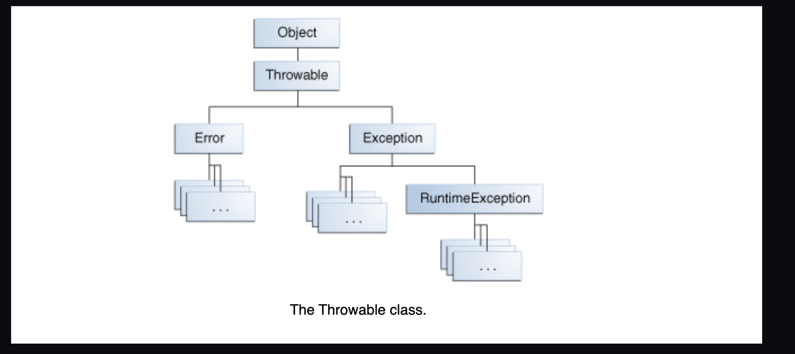
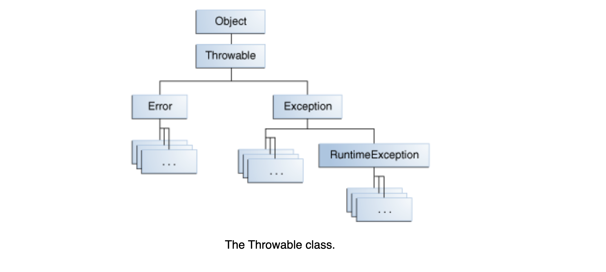
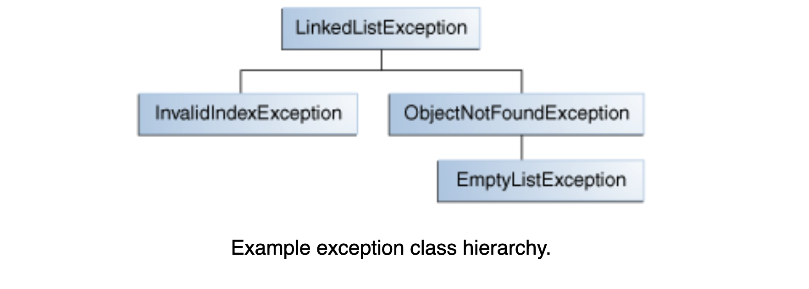

### What Is an Exception?

The term *exception* is shorthand for the phrase "exceptional event."

**Definition:**  
An exception is an event that occurs during the execution of a program, disrupting the normal flow of the program's instructions.

When an error occurs within a method, the method creates an object and hands it off to the runtime system. This object, called an *exception object*, contains information about the error, including its type and the state of the program when the error occurred. The process of creating an exception object and handing it to the runtime system is called *throwing an exception*.

After a method throws an exception, the runtime system attempts to find something to handle it. The set of possible "somethings" to handle the exception is the ordered list of methods that had been called to get to the method where the error occurred. This list of methods is known as the *call stack* (see the next figure).


The runtime system searches the call stack for a method that contains a block of code capable of handling the exception. This block of code is called an *exception handler*. The search begins with the method in which the error occurred and proceeds through the call stack in the reverse order in which the methods were called. 

When an appropriate handler is found, the runtime system passes the exception to the handler. An exception handler is considered appropriate if the type of the exception object thrown matches the type that the handler can manage.

The exception handler chosen is said to *catch* the exception. If the runtime system exhaustively searches all the methods on the call stack without finding an appropriate exception handler, as shown in the next figure, the runtime system (and, consequently, the program) terminates.


Using exceptions to manage errors has some advantages over traditional error-management techniques. You can learn more in the [Advantages of Exceptions](https://docs.oracle.com/javase/tutorial/essential/exceptions/advantages.html) section.



### The Catch or Specify Requirement

Valid Java programming language code must honor the *Catch or Specify Requirement*. This means that code that might throw certain exceptions must be enclosed by either of the following:

1. **A `try` statement that catches the exception.**  
   The `try` must provide a handler for the exception, as described in *Catching and Handling Exceptions*.

2. **A method that specifies that it can throw the exception.**  
   The method must provide a `throws` clause that lists the exception, as described in *Specifying the Exceptions Thrown by a Method*.

Code that fails to honor the *Catch or Specify Requirement* will not compile.

Not all exceptions are subject to the *Catch or Specify Requirement*. To understand why, we need to look at the three basic categories of exceptions, only one of which is subject to the Requirement.

### The Three Kinds of Exceptions

1. **Checked Exceptions:**  
   These are exceptional conditions that a well-written application should anticipate and recover from. For example, suppose an application prompts a user for an input file name, then opens the file by passing the name to the constructor for `java.io.FileReader`. Normally, the user provides the name of an existing, readable file, so the construction of the `FileReader` object succeeds, and the execution of the application proceeds normally. But sometimes the user supplies the name of a nonexistent file, and the constructor throws `java.io.FileNotFoundException`. A well-written program will catch this exception and notify the user of the mistake, possibly prompting for a corrected file name.

   Checked exceptions are subject to the *Catch or Specify Requirement*. All exceptions are checked exceptions, except for those indicated by `Error`, `RuntimeException`, and their subclasses.

2. **Errors:**  
   These are exceptional conditions that are external to the application and that the application usually cannot anticipate or recover from. For example, suppose that an application successfully opens a file for input but is unable to read the file because of a hardware or system malfunction. The unsuccessful read will throw `java.io.IOError`. An application might choose to catch this exception to notify the user of the problem, but it also might make sense for the program to print a stack trace and exit.

   Errors are not subject to the *Catch or Specify Requirement*. Errors are those exceptions indicated by `Error` and its subclasses.

3. **Runtime Exceptions:**  
   These are exceptional conditions that are internal to the application and that the application usually cannot anticipate or recover from. These usually indicate programming bugs, such as logic errors or improper use of an API. For example, consider the application described previously that passes a file name to the constructor for `FileReader`. If a logic error causes a `null` to be passed to the constructor, the constructor will throw `NullPointerException`. The application can catch this exception, but it probably makes more sense to eliminate the bug that caused the exception to occur.

   Runtime exceptions are not subject to the *Catch or Specify Requirement*. Runtime exceptions are those indicated by `RuntimeException` and its subclasses.

Errors and runtime exceptions are collectively known as *unchecked exceptions*.

### Bypassing Catch or Specify

Some programmers consider the *Catch or Specify Requirement* a serious flaw in the exception mechanism and bypass it by using unchecked exceptions in place of checked exceptions. In general, this is not recommended. The section *Unchecked Exceptions — The Controversy* discusses when it is appropriate to use unchecked exceptions.


### Catching and Handling Exceptions

This section describes how to use the three exception handler components — the `try`, `catch`, and `finally` blocks — to write an exception handler. Then, the *try-with-resources* statement, introduced in Java SE 7, is explained. The *try-with-resources* statement is particularly suited to situations that use `Closeable` resources, such as streams.

The last part of this section walks through an example and analyzes what occurs during various scenarios.

The following example defines and implements a class named `ListOfNumbers`. When constructed, `ListOfNumbers` creates an `ArrayList` that contains 10 `Integer` elements with sequential values from 0 through 9. The `ListOfNumbers` class also defines a method named `writeList`, which writes the list of numbers into a text file called `OutFile.txt`. This example uses output classes defined in `java.io`, which are covered in *Basic I/O*.

```java
// Note: This class will not compile yet.
import java.io.*;
import java.util.List;
import java.util.ArrayList;

public class ListOfNumbers {

    private List<Integer> list;
    private static final int SIZE = 10;

    public ListOfNumbers () {
        list = new ArrayList<Integer>(SIZE);
        for (int i = 0; i < SIZE; i++) {
            list.add(new Integer(i));
        }
    }

    public void writeList() {
        // The FileWriter constructor throws IOException, which must be caught.
        PrintWriter out = new PrintWriter(new FileWriter("OutFile.txt"));

        for (int i = 0; i < SIZE; i++) {
            // The get(int) method throws IndexOutOfBoundsException, which must be caught.
            out.println("Value at: " + i + " = " + list.get(i));
        }
        out.close();
    }
}
```

The first line in boldface is a call to a constructor. The constructor initializes an output stream on a file. If the file cannot be opened, the constructor throws an `IOException`. The second boldface line is a call to the `ArrayList` class's `get` method, which throws an `IndexOutOfBoundsException` if the value of its argument is too small (less than 0) or too large (more than the number of elements currently contained by the `ArrayList`).

If you try to compile the `ListOfNumbers` class, the compiler prints an error message about the exception thrown by the `FileWriter` constructor. However, it does not display an error message about the exception thrown by `get`. The reason is that the exception thrown by the constructor, `IOException`, is a checked exception, and the one thrown by the `get` method, `IndexOutOfBoundsException`, is an unchecked exception.

Now that you're familiar with the `ListOfNumbers` class and where the exceptions can be thrown within it, you're ready to write exception handlers to catch and handle those exceptions.


### The `try` Block

The first step in constructing an exception handler is to enclose the code that might throw an exception within a `try` block. In general, a `try` block looks like the following:

```java
try {
    // code
}
// catch and finally blocks . . .
```

The segment in the example labeled `code` contains one or more legal lines of code that could throw an exception. (The `catch` and `finally` blocks are explained in the next two subsections.)

To construct an exception handler for the `writeList` method from the `ListOfNumbers` class, enclose the exception-throwing statements of the `writeList` method within a `try` block. There is more than one way to do this. You can put each line of code that might throw an exception within its own `try` block and provide separate exception handlers for each. Or, you can put all the `writeList` code within a single `try` block and associate multiple handlers with it. The following listing uses one `try` block for the entire method because the code in question is very short.

```java
private List<Integer> list;
private static final int SIZE = 10;

public void writeList() {
    PrintWriter out = null;
    try {
        System.out.println("Entered try statement");
        FileWriter f = new FileWriter("OutFile.txt");
        out = new PrintWriter(f);
        for (int i = 0; i < SIZE; i++) {
            out.println("Value at: " + i + " = " + list.get(i));
        }
    }
    // catch and finally blocks . . .
}
```

If an exception occurs within the `try` block, that exception is handled by an exception handler associated with it. To associate an exception handler with a `try` block, you must put a `catch` block after it; the next section, *The `catch` Blocks*, shows you how.

### The `catch` Blocks

You associate exception handlers with a `try` block by providing one or more `catch` blocks directly after the `try` block. No code can be placed between the end of the `try` block and the beginning of the first `catch` block.

```java
try {
    // code that might throw an exception
} catch (ExceptionType name) {
    // handle ExceptionType
} catch (ExceptionType name) {
    // handle another ExceptionType
}
```

Each `catch` block is an exception handler that handles the type of exception indicated by its argument. The argument type, `ExceptionType`, declares the type of exception that the handler can handle and must be the name of a class that inherits from the `Throwable` class. The handler can refer to the exception with `name`.

The `catch` block contains code that is executed if and when the exception handler is invoked. The runtime system invokes the exception handler when the handler is the first one in the call stack whose `ExceptionType` matches the type of the exception thrown. The system considers it a match if the thrown object can legally be assigned to the exception handler's argument.

The following are two exception handlers for the `writeList` method:

```java
try {
    // code that might throw exceptions
}catch (Throwable throwable) {
    System.err.println("IndexOutOfBoundsException: " + throwable.getMessage());
}  
 catch (IndexOutOfBoundsException e) {  //unreachable code 
    System.err.println("IndexOutOfBoundsException: " + e.getMessage());
}catch(IOException e){
   //swalllowing the exception (VERY VERY BAD)
 } 
catch (IOException e) {//unreachable code 
   	System.err.println("Caught IOException: " + e.getMessage());  //option-1
    sendEmail("team@org.com","file not found , severe error");   //better option1 

    System.exit(0); // optional  (option-2 halt the program)
		sout("please provide another file name"); //option-3 recover from error and ask user for different input 
    throw new IncorrectResultSizeDataAccessException("file was not found , throwing runtimeException");
}
```

Exception handlers can do more than just print error messages or halt the program. They can perform error recovery, prompt the user to make a decision, or propagate the error up to a higher-level handler using chained exceptions, as described in the Chained Exceptions section.

### Catching More Than One Type of Exception with One Exception Handler

In Java SE 7 and later, a single `catch` block can handle more than one type of exception. This feature can reduce code duplication and lessen the temptation to catch an overly broad exception.

In the `catch` clause, specify the types of exceptions that the block can handle, and separate each exception type with a vertical bar (`|`):

```java
catch (IOException | SQLException ex) {
    logger.log(ex);
    //throw ex;
    throw new RuntimeException("some exception happened",ex);
}
```

**Note:** If a `catch` block handles more than one exception type, then the `catch` parameter is implicitly `final`. In this example, the `catch` parameter `ex` is `final` and therefore you cannot assign any values to it within the `catch` block.


### The `finally` Block

The `finally` block always executes when the `try` block exits. This ensures that the `finally` block is executed even if an unexpected exception occurs. However, `finally` is useful for more than just exception handling—it allows the programmer to avoid having cleanup code accidentally bypassed by a `return`, `continue`, or `break`. Putting cleanup code in a `finally` block is always a good practice, even when no exceptions are anticipated.

**Note:** The `finally` block may not execute if the JVM exits while the `try` or `catch` code is being executed.

The `try` block of the `writeList` method that you've been working with here opens a `PrintWriter`. The program should close that stream before exiting the `writeList` method. This poses a somewhat complicated problem because `writeList`'s `try` block can exit in one of three ways:

1. The `new FileWriter` statement fails and throws an `IOException`.
2. The `list.get(i)` statement fails and throws an `IndexOutOfBoundsException`.
3. Everything succeeds, and the `try` block exits normally.

The runtime system always executes the statements within the `finally` block regardless of what happens within the `try` block, making it the perfect place to perform cleanup.

The following `finally` block for the `writeList` method cleans up and then closes the `PrintWriter` and `FileWriter`:

```java
finally {
    if (out != null) { 
        System.out.println("Closing PrintWriter");
        out.close(); 
    } else { 
        System.out.println("PrintWriter not open");
    } 
    if (f != null) {
        System.out.println("Closing FileWriter");
        f.close();
    }   
}
```

**Important:** Use a try-with-resources statement instead of a `finally` block when closing a file or otherwise recovering resources. The following example uses a try-with-resources statement to clean up and close the `PrintWriter` and `FileWriter` for the `writeList` method:

```java
public void writeList() throws IOException {
    try (FileWriter f = new FileWriter("OutFile.txt");
         PrintWriter out = new PrintWriter(f)) {
        for (int i = 0; i < SIZE; i++) {
            out.println("Value at: " + i + " = " + list.get(i));
        }
    }
}
```

The try-with-resources statement automatically releases system resources when they are no longer needed. See The try-with-resources Statement.


### The `try-with-resources` Statement

The `try-with-resources` statement is a `try` statement that declares one or more resources. A *resource* is an object that must be closed after the program is finished with it. The `try-with-resources` statement ensures that each resource is closed at the end of the statement. Any object that implements `java.lang.AutoCloseable`, which includes all objects that implement `java.io.Closeable`, can be used as a resource.

The following example reads the first line from a file. It uses an instance of `FileReader` and `BufferedReader` to read data from the file. `FileReader` and `BufferedReader` are resources that must be closed after the program is finished with them:

```java
static String readFirstLineFromFile(String path) throws IOException {
    try (FileReader fr = new FileReader(path);
         BufferedReader br = new BufferedReader(fr)) {
        return br.readLine();
    }
  
  try{ FileReader fr = new FileReader(path);
         BufferedReader br = new BufferedReader(fr)
        return br.readLine();
    }
}
```

In this example, the resources declared in the `try-with-resources` statement are a `FileReader` and a `BufferedReader`. The declaration statements of these resources appear within parentheses immediately after the `try` keyword. The classes `FileReader` and `BufferedReader`, in Java SE 7 and later, implement the interface `java.lang.AutoCloseable`. Because the `FileReader` and `BufferedReader` instances are declared in a `try-with-resources` statement, they will be closed regardless of whether the `try` statement completes normally or abruptly (as a result of the method `BufferedReader.readLine` throwing an `IOException`).

#### Prior to Java SE 7

Before Java SE 7, you could use a `finally` block to ensure that a resource is closed regardless of whether the `try` statement completes normally or abruptly. The following example uses a `finally` block instead of a `try-with-resources` statement:

```java
static String readFirstLineFromFileWithFinallyBlock(String path) throws IOException {
   
    FileReader fr = new FileReader(path);
    BufferedReader br = new BufferedReader(fr);
    try {
        return br.readLine();
    } finally {
        br.close();
        fr.close();
    }
}
```

However, this example might have a resource leak. A program has to do more than rely on the garbage collector (GC) to reclaim a resource's memory when it's finished with it. The program must also release the resource back to the operating system, typically by calling the resource's `close` method. If a program fails to do this before the GC reclaims the resource, then the information needed to release the resource is lost. The resource, which is still considered by the operating system to be in use, has leaked.

In this example, if the `readLine` method throws an exception, and the statement `br.close()` in the `finally` block throws an exception, then the `FileReader` has leaked. Therefore, it is better to use a `try-with-resources` statement instead of a `finally` block to close your program's resources.

If both the `readLine` and `close` methods throw exceptions, then the method `readFirstLineFromFileWithFinallyBlock` throws the exception from the `finally` block, and the exception thrown from the `try` block is suppressed. In contrast, in the example `readFirstLineFromFile`, if exceptions are thrown from both the `try` block and the `try-with-resources` statement, then the method `readFirstLineFromFile` throws the exception from the `try` block, and the exception thrown from the `try-with-resources` block is suppressed. In Java SE 7 and later, you can retrieve suppressed exceptions; see the section *Suppressed Exceptions* for more information.

#### Example: Working with a ZIP File

The following example retrieves the names of the files packaged in the zip file `zipFileName` and creates a text file that contains the names of these files:

```java
public static void writeToFileZipFileContents(String zipFileName,
                                              String outputFileName)
                                              throws java.io.IOException {

    java.nio.charset.Charset charset =
         java.nio.charset.StandardCharsets.US_ASCII;
    java.nio.file.Path outputFilePath =
         java.nio.file.Paths.get(outputFileName);

    // Open zip file and create output file with 
    // try-with-resources statement

    try (
        java.util.zip.ZipFile zf =
             new java.util.zip.ZipFile(zipFileName);
        java.io.BufferedWriter writer = 
            java.nio.file.Files.newBufferedWriter(outputFilePath, charset)
    ) {
        // Enumerate each entry
        for (java.util.Enumeration entries =
                                zf.entries(); entries.hasMoreElements();) {
            // Get the entry name and write it to the output file
            String newLine = System.getProperty("line.separator");
            String zipEntryName =
                 ((java.util.zip.ZipEntry)entries.nextElement()).getName() +
                 newLine;
            writer.write(zipEntryName, 0, zipEntryName.length());
        }
    }
}
```

In this example, the `try-with-resources` statement contains two declarations that are separated by a semicolon: `ZipFile` and `BufferedWriter`. When the block of code that directly follows it terminates, either normally or because of an exception, the `close` methods of the `BufferedWriter` and `ZipFile` objects are automatically called in this order. Note that the `close` methods of resources are called in the opposite order of their creation.

#### Example: Working with a `java.sql.Statement`

The following example uses a `try-with-resources` statement to automatically close a `java.sql.Statement` object:

```java
public static void viewTable(Connection con) throws SQLException {

    String query = "select COF_NAME, SUP_ID, PRICE, SALES, TOTAL from COFFEES";

    try (Statement stmt = con.createStatement()) {
        ResultSet rs = stmt.executeQuery(query);

        while (rs.next()) {
            String coffeeName = rs.getString("COF_NAME");
            int supplierID = rs.getInt("SUP_ID");
            float price = rs.getFloat("PRICE");
            int sales = rs.getInt("SALES");
            int total = rs.getInt("TOTAL");

            System.out.println(coffeeName + ", " + supplierID + ", " + 
                               price + ", " + sales + ", " + total);
        }
    } catch (SQLException e) {
        JDBCTutorialUtilities.printSQLException(e);
    }
}
```

The resource `java.sql.Statement` used in this example is part of the JDBC 4.1 and later API.

**Note:** A `try-with-resources` statement can have `catch` and `finally` blocks just like an ordinary `try` statement. In a `try-with-resources` statement, any `catch` or `finally` block is run after the resources declared have been closed.

### Suppressed Exceptions

An exception can be thrown from the block of code associated with the `try-with-resources` statement. In the example `writeToFileZipFileContents`, an exception can be thrown from the `try` block, and up to two exceptions can be thrown from the `try-with-resources` statement when it tries to close the `ZipFile` and `BufferedWriter` objects. If an exception is thrown from the `try` block and one or more exceptions are thrown from the `try-with-resources` statement, then those exceptions thrown from the `try-with-resources` statement are suppressed, and the exception thrown by the block is the one that is thrown by the `writeToFileZipFileContents` method. You can retrieve these suppressed exceptions by calling the `Throwable.getSuppressed` method from the exception thrown by the `try` block.

### Classes That Implement the `AutoCloseable` or `Closeable` Interface

See the Javadoc of the `AutoCloseable` and `Closeable` interfaces for a list of classes that implement either of these interfaces. The `Closeable` interface extends the `AutoCloseable` interface. The `close` method of the `Closeable` interface throws exceptions of type `IOException`, while the `close` method of the `AutoCloseable` interface throws exceptions of type `Exception`. Consequently, subclasses of the `AutoCloseable` interface can override this behavior of the `close` method to throw specialized exceptions, such as `IOException`, or no exception at all.


### Putting It All Together

The previous sections described how to construct the `try`, `catch`, and `finally` code blocks for the `writeList` method in the `ListOfNumbers` class. Now, let's walk through the code and investigate what can happen.

When all the components are put together, the `writeList` method looks like the following:

```java
public void writeList() {
    PrintWriter out = null;

    try {
        System.out.println("Entering try statement");

        out = new PrintWriter(new FileWriter("OutFile.txt"));
        for (int i = 0; i < SIZE; i++) {
            out.println("Value at: " + i + " = " + list.get(i));
        }
    } catch (IndexOutOfBoundsException e) {
        System.err.println("Caught IndexOutOfBoundsException: " + e.getMessage());
    } catch (IOException e) {
        System.err.println("Caught IOException: " + e.getMessage());
    } finally {
        if (out != null) {
            System.out.println("Closing PrintWriter");
            out.close();
        } else {
            System.out.println("PrintWriter not open");
        }
    }
}
```

As mentioned previously, this method's `try` block has three different exit possibilities; here are two of them:

1. **Code in the `try` statement fails and throws an exception.**  
   This could be an `IOException` caused by the `new FileWriter` statement or an `IndexOutOfBoundsException` caused by a wrong index value in the `for` loop.

2. **Everything succeeds, and the `try` statement exits normally.**

Let's look at what happens in the `writeList` method during these two exit possibilities.

---

### Scenario 1: An Exception Occurs

The statement that creates a `FileWriter` can fail for a number of reasons. For example, the constructor for the `FileWriter` throws an `IOException` if the program cannot create or write to the file indicated.

When `FileWriter` throws an `IOException`, the runtime system immediately stops executing the `try` block; method calls being executed are not completed. The runtime system then starts searching at the top of the method call stack for an appropriate exception handler. In this example, when the `IOException` occurs, the `FileWriter` constructor is at the top of the call stack. However, the `FileWriter` constructor doesn't have an appropriate exception handler, so the runtime system checks the next method — the `writeList` method — in the method call stack. The `writeList` method has two exception handlers: one for `IOException` and one for `IndexOutOfBoundsException`.

The runtime system checks `writeList`'s handlers in the order in which they appear after the `try` statement. The argument to the first exception handler is `IndexOutOfBoundsException`. This does not match the type of exception thrown, so the runtime system checks the next exception handler — `IOException`. This matches the type of exception that was thrown, so the runtime system ends its search for an appropriate exception handler. Now that the runtime has found an appropriate handler, the code in that `catch` block is executed.

After the exception handler executes, the runtime system passes control to the `finally` block. Code in the `finally` block executes regardless of the exception caught above it. In this scenario, the `FileWriter` was never opened and doesn't need to be closed. After the `finally` block finishes executing, the program continues with the first statement after the `finally` block.

Here's the complete output from the `ListOfNumbers` program that appears when an `IOException` is thrown:

```
Entering try statement
Caught IOException: OutFile.txt
PrintWriter not open
```

The boldface code in the following listing shows the statements that get executed during this scenario:

```java
public void writeList() {
    PrintWriter out = null;

    try {
        System.out.println("Entering try statement");
        out = new PrintWriter(new FileWriter("OutFile.txt"));
        for (int i = 0; i < SIZE; i++)
            out.println("Value at: " + i + " = " + list.get(i));
    } catch (IndexOutOfBoundsException e) {
        System.err.println("Caught IndexOutOfBoundsException: " + e.getMessage());
    } catch (IOException e) {
        System.err.println("Caught IOException: " + e.getMessage());
    } finally {
        if (out != null) {
            System.out.println("Closing PrintWriter");
            out.close();
        } else {
            System.out.println("PrintWriter not open");
        }
    }
}
```

---

### Scenario 2: The `try` Block Exits Normally

In this scenario, all the statements within the scope of the `try` block execute successfully and throw no exceptions. Execution falls off the end of the `try` block, and the runtime system passes control to the `finally` block. Because everything was successful, the `PrintWriter` is open when control reaches the `finally` block, which closes the `PrintWriter`. Again, after the `finally` block finishes executing, the program continues with the first statement after the `finally` block.

Here is the output from the `ListOfNumbers` program when no exceptions are thrown:

```
Entering try statement
Closing PrintWriter
```

The boldface code in the following sample shows the statements that get executed during this scenario:

```java
public void writeList() {
    PrintWriter out = null;
    try {
        System.out.println("Entering try statement");
        out = new PrintWriter(new FileWriter("OutFile.txt"));
        for (int i = 0; i < SIZE; i++)
            out.println("Value at: " + i + " = " + list.get(i));
    } catch (IndexOutOfBoundsException e) {
        System.err.println("Caught IndexOutOfBoundsException: " + e.getMessage());
    } catch (IOException e) {
        System.err.println("Caught IOException: " + e.getMessage());
    } finally {
        if (out != null) {
            System.out.println("Closing PrintWriter");
            out.close();
        } else {
            System.out.println("PrintWriter not open");
        }
    }
}
```


### Specifying the Exceptions Thrown by a Method

The previous section showed how to write an exception handler for the `writeList` method in the `ListOfNumbers` class. Sometimes, it's appropriate for code to catch exceptions that can occur within it. However, in other cases, it's better to let a method further up the call stack handle the exception. For example, if you were providing the `ListOfNumbers` class as part of a package, you probably couldn't anticipate the needs of all the users of your package. In such cases, it's better not to catch the exception and instead allow a method further up the call stack to handle it.

If the `writeList` method doesn't catch the checked exceptions that can occur within it, the method must specify that it can throw these exceptions. Let's modify the original `writeList` method to specify the exceptions it can throw instead of catching them.

To remind you, here's the original version of the `writeList` method that won't compile:

```java
public void writeList() {
    PrintWriter out = new PrintWriter(new FileWriter("OutFile.txt"));
    for (int i = 0; i < SIZE; i++) {
        out.println("Value at: " + i + " = " + list.get(i));
    }
    out.close();
}
```

To specify that `writeList` can throw two exceptions, add a `throws` clause to the method declaration. The `throws` clause comprises the `throws` keyword followed by a comma-separated list of all the exceptions thrown by that method. The clause goes after the method name and argument list, and before the brace that defines the scope of the method. Here’s an example:

```java
public void writeList() throws IOException, IndexOutOfBoundsException {
```

Remember that `IndexOutOfBoundsException` is an unchecked exception; including it in the `throws` clause is not mandatory. You could just write the following:

```java
public void writeList() throws IOException {
```


### How to Throw Exceptions

Before you can catch an exception, some code somewhere must throw one. Any code can throw an exception: your code, code from a package written by someone else (such as the packages that come with the Java platform), or the Java runtime environment. Regardless of what throws the exception, it's always thrown with the `throw` statement.

As you may have noticed, the Java platform provides numerous exception classes. All these classes are descendants of the `Throwable` class, which allows programs to differentiate among the various types of exceptions that can occur during program execution.

You can also create your own exception classes to represent problems that might occur within the classes you write. In fact, if you are a package developer, you might need to create your own set of exception classes to help users differentiate errors in your package from those in the Java platform or other packages.

You can also create chained exceptions. For more information, see the **Chained Exceptions** section.

#### The `throw` Statement

All methods use the `throw` statement to throw an exception. The `throw` statement requires a single argument: a throwable object. Throwable objects are instances of any subclass of the `Throwable` class. Here's an example of a `throw` statement:

```java
throw someThrowableObject;
```

Let’s look at the `throw` statement in context. The following `pop` method is taken from a class that implements a common stack object. The method removes the top element from the stack and returns the object:

```java
public Object pop() {
    Object obj;

    if (size == 0) {
        throw new EmptyStackException();
    }

    obj = objectAt(size - 1);
    setObjectAt(size - 1, null);
    size--;
    return obj;
}
```

The `pop` method checks whether any elements are on the stack. If the stack is empty (its size is equal to 0), `pop` instantiates a new `EmptyStackException` object (a member of `java.util`) and throws it. The **Creating Exception Classes** section in this chapter explains how to create your own exception classes. For now, remember that you can only throw objects that inherit from the `java.lang.Throwable` class.

Note that the declaration of the `pop` method does not contain a `throws` clause. `EmptyStackException` is not a checked exception, so `pop` is not required to declare that it might occur.

#### Throwable Class and Its Subclasses

The objects that inherit from the `Throwable` class include direct descendants (objects that inherit directly from the `Throwable` class) and indirect descendants (objects that inherit from children or grandchildren of the `Throwable` class). The figure below illustrates the class hierarchy of the `Throwable` class and its most significant subclasses. As you can see, `Throwable` has two direct descendants: `Error` and `Exception`.




**Throwable Class Hierarchy:**

- **Error Class:**  
  When a dynamic linking failure or another hard failure occurs in the Java virtual machine, the virtual machine throws an `Error`. Simple programs typically do not catch or throw `Error`s.

- **Exception Class:**  
  Most programs throw and catch objects that derive from the `Exception` class. An `Exception` indicates that a problem occurred, but it is not a serious system problem. Most programs you write will throw and catch `Exception`s rather than `Error`s.

  The Java platform defines many descendants of the `Exception` class. These descendants indicate various types of exceptions that can occur. For example, `IllegalAccessException` signals that a particular method could not be accessed, and `NegativeArraySizeException` indicates that a program attempted to create an array with a negative size.

  One `Exception` subclass, `RuntimeException`, is reserved for exceptions that indicate incorrect use of an API. An example of a runtime exception is `NullPointerException`, which occurs when a method tries to access a member of an object through a null reference. The section **Unchecked Exceptions — The Controversy** discusses why most applications shouldn't throw runtime exceptions or subclass `RuntimeException`.


### Chained Exceptions

An application often responds to an exception by throwing another exception. In effect, the first exception causes the second exception. It can be very helpful to know when one exception causes another. *Chained Exceptions* help the programmer achieve this.

The following are the methods and constructors in `Throwable` that support chained exceptions:

- `Throwable getCause()`
- `Throwable initCause(Throwable)`
- `Throwable(String, Throwable)`
- `Throwable(Throwable)`

The `Throwable` argument to `initCause` and the `Throwable` constructors is the exception that caused the current exception. `getCause` returns the exception that caused the current exception, and `initCause` sets the current exception's cause.

The following example shows how to use a chained exception:

```java
try {
    // some code that may throw an exception
} catch (IOException e) {
    throw new SampleException("Other IOException", e);
}
```

In this example, when an `IOException` is caught, a new `SampleException` is created with the original cause attached, and the chain of exceptions is thrown up to the next higher-level exception handler.

### Accessing Stack Trace Information

Suppose the higher-level exception handler wants to dump the stack trace in its own format.

**Definition:**  
A stack trace provides information on the execution history of the current thread and lists the names of the classes and methods that were called at the point when the exception occurred. A stack trace is a useful debugging tool that you'll normally take advantage of when an exception has been thrown.

The following code shows how to call the `getStackTrace` method on the exception object:

```java
catch (Exception cause) {
    StackTraceElement elements[] = cause.getStackTrace();
    for (int i = 0, n = elements.length; i < n; i++) {       
        System.err.println(elements[i].getFileName()
            + ":" + elements[i].getLineNumber() 
            + ">> "
            + elements[i].getMethodName() + "()");
    }
}
```

### Logging API

The next code snippet logs where an exception occurred from within the `catch` block. However, rather than manually parsing the stack trace and sending the output to `System.err`, it sends the output to a file using the logging facility in the `java.util.logging` package.

```java
try {
    Handler handler = new FileHandler("OutFile.log");
    Logger.getLogger("").addHandler(handler);
    
} catch (IOException e) {
    Logger.error(e); //with libraries like log4j, sl4j, logback
   
    Logger logger = Logger.getLogger("package.name");  //java.util.logging
    StackTraceElement elements[] = e.getStackTrace();
    for (int i = 0, n = elements.length; i < n; i++) {
        logger.log(Level.WARNING, elements[i].getMethodName());
    }
}
```


### Creating Exception Classes

When deciding which type of exception to throw, you have the option to use an existing exception class provided by the Java platform or to create your own. You should consider writing your own exception classes if you answer "yes" to any of the following questions; otherwise, you might be better off using an existing exception:

- **Do you need an exception type that isn't represented by those in the Java platform?**
- **Would it help users if they could differentiate your exceptions from those thrown by classes written by other vendors?**
- **Does your code throw more than one related exception?**
- **If you use someone else's exceptions, will users have access to those exceptions?**  
  A similar question is whether your package should be independent and self-contained.

### An Example

Suppose you are writing a linked list class. The class supports the following methods, among others:

- **`objectAt(int n)`** — Returns the object in the `n`th position in the list. Throws an exception if the argument is less than 0 or more than the number of objects currently in the list.
- **`firstObject()`** — Returns the first object in the list. Throws an exception if the list contains no objects.
- **`indexOf(Object o)`** — Searches the list for the specified object and returns its position in the list. Throws an exception if the object passed into the method is not in the list.

The linked list class can throw multiple exceptions, and it would be convenient to catch all exceptions thrown by the linked list with one exception handler. Additionally, if you plan to distribute your linked list in a package, all related code should be packaged together. Therefore, the linked list should provide its own set of exception classes.

The next figure illustrates one possible class hierarchy for the exceptions thrown by the linked list.



Choosing a Superclass

Any `Exception` subclass can be used as the parent class of `LinkedListException`. However, a quick look at these subclasses shows that they are often too specialized or completely unrelated to `LinkedListException`. Therefore, the parent class of `LinkedListException` should be `Exception`.

Most applets and applications you write will throw objects that are `Exceptions`. `Errors` are normally used for serious, hard errors in the system, such as those that prevent the JVM from running.

**Note:** For readable code, it's good practice to append the string `Exception` to the names of all classes that inherit (directly or indirectly) from the `Exception` class.

### Unchecked Exceptions — The Controversy

Because the Java programming language does not require methods to catch or specify unchecked exceptions (`RuntimeException`, `Error`, and their subclasses), programmers may be tempted to write code that throws only unchecked exceptions or to make all their exception subclasses inherit from `RuntimeException`. Both of these shortcuts allow programmers to write code without dealing with compiler errors and without specifying or catching any exceptions. Although this may seem convenient, it sidesteps the intent of the catch-or-specify requirement and can cause problems for others using your classes.

#### Why Specify Unchecked Exceptions?

Why did the designers of Java decide to force a method to specify all uncaught checked exceptions that can be thrown within its scope? Any `Exception` that can be thrown by a method is part of the method's public programming interface. Those who call a method must know about the exceptions that the method can throw so they can decide how to handle them. These exceptions are as much a part of the method's programming interface as its parameters and return value.

The next question might be: "If it's so good to document a method's API, including the exceptions it can throw, why not specify runtime exceptions too?" Runtime exceptions represent problems that are the result of a programming issue, and as such, the API client code cannot reasonably be expected to recover from them or handle them in any way. Such problems include arithmetic exceptions, such as dividing by zero; pointer exceptions, such as trying to access an object through a null reference; and indexing exceptions, such as attempting to access an array element through an index that is too large or too small.

Runtime exceptions can occur anywhere in a program, and in a typical one, they can be very numerous. Having to add runtime exceptions in every method declaration would reduce a program's clarity. Thus, the compiler does not require that you catch or specify runtime exceptions (although you can).

#### When to Use RuntimeException

One case where it is common practice to throw a `RuntimeException` is when the user calls a method incorrectly. For example, a method can check if one of its arguments is incorrectly `null`. If an argument is `null`, the method might throw a `NullPointerException`, which is an unchecked exception.

Generally speaking, do not throw a `RuntimeException` or create a subclass of `RuntimeException` simply because you don't want to be bothered with specifying the exceptions your methods can throw.

### Guideline

Here's the bottom line guideline: **If a client can reasonably be expected to recover from an exception, make it a checked exception. If a client cannot do anything to recover from the exception, make it an unchecked exception.**

# Advantages of Exceptions

Now that you know what exceptions are and how to use them, it's time to learn the advantages of using exceptions in your programs.

## Advantage 1: Separating Error-Handling Code from "Regular" Code

Exceptions provide the means to separate the details of what to do when something out of the ordinary happens from the main logic of a program. In traditional programming, error detection, reporting, and handling often lead to confusing spaghetti code. For example, consider the pseudocode method here that reads an entire file into memory.

```java
readFile {
    open the file;
    determine its size;
    allocate that much memory;
    read the file into memory;
    close the file;
}
```

At first glance, this function seems simple enough, but it ignores all the following potential errors.

- What happens if the file can't be opened?
- What happens if the length of the file can't be determined?
- What happens if enough memory can't be allocated?
- What happens if the read fails?
- What happens if the file can't be closed?

To handle such cases, the `readFile` function must have more code to do error detection, reporting, and handling. Here is an example of what the function might look like.

```java
errorCodeType readFile {
    initialize errorCode = 0;
    
    open the file;
    if (theFileIsOpen) {
        determine the length of the file;
        if (gotTheFileLength) {
            allocate that much memory;
            if (gotEnoughMemory) {
                read the file into memory;
                if (readFailed) {
                    errorCode = -1; //read failed error code
                }
            } else {
                errorCode = -2;//not enough memory error code
            }
        } else {
            errorCode = -3; //unable to get file length error code
        }
        close the file;
        if (theFileDidntClose && errorCode == 0) {
            errorCode = -4; //file closure error code
        } else {
            errorCode = errorCode and -4; //more error codes
        }
    } else {
        errorCode = -5; //file could not be opened error code 
    }
    return errorCode;
}
```

There's so much error detection, reporting, and returning here that the original seven lines of code are lost in the clutter. Worse yet, the logical flow of the code has also been lost, thus making it difficult to tell whether the code is doing the right thing: Is the file really being closed if the function fails to allocate enough memory? It's even more difficult to ensure that the code continues to do the right thing when you modify the method three months after writing it. Many programmers solve this problem by simply ignoring it — errors are reported when their programs crash.

Exceptions enable you to write the main flow of your code and to deal with the exceptional cases elsewhere. If the `readFile` function used exceptions instead of traditional error-management techniques, it would look more like the following.

```java
readFile {
    try {
        open the file;
        determine its size;
        allocate that much memory;
        read the file into memory;
        close the file;
    } catch (fileOpenFailed) {
       doSomething;
    } catch (sizeDeterminationFailed) {
        doSomething;
    } catch (memoryAllocationFailed) {
        doSomething;
    } catch (readFailed) {
        doSomething;
    } catch (fileCloseFailed) {
        doSomething;
    } catch (Exception){
      
    }
}
```

Note that exceptions don't spare you the effort of doing the work of detecting, reporting, and handling errors, but they do help you organize the work more effectively.

## Advantage 2: Propagating Errors Up the Call Stack

A second advantage of exceptions is the ability to propagate error reporting up the call stack of methods. Suppose that the `readFile` method is the fourth method in a series of nested method calls made by the main program: `method1` calls `method2`, which calls `method3`, which finally calls `readFile`.

```java
method1 {
    call method2;
}

method2 {
    call method3;
}

method3 {
    call readFile;
}
```

Suppose also that `method1` is the only method interested in the errors that might occur within `readFile`. Traditional error-notification techniques force `method2` and `method3` to propagate the error codes returned by `readFile` up the call stack until the error codes finally reach `method1`—the only method that is interested in them.

```java
method1 {
    errorCodeType error;
    error = call method2;
    if (error)
        doErrorProcessing;
    else
        proceed;
}

errorCodeType method2 {
    errorCodeType error;
    error = call method3;
    if (error)
        return error;
    else
        proceed;
}

errorCodeType method3 {
    errorCodeType error;
    error = call readFile;
    if (error)
        return error;
    else
        proceed;
}
```

Recall that the Java runtime environment searches backward through the call stack to find any methods that are interested in handling a particular exception. A method can duck any exceptions thrown within it, thereby allowing a method farther up the call stack to catch it. Hence, only the methods that care about errors have to worry about detecting errors.

```java
method1 {
    try {
        call method2;
    } catch (exception e) {
        doErrorProcessing;
    }
}

method2 throws exception {
    call method3;
}

method3 throws exception {
    call readFile;
}
```

However, as the pseudocode shows, ducking an exception requires some effort on the part of the middleman methods. Any checked exceptions that can be thrown within a method must be specified in its `throws` clause.

## Advantage 3: Grouping and Differentiating Error Types

Because all exceptions thrown within a program are objects, the grouping or categorizing of exceptions is a natural outcome of the class hierarchy. An example of a group of related exception classes in the Java platform are those defined in `java.io` — `IOException` and its descendants. `IOException` is the most general and represents any type of error that can occur when performing I/O. Its descendants represent more specific errors. For example, `FileNotFoundException` means that a file could not be located on disk.

A method can write specific handlers that can handle a very specific exception. The `FileNotFoundException` class has no descendants, so the following handler can handle only one type of exception.

```java
catch (FileNotFoundException e) {
    ...
}
```

A method can catch an exception based on its group or general type by specifying any of the exception's superclasses in the `catch` statement. For example, to catch all I/O exceptions, regardless of their specific type, an exception handler specifies an `IOException` argument.

```java
catch (IOException e) {
    ...
}
```

This handler will be able to catch all I/O exceptions, including `FileNotFoundException`, `EOFException`, and so on. You can find details about what occurred by querying the argument passed to the exception handler. For example, use the following to print the stack trace.

```java
catch (IOException e) {
    // Output goes to System.err.
    e.printStackTrace();
    // Send trace to stdout.
    e.printStackTrace(System.out);
}
```

You could even set up an exception handler that handles any `Exception` with the handler here.

```java
// A (too) general exception handler
catch (Exception e) {
    ...
}
```

The `Exception` class is close to the top of the `Throwable` class hierarchy. Therefore, this handler will catch many other exceptions in addition to those that the handler is intended to catch. You may want to handle exceptions this way if all you want your program to do, for example, is print out an error message for the user and then exit.

In most situations, however, you want exception handlers to be as specific as possible. The reason is that the first thing a handler must do is determine what type of exception occurred before it can decide on the best recovery strategy. In effect, by not catching specific errors, the handler must accommodate any possibility. Exception handlers that are too general can make code more error-prone by catching and handling exceptions that weren't anticipated by the programmer and for which the handler was not intended.

As noted, you can create groups of exceptions and handle exceptions in a general fashion, or you can use the specific exception type to differentiate exceptions and handle exceptions in an exact fashion.

### Summary

A program can use exceptions to indicate that an error occurred. To throw an exception, use the `throw` statement and provide it with an exception object—a descendant of `Throwable`—to convey information about the specific error that occurred. A method that throws an uncaught, checked exception must include a `throws` clause in its declaration.

A program can catch exceptions by using a combination of the `try`, `catch`, and `finally` blocks:

- **`try` Block:** Identifies a block of code in which an exception can occur.
- **`catch` Block:** Identifies a block of code, known as an exception handler, that can handle a particular type of exception.
- **`finally` Block:** Identifies a block of code that is guaranteed to execute and is the right place to close files, recover resources, and otherwise clean up after the code enclosed in the `try` block.

The `try` statement should contain at least one `catch` block or a `finally` block and may have multiple `catch` blocks.

The class of the exception object indicates the type of exception thrown. The exception object can contain further information about the error, including an error message. With exception chaining, an exception can point to the exception that caused it, which can, in turn, point to the exception that caused it, and so on.


Here's the updated version of the **Generic Course Class** problem statement with appropriate user-defined exceptions added for error handling:

---

### **Problem 4: Generic Course Class with Exception Handling**

#### **Objective:**

Design and implement a generic class `Course` that can store and manage information about a course, including the students enrolled and their corresponding grades. The `Course` class should be versatile, allowing it to work with any type of student identifier and any numeric type for grades, such as `Integer`, `Double`, etc.

Additionally, the class should include appropriate exception handling to manage cases where operations fail due to invalid inputs or missing data.

#### **Requirements:**

1. **Generic Design:**
   - The `Course` class should use generics to handle different types of student identifiers (e.g., `String` for names, `Integer` for student IDs) and numeric grades (e.g., `Integer`, `Double`).
   - The class should ensure type safety by working with these types and performing necessary operations without relying on specific implementations.

2. **Core Functionalities:**
   - **Enrolling Students**: The class should allow enrolling students in the course. Each student should be uniquely identified by an identifier of type `S`.  
     - If a student with the same identifier is already enrolled, throw a `StudentAlreadyEnrolledException`.
   - **Assigning Grades**: The class should provide functionality to assign a grade of type `G` to a specific student.  
     - If a grade is assigned to a student who is not enrolled, throw a `StudentNotFoundException`.
   - **Retrieving Grades**: The class should allow retrieval of a student's grade based on their identifier.  
     - If the student has not been assigned a grade, throw a `GradeNotAssignedException`.  
     - If the student is not enrolled, throw a `StudentNotFoundException`.
   - **Listing All Grades**: The class should offer a way to retrieve a collection of all students and their corresponding grades.

3. **Edge Cases Handling:**
   - The class should handle cases where a grade is requested for a student who has not been assigned a grade yet or who is not enrolled in the course.
   - It should ensure that grades can be updated if necessary and reflect the latest information for each student.
   - **Custom Exceptions**:
     - `StudentAlreadyEnrolledException`: Thrown when attempting to enroll a student who is already enrolled.
     - `StudentNotFoundException`: Thrown when trying to assign a grade to or retrieve information about a non-enrolled student.
     - `GradeNotAssignedException`: Thrown when attempting to retrieve a grade for a student who has not been assigned a grade yet.

4. **Ease of Use:**
   - The class should provide an intuitive interface for adding students, assigning grades, and retrieving information.
   - It should be easily adaptable to different educational contexts, whether used in a simple classroom setting or a more complex educational system.

5. **Scalability:**
   - The design should accommodate large numbers of students and efficiently manage the storage and retrieval of their grades.
   - It should maintain the integrity of the data and perform operations in a way that scales well with the number of students.

#### **Scenario Example:**

Imagine a scenario where a teacher is managing a course and needs to keep track of the students enrolled and their grades. Each student can be identified by a unique identifier (such as a name or a student ID), and their grades could be in various formats, such as percentages or GPA scores. The teacher needs to be able to enroll students, assign grades, and retrieve grades as needed, ensuring that the course's data remains accurate and up-to-date.

The `Course` class should throw appropriate exceptions if:
- A student tries to enroll who is already in the course.
- A grade is assigned to a student who isn't enrolled.
- A grade is requested for a student who hasn't been assigned a grade.

By implementing the `Course` class with generics and exception handling, the teacher can manage these tasks seamlessly, regardless of the type of student identifier or grade format, making the class highly adaptable to various educational needs.

#### **Exception Classes:**

```java
public class StudentAlreadyEnrolledException extends Exception {
    public StudentAlreadyEnrolledException(String studentId) {
        super("Error: Student '" + studentId + "' is already enrolled.");
    }
}

public class StudentNotFoundException extends Exception {
    public StudentNotFoundException(String studentId) {
        super("Error: Student '" + studentId + "' is not enrolled in the course.");
    }
}

public class GradeNotAssignedException extends Exception {
    public GradeNotAssignedException(String studentId) {
        super("Error: Grade not assigned for student '" + studentId + "'.");
    }
}
```

#### **Outcome:**

Students should be able to design the `Course` class that can:

- Store and manage a collection of students and their corresponding grades.
- Provide methods for enrolling students, assigning and updating grades, and retrieving grades.
- Handle various types of student identifiers and numeric grades through the use of generics.
- Offer a user-friendly interface suitable for managing a course in different educational contexts.
- Appropriately throw and handle exceptions for invalid operations like duplicate enrollment or requesting grades for non-existent students.

---

This version adds robustness through exception handling while maintaining type safety and scalability.


Here's the Java code for the **Generic Course Class** with the appropriate exception handling, along with JUnit 4.13 tests.

### **Java Code: `Course.java`**

```java
import java.util.HashMap;
import java.util.Map;

// Custom Exception Classes
class StudentAlreadyEnrolledException extends Exception {
    public StudentAlreadyEnrolledException(String studentId) {
        super("Error: Student '" + studentId + "' is already enrolled.");
    }
}

class StudentNotFoundException extends Exception {
    public StudentNotFoundException(String studentId) {
        super("Error: Student '" + studentId + "' is not enrolled in the course.");
    }
}

class GradeNotAssignedException extends Exception {
    public GradeNotAssignedException(String studentId) {
        super("Error: Grade not assigned for student '" + studentId + "'.");
    }
}

// Generic Course Class
public class Course<S, G extends Number> {
    private Map<S, G> studentGrades;

    public Course() {
        studentGrades = new HashMap<>();
    }

    // Enroll a student
    public void enrollStudent(S studentId) throws StudentAlreadyEnrolledException {
        if (studentGrades.containsKey(studentId)) {
            throw new StudentAlreadyEnrolledException(studentId.toString());
        }
        studentGrades.put(studentId, null); // Initially, no grade is assigned
    }

    // Assign a grade to a student
    public void assignGrade(S studentId, G grade) throws StudentNotFoundException {
        if (!studentGrades.containsKey(studentId)) {
            throw new StudentNotFoundException(studentId.toString());
        }
        studentGrades.put(studentId, grade); // Assign or update grade
    }

    // Retrieve a student's grade
    public G getGrade(S studentId) throws StudentNotFoundException, GradeNotAssignedException {
        if (!studentGrades.containsKey(studentId)) {
            throw new StudentNotFoundException(studentId.toString());
        }
        G grade = studentGrades.get(studentId);
        if (grade == null) {
            throw new GradeNotAssignedException(studentId.toString());
        }
        return grade;
    }

    // List all students and their grades
    public Map<S, G> getAllGrades() {
        return new HashMap<>(studentGrades);
    }
}
```

### **JUnit 4.13 Tests: `CourseTest.java`**

```java
import org.junit.Before;
import org.junit.Test;
import static org.junit.Assert.*;

import java.util.Map;

public class CourseTest {
    private Course<String, Double> course;

    @Before
    public void setUp() {
        course = new Course<>();
    }

    // Test successful student enrollment
    @Test
    public void testEnrollStudent() throws StudentAlreadyEnrolledException {
        course.enrollStudent("Student1");
        assertNotNull(course.getAllGrades().get("Student1"));
    }

    // Test enrolling the same student twice should throw exception
    @Test(expected = StudentAlreadyEnrolledException.class)
    public void testEnrollStudent_AlreadyEnrolled() throws StudentAlreadyEnrolledException {
        course.enrollStudent("Student1");
        course.enrollStudent("Student1"); // This should throw StudentAlreadyEnrolledException
    }

    // Test assigning a grade to an enrolled student
    @Test
    public void testAssignGrade() throws StudentAlreadyEnrolledException, StudentNotFoundException {
        course.enrollStudent("Student1");
        course.assignGrade("Student1", 85.5);
        assertEquals(Double.valueOf(85.5), course.getAllGrades().get("Student1"));
    }

    // Test assigning a grade to a non-enrolled student should throw exception
    @Test(expected = StudentNotFoundException.class)
    public void testAssignGrade_StudentNotFound() throws StudentNotFoundException {
        course.assignGrade("Student2", 90.0); // This should throw StudentNotFoundException
    }

    // Test retrieving a grade for a student
    @Test
    public void testGetGrade() throws StudentAlreadyEnrolledException, StudentNotFoundException, GradeNotAssignedException {
        course.enrollStudent("Student1");
        course.assignGrade("Student1", 88.0);
        assertEquals(Double.valueOf(88.0), course.getGrade("Student1"));
    }

    // Test retrieving a grade for a non-enrolled student should throw exception
    @Test(expected = StudentNotFoundException.class)
    public void testGetGrade_StudentNotFound() throws StudentNotFoundException, GradeNotAssignedException {
        course.getGrade("Student2"); // This should throw StudentNotFoundException
    }

    // Test retrieving a grade for an enrolled student who hasn't been assigned a grade should throw exception
    @Test(expected = GradeNotAssignedException.class)
    public void testGetGrade_GradeNotAssigned() throws StudentAlreadyEnrolledException, StudentNotFoundException, GradeNotAssignedException {
        course.enrollStudent("Student1");
        course.getGrade("Student1"); // This should throw GradeNotAssignedException
    }

    // Test listing all grades
    @Test
    public void testGetAllGrades() throws StudentAlreadyEnrolledException, StudentNotFoundException {
        course.enrollStudent("Student1");
        course.enrollStudent("Student2");
        course.assignGrade("Student1", 75.0);
        course.assignGrade("Student2", 85.0);

        Map<String, Double> allGrades = course.getAllGrades();
        assertEquals(Double.valueOf(75.0), allGrades.get("Student1"));
        assertEquals(Double.valueOf(85.0), allGrades.get("Student2"));
    }
}
```

### **Explanation:**
1. **Course Class:**
   - The `Course` class is a generic class that can work with different types of student identifiers (`S`) and grades (`G`).
   - It has methods to enroll students, assign grades, retrieve grades, and list all students with their grades.
   - Exception handling is implemented using custom exceptions (`StudentAlreadyEnrolledException`, `StudentNotFoundException`, `GradeNotAssignedException`).

2. **JUnit Tests:**
   - **`testEnrollStudent()`** ensures that a student can be successfully enrolled.
   - **`testEnrollStudent_AlreadyEnrolled()`** checks that enrolling a student twice throws an exception.
   - **`testAssignGrade()`** checks that grades can be assigned to enrolled students.
   - **`testAssignGrade_StudentNotFound()`** ensures that assigning a grade to a non-enrolled student throws an exception.
   - **`testGetGrade()`** ensures grades can be retrieved for enrolled students.
   - **`testGetGrade_StudentNotFound()`** and **`testGetGrade_GradeNotAssigned()`** handle cases where grades are requested for non-enrolled students or students without assigned grades.
   - **`testGetAllGrades()`** verifies that all student grades can be retrieved as expected.

### **Running the Tests:**
Run the JUnit tests using your preferred testing tool or directly through an IDE like IntelliJ IDEA, Eclipse, or from the command line using Maven or Gradle.

Let me know if you need further assistance with the implementation or testing!


