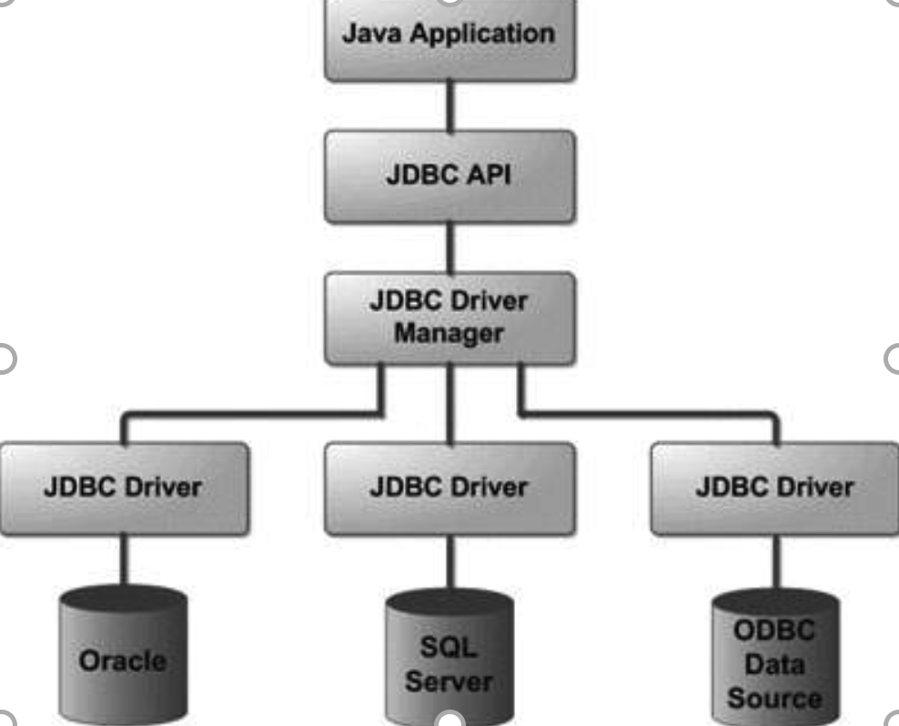
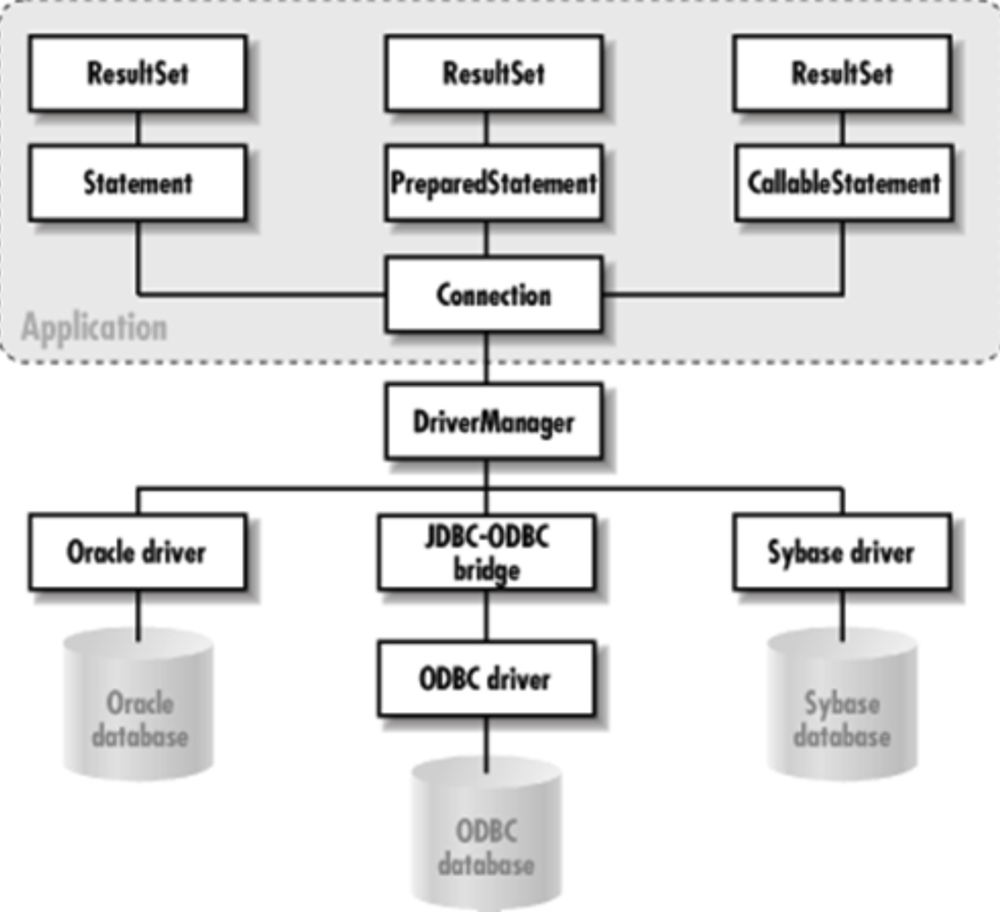
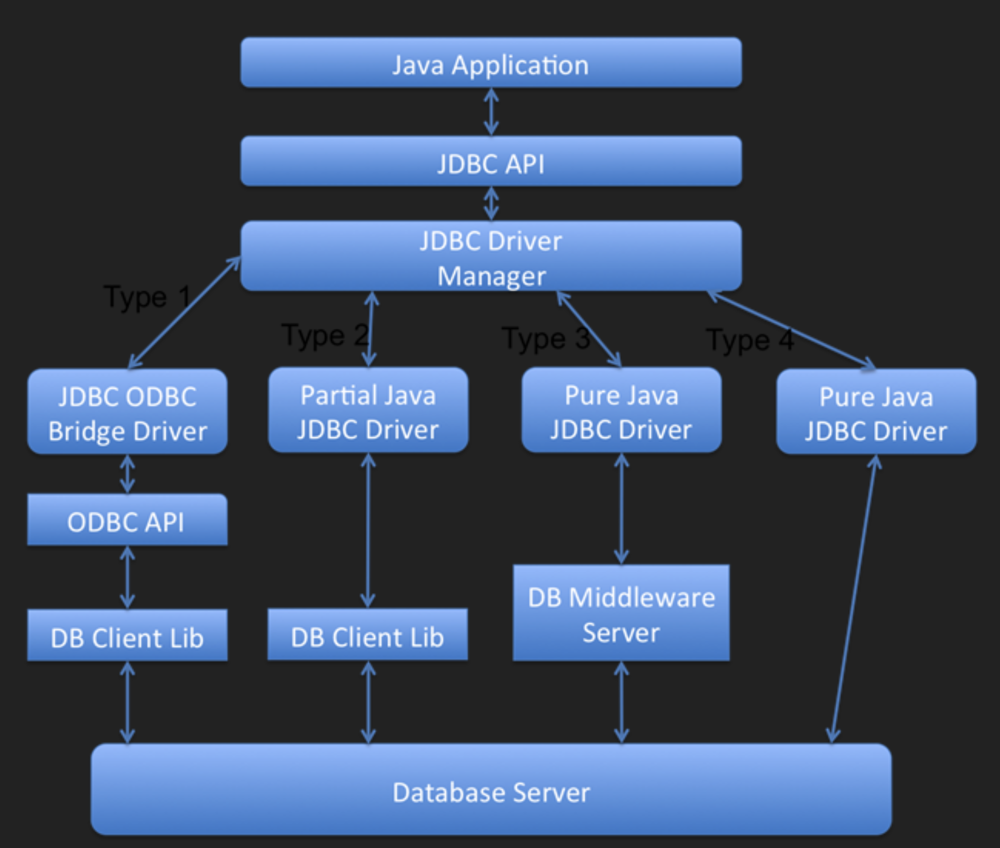

**Basic JDBC Architecture** 

  https://github.com/FullStackLabsCa/boca-core-java-examples/tree/main/src/jdbc

Java --> JVM --> OS

Java app --> JDBC Api --> DB



Basic JDBC Class Hierarchy 




**Different types** **of JDBC Drivers**




A JDBC driver is a JDBC API implementation used for connecting to a particular type of database. There are several types of JDBC drivers: 

- Type 1 – contains a mapping to another data access API; an example of this is the JDBC-ODBC driver 

- Type 2 – is an implementation that uses client-side libraries of the target database; also called a native-API driver 

- Type 3 – uses middleware to convert JDBC calls into database-specific calls; also known as network protocol driver 

- Type 4 – connect directly to a database by converting JDBC calls into database-specific calls; known as database protocol drivers or thin drivers 


`install docker`

`ask docker to run mysql container with docker run command`  

`installed oracle sql developer(1) && db visualizer(2)`

`we download type 4 jdbc driver for mysql 8/9 from mysql downloads`

`brew install mysql for obtaining the command line mysql client(3)`

**Steps to work with Databases using JDBC** 

### Create the Database and Tables

`brew install `

1. `docker run --name mysql -e MYSQL_ROOT_PASSWORD=password123  -p 3306:3306  bitnami/mysql:latest`

2. `docker ps ` 

3. `mysql -u root -p -h 127.0.0.1 -P 3306`

4. `[Oracle SQL Developer Downloads](https://www.oracle.com/database/sqldeveloper/technologies/download/)`

5. 

6. **Create the Database**:

   ```sql
   CREATE DATABASE bootcamp;
   ```

7. **Create the User**:
   ```sql
   CREATE USER 'user1' IDENTIFIED BY 'password123';
   ```

8. **Grant Permissions**:
   ```sql
   GRANT ALL ON bootcamp.* TO 'user1';
   ```

---

### Connect to the Database

#### 1. Register the JDBC Driver

Before you register the driver, make sure you include the required dependencies in your project.

**Dependency (Maven example)**:
```xml
<dependency>
    <groupId>mysql</groupId>
    <artifactId>mysql-connector-java</artifactId>
    <version>8.0.16</version>
</dependency>
```

**Register the Driver**:
```java
Class.forName("com.mysql.cj.jdbc.Driver"); // For MySQL
```

---

#### 2. Create the Connection using JDBC URLs

**Example of Creating a Connection**:
```java
Connection con = DriverManager.getConnection("jdbc:mysql://localhost:3306/myDb", "user1", "pass");
```

---

This outlines the basic steps for setting up a MySQL database, connecting to it via JDBC, and registering the driver.


### JDBC URL Format

The general format for a JDBC URL is:
```
jdbc:<vendor-name>://host:port/<database-name>?parameter1=value1&parameter2=value2
```

#### Examples for Popular Databases

- **MySQL**:
  ```text
  jdbc:mysql://localhost:3306/myDb?user=user1&password=pass
  ```

- **HSQLDB (In-Memory)**:
  ```text
  jdbc:hsqldb:mem:myDb
  ```

For more commonly used JDBC URL strings, visit:  
[Most commonly used JDBC URL Strings](https://vladmihalcea.com/jdbc-driver-connection-url-strings/)

---

### Executing SQL Statements (From Connection Object)

In JDBC, SQL statements are executed using the following classes:
- **Statement**
- **PreparedStatement**
- **CallableStatement**

---

### Using `Statement`

The `Statement` class allows you to execute SQL instructions using three key methods:

1. **`executeQuery()`**: Used for `SELECT` instructions.
   
   ```java
   String selectSql = "SELECT * FROM employees where employee_id" + employee_id;
   String selectSql = "SELECT * FROM employees where employee_id= (select 1 from )";//sql injection
   ResultSet resultSet = stmt.executeQuery(selectSql);
   ```
   
2. **`executeUpdate()`**: Used for updating data or modifying the database structure (e.g., `INSERT`, `UPDATE`, `DELETE`, `ALTER`, etc.).
   
   ```java
   String insertSql = "INSERT INTO employees(name, position, salary) VALUES('John', 'Developer', 2000)";
   stmt.executeUpdate(insertSql);
   ```
   
3. **`execute()`**: Can be used for both `SELECT` and non-`SELECT` queries when the type of result is unknown.
   ```java
   String tableSql = "CREATE TABLE IF NOT EXISTS employees (emp_id int PRIMARY KEY AUTO_INCREMENT, name varchar(30), position varchar(30), salary double)";
   stmt.execute(tableSql);
   ```

#### Notes:
- If `execute()` is used for an update command, use `stmt.getUpdateCount()` to get the number of affected rows.
- If the result is `0`, it means either no rows were affected or it was a database structure (DDL) update.
- If the result is `-1`, the command was a `SELECT` query, and the result can be obtained using `stmt.getResultSet()`.


### PreparedStatement

`PreparedStatement` objects contain precompiled SQL sequences. They can have one or more parameters denoted by a question mark (`?`).

Let’s create a `PreparedStatement` which updates records in the `employees` table based on given parameters:

```java
String updatePositionSql = "UPDATE employees SET position=? WHERE emp_id=?";
PreparedStatement pstmt = con.prepareStatement(updatePositionSql);
```

To add parameters to the `PreparedStatement`, use simple setters – `setX()` – where `X` is the type of the parameter. The method arguments are the order and value of the parameter:

```java
pstmt.setString(1, "lead developer");
pstmt.setInt(2, 1);
```

The statement is executed with one of the same three methods described before: `executeQuery()`, `executeUpdate()`, or `execute()` (without the SQL String parameter):

```java
int rowsAffected = pstmt.executeUpdate();
```


Using `PreparedStatement` in Java JDBC provides several key benefits compared to using `Statement`. Here’s a detailed comparison between the two:

### 1. **Security (Prevention of SQL Injection)**:
   - **`PreparedStatement`**: Helps prevent **SQL injection attacks** by separating SQL logic from data. The SQL query is precompiled, and the input values are bound to the query at runtime. Even if a user inputs malicious SQL code, it is treated as data and not executable SQL.
   - **`Statement`**: Vulnerable to SQL injection, as it concatenates user inputs directly into the SQL query. Malicious inputs can alter the query structure and execute unintended commands.

   **Example:**
   ```java
   // Vulnerable to SQL injection
   String user = "username' OR '1'='1";
   Statement stmt = connection.createStatement();
   String query = "SELECT * FROM users WHERE username = '" + user + "'";
   ResultSet rs = stmt.executeQuery(query);  // Potentially dangerous!
   ```

   **With PreparedStatement**:
   ```java
   String query = "SELECT * FROM users WHERE username = ?";
   PreparedStatement pstmt = connection.prepareStatement(query);
   pstmt.setString(1, user);  // User input is safely parameterized
   ResultSet rs = pstmt.executeQuery();  // Safe from SQL injection
   ```

### 2. **Performance**:
   - **`PreparedStatement`**: **Precompiles** the SQL query, meaning the database can reuse the query plan across multiple executions. This can significantly improve performance, especially for repeated executions of the same query with different parameters. When you execute a `PreparedStatement`, the database does not need to parse and optimize the SQL statement each time.
   - **`Statement`**: Every time a `Statement` is executed, the SQL query is sent to the database and needs to be parsed and compiled again, even if it’s the same query with different parameters. This can lead to a performance penalty in scenarios where the same query is executed frequently.

   **Example**:
   ```java
   // PreparedStatement is optimized for repeated execution
   String query = "INSERT INTO employees (name, salary) VALUES (?, ?)";
   PreparedStatement pstmt = connection.prepareStatement(query);
   for (Employee emp : employeeList) {
       pstmt.setString(1, emp.getName());
       pstmt.setDouble(2, emp.getSalary());
       pstmt.executeUpdate();
   }
   ```

### 3. **Parameter Binding**:
   - **`PreparedStatement`**: Automatically handles parameter binding, meaning it escapes and binds values safely. This also helps in handling special characters in strings and different data types.
   - **`Statement`**: Requires manual concatenation of strings and numbers into SQL queries, which is prone to errors and issues (e.g., mishandling quotes in strings or wrong data formatting).

   **Example**:
   ```java
   // With PreparedStatement
   String query = "INSERT INTO users (name, age) VALUES (?, ?)";
   PreparedStatement pstmt = connection.prepareStatement(query);
   pstmt.setString(1, "John");
   pstmt.setInt(2, 30);
   pstmt.executeUpdate();
   ```

   **With Statement**:
   ```java
   // Manual concatenation (error-prone)
   String query = "INSERT INTO users (name, age) VALUES ('John', 30)";
   Statement stmt = connection.createStatement();
   stmt.executeUpdate(query);
   ```

### 4. **Code Readability and Maintenance**:
   - **`PreparedStatement`**: Makes the code cleaner and easier to read, especially when working with complex queries. By using placeholders (`?`) for parameters, you separate SQL structure from the data, making it easier to modify queries.
   - **`Statement`**: Requires manual construction of SQL queries, which can get messy and hard to read, especially when many parameters are involved. It increases the risk of syntax errors.

   **Example**:
   ```java
   // PreparedStatement: Easier to modify and maintain
   String query = "UPDATE users SET name = ?, age = ? WHERE id = ?";
   PreparedStatement pstmt = connection.prepareStatement(query);
   pstmt.setString(1, "John");
   pstmt.setInt(2, 30);
   pstmt.setInt(3, 1);
   pstmt.executeUpdate();
   ```

   **With Statement**:
   ```java
   // Harder to maintain and error-prone
   String query = "UPDATE users SET name = 'John', age = 30 WHERE id = 1";
   Statement stmt = connection.createStatement();
   stmt.executeUpdate(query);
   ```

### 5. **Handling Complex Queries**:
   - **`PreparedStatement`**: Ideal for handling complex queries, especially when you need to run the same query multiple times with different parameter values.
   - **`Statement`**: May require additional string manipulations or concatenations when handling complex queries, which increases the risk of mistakes.

### 6. **Batch Processing**:
   - **`PreparedStatement`**: Supports **batch processing** where you can add multiple sets of parameters to the same query and execute them in a batch. This can further improve performance when executing multiple similar queries.
   - **`Statement`**: Does not have built-in support for batch processing. You would need to execute individual queries for each data set, which increases overhead.

   **Example** (Batch with `PreparedStatement`):
   ```java
   String query = "INSERT INTO employees (name, salary) VALUES (?, ?)";
   PreparedStatement pstmt = connection.prepareStatement(query);
   for (Employee emp : employeeList) {
       pstmt.setString(1, emp.getName());
       pstmt.setDouble(2, emp.getSalary());
       pstmt.addBatch();  // Add to batch
   }
   pstmt.executeBatch();  // Execute all at once
   ```

### 7. **Flexibility**:
   - **`PreparedStatement`**: Supports dynamic parameterization, making it easier to change the input values for the same query without modifying the SQL itself.
   - **`Statement`**: Requires a new SQL string for every query that has different parameters.

### When to Use Each:
- **Use `PreparedStatement`**:
   - When you have queries that are executed multiple times with different parameters.
   - When you want to prevent SQL injection and ensure security.
   - When you need better performance for frequent queries.
   - When dealing with complex queries with dynamic values.
   - When handling batch processing.

- **Use `Statement`**:
   - For simple, **one-off queries** with no parameters.
   - When query performance and security are not primary concerns.
   - When you want to execute raw SQL commands without parameters (though `PreparedStatement` can handle this too).

### Summary of Benefits of `PreparedStatement` Over `Statement`:

| Feature                       | `Statement`                   | `PreparedStatement`                               |
| ----------------------------- | ----------------------------- | ------------------------------------------------- |
| **Security**                  | Vulnerable to SQL injection   | Safe from SQL injection (parameterized queries)   |
| **Performance**               | Re-parses the query each time | Precompiled, faster for repeated queries          |
| **Space Efficiency**          | No specific optimizations     | Reuses query plan and reduces overhead            |
| **Parameter Handling**        | Manual concatenation          | Automatic parameter handling                      |
| **Batch Processing**          | Not supported natively        | Supported, efficient for multiple similar queries |
| **Readability & Maintenance** | More error-prone and complex  | Easier to read, maintain, and modify              |
| **Complex Queries**           | Harder to manage              | Ideal for complex, dynamic queries                |

In conclusion, `PreparedStatement` should be your go-to choice in most situations because of its advantages in terms of security, performance, readability, and maintainability. `Statement` is typically reserved for simple, ad-hoc queries where parameterization isn't needed.

---

### CallableStatement

The `CallableStatement` interface allows calling stored procedures.

To create a `CallableStatement` object, use the `prepareCall()` method of `Connection`:

```java
String preparedSql = "{call insertEmployee(?,?,?,?)}";
CallableStatement cstmt = con.prepareCall(preparedSql);
```

Setting input parameter values for the stored procedure is done in the same way as with the `PreparedStatement` interface, using `setX()` methods:

```java
cstmt.setString(2, "Ana");
cstmt.setString(3, "Tester");
cstmt.setDouble(4, 2000);
```

If the stored procedure has output parameters, add them using the `registerOutParameter()` method:

```java
cstmt.registerOutParameter(1, Types.INTEGER);
```

Next, execute the statement and retrieve the returned value using a corresponding `getX()` method:

```java
cstmt.execute();
int new_id = cstmt.getInt(1);
```

### Stored Procedure Example

For the example to work, you need to create the stored procedure in your MySQL database:

```sql
delimiter //

CREATE PROCEDURE insertEmployee(
  OUT emp_id int,
  IN emp_name varchar(30),
  IN position varchar(30),
  IN salary double
)
BEGIN
  INSERT INTO employees(name, position, salary)
  VALUES (emp_name, position, salary);

  SET emp_id = LAST_INSERT_ID();
END //

delimiter ;
```

The `insertEmployee` procedure above inserts a new record into the `employees` table using the given parameters and returns the ID of the new record in the `emp_id` output parameter.

### Permission Requirements

To run a stored procedure from Java, the connection user needs access to the stored procedure’s metadata. This can be achieved by granting rights to the user on all stored procedures in all databases:

```sql
GRANT ALL ON mysql.proc TO 'user1';
```

Alternatively, open the connection with the property `noAccessToProcedureBodies` set to `true`:

```java
con = DriverManager.getConnection(
    "jdbc:mysql://localhost:3306/myDb?noAccessToProcedureBodies=true",
    "user1", "pass"
);
```

This will inform the JDBC API that the user does not have rights to read the procedure metadata, so it will create all parameters as `INOUT` `String` parameters.


### Parsing Query Results

After executing a query, the result is represented by a `ResultSet` object, which has a structure similar to a table, with rows and columns.

---

#### 1. `ResultSet` Interface

The `ResultSet` uses the `next()` method to move to the next row.

Let’s first create an `Employee` class to store our retrieved records:
```java
public class Employee { 
    private int id; 
    private String name; 
    private String position; 
    private double salary;   

    // standard constructor, getters, setters
}
```

Next, let’s traverse the `ResultSet` and create an `Employee` object for each record:
```java
String selectSql = "SELECT * FROM employees"; 
ResultSet resultSet = stmt.executeQuery(selectSql); 
List<Employee> employees = new ArrayList<>(); 
while (resultSet.next()) { 
    Employee emp = new Employee(); 
    emp.setId(resultSet.getInt("emp_id")); 
    emp.setName(resultSet.getString("name"));             
    emp.setPosition(resultSet.getString("position")); 
    emp.setSalary(resultSet.getDouble("salary")); 
    employees.add(emp); 
}
```

Retrieving the value for each table cell can be done using `getX()` methods where `X` represents the type of the cell data. These methods can take either:
- **int** parameter: represents the order of the cell.
- **String** parameter: represents the name of the column. This is preferable if the column order changes.

---

#### 2. Updatable `ResultSet`

By default, a `ResultSet` is forward-only and read-only. To modify data and traverse it in both directions, create the `Statement` object with additional parameters:
```java
stmt = con.createStatement(ResultSet.TYPE_SCROLL_INSENSITIVE, ResultSet.CONCUR_UPDATABLE);
```

You can navigate through this type of `ResultSet` using the following methods:
- `first()`, `last()`, `beforeFirst()`, `beforeLast()`
- `next()`, `previous()`
- `getRow()`
- `moveToInsertRow()`, `moveToCurrentRow()`
- `absolute(int row)`, `relative(int nrRows)`

To update a `ResultSet`, use methods with the format `updateX()` where `X` is the type of the cell data. To persist these changes, use:
- `updateRow()`, `insertRow()`, `deleteRow()`
- `refreshRow()`, `cancelRowUpdates()`

**Example of inserting a row:**
```java
Statement updatableStmt = con.createStatement(ResultSet.TYPE_SCROLL_INSENSITIVE, ResultSet.CONCUR_UPDATABLE); 
ResultSet updatableResultSet = updatableStmt.executeQuery(selectSql); 
updatableResultSet.moveToInsertRow(); 
updatableResultSet.updateString("name", "Mark"); 
updatableResultSet.updateString("position", "Analyst"); 
updatableResultSet.updateDouble("salary", 2000); 
updatableResultSet.insertRow(); 
```

---

### Parsing Metadata

#### 1. `DatabaseMetaData`

This interface provides general information about the database (tables, stored procedures, SQL dialect, etc.).

**Example:**
```java
DatabaseMetaData dbmd = con.getMetaData(); 
ResultSet tablesResultSet = dbmd.getTables(null, null, "%", null); 
while (tablesResultSet.next()) { 
    LOG.info(tablesResultSet.getString("TABLE_NAME")); 
}
```

#### 2. `ResultSetMetaData`

This interface allows you to find information about a `ResultSet`, such as the number and names of its columns.

**Example:**
```java
ResultSetMetaData rsmd = rs.getMetaData(); 
int nrColumns = rsmd.getColumnCount(); 

IntStream.range(1, nrColumns).forEach(i -> { 
    try { 
        LOG.info(rsmd.getColumnName(i)); 
    } catch (SQLException e) { 
        e.printStackTrace(); 
    } 
});
```

---

### Handling Transactions

**Example:**
```java
String updatePositionSql = "UPDATE employees SET position=? WHERE emp_id=?"; 
PreparedStatement pstmt = con.prepareStatement(updatePositionSql); 
pstmt.setString(1, "lead developer"); 
pstmt.setInt(2, 1); 

String updateSalarySql = "UPDATE employees SET salary=? WHERE emp_id=?"; 
PreparedStatement pstmt2 = con.prepareStatement(updateSalarySql); 
pstmt.setDouble(1, 3000); 
pstmt.setInt(2, 1); 

boolean autoCommit = con.getAutoCommit(); 
try { 
    con.setAutoCommit(false); 
    pstmt.executeUpdate(); 
    pstmt2.executeUpdate(); 
    con.commit(); 
} catch (SQLException exc) { 
    con.rollback(); 
} finally { 
    con.setAutoCommit(autoCommit); 
}
```

---

### Closing the Connection

Once you are done with the database connection, it’s important to release the resources by closing the connection:
```java
con.close();
```

---

### Batch Processing

#### 1. Using `Statement`

Add multiple queries to a batch using `addBatch()` and execute them using `executeBatch()`. It returns an `int` array indicating how many records were affected.

**Example:**
```java
Statement statement = connection.createStatement(); 
statement.addBatch("INSERT INTO EMPLOYEE(ID, NAME, DESIGNATION) VALUES ('1','EmployeeName','Designation')"); 
statement.addBatch("INSERT INTO EMP_ADDRESS(ID, EMP_ID, ADDRESS) VALUES ('10','1','Address')"); 
statement.executeBatch();
```

#### 2. Using `PreparedStatement`

Reusing SQL statements with `PreparedStatement` and setting new parameters for each update/insert operation.

**Example:**
```java
String[] EMPLOYEES = new String[]{"Zuck", "Mike", "Larry", "Musk", "Steve"}; 
String[] DESIGNATIONS = new String[]{"CFO", "CSO", "CTO", "CEO", "CMO"}; 

String insertEmployeeSQL = "INSERT INTO EMPLOYEE(ID, NAME, DESIGNATION) VALUES (?,?,?)"; 
PreparedStatement employeeStmt = connection.prepareStatement(insertEmployeeSQL); 

for (int i = 0; i < EMPLOYEES.length; i++) { 
    String employeeId = UUID.randomUUID().toString(); 
    employeeStmt.setString(1, employeeId); 
    employeeStmt.setString(2, EMPLOYEES[i]); 
    employeeStmt.setString(3, DESIGNATIONS[i]); 
    employeeStmt.addBatch(); 
} 
employeeStmt.executeBatch();
```

---

To modify the original problem statement and incorporate database storage (e.g., using MySQL), we'll adjust the design to interact with a relational database using JDBC (Java Database Connectivity). The School system will now store courses, students, and grades in tables, and operations such as adding courses, enrolling students, and assigning grades will be reflected in the database.

### Updated Problem Statement with Database Integration:

#### **Objective**:
Design and implement a generic class `School` that manages multiple courses and handles operations such as enrolling students, managing grades, and generating reports. The program should now store all relevant information (courses, students, and grades) in a relational database and interact with it using JDBC. The program should remain command-line driven, allowing the user to input various commands to perform different functionalities and store data persistently in the database.

#### **Requirements**:

1. **Generic Design**: 
   - Use generics to maintain type safety for managing courses (`Course<S, G>`), where `S` represents the student identifier and `G` represents the grade type.
   - Ensure type safety while performing operations on different types of courses.

2. **Database Design**:
   - **Tables**:
     - `Courses` table with columns: `course_id`, `course_name`.
     - `Students` table with columns: `student_id`, `student_name`.
     - `Enrollments` table with columns: `enrollment_id`, `course_id`, `student_id`.
     - `Grades` table with columns: `grade_id`, `course_id`, `student_id`, `grade`.
   - Ensure proper relational constraints, such as foreign keys to link `Courses` with `Enrollments` and `Grades`.

3. **Command-Line Interface**:
   - **Managing Courses**: Allow the user to add, remove, and list courses via the command line, and store the course information in the database.
   - **Enrolling Students**: Enroll students in a course and save the information in the `Enrollments` table.
   - **Assigning Grades**: Assign grades to students and store the information in the `Grades` table.
   - **Generating Reports**: Fetch and display reports by querying the database for specific courses or students.

4. **Core Functionalities**:
   - **Add Course**: The command `add_course <course_name>` should add a new course to the `Courses` table in the database.
   - **Enroll Student**: The command `enroll_student <course_name> <student_id>` should enroll a student in the specified course by inserting records into the `Enrollments` table.
   - **Assign Grade**: The command `assign_grade <course_name> <student_id> <grade>` should assign a grade to a student by inserting or updating the `Grades` table.
   - **List Grades**: The command `list_grades <course_name>` should fetch all students and their grades from the database for the specified course.
   - **List Courses**: The command `list_courses` should fetch and display all courses from the database.

5. **Database Operations**:
   - **SQL Queries**: Use SQL queries to perform CRUD operations (Create, Read, Update, Delete) on the database.
   - **Connection Pooling**: Implement connection pooling to efficiently manage database connections.
   - **JDBC**: Use JDBC to connect to the MySQL database and execute SQL queries for interacting with tables.

6. **Reporting Features**:
   - **Unique Courses**: The command `report_unique_courses` should fetch all unique courses from the `Courses` table.
   - **Unique Students**: The command `report_unique_students` should fetch all unique students from the `Enrollments` table.
   - **Average Score by Course**: The command `report_average_score <course_name>` should compute and display the average score of students in a course by querying the `Grades` table.
   - **Cumulative Average Score by Student**: The command `report_cumulative_average <student_id>` should compute and display the cumulative average score for a student across all courses.

7. **Error Handling**:
   - Handle unknown commands and errors related to database operations (e.g., trying to enroll in a non-existent course).

8. **Scalability**:
   - Design for scalability by ensuring efficient database queries and indexing.

#### **Database Schema**:

```sql
CREATE TABLE Courses (
    course_id INT AUTO_INCREMENT PRIMARY KEY,
    course_name VARCHAR(100) UNIQUE NOT NULL
);

CREATE TABLE Students (
    student_id INT AUTO_INCREMENT PRIMARY KEY,
    student_name VARCHAR(100) NOT NULL
);

CREATE TABLE Enrollments (
    enrollment_id INT AUTO_INCREMENT PRIMARY KEY,
    course_id INT NOT NULL,
    student_id INT NOT NULL,
    FOREIGN KEY (course_id) REFERENCES Courses(course_id),
    FOREIGN KEY (student_id) REFERENCES Students(student_id)
);

CREATE TABLE Grades (
    grade_id INT AUTO_INCREMENT PRIMARY KEY,
    course_id INT NOT NULL,
    student_id INT NOT NULL,
    grade DECIMAL(5, 2) NOT NULL,
    FOREIGN KEY (course_id) REFERENCES Courses(course_id),
    FOREIGN KEY (student_id) REFERENCES Students(student_id)
);
```

### Java Code Overview

#### JDBC Helper Class:
This class will handle connection management with the database.

```java
import java.sql.Connection;
import java.sql.DriverManager;
import java.sql.SQLException;

public class DatabaseHelper {
    private static final String URL = "jdbc:mysql://localhost:3306/school_db";
    private static final String USER = "root";
    private static final String PASSWORD = "your_password";

    public static Connection getConnection() throws SQLException {
        return DriverManager.getConnection(URL, USER, PASSWORD);
    }
}
```

#### School Class with Database Integration:
This class will manage courses and interact with the database.

```java
import java.sql.Connection;
import java.sql.PreparedStatement;
import java.sql.ResultSet;
import java.sql.SQLException;

public class School {
    // Add course
    public void addCourse(String courseName) {
        String query = "INSERT INTO Courses (course_name) VALUES (?)";
        try (Connection conn = DatabaseHelper.getConnection();
             PreparedStatement stmt = conn.prepareStatement(query)) {
            stmt.setString(1, courseName);
            stmt.executeUpdate();
            System.out.println("Course '" + courseName + "' added.");
        } catch (SQLException e) {
            System.out.println("Error adding course: " + e.getMessage());
        }
    }

    // Enroll student
    public void enrollStudent(int studentId, String courseName) {
        String courseQuery = "SELECT course_id FROM Courses WHERE course_name = ?";
        String enrollQuery = "INSERT INTO Enrollments (course_id, student_id) VALUES (?, ?)";
        
        try (Connection conn = DatabaseHelper.getConnection();
             PreparedStatement courseStmt = conn.prepareStatement(courseQuery);
             PreparedStatement enrollStmt = conn.prepareStatement(enrollQuery)) {
             
            // Fetch course ID
            courseStmt.setString(1, courseName);
            ResultSet rs = courseStmt.executeQuery();
            if (rs.next()) {
                int courseId = rs.getInt("course_id");
                
                // Enroll student
                enrollStmt.setInt(1, courseId);
                enrollStmt.setInt(2, studentId);
                enrollStmt.executeUpdate();
                System.out.println("Student '" + studentId + "' enrolled in course '" + courseName + "'.");
            } else {
                System.out.println("Error: Course '" + courseName + "' does not exist.");
            }
        } catch (SQLException e) {
            System.out.println("Error enrolling student: " + e.getMessage());
        }
    }

    // Assign grade
    public void assignGrade(int studentId, String courseName, double grade) {
        String courseQuery = "SELECT course_id FROM Courses WHERE course_name = ?";
        String gradeQuery = "INSERT INTO Grades (course_id, student_id, grade) VALUES (?, ?, ?)";

        try (Connection conn = DatabaseHelper.getConnection();
             PreparedStatement courseStmt = conn.prepareStatement(courseQuery);
             PreparedStatement gradeStmt = conn.prepareStatement(gradeQuery)) {

            // Fetch course ID
            courseStmt.setString(1, courseName);
            ResultSet rs = courseStmt.executeQuery();
            if (rs.next()) {
                int courseId = rs.getInt("course_id");

                // Assign grade
                gradeStmt.setInt(1, courseId);
                gradeStmt.setInt(2, studentId);
                gradeStmt.setDouble(3, grade);
                gradeStmt.executeUpdate();
                System.out.println("Grade '" + grade + "' assigned to student '" + studentId + "' in course '" + courseName + "'.");
            } else {
                System.out.println("Error: Course '" + courseName + "' does not exist.");
            }
        } catch (SQLException e) {
            System.out.println("Error assigning grade: " + e.getMessage());
        }
    }
}
```

### Command-Line Interface:
The program will accept commands and perform operations by invoking the `School` class, which interacts with the database.

```java
import java.util.Scanner;

public class SchoolCLI {
    private static final School school = new School();

    public static void main(String[] args) {
        Scanner scanner = new Scanner(System.in);
        System.out.println("Welcome to the School Management System");

        while (true) {
            System.out.print("> ");
            String input = scanner.nextLine();
            String[] command = input.split(" ");

            switch (command[0]) {
                case "add_course":
                    school.addCourse(command[1]);
                    break;
                case "enroll_student":
                    school.enrollStudent(Integer.parseInt(command[2]), command[1]);
                    break;
                case "assign_grade":
                    school.assignGrade(Integer.parseInt(command[2]), command[1], Double

.parseDouble(command[3]));
                    break;
                case "exit":
                    System.out.println("Exiting...");
                    return;
                default:
                    System.out.println("Unknown command");
            }
        }
    }
}
```

### Conclusion:
The system now stores courses, students, and grades in a MySQL database, allowing for persistent data management. Users can interact with the `School` class via a command-line interface to perform operations like adding courses, enrolling students, assigning grades, and generating reports. The system uses JDBC to connect to the database and execute SQL queries for CRUD operations, and it can be further expanded with additional features, error handling, and scalability considerations.


`enroll_student john 12345 Math101`

`assign_grade Math101 12345 3.90`

### Why Connection Pooling?

A database connection is an expensive operation involving opening a TCP socket, reading/writing data, and closing it. Connection pooling helps reduce the overhead by reusing connections. This is particularly useful in high-performance applications.

---

For more information on **SQL Joins** and **Transactions**, check out:

- [Oracle's Transactions Guide](https://docs.oracle.com/javase/tutorial/jdbc/basics/transactions.html)
- [JDBC Basics](https://docs.oracle.com/javase/tutorial/jdbc/basics/index.html)


# Connection Pooling 

Using connection pooling in Java with JDBC helps manage database connections more efficiently, especially in high-load applications. The common approach is to use a connection pool provided by libraries like **HikariCP**, **Apache DBCP**, or **C3P0**. Here’s a basic guide using **HikariCP**, which is widely known for its simplicity and performance.

### Steps to Use Connection Pooling with HikariCP

#### 1. Add HikariCP to Your Project
For Maven, include the dependency in your `pom.xml`:

```xml
<dependency>
    <groupId>com.zaxxer</groupId>
    <artifactId>HikariCP</artifactId>
    <version>5.0.1</version>
</dependency>
```

For Gradle, add this to your `build.gradle`:

```gradle
implementation 'com.zaxxer:HikariCP:5.0.1'
```

#### 2. Configure HikariCP

```java
import com.zaxxer.hikari.HikariConfig;
import com.zaxxer.hikari.HikariDataSource;

import java.sql.Connection;
import java.sql.ResultSet;
import java.sql.Statement;

public class DatabaseConnectionPool {

    private static HikariDataSource dataSource;

    static {
        // Configure the HikariCP connection pool
        HikariConfig config = new HikariConfig();
        config.setJdbcUrl("jdbc:mysql://localhost:3306/yourdatabase");
        config.setUsername("yourusername");
        config.setPassword("yourpassword");
        config.setMaximumPoolSize(10); // Set max connections in pool
        config.setConnectionTimeout(30 000); // Timeout in milliseconds
        config.setIdleTimeout(10  000); // Idle timeout before connection is closed

        // Create the HikariCP data source
        dataSource = new HikariDataSource(config);
    }

    public static Connection getConnection() throws Exception {
        // Fetch a connection from the pool
        return dataSource.getConnection();
    }

    public static void close() {
        // Close the data source (usually when the app shuts down)
        if (dataSource != null) {
            dataSource.close();
        }
    }

    public static void main(String[] args) {
        try (Connection conn = getConnection();
             Statement stmt = conn.createStatement();
             ResultSet rs = stmt.executeQuery("SELECT * FROM students")) {

            while (rs.next()) {
                System.out.println("Student ID: " + rs.getInt("id"));
            }

        } catch (Exception e) {
            e.printStackTrace();
        } finally {
            close();
        }
    }
}
```

### Key Points:

1. **HikariConfig**: You configure the JDBC URL, username, password, and other pooling settings.
2. **HikariDataSource**: This is the actual connection pool. You use it to fetch a `Connection` object.
3. **getConnection()**: Instead of creating a new connection every time, this method retrieves one from the pool.
4. **Connection Timeout**: Set the maximum time the pool will wait for a connection.
5. **Idle Timeout**: Controls how long idle connections stay in the pool before being closed.

### Benefits of Connection Pooling:
- **Improved Performance**: Reduces overhead by reusing existing connections instead of constantly opening and closing new ones.
- **Scalability**: Manages a large number of concurrent connections efficiently.
- **Better Resource Management**: Pool size limits the number of simultaneous connections to avoid overloading the database.

You can customize further by adjusting pool size, leak detection thresholds, and connection validation based on your needs.

You can set the maximum connections in mysql container with the settings


`docker run -d \
  --name mysql-container \
  -e MYSQL_ROOT_PASSWORD=root_password \
  -e MYSQL_EXTRA_FLAGS="--max_connections=500" \
  -p 3306:3306 \
  bitnami/mysql:8.0`

Here’s an example of a command-line program that creates multiple database connections without using a connection pool. Eventually, the program will exhaust the available connections, leading to a failure. This makes a clear case for why connection pooling is necessary.

### Example: Exhausting Database Connections 

```java
import java.sql.Connection;
import java.sql.DriverManager;
import java.sql.SQLException;
import java.sql.Statement;

public class NoConnectionPoolingExample {

    private static final String JDBC_URL = "jdbc:mysql://localhost:3306/yourdatabase";
    private static final String JDBC_USER = "yourusername";
    private static final String JDBC_PASSWORD = "yourpassword";

    public static void main(String[] args) {
        int maxConnections = 100;  // Simulating a large number of connections
        Connection[] connections = new Connection[maxConnections];

        try {
            for (int i = 0; i < maxConnections; i++) {
                System.out.println("Opening connection #" + (i + 1));
                connections[i] = DriverManager.getConnection(JDBC_URL, JDBC_USER, JDBC_PASSWORD);

                // Simulate doing something with the connection
                try (Statement stmt = connections[i].createStatement()) {
                    stmt.execute("SELECT 1");  // Simple query to keep the connection alive
                }

                // Leave the connection open to simulate exhaustion of resources
                Thread.sleep(100);  // Simulate some delay between connections
            }

        } catch (SQLException e) {
            System.err.println("SQLException occurred: " + e.getMessage());
        } catch (InterruptedException e) {
            Thread.currentThread().interrupt();
        } finally {
            // Close all connections in the end
            for (Connection conn : connections) {
                if (conn != null) {
                    try {
                        conn.close();
                    } catch (SQLException e) {
                        e.printStackTrace();
                    }
                }
            }
        }
    }
}
```

### Explanation:
1. **Without Pooling**: This program creates multiple database connections using `DriverManager.getConnection()`. Each connection is kept open and never reused. Over time, this will lead to the exhaustion of database connection resources.
   
2. **Simulating Connection Exhaustion**: The program attempts to open 100 connections in a loop. Most databases have a much lower limit on the number of simultaneous connections (e.g., MySQL defaults to 151). Once the limit is reached, the program will throw a `SQLException` stating that no more connections are available.

3. **Sleep to Simulate Load**: There’s a small delay between opening each connection to simulate time taken for the connection to be used. In real-world applications, long-running operations can further increase the likelihood of running out of connections.

### Expected Outcome:
If your database has a connection limit set (e.g., 10, 50, or 100), this program will eventually hit the limit and throw an error like:

```
SQLException occurred: Too many connections
```

### Why Connection Pooling is Needed:
- **Resource Management**: Without pooling, each connection is new and never reused, leading to resource exhaustion.
- **Efficiency**: By reusing connections from a pool, you reduce the overhead of opening and closing connections constantly.
- **Handling Concurrent Requests**: When multiple threads or processes request database access, pooling ensures they share a limited number of connections, preventing failures.

#### Next Step:
You can easily switch to using a connection pool, like HikariCP (as shown in the previous response), to demonstrate how connection pooling resolves this issue by managing connections more efficiently and preventing exhaustion.


A connection pool library like HikariCP is still very useful even though, as you noted, it can't prevent connection exhaustion if connections aren't properly closed. The primary value of connection pooling lies in how it optimizes the **management and reuse of connections**, significantly improving performance and resource usage compared to opening and closing connections directly from the database. Here's how it helps:

### 1. **Connection Reuse**
   - **Without Pooling**: Every time you need a database connection, you have to open a new connection by interacting with the database server (e.g., `DriverManager.getConnection(...)`). This is an expensive operation in terms of time and resources, as it involves network communication, authentication, and establishing a session with the database.
   - **With Pooling**: A connection pool maintains a set of pre-established, ready-to-use connections. When your application needs a connection, it simply borrows one from the pool, drastically reducing the time and overhead associated with setting up a connection. Once done, the connection is returned to the pool and can be reused by the next database operation.

### 2. **Efficient Resource Management**
   - **Without Pooling**: If every request opens a new connection and holds it for too long, the database server might quickly exhaust its resources (memory, CPU) due to the sheer number of open connections. Each new connection creates load on the database server.
   - **With Pooling**: The pool manages how many connections are simultaneously active, helping prevent excessive database load. The pool reuses connections rather than opening new ones every time, leading to a more efficient use of database resources.

### 3. **Connection Limits and Throttling**
   - **Without Pooling**: Your application can accidentally open too many connections to the database if not controlled, which can overwhelm the database or hit connection limits imposed by the database server.
   - **With Pooling**: You can set an upper limit (e.g., `maxConnections` in HikariCP), which ensures that your application never tries to open more than a certain number of connections. If all connections are in use, the pool can block requests until a connection is available or throw an exception after a configurable timeout. This helps throttle your application's database usage.

### 4. **Connection Lifecycle Management**
   - **Without Pooling**: Connections that are opened but left idle for too long can consume resources unnecessarily. Additionally, you might run into stale connections, where connections are closed by the database server due to inactivity or network issues.
   - **With Pooling**: Connection pools monitor and manage the lifecycle of connections. They can automatically close idle connections after a certain timeout (e.g., `idleTimeout` in HikariCP) and replace broken or stale connections, keeping the pool healthy and your application running smoothly.

### 5. **Connection Validation**
   - **Without Pooling**: If a connection becomes stale or broken due to network issues or database crashes, your application might fail unexpectedly when trying to use it.
   - **With Pooling**: Connection pools like HikariCP often provide connection validation mechanisms (e.g., executing a lightweight query like `SELECT 1` or using a "connection test query") to ensure that the connection is still valid before returning it from the pool. This helps avoid runtime errors due to broken connections.

### 6. **Configuration Flexibility**
   - **Without Pooling**: You have limited control over how connections are handled when opening them directly. For example, if you want to apply timeouts, limits, or monitoring, you need to implement it yourself.
   - **With Pooling**: Connection pools provide a wide range of configurable options, such as:
     - `maxConnections`: Maximum number of connections in the pool.
     - `connectionTimeout`: Maximum time to wait for a connection before throwing an error.
     - `idleTimeout`: How long a connection can remain idle before being closed.
     - `minIdle`: Minimum number of idle connections to keep in the pool.
     - `maxLifetime`: Maximum lifetime of a connection before it's retired from the pool.
     This flexibility allows you to fine-tune the performance and resource usage based on your specific application's needs.

### 7. **Concurrency Management**
   - **Without Pooling**: Manually managing concurrent requests for database access can become complex. Multiple threads might need to open new connections simultaneously, which can result in contention, delays, or excessive resource usage.
   - **With Pooling**: Connection pools are designed to handle concurrency efficiently. Multiple threads can acquire and release connections in parallel, and the pool manages the balance between connection reuse and opening new connections when needed.

### Summary: Benefits of Connection Pooling

| Feature                        | Without Pooling                                   | With Pooling                                          |
| ------------------------------ | ------------------------------------------------- | ----------------------------------------------------- |
| **Connection Overhead**        | High, because each request opens a new connection | Low, because connections are reused                   |
| **Connection Limits**          | Can easily exceed database limits                 | Controlled via configurable `maxConnections`          |
| **Connection Lifetime**        | Difficult to manage; can lead to resource leaks   | Automatically managed (idle, max lifetime)            |
| **Handling Stale Connections** | Manually handled or causes errors                 | Automatically validated before use                    |
| **Concurrency**                | Potential contention, inefficiency                | Efficient concurrent connection handling              |
| **Configuration**              | Limited, requires manual work                     | Flexible configuration options for performance tuning |

In summary, connection pooling is a crucial tool in database-driven applications that require efficient resource management, concurrency control, and reduced connection setup costs. Even though pooling won't prevent connection exhaustion if you misuse connections (e.g., never closing them), it significantly enhances performance, scalability, and stability in scenarios where connections are properly managed.


Sure! Here's a real-life example of a typical **web application** scenario where connection pooling is used. Consider an **e-commerce website** where multiple users access the platform simultaneously to view products, place orders, or check their purchase history. Each request that requires database access (e.g., fetching product details, inserting an order, or retrieving purchase history) would benefit from connection pooling to avoid the overhead of creating and closing new database connections for every request.

### Scenario: E-commerce Application with HikariCP Connection Pooling

#### 1. **Application Context:**
   - You have an **e-commerce application** running on a Java Spring Boot framework.
   - The database is a **MySQL** instance storing user details, products, orders, and payment information.
   - The application can have **hundreds of concurrent users** at any given time.

#### 2. **Challenge Without Connection Pooling:**
   - Each user action that involves database access would require opening a new connection. For example, when a user:
     - Loads a product page: a connection is needed to fetch product details.
     - Places an order: a connection is needed to insert the order and update product availability.
     - Views order history: a connection is needed to fetch previous orders.
   - Opening and closing database connections for each request would lead to **significant overhead**, slowing down response times, increasing server load, and potentially hitting database connection limits.

#### 3. **Solution Using HikariCP Connection Pooling:**
   - **Connection Pooling** optimizes performance by reusing database connections.
   - When a user request needs to access the database, a **pre-established connection** is taken from the pool. Once the request is processed, the connection is returned to the pool for future use.
   - This reduces the time needed to establish new connections and optimizes resource usage, especially with high traffic.

### Code Example: Using HikariCP in a Spring Boot Application

Here's how you might configure connection pooling using HikariCP in a Spring Boot-based e-commerce application.

#### **1. HikariCP Configuration (application.properties or application.yml)**
In a Spring Boot application, you'd typically configure your data source (including HikariCP settings) in `application.properties` or `application.yml`.

```properties
# application.properties

# Database connection details
spring.datasource.url=jdbc:mysql://localhost:3306/ecommerce_db
spring.datasource.username=db_user
spring.datasource.password=db_password

# HikariCP settings
spring.datasource.hikari.minimum-idle=10         # Minimum idle connections in the pool
spring.datasource.hikari.maximum-pool-size=20    # Maximum number of connections in the pool
spring.datasource.hikari.idle-timeout=60000      # Idle timeout in milliseconds
spring.datasource.hikari.connection-timeout=30000 # Maximum time to wait for a connection from the pool (30 seconds)
spring.datasource.hikari.max-lifetime=1800000    # Maximum lifetime of a connection (30 minutes)
spring.datasource.hikari.auto-commit=true        # Auto-commit each query
```

#### **2. DAO Layer (Using HikariCP with JDBC)**
Now let's assume we are building an e-commerce service where customers can **place orders** and **fetch order history**. Below is an example of how the connection pooling is used in a Data Access Object (DAO) class:

```java
import java.sql.Connection;
import java.sql.PreparedStatement;
import java.sql.ResultSet;
import java.sql.SQLException;
import java.util.ArrayList;
import java.util.List;
import javax.sql.DataSource;
import org.springframework.beans.factory.annotation.Autowired;
import org.springframework.stereotype.Repository;

@Repository
public class OrderDAO {

    @Autowired
    private DataSource dataSource;  // HikariCP provides the DataSource

    // Method to place a new order
    public void placeOrder(int userId, int productId, int quantity) throws SQLException {
        String query = "INSERT INTO orders (user_id, product_id, quantity) VALUES (?, ?, ?)";

        // Try-with-resources to ensure the connection is closed properly
        try (Connection connection = dataSource.getConnection();
             PreparedStatement stmt = connection.prepareStatement(query)) {
            
            // Set parameters and execute
            stmt.setInt(1, userId);
            stmt.setInt(2, productId);
            stmt.setInt(3, quantity);
            stmt.executeUpdate();
        }
        // No need to close the connection manually – it is returned to the pool automatically
    }

    // Method to fetch order history for a user
    public List<Order> getOrderHistory(int userId) throws SQLException {
        List<Order> orders = new ArrayList<>();
        String query = "SELECT * FROM orders WHERE user_id = ?";

        // Try-with-resources ensures the connection and statement are properly closed
        try (Connection connection = dataSource.getConnection();
             PreparedStatement stmt = connection.prepareStatement(query)) {
            
            // Set parameters and execute
            stmt.setInt(1, userId);
            try (ResultSet rs = stmt.executeQuery()) {
                while (rs.next()) {
                    Order order = new Order();
                    order.setOrderId(rs.getInt("order_id"));
                    order.setProductId(rs.getInt("product_id"));
                    order.setQuantity(rs.getInt("quantity"));
                    orders.add(order);
                }
            }
        }
        return orders;
    }
}
```

#### **3. Connection Pool in Action:**
- **User 1** views their order history: The application checks the connection pool for an available connection.
- **User 2** places an order: Another connection is taken from the pool and reused for inserting order details.
- **User 3** browses products: The application reuses an idle connection to query product details from the database.

Once each operation is completed, the connections are returned to the pool instead of being closed, ready for the next database operation.

### Benefits of Using Connection Pooling in This Scenario:
1. **Faster Database Operations**: Users experience faster load times for product pages, orders, and history retrieval because the connections are reused from the pool rather than created from scratch.
2. **Efficient Resource Usage**: The database server is not overwhelmed with connection requests, as the pool maintains a controlled number of connections.
3. **Concurrency Handling**: The connection pool can handle high concurrency, ensuring that hundreds of users can access the database without causing contention or delays.
4. **Connection Management**: The connection pool ensures that connections are validated, preventing stale or broken connections from being used.
5. **Scalability**: As traffic increases, the pool can manage connections efficiently, allowing the system to scale and handle many concurrent requests.

### Summary:
In this e-commerce scenario, connection pooling helps by improving performance, managing resource usage, and ensuring the database can handle high traffic efficiently. Without pooling, every database access would involve the costly operation of opening and closing connections, leading to slower response times and potentially overwhelming the database.


### JDBC with Transactions in MySQL: A Step-by-Step Tutorial

JDBC (Java Database Connectivity) provides mechanisms for transaction management when working with relational databases like MySQL. In this tutorial, I'll walk you through the basics of using JDBC with transactions, along with an overview of transaction theory in SQL.

### 1. **What is a Transaction?**
A transaction in SQL is a sequence of one or more SQL operations (e.g., `SELECT`, `INSERT`, `UPDATE`, or `DELETE`) executed as a single logical unit of work. A transaction ensures data consistency and integrity by adhering to the following **ACID** properties:

- **Atomicity**: All operations in the transaction must succeed or fail as a whole. If one part fails, the entire transaction is rolled back, undoing any partial changes.
- **Consistency**: The database moves from one consistent state to another after a transaction.
- **Isolation**: Transactions should not affect each other. One transaction’s changes must be isolated from others until it is complete.
- **Durability**: Once a transaction is committed, its results are permanent and survive even if the system crashes.

### 2. **Transaction Control Statements in SQL**
- **START TRANSACTION** or **BEGIN**: Marks the start of a transaction.
- **COMMIT**: Saves all changes made during the transaction.
- **ROLLBACK**: Undoes all changes made during the transaction.
- **SAVEPOINT**: Sets a point in the transaction to which you can roll back.
- **RELEASE SAVEPOINT**: Removes a savepoint.

#### Example of a Transaction in SQL:
```sql
START TRANSACTION;

-- Deduct from one account
UPDATE bank_account SET balance = balance - 100 WHERE account_id = 1;

-- Add to another account
UPDATE bank_account SET balance = balance + 100 WHERE account_id = 2;

-- Commit the transaction
COMMIT;
```

If any of the `UPDATE` statements fail, you can issue a `ROLLBACK` to undo all changes.

### 3. **JDBC with Transactions: Example**

In JDBC, you manage transactions by:
1. **Turning off auto-commit mode**: This prevents every SQL statement from being treated as a separate transaction.
2. **Committing** or **rolling back** a transaction based on success or failure.

#### Steps for a JDBC Transaction:
1. Disable auto-commit mode (`setAutoCommit(false)`).
2. Execute your SQL statements.
3. If all statements execute successfully, call `commit()`.
4. If any statement fails, call `rollback()` to undo the changes.
5. Re-enable auto-commit mode if needed.

### 4. **JDBC Transaction Example**

Here’s an example of how to use JDBC for transactions in Java, using a simple banking application where money is transferred between two accounts.

#### Scenario:
We want to transfer money from **Account A** to **Account B**. This involves:
1. Deducting the amount from Account A.
2. Adding the same amount to Account B.
3. Both steps should either succeed together or fail together (transaction).

#### Step-by-Step JDBC Code Example:

```java
package jdbc.transactions;

import java.sql.Connection;
import java.sql.DriverManager;
import java.sql.PreparedStatement;
import java.sql.ResultSet;
import java.sql.SQLException;
import java.sql.Statement;

public class TransactionExample {

    private static final String JDBC_URL = "jdbc:mysql://localhost:3306/bootcamp";
    private static final String JDBC_USER = "root";
    private static final String JDBC_PASSWORD = "password123";

    public static void main(String[] args) {
        try (Connection connection = DriverManager.getConnection(JDBC_URL, JDBC_USER, JDBC_PASSWORD)) {

            // Disable auto-commit to manually control transactions
            connection.setAutoCommit(false);

            // Step 1: Deduct from Account A
            String withdrawSQL = "UPDATE bank_account SET balance = balance - ? WHERE account_id = ?";
            try (PreparedStatement withdrawStmt = connection.prepareStatement(withdrawSQL)) {
                withdrawStmt.setDouble(1, 100);  // Withdraw 100 units
                withdrawStmt.setInt(2, 1);  // From Account A
                withdrawStmt.executeUpdate();
            }

            // Step 2: Check balance of Account A
            String balanceSQL = "SELECT balance FROM bank_account WHERE account_id = 1 FOR UPDATE";
            try (Statement stmt = connection.createStatement();
                 ResultSet rs = stmt.executeQuery(balanceSQL)) {

                if (rs.next()) {
                    double balance = rs.getDouble("balance");

                    if (balance < 0) {
                        // If balance is negative, rollback
                        System.out.println("Insufficient funds, rolling back the transaction...");
                        connection.rollback();
                    } else {
                        // Step 3: Deposit into Account B
                        String depositSQL = "UPDATE bank_account SET balance = balance + ? WHERE account_id = ?";
                        try (PreparedStatement depositStmt = connection.prepareStatement(depositSQL)) {
                            depositStmt.setDouble(1, 100);  // Deposit 100 units
                            depositStmt.setInt(2, 2);  // Into Account B
                            depositStmt.executeUpdate();
                        }

                        // Step 4: Log the transaction
                        String logSQL = "INSERT INTO transactions_log (account_id, transaction_type, amount) VALUES (?, ?, ?)";
                        try (PreparedStatement logStmt = connection.prepareStatement(logSQL)) {
                            logStmt.setInt(1, 1);  // Log for Account A (Withdraw)
                            logStmt.setString(2, "Withdraw");
                            logStmt.setDouble(3, 100);
                            logStmt.executeUpdate();

                            logStmt.setInt(1, 2);  // Log for Account B (Deposit)
                            logStmt.setString(2, "Deposit");
                            logStmt.setDouble(3, 100);
                            logStmt.executeUpdate();
                        }

                        // Step 5: Commit the transaction
                        connection.commit();
                        System.out.println("Transaction completed successfully.");
                    }
                }
            } catch (SQLException e) {
                connection.rollback();
                e.printStackTrace();
            }

        } catch (SQLException e) {
            e.printStackTrace();
        }
    }
}

```

### 5. **How This Works:**
1. **Connection Establishment**: First, we connect to the database using `DriverManager.getConnection()`.
2. **Disabling Auto-Commit**: We disable auto-commit by calling `setAutoCommit(false)`, indicating that we're starting a transaction.
3. **Executing Statements**: We execute two separate SQL update statements:
   - Withdraw from **Account A**.
   - Deposit into **Account B**.
4. **Committing the Transaction**: If both SQL statements execute successfully, we commit the transaction using `connection.commit()`.
5. **Rollback in Case of Error**: If anything goes wrong (e.g., one of the SQL statements fails), we catch the `SQLException` and call `connection.rollback()` to undo the changes.
6. **Re-Enabling Auto-Commit**: Finally, we restore auto-commit mode by calling `setAutoCommit(true)` and close the connection.


Batching in JDBC is primarily used for **insert**, **update**, and **delete** operations, but **not** for **select** operations. Here's why:

### 1. **Purpose of Batching**:

   - Batching is designed to optimize operations that modify data (inserts, updates, deletes) by reducing the number of round-trips to the database and grouping multiple operations into a single request.
   - These operations benefit from batching because they typically don't require immediate feedback on each individual operation.

### 2. **Why Not Batch `SELECT` Statements**:

   - **`SELECT` Statements Return Results**: Unlike `insert`, `update`, or `delete`, a `SELECT` statement returns a result set, which must be processed row by row. Because each `SELECT` produces a different result set, it's not possible to batch multiple `SELECT` statements together in a way that efficiently handles these results in one go.
   - **Result Handling**: Inserting multiple rows or updating multiple rows doesn’t return a result set for each operation, but a `SELECT` needs to return data, which could be of varying sizes and formats. Handling multiple result sets from a single batch would make it harder to manage the returned data efficiently.
   - **Non-Modifying Operation**: Since `SELECT` doesn’t modify data, the performance optimizations of batching are not as beneficial. The main advantage of batching is reducing the number of trips to the database for modifying operations, but `SELECT` statements typically don’t involve the same kind of repetitive database modifications.

### Alternative for `SELECT` Optimization: **Batch Processing of Results**

While `SELECT` itself isn’t batched, if you’re dealing with large result sets, you can optimize how you **process the results**. Here are some techniques:

1. **Fetching Large Result Sets in Batches**:

   - You can fetch large data sets in smaller chunks using `setFetchSize()` to limit the number of rows retrieved in one go. This prevents loading the entire result set into memory at once, which can improve performance when handling large queries.

   Example:

   ```java
   preparedStatement = connection.prepareStatement("SELECT * FROM large_table");
   preparedStatement.setFetchSize(100);  // Fetch 100 rows at a time
   ResultSet resultSet = preparedStatement.executeQuery();
   ```

2. **Pagination**:

   - If you need to retrieve large amounts of data from a `SELECT` statement, you can use **pagination** (e.g., `LIMIT` in SQL) to fetch results in smaller chunks.

   Example:

   ```java
   String query = "SELECT * FROM employees LIMIT ? OFFSET ?";
   preparedStatement = connection.prepareStatement(query);
   preparedStatement.setInt(1, 100); // Limit the number of rows to fetch
   preparedStatement.setInt(2, 0);   // Offset to start fetching
   ```

### Conclusion:

- **Batching** is primarily for **insert**, **update**, and **delete** operations in JDBC to optimize performance by reducing round-trips to the database and allowing the database to process multiple modifications at once.
- **`SELECT` statements are not batched** because they return result sets, and managing multiple result sets within a single batch would complicate result handling. Instead, optimization techniques like setting fetch sizes or using pagination are applied to handle large query results efficiently.

--------

## <u>BATCHING WITH TRANSACTIONS</u>


Batching in JDBC offers several performance and efficiency benefits compared to executing individual SQL statements one by one. Here's how batching improves performance:

### 1. **Reduced Network Overhead**:

   - **Without Batching**: Every time you execute an SQL statement, it sends a separate request to the database server and waits for a response. This leads to multiple round-trips between your application and the database.
   - **With Batching**: You can send multiple SQL statements in a single request, which reduces the number of round-trips to the database server. This is particularly beneficial when dealing with a large number of inserts, updates, or deletes.

   **Benefit**: Fewer network calls mean reduced network latency, resulting in faster execution, especially when you're inserting a large number of rows.

### 2. **Better Resource Management**:

   - **Without Batching**: Each statement executed independently consumes resources (memory, CPU) on both the client (your application) and the database server. These resources must be managed for every individual statement.
   - **With Batching**: Multiple SQL statements are grouped together, which allows the database to process them more efficiently, leading to better resource utilization.

   **Benefit**: Database and application performance are optimized, as they are not overloaded with the overhead of managing individual statements.

### 3. **Improved Performance through Optimized Execution**:

   - **Without Batching**: The database has to compile and execute each SQL statement one by one, leading to additional overhead of parsing, planning, and optimizing the execution of each query.
   - **With Batching**: The database server can optimize execution by processing the batch as a whole. Some databases can apply internal optimizations to execute batched statements more efficiently compared to executing them individually.

   **Benefit**: Processing a batch of operations as a whole is faster than handling them one at a time, allowing databases to take advantage of internal optimizations.

### 4. **Efficient Use of JDBC Driver Resources**:

   - **Without Batching**: Every individual `executeUpdate()` or `executeQuery()` call incurs the overhead of JDBC driver processing for each statement.
   - **With Batching**: The JDBC driver processes multiple statements in a single batch operation, reducing the overhead involved in managing multiple execution calls.

   **Benefit**: JDBC driver overhead is reduced, leading to better throughput and performance.

### 5. **Bulk Inserts/Updates**:

   - **Without Batching**: Inserting or updating a large number of rows one at a time will lead to slower performance, as each operation is handled individually.
   - **With Batching**: You can insert or update a large number of rows in bulk, which significantly improves the speed of these operations.

   **Benefit**: Batching allows you to perform bulk inserts or updates efficiently, making it well-suited for situations where large data sets need to be processed.

### 6. **Example:**

Let’s compare how the flow works for **batched** vs **non-batched** inserts.

#### Without Batching:

```java
for (Employee emp : employees) {
    String insertSQL = "INSERT INTO employees (name, department, salary) VALUES (?, ?, ?)";
    preparedStatement = connection.prepareStatement(insertSQL);
    preparedStatement.setString(1, emp.getName());
    preparedStatement.setString(2, emp.getDepartment());
    preparedStatement.setDouble(3, emp.getSalary());
    preparedStatement.executeUpdate(); // Each insert is a separate call
}
```

- Each `executeUpdate()` call triggers a network round-trip to the database.
- This leads to slower performance, especially with a large number of records.

#### With Batching:

```java
String insertSQL = "INSERT INTO employees (name, department, salary) VALUES (?, ?, ?)";
preparedStatement = connection.prepareStatement(insertSQL);

for (Employee emp : employees) {
    preparedStatement.setString(1, emp.getName());
    preparedStatement.setString(2, emp.getDepartment());
    preparedStatement.setDouble(3, emp.getSalary());
    preparedStatement.addBatch(); // Add each insert to the batch
}

preparedStatement.executeBatch(); // One call to execute all inserts
```

- Only one network round-trip is made to execute all inserts in the batch.
- The database can optimize the execution of the batch as a whole.

### Summary of Benefits of Batching (Without Transactions):

- **Reduced network calls**: Fewer round-trips between the application and the database, leading to faster execution.
- **Better resource utilization**: The database can handle batch operations more efficiently than multiple individual ones.
- **Improved throughput**: The database server can optimize execution of batches, resulting in faster performance.
- **Lower JDBC overhead**: The driver and the database can handle batch operations more efficiently, reducing the overhead involved in executing multiple operations individually.
- **Faster bulk processing**: Batching allows for bulk inserts, updates, or deletes to be processed faster, making it ideal for handling large datasets.

Yes, in Java JDBC, batched inserts can participate in transactions. You can group multiple SQL statements into a batch and then execute them as part of a single transaction. If the transaction is committed, all the batched operations are applied. If the transaction is rolled back, all batched operations are discarded.

Here is an example demonstrating how to perform batch inserts in JDBC within a transaction:

### Example Code: Batched Inserts with Transaction

```java
import java.sql.Connection;
import java.sql.DriverManager;
import java.sql.PreparedStatement;
import java.sql.SQLException;

public class BatchInsertTransactionExample {
    public static void main(String[] args) {
        Connection connection = null;
        PreparedStatement preparedStatement = null;

        try {
            // Establish connection
            connection = DriverManager.getConnection("jdbc:mysql://localhost:3306/your_database", "username", "password");

            // Disable auto-commit mode to handle transaction manually
            connection.setAutoCommit(false);

            // Create SQL query for batch insert
            String insertSQL = "INSERT INTO employees (name, department, salary) VALUES (?, ?, ?)";

            // Prepare the statement
            preparedStatement = connection.prepareStatement(insertSQL);

            // First batch of inserts
            preparedStatement.setString(1, "John Doe");
            preparedStatement.setString(2, "Engineering");
            preparedStatement.setDouble(3, 75000);
            preparedStatement.addBatch();

            preparedStatement.setString(1, "Jane Smith");
            preparedStatement.setString(2, "HR");
            preparedStatement.setDouble(3, 60000);
            preparedStatement.addBatch();

            preparedStatement.setString(1, "Michael Johnson");
            preparedStatement.setString(2, "Finance");
            preparedStatement.setDouble(3, 90000);
            preparedStatement.addBatch();

            // Execute batch
            int[] batchResults = preparedStatement.executeBatch();

            // Commit the transaction if all goes well
            connection.commit();
            System.out.println("Batch executed and transaction committed successfully.");

        } catch (SQLException e) {
            // Roll back the transaction in case of an error
            if (connection != null) {
                try {
                    connection.rollback();
                    System.out.println("Transaction rolled back due to an error.");
                } catch (SQLException rollbackException) {
                    rollbackException.printStackTrace();
                }
            }
            e.printStackTrace();
        } finally {
            // Clean up the resources
            try {
                if (preparedStatement != null) {
                    preparedStatement.close();
                }
                if (connection != null) {
                    connection.close();
                }
            } catch (SQLException e) {
                e.printStackTrace();
            }
        }
    }
}
```

### Key Points:

1. **Auto-Commit Mode**: By default, JDBC operates in auto-commit mode, meaning each SQL statement is treated as its own transaction. By setting `connection.setAutoCommit(false)`, you can group the batch of inserts into one transaction.
2. **Batch Execution**: `addBatch()` adds each set of parameters to the batch, and `executeBatch()` executes all the statements as one.
3. **Transaction Management**: If an error occurs during the execution, you can rollback the entire transaction using `connection.rollback()`. If everything succeeds, you can commit the transaction using `connection.commit()`.

### Important Notes:

- **Batch Size**: It's recommended to limit the batch size, especially when dealing with large data sets, to avoid memory issues.
- **Error Handling**: If a failure occurs while processing the batch, the whole transaction can be rolled back to ensure data integrity.

If you don't explicitly manage the transaction in the above case (i.e., if you don't disable auto-commit and manually commit/rollback), each individual batched insert will be treated as its own transaction, and JDBC will automatically commit each statement after it is executed.

Here’s what will happen:

1. **Auto-Commit Mode**: By default, JDBC operates in auto-commit mode (`connection.setAutoCommit(true)`). In this mode, every SQL statement is treated as a separate transaction and is automatically committed as soon as it is executed.

2. **Batch Execution Without Transaction**:
   - If you don’t disable auto-commit (`connection.setAutoCommit(false)`), when you call `preparedStatement.executeBatch()`, each batch of inserts is treated as independent transactions. This means that:
     - Each SQL insert in the batch is committed immediately.
     - If one insert fails, the previously executed inserts in the batch are already committed, and they will not be rolled back.

3. **Partial Insert on Failure**: If an error occurs during one of the batch executions:
   - Without explicit transaction control (i.e., with auto-commit enabled), the system will only fail for the current batch, and the previous successful inserts will remain committed in the database.
   - This could lead to **inconsistent data** because part of the data might be inserted, and part of it may not be, depending on where the error occurred.

### Example Scenario Without Transaction:

Imagine you're inserting 100 rows into the database in batches of 20, and an error occurs at row 45. Without explicit transaction management:

- The first two batches (40 rows) would be successfully committed.
- The third batch would partially fail, and you’d be left with an incomplete set of data in the database, as the successful rows before row 45 would already be committed.
- The rows after row 45 would not be inserted, leading to inconsistent data.

### In Short:

- **With Transaction**: If any part of the batch fails, the entire batch can be rolled back, ensuring that either **all** inserts are applied or **none** are.
- **Without Transaction**: Each batch (or each individual insert, depending on your setup) is committed independently, so if an error occurs, the inserts that were already executed are not rolled back. This can lead to incomplete or inconsistent data.

#### When to Use Transactions:

- Use transactions if you want to ensure **atomicity**, where either all changes are applied, or none are, to maintain the consistency of the database in case of failure.
- If atomicity is not required and partial success is acceptable, then transactions may not be necessary.

### 6. **Transaction Isolation Levels in MySQL**

When working with transactions, you can specify the **isolation level** to control how transactions interact with one another.

MySQL supports the following isolation levels:
1. **READ UNCOMMITTED**: Transactions can read uncommitted data (dirty reads).
2. **READ COMMITTED**: Transactions can only read committed data. (Default in many databases, but not MySQL.)
3. **REPEATABLE READ**: Ensures that if a transaction reads a row twice, the same value will be returned. This is MySQL's default isolation level.
4. **SERIALIZABLE**: The highest isolation level. Transactions are executed sequentially, preventing any concurrency issues.

You can set the isolation level in JDBC like this:

```java
connection.setTransactionIsolation(Connection.TRANSACTION_SERIALIZABLE);
```

Or via SQL in MySQL:

```sql
SET TRANSACTION ISOLATION LEVEL SERIALIZABLE;
```

### 7. **Common Transaction Scenarios**

1. **Money Transfer** (As shown above): Ensures that funds are deducted and deposited correctly.
2. **Inventory Management**: When purchasing an item, a transaction is used to decrement the stock and insert an order record.
3. **Booking Systems**: Ensuring that only one user can book a seat at a time, avoiding double-booking.

### Conclusion:
Using transactions in JDBC is essential for maintaining the integrity of your data in the face of multiple operations that need to succeed or fail together. JDBC’s `setAutoCommit(false)` combined with `commit()` and `rollback()` ensures that you have control over how your SQL operations are executed.


Transaction isolation levels in JDBC specify how transactions interact with each other, particularly with regard to visibility of changes made in one transaction to others. JDBC supports four standard isolation levels that map to the SQL standard:

1. **READ UNCOMMITTED**: The lowest level of isolation. A transaction can see uncommitted changes made by other transactions, leading to potential issues like dirty reads.
2. **READ COMMITTED**: A transaction can only see committed changes from other transactions, preventing dirty reads, but non-repeatable reads may still occur.
3. **REPEATABLE READ**: Ensures that if a row is read twice in a transaction, it will always return the same result. However, phantom reads (new rows being added by other transactions) can still occur.
4. **SERIALIZABLE**: The highest isolation level. It ensures that transactions are completely isolated from each other, preventing dirty reads, non-repeatable reads, and phantom reads.

Here is an example showing how to configure and use different isolation levels in JDBC with Java:

### Example Code

```java
import java.sql.Connection;
import java.sql.DriverManager;
import java.sql.SQLException;

public class TransactionIsolationExample {

    public static void main(String[] args) {
        String jdbcUrl = "jdbc:mysql://localhost:3306/your_database";
        String username = "your_username";
        String password = "your_password";

        try (Connection connection = DriverManager.getConnection(jdbcUrl, username, password)) {
            // Set the transaction isolation level
            connection.setTransactionIsolation(Connection.TRANSACTION_READ_COMMITTED);
            
            // Begin the transaction
            connection.setAutoCommit(false);
            
            try {
                // Perform database operations here

                // Commit the transaction
                connection.commit();
            } catch (SQLException e) {
                // Rollback in case of an error
                connection.rollback();
                e.printStackTrace();
            }
            
        } catch (SQLException e) {
            e.printStackTrace();
        }
    }
}
```

### Configuring Transaction Isolation Levels

You can configure different isolation levels using the `Connection.setTransactionIsolation(int level)` method. The isolation level constants provided by the `Connection` interface are:

- `Connection.TRANSACTION_READ_UNCOMMITTED`
- `Connection.TRANSACTION_READ_COMMITTED`
- `Connection.TRANSACTION_REPEATABLE_READ`
- `Connection.TRANSACTION_SERIALIZABLE`

### Example of Setting Different Isolation Levels

```java
// Set the isolation level to READ UNCOMMITTED (allows dirty reads)
connection.setTransactionIsolation(Connection.TRANSACTION_READ_UNCOMMITTED);

// Set the isolation level to READ COMMITTED (prevents dirty reads)
connection.setTransactionIsolation(Connection.TRANSACTION_READ_COMMITTED);

// Set the isolation level to REPEATABLE READ (prevents non-repeatable reads)
connection.setTransactionIsolation(Connection.TRANSACTION_REPEATABLE_READ);

// Set the isolation level to SERIALIZABLE (prevents phantom reads)
connection.setTransactionIsolation(Connection.TRANSACTION_SERIALIZABLE);
```

### Example of Handling a Transaction with Isolation Levels

This example demonstrates a transaction using **READ COMMITTED** isolation level (default in many databases, including MySQL):

```java
try (Connection connection = DriverManager.getConnection(jdbcUrl, username, password)) {
    // Set isolation level to READ COMMITTED
    connection.setTransactionIsolation(Connection.TRANSACTION_READ_COMMITTED);

    // Disable auto-commit mode to manage the transaction manually
    connection.setAutoCommit(false);

    // Execute some database operations
    try (PreparedStatement stmt = connection.prepareStatement("UPDATE accounts SET balance = balance - ? WHERE id = ?")) {
        stmt.setDouble(1, 100.0);
        stmt.setInt(2, 1);
        stmt.executeUpdate();

        // Commit the transaction
        connection.commit();
    } catch (SQLException ex) {
        // Rollback if any error occurs during the transaction
        connection.rollback();
        ex.printStackTrace();
    }

} catch (SQLException e) {
    e.printStackTrace();
}
```

### Summary of Transaction Isolation Levels

- **READ UNCOMMITTED**: Allows dirty reads.
- **READ COMMITTED**: Prevents dirty reads but may allow non-repeatable reads and phantom reads.
- **REPEATABLE READ**: Prevents dirty and non-repeatable reads but may allow phantom reads.
- **SERIALIZABLE**: Prevents dirty reads, non-repeatable reads, and phantom reads but may have performance overhead due to locking.

This example illustrates how to configure and work with various transaction isolation levels in JDBC.

-------------

### <u>Transaction propagation levels</u>

Transaction propagation levels determine how transactions behave when a method with an existing transaction calls another method that starts a new transaction. In the context of Spring or Java EE frameworks that provide declarative transaction management (e.g., using `@Transactional` annotation in Spring), different propagation levels define the interaction between the current and the newly created transactions.

Here are the transaction propagation levels in Spring:

1. **REQUIRED**: 
   - If a transaction already exists, the method joins it.
   - If there’s no existing transaction, a new one is created.
   - This is the default behavior.

2. **REQUIRES_NEW**: 
   - Always creates a new transaction, suspending the existing one (if any).
   - The new transaction runs independently of the original one, so changes in one transaction don't affect the other.

3. **SUPPORTS**: 
   - If a transaction exists, the method joins it.
   - If no transaction exists, the method runs without one.
   - It neither forces the creation of a new transaction nor suspends any existing ones.

4. **NOT_SUPPORTED**: 
   - The method does not execute within a transaction.
   - If an existing transaction is running, it gets suspended for the duration of this method.

5. **MANDATORY**: 
   - Requires an existing transaction to be present.
   - If no transaction is found, an exception is thrown (`TransactionRequiredException`).

6. **NEVER**: 
   - The method must not be called within a transaction.
   - If an existing transaction is found, an exception is thrown (`IllegalTransactionStateException`).

7. **NESTED**: 
   - If a transaction exists, it creates a new nested transaction within the existing one.
   - If there’s no existing transaction, it behaves like `REQUIRED`.
   - Nested transactions allow for committing or rolling back the inner transaction without affecting the outer transaction.

### Example Using `@Transactional` Annotation

In Spring, the `@Transactional` annotation is used to define the propagation behavior. Below is an example of how to use different propagation levels:

```java
import org.springframework.transaction.annotation.Propagation;
import org.springframework.transaction.annotation.Transactional;

public class TransactionalService {

    @Transactional(propagation = Propagation.REQUIRED)
    public void requiredTransaction() {
        // This method will join an existing transaction, or create a new one if none exists
    }

    @Transactional(propagation = Propagation.REQUIRES_NEW)
    public void requiresNewTransaction() {
        // This method always creates a new transaction, suspending any existing one
    }

    @Transactional(propagation = Propagation.SUPPORTS)
    public void supportsTransaction() {
        // This method will join an existing transaction if one exists, otherwise it will not use a transaction
    }

    @Transactional(propagation = Propagation.NOT_SUPPORTED)
    public void notSupportedTransaction() {
        // This method will not run in a transaction. Any existing transaction will be suspended
    }

    @Transactional(propagation = Propagation.MANDATORY)
    public void mandatoryTransaction() {
        // This method requires an existing transaction. If no transaction exists, it will throw an exception
    }

    @Transactional(propagation = Propagation.NEVER)
    public void neverTransaction() {
        // This method must not be executed within a transaction. If a transaction exists, an exception is thrown
    }

    @Transactional(propagation = Propagation.NESTED)
    public void nestedTransaction() {
        // This method will create a nested transaction within an existing one, or behave like REQUIRED if none exists
    }
}
```

### Propagation Levels Explained with Scenarios

1. **Propagation.REQUIRED**:
   - If `methodA()` calls `methodB()`, and both have `REQUIRED` propagation, they will share the same transaction.
   - If the transaction in `methodA()` rolls back, the changes in `methodB()` will also be rolled back, as they are part of the same transaction.

2. **Propagation.REQUIRES_NEW**:
   - If `methodA()` calls `methodB()`, and `methodB()` is marked as `REQUIRES_NEW`, `methodB()` will start a new transaction, independent of the transaction in `methodA()`.
   - Even if `methodA()` rolls back, the changes in `methodB()` will not be affected.

3. **Propagation.NESTED**:
   - When `methodA()` calls `methodB()`, and `methodB()` is marked as `NESTED`, a sub-transaction is created under the same parent transaction.
   - If `methodB()` rolls back, only `methodB()`'s changes are rolled back, but `methodA()` can still continue with the parent transaction.

4. **Propagation.SUPPORTS**:
   - If `methodA()` calls `methodB()` and `methodA()` has a transaction, `methodB()` will join it.
   - If `methodA()` does not have a transaction, `methodB()` will run without any transaction.

5. **Propagation.NOT_SUPPORTED**:
   - If `methodA()` is running in a transaction and it calls `methodB()`, which is marked as `NOT_SUPPORTED`, the transaction in `methodA()` is suspended, and `methodB()` runs without a transaction.

### Example Scenario

Let's say you have two services, `ServiceA` and `ServiceB`. `ServiceA` calls a method in `ServiceB`, and each service has its own transaction behavior.

```java
@Service
public class ServiceA {
    
    @Autowired
    private ServiceB serviceB;

    @Transactional(propagation = Propagation.REQUIRED)
    public void serviceAMethod() {
        // Some database operations...
        serviceB.serviceBMethod();
        // More database operations...
    }
}

@Service
public class ServiceB {
    
    @Transactional(propagation = Propagation.REQUIRES_NEW)
    public void serviceBMethod() {
        // Database operations in a new transaction
    }
}
```

- In this case, `serviceAMethod()` runs within a transaction. When it calls `serviceBMethod()`, a new transaction is created because `Propagation.REQUIRES_NEW` is used in `serviceBMethod()`.
- Even if `serviceAMethod()` rolls back, the changes in `serviceBMethod()` will not be rolled back since they are in a separate transaction.

### Choosing the Right Propagation Level

- Use **REQUIRED** when you want the called method to share the caller's transaction.
- Use **REQUIRES_NEW** when you want a new independent transaction.
- Use **SUPPORTS** when the called method can either participate in an existing transaction or run without one.
- Use **NESTED** when you want to create a sub-transaction that can roll back independently.
- Use **MANDATORY** to ensure that a transaction is always present.
- Use **NEVER** or **NOT_SUPPORTED** when a method must not or should not run in a transaction.

By configuring these propagation levels, you can ensure the desired transaction behavior when working with various services in your Java application.

Transaction propagation levels like the ones used in Spring are not directly available in pure Java JDBC, as JDBC itself doesn't provide transaction propagation out of the box. However, you can mimic some of the propagation behaviors manually by managing transactions explicitly in your Java code. Below, I'll walk through each type of transaction propagation (similar to Spring) and show how you can manage transactions in a JDBC context.

### Simulating Transaction Propagation in Java JDBC

We'll explore each propagation concept and simulate the behavior by handling the transaction manually in JDBC.

### 1. **REQUIRED (Default in JDBC)**

In JDBC, this is the default behavior. A transaction is started when you disable auto-commit, and if a method calls another method, both operations will be part of the same transaction.

#### Example

```java
import java.sql.Connection;
import java.sql.DriverManager;
import java.sql.PreparedStatement;
import java.sql.SQLException;

public class RequiredTransaction {

    public static void main(String[] args) {
        String jdbcUrl = "jdbc:mysql://localhost:3306/your_database";
        String username = "your_username";
        String password = "your_password";

        try (Connection connection = DriverManager.getConnection(jdbcUrl, username, password)) {
            // Disable auto-commit, starting a transaction
            connection.setAutoCommit(false);

            // First method call
            performActionA(connection);
            
            // Second method call within the same transaction
            performActionB(connection);

            // Commit the transaction after both actions
            connection.commit();
        } catch (SQLException e) {
            e.printStackTrace();
        }
    }

    public static void performActionA(Connection connection) throws SQLException {
        try (PreparedStatement stmt = connection.prepareStatement("UPDATE accounts SET balance = balance - 100 WHERE id = 1")) {
            stmt.executeUpdate();
        }
    }

    public static void performActionB(Connection connection) throws SQLException {
        try (PreparedStatement stmt = connection.prepareStatement("UPDATE accounts SET balance = balance + 100 WHERE id = 2")) {
            stmt.executeUpdate();
        }
    }
}
```

- Both `performActionA` and `performActionB` participate in the same transaction, just like **Propagation.REQUIRED**.

### 2. **REQUIRES_NEW**

In this case, you need to create a completely new transaction and suspend the existing one. In JDBC, this can be achieved by committing or rolling back the first transaction before starting the second transaction.

#### Example

```java
import java.sql.Connection;
import java.sql.DriverManager;
import java.sql.PreparedStatement;
import java.sql.SQLException;

public class RequiresNewTransaction {

    public static void main(String[] args) {
        String jdbcUrl = "jdbc:mysql://localhost:3306/your_database";
        String username = "your_username";
        String password = "your_password";

        try (Connection connection = DriverManager.getConnection(jdbcUrl, username, password)) {
            // Disable auto-commit to start transaction 1
            connection.setAutoCommit(false);

            // Perform action in transaction 1
            performActionA(connection);
            
            // Commit transaction 1
            connection.commit();

            // Perform a new transaction (transaction 2)
            performActionWithNewTransaction();
          
            //step1.1     //how to ensure step1.1 and 1.2 are still executed 
            //step1.2
            connection.commit();  //PENDING-to-be-checked

        } catch (SQLException e) {
            e.printStackTrace();
        }
    }

    public static void performActionA(Connection connection) throws SQLException {
        try (PreparedStatement stmt = connection.prepareStatement("UPDATE accounts SET balance = balance - 100 WHERE id = 1")) {
            stmt.executeUpdate();
        }
    }

    public static void performActionWithNewTransaction() {
        String jdbcUrl = "jdbc:mysql://localhost:3306/your_database";
        String username = "your_username";
        String password = "your_password";

        try (Connection connection = DriverManager.getConnection(jdbcUrl, username, password)) {
            // Disable auto-commit to start transaction 2
            connection.setAutoCommit(false);

            try (PreparedStatement stmt = connection.prepareStatement("UPDATE accounts SET balance = balance + 100 WHERE id = 2")) {
                stmt.executeUpdate();
            }

            // Commit transaction 2
            connection.commit();

        } catch (SQLException e) {
            e.printStackTrace();
        }
    }
}
```

- `performActionA` operates in **Transaction 1**, and `performActionWithNewTransaction` starts a new, independent **Transaction 2**, similar to **Propagation.REQUIRES_NEW**.

### 3. **SUPPORTS**

In JDBC, **SUPPORTS** means that if a transaction exists, the method should join it, and if no transaction exists, it should run without a transaction. In JDBC, you can achieve this by checking the auto-commit mode.

#### Example

```java
import java.sql.Connection;
import java.sql.DriverManager;
import java.sql.PreparedStatement;
import java.sql.SQLException;

public class SupportsTransaction {

    public static void main(String[] args) {
        String jdbcUrl = "jdbc:mysql://localhost:3306/your_database";
        String username = "your_username";
        String password = "your_password";

        try (Connection connection = DriverManager.getConnection(jdbcUrl, username, password)) {
            // If you don't set auto-commit to false, the method will run without a transaction.
            performAction(connection);

        } catch (SQLException e) {
            e.printStackTrace();
        }
    }

    public static void performAction(Connection connection) throws SQLException {
        // Check if the connection is in a transaction (auto-commit is off)
        if (!connection.getAutoCommit()) {
            // Execute in the context of an existing transaction
            System.out.println("Joining existing transaction");
        } else {
            // Execute without a transaction
            System.out.println("Running without transaction");
        }

        try (PreparedStatement stmt = connection.prepareStatement("UPDATE accounts SET balance = balance + 100 WHERE id = 2")) {
            stmt.executeUpdate();
        }
    }
}
```

- The `performAction` method will behave differently depending on whether it's called within a transaction or not, similar to **Propagation.SUPPORTS**.

### 4. **NOT_SUPPORTED**

In **NOT_SUPPORTED**, the method should suspend any existing transaction and run without a transaction. In JDBC, this can be achieved by enabling auto-commit mode temporarily.

#### Example

```java
import java.sql.Connection;
import java.sql.DriverManager;
import java.sql.PreparedStatement;
import java.sql.SQLException;

public class NotSupportedTransaction {

    public static void main(String[] args) {
        String jdbcUrl = "jdbc:mysql://localhost:3306/your_database";
        String username = "your_username";
        String password = "your_password";

        try (Connection connection = DriverManager.getConnection(jdbcUrl, username, password)) {
            // Disable auto-commit to start a transaction
            connection.setAutoCommit(false);

            // Perform action that suspends the transaction
            performActionWithoutTransaction(connection);

            // Resume the original transaction
            connection.commit();

        } catch (SQLException e) {
            e.printStackTrace();
        }
    }

    public static void performActionWithoutTransaction(Connection connection) throws SQLException {
        // Temporarily enable auto-commit (suspends the current transaction)
        boolean originalAutoCommit = connection.getAutoCommit();
        connection.setAutoCommit(true);

        try (PreparedStatement stmt = connection.prepareStatement("UPDATE accounts SET balance = balance + 100 WHERE id = 2")) {
            stmt.executeUpdate();
        }

        // Restore the original auto-commit mode (resume transaction if any)
        connection.setAutoCommit(originalAutoCommit);
    }
}
```

- In this case, the `performActionWithoutTransaction` runs without a transaction by enabling auto-commit temporarily, similar to **Propagation.NOT_SUPPORTED**.

### 5. **NESTED**

JDBC doesn't directly support nested transactions. You would need to simulate this behavior using **savepoints**. A savepoint allows you to mark a point in a transaction, and later you can roll back to that savepoint without affecting the whole transaction.

#### Example

```java
import java.sql.Connection;
import java.sql.DriverManager;
import java.sql.PreparedStatement;
import java.sql.SQLException;
import java.sql.Savepoint;

public class NestedTransaction {

    public static void main(String[] args) {
        String jdbcUrl = "jdbc:mysql://localhost:3306/your_database";
        String username = "your_username";
        String password = "your_password";

        try (Connection connection = DriverManager.getConnection(jdbcUrl, username, password)) {
            // Disable auto-commit to start the transaction
            connection.setAutoCommit(false);

            try {
                performActionA(connection);

                // Create a savepoint (like starting a nested transaction)
                Savepoint savepoint = connection.setSavepoint("NestedTransaction");

                performActionB(connection);

                // Rollback to the savepoint if necessary (rollback nested transaction)
                // connection.rollback(savepoint);

                // Commit the outer transaction
                connection.commit();

            } catch (SQLException e) {
                // Rollback the whole transaction if there's an error
                connection.rollback();
                e.printStackTrace();
            }
        } catch (SQLException e) {
            e.printStackTrace();
        }
    }

    public static void performActionA(Connection connection) throws SQLException {
        try (PreparedStatement stmt = connection.prepareStatement("UPDATE accounts SET balance = balance - 100 WHERE id = 1")) {
            stmt.executeUpdate();
        }
    }

    public static void performActionB(Connection connection) throws SQLException {
        try (PreparedStatement stmt = connection.prepareStatement("UPDATE accounts SET balance = balance + 100 WHERE id = 2")) {
            stmt.executeUpdate();
        }
    }
}
```

- **Savepoints** simulate nested transactions. You can roll back to a savepoint to undo part of a transaction while keeping the rest intact, mimicking **Propagation.N


**Optimistic and pessimistic locking** are concurrency control mechanisms that deal with how data is accessed and modified by multiple transactions in a database. These mechanisms are often used to **prevent data inconsistencies** in concurrent environments, especially in scenarios where multiple users or processes are interacting with the same data. These concepts are related to **transaction isolation levels** because both deal with concurrency, but they are different strategies for managing it.

----------

### Relationship Between **Optimistic/Pessimistic Locking** and **Transaction Isolation Levels**

1. **Transaction Isolation Levels**: Control the visibility of data changes between transactions. They determine what one transaction can see of another transaction's work (uncommitted or committed changes) and how transaction boundaries are enforced. The isolation levels include:
   - **READ UNCOMMITTED**
   - **READ COMMITTED**
   - **REPEATABLE READ**
   - **SERIALIZABLE**

2. **Optimistic and Pessimistic Locking**: Directly control how **locks** are managed on database records during a transaction to avoid conflicting updates, typically at the application level, independent of the database’s internal isolation mechanisms.

#### Transaction Isolation Levels (JDBC) vs. Locking Strategies

- **Optimistic Locking**:
  - Assumes conflicts are **rare**.
  - Does not lock the data when reading it. Instead, it checks for conflicts **only at the time of committing** the transaction.
  - This is typically implemented using **versioning** or **timestamps** on rows.
  - **Relationship to Isolation Levels**: Optimistic locking works well with lower isolation levels like **READ COMMITTED** or **REPEATABLE READ**, as it prevents lost updates through explicit checks rather than relying on stricter isolation mechanisms.
    - Example: Even if a transaction reads data with **READ COMMITTED** isolation level, it won’t lock the row for others. But, during the commit, optimistic locking will check if the row has been updated since it was read (e.g., via a version number), and if so, it will throw an exception (like `OptimisticLockException`) to force the transaction to retry.

- **Pessimistic Locking**:
  - Assumes conflicts are **likely** and prevents them by locking data immediately when it is accessed.
  - Locks the data when it is read (in some cases), preventing other transactions from reading or modifying the same data until the lock is released (until the transaction completes).
  - **Relationship to Isolation Levels**: Pessimistic locking is often used when you want to explicitly lock rows and prevent others from accessing them. This can be **more restrictive** than any transaction isolation level and may work with any isolation level, but is commonly used with **READ COMMITTED** or **REPEATABLE READ**. It is also useful when higher isolation levels like **SERIALIZABLE** are too costly.
    - Example: In **REPEATABLE READ** or **READ COMMITTED**, if a transaction reads a record with pessimistic locking, it locks the record for updates or reads by other transactions until the transaction completes.

---

### Optimistic Locking in Detail

Optimistic locking does **not acquire locks** on a database record when it is read. Instead, it checks for modifications at the time of writing or committing the changes. It typically uses a **version column** or **timestamp** in the database record.

#### How It Works:

1. Transaction A reads a row (with a version number, e.g., `version = 1`).
2. Transaction B reads the same row (also sees `version = 1`).
3. Transaction A updates the row and increments the version (`version = 2`) and commits.
4. Transaction B attempts to update the row, but before committing, it checks the version.
   - Transaction B notices that the version in the database (`version = 2`) has changed from the version it initially read (`version = 1`).
   - This triggers a **conflict**, and Transaction B will either throw an error or retry.

#### Example SQL for Optimistic Locking:

```sql
SELECT * from Accounts where id =1 ; //balance=200, version=1   // first thread
SELECT * from Accounts where id =1 ; //balance=200, version=1   // second thread

//first thread - happened to execute and commit first 
UPDATE accounts  
SET balance = balance - 100, version = version + 1  //(2)
WHERE id = 1 AND version = 1;

//at this time, balance = 100, version =2

//second thread - will not get any rows updated
UPDATE accounts  
SET balance = balance - 100, version = version + 1  //(2)
WHERE id = 1 AND version = 1;


//second thread fails to update any rows , then retries

SELECT * from Accounts where id =1 ; //balance=100, version=2  //second thread (second attempt)

//second thread
UPDATE accounts    //balance = 0, version =3
SET balance = balance - 100, version = version + 1  //(3)
WHERE id = 1 AND version = 2;
```

- The **`AND version = 1`** ensures that the update only happens if no one else has modified the row (i.e., if the version matches what the transaction initially read).

---

### Pessimistic Locking in Detail

Pessimistic locking immediately acquires a **database lock** on a record when it is read or updated, preventing other transactions from accessing the locked data until the lock is released (typically after the transaction commits or rolls back).

#### How It Works:

1. Transaction A reads a row and places an **exclusive lock** on it.
2. Transaction B attempts to read or update the same row, but it is **blocked** until Transaction A releases the lock.
3. Transaction A either commits or rolls back, releasing the lock.
4. Transaction B can now proceed.

#### Example SQL for Pessimistic Locking:

In databases like MySQL or PostgreSQL, you can issue a **SELECT ... FOR UPDATE** query to explicitly acquire a pessimistic lock.

```sql
SELECT * FROM accounts WHERE id = 1 FOR UPDATE;
```

- This query locks the selected row for the duration of the transaction, preventing other transactions from <u>reading or</u> updating it until the current transaction is committed or rolled back.

---

### Isolation Levels and Locking in Action

- **READ COMMITTED**: 
  - You will **not see dirty reads**, but you might see **non-repeatable reads** (i.e., a row might change between reads within the same transaction).
  - **Optimistic locking** ensures that any conflicting update is detected during commit, even if using **READ COMMITTED**.
  - **Pessimistic locking** can be applied to ensure the data remains consistent across reads and updates, even in **READ COMMITTED**.

- **REPEATABLE READ**:
  - Guarantees that if a transaction reads a row, no other transaction can modify that row until the first transaction completes.
  - **Optimistic locking** can still be useful if you want to allow reads but check for conflicting updates at commit.
  - **Pessimistic locking** can ensure that no one else can even read the row while the transaction is ongoing.

- **SERIALIZABLE**:
  - The strictest isolation level, it prevents all kinds of anomalies (dirty reads, non-repeatable reads, phantom reads) by effectively serializing transactions.
  - **Optimistic locking** might be unnecessary because **SERIALIZABLE** already prevents conflicts through isolation.
  - **Pessimistic locking** may not add much value beyond what **SERIALIZABLE** already provides, but in very specific cases, it can be used to ensure even tighter control over access to critical data.

---

### Summary of Key Differences:

- **Optimistic Locking**: 
  - **Prevention Mechanism**: Conflicts are checked only at commit (version control).
  - **Concurrency**: Higher, as no locks are held until commit.
  - **Best Use Case**: When conflicts are rare and you want to avoid locks that block other transactions.

- **Pessimistic Locking**: 
  - **Prevention Mechanism**: Explicit locks prevent other transactions from reading/updating data until the transaction completes.
  - **Concurrency**: Lower, as locks block other transactions.
  - **Best Use Case**: When conflicts are common, or when data consistency needs to be ensured during long-running transactions.

### Conclusion:

- **Isolation levels** primarily control **visibility** and **prevent anomalies** between transactions.
- **Locking mechanisms** (optimistic/pessimistic) **control access** to the data itself and are often applied within the boundaries of transactions.
- Both isolation levels and locking mechanisms can be used together to manage transaction concurrency effectively.

-------


### <u>You can setup a test environment with two command line mysql clients and see how individual Isolation levels interplay with each other.</u>

### Transaction Isolation Levels and Operations Table

| **Isolation Level**  | **Operation**            | **Scenario**                                                 | **Transaction A Isolation Level** | **Transaction B Isolation Level** | **Transaction A Query**                                      | **Transaction B Query**                                      | **Expected Result**                                          |
| -------------------- | ------------------------ | ------------------------------------------------------------ | --------------------------------- | --------------------------------- | ------------------------------------------------------------ | ------------------------------------------------------------ | ------------------------------------------------------------ |
| **READ UNCOMMITTED** | **SELECT (row level)**   | Transaction A reads a row while Transaction B updates the same row but hasn’t committed. | **READ UNCOMMITTED**              | **READ UNCOMMITTED**              | `SELECT * FROM accounts WHERE id = 1;`                       | `UPDATE accounts SET balance = balance + 100 WHERE id = 1;`  | Transaction A sees **uncommitted (dirty) changes** made by Transaction B. |
| **READ UNCOMMITTED** | **UPDATE (row level)**   | Transaction A updates a row, and Transaction B updates the same row concurrently. | **READ UNCOMMITTED**              | **READ UNCOMMITTED**              | `UPDATE accounts SET balance = balance - 50 WHERE id = 1;`   | `UPDATE accounts SET balance = balance + 100 WHERE id = 1;`  | **Lost updates** may occur, transactions overwrite each other’s changes. |
| **READ UNCOMMITTED** | **SELECT (table level)** | Transaction A reads all rows in a table while Transaction B updates multiple rows but hasn’t committed. | **READ UNCOMMITTED**              | **READ UNCOMMITTED**              | `SELECT * FROM accounts;`                                    | `UPDATE accounts SET balance = balance + 100 WHERE id > 5;`  | Transaction A sees **dirty reads** of rows updated by Transaction B. |
| **READ UNCOMMITTED** | **UPDATE (table level)** | Transaction A updates multiple rows, and Transaction B updates the same rows. | **READ UNCOMMITTED**              | **READ UNCOMMITTED**              | `UPDATE accounts SET balance = balance - 50 WHERE id > 5;`   | `UPDATE accounts SET balance = balance + 100 WHERE id > 5;`  | **Lost updates** across multiple rows due to lack of locks.  |
| **READ COMMITTED**   | **SELECT (row level)**   | Transaction A reads a row, and Transaction B updates and commits the same row during Transaction A’s transaction. | **READ COMMITTED**                | **READ COMMITTED**                | `SELECT * FROM accounts WHERE id = 1;`                       | `UPDATE accounts SET balance = balance + 100 WHERE id = 1; COMMIT;` | Transaction A only sees **committed changes**, but results may vary if Transaction A reads before Transaction B commits. |
| **READ COMMITTED**   | **UPDATE (row level)**   | Transaction A updates a row, and Transaction B updates the same row after Transaction A commits. | **READ COMMITTED**                | **READ COMMITTED**                | `UPDATE accounts SET balance = balance - 50 WHERE id = 1; COMMIT;` | `UPDATE accounts SET balance = balance + 100 WHERE id = 1; COMMIT;` | No dirty reads, but **non-repeatable reads** might occur if Transaction A re-reads the row. |
| **READ COMMITTED**   | **SELECT (table level)** | Transaction A reads all rows in a table while Transaction B updates multiple rows and commits. | **READ COMMITTED**                | **READ COMMITTED**                | `SELECT * FROM accounts WHERE id > 5;`                       | `UPDATE accounts SET balance = balance + 100 WHERE id > 5; COMMIT;` | Only committed rows are visible to Transaction A, but new updates from Transaction B may appear if re-read. |
| **READ COMMITTED**   | **UPDATE (table level)** | Transaction A updates multiple rows, and Transaction B updates different rows concurrently. | **READ COMMITTED**                | **READ COMMITTED**                | `UPDATE accounts SET balance = balance - 50 WHERE id > 5; COMMIT;` | `UPDATE accounts SET balance = balance + 100 WHERE id <= 5; COMMIT;` | Updates do not interfere unless the same rows are touched. Non-repeatable reads may occur. |
| **REPEATABLE READ**  | **SELECT (row level)**   | Transaction A reads a row, and Transaction B updates and commits the same row during Transaction A’s transaction. | **REPEATABLE READ**               | **REPEATABLE READ**               | `SELECT * FROM accounts WHERE id = 1;`                       | `UPDATE accounts SET balance = balance + 100 WHERE id = 1; COMMIT;` | Transaction A sees **consistent data** for the row, preventing non-repeatable reads. |
| **REPEATABLE READ**  | **UPDATE (row level)**   | Transaction A updates a row, and Transaction B attempts to update the same row. | **REPEATABLE READ**               | **REPEATABLE READ**               | `UPDATE accounts SET balance = balance - 50 WHERE id = 1;`   | `UPDATE accounts SET balance = balance + 100 WHERE id = 1;`  | Transaction B is **blocked** until Transaction A commits or rolls back. |
| **REPEATABLE READ**  | **SELECT (table level)** | Transaction A reads all rows, and Transaction B inserts new rows into the table and commits. | **REPEATABLE READ**               | **REPEATABLE READ**               | `SELECT * FROM accounts WHERE id > 5;`                       | `INSERT INTO accounts (id, balance) VALUES (10, 500); COMMIT;` | Transaction A sees the **same set of rows**, but **phantom reads** might occur if Transaction A re-reads after Transaction B's commit. |
| **REPEATABLE READ**  | **UPDATE (table level)** | Transaction A updates multiple rows, and Transaction B updates different rows. | **REPEATABLE READ**               | **REPEATABLE READ**               | `UPDATE accounts SET balance = balance - 50 WHERE id > 5;`   | `UPDATE accounts SET balance = balance + 100 WHERE id <= 5;` | No interference unless the same rows are updated, but phantom rows may appear if Transaction B inserts new rows. |
| **SERIALIZABLE**     | **SELECT (row level)**   | Transaction A reads a row, and Transaction B tries to update the same row during Transaction A’s transaction. | **SERIALIZABLE**                  | **SERIALIZABLE**                  | `SELECT * FROM accounts WHERE id = 1;`                       | `UPDATE accounts SET balance = balance + 100 WHERE id = 1;`  | Transaction B is **blocked** until Transaction A completes, preventing any anomalies like non-repeatable or phantom reads. |
| **SERIALIZABLE**     | **UPDATE (row level)**   | Transaction A updates a row, and Transaction B attempts to update the same row. | **SERIALIZABLE**                  | **SERIALIZABLE**                  | `UPDATE accounts SET balance = balance - 50 WHERE id = 1;`   | `UPDATE accounts SET balance = balance + 100 WHERE id = 1;`  | Transaction B is **blocked**, ensuring no concurrent updates to the same row. |
| **SERIALIZABLE**     | **SELECT (table level)** | Transaction A reads all rows in a table, and Transaction B tries to insert new rows into the table. | **SERIALIZABLE**                  | **SERIALIZABLE**                  | `SELECT * FROM accounts WHERE id > 5;`                       | `INSERT INTO accounts (id, balance) VALUES (10, 500);`       | Transaction B is **blocked** from inserting or updating rows until Transaction A completes, preventing **phantom reads**. |
| **SERIALIZABLE**     | **UPDATE (table level)** | Transaction A updates multiple rows, and Transaction B tries to update or insert rows. | **SERIALIZABLE**                  | **SERIALIZABLE**                  | `UPDATE accounts SET balance = balance - 50 WHERE id > 5;`   | `UPDATE accounts SET balance = balance + 100 WHERE id <= 5;` | Transaction B is **blocked** entirely from making changes until Transaction A completes. |

---

### Things to Test

1. **Dirty Read**: 
   - Setup: Transaction A reads a row while Transaction B updates it but hasn’t committed.
   - Isolation Levels:
     - Transaction A: **READ UNCOMMITTED**
     - Transaction B: **READ UNCOMMITTED**
   - Transaction A Query: `SELECT * FROM accounts WHERE id = 1;`
   - Transaction B Query: `UPDATE accounts SET balance = balance + 100 WHERE id = 1;`
   - Expected Outcome: Transaction A sees **uncommitted changes**.

2. **Non-Repeatable Read**:
   - Setup: Transaction A reads a row, Transaction B updates and commits changes to the same row. Transaction A reads the row again.
   - Isolation Levels:
     - Transaction A: **READ COMMITTED**
     - Transaction B: **READ COMMITTED**
   - Transaction A Query: `SELECT * FROM accounts WHERE id = 1;`
   - Transaction B Query: `UPDATE accounts SET balance = balance + 100 WHERE id = 1; COMMIT;`
   - Expected Outcome: Transaction A sees different data when re-reading the row after Transaction B commits.

3. **Phantom Read**:
   - Setup: Transaction A reads rows matching a condition (`SELECT * FROM accounts WHERE

 id > 5`). Transaction B inserts new rows into the table and commits. Transaction A re-executes the query.
   - Isolation Levels:
     - Transaction A: **REPEATABLE READ**
     - Transaction B: **REPEATABLE READ**
   - Transaction A Query: `SELECT * FROM accounts WHERE id > 5;`
   - Transaction B Query: `INSERT INTO accounts (id, balance) VALUES (10, 500); COMMIT;`
   - Expected Outcome: Transaction A sees the same rows, but **phantom rows** might appear if re-read after Transaction B commits.

4. **Lost Update**:
   - Setup: Transaction A updates a row, and Transaction B updates the same row before either transaction commits.
   - Isolation Levels:
     - Transaction A: **READ UNCOMMITTED**
     - Transaction B: **READ UNCOMMITTED**
   - Transaction A Query: `UPDATE accounts SET balance = balance - 50 WHERE id = 1;`
   - Transaction B Query: `UPDATE accounts SET balance = balance + 100 WHERE id = 1;`
   - Expected Outcome: Both transactions might overwrite each other’s changes, causing **lost updates**.

---

This table now includes the queries that should be run for each scenario, so you can easily observe how different isolation levels impact the operations in a concurrent environment.

---------

### <u>Not all Connections are same..</u> 

The behavior of `connection.close()` depends on whether the connection is managed by a **connection pool** or not.

### 1. **`DriverManager.getConnection()` (Non-pooled connection)**

When you use `DriverManager.getConnection()`, each call creates a **new physical connection** to the database. When you call `connection.close()` on such a connection, it **actually closes** the underlying physical connection to the database, releasing all database resources.

- **No pooling** is involved.
- Each `connection.close()` results in a true closing of the connection with the database.
- To get a new connection after closing it, you have to create a new physical connection.

```java
Connection conn = DriverManager.getConnection(url, user, password);
// Do something with the connection
conn.close(); // This closes the actual database connection
```

### 2. **`HikariDataSource.getConnection()` (Pooled connection)**

When you use `HikariDataSource.getConnection()`, the connection is obtained from the **connection pool**. In this case, when you call `connection.close()`, it doesn't actually close the physical connection to the database. Instead, it **returns the connection to the pool** so it can be reused by other threads or future requests. The connection remains open to the database but is marked as available in the pool.

- **Pooling** is involved.
- `connection.close()` just returns the connection to the pool, making it available for reuse by other clients.
- The physical connection to the database remains open, and the pool manages its lifecycle (including closing connections based on properties like `idleTimeout`, `maxLifetime`, etc.).

```java
HikariDataSource dataSource = new HikariDataSource(config);
Connection conn = dataSource.getConnection();
// Do something with the connection
conn.close(); // This returns the connection to the pool, NOT the database
```

### Key Differences:

1. **`DriverManager.getConnection()`**:
   - **No pooling**: Creates a new connection each time.
   - **`connection.close()`**: Physically closes the connection to the database.

2. **`HikariDataSource.getConnection()`**:
   - **Connection pooling**: Manages a pool of reusable connections.
   - **`connection.close()`**: Returns the connection to the pool for reuse (does not close the physical connection).

### Why This Matters:

- **Connection pooling** significantly improves performance by reusing connections, avoiding the overhead of creating and closing physical connections each time.
- Without pooling, creating and closing connections frequently (via `DriverManager`) can lead to performance bottlenecks.
- With a connection pool like **HikariCP**, the pool handles connection management efficiently, reusing and closing connections based on the configured properties like `idleTimeout`, `maxLifetime`, etc.

So, in a connection pool environment (like HikariCP), calling `connection.close()` doesn’t mean the connection is closed to the database—it just gets returned to the pool for reuse.


If you **do not call `connection.close()`** or use **`HikariDataSource.getConnection()` inside a `try-with-resources` block**, the connection will **not be returned to the pool** until you explicitly close it. This can lead to a number of issues:

1. **Connection Leakage**: The connection remains in use and is not returned to the pool, meaning that the pool will eventually run out of available connections if this behavior persists. This is known as **connection leakage**.
2. **Exhausted Connection Pool**: Since the connections are never returned to the pool, the pool will eventually reach its configured maximum size (`maximumPoolSize`), and any subsequent requests for connections will block or fail, depending on the pool's `connectionTimeout` setting.

### Preventing Connection Leaks

To ensure connections are returned to the pool, you should **always close the connection** when you're done with it. The recommended way to ensure this happens is by using a **try-with-resources** block or explicitly calling `connection.close()` in a `finally` block.

#### 1. Using **try-with-resources** (Recommended):

This automatically closes the connection when the block finishes (even if an exception is thrown), and in the case of a pooled connection (e.g., HikariCP), it will return the connection to the pool.

```java
HikariDataSource dataSource = new HikariDataSource(config);

try (Connection connection = dataSource.getConnection()) {
    // Use the connection
    // The connection will be automatically returned to the pool
} catch (SQLException e) {
    e.printStackTrace();
}
```

- This ensures the connection is always closed and returned to the pool, whether the operation succeeds or fails.

#### 2. Explicitly Closing the Connection:

If you do not use `try-with-resources`, you **must** explicitly close the connection (ideally in a `finally` block) to ensure it is returned to the pool.

```java
HikariDataSource dataSource = new HikariDataSource(config);
Connection connection = null;

try {
    connection = dataSource.getConnection();
    // Use the connection
} catch (SQLException e) {
    e.printStackTrace();
} finally {
    if (connection != null) {
        try {
            connection.close(); // Return the connection to the pool
        } catch (SQLException e) {
            e.printStackTrace();
        }
    }
}
```

### What Happens if `connection.close()` is Not Called?

If you don't close the connection, it will **remain in use**, and it will not be available for reuse by other requests. Over time, this leads to:

- **Connection pool exhaustion**: All connections will be checked out from the pool, leaving no available connections for other parts of the application.
- **Potential application failure**: Once the connection pool is exhausted, future calls to `dataSource.getConnection()` will either block indefinitely (until a connection becomes available) or fail with a `SQLException` (depending on the `connectionTimeout` setting).

### How HikariCP Handles Connection Leaks:

HikariCP has a feature called **leak detection**, which allows you to detect when connections are checked out from the pool but never returned (i.e., never closed).

#### Enabling Leak Detection:

You can enable leak detection by setting the **`leakDetectionThreshold`** property in HikariCP. This property specifies the threshold (in milliseconds) for how long a connection can be open without being closed. If a connection is not returned within this time, HikariCP logs a warning.

```java
HikariConfig config = new HikariConfig();
config.setJdbcUrl("jdbc:mysql://localhost:3306/your_database");
config.setUsername("your_username");
config.setPassword("your_password");

// Enable leak detection (log a warning if a connection is open for more than 2 minutes)
config.setLeakDetectionThreshold(120000); // 120 seconds
```

With `leakDetectionThreshold` set, HikariCP will log warnings for any connections that remain open longer than the specified time, helping you detect connection leaks in your application.

### Summary:

- **Always** call `connection.close()` (or use `try-with-resources`) to ensure that the connection is returned to the pool.
- If you don’t close the connection, it will **not be returned to the pool**, causing **connection leakage** and eventually leading to **pool exhaustion**.
- You can enable **leak detection** in HikariCP to help identify connections that are not properly closed.


