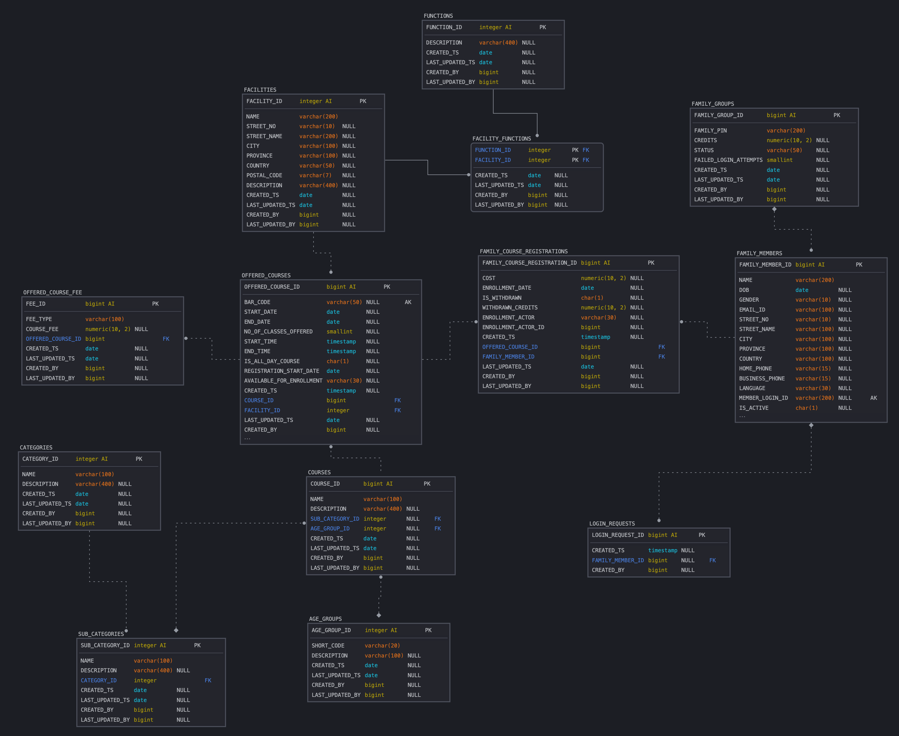

# **ActiveLife Canada**

Cities across Canada manage a variety of recreational facilities, such as community centers, sports complexes, and swimming pools, each offering programs tailored to their unique capabilities and resources. These programs, ranging from swimming and skating to fitness, dance, and cooking & nutrition, are designed to serve diverse age groups, from children and youth to seniors.

The envisioned platform will enable seamless interaction between residents and their city’s recreational services by offering the following enhanced features:

### **Core Features**

1. **City-Based Facilities**:
   - Each city runs multiple facilities, and the programs offered are based on the capabilities of these facilities (e.g., a facility with an ice rink offers skating lessons, while a facility with a kitchen focuses on cooking classes, most of facilities supports multiple activities).
2. **Resident-Centric Search**:
   - Residents can browse/search for programs offered by their city's facilities.
   - Residents can list all the programs offered by categories and sub-categories 
   - Search results will provide detailed program information, including:
     - **Available Spots**: Current availability for immediate registration.
     - **Registration Start Date**: When registration opens for new participants.
     - **Program Start Date**: The first session of the program.
     - **Fees**: Total cost of enrollment.
     - **Facility Location**: Address and directions for the facility hosting the program.
   - Advanced filters will allow searching by age group, skill level, program type, and schedule preferences.
3. **Program Registration and Waitlist Management**:
   - Users can register directly from the search results.
   - If a program is fully booked, users can join a waitlist and receive automatic updates when a spot becomes available.
4. **Resident Login and Family Management**:
   - Residents can log in to create and manage family accounts. 
   - Each family member can be linked to the account, enabling parents or guardians to manage registrations for children or seniors in the household.
5. **Program Dashboard**:
   - Residents will have access to a personalized dashboard showing:
     - Registered programs and schedules.
     - Waitlist status for programs of interest.
     - Payment receipts and outstanding balances.
6. **Real-Time Updates**:
   - Facility managers can update program availability, registration limits, and schedule changes, ensuring residents receive accurate and timely information.

### Future Expansion Feature list
The platform is designed to scale, allowing for:
- Integration with payment gateways for seamless transactions.
- Multi-city support for residents who wish to explore programs in neighboring municipalities.
- Push notifications for upcoming registration dates, session reminders, and special events.

### Benefits
This platform will streamline the connection between residents and their local recreational services, providing a modern and efficient way to engage with programs. It will empower municipalities to manage resources effectively while offering residents a centralized hub for all their recreational needs.

Here is the initial data model for recreational platform to analyze 

