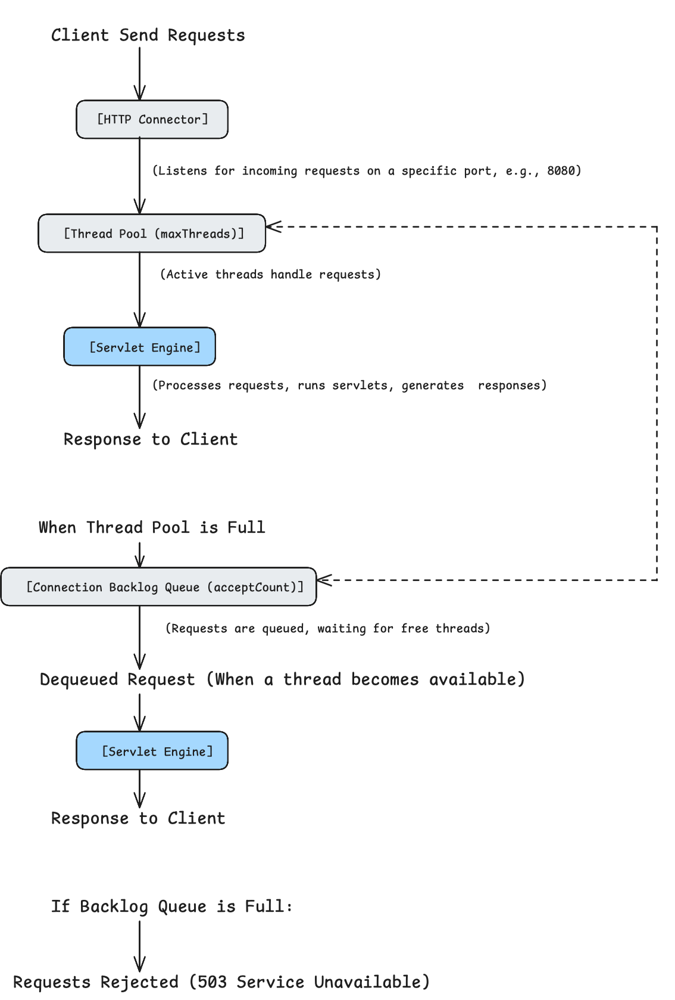
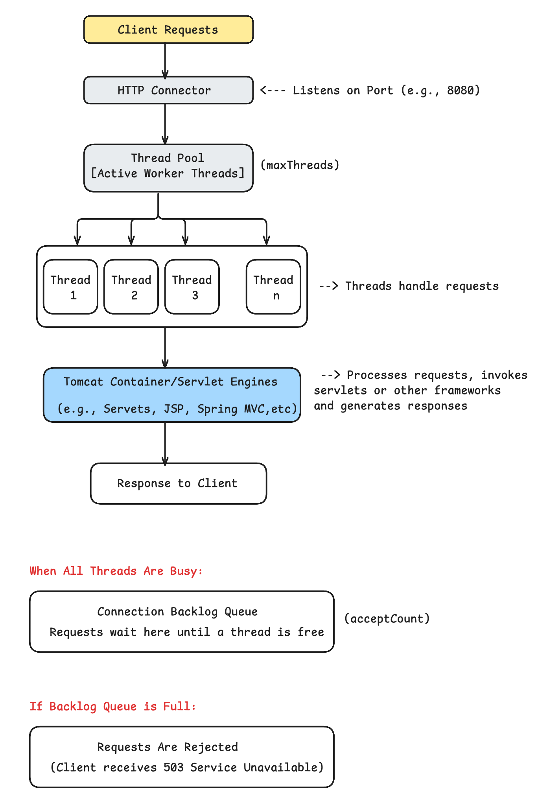
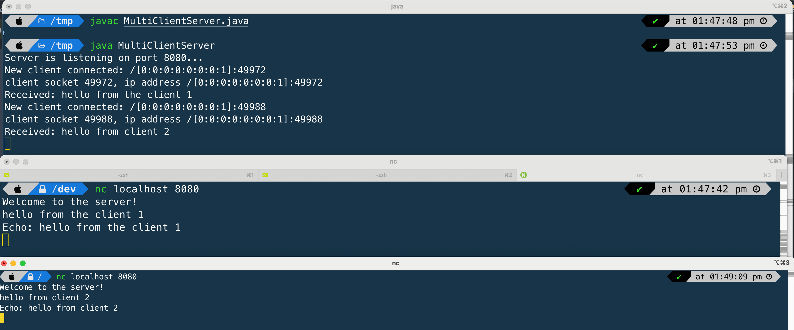

### **Apache Tomcat  Requests Handling**

In Apache Tomcat, multiple requests are handled concurrently using a **thread pool model** to process incoming client requests efficiently.  Tomcat's use of a thread pool to manage multiple concurrent requests ensures efficient resource utilization and high performance. Proper configuration of the thread pool and application code that ensures thread safety are crucial for smooth and scalable operations.

 Here's how it works:

1. **Connector and Thread Pool**

   - Tomcat's **Connector** listens for incoming HTTP requests on a specific port (e.g., 8080).
   - When a request arrives, the Connector delegates the request to a **thread** from a **thread pool** for processing.
   - This thread pool ensures efficient use of system resources, as threads are reused rather than created and destroyed for each request.

2. **Request Processing Flow**

   - **Accept Request**: The Connector accepts the request and queues it.
   - **Thread Assignment**: A thread is assigned from the thread pool to handle the request.
   - **Request Handling**:
     - The thread invokes the appropriate servlet or application component (e.g., JSP, REST API).
     - The request is processed, and the response is generated.
   - **Thread Release**: Once processing is complete, the thread is released back to the pool, ready to handle other requests.

3. **Thread Pool Configuration**

   Tomcat uses the **Executor** thread pool, which can be configured in the `server.xml` file. Key parameters include:

   - **maxThreads**: Maximum number of threads in the pool (default is 200).
   - **minSpareThreads**: Minimum number of threads always kept alive (default is 10).
   - **acceptCount**: Maximum number of requests that can wait in the queue when all threads are busy (default is 100).
   - **keepAliveTimeout**: Time (in milliseconds) to keep an idle connection alive.

   Example configuration:
   ```xml
   <Connector port="8080" protocol="HTTP/1.1" 
              connectionTimeout="20000" 
              redirectPort="8443" 
              maxThreads="300" 
              acceptCount="200" />
   ```

4. **Concurrency and Scalability**

   - **Concurrency**: Tomcat can handle multiple requests concurrently as long as there are free threads in the pool.
   - **Scalability**: If the number of incoming requests exceeds the thread pool capacity, additional requests are queued up to the `acceptCount` limit. Beyond this, requests are rejected.

5. **Thread Safety in Servlets**

   - Since Tomcat uses a thread-per-request model, multiple threads may access the same servlet instance concurrently.
   - Developers must ensure thread safety in servlets by avoiding shared mutable state or using synchronization mechanisms.

6. **Asynchronous Processing**

   Tomcat supports asynchronous request processing to handle long-running tasks without blocking threads:
   - Servlets can start processing a request and then release the thread, completing the task asynchronously.
   - This approach improves resource utilization and handles more requests efficiently.



__________



__________

#### Tomcat connector configuration and how it would handle **500 concurrent requests**:

```xml
<Connector port="8080" protocol="HTTP/1.1" 
           connectionTimeout="20000" 
           redirectPort="8443" 
           maxThreads="300" 
           acceptCount="200" />
```

**1. Initial Thread Pool Usage**

- **maxThreads="300"**: Tomcat can process up to **300 concurrent requests** using threads from the thread pool.
  - Each thread handles one request at a time.
  - As soon as a thread completes processing, it is released back to the pool to handle another request.

**2. Request Queueing**

- **acceptCount="200"**: If all **300 threads** are busy, any additional requests (up to **200**) are queued in the request backlog (queue).
  - These queued requests wait for an available thread to process them.

**3. Requests Beyond Capacity**

- When the number of concurrent requests exceeds **300 (threads) + 200 (acceptCount) = 500**:
  - Any additional requests are **rejected**, and the client will receive an error response (commonly a **503 Service Unavailable**).

#### **Breakdown of Request Handling for 500 Requests**

1. **First 300 requests**:
   - Handled immediately by the available threads in the thread pool.
2. **Next 200 requests**:
   - Queued in the request backlog (acceptCount).
   - These requests are processed as threads become available.
3. **501st and beyond**:
   - Rejected with an error response (e.g., **503 Service Unavailable**).

##### **Detailed Flow**

1. **Request 1–300**: Immediately assigned to available threads and processed concurrently.
2. **Request 301–500**: Placed in the queue (acceptCount).
3. **Request 501+**:
   - Tomcat's Connector reaches its capacity (threads + queue).
   - New requests are rejected, and clients experience a service unavailability error.

##### **Scenarios to Consider**

1. **If requests complete quickly**:
   - Threads finish processing and become available for new requests from the queue.
   - This minimizes the likelihood of request rejection.
2. **If requests are long-running**:
   - Threads remain busy for longer, causing more requests to stay in the queue.
   - This increases the likelihood of reaching capacity and rejecting requests.

##### **Improving Handling Capacity**

To handle more requests concurrently:
1. **Increase `maxThreads`**: Allow more threads to process requests simultaneously (e.g., `maxThreads="500"`).
   - Be mindful of server resources (CPU, memory) since each thread consumes them.
2. **Increase `acceptCount`**: Allow more requests to wait in the queue (e.g., `acceptCount="500"`).
   - This avoids immediate rejection but may increase latency for queued requests.
3. **Optimize application performance**:
   - Reduce request processing time to free threads faster.
4. **Implement asynchronous processing**:
   - Use non-blocking I/O (e.g., Servlets 3.0 async support) to avoid keeping threads tied up for long-running tasks.

In the given configuration, Tomcat handles the **500 concurrent requests** by:

- Serving the first 300 requests with active threads.
- Queuing the next 200 requests.
- Rejecting any requests beyond the 500 total (threads + queue).

_________

#### Under the hood 

When Tomcat handles requests beyond the **`maxThreads`** limit, the `acceptCount` configuration determines how many additional requests can be placed in the **connection backlog queue**. Here's a deeper dive into what happens **under the hood** for requests beyond `maxThreads`:

**1. Accepting a New Request**

- Tomcat uses a **server socket** to listen for incoming connections on a port (e.g., 8080).
- When a client sends a request, the **operating system's TCP/IP stack** initially handles the connection and passes it to Tomcat.
- If an available thread is present in the thread pool, the request is handed off immediately for processing.

**2. What Happens for Requests Beyond `maxThreads`**

When the thread pool is fully occupied (i.e., 300 threads busy):
- Incoming requests cannot be immediately processed by a thread.
- These requests are placed in a **connection backlog queue** (up to the limit specified by `acceptCount`).

**3. Connection Backlog Queue (acceptCount)**

- **Connection Exists**: The connection between the client and the server remains active while the request is in the backlog.
- **Queue Behavior**:
  - The request is held in the queue, waiting for a thread to become available.
  - The client remains connected but may not receive an immediate response.

**4. What Happens Internally**

When **Request 301** arrives:
- **Connection Established**: A TCP connection is established with the client, and the connection is managed by the operating system.

- **Added to Backlog**: Since all threads are busy, Tomcat places the request in the backlog queue.
  - The request is not yet processed but is waiting in the queue for a free thread.

- **Resource Handling**:

  - The connection occupies a **file descriptor** and some memory for managing the TCP connection.

  - The request consumes minimal resources at this stage since it’s not actively processed.

- **Waiting for a Free Thread**:
  - Once a thread becomes available (i.e., a request in the thread pool completes), the next request in the backlog is dequeued and assigned to the available thread.

**5. Requests Beyond the Backlog (Request 501 and Onward)**

- If the backlog queue is full (i.e., 200 requests waiting), the operating system rejects additional connection attempts.
- The client receives a **TCP connection refusal** or a **503 Service Unavailable** error.

**6. Implications of Active Connections for Backlogged Requests**

While in the backlog:
- **Client Connections Are Active**:

  - The client’s socket remains connected but does not receive a response until the request is dequeued and processed.

  - Some clients may timeout or disconnect if the delay exceeds their configured timeout (e.g., 30 seconds).

- **Server Resources**:
  - Active connections consume server resources such as file descriptors and a small amount of memory, but threads are not allocated yet.

- **Potential Bottleneck**:
  - If too many connections are open and waiting, the server could exhaust system resources like file descriptors.

**7. Long-Running Requests and Their Effect**

- If the first 300 threads are tied up for a long time:
  - Requests in the backlog (301–500) will wait indefinitely or until the client times out.
  - New requests beyond the backlog limit are rejected outright.

**Optimization Tips**

1. **Keep Connections Short**:
   - Optimize application logic to reduce request processing time.
   - Use techniques like caching or async processing to free up threads quickly.
2. **Enable HTTP Keep-Alive Wisely**:
   - Keep-Alive connections keep sockets open for multiple requests. While useful, they can occupy sockets for long periods. Ensure proper `keepAliveTimeout` configuration.
3. **Increase `maxThreads` and `acceptCount`**:
   - Scale thread pool and backlog size to match anticipated traffic, but monitor resource usage (CPU, memory, file descriptors).
4. **Monitor Timeouts**:
   - Set reasonable timeouts for requests and backlog queues to avoid indefinite waiting.

**Summary**

For requests 301–500 in your scenario:
- These requests are placed in the **backlog queue**.
- Each request has an **active TCP connection**, occupying resources (e.g., file descriptors).
- If the backlog becomes full, further requests are rejected.
- Requests in the backlog wait until threads are freed, at which point they are processed in a **first-come, first-served** manner.

_________

**Here is  the multi threaded server in Java using java.net API echo back message received**

```java
import java.io.BufferedReader;
import java.io.IOException;
import java.io.InputStreamReader;
import java.io.PrintWriter;
import java.net.ServerSocket;
import java.net.Socket;

public class MultiClientServer {
    public static void main(String[] args) {
        try (ServerSocket serverSocket = new ServerSocket(8080)) {
            System.out.println("Server is listening on port 8080...");

            while (true) {
                Socket clientSocket = serverSocket.accept();

                System.out.println("New client connected: " + clientSocket.getRemoteSocketAddress());

                // Create a new thread for each client
                new Thread(() -> handleClient(clientSocket)).start();
            }
        } catch (IOException e) {
            throw new RuntimeException(e);
        }
    }

    private static void handleClient(Socket clientSocket) {
        try (BufferedReader in = new BufferedReader(new InputStreamReader(clientSocket.getInputStream()));
             PrintWriter out = new PrintWriter(clientSocket.getOutputStream(), true)) {
            out.println("Welcome to the server!");
            System.out.println("client socket "+clientSocket.getPort()+", ip address "+clientSocket.getRemoteSocketAddress());
            String message;
            while ((message = in.readLine()) != null) {
                System.out.println("Received: " + message);
                out.println("Echo: " + message);
            }
        } catch (IOException e) {
            System.out.println("Client disconnected: " + e.getMessage());
        }
    }
}
```

- The server listens on a single port using a `ServerSocket`.

- Each client connection results in a new `Socket` for communication.

- The server can handle multiple clients simultaneously by using threads or other concurrency mechanisms.

- The system keeps track of connections using the `(Client IP, Client Port)` and `(Server IP, Server Port)` pair.

-  Compile the above code and run it using java command , it will listen on the port 8080.

- We can connect to the server using netcat (nc) command line 

```
nc localhost 8080 #nc ip-address-of-the-server port-no
```

See the screenshot below to see the communication between Client (netcat/nc) and Server (MultiClientServer.java)




